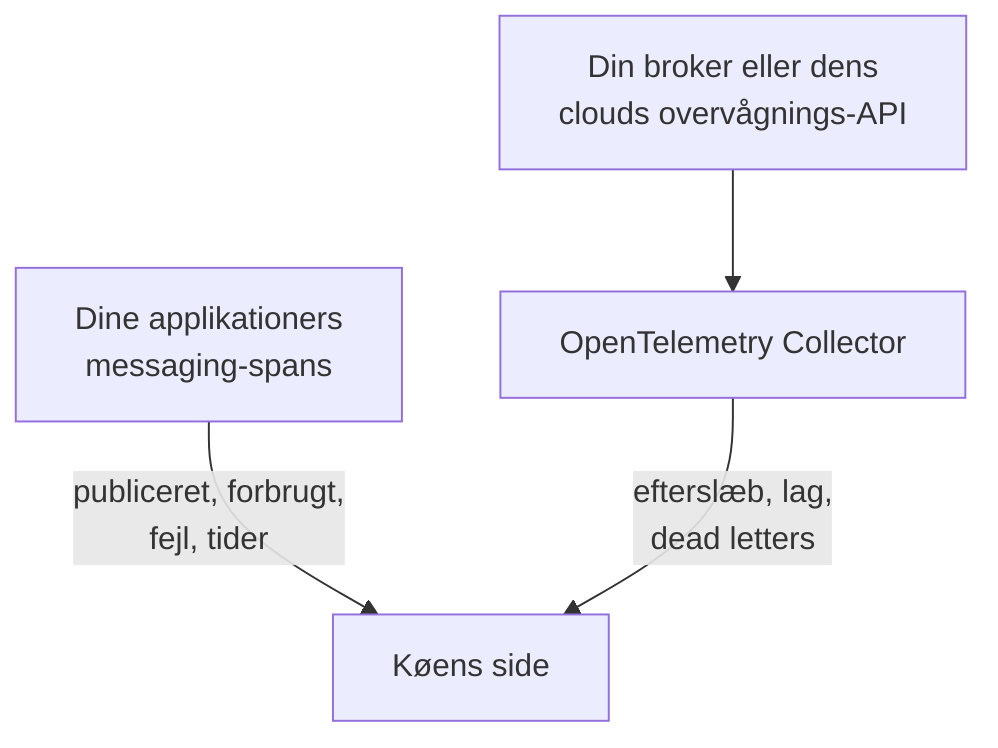

# Køer

**Queues** giver hver beskedkø, hvert topic og hvert abonnement, som dine applikationer bruger, sin egen side: hvilke tjenester der publicerer til den, og hvilke der forbruger fra den, hvor mange beskeder der går igennem, hvor mange der fejler, og hvor lang tid behandlingen tager, dens traces og metrikker og, så snart brokerens egne metrikker når OneUptime, dens efterslæb, consumer-lag, dead letters og begrænsning. Køer har labels, ejere, label- og ejerregler og arkivering, ligesom alle andre ressourcer. Åbn dem under **Produkter → Ressourcer → Køer**.

:::cards
- [Instrumentering af applikationer](#instrumentering-af-applikationer): De messaging-spans, som din OpenTelemetry-instrumentering allerede sender.
- [Brokerens sundhedsmetrikker](#brokerens-sundhedsmetrikker): Efterslæb, lag og dead letters fra din broker, system for system.
- [Advarsler](#advarsler): Færdige skabeloner samt forsinkede eller talte metrikker.
- [Fejlfinding](#fejlfinding): En kø, der ikke blev oprettet, eller en brokersundhed, der forbliver tom.
:::

## Sådan virker det

Det fungerer på samme måde for alle brokere (Apache Kafka, RabbitMQ, Apache ActiveMQ og andre JMS-brokere, Amazon SQS og SNS, Google Cloud Pub/Sub, Azure Service Bus, Event Hubs og Event Grid, Apache Pulsar, Apache RocketMQ, NATS og BullMQ; se [Understøttede beskedsystemer](#understøttede-beskedsystemer)) og for enhver anden broker, som dine spans nævner i `messaging.system`. De fleste køer dukker op af sig selv, fra to kilder:

| Kilde | Hvad den kræver af dig | Hvad den tilføjer til køens side |
| --- | --- | --- |
| **Applikationstraces** | Instrumenterede applikationer (OpenTelemetry); se [Instrumentering af applikationer](#instrumentering-af-applikationer) | Publicerede og forbrugte beskeder, fejl og behandlingstid, tjenesterne på hver side og selve traces |
| **Brokermetrikker** (en OpenTelemetry Collector) | Collector-receiveren eller scrapingen til din broker; se [Brokerens sundhedsmetrikker](#brokerens-sundhedsmetrikker) | **Brokersundhed**: efterslæb, consumer-lag, dead letters, alder på den ældste besked, begrænsning og brokerens egne beskedrater |



Traces fortæller OneUptime, at en kø findes, og hvordan applikationer bruger den, men ikke hvor fuld den er. Det kommer fra selve brokeren eller fra dens cloududbyders overvågnings-API eller, for [BullMQ](#bullmq), der gemmer sine jobs i Redis og ikke har en broker at spørge, fra en gauge, som applikationen rapporterer.

Du kan også tilføje en kø manuelt: **Queues → Opret Queue**, med dens beskedsystem og navnet på dens destination og, for Azure Service Bus og Event Hubs, dens namespace. Formularen spørger om dem i sit første trin, **Beskedsystem**, og derefter om et valgfrit navn og en beskrivelse, med labels under **Flere felter** (**Køoplysninger**). Lad kun namespacet være tomt for en kø, som dine applikationer når via en emulator eller et brugerdefineret domænenavn: deres spans nævner intet namespace, og Azure Monitors metrikker når aldrig en sådan kø (se [Begrænsninger](#begrænsninger)).

## Kom i gang

:::steps
### Send dine applikationers traces

Instrumentér de applikationer, der publicerer og forbruger, og send deres traces til OneUptime (se [Instrumentering af applikationer](#instrumentering-af-applikationer)). Der kræves intet OneUptime-specifikt: de messaging-spans, som din instrumentering allerede laver, nævner køerne.

### Send din brokers metrikker

Find dit beskedsystem under [Brokerens sundhedsmetrikker](#brokerens-sundhedsmetrikker), og kør dets collector-konfiguration med din indtagelsesnøgle. Fanen **Dokumentation** på hver kø har konfigurationen til den kø, klar til at kopiere.

### Åbn køen

Åbn **Produkter → Ressourcer → Køer**. Registreringen kører hvert 10. minut: en kø dukker op, så snart mindst 3 af dens spans er ankommet inden for 15 minutter, eller en brokermetrik har nævnt den.
:::

## Understøttede beskedsystemer

OneUptime kender beskedsystemerne nedenfor ved navn. Det normaliserer det, som instrumenteringer lægger i `messaging.system`, til værdien i anden kolonne (den kendte OpenTelemetry-værdi, hvor der er en) uden hensyn til store og små bogstaver, så `AmazonSQS`, `aws.sqs` og `aws_sqs` er ét system. `nats` og `bullmq` er ikke kendte OpenTelemetry-værdier: `nats` er det, som Java-agentens NATS-instrumentering rapporterer, og `bullmq` er den værdi, du skal angive for BullMQ (se [BullMQ](#bullmq)).

Et system, som OneUptime ikke kender, virker stadig: en velformet værdi (`ibmmq`, `solace`, `mqtt`: små bogstaver, cifre, `.`, `_` og `-`, op til 64 tegn) bevares, som den kom, så den brokers køer registreres og vises under det navn; kun brokerens egne metrikker kræver et system fra denne tabel. `spring_integration` ignoreres: Spring Integrations kanaler er metodekald inden for én proces, ikke en broker.

**Brokermetrikker** angiver, hvor et systems sundhedsmetrikker kommer fra: en collector-contrib-receiver, et Prometheus-endpoint (`:port/path`, scrapet med collectorens `prometheus`-receiver), cloududbyderens overvågnings-API eller et program uden for collectoren, der sender dem via OTLP. Hvert system linker nedenfor til sin opsætning, og fanen **Dokumentation** på hver kø gør det til en konfiguration til den kø.

| System | `messaging.system` | Accepteres også | Brokermetrikker |
| --- | --- | --- | --- |
| [Amazon SNS](#amazon-sns) | `aws.sns` | `aws_sns`, `amazonsns`, `sns` | receiver `aws_cloudwatch` eller `awsfirehose` (cloudovervågning) |
| [Amazon SQS](#amazon-sqs) | `aws_sqs` | `aws.sqs`, `amazonsqs`, `sqs` | receiver `aws_cloudwatch` eller `awsfirehose` (cloudovervågning) |
| [Apache ActiveMQ](#apache-activemq) | `activemq` | `artemis`, `activemq_artemis` | OpenTelemetry JMX Scraper (sender via OTLP) |
| [Apache Kafka](#apache-kafka) | `kafka` | — | receiver `kafka_metrics` |
| [Apache Pulsar](#apache-pulsar) | `pulsar` | `apache_pulsar` | Prometheus (Pulsar-broker), `:8080/metrics/` |
| [Apache RocketMQ](#apache-rocketmq) | `rocketmq` | — | Prometheus (RocketMQ-broker), `:5557/metrics` |
| [Azure Event Grid](#azure-event-grid) | `eventgrid` | `azure_eventgrid`, `azure.eventgrid`, `microsoft.eventgrid` | receiver `azure_monitor` (cloudovervågning) |
| [Azure Event Hubs](#azure-event-hubs) | `eventhubs` | `azure_eventhubs`, `azure.eventhubs`, `microsoft.eventhub` | receiver `azure_monitor` (cloudovervågning) |
| [Azure Service Bus](#azure-service-bus) | `servicebus` | `azure_servicebus`, `azure.servicebus`, `microsoft.servicebus` | receiver `azure_monitor` (cloudovervågning) |
| [BullMQ](#bullmq) | `bullmq` | — | Intet indbygget |
| [Google Cloud Pub/Sub](#google-cloud-pubsub) | `gcp_pubsub` | `gcp.pubsub`, `pubsub`, `google_pubsub` | receiver `googlecloudmonitoring` (cloudovervågning) |
| [JMS](#jms) | `jms` | — | Intet indbygget |
| [NATS](#nats) | `nats` | `jetstream` | Prometheus (prometheus-nats-exporter), `:7777/metrics` |
| [RabbitMQ](#rabbitmq) | `rabbitmq` | — | receiver `rabbitmq` |

En kø er én destination i ét system. For **Azure Service Bus** og **Azure Event Hubs** er dens namespace også en del af den, da to namespaces hver kan indeholde en kø med navnet `orders`. **JMS** og **Apache ActiveMQ** deler deres køer: Java-applikationer når ActiveMQ via JMS-API'et, hvis spans siger `jms`, uanset hvilken broker der står bag, mens brokerens egne metrikker kun kan sige `activemq`, så begge havner på én kø (se [Hvad der gør to observationer til én kø](#hvad-der-gør-to-observationer-til-én-kø)).

## Sådan registreres køer

Hver kø husker, om traces, brokermetrikker eller en person oprettede den. Alt, hvad der senere nævner den samme kø, føjes til den i stedet for at oprette en ny (se [Hvad der gør to observationer til én kø](#hvad-der-gør-to-observationer-til-én-kø)).

### Fra applikationstraces

Hvert 10. minut opsummerer OneUptime de spans, som dine applikationer har sendt inden for de seneste 15 minutter, og som bærer en af nøglerne `messaging.system`, `messaging.destination.name`, `messaging.destination`, `message_bus.destination`, `az.namespace`, `azure.resource_provider.namespace`, `aws.sqs.queue.url`, `aws.queue_url` eller `aws.sns.topic.arn`. Alle spans undtagen et SERVER-span tæller: PRODUCER-, CONSUMER-, CLIENT- og INTERNAL-spans samt spans, som en trace-pipelines **Span Kind-remapper** har givet en anden type (såsom Unspecified) eller ingen; et SERVER-span nævner aldrig en kø.

En brokers egne spans er også SERVER-spans. [Kubernetes-agentens](/docs/telemetry/kubernetes-agent#sådan-ser-ebpf-traces-ud) eBPF-tracer registrerer en Kafka-, MQTT- eller NATS-brokers side af hver udveksling (en besked, den modtager, en besked, den leverer) og sender de fleste af dem som PRODUCER eller CONSUMER; OneUptime gemmer dem som SERVER, så en broker ikke står blandt producenterne eller forbrugerne af de topics, den transporterer. En MQTT-broker, der sender en besked videre til en abonnent, skriver den samme PUBLISH som en klient, og traceren rapporterer begge ens, så for MQTT- og NATS-publiceringer går OneUptime efter porten i den anden ende af forbindelsen: fra port 32768 og op (hvor operativsystemer vælger porten for en klient, der forbinder; Linux' standardinterval starter der; Windows og macOS bruger 49152–65535) er det en abonnents, og spannet er brokerens. En applikation, der publicerer til en MQTT- eller NATS-broker, som selv lytter på en port fra 32768 og op, såsom en Docker-port, der er publiceret tilfældigt, står derfor ikke som producent af sine topics, og et topic, som kun sådanne applikationer bruger, bliver måske slet ikke registreret ud fra tracerens spans. En abonnent, der forbinder til en broker fra en port under 32768 (et indsnævret portinterval eller en port, som en NAT har omskrevet), har stadig brokeren opført som producent af de topics, der leveres til den.

Alle messaging-attributter i OpenTelemetry er stadig markeret som under udvikling, så applikationer i ét projekt rapporterer de samme ting under op til fem generationer af navne. OneUptime læser dem alle, de nyeste først, og fortolker aldrig span-navne, hvis format ændrede sig i de semantiske konventioner 1.27, og som leverandører vælger frit:

- **Systemet**: `messaging.system`, normaliseret som under [Understøttede beskedsystemer](#understøttede-beskedsystemer). Uden den nøgle Azure-SDK'ernes `az.namespace` eller `azure.resource_provider.namespace` (`Microsoft.ServiceBus`, `Microsoft.EventHub`), Azure-SDK'ets ældre nøgle `component`, et AWS-SDK-span (`rpc.system` = `aws-api`), der kalder SQS eller SNS (Java-agentens SNS-spans bærer intet `messaging.system`), eller en nøgle med en SQS-kø-URL eller et SNS-topic-ARN.
- **Destinationen**: den første af nøglerne `messaging.destination.template`, `messaging.destination.name`, `messaging.source.template`, `messaging.source.name`, `messaging.destination` og `message_bus.destination`, som spannet bærer. Et span uden nogen af dem falder tilbage på sit systems egne nøgler: SQS-kø-URL'en (`aws.sqs.queue.url`, `aws.queue_url` eller en kø-URL i `messaging.url`, `server.address` eller `net.peer.name`), SNS-topic-ARN'et (`aws.sns.topic.arn`) og, for RabbitMQ, routing key'en (`messaging.rabbitmq.destination.routing_key` eller `messaging.rabbitmq.routing_key`), som er køens navn, når en besked går gennem standard-exchangen.
- **Retningen**: først `messaging.operation.type`, derefter span-typen (PRODUCER publicerer, CONSUMER forbruger), derefter den ældre `messaging.operation`, derefter `messaging.operation.name` og, for SQS og SNS, AWS-SDK-operationen i `rpc.method` (`SendMessage`, `ReceiveMessage`, …). Typen går forud for de ældre nøgler, fordi nogle instrumenteringer udfyldte dem forkert: confluent-kafka til Python skrev `receive` på sine producer-spans.

En kø **oprettes** ud fra traces, så snart dens spans i det 15-minutters vindue, som en kørsel ser på, tæller mindst 3 (`MESSAGE_QUEUE_MIN_SPANS`), så et engangsscript ikke opretter en, og kun så længe projektet er under sit [budget for automatisk oprettelse](#budgettet-for-automatisk-oprettelse). Spans, der ikke opretter en kø, tæller stadig med for en eksisterende.

Hvert messaging-span mærkes også med sin kø, når det indtages, så køens fane **Spor** viser hvert span, der nævner den, også spans sendt, før køen blev oprettet.

### Fra brokermetrikker

En brokermetrik fra listerne under [Brokerens sundhedsmetrikker](#brokerens-sundhedsmetrikker) nævner sin kø i brokerens egen attribut (Kafkas `topic`, RabbitMQs `rabbitmq.queue.name`, Azure Monitors dimension `EntityName`, CloudWatchs `QueueName`), og OneUptime knytter den til den kø, når den indtages. Brokermetrikker bærer intet `messaging.system`: hver genkendes på sit navn (`kafka.consumer_group.lag_sum`) og, hvor to systemer deler et navn (Azure Monitor navngiver Service Bus' og Event Hubs' metrikker ens), på den ressourcetype, som datapunktet bærer.

Den næste registreringskørsel opretter køen, hvis den ikke findes endnu: én brokermetrik er nok, inden for [budgettet for automatisk oprettelse](#budgettet-for-automatisk-oprettelse). Så en kø, som ingen instrumenteret applikation rører, dukker stadig op, så snart dens broker rapporterer den.

Cloud-overvågnings-API'er (CloudWatch, Azure Monitor og Cloud Monitoring) offentliggør hvert tal minutter efter det tidspunkt, det måler, og det gemmes under det tidspunkt. Derfor læser hver kørsel deres metrikker fra den seneste time i stedet for fra de seneste 15 minutter, som den læser spans og andre metrikker fra: et datapunkt, der ankommer for sent, observerer stadig sin kø eller opretter den.

### Fra messaging-klienters metrikker

Instrumenterede klienter kan også rapportere metrikker: OpenTelemetrys metrikker for messaging-klienter `messaging.client.sent.messages`, `messaging.client.consumed.messages`, `messaging.client.operation.duration` og `messaging.process.duration`, deres ældre navne `messaging.publish.duration`, `messaging.receive.duration`, `messaging.publish.messages`, `messaging.receive.messages`, `messaging.process.messages` og `messaging.client.published.messages` samt Azure SDK til Javas `messaging.servicebus.messages.sent`, `messaging.servicebus.receiver.lag`, `messaging.servicebus.settlement.request.duration` og `messaging.servicebus.settlement.sequence_number`. Hvert datapunkt nævner sit system og sin destination, som et span gør (Azure SDK'ets Service Bus-metrikker nævner intet system, så deres navn træder i stedet), og knyttes til den kø, når det indtages, så det vises på køens fane **Metrikker**. Det samme gælder enhver egen metrik, der bærer `messaging.system` og `messaging.destination.name` på hvert datapunkt (ikke på ressourcen, hvor de ikke læses), såsom en gauge for kødybden (se [BullMQ](#bullmq)).

Messaging-klienters metrikker opretter aldrig en kø: det gør traces, brokermetrikker eller en person. En klientmetrik, der nævner en eksisterende kø, holder dens **Sidst set** opdateret, som dens spans gør. En egen metrik gør ingen af delene: den vises kun på køens fane **Metrikker**.

### Hvad der gør to observationer til én kø

En køs identitet er dens **system** og dens **destination**, sammenlignet uden hensyn til store og små bogstaver: `Orders` og `orders` er én kø, vist under navnet, som det først blev set. For Azure Service Bus og Event Hubs omfatter identiteten også **namespacet**:

- på et span den første DNS-label i den vært, som SDK'et forbandt til, fra `server.address`, `net.peer.name`, `peer.address` eller `network.peer.address` i den rækkefølge, når værten er en namespace-vært: `<namespace>.servicebus.windows.net` eller en suveræn clouds `.servicebus.usgovcloudapi.net`, `.servicebus.chinacloudapi.cn` eller `.servicebus.cloudapi.de`. Event Hubs deler Service Bus' domæne;
- på en Azure Monitor-metrik `name` for det namespace, den rapporterer om.

Intet andet er en del af den, så intet af dette splitter nogensinde en kø: brokerens adresse (Kafka-klienter rapporterer sjældent en, og et Azure-namespace svarer på mange), consumergruppen eller abonnementet (et topics forbrugere er ikke separate køer), partitionen og en dead-letter-underkø. Af disse beholder en kø kun brokerens adresse, til visning.

**JMS og ActiveMQ er én familie.** Hvert JMS-span siger `jms`, uanset hvilken broker der står bag, og brokerens egne metrikker ([OpenTelemetry JMX Scraper](#apache-activemq)) kan kun sige `activemq`, så OneUptime identificerer en ActiveMQ-kø ved dens JMS-familie: spans og brokermetrikker for `orders` havner på én kø. Den vises som JMS, indtil brokerens metrikker ankommer, og som Apache ActiveMQ derefter, aldrig omvendt. En kø, du opretter manuelt som Apache ActiveMQ, er den samme kø.

### Sådan læses destinationsnavne

Instrumenteringer navngiver én kø på mange måder, og OneUptime reducerer det, de rapporterer, til køens eget navn:

| System | Rapporteret som | Kø |
| --- | --- | --- |
| Amazon SQS | `https://sqs.us-east-1.amazonaws.com/123456789012/orders`, en kø-URL (Go's `otelaws` lægger den i `server.address`) | `orders` |
| Amazon SNS | `arn:aws:sns:us-east-1:123456789012:order-events`, et topic-ARN | `order-events` |
| Google Cloud Pub/Sub | `projects/shop/topics/orders`, et ressourcenavn | `orders` |
| Azure Service Bus | `orders/Subscriptions/billing`, enhedsstien for topicets abonnement `billing` | `orders` |
| Azure Service Bus | `orders/$DeadLetterQueue`, enhedsstien for køens dead-letter-underkø | `orders` |
| Azure Event Hubs | `telemetry/ConsumerGroups/$Default/Partitions/3`, en modtagers enhedssti, for consumergruppen `$Default` | `telemetry` |
| Apache Pulsar | `orders-partition-3`, en partition af et topic med kort navn | `persistent://public/default/orders` |
| Apache Pulsar | `acme/shop/orders`, et topic uden sit domæne | `persistent://acme/shop/orders` |
| JMS | `queue://orders`, med sit præfiks for destinationstypen | `orders` |
| RabbitMQ | `shop:new-order:orders`, exchange, routing key og kø på en forbruger (semantiske konventioner 1.30 og senere) | `orders` |
| RabbitMQ | `amq.default`, standard-exchangen, med routing key `orders` | `orders` |
| RabbitMQ | `,orders`, aio-pikas `{exchange},{routing key}` via standard-exchangen | `orders` |
| RabbitMQ | `shop,new-order`, aio-pikas `{exchange},{routing key}` | `shop` |

En Pulsar-partition foldes ind i sit topic, og et navn uden domæne fuldendes, sådan som Pulsar selv fuldender det (et kort navn i namespacet `public/default`), så Java-agentens navne slutter sig til brokernes fuldt kvalificerede metriklabels. Et RabbitMQ-span nævner som regel den exchange, en besked gik igennem, både på den publicerende og den forbrugende side; standard-exchangen (`amq.default`, `<default>` eller et tomt navn) står for sin routing key, som er køens navn. De semantiske konventioner 1.30 sætter exchange, routing key og kø sammen med `:` (Java-agentens opt-in-navne), og OneUptime tager køen fra en forbrugers sammensatte navn og exchangen fra en publishers. aio-pika sætter exchange og routing key sammen med et komma på den publicerende side, og OneUptime deler det på samme måde.

### Hvad der ignoreres

OneUptime fejler hellere i retning af ingen kø: et navn, der opfindes pr. anmodning eller pr. forbruger, ville ellers oprette en kø, som ingen ejer, for hver besked. Disse bliver aldrig til køer:

- **SERVER-spans** og spans, hvis `messaging.system` er `spring_integration`.
- **Destinationer markeret som midlertidige eller anonyme**: `messaging.destination.temporary`, `messaging.destination.anonymous`, `messaging.source.temporary` eller `messaging.source.anonymous` sat til `true`. Den ældre `messaging.temp_destination` er ikke til at stole på: Pythons pika- og aio-pika-instrumenteringer sætter den ved hver publicering.
- **Pladsholdere, som instrumenteringer rapporterer i stedet for et navn**: `(temporary)`, `(anonymous)`, `<generated>`, `unknown` (en Kafka-batch på tværs af flere topics), `aws:sqs` (Java-agentens Lambda-SQS-hændelser), Azure Monitors `-NamespaceOnlyMetric-` og en værdi, som OneUptimes egen datarensning har erstattet helt (`[REDACTED]`).
- **Genererede destinationer og svardestinationer**: RabbitMQs servernavngivne køer i stil med `amq.gen-JzTY20BRgKO-HjmUJj0wLg`, Springs køer `spring.gen-…` og Spring Cloud Streams køer `<destination>.anonymous.<id>` for forbrugere uden gruppe samt direct reply-to (`amq.rabbitmq.reply-to…`); midlertidige JMS-destinationer (`temp-queue://…`, `temp-topic://…`) og TIBCOs `$TMP$…`; ActiveMQs advisory-topics (`ActiveMQ.Advisory.…`); NATS-indbakker (`_INBOX.…`) og JetStreams bekræftelsessubjects (`$JS.ACK.…`); Pulsars systemtopics (`__change_events`, `__transaction_…` og alt under et `/__`-segment); og en destination, der ikke er andet end et UUID.
- **SNS-tekstbeskeder og mobil push**: et telefonnummer (`+15555550123` eller `phone_number:**` fra botocore) eller et platform-endpoint-ARN (`arn:aws:sns:us-east-1:123456789012:endpoint/GCM/shop-app/1234`) er en enhed, ikke et topic.
- **Navne, der ikke kan være én kø**: en liste over destinationer fra en batch (`["orders","payments"]`), et navn med et kontroltegn og et navn på mere end 255 tegn.

**UUID'er gøres til skabeloner.** Hvert UUID i en destination erstattes med `{uuid}`, så navne pr. anmodning såsom `reply-7f1c2a9e-4b1d-4c3e-9f1a-2b3c4d5e6f70` bliver én kø, `reply-{uuid}`, i stedet for én kø hver.

### Budgettet for automatisk oprettelse

Traces og brokermetrikker opretter kun selv køer, så længe projektet har færre end 500 aktive, ikke-arkiverede registrerede køer (`MESSAGE_QUEUE_AUTO_CREATE_BUDGET`, se [Justering ved selvhosting](#justering-til-selvhosting)). Køer, du opretter manuelt, tæller aldrig med og blokeres aldrig; arkiverede køer tæller ikke med, så [automatisk arkivering](#livscyklus-og-arkivering) frigør budget; og køer, der allerede findes, bliver ved med at blive matchet og opdateret.

### Livscyklus og arkivering

- **Sidst set** er det tidspunkt, hvor registreringen sidst så køen, i traces, messaging-klienters metrikker eller brokermetrikker.
- **Arkivér for at afvise.** At slette en registreret kø fjerner den kun, indtil den ses igen: dens næste observation bringer den tilbage som en ny kø. For at afvise en for altid skal du **arkivere** den. En arkiveret kø beholder sin identitet, så alt, hvad der nævner den, forbliver knyttet til den arkiverede kø i stedet for at oprette en ny.
- **Automatisk arkivering.** En registreret kø, der ikke er set i 7 dage (`MESSAGE_QUEUE_AUTO_ARCHIVE_DAYS`), arkiveres automatisk, medmindre en person har omdøbt den, beskrevet den, givet den labels eller givet den ejere. Labels og ejere, som label- eller ejerregler har tilføjet af sig selv, tæller ikke med.
- **Gendannelse.** En automatisk arkiveret kø gendannes automatisk, når den ses igen. Køer, du har oprettet manuelt, og køer, som en person har arkiveret, bliver aldrig arkiveret eller gendannet af registreringen. En kø, som en person gendanner, forbliver gendannet i 30 dage (eller arkivvinduet, hvis det er længere), selv hvis intet ser den; fra dens næste observation gælder 7-dagesreglen igen.

## Instrumentering af applikationer

Køer kommer fra de messaging-spans, som din OpenTelemetry-instrumentering allerede laver; der kræves intet OneUptime-specifikt. Send dine traces til OneUptime som beskrevet under [OpenTelemetry](/docs/telemetry/open-telemetry), og tjek derefter listen for dit sprog.

:::tabs
@tab Java
OpenTelemetrys Java-agent tracer Kafka-, RabbitMQ-, JMS- (ActiveMQ, Artemis, IBM MQ og alle andre JMS-brokere), Amazon SQS- og SNS-, Pulsar-, RocketMQ- og NATS-klienter uden kodeændringer. OneUptime læser både de attributnavne, den udsender som standard, og de nyere, den udsender med `OTEL_SEMCONV_STABILITY_OPT_IN=messaging` (agent 2.31.0 og senere). JMS-spans siger `jms`, uanset hvilken broker der står bag dem (se [JMS](#jms)).

- **Azure Service Bus og Event Hubs**: Azure SDK til Java tracer sig selv, og Java-agenten forbinder den tracing med OpenTelemetry.
- **Google Cloud Pub/Sub**: klienten tracer sig selv, så snart dens builders `Publisher` og `Subscriber` får en OpenTelemetry-instans og tracing-kontakten: `setOpenTelemetry(GlobalOpenTelemetry.get())` og `setEnableOpenTelemetryTracing(true)`. Et af kaldene alene tracer intet.
@tab .NET
- **Azure Service Bus og Event Hubs** (`Azure.Messaging.ServiceBus`, `Azure.Messaging.EventHubs`): deres OpenTelemetry-spans er eksperimentelle i Azure SDK. Slå dem til med miljøvariablen `AZURE_EXPERIMENTAL_ENABLE_ACTIVITY_SOURCE=true` (eller kontakten `Azure.Experimental.EnableActivitySource` nedenfor), og abonnér på kilderne `Azure.*`.
- **RabbitMQ.Client** 7 tracer sig selv: abonnér på `RabbitMQ.Client.*`.
- **MassTransit** tracer sig selv: abonnér på `MassTransit` (se [Begrænsninger](#begrænsninger) for, hvad dens spans udelader).
- **Confluent.Kafka**: pakken `OpenTelemetry.Instrumentation.ConfluentKafka`.
- **Amazon SQS og SNS**: pakken `OpenTelemetry.Instrumentation.AWS` med `.AddAWSInstrumentation(opt => opt.SemanticConventionVersion = SemanticConventionVersion.Latest)`. Dens standardsæt af attributter (`V1_28_0`) nævner kun en SQS-kø ved dens URL (`aws.queue_url`, som OneUptime læser) og et SNS-topic slet ikke.

```csharp
// Before any Azure client is created; or set AZURE_EXPERIMENTAL_ENABLE_ACTIVITY_SOURCE=true.
AppContext.SetSwitch("Azure.Experimental.EnableActivitySource", true);

builder.Services.AddOpenTelemetry()
    .WithTracing(tracing => tracing
        .AddSource("Azure.*")
        .AddSource("RabbitMQ.Client.*")
        .AddSource("MassTransit")
        .AddOtlpExporter());
```
@tab Node.js
- `@opentelemetry/auto-instrumentations-node` tracer `amqplib` (RabbitMQ), `kafkajs` og AWS SDK (SQS og SNS).
- **Azure Service Bus og Event Hubs**: registrér `createAzureSdkInstrumentation()` fra `@azure/opentelemetry-instrumentation-azure-sdk`.
- **Google Cloud Pub/Sub**: `new PubSub({ enableOpenTelemetryTracing: true })`.
- **BullMQ**: se [BullMQ](#bullmq); dens egen telemetri skal have tilføjet to attributter.
@tab Python
- Kafka: `opentelemetry-instrumentation-kafka-python`, `opentelemetry-instrumentation-confluent-kafka` eller `opentelemetry-instrumentation-aiokafka`. RabbitMQ: `opentelemetry-instrumentation-pika` eller `opentelemetry-instrumentation-aio-pika`. SQS og SNS: `opentelemetry-instrumentation-botocore` eller `opentelemetry-instrumentation-boto3sqs` til SQS. `opentelemetry-bootstrap -a install` vælger dem, som dine installerede biblioteker har brug for.
- **Azure Service Bus og Event Hubs**: installér `azure-core-tracing-opentelemetry`, og sæt `settings.tracing_implementation = "opentelemetry"` (fra `azure.core.settings`).
- **Google Cloud Pub/Sub**: `PublisherOptions(enable_open_telemetry_tracing=True)` og `SubscriberOptions(enable_open_telemetry_tracing=True)`.
- Celerys spans bærer intet `messaging.system` og nævner ingen broker, så de opretter ikke køer.
@tab Go
- **Amazon SQS og SNS**: `otelaws` (`go.opentelemetry.io/contrib/instrumentation/github.com/aws/aws-sdk-go-v2/otelaws`), tilføjet med `otelaws.AppendMiddlewares(&cfg.APIOptions)`. Dens SQS-spans bærer kø-URL'en i `server.address`, som OneUptime læser som køen.
- **Google Cloud Pub/Sub**: `pubsub.ClientConfig{EnableOpenTelemetryTracing: true}`.
- **Kafka** med `segmentio/kafka-go`: OpenTelemetrys automatiske instrumentering til Go (`go.opentelemetry.io/auto`, eBPF, på Linux) tracer dens producenter og forbrugere uden kodeændringer.
- OpenTelemetrys Go-contrib-biblioteker har ingen instrumentering til Kafka, RabbitMQ eller NATS. Brug til andre klienter klientbibliotekets egen OpenTelemetry-understøttelse, eller sæt `messaging.system`, `messaging.destination.name` og span-typen på de spans, der omgiver dine afsendelser og handlers.
:::

## Brokerens sundhedsmetrikker

En broker ved, hvad ingen applikation kan se: hvor mange beskeder der venter, hvor langt hver consumergruppe er bagud, hvad der endte i en dead-letter-kø. Hver sektion nedenfor har collector-konfigurationen til ét system: en komplet OpenTelemetry Collector-konfiguration, der slutter med den OTLP-exporter, der sender til OneUptime. Sæt en telemetri-indtagelsesnøgle (**Projektindstillinger → Telemetri og APM → Indtagelsesnøgler**) i `x-oneuptime-token`, erstat `https://oneuptime.com` med din egen vært, hvis du selvhoster, og kør den med `otel/opentelemetry-collector-contrib` 0.161.0 eller senere (hver konfiguration her er valideret mod 0.161.0). Nyere collectorer logger, at `otlphttp` er forældet til fordel for `otlp_http`; begge navne er den samme exporter. Flet deres receivere sammen i én collector for at indsamle flere systemer.

Hver køs sektion **Brokersundhed** viser de metrikker, der er angivet for dens system (en gauge som dens værdi, et antal pr. periode summeret pr. interval, en tæller som rate pr. sekund), og kombinerer en køs serier, som hver metrik kræver (en RabbitMQ-køs klare og ubekræftede beskeder lægges sammen; den consumergruppe, der er længst bagud, er lag'et). Alt, hvad collectoren sender, findes også i stifinderen **Metrikker**. Så længe ingen angivet metrik er ankommet for en kø, viser sektionen, hvor det systems metrikker kommer fra, med et link til dets sektion her.

### Amazon SNS

Læs topicsenes CloudWatch-metrikker med collectorens `aws_cloudwatch`-receiver, eller stream dem gennem en CloudWatch Metric Stream og Amazon Data Firehose til dens `awsfirehose`-receiver.

`aws_cloudwatch`-receiveren forespørger CloudWatchs API `GetMetricData`, ét namespace pr. receiver, så SNS får sin egen instans ved siden af [Amazon SQS](#amazon-sqs)'s. Den bruger AWS SDK'ets standardlegitimationsoplysninger (miljø, delt profil eller instansrolle), som kræver `cloudwatch:ListMetrics` og `cloudwatch:GetMetricData`:

```yaml
receivers:
  aws_cloudwatch/sns:
    region: us-east-1
    metrics:
      collection_interval: 5m
      period: 1m
      delay: 10m
      discovery:
        filters:
          namespace: AWS/SNS
        limit: 500

processors:
  batch: {}

exporters:
  otlphttp:
    endpoint: https://oneuptime.com/otlp
    headers:
      x-oneuptime-token: YOUR_TELEMETRY_INGESTION_TOKEN

service:
  pipelines:
    metrics:
      receivers: [aws_cloudwatch/sns]
      processors: [batch]
      exporters: [otlphttp]
```

Lad `stats` være uangivet, som under [Amazon SQS](#amazon-sqs). En Metric Stream bærer SNS og SQS sammen: tilføj `AWS/SNS` til streamens namespaces i opsætningen af [Amazon SQS](#amazon-sqs).

Et topic navngives ens fra begge sider: spans rapporterer dets ARN eller dets navn, og OneUptime beholder navnet efter ARN'ets sidste `:`.

| Metrik | Vises som | Type |
| --- | --- | --- |
| `amazonaws.com/aws/sns/numberofmessagespublished` (JSON-stream: `numberofmessagespublished`) | Messages published | Antal pr. periode |
| `amazonaws.com/aws/sns/numberofnotificationsdelivered` (JSON-stream: `numberofnotificationsdelivered`) | Notifications delivered | Antal pr. periode |
| `amazonaws.com/aws/sns/numberofnotificationsfailed` (JSON-stream: `numberofnotificationsfailed`) | Notifications failed | Antal pr. periode |
| `amazonaws.com/aws/sns/numberofnotificationsredriventodlq` (JSON-stream: `numberofnotificationsredriventodlq`) | Redriven to dead-letter queue | Antal pr. periode |

### Amazon SQS

Læs køernes CloudWatch-metrikker med collectorens `aws_cloudwatch`-receiver, eller stream dem gennem en CloudWatch Metric Stream og Amazon Data Firehose til dens `awsfirehose`-receiver.

**Forespørgsel til CloudWatch** kræver intet på AWS-siden ud over legitimationsoplysninger. Receiveren bruger AWS SDK'ets standardlegitimationsoplysninger (miljø, delt profil eller instansrolle), som kræver `cloudwatch:ListMetrics` og `cloudwatch:GetMetricData`:

```yaml
receivers:
  aws_cloudwatch/sqs:
    region: us-east-1
    metrics:
      collection_interval: 5m
      period: 1m
      delay: 10m
      discovery:
        filters:
          namespace: AWS/SQS
        # Metrics per scrape: about nine per queue. Must be set.
        limit: 500

processors:
  batch: {}

exporters:
  otlphttp:
    endpoint: https://oneuptime.com/otlp
    headers:
      x-oneuptime-token: YOUR_TELEMETRY_INGESTION_TOKEN

service:
  pipelines:
    metrics:
      receivers: [aws_cloudwatch/sqs]
      processors: [batch]
      exporters: [otlphttp]
```

- **Lad `stats` være uangivet.** Uden den kommer hver metrik som ét resumé pr. periode, og det er det, OneUptime læser; med den bliver hver statistik sin egen serie, og diagrammerne blander dem.
- `discovery.limit` skal være angivet og begrænser de metrikker, der læses pr. scrape: omkring ni pr. kø. Hver koster fire underforespørgsler til `GetMetricData` pr. scrape, som AWS fakturerer.
- `delay` venter på, at CloudWatch offentliggør en periode (det tager et par minutter), så med denne konfiguration ankommer en køs brokermetrikker 11 til 17 minutter forsinket: en monitor over dem skal have et længere vindue (se **Forsinkede metrikker** under [Advarsler](#advarsler)).
- Én receiver læser én region og ét namespace: tilføj en instans pr. region.

**Streaming** sender metrikkerne, efterhånden som CloudWatch offentliggør dem. Opret en CloudWatch Metric Stream for namespacene `AWS/SQS` (og `AWS/SNS`) med outputformatet **OpenTelemetry 1.0**, der leverer til en Amazon Data Firehose-stream, hvis destination er et HTTP-endpoint: din collector med en adgangsnøgle. Firehose leverer kun til `https://` på port 443, så collectoren skal have et certifikat og en offentlig port 443 (for eksempel bag en load balancer):

```yaml
extensions:
  awscloudwatchmetricstreams_encoding:
    format: opentelemetry1.0

receivers:
  awsfirehose:
    # Firehose delivers to HTTPS on port 443 only: expose this port as 443,
    # for example behind a load balancer.
    endpoint: 0.0.0.0:4433
    encoding: awscloudwatchmetricstreams_encoding
    access_key: ${env:FIREHOSE_ACCESS_KEY}
    tls:
      cert_file: /etc/otelcol/tls/server.crt
      key_file: /etc/otelcol/tls/server.key

processors:
  batch: {}

exporters:
  otlphttp:
    endpoint: https://oneuptime.com/otlp
    headers:
      x-oneuptime-token: YOUR_TELEMETRY_INGESTION_TOKEN

service:
  extensions: [awscloudwatchmetricstreams_encoding]
  pipelines:
    metrics:
      receivers: [awsfirehose]
      processors: [batch]
      exporters: [otlphttp]
```

En stream i outputformatet **JSON** (`format: json`) virker også: den sender hver metrik under dens rå navn, og OneUptime skelner SQS' fra SNS' på den `service.name`, som streamen sætter (`SQS`, `SNS`).

En dead-letter-kø er en almindelig SQS-kø med egne metrikker, så den er en kø for sig i OneUptime. Køer navngives kun ved deres navn, ikke ved deres konto eller region (se [Begrænsninger](#begrænsninger)).

| Metrik | Vises som | Type |
| --- | --- | --- |
| `amazonaws.com/aws/sqs/approximatenumberofmessagesvisible` (JSON-stream: `approximatenumberofmessagesvisible`) | Messages visible | Gauge |
| `amazonaws.com/aws/sqs/approximateageofoldestmessage` (JSON-stream: `approximateageofoldestmessage`) | Oldest message age | Gauge |
| `amazonaws.com/aws/sqs/approximatenumberofmessagesnotvisible` (JSON-stream: `approximatenumberofmessagesnotvisible`) | Messages in flight | Gauge |
| `amazonaws.com/aws/sqs/numberofmessagessent` (JSON-stream: `numberofmessagessent`) | Messages sent | Antal pr. periode |
| `amazonaws.com/aws/sqs/numberofmessagesreceived` (JSON-stream: `numberofmessagesreceived`) | Messages received | Antal pr. periode |
| `amazonaws.com/aws/sqs/numberofmessagesdeleted` (JSON-stream: `numberofmessagesdeleted`) | Messages deleted | Antal pr. periode |

### Apache ActiveMQ

Collectoren har ingen JMX-receiver, så kør OpenTelemetry JMX Scraper med `OTEL_JMX_TARGET_SYSTEM=activemq` ved siden af en ActiveMQ Classic-broker; den sender brokerens destinationsmetrikker via OTLP.

1. Lad brokeren tage imod JMX-forbindelser. Med imaget `apache/activemq-classic` eller scriptet `bin/activemq` skal du sætte `ACTIVEMQ_SUNJMX_START`, før du starter den. Dette eksempel slår godkendelse fra: hold porten på et privat netværk, eller slå `jmxremote.authenticate` til med en adgangskodefil, og giv scraperen `OTEL_JMX_USERNAME` og `OTEL_JMX_PASSWORD`.

```bash
ACTIVEMQ_SUNJMX_START="-Dcom.sun.management.jmxremote.port=1099 -Dcom.sun.management.jmxremote.rmi.port=1099 -Dcom.sun.management.jmxremote.authenticate=false -Dcom.sun.management.jmxremote.ssl=false -Djava.rmi.server.hostname=activemq"
```

2. Kør scraperen, hvor den kan nå den port, med en Java-runtime. Den sender direkte til OneUptime; for i stedet at sende den gennem din egen collector skal du pege `OTEL_EXPORTER_OTLP_ENDPOINT` mod collectorens OTLP-receiver.

```bash
curl -fsSLo opentelemetry-jmx-scraper.jar https://github.com/open-telemetry/opentelemetry-java-contrib/releases/latest/download/opentelemetry-jmx-scraper.jar

export OTEL_JMX_SERVICE_URL=service:jmx:rmi:///jndi/rmi://activemq:1099/jmxrmi
export OTEL_JMX_TARGET_SYSTEM=activemq
export OTEL_JMX_TARGET_SOURCE=instrumentation
export OTEL_METRIC_EXPORT_INTERVAL=30000
export OTEL_SERVICE_NAME=activemq-prod
export OTEL_EXPORTER_OTLP_PROTOCOL=http/protobuf
export OTEL_EXPORTER_OTLP_ENDPOINT=https://oneuptime.com/otlp
export OTEL_EXPORTER_OTLP_HEADERS=x-oneuptime-token=YOUR_TELEMETRY_INGESTION_TOKEN
java -jar opentelemetry-jmx-scraper.jar
```

`OTEL_JMX_TARGET_SOURCE=instrumentation` beholder de metriknavne, som scraperen har brugt siden 1.53.0-alpha (`activemq.message.queue.size`, med destinationen i `messaging.destination.name`). OneUptime læser også ældre scraperes navne og navnene fra `OTEL_JMX_TARGET_SOURCE=legacy` (`activemq.message.current`, med destinationen i `destination`).

Brokerens metrikker slutter sig til den kø, som dens JMS-klienters spans har oprettet, og derefter vises køen som Apache ActiveMQ (se [Hvad der gør to observationer til én kø](#hvad-der-gør-to-observationer-til-én-kø)). Scraperen rapporterer hver destination: OneUptime ignorerer advisory-topics, mens dead-letter-køer (`ActiveMQ.DLQ` eller `DLQ.<destination>` med en individuel dead-letter-strategi) er køer for sig. ActiveMQ Artemis har andre MBeans, som disse regler ikke læser: Artemis-køer kommer stadig fra deres JMS-spans, uden brokersundhed.

| Metrik | Vises som | Type |
| --- | --- | --- |
| `activemq.message.queue.size` | Queue size | Gauge |
| `activemq.message.current` | Queue size (legacy names) | Gauge |
| `activemq.message.enqueued` | Enqueued | Tæller, vist pr. sekund |
| `activemq.message.dequeued` | Dequeued | Tæller, vist pr. sekund |
| `activemq.message.expired` | Expired | Tæller, vist pr. sekund |
| `activemq.consumer.count` | Consumers | Gauge |
| `activemq.message.enqueue.average_duration` | Average time in queue | Gauge |
| `activemq.message.wait_time.avg` | Average time in queue (legacy names) | Gauge |

### Apache Kafka

Collectorens `kafka_metrics`-receiver læser consumergruppers lag og partitioners offsets fra brokerne; aktivér dens scrapers `topics` og `consumers`.

```yaml
receivers:
  kafka_metrics:
    brokers: ["kafka-1:9092", "kafka-2:9092"]
    # topics: each partition's log-end offset; consumers: each group's
    # committed offsets and lag. brokers: the broker count.
    scrapers: [brokers, topics, consumers]
    collection_interval: 30s
    # auth:
    #   sasl:
    #     mechanism: SCRAM-SHA-512
    #     username: ${env:KAFKA_USERNAME}
    #     password: ${env:KAFKA_PASSWORD}
    # tls:
    #   ca_file: /etc/kafka/ca.pem

processors:
  batch: {}

exporters:
  otlphttp:
    endpoint: https://oneuptime.com/otlp
    headers:
      x-oneuptime-token: YOUR_TELEMETRY_INGESTION_TOKEN

service:
  pipelines:
    metrics:
      receivers: [kafka_metrics]
      processors: [batch]
      exporters: [otlphttp]
```

For en klynge med SASL eller TLS skal du fjerne kommentaren fra `auth` og `tls`. Receiveren navngiver hvert topic i `topic`, og det er sådan, metrikkerne finder topicets kø. Den rapporterer kun en consumergruppes lag og committede offsets på topics, som gruppen har committet et offset til, og springer topics over, hvis navne starter med `_`, Kafkas interne (`topic_match` er som standard `^[^_].*$`).

| Metrik | Vises som | Type |
| --- | --- | --- |
| `kafka.consumer_group.lag_sum` | Consumer lag | Gauge |
| `kafka.consumer_group.lag` | Partition lag | Gauge |
| `kafka.consumer_group.offset_sum` | Consumed | Tæller, vist pr. sekund |
| `kafka.partition.current_offset` | Produced | Tæller, vist pr. sekund |

### Apache Pulsar

Hver broker udstiller sine topic- og abonnementsmetrikker på sin webservices port; scrape hver broker, for en broker rapporterer kun de topics, den ejer i øjeblikket.

```yaml
receivers:
  prometheus:
    config:
      scrape_configs:
        - job_name: pulsar-broker
          scrape_interval: 30s
          metrics_path: /metrics/
          # Every broker: each one reports only the topics it owns.
          static_configs:
            - targets: ["pulsar-broker-0:8080", "pulsar-broker-1:8080"]
          # Keeps the families the queue page charts; remove it to keep all.
          metric_relabel_configs:
            - source_labels: [__name__]
              regex: "pulsar_(msg_backlog|subscription_back_log|storage_backlog_age_seconds|in_messages_total|out_messages_total)"
              action: keep

processors:
  batch: {}

exporters:
  otlphttp:
    endpoint: https://oneuptime.com/otlp
    headers:
      x-oneuptime-token: YOUR_TELEMETRY_INGESTION_TOKEN

service:
  pipelines:
    metrics:
      receivers: [prometheus]
      processors: [batch]
      exporters: [otlphttp]
```

- Topic- og abonnementsserier kræver `exposeTopicLevelMetricsInPrometheus=true` i `broker.conf`, hvilket er standarden.
- Pulsar mærker hver serie med topicets fulde navn (`persistent://public/default/orders`), og en partitions serier med partitionens (`persistent://public/default/orders-partition-3`): partitioner lægges sammen i deres topic.
- Efterslæbet tælles i poster, og Pulsar tæller en batch af beskeder som én post.
- Pulsar gentager `pulsar_out_messages_total` pr. forbruger, når `exposeConsumerLevelMetricsInPrometheus=true`; de serier pr. forbruger holdes uden for diagrammerne, så ingen besked tælles to gange.
- `pulsar_storage_backlog_age_seconds` viser `-1`, så længe brokeren ikke kan afgøre det.
- De native OpenTelemetry-metrikker i Pulsar 3.3 og senere (eksperimentelle, som standard slået fra) bruger andre navne, som ikke vises i diagrammer.

| Metrik | Vises som | Type |
| --- | --- | --- |
| `pulsar_msg_backlog` | Backlog | Gauge |
| `pulsar_subscription_back_log` | Subscription backlog | Gauge |
| `pulsar_storage_backlog_age_seconds` | Backlog age | Gauge |
| `pulsar_in_messages_total` | Messages in | Tæller, vist pr. sekund |
| `pulsar_out_messages_total` | Messages out | Tæller, vist pr. sekund |

### Apache RocketMQ

Sæt `metricsExporterType=PROM` i brokerens `broker.conf`, så brokeren udstiller sine lag- og gennemløbsmetrikker.

```text
metricsExporterType=PROM
metricsPromExporterPort=5557
metricsPromExporterHost=0.0.0.0
```

Scrape derefter hver broker:

```yaml
receivers:
  prometheus:
    config:
      scrape_configs:
        - job_name: rocketmq-broker
          scrape_interval: 30s
          metrics_path: /metrics
          static_configs:
            - targets: ["rocketmq-broker-a:5557", "rocketmq-broker-b:5557"]

processors:
  batch: {}

exporters:
  otlphttp:
    endpoint: https://oneuptime.com/otlp
    headers:
      x-oneuptime-token: YOUR_TELEMETRY_INGESTION_TOKEN

service:
  pipelines:
    metrics:
      receivers: [prometheus]
      processors: [batch]
      exporters: [otlphttp]
```

Dette er RocketMQ 5's indbyggede exporter. RocketMQ 4 har ingen; den separate `rocketmq-exporter`, som den bruger, rapporterer andre metriknavne, som ikke vises i diagrammer. En consumergruppes dead-letter-topic (`%DLQ%<group>`) er en kø for sig.

| Metrik | Vises som | Type |
| --- | --- | --- |
| `rocketmq_consumer_lag_messages` | Consumer lag | Gauge |
| `rocketmq_consumer_ready_messages` | Ready messages | Gauge |
| `rocketmq_send_to_dlq_messages_total` | Sent to dead-letter queue | Tæller, vist pr. sekund |
| `rocketmq_messages_in_total` | Messages in | Tæller, vist pr. sekund |

### Azure Event Grid

Azure Monitor har topicsenes leverings- og dead-letter-metrikker, som collectorens `azure_monitor`-receiver læser; de vises endnu ikke på en køside, så udforsk dem under Metrikker.

Receiveren logger på via udvidelsen `azure_auth`. Giv tjenesteprincipalen rollen **Monitoring Reader** på abonnementet:

```yaml
extensions:
  azure_auth:
    service_principal:
      tenant_id: ${env:AZURE_TENANT_ID}
      client_id: ${env:AZURE_CLIENT_ID}
      client_secret: ${env:AZURE_CLIENT_SECRET}

receivers:
  azure_monitor/eventgrid:
    subscription_ids: ["${env:AZURE_SUBSCRIPTION_ID}"]
    auth:
      authenticator: azure_auth
    collection_interval: 60s
    services:
      - Microsoft.EventGrid/topics
      - Microsoft.EventGrid/systemTopics
      - Microsoft.EventGrid/domains
    maximum_number_of_records_per_resource: 1000

processors:
  batch: {}

exporters:
  otlphttp:
    endpoint: https://oneuptime.com/otlp
    headers:
      x-oneuptime-token: YOUR_TELEMETRY_INGESTION_TOKEN

service:
  extensions: [azure_auth]
  pipelines:
    metrics:
      receivers: [azure_monitor/eventgrid]
      processors: [batch]
      exporters: [otlphttp]
```

OneUptime viser ikke Event Grids metrikker på en køs side: Azure Monitor rapporterer dem pr. Event Grid-ressource og hændelsesabonnement, ikke i en form, der nævner en af dine køer. De ankommer i stifinderen **Metrikker**: `azure_publishsuccesscount_total`, `azure_deliverysuccesscount_total`, `azure_deadletteredcount_total` og resten. For Event Grid-namespaces skal du tilføje `Microsoft.EventGrid/namespaces` til `services`.

### Azure Event Hubs

Læs namespacets metrikker fra Azure Monitor med collectorens `azure_monitor`-receiver, som deler dem op pr. event hub efter dimensionen EntityName.

Receiveren logger på via udvidelsen `azure_auth`. Giv tjenesteprincipalen rollen **Monitoring Reader** på abonnementet:

```yaml
extensions:
  azure_auth:
    service_principal:
      tenant_id: ${env:AZURE_TENANT_ID}
      client_id: ${env:AZURE_CLIENT_ID}
      client_secret: ${env:AZURE_CLIENT_SECRET}

receivers:
  azure_monitor/eventhubs:
    subscription_ids: ["${env:AZURE_SUBSCRIPTION_ID}"]
    auth:
      authenticator: azure_auth
    collection_interval: 60s
    services: [Microsoft.EventHub/namespaces]
    maximum_number_of_records_per_resource: 1000
    metrics:
      "Microsoft.EventHub/namespaces":
        IncomingMessages: [Total]
        OutgoingMessages: [Total]
        ServerErrors: [Total]
        UserErrors: [Total]
        QuotaExceededErrors: [Total]
        ThrottledRequests: [Total]

processors:
  batch: {}

exporters:
  otlphttp:
    endpoint: https://oneuptime.com/otlp
    headers:
      x-oneuptime-token: YOUR_TELEMETRY_INGESTION_TOKEN

service:
  extensions: [azure_auth]
  pipelines:
    metrics:
      receivers: [azure_monitor/eventhubs]
      processors: [batch]
      exporters: [otlphttp]
```

Metrikkerne finder deres event hub via namespacet (`name`) og event hubben (`EntityName`); det namespace, som spans rapporterer som `<namespace>.servicebus.windows.net`. `maximum_number_of_records_per_resource` er, hvor mange serier Azure returnerer pr. metrik og namespace, 10, medmindre du hæver det: hold det over dit antal event hubs, ellers bliver resten ikke rapporteret. Lad `use_batch_api` være slået fra, som det er som standard: batch-API'et har fejlet for Event Hubs-namespaces siden collector 0.155.0.

Azure Monitor har ingen consumer-lag-metrik for Event Hubs: dens `ConsumerLag` findes kun i applikationsmetriklogs for niveauerne Premium og Dedicated, som denne receiver ikke læser.

| Metrik | Vises som | Type |
| --- | --- | --- |
| `azure_incomingmessages_total` | Incoming messages | Antal pr. periode |
| `azure_outgoingmessages_total` | Outgoing messages | Antal pr. periode |
| `azure_servererrors_total` | Server errors | Antal pr. periode |
| `azure_usererrors_total` | User errors | Antal pr. periode |
| `azure_quotaexceedederrors_total` | Quota exceeded errors | Antal pr. periode |
| `azure_throttledrequests_total` | Throttled requests | Antal pr. periode |

### Azure Service Bus

Læs namespacets metrikker fra Azure Monitor med collectorens `azure_monitor`-receiver, som deler dem op pr. kø og topic efter dimensionen EntityName.

Receiveren logger på via udvidelsen `azure_auth`. Giv tjenesteprincipalen rollen **Monitoring Reader** på abonnementet:

```yaml
extensions:
  azure_auth:
    service_principal:
      tenant_id: ${env:AZURE_TENANT_ID}
      client_id: ${env:AZURE_CLIENT_ID}
      client_secret: ${env:AZURE_CLIENT_SECRET}

receivers:
  azure_monitor/servicebus:
    subscription_ids: ["${env:AZURE_SUBSCRIPTION_ID}"]
    auth:
      authenticator: azure_auth
    collection_interval: 60s
    services: [Microsoft.ServiceBus/namespaces]
    # Series Azure returns per metric and namespace (default 10): keep it
    # above your number of queues and topics.
    maximum_number_of_records_per_resource: 1000
    metrics:
      "Microsoft.ServiceBus/namespaces":
        ActiveMessages: [Average]
        DeadletteredMessages: [Average]
        IncomingMessages: [Total]
        OutgoingMessages: [Total]
        CompleteMessage: [Total]
        AbandonMessage: [Total]
        ServerErrors: [Total]
        UserErrors: [Total]
        ThrottledRequests: [Total]

processors:
  batch: {}

exporters:
  otlphttp:
    endpoint: https://oneuptime.com/otlp
    headers:
      x-oneuptime-token: YOUR_TELEMETRY_INGESTION_TOKEN

service:
  extensions: [azure_auth]
  pipelines:
    metrics:
      receivers: [azure_monitor/servicebus]
      processors: [batch]
      exporters: [otlphttp]
```

- Metrikkerne finder deres kø eller topic via namespacet (`name`) og enheden (`EntityName`); SDK'ernes spans nævner det samme namespace som `<namespace>.servicebus.windows.net`. Et span på `orders/Subscriptions/billing` eller `orders/$DeadLetterQueue` hører til `orders`, ligesom metrikkerne.
- `maximum_number_of_records_per_resource` er, hvor mange serier Azure returnerer pr. metrik og namespace, 10, medmindre du hæver det: hold det over dit antal køer og topics (fejlmetrikkerne deler desuden hver enhed op efter resultat), ellers bliver resten ikke rapporteret.
- Azure Monitor deler ikke op efter topic-abonnement: et topics tællinger dækker alle dets abonnementer.
- Listen `metrics` indsamler præcis det, køsiden viser, hver med den ene aggregering, den viser; tilføj en metrik (`ScheduledMessages`, `Size`, …) for også at indsamle den.
- Receiveren lister dine namespaces én gang om dagen, så et nyt namespace kan tage op til 24 timer om at dukke op.

| Metrik | Vises som | Type |
| --- | --- | --- |
| `azure_activemessages_average` | Active messages | Gauge |
| `azure_deadletteredmessages_average` | Dead-lettered messages | Gauge |
| `azure_incomingmessages_total` | Incoming messages | Antal pr. periode |
| `azure_outgoingmessages_total` | Outgoing messages | Antal pr. periode |
| `azure_completemessage_total` | Completed messages | Antal pr. periode |
| `azure_abandonmessage_total` | Abandoned messages | Antal pr. periode |
| `azure_servererrors_total` | Server errors | Antal pr. periode |
| `azure_usererrors_total` | User errors | Antal pr. periode |
| `azure_throttledrequests_total` | Throttled requests | Antal pr. periode |

### BullMQ

BullMQ gemmer sine jobs i Redis og har ingen broker at scrape; rapportér kødybden fra applikationen som en metrik, der bærer `messaging.system` og `messaging.destination.name`, som OneUptimes egne workers gør med `queue.size`.

Med [Kubernetes-agentens eBPF-sporing](/docs/telemetry/kubernetes-agent#sådan-ser-ebpf-traces-ud) læser OneUptime også BullMQ-køer (BullMQ 5 og nyere) ud fra de Redis-kommandoer, BullMQ sender, uden ændringer i din applikation: når et job tilføjes, vises servicen som producent af sin kø, og når et job afsluttes, som forbruger. Agenten dropper som standard databasekald, der foretages uden for en request (`ebpf.dropUnlinkedDatabaseCalls`), og en worker, der behandler et job, er uden for en request, så en kø, der findes på denne måde, viser fra start mest sine producenter; sæt `ebpf.dropUnlinkedDatabaseCalls=false` for også at se dens forbrugere.

BullMQ's egen telemetri (dens indstilling `telemetry`, som pakken `bullmq-otel` implementerer) nævner køen i `bullmq.queue.name` og sætter intet `messaging.system`, så alene opretter den ingen kø. En `transform`-processor i den collector, som dine applikationer sender til, tilføjer de to nøgler, som OneUptime læser, på de spans, der tilføjer og behandler jobs, og på BullMQ's egne metrikker:

```yaml
receivers:
  otlp:
    protocols:
      grpc:
        endpoint: 0.0.0.0:4317
      http:
        endpoint: 0.0.0.0:4318

processors:
  # BullMQ names the queue in bullmq.queue.name and sets no
  # messaging.system: copy it into the keys OneUptime reads, on the spans
  # that publish (add) and process jobs, and on BullMQ's own metrics.
  transform/bullmq:
    error_mode: ignore
    trace_statements:
      - set(span.attributes["messaging.system"], "bullmq") where span.attributes["bullmq.queue.name"] != nil and span.attributes["messaging.system"] == nil and (span.kind == SPAN_KIND_PRODUCER or span.kind == SPAN_KIND_CONSUMER)
      - set(span.attributes["messaging.destination.name"], span.attributes["bullmq.queue.name"]) where span.attributes["messaging.system"] == "bullmq" and span.attributes["messaging.destination.name"] == nil
    metric_statements:
      - set(datapoint.attributes["messaging.system"], "bullmq") where datapoint.attributes["bullmq.queue.name"] != nil and datapoint.attributes["messaging.system"] == nil
      - set(datapoint.attributes["messaging.destination.name"], datapoint.attributes["bullmq.queue.name"]) where datapoint.attributes["messaging.system"] == "bullmq" and datapoint.attributes["messaging.destination.name"] == nil
  batch: {}

exporters:
  otlphttp:
    endpoint: https://oneuptime.com/otlp
    headers:
      x-oneuptime-token: YOUR_TELEMETRY_INGESTION_TOKEN

service:
  pipelines:
    traces:
      receivers: [otlp]
      processors: [transform/bullmq, batch]
      exporters: [otlphttp]
    metrics:
      receivers: [otlp]
      processors: [transform/bullmq, batch]
      exporters: [otlphttp]
```

Kun de PRODUCER-spans, der tilføjer jobs, og de CONSUMER-spans, der behandler dem, mærkes: BullMQ's interne spans (hente det næste job, forlænge låse) nævner også køen, men er ikke beskeder. For kødybden skal du observere job-tællingerne i applikationen; en gauge, der selv bærer de to nøgler, har ikke brug for nogen transformation:

```ts
import { metrics } from "@opentelemetry/api";
import { Queue } from "bullmq";

const queue = new Queue("orders", { connection: { host: "redis" } });

metrics
  .getMeter("bullmq-queues")
  .createObservableGauge("queue.size", { unit: "{job}" })
  .addCallback(async (result) => {
    const counts = await queue.getJobCounts("waiting", "active", "delayed", "failed");
    for (const [state, count] of Object.entries(counts)) {
      result.observe(count, {
        "messaging.system": "bullmq",
        "messaging.destination.name": queue.name,
        state,
      });
    }
  });
```

Den vises på køens fane **Metrikker**. OneUptime har ingen egne BullMQ-metrikker at vise under **Brokersundhed**.

### Google Cloud Pub/Sub

Læs topicsenes og abonnementernes metrikker fra Cloud Monitoring med collectorens `googlecloudmonitoring`-receiver, og angiv hver metriktype under `metrics_list`.

Receiveren logger på med Application Default Credentials (`GOOGLE_APPLICATION_CREDENTIALS` eller den tjenestekonto, collectoren kører som), som kræver rollen **Monitoring Viewer** på projektet:

```yaml
receivers:
  googlecloudmonitoring:
    project_id: my-gcp-project
    collection_interval: 2m
    # Only the metric types listed here are read.
    metrics_list:
      - metric_name: pubsub.googleapis.com/subscription/num_undelivered_messages
      - metric_name: pubsub.googleapis.com/subscription/oldest_unacked_message_age
      - metric_name: pubsub.googleapis.com/subscription/dead_letter_message_count
      - metric_name: pubsub.googleapis.com/subscription/ack_message_count
      - metric_name: pubsub.googleapis.com/topic/send_request_count

processors:
  batch: {}

exporters:
  otlphttp:
    endpoint: https://oneuptime.com/otlp
    headers:
      x-oneuptime-token: YOUR_TELEMETRY_INGESTION_TOKEN

service:
  pipelines:
    metrics:
      receivers: [googlecloudmonitoring]
      processors: [batch]
      exporters: [otlphttp]
```

- En metriktype, der mangler i `metrics_list`, bliver aldrig læst, og listen læses, når collectoren starter: genstart den efter en ændring.
- `collection_interval` er mindst ét minut. Cloud Monitoring offentliggør Pub/Sub's metrikker to til fire minutter forsinket.
- Abonnementsmetrikker knyttes til abonnementets kø (`subscription_id`), topicmetrikker til topicets (`topic_id`); det er også sådan, klientbibliotekernes spans navngiver dem (se [Begrænsninger](#begrænsninger)).

| Metrik | Vises som | Type |
| --- | --- | --- |
| `pubsub.googleapis.com/subscription/num_undelivered_messages` | Undelivered messages | Gauge |
| `pubsub.googleapis.com/subscription/oldest_unacked_message_age` | Oldest unacked message age | Gauge |
| `pubsub.googleapis.com/subscription/dead_letter_message_count` | Dead-lettered messages | Antal pr. periode |
| `pubsub.googleapis.com/subscription/ack_message_count` | Acknowledged messages | Antal pr. periode |
| `pubsub.googleapis.com/topic/send_request_count` | Publish requests | Antal pr. periode |

### JMS

JMS er et API, og dets spans nævner ikke brokeren bag det; når brokeren er Apache ActiveMQ, skal du køre OpenTelemetry JMX Scraper mod den, så dens metrikker slutter sig til den samme kø, som så vises som en ActiveMQ-kø, mens andre JMS-brokere som IBM MQ ikke har en færdig vej for metrikker.

JMS-applikationers køer dukker op fra deres spans, uanset broker: se [Apache ActiveMQ](#apache-activemq) for scraperen. For alle andre brokere skal du sende deres metrikker med `messaging.system` sat til `jms` og `messaging.destination.name` sat til køens navn på hvert datapunkt: så knyttes de til den samme kø som spannene og vises på dens fane **Metrikker**.

### NATS

Kør prometheus-nats-exporter med `-jsz=all` mod serverens overvågningsport. Dens JetStream-metrikker gælder pr. stream og forbruger, ikke pr. subject, så de knyttes ikke til køer på subject-niveau.

Slå serverens overvågningsport til med `-m 8222` (eller `http_port: 8222` i dens konfiguration), og kør derefter exporteren:

```bash
prometheus-nats-exporter -varz -jsz=all http://nats:8222
```

Og scrape den:

```yaml
receivers:
  prometheus:
    config:
      scrape_configs:
        - job_name: nats
          scrape_interval: 30s
          metrics_path: /metrics
          static_configs:
            - targets: ["nats-exporter:7777"]

processors:
  batch: {}

exporters:
  otlphttp:
    endpoint: https://oneuptime.com/otlp
    headers:
      x-oneuptime-token: YOUR_TELEMETRY_INGESTION_TOKEN

service:
  pipelines:
    metrics:
      receivers: [prometheus]
      processors: [batch]
      exporters: [otlphttp]
```

NATS-køer er subjects (`orders.created`), navngivet af Java-agentens spans, og JetStreams streams og forbrugere passer ikke på ét subject, så OneUptime viser ingen af dem på en køs side. De ankommer i stifinderen **Metrikker**: `jetstream_consumer_num_pending`, `jetstream_consumer_num_ack_pending`, `jetstream_stream_total_messages` og resten.

### RabbitMQ

Collectorens `rabbitmq`-receiver læser hver køs dybde, forbrugere og beskedrater fra management-pluginets HTTP-API som en bruger med tagget `monitoring` og adgang til hver virtuel vært.

Aktivér management-pluginet, og opret den bruger. Tagget `monitoring` alene viser den ingen kø: management-API'et viser kun en bruger køerne i de virtuelle værter, den har adgang til, så giv den adgang til hver virtuel vært, der skal overvåges. Tomme mønstre giver den adgang uden nogen ret til at konfigurere, publicere eller forbruge:

```bash
rabbitmq-plugins enable rabbitmq_management
rabbitmqctl add_user otel 'a-strong-password'
rabbitmqctl set_user_tags otel monitoring
# Once per virtual host to monitor; "/" is the default one.
rabbitmqctl set_permissions -p / otel "" "" ""
```

```yaml
receivers:
  rabbitmq:
    endpoint: http://rabbitmq:15672
    username: ${env:RABBITMQ_USERNAME}
    password: ${env:RABBITMQ_PASSWORD}
    collection_interval: 30s

processors:
  batch: {}

exporters:
  otlphttp:
    endpoint: https://oneuptime.com/otlp
    headers:
      x-oneuptime-token: YOUR_TELEMETRY_INGESTION_TOKEN

service:
  pipelines:
    metrics:
      receivers: [rabbitmq]
      processors: [batch]
      exporters: [otlphttp]
```

- Receiveren rapporterer hver kø under dens RabbitMQ-navn. De fleste instrumenteringers spans nævner i stedet exchangen, både hos publishere og forbrugere, så de havner på en kø for sig i OneUptime. Spans nævner selve køen for beskeder, der sendes gennem standard-exchangen, og hos forbrugere, som Java-agenten tracer med `OTEL_SEMCONV_STABILITY_OPT_IN=messaging` (se [Begrænsninger](#begrænsninger)).
- Uden adgang til en virtuel vært ser receiveren ingen af dens køer: den sender intet for dem og logger ingen fejl.
- Tællerne for publicerede, leverede, bekræftede og droppede beskeder vises først, når køen har haft den aktivitet: indtil da sender receiveren intet, heller ikke 0.

| Metrik | Vises som | Type |
| --- | --- | --- |
| `rabbitmq.message.current` | Queue depth | Gauge |
| `rabbitmq.message.published` | Published | Tæller, vist pr. sekund |
| `rabbitmq.message.delivered` | Delivered | Tæller, vist pr. sekund |
| `rabbitmq.message.acknowledged` | Acknowledged | Tæller, vist pr. sekund |
| `rabbitmq.message.dropped` | Dropped | Tæller, vist pr. sekund |
| `rabbitmq.consumer.count` | Consumers | Gauge |

## Advarsler

Køer overvåges med **Metrikker**-monitorer over deres brokermetrikker (se [Metrik-monitor](/docs/monitor/metrics-monitor)).

**Fra køens side.** Hver gauge og hvert antal pr. periode under **Brokersundhed** har **Opret monitor**: den åbner en ny metrik-monitor over den metrik, filtreret på præcis de attributværdier, der nævner denne kø i den, med en starttærskel, hvor metrikken måler noget med en åbenlys dårlig retning: efterslæb, dead letters, consumer-lag, alder på den ældste besked, begrænsning eller fejl. Fire af dem starter uden tærskel, fordi en fast tærskel på dem vildleder: Kafkas partitions-lag (`kafka.consumer_group.lag`), som dens consumergruppes lag allerede dækker; ActiveMQs gennemsnitlige tid i køen (`activemq.message.enqueue.average_duration`, `activemq.message.wait_time.avg`), et gennemsnit siden brokerens start, der forbliver højt længe efter et stop; og Pulsars efterslæbsalder (`pulsar_storage_backlog_age_seconds`), som viser `-1`, så længe brokeren ikke kan afgøre det. Tællere får ingen monitor: deres diagram viser en rate, og en monitor har ingen ratefunktion.

**Tællere.** RabbitMQs, Apache ActiveMQs og Apache RocketMQs tællere når collectoren som kumulative summer, som en `cumulative_to_delta`-processor (`cumulativetodelta` i ældre collectorer) omdanner til deltaer, som en monitor kan advare på. Konvertér en kopi under sit eget navn, aldrig selve tælleren: køsiden læser hver af disse tællere som en løbende total og viser, hvor hurtigt den vokser, så en tæller, der er omdannet til deltaer, viser nonsens under **Brokersundhed** og på fanen **Metrikker**: jævn trafik vises som 0 beskeder pr. sekund. Apache Kafkas offsets (`kafka.consumer_group.offset_sum`, `kafka.partition.current_offset`) og Apache Pulsars `pulsar_in_messages_total` og `pulsar_out_messages_total` ankommer som gauges, som `cumulative_to_delta` lader være: advar i stedet på de systemers gauges for lag og efterslæb.

Konfigurationen for [RabbitMQ](#rabbitmq) med en kopi af `rabbitmq.message.published`, som der kan advares på:

```yaml
receivers:
  rabbitmq:
    endpoint: http://rabbitmq:15672
    username: ${env:RABBITMQ_USERNAME}
    password: ${env:RABBITMQ_PASSWORD}
    collection_interval: 30s

processors:
  # A copy of each counter to alert on, under a name of its own: the queue
  # page keeps charting the original.
  transform/alerting:
    error_mode: ignore
    metric_statements:
      - copy_metric(name="rabbitmq.message.published.delta") where metric.name == "rabbitmq.message.published"
  # Turns only the copies into deltas. `drop` keeps back each copy's first
  # point after a start, which would otherwise be the counter's whole total.
  cumulative_to_delta/alerting:
    initial_value: drop
    include:
      metrics:
        - rabbitmq.message.published.delta
      match_type: strict
  batch: {}

exporters:
  otlphttp:
    endpoint: https://oneuptime.com/otlp
    headers:
      x-oneuptime-token: YOUR_TELEMETRY_INGESTION_TOKEN

service:
  pipelines:
    metrics:
      receivers: [rabbitmq]
      processors: [transform/alerting, cumulative_to_delta/alerting, batch]
      exporters: [otlphttp]
```

Hvert punkt i `rabbitmq.message.published.delta` er antallet af beskeder publiceret siden den forrige scrape, så en metrik-monitor på den, filtreret på `resource.rabbitmq.queue.name` og summeret over dens vindue, tæller, hvad der blev publiceret i det vindue: under 1 over 15 minutter betyder, at ingen publicerer. Efter hver start af collectoren har processoren ingen tidligere værdi at trække en køs første punkt fra og sender som standard punktet, som det er: tællerens hele løbende total, som om hver besked, køen nogensinde har haft, var publiceret i én scrape. `initial_value: drop` holder det punkt tilbage, så en køs kopi starter med den anden scrape, der rapporterer dens tæller. Kopiér en anden tæller på samme måde med hver sin `copy_metric`-sætning og hver sin `include`-post. ActiveMQs JMX Scraper skal så sende gennem sådan en collector, til en `otlp`-receiver i stedet for `rabbitmq`; RocketMQs tællere tager de samme to processorer i pipelinen for dens `prometheus`-receiver.

**Manuelt** filtrerer du på den attribut, der nævner køen i den metrik; den er den samme for hver kø i et system:

| Advar, når | Metrik | Filter | Aggregering |
| --- | --- | --- | --- |
| En Kafka-consumergruppe sakker bagud | `kafka.consumer_group.lag_sum` | `topic` = `orders` | Max |
| En SQS-køs ældste besked bliver gammel | `amazonaws.com/aws/sqs/approximateageofoldestmessage` | `Dimensions.QueueName` = `orders` | Max |
| Beskeder når en dead-letter-kø i Service Bus | `azure_deadletteredmessages_average` | `name` = `shop-prod`, `metadata_entityname` = `orders` | Max |
| Et Pub/Sub-abonnements efterslæb vokser | `pubsub.googleapis.com/subscription/num_undelivered_messages` | `resource.subscription_id` = `orders-billing` | Max |
| Ingen forbruger en RabbitMQ-kø | `rabbitmq.consumer.count` | `resource.rabbitmq.queue.name` = `orders` | Min |

For at overvåge hver kø i et system med én monitor skal du gruppere efter den attribut i stedet for at filtrere på den: hver kø advarer så for sig selv (se [Advarsler pr. serie](/docs/monitor/metrics-monitor#advarsler-pr-serie-group-by)). En RabbitMQ-køs dybde (`rabbitmq.message.current`) ankommer som to serier, `state` = `ready` og `state` = `unacknowledged`. Den monitor, **Opret monitor** bygger, lægger dem sammen, som køsiden gør: én forespørgsel pr. tilstand, `a_ready` og `a_unacknowledged`, og formlen `a_ready + a_unacknowledged`, hvis alias `a` dens starttærskel gælder for. En monitor, der bygges manuelt, bør gøre det samme med sine kriterier på formlen.

**Forsinkede metrikker.** Cloud-overvågnings-API'er offentliggør deres tal minutter efter det skete: `aws_cloudwatch`-receiverens nyeste punkt er 11 til 17 minutter gammelt med konfigurationen på denne side og op til 25 med receiverens standard-`period` på fem minutter; `googlecloudmonitoring`-receiverens er op til 9. En monitor over SQS-, SNS- eller Pub/Sub-metrikker skal derfor have et længere vindue end det, ellers ser den ingen data og udløses aldrig; **Opret monitor** starter disse monitorer på 30 og 15 minutter.

## Begrænsninger

- **Destinationer med samme navn på to klynger eller konti er én kø.** Et Kafka-topic, en RabbitMQ-kø eller en SQS-kø identificeres kun ved sit navn: spans nævner sjældent deres klynge (Java-agenten, kafkajs og Confluents .NET-klient rapporterer ingen brokeradresse), så en klynge i identiteten ville i stedet splitte hvert topic op efter instrumentering. To klynger med et topic ved navn `orders`, eller to AWS-konti eller -regioner med en kø ved navn `orders`, deler én kø i et projekt. Azure Service Bus og Event Hubs er undtagelsen: deres namespace er en del af identiteten.
- **Kafka-klienter på Event Hubs er Kafka.** En Kafka-klient, der er forbundet til Event Hubs' Kafka-endpoint, rapporterer `kafka`, så dens topic er en Kafka-kø, adskilt fra event hubbens egen Azure Event Hubs-kø og dens Azure Monitor-metrikker.
- **Service Bus-spans uden namespace-vært identificeres for sig.** Namespacet kommer fra den vært, SDK'et forbandt til. Spans, der sendes til Service Bus-emulatoren eller gennem et brugerdefineret domænenavn, nævner intet namespace, så deres kø er en anden end den kø, som Azure Monitors metrikker knyttes til.
- **RabbitMQ-spans nævner som regel exchanges; brokerens metrikker nævner køer.** De fleste instrumenteringer (Java-agenten som standard, amqplib til Node.js, pika og aio-pika til Python, RabbitMQ.Client til .NET) nævner den exchange, en besked gik igennem, både på den publicerende og den forbrugende side. Deres spans havner på en kø, der er opkaldt efter exchangen, og `rabbitmq`-receiverens metrikker på selve køen. De to mødes for beskeder, der sendes gennem standard-exchangen, hvis routing key er køens navn, og for forbrugere, som Java-agenten 2.31.0 eller senere tracer med `OTEL_SEMCONV_STABILITY_OPT_IN=messaging`, og hvis spans nævner exchange, routing key og kø (`shop:new-order:orders`), hvorfra OneUptime tager køen. MassTransit nævner én exchange pr. beskedtype (`Namespace:Type`), som bevares hel, og dens modtagelses-spans sætter intet `messaging.system`, så de opretter ingen kø og vises ikke som dens forbrugere.
- **Pub/Sub-publishere nævner topics; abonnenter nævner abonnementer.** Hvert Google-klientbibliotek rapporterer topicet på den publicerende side og abonnementet på den forbrugende side, så et topic og hvert af dets abonnementer er separate køer: publiceringsspans og topicmetrikker på den ene, forbrugsspans og abonnementsmetrikker på de andre.
- **Pulsars serier pr. forbruger holdes uden for diagrammerne**, så beskeder leveret til et abonnement ikke tælles to gange.
- **Azure Storage Queues har ingen metrikker pr. kø.** Azure Monitor rapporterer kun en hel lagerkontos beskedantal, én gang i timen, så de har ingen brokersundhed.
- **RocketMQs retry- og systemtopics filtreres ikke fra brokermetrikkerne.** Serier, som RocketMQ markerer med `is_retry` eller `is_system`, tæller som alle andre.

## Justering til selvhosting

Selvhostede installationer kan justere registreringen med disse miljøvariabler på OneUptime-appen:

| Variabel | Standard | Hvad den styrer |
| --- | --- | --- |
| `MESSAGE_QUEUE_MIN_SPANS` | `3` | De spans, en destination skal have inden for det 15-minutters vindue, som hver 10-minutters kørsel ser på, før traces opretter en kø til den |
| `MESSAGE_QUEUE_AUTO_CREATE_BUDGET` | `500` | Aktive, ikke-arkiverede registrerede køer, et projekt kan have, før traces og brokermetrikker holder op med at oprette nye. Kun køer oprettet manuelt er undtaget; `0` slår automatisk oprettelse fra |
| `MESSAGE_QUEUE_AUTO_ARCHIVE_DAYS` | `7` | Dage uden observation, før en urørt registreret kø arkiveres (mindst 1) |

## Fejlfinding

### En kø, som mine applikationer bruger, blev ikke oprettet

- Dens spans nævner intet beskedsystem, som OneUptime kan genkende: Celerys spans, BullMQ's egen telemetri (se [BullMQ](#bullmq)) eller en hjemmelavet klient. Tilføj `messaging.system` og `messaging.destination.name`, og giv spannene typen PRODUCER eller CONSUMER.
- Dens navn er et af dem, OneUptime ignorerer (se [Hvad der ignoreres](#hvad-der-ignoreres)), eller kun SERVER-spans nævner den.
- Færre end 3 af dens spans ankom inden for de seneste 15 minutter, eller projektet har nået sit [budget for automatisk oprettelse](#budgettet-for-automatisk-oprettelse).

Når dens spans faktisk nævner den, så opret den manuelt med samme system og destination (**Queues → Opret Queue**): dens fane **Spor** fyldes ud fra de spans, der allerede er gemt.

### Brokersundheden forbliver tom

- Tjek collectorens log. OneUptime afviser en forkert indtagelsesnøgle med `401` (`422` for en deaktiveret nøgle eller en browsernøgle), og collectoren logger `Exporting failed` for hver batch, den dropper.
- Metrikken navngiver køen anderledes end spannene. RabbitMQ-spans nævner som regel exchangen, mens brokerens metrikker beskriver køer; et Pub/Sub-topic har topicmetrikkerne og dets abonnementer abonnementsmetrikkerne; Service Bus- og Event Hubs-spans uden namespace-vært ligger på en anden kø end Azure Monitors metrikker (se [Begrænsninger](#begrænsninger)).
- Receiveren rapporterer den ikke. Kafka rapporterer kun en consumergruppes lag, efter at gruppen har committet et offset; RabbitMQ rapporterer kun køerne i de virtuelle værter, som dens bruger har adgang til, og logger ingen fejl for resten (se [RabbitMQ](#rabbitmq)); RabbitMQs tællere dukker op ved den første aktivitet; Azure Monitor returnerer 10 køer pr. metrik og namespace, medmindre `maximum_number_of_records_per_resource` hæves; Cloud Monitoring læser kun typerne i `metrics_list`.
- Den er forsinket. `aws_cloudwatch` venter `delay` (10 minutter) på, at CloudWatch offentliggør, så dens punkter ankommer 11 til 17 minutter forsinket, og Pub/Sub's metrikker ankommer minutter forsinket.
- Systemet har ingen metrikker i diagrammer: Azure Event Grid, NATS, andre JMS-brokere end ActiveMQ og BullMQ (se deres sektioner). Deres metrikker findes i stifinderen **Metrikker**.

### To køer for én destination

- To systemer nævner den: en Kafka-klient på Event Hubs' Kafka-endpoint rapporterer `kafka`, Event Hubs-SDK'et `eventhubs`.
- En observation fra Service Bus eller Event Hubs har intet namespace: emulatoren eller et brugerdefineret domæne.
- RabbitMQ-spans nævner som regel exchangen, og brokerens metrikker køen: to køer i OneUptime, medmindre exchangen og køen har samme navn (se [Begrænsninger](#begrænsninger)).

Arkivér den, du ikke vil have: en arkiveret kø forbliver arkiveret, og det, der nævner den, opretter ikke længere en ny.

### En ny kø for hver anmodning

En destination, der navngives pr. anmodning eller pr. forbruger, og som OneUptime ikke genkender (et numerisk suffiks, en hash), giver en kø pr. navn. UUID'er foldes allerede sammen (se [Hvad der ignoreres](#hvad-der-ignoreres)). Markér sådanne destinationer med `messaging.destination.temporary=true` i din instrumentering, eller giv dem et stabilt navn, og arkivér derefter de køer, der allerede er oprettet.

## Næste trin

:::cards
- [Metrik-monitor](/docs/monitor/metrics-monitor): Advar om en køs efterslæb, lag eller dead letters.
- [OpenTelemetry](/docs/telemetry/open-telemetry): Send dine applikationers traces, så deres køer dukker op.
- [Serverløse funktioner](/docs/telemetry/serverless-functions#azure-functions): Azure Functions, der udløses af Service Bus eller Event Hubs.
:::
