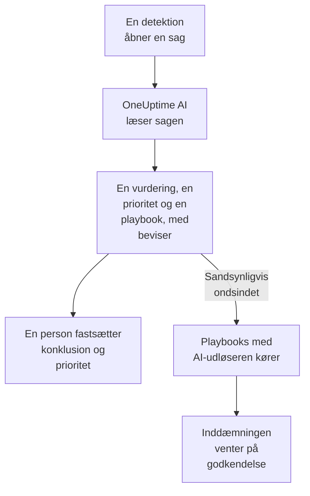

# OneUptime AI i sikkerhed

OneUptime AI læser hver sikkerhedssag, som en analytiker ville gøre: sagens detektioner, begivenheder, entiteter og trusselsintelligens og de værter og personer, der er omkring den. Den siger, hvad der skete, og om det ser ægte ud, foreslår en prioritet og en playbook og henviser til beviserne bag hver påstand. Den ændrer intet af sig selv: en person fastsætter konklusionen og prioriteten og kører playbooken. Den skriver også udkast til detektionsregler ud fra en enkelt sætning og besvarer i Ask AI dine spørgsmål om dine sikkerhedsdata.

:::cards
- [Vurder en sag](#vurder-en-sag): Hvad OneUptime AI læser, hvad den konkluderer, og hvad den aldrig gør.
- [Vurder nye sager automatisk](#vurder-nye-sager-automatisk): Hver sag, som en detektion åbner, vurderet, så snart den åbner.
- [Kør en playbook efter en vurdering](#kør-en-playbook-efter-en-vurdering): Reager på en sag, der læses som Sandsynligvis ondsindet.
- [Skriv et udkast til en detektionsregel](#skriv-et-udkast-til-en-detektionsregel): Beskriv, hvad der skal fanges, og læs Sigma-reglen.
- [Ask AI på sikkerhedssiderne](#ask-ai-på-sikkerhedssiderne): Spørgsmål om sager og begivenheder med almindelige ord.
:::

## Sådan virker det

En vurdering læser kun. Den kører på projektets egen AI: **Aktivér AI**, projektets LLM-udbyder, dets AI-kreditter og dets daglige AI-grænser.

## Før du begynder

- **Aktivér AI** slået til under **Projektindstillinger → AI → AI Features**. Er den slået fra, viser sikkerhed intet fra OneUptime AI, og intet kører.
- En LLM-udbyder, som OneUptime AI kan bruge, under **Projektindstillinger → AI → LLM-udbydere**. OneUptime Cloud stiller en til rådighed.
- En rolle, der må arbejde med sikkerhedssager, for at starte en vurdering: Project Owner, Project Admin, Security Admin eller Security Member. Security Viewer kan læse alle vurderinger, men ikke starte nogen. Se [Roller](/docs/permissions/reference#roller).

## Vurder en sag

Åbn en sag: kortet **OneUptime AI** står øverst på dens side.

| Kortet siger | Hvad det betyder |
| --- | --- |
| **Ikke vurderet endnu** | Der er ikke kørt nogen vurdering. **Vurder med AI** starter en. |
| **Vurderer denne sag** | OneUptime AI læser sagen. Hvert tjek vises, mens det kører. |
| En vurdering som **Sandsynligvis ondsindet** | Vurderingen er færdig. **Vurder igen** læser sagen forfra. |
| **Vurderingen blev ikke færdig** | Kørslen stoppede. **Prøv igen** starter en ny. |

En vurdering læser:

- sagen: titel, prioritet, status, entiteter og ATT&CK-tilknytning;
- dens detektioner, den nyeste først, med en eksempelbegivenhed for hver;
- sikkerhedsbegivenhederne og trusselsintelligensen om dens brugere, værter og adresser;
- risikoen for dens brugere, værter og adresser, og hvad der bidrog til den i denne uge;
- de værter i OneUptime, som dens værter og adresser svarer til, og hvem der ejer dem;
- den hændelse, den har erklæret, dens noter, dens beskyttede entiteter og de playbooks, der er slået til.

Den kan også læse resten af OneUptime, som undersøgelsen af en hændelse gør: logs, traces, metrikker, værter og de skrivebeskyttede værktøjer på projektets MCP-servere.

### Hvad den konkluderer

| Vurdering | Betyder | Foreslår at lukke som |
| --- | --- | --- |
| Sandsynligvis ondsindet | Beviserne peger på ondsindet eller uautoriseret aktivitet | True Positive |
| Sandsynligvis harmløs | Aktiviteten ser ægte, men forventet ud, som en administrativ opgave eller en scanning, dit team kører | Benign Positive |
| Sandsynligvis falsk positiv | Detektionen ser ud til at have fejltolket normal aktivitet | False Positive |
| Uafklaret | Der var ikke nok beviser til at afgøre det, og en person skal se på det | Intet |

Vurderingen er OneUptime AI's, aldrig sagens konklusion: **Close Case** starter på den konklusion, den foreslår, og en person vælger. Under vurderingen viser kortet:

- **Foreslået prioritet** med **Angiv prioritet**, når sagen har en anden prioritet.
- **Foreslået playbook** med **Kør playbook**, som kører den i dit navn med hver godkendelse, den kræver.
- Rapporten: hvad der skete, hvor sikker vurderingen er, og hvad der skal ske nu, hver påstand efterfulgt af en henvisning som C1.
- **Evidence checked**: hver forespørgsel, vurderingen kørte. En henvisning åbner sin forespørgsel, og når du folder en ud, kører den igen med dine tilladelser over det tidsrum, vurderingen læste.
- **Spørg om denne sag**, som åbner Ask AI på sagen.

Hver liste over sager viser vurderingen ved siden af hver sags titel og filtrerer på den med **AI-vurdering**.

### Hvad den aldrig gør

En vurdering ændrer intet på sagen: hverken status, prioritet, ansvarlig, konklusion eller noter. Den kører ingen playbook og inddæmmer ingen. En playbook, den foreslår, kører, når en person kører den, eller via udløseren nedenfor.

### Tekst skrevet for at styre en AI

Begivenheder, advarsler og værdier for entiteter kommer udefra, og en angriber kan skrive dem. OneUptime AI læser dem alle som data, aldrig som instruktioner. Når noget af en sags data lyder som instruktioner til en AI, siger kortet det først, en vurdering Sandsynligvis harmløs eller Sandsynligvis falsk positiv bliver til Uafklaret, og den vurdering starter ingen playbook.

## Vurder nye sager automatisk

Åbn **Produkter → Security Events → AI → Indstillinger**, og slå **Vurder nye sager** til: så bliver hver sag, som en detektion åbner, vurderet, så snart den åbner. Kontakten gemmer, så snart du slår den om. Project Owner og Project Admin kan ændre den.

Nye projekter starter med den slået til; et projekt, der blev oprettet før, har den slået fra, indtil nogen slår den til. En sag, der er åbnet i hånden, og sagen fra testangrebet i **Send et testangreb** bliver vurderet, når nogen klikker på **Vurder med AI**.

## Kør en playbook efter en vurdering

En playbook, hvis **Trigger** er **Vurderet som sandsynligvis ondsindet**, kører én gang på en sag, når en vurdering læser den som Sandsynligvis ondsindet. **For Cases At Least**, **Only For Detections From** og **Only For These Detection Rules** afgrænser den som for enhver udløser, og dens inddæmningstrin venter som altid på godkendelse. Den kører ikke:

- efter en vurdering, der fandt tekst skrevet for at styre en AI;
- en anden gang på den samme sag, uanset hvor ofte sagen bliver vurderet;
- på testangrebets sag, medmindre hvert trin i playbooken bliver inden for OneUptime.

En ny playbook får kun tilbudt denne udløser, mens projektets AI er slået til.

## Skriv et udkast til en detektionsregel

Klik på siden **Detection Rules** under feltet **Sigma Rule (YAML)** på **Draft with AI**, og sig, hvad reglen skal fange, for eksempel ti mislykkede logins fra én IP-adresse inden for fem minutter. **Skriv regel** sætter en Sigma-regel ind i feltet, kontrolleret på samme måde som en gemt regel. Læs den, ret den efter behov, og gem den som sædvanlig: intet bliver gemt, før du gør det. Står der allerede en regel i feltet, hedder knappen **Skriv igen med AI**, og udkastet erstatter den regel.

Et udkast kræver en rolle, der må oprette detektionsregler.

## Ask AI på sikkerhedssiderne

**Ask AI** ved, hvilken sikkerhedsside du er på. På en sag læser den først sagen og tilbyder spørgsmål som **Er det ægte?**. På de andre sider under sikkerhedsbegivenheder søger et spørgsmål med almindelige ord i dine sikkerhedsbegivenheder. Den kan også tjekke værdier mod din trusselsintelligens, se hvor aktiv en bruger, en vært eller en adresse har været, og vise de playbooks, en sag kan gives videre til.

Ask AI kan tilføje en note til en sag og køre en playbook på den i dit navn, og den spørger før hver handling. En playbook, den kører, venter på godkendelse som enhver anden.

Når en sag erklærer en hændelse, læser hændelsens AI-undersøgelse også sagen: hvad der blev opdaget, om hvem, og OneUptime AI's vurdering af den.

## Omkostninger og grænser

En vurdering er arbejde for OneUptime AI ligesom undersøgelsen af en hændelse. På OneUptime Cloud betales den med projektets AI-kreditter, og den tæller med i projektets egne daglige AI-grænser (**Daglige grænser** under **Projektindstillinger → AI → AI Features**). De daglige grænser for hændelser og advarsler gælder ikke. En sag har én vurdering ad gangen, og AI-loggene (**Projektindstillinger → AI → AI-logs**) viser dens kald.

Når projektet er løbet tør for AI-kreditter eller har nået en daglig AI-grænse, bliver nye sager ikke vurderet: kortet siger hvorfor, og **Vurder med AI** virker igen, så snart der er tilføjet kreditter, eller grænsen nulstilles.

## Fejlfinding

:::details En ny sag blev ikke vurderet
Tjek, at **Aktivér AI** er slået til, og **Vurder nye sager** under **Produkter → Security Events → AI → Indstillinger**. En sag, der er åbnet i hånden, og testangrebets sag bliver kun vurderet, når nogen beder om det. Åbn sagen: når noget forhindrer en vurdering, siger kortet hvad, og hvor det kan rettes.
:::

:::details Kortet siger, at projektet er løbet tør for AI-kreditter eller har nået sin daglige AI-grænse
En projektejer eller en person med Manage Billing kan tilføje kreditter under **Projektindstillinger → AI → AI-kreditter** eller hæve eller fjerne grænsen under **Projektindstillinger → AI → AI Features**. Klik derefter på **Vurder med AI** på sagen.
:::

:::details Kortet siger, at tekst i sagen lyder som instruktioner til en AI
Noget af sagens data, som en begivenhedsmeddelelse eller et brugernavn, blev skrevet for at styre en AI. OneUptime AI læste det som data og overlod beslutningen til dig: læs selv detektionerne og beviserne, før du lukker sagen.
:::

:::details En playbook med AI-udløseren kørte ikke
Tjek, at playbooken er slået til, at vurderingen læste sagen som Sandsynligvis ondsindet, og at dens indstillinger **For Cases At Least**, **Only For Detections From** og **Only For These Detection Rules** passer til sagen. Den kører én gang pr. sag og ikke efter en vurdering, der fandt tekst skrevet for at styre en AI.
:::

## Næste skridt

:::cards
- [Sikkerhedssager og playbooks](/docs/telemetry/security-cases): Arbejd med sager, luk dem med en konklusion, og byg playbooks.
- [AI SRE](/docs/ai/ai-sre): Hvordan OneUptime AI undersøger hændelser og advarsler, og dens grænser.
- [Spørg AI](/docs/ai/ask-ai): Stil spørgsmål om dit projekt med almindelige ord.
- [LLM-udbydere](/docs/ai/llm-provider): Vælg den model, OneUptime AI bruger.
:::
