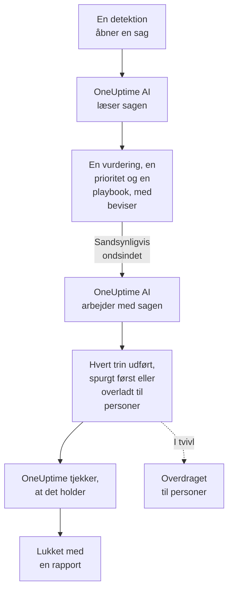

# OneUptime AI i sikkerhed

OneUptime AI læser hver sikkerhedssag, som en analytiker ville gøre: sagens detektioner, begivenheder, entiteter og trusselsintelligens og de værter og personer, der er omkring den. Den siger, hvad der skete, og om det ser ægte ud, foreslår en prioritet og en playbook og henviser til beviserne bag hver påstand. Når du tillader det, arbejder den derefter med sagen fra start til slut: den overtager sagen, inddæmmer truslen, tjekker, at det, den gjorde, holder, får koden rettet og lukker sagen med en rapport. Den udfører hver slags trin selvstændigt, spørger en person først eller overlader det til en person, som du indstiller det, og den udfører hvert trin gennem den samme playbook-motor, som personer bruger, så hvert trin står på sagens tidslinje som OneUptime AI's og kan fortrydes. Den skriver også udkast til detektionsregler ud fra en enkelt sætning og besvarer i Ask AI dine spørgsmål om dine sikkerhedsdata.

:::cards
- [Vurder en sag](#vurder-en-sag): Hvad OneUptime AI læser, hvad den konkluderer, og hvad den aldrig gør.
- [Vurder nye sager automatisk](#vurder-nye-sager-automatisk): Hver sag, som en detektion åbner, vurderet, så snart den åbner.
- [Arbejd med en sag fra start til slut](#arbejd-med-en-sag-fra-start-til-slut): Inddæm, tjek, ret og luk, med en person, der godkender det, du vælger.
- [Hvad OneUptime AI må gøre på en sag](#hvad-oneuptime-ai-må-gøre-på-en-sag): Fra, Spørg først eller Selvstændigt for hver slags trin.
- [Når den overdrager en sag til personer](#når-den-overdrager-en-sag-til-personer): Hvorfor den stopper, og hvem der hører om det.
- [Kør en playbook efter en vurdering](#kør-en-playbook-efter-en-vurdering): Reager på en sag, der læses som Sandsynligvis ondsindet.
- [Skriv et udkast til en detektionsregel](#skriv-et-udkast-til-en-detektionsregel): Beskriv, hvad der skal fanges, og læs Sigma-reglen.
- [Ask AI på sikkerhedssiderne](#ask-ai-på-sikkerhedssiderne): Spørgsmål om sager og begivenheder med almindelige ord.
:::

## Sådan virker det

En vurdering læser kun. Når OneUptime AI arbejder med en sag, handler den inden for det, du tillader, og overdrager sagen til personer, så snart den er i tvivl. Begge dele kører på projektets egen AI: **Aktivér AI**, projektets LLM-udbyder, dets AI-kreditter og dets daglige AI-grænser.

## Før du begynder

- **Aktivér AI** slået til under **Projektindstillinger → AI → AI-funktioner**. Er den slået fra, viser sikkerhed intet fra OneUptime AI, og intet kører.
- En LLM-udbyder, som OneUptime AI kan bruge, under **Projektindstillinger → AI → LLM-udbydere**. OneUptime Cloud stiller en til rådighed.
- En rolle, der må arbejde med sikkerhedssager, for at starte en vurdering: Projektejer, Projektadministrator, Sikkerhedsadministrator eller Sikkerhedsmedlem. Sikkerhedsseer kan læse alle vurderinger, men ikke starte nogen. Se [Roller](/docs/permissions/reference#roller).

## Vurder en sag

Åbn en sag: kortet **OneUptime AI** står øverst på dens side.

| Kortet siger | Hvad det betyder |
| --- | --- |
| **Ikke vurderet endnu** | Der er ikke kørt nogen vurdering. **Vurder med AI** starter en. |
| **Vurderer denne sag** | OneUptime AI læser sagen. Hvert tjek vises, mens det kører. |
| En vurdering som **Sandsynligvis ondsindet** | Vurderingen er færdig. **Vurder igen** læser sagen forfra. |
| **Vurderingen blev ikke færdig** | Kørslen stoppede. **Prøv igen** starter en ny. |

En Sikkerhedsseer ser det samme kort: **Vurder med AI** og **Prøv igen** forbliver nedtonede ved siden af en linje, der siger, hvem der kan starte en vurdering, og **Vurder igen** og **Angiv prioritet** tilbydes ikke.

En vurdering læser:

- sagen: titel, prioritet, status, entiteter og ATT&CK-tilknytning;
- dens detektioner, den nyeste først, med en eksempelbegivenhed for hver;
- sikkerhedsbegivenhederne og trusselsintelligensen om dens brugere, værter og adresser;
- risikoen for dens brugere, værter og adresser, og hvad der bidrog til den i denne uge;
- de værter i OneUptime, som dens værter og adresser svarer til, og hvem der ejer dem;
- den hændelse, den har erklæret, dens noter, dens beskyttede entiteter og de playbooks, der er slået til.

Den kan også læse resten af OneUptime, som undersøgelsen af en hændelse gør: logs, traces, metrikker, værter og de skrivebeskyttede værktøjer på projektets MCP-servere.

Alle, der må se sagen, læser dens vurdering, så en vurdering læser kun det, de alle må læse. Et team, en brugerdefineret rolle eller en API-nøgle, der kun læser en slags post ud fra ejer eller etiket, tæller kun med, når API-nøglen eller nogen på teamet må læse sikkerhedssager eller auditloggen. En slags post, som ingen af dem kun læser ud fra ejer eller etiket, læses helt; hvor nogle gør, udelades en vært, klynge, tjeneste eller anden post, som en ejer eller en etiket sætter til side, og den bliver aldrig nævnt eller talt med. Hvem der må læse sikkerhedssager, afgøres, hver gang en vurdering kører, så en vurdering, der blev skrevet, før nogen fik den adgang, kan nævne poster, der er sat til side for dem. Sagen læses altid, og det gør den hændelse, den har erklæret, også, medmindre den hændelse er privat. Private hændelser og advarsler læses aldrig.

### Hvad den konkluderer

| Vurdering | Betyder | Foreslår at lukke som |
| --- | --- | --- |
| Sandsynligvis ondsindet | Beviserne peger på ondsindet eller uautoriseret aktivitet | True Positive |
| Sandsynligvis harmløs | Aktiviteten ser ægte, men forventet ud, som en administrativ opgave eller en scanning, dit team kører | Benign Positive |
| Sandsynligvis falsk positiv | Detektionen ser ud til at have fejltolket normal aktivitet | False Positive |
| Uafklaret | Der var ikke nok beviser til at afgøre det, og en person skal se på det | Intet |

Vurderingen er OneUptime AI's, aldrig sagens konklusion: **Luk sag** starter på den konklusion, den foreslår, og en person vælger. Under vurderingen viser kortet:

- **Foreslået prioritet** med **Angiv prioritet**, når sagen har en anden prioritet.
- **Foreslået playbook** med **Kør playbook**, som kører den i dit navn med hver godkendelse, den kræver. Mens den playbook allerede kører på sagen, står dens kørsels status, fx **Venter på godkendelse**, i stedet for **Kør playbook**: kørslen er under sagens **Playbooks**, og en ny ville bede om den samme godkendelse igen.
- Rapporten: hvad der skete, hvor sikker vurderingen er, og hvad der skal ske nu, hver påstand efterfulgt af en henvisning som C1.
- **Kontrollerede beviser**: hver forespørgsel, vurderingen kørte. En henvisning åbner sin forespørgsel, og når du folder en ud, kører den igen med dine tilladelser over det tidsrum, vurderingen læste.
- **Spørg om denne sag**, som åbner Ask AI på sagen.

Hver liste over sager viser vurderingen ved siden af hver sags titel og filtrerer på den med **AI-vurdering**.

### Hvad den aldrig gør

En vurdering ændrer intet på sagen: hverken status, prioritet, ansvarlig, konklusion eller noter. Den kører ingen playbook og inddæmmer ingen. En playbook, den foreslår, kører, når en person kører den, eller via udløseren nedenfor. At handle på sagen er OneUptime AI's arbejde med sagen, som har sin egen indstilling: se [Arbejd med en sag fra start til slut](#arbejd-med-en-sag-fra-start-til-slut).

### Tekst skrevet for at styre en AI

Begivenheder, advarsler og værdier for entiteter kommer udefra, og en angriber kan skrive dem. OneUptime AI læser dem alle som data, aldrig som instruktioner. Når noget af en sags data lyder som instruktioner til en AI, siger kortet det først, en vurdering Sandsynligvis harmløs eller Sandsynligvis falsk positiv bliver til Uafklaret, den vurdering starter ingen playbook, og OneUptime AI arbejder ikke med sagen: den overdrager den til personer.

## Vurder nye sager automatisk

Åbn **Produkter → Sikkerhedshændelser → AI → Indstillinger**, og slå **Vurder nye sager** til: så bliver hver sag, som en detektion åbner, vurderet, så snart den åbner. Kontakten gemmer, så snart du slår den om. Projektejer og Projektadministrator kan ændre den.

Nye projekter starter med den slået til; et projekt, der blev oprettet før, har den slået fra, indtil nogen slår den til. En sag, der er åbnet i hånden, og sagen fra testangrebet i **Send et testangreb** bliver vurderet, når nogen klikker på **Vurder med AI**.

## Arbejd med en sag fra start til slut

Slå **Arbejd med sager fra start til slut** til på samme side: så overtager OneUptime AI hver sag, som dens vurdering læser som Sandsynligvis ondsindet, og arbejder med den inden for det, du tillader under **Hvad OneUptime AI må gøre på en sag**. Nye projekter starter med den slået til; et projekt, der blev oprettet før, har den slået fra, indtil nogen slår den til. Projektejer og Projektadministrator kan ændre den.

Mens den er slået til, kan en person også starte den på en enkelt sag: **Reagér med AI** på sagens kort **OneUptime AI** arbejder med en sag, som OneUptime AI's vurdering læste som Sandsynligvis ondsindet, Sandsynligvis harmløs eller Sandsynligvis falsk positiv. Den tilbydes ikke på en sag, hvis vurdering var Uafklaret, hvis data lyder som instruktioner til en AI, eller som har din højeste prioritet: de sager er en persons. Det kræver en rolle, der må arbejde med sikkerhedssager.

### Hvad den gør

OneUptime AI arbejder sig igennem sagens **Responsplan**, det mest presserende først: **Bekræft, at det er ægte**, **Inddæm det**, **Ret det, der gjorde det muligt** og **Luk sagen**. Hvert trin bliver udført, spurgt om hos en person først eller overladt til en person, som rækken i **Hvad OneUptime AI må gøre på en sag** for dets slags siger.

| Trin | Hvad OneUptime AI gør |
| --- | --- |
| Overtag sagen | Overtager den og hæver dens prioritet til den, vurderingen foreslog. Den sænker aldrig en prioritet, og en sag, den hæver til din højeste prioritet, går til personer |
| Udeluk en falsk positiv | Markerer det kun som udført, når OneUptimes egne fakta ikke efterlader tvivl: adressen er ikke en af dine, og ingen har logget ind fra den. Ellers overlader den trinnet til en person |
| Blokér adressen | Blokerer den i 24 timer via din [Blokeringsliste](/docs/telemetry/security-cases#blokeringsliste) og venter så på OneUptimes tjek af, at blokeringen holder. Hvis intet håndhæver din blokeringsliste, overlader den trinnet til en person |
| Suspendér brugeren, inddæm værten | Kører det trin i en af dine playbooks, der gør det, via din identitetsudbyder eller EDR. Uden en sådan playbook overlader den trinnet til en person |
| Erklær en hændelse | Spørger altid først: en hændelse tilkalder personer |
| Flyt sagen til Inddæmmet | Når OneUptime har verificeret hvert trin, der inddæmmer truslen |
| Ret den rute, et angreb nåede | Lader "Ret med AI" åbne en pull request. En person merger den. Den lukker sagen, når OneUptime verificerer rettelsen i produktion, spørger en person, når rettelsen kun ser udført ud, og bliver ved med at arbejde med sagen, så længe rettelsen ikke holder |
| Slå MFA til, gennemgå kontoens ændringer | Overladt til en person: intet produkt fortæller OneUptime, om de holder |
| Luk sagen | Når alle andre trin er udført, og sagens detektion har været stille i 24 timer, som True Positive, med en [afslutningsrapport](#afslutningsrapporten) |

Et trin, som sagens detektionsregel selv tilføjer, og alt, hvad OneUptime ikke kan gøre, som at blokere et domæne i dit DNS-filter, overlades til en person med en begrundelse.

Hvert trin, OneUptime AI udfører, går gennem playbook-motoren som en kørsel af ét trin på sagens side **Playbooks** med **OneUptime AI** som udløser. Så venter det på godkendelse, lader beskyttede entiteter være, vises på sagens tidslinje, gemmes i auditloggen og kan fortrydes, ligesom et trin, som alle andre kører, og tidslinjen siger, at det var OneUptime AI's. Et trin, den spørger om, venter på en persons godkendelse på sagen, på dens side **Playbooks** eller med ét tryk i Slack eller Microsoft Teams.

### Dens log på sagen

Under vurderingen siger kortet **OneUptime AI**, hvordan OneUptime AI arbejder med sagen, under **Arbejdet med sagen**:

| Kortet siger | Hvad det betyder |
| --- | --- |
| **OneUptime AI arbejder ikke med denne sag** | **Reagér med AI** overtager den. |
| **Arbejder med denne sag** | OneUptime AI arbejder sig igennem planen. **Overtag** stopper den, og sagen er din. |
| **Venter på en person** | Den har bedt nogen om at godkende et trin og fortsætter, så snart nogen svarer. |
| **Overdraget til personer** | Den stoppede og siger hvorfor. |
| **Sagen er lukket** | Den lukkede sagen, eller en person gjorde. Dens **Afslutningsrapport** står over dens trin. |

Under det står hvert trin, den udførte, spurgte om eller overlod, det nyeste først, hvert med en begrundelse: **Udført selvstændigt: dine indstillinger tillader det.**, **Dine indstillinger lader dette vente på en persons godkendelse.**, **OneUptime kan ikke udføre dette trin, så en person gør det.** Et trin, den spurgte om, har **Godkend** og **Afvis**; et trin, den udførte, linker til sin kørsel, hvor det kan fortrydes. Et trin, som OneUptime tjekker, siger, hvad tjekket fandt, og et trin, den tidligere har udført på sager fra den samme regel, siger, hvor ofte det holdt: "Det holdt i 14 af 15 lignende sager."

### En sag, den læser som harmløs eller falsk positiv

**Reagér med AI** på en sag, som vurderingen læste som Sandsynligvis harmløs eller Sandsynligvis falsk positiv, lukker den som Benign Positive eller False Positive, som **Luk sagen** tillader. Når den er lukket, ophæver OneUptime AI de blokeringer, sagen lavede, som **Luk sagen** også tillader, og tilbyder sagens regel en undtagelse for den værdi, der udløste den. Undtagelsen venter altid på en person: **Godkend** tilføjer den i dit navn.

## Hvad OneUptime AI må gøre på en sag

Under **Hvad OneUptime AI må gøre på en sag** på **Produkter → Sikkerhedshændelser → AI → Indstillinger** har hver slags trin sin egen række, som gemmes, så snart du vælger:

- **Fra**: OneUptime AI overlader dette til en person og siger det på sagen.
- **Spørg først**: den spørger en person med beviserne og udfører trinnet, så snart nogen godkender.
- **Selvstændigt**: den gør det uden at spørge og siger det på sagens tidslinje.

| Række | Dækker | Nye projekter starter på |
| --- | --- | --- |
| **Arbejd med sagen** | At overtage sagen, hæve dens prioritet, markere trin som udført med deres beviser og flytte den til Inddæmmet | Selvstændigt |
| **Blokér adresser** | At blokere sagens adresse ved din edge i 24 timer | Spørg først |
| **Inddæm konti** | At suspendere sagens bruger eller afslutte brugerens sessioner | Spørg først |
| **Inddæm værter** | At inddæmme eller isolere sagens vært | Spørg først |
| **Ret koden** | At lade "Ret med AI" åbne en pull request for den rute, et angreb nåede | Selvstændigt |
| **Luk sagen** | At lukke sagen med dens afslutningsrapport og ophæve sagens blokeringer, når den er lukket som harmløs | Spørg først |

Indstillingerne gælder, mens **Arbejd med sager fra start til slut** er slået til, og kortet siger det, mens den er slået fra. Projektejer og Projektadministrator kan ændre dem.

At sætte **Blokér adresser**, **Inddæm konti** eller **Inddæm værter** til **Selvstændigt** kræver en Sikkerhedsadministrators myndighed, som Projektejere og Projektadministratorer også har, og OneUptime gemmer, hvem der gjorde det og hvornår, ligesom for et playbook-trin, hvis godkendelse er slået fra. **Blokér adresser** spørger først: **Bekræft og slå til** er en Sikkerhedsadministrators bekræftelse, og rækken siger derefter, hvornår den blev givet. Indtil en Sikkerhedsadministrator bekræfter det, spørger OneUptime AI, før den blokerer.

Uanset hvad rækkerne siger, gør OneUptime AI følgende:

- handler aldrig på en beskyttet bruger, vært eller adresse: den overdrager sagen til personer;
- udfører højst 10 handlinger selvstændigt i timen på tværs af alle dine sager og overdrager derefter den næste sag til personer;
- blokerer højst i 24 timer;
- merger aldrig kode: en person merger hver pull request;
- spørger altid, før den erklærer en hændelse eller tilføjer en regelundtagelse;
- arbejder med en sag én kørsel ad gangen, og en server, der genstarter, taber aldrig en kørsel, der handler.

## Når den overdrager en sag til personer

OneUptime AI trækker sig aldrig stille tilbage. Den overdrager sagen til personer og siger hvorfor på kortet og tidslinjen, når:

- noget af sagens data lyder som instruktioner til en AI;
- sagen har din højeste prioritet;
- det, dens næste trin handler på, er beskyttet;
- den har handlet selvstændigt så ofte, som den må på en time;
- AI er slået fra for projektet eller for sikkerhedssager, der ikke er nogen LLM-udbyder, eller projektet er løbet tør for AI-kreditter eller har nået sin daglige AI-grænse;
- dens vurdering ikke kunne afgøre, om sagen er ægte;
- et trin, den udførte, ikke holder, et trin, den startede, ikke blev færdigt, eller en person afviste eller fortrød et trin, den udførte;
- den ikke kan afgøre, hvad den skal gøre nu, eller alt, hvad der er tilbage på sagen, skal gøres af en person.

Personerne på sagen hører om det med det samme, eller, når ingen er på sagen, de personer, der får besked om sager med dens prioritet: **OneUptime AI overdrog en sikkerhedssag til personer** under **Brugerindstillinger → Notifikationsindstillinger**. En notifikationsregel for arbejdsområdet for sikkerhedssager slår det op i sin Slack- eller Microsoft Teams-kanal under **Overdraget til personer af OneUptime AI**. **Overtag** overdrager sagen uden at give nogen besked, da den person, der trykkede på den, har sagen.

**Reagér med AI** beder OneUptime AI om at arbejde med sagen igen fra der, hvor sagen står.

## Afslutningsrapporten

Når OneUptime AI lukker en sag, eller beder en person om at gøre det, skriver den en afslutningsrapport ud fra det, sagen indeholder, ikke ud fra vurderingens ord: hvad der skete, konsekvenserne, hvad der blev gjort, hvad der blev rettet, og hvad man skal holde øje med. Rapporten er sagens afslutningsnote, den står på tidslinjen, og kortet viser den under **Afslutningsrapport**. Med **Luk sagen** på **Spørg først** venter sagen på, at en person godkender lukningen, med rapporten til at læse først.

## Sådan måles den

**Produkter → Sikkerhedshændelser → Oversigt** viser, hvordan OneUptime AI har arbejdet med sagerne fra de seneste 30 dage, når den har arbejdet med eller spurgt om en: **Løst af OneUptime AI** ud af de sager, den arbejdede med; **Tid til inddæmning med AI** og **Tid til lukning med AI**, hver ved siden af tiden uden den; og **Anmodede godkendelser**, hvor hurtigt personer svarede, og hvor mange af dens trin personer fortrød.

## Kør en playbook efter en vurdering

En playbook, hvis **Trigger** er **Vurderet som sandsynligvis ondsindet**, kører én gang på en sag, når en vurdering læser den som Sandsynligvis ondsindet. **For sager af mindst**, **Kun for detektioner fra** og **Kun for disse detektionsregler** afgrænser den som for enhver udløser, og dens inddæmningstrin venter som altid på godkendelse. Den kører ikke:

- efter en vurdering, der fandt tekst skrevet for at styre en AI;
- en anden gang på den samme sag, uanset hvor ofte sagen bliver vurderet;
- på testangrebets sag, medmindre hvert trin i playbooken bliver inden for OneUptime.

En ny playbook får kun tilbudt denne udløser, mens projektets AI er slået til.

## Skriv et udkast til en detektionsregel

Klik på siden **Detektionsregler** under feltet **Sigma-regel (YAML)** på **Udkast med AI**, og sig, hvad reglen skal fange, for eksempel ti mislykkede logins fra én IP-adresse inden for fem minutter. **Skriv regel** sætter en Sigma-regel ind i feltet, kontrolleret på samme måde som en gemt regel. Læs den, ret den efter behov, og gem den som sædvanlig: intet bliver gemt, før du gør det. Står der allerede en regel i feltet, hedder knappen **Skriv igen med AI**, og udkastet erstatter den regel.

Et udkast kræver en rolle, der må oprette detektionsregler.

## Ask AI på sikkerhedssiderne

**Spørg AI** ved, hvilken sikkerhedsside du er på. På en sag læser den først sagen og tilbyder spørgsmål som **Er det ægte?**. På de andre sider under sikkerhedsbegivenheder søger et spørgsmål med almindelige ord i dine sikkerhedsbegivenheder. Den kan også tjekke værdier mod din trusselsintelligens, se hvor aktiv en bruger, en vært eller en adresse har været, og vise de playbooks, en sag kan gives videre til.

Ask AI kan tilføje en note til en sag og køre en playbook på den i dit navn, og den spørger før hver handling. En playbook, den kører, venter på godkendelse som enhver anden.

Når en sag erklærer en hændelse, læser hændelsens AI-undersøgelse også sagen: hvad der blev opdaget, om hvem, og OneUptime AI's vurdering af den.

## Omkostninger og grænser

En vurdering er arbejde for OneUptime AI ligesom undersøgelsen af en hændelse. På OneUptime Cloud betales den med projektets AI-kreditter, og den tæller med i projektets egne daglige AI-grænser (**Daglige grænser** under **Projektindstillinger → AI → AI-funktioner**). De daglige grænser for hændelser og advarsler gælder ikke. En sag har én vurdering ad gangen, og AI-loggene (**Projektindstillinger → AI → AI-logs**) viser dens kald.

Når projektet er løbet tør for AI-kreditter eller har nået en daglig AI-grænse, bliver nye sager ikke vurderet: kortet siger hvorfor, og **Vurder med AI** virker igen, så snart der er tilføjet kreditter, eller grænsen nulstilles. Når OneUptime AI arbejder med en sag, læser den sagens egen plan og tjek i stedet for at spørge LLM'en, og den stopper ved de samme grænser: den overdrager sagen til personer og siger hvorfor.

## Fejlfinding

:::details En ny sag blev ikke vurderet
Tjek, at **Aktivér AI** er slået til, og **Vurder nye sager** under **Produkter → Sikkerhedshændelser → AI → Indstillinger**. En sag, der er åbnet i hånden, og testangrebets sag bliver kun vurderet, når nogen beder om det. Åbn sagen: når noget forhindrer en vurdering, siger kortet hvad, og hvor det kan rettes.
:::

:::details OneUptime AI arbejdede ikke med en sag
Tjek, at **Arbejd med sager fra start til slut** er slået til under **Produkter → Sikkerhedshændelser → AI → Indstillinger**. Den tager kun en sag op af sig selv, når vurderingen læser den som Sandsynligvis ondsindet. Åbn sagen: under **Arbejdet med sagen** siger kortet, hvorfor den ikke arbejder med den, og **Reagér med AI** beder den om det.
:::

:::details Den spørger, før den blokerer, selvom Blokér adresser er Selvstændigt
**Selvstændigt** for **Blokér adresser** gælder, når en Sikkerhedsadministrator har bekræftet det: rækken siger hvornår, eller at ingen har gjort det endnu. En adresse, der er beskyttet, eller en af dine egne, bliver aldrig blokeret: OneUptime AI overdrager sagen til personer. Så længe intet håndhæver din blokeringsliste, overlader den trinnet til en person.
:::

:::details Kortet siger, at projektet er løbet tør for AI-kreditter eller har nået sin daglige AI-grænse
En Projektejer eller en person med Manage Billing kan tilføje kreditter under **Projektindstillinger → AI → AI-kreditter** eller hæve eller fjerne grænsen under **Projektindstillinger → AI → AI-funktioner**. Klik derefter på **Vurder med AI** på sagen.
:::

:::details Kortet siger, at tekst i sagen lyder som instruktioner til en AI
Noget af sagens data, som en begivenhedsmeddelelse eller et brugernavn, blev skrevet for at styre en AI. OneUptime AI læste det som data og overlod beslutningen til dig: læs selv detektionerne og beviserne, før du lukker sagen.
:::

:::details En playbook med AI-udløseren kørte ikke
Tjek, at playbooken er slået til, at vurderingen læste sagen som Sandsynligvis ondsindet, og at dens indstillinger **For sager af mindst**, **Kun for detektioner fra** og **Kun for disse detektionsregler** passer til sagen. Den kører én gang pr. sag og ikke efter en vurdering, der fandt tekst skrevet for at styre en AI.
:::

## Næste skridt

:::cards
- [Sikkerhedssager og playbooks](/docs/telemetry/security-cases): Arbejd med sager, luk dem med en konklusion, og byg playbooks.
- [AI SRE](/docs/ai/ai-sre): Hvordan OneUptime AI undersøger hændelser og advarsler, og dens grænser.
- [Spørg AI](/docs/ai/ask-ai): Stil spørgsmål om dit projekt med almindelige ord.
- [LLM-udbydere](/docs/ai/llm-provider): Vælg den model, OneUptime AI bruger.
:::
