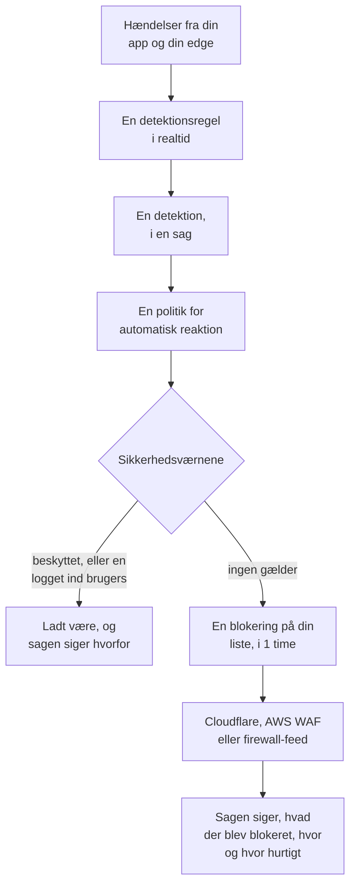

# Automatisk reaktion

Politikker for automatisk reaktion udfordrer eller blokerer en angribende adresse, så snart detektionen sker, før nogen har vurderet sagen: skannere, der afsøger din app, og bots, der prøver adgangskode efter adgangskode, bliver afvist få minutter efter deres første anmodning. Hvert projekt har tre færdige politikker, hver slået fra, indtil du slår den til, og hver starter med en uges prøveperiode, der kun registrerer, hvad den ville have gjort. Sikkerhedsværn gør en politik sikker at lade være slået til: den rører aldrig dine egne adresser eller en, som dine loggede ind brugere bruger, og den stopper og tilkalder en person, når et angreb er større, end den bør håndtere alene.

:::cards
- [Slå en politik til](#slå-en-politik-til): Først en uges prøveperiode, derefter ét klik.
- [Sikkerhedsværnene](#sikkerhedsværnene): Hvad en politik aldrig gør, og hvornår den stopper.
- [Tid til blokering](#tid-til-blokering): Hvor hurtigt hver politik blokerer, på dens kort og i sagen.
- [Din egen politik](#din-egen-politik): Reager på de teknikker, regler eller den trusselsinformation, du vælger.
:::

## Sådan virker det

En politik reagerer på en detektion, så snart den er registreret i sin sag, få sekunder efter at reglen udløses. Dens blokering kommer på din [blokeringsliste](/docs/telemetry/security-cases#blokeringsliste) på samme måde som playbook-trinnet **Blokér adressen**, med politikkens navn som opretter: de destinationer, der håndhæver din blokeringsliste, holder den, den vises på sagens tidslinje og i revisionsloggen, og den udløber af sig selv. Den kræver ingens godkendelse: den, der slog politikken til, godkendte dens blokeringer.

## Før du begynder

- En destination, der håndhæver din blokeringsliste: Cloudflare, AWS WAF eller en firewall eller proxy, der læser et [blokeringslistefeed](/docs/telemetry/blocklist-feeds). Så længe intet håndhæver den, siger siden det, og en politiks blokeringer gælder ingen steder.
- De hændelser, som en politiks regler læser: din apps adgangslogge eller traces eller din edges hændelser, såsom Cloudflares firewallhændelser, og dine logins. Se [Sikkerhedshændelser](/docs/telemetry/security-events).
- En rolle, der må slå en politik til: Sikkerhedsadministrator, Projektadministrator eller Projektejer. Sikkerhedsmedlem og Sikkerhedsseer ser politikkerne og hvad de har gjort. Se [Roller](/docs/permissions/reference#roller).

## De færdige politikker

| Politik | Reagerer på | Gør | Første blokering |
| --- | --- | --- | --- |
| **Skannere** | Webscanninger og udnyttelsesforsøg (ATT&CK T1595, T1190): SQL-injection-, path traversal- og Log4Shell-forsøg og mange træf på administrerede Cloudflare-regler fra én adresse, så længe alle adressens anmodninger blev afvist | Udfordring | 1 time |
| **Gætning af adgangskoder** | Brute force og password spraying (ATT&CK T1110): mislykkede logins fra én adresse og mislykkede logins efterfulgt af et vellykket fra samme adresse | Blokér | 1 time |
| **Kendte ondsindede adresser** | Enhver detektion om en adresse, som din [trusselsinformation](/docs/telemetry/threat-intelligence) viser | Blokér | 24 timer |

Mennesker består en udfordring, scripts og bots gør ikke. Skannere udfordrer kun en adresse, så længe ingen af dens anmodninger har nået din app: en adresse, hvis anmodninger kom igennem, er en sag for en person.

Når du slår Skannere eller Gætning af adgangskoder til, i prøveperioden eller helt, kører de regler fra **Regelbibliotek**, som politikken reagerer på, i realtid, og de regler, dit projekt mangler, tilføjes: en realtidsregel udløses sekunder efter, at hændelserne ankommer, hvor en planlagt regel læser minutter bagud. En regel, som nogen har slået fra, forbliver slået fra. Et projekt kører højst 50 regler i realtid: derudover bliver en regel på sin tidsplan, og politikkens kort viser **Efter en tidsplan** ved siden af.

## Slå en politik til

:::steps
### Åbn Automatisk reaktion

Åbn **Produkter → Sikkerhedshændelser → Playbooks → Automatisk reaktion**. Hver politik har sit kort: hvad den gør, en mærkat med **Fra**, **Prøveperiode**, **Prøveperiode afsluttet** eller **Til**, og dens kontakt.

### Start prøveperioden

Slå politikkens kontakt om. I 7 dage registrerer den, hvad den ville have gjort, og rører ingen trafik: sagen siger "Trial run: the Scanners policy would have challenged 35.205.11.131 for 1 hour." Kortet tæller adresserne indtil videre, og hvad dens sikkerhedsværn lod være.

### Slå den til

Når ugen er gået, siger kortet, hvad politikken ville have gjort, for eksempel "På 7 dage ville den have udfordret 1.283 adresser. Ingen havde loggede ind brugere, og ingen var dine. Slå den til?", og dine sikkerhedsansvarlige får det samme på e-mail. Klik på **Slå til**: fra da af reagerer politikken.
:::

For at slå en politik til uden dens uges prøveperiode skal du åbne **Yderligere indstillinger** på dens kort og klikke på **Slå til uden prøveperiode**. Dens sikkerhedsværn gælder stadig. Slå kontakten om igen for at slå en politik fra; slået til igen efter en hel uges prøveperiode reagerer den med det samme.

## Sikkerhedsværnene

- **Aldrig dine egne eller beskyttede adresser.** Posterne i **Beskyttede entiteter** og alt, hvad OneUptime beskytter af sig selv: dine værter, cloudressourcer og sonder, de intervaller, der ikke er på internettet, og den edge, der står foran din app. Se [Blokeringsliste](/docs/telemetry/security-cases#blokeringsliste).
- **Aldrig en adresse, som en logget ind bruger har brugt i de seneste 30 dage.** Et kontors netværk, en kundes proxy eller en persons hjem: OneUptime leder efter adressen i din identitetsudbyders logins og i de anmodninger, din app besvarede for en logget ind bruger, dem med et bruger-id i deres traces eller logge. En adresse, den ikke kan tjekke, fordi de hændelser ikke kunne læses, eller fordi dine scrub-regler skjuler adresser på en måde, den ikke kan matche, overlades til en person.
- **Længere blokeringer for en adresse, der kommer igen.** Den første blokering varer 1 time, derefter 24 timer, derefter 7 dage for en adresse, der blokeres igen inden for 30 dage. Kendte ondsindede adresser starter ved 24 timer.
- **Højst 50 automatiske blokeringer i timen.** Derudover holder dine politikker op med at blokere og tilkalder dine sikkerhedsansvarlige: et så stort angreb kræver en person. Siden siger det, så længe det varer.
- **Fortryd ved tvivl.** Når en logget ind bruger ses fra en adresse, som en politik har blokeret, ophæver politikken blokeringen og giver dine sikkerhedsansvarlige besked.

Dine sikkerhedsansvarlige er dit projekts Sikkerhedsadministratorer eller, hvis det ikke har nogen, dets Projektejere. Hver adresse, som et sikkerhedsværn lod være, står i dens sag med årsagen.

## Hvor en destination ikke kan udfordre

Cloudflare og AWS WAF udfordrer. En firewall, der læser et blokeringslistefeed, kan ikke, så dér er en politiks udfordring en blokering i samme tid, og politikkens kort og sagen siger det, for eksempel "FortiGate feed cannot challenge, so it blocks the address there for the same time." En udfordring, du selv laver, bliver aldrig til en blokering.

## Tid til blokering

Tid til blokering løber fra adressens første anmodning, den tidligste hændelse i dens detektion, til blokeringen virker ved din edge. Hver politiks kort viser dens 50. og 95. percentil dag for dag over de seneste 30 dage. En sag, som en automatisk reaktion har blokeret, siger det under **Tid til inddæmning** på dens **Oversigt**, for eksempel "Blokeret automatisk 41s efter dens første anmodning", og dens tidslinje siger, hvad der blev blokeret, hvor og hvor hurtigt: "OneUptime challenged 35.205.11.131 at Cloudflare for 1 hour (Scanners policy), 41 seconds after its first request." Adressens trin i sagens **Responsplan** er udført, med **Ophæv** ved siden af.

## Din egen politik

Klik på **Opret politik** under de færdige politikker. En egen politik skal have et **Navn** og det, den reagerer på:

| Felt | Hvad det gør |
| --- | --- |
| **ATT&CK-teknikker** | De teknikker, en detektion skal have, adskilt med kommaer, såsom `T1110, T1190`. En teknik dækker sine underteknikker. |
| **Handling** | Under **Flere felter**: **Blokér** eller **Udfordring**. |
| **Første blokering varer** | Under **Flere felter**: 1 time, 24 timer eller 7 dage. En adresse, der kommer igen, blokeres længere. |
| **Detektionsregler** | Under **Flere felter**: eller en detektion fra én af disse regler. |
| **Kun adresser, som din trusselsinformation viser** | Under **Flere felter**: reagerer kun på adresser, som din trusselsinformation viser. Alene reagerer den på enhver detektion om en sådan. |
| **Kun så længe alle anmodninger blev afvist** | Under **Flere felter**: reagerer kun, så længe ingen af adressens anmodninger har nået din app. |

En egen politik starter slået fra, kører en uges prøveperiode som en færdig og har de samme sikkerhedsværn. **Rediger politik** og **Slet politik** står på dens kort; sletter du den, bliver dens blokeringer på din blokeringsliste, til de udløber.

## Fejlfinding

:::details En politik er slået til, men blokerede ikke en adresse
Se på sagens tidslinje: en politik, der lod en adresse være, siger hvorfor, for eksempel at en logget ind bruger havde brugt den. Tjek, at en destination håndhæver din blokeringsliste, og at politikkens regler viser **Realtid** på dens kort.
:::

:::details Siden siger, at timens automatiske blokeringer er brugt op
Dine politikker lavede 50 automatiske blokeringer i den seneste time og tilkaldte dine sikkerhedsansvarlige. De fortsætter igen, efterhånden som timens blokeringer bliver ældre. Se på angrebets sager, og blokér et interval fra **Blokeringsliste**, hvis det kommer fra ét netværk.
:::

## Næste trin

:::cards
- [Sikkerhedssager og playbooks](/docs/telemetry/security-cases): Arbejd med de sager, dine politikker reagerer på, og blokér manuelt.
- [Blokeringslistefeeds](/docs/telemetry/blocklist-feeds): Håndhæv din blokeringsliste på en firewall eller proxy.
- [Trusselsinformation](/docs/telemetry/threat-intelligence): De feeds, som Kendte ondsindede adresser reagerer på.
:::
