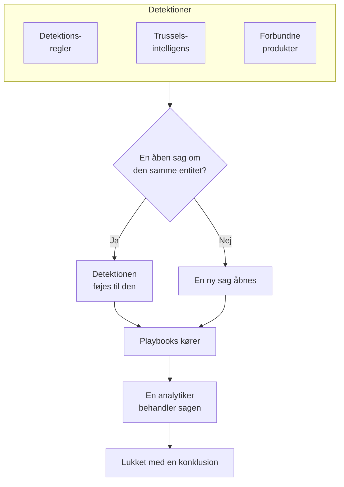

# Sikkerhedssager og playbooks (SOAR)

Sikkerhedshændelser gør det, som dine detektionsregler, din trusselsintelligens og dine forbundne sikkerhedsprodukter finder, til sager: én sag for hver ting, der er værd at undersøge, med alle detektioner om den samme bruger, vært eller adresse samlet i den. Analytikere behandler sagerne i en kø, og playbooks reagerer på dem, af sig selv eller med et klik.

:::cards
- [Hvor sager kommer fra](#hvor-sager-kommer-fra): Detektionsregler, trusselsintelligens, forbundne produkter, entitetsrisiko og personer.
- [Behandl en sag](#behandl-en-sag): Tildel den, undersøg dens entiteter, og luk den med en konklusion.
- [Sagsprioriteter og sagsstatusser](#sagsprioriteter-og-sagsstatusser): Omdøb dem, giv dem en anden farve og rækkefølge, og tilføj dine egne.
- [Responsmål](#responsmål): Hvor hurtigt en sag med hver prioritet skal tages og inddæmmes.
- [Notifikationer](#notifikationer): Hvem der får besked om en ny sag, en tildeling, et responsmål, en opgave og et trin, der venter på godkendelse.
- [Playbooks](#playbooks): Trin, der kører på en sag, med godkendelse, hvor det betyder noget.
- [Oversigten](#oversigten): Det, der kræver nogens indsats nu, og hvor hurtigt sager bliver håndteret.
:::

## Sådan virker det

Åbn **Produkter → Sikkerhedshændelser → Sikkerhedssager → Åbne sager** for køen. **Tildelt mig**, **Ikke tildelt**, **Lukkede sager** og **Alle sager** er sider for sig ved siden af, og hver viser de sager, navnet siger.

## Før du begynder

Sager og playbooks følger de tre Security-roller. Projektejer og Projektadministrator kan alt.

| Rolle | Hvad den kan |
| --- | --- |
| Sikkerhedsadministrator | Alt, også at slette sager, fjerne beviser og sætte playbooks op |
| Sikkerhedsmedlem | Åbne, tildele, ændre og lukke sager, skrive noter, arbejde med opgaver, tilføje beviser, køre playbooks og godkende eller afvise deres trin |
| Sikkerhedsseer | Læse sager, detektioner, noter, opgaver, beviser, playbooks og deres kørsler |

Hver af disse rettigheder kan også tildeles for sig, fra at oprette en sag til at godkende en playbooks trin; se [Tilladelsesreference](/docs/permissions/reference).

## Hvor sager kommer fra

| Kilde | Åbner en sag, når | Slås fra med |
| --- | --- | --- |
| Detektionsregler | En regel matcher | **Åbn en sag ved match** i regelens trin **Ved match** |
| Trusselsintelligens | En begivenhed nævner en kendt indikator | **Åbn en sag ved match** i feedets trin **Ved match** |
| Forbundne produkter | En advarsel fra selve produktet importeres på eller over forbindelsens tærskel | **Åbn sager fra** sat til **Aldrig** i forbindelsens trin **Hentning** |
| Sikkerhedsprodukter i dine logs | En trussel, som en firewall, et IDS eller et endpointprodukt skriver i dine logs, ligger på eller over tærsklen for Dine logs | **Åbn sager fra** sat til **Aldrig** på **Dine logs** |
| Entitetsrisiko | En brugers, værts eller adresses risiko når projektets tærskel | **Risikosager** under **Indstillinger → Risikoscoring** |
| Personer | Nogen åbner en fra **Sikkerhedssager** eller med **Åbn sag** i en begivenheds panel | Ingen |

Alle kilder åbner sager som standard, undtagen entitetsrisiko i projekter, der blev oprettet, før det fandtes: slå først **Risikosager** til dér ([Entitetsrisiko](/docs/telemetry/security-entity-risk)). En forbindelse åbner sager for **Høj og højere**, medmindre du vælger et andet niveau; advarslerne under det importeres stadig som begivenheder. **Dine logs** gør det samme for truslerne i dine logs.

### Sådan grupperes detektioner

En detektion handler om en entitet: den værdi, dens regel grupperer efter, f.eks. IP-adressen i en brute force-regel, eller den indikator, et match fra trusselsintelligens nævner. En detektion uden en entitet står alene.

- Når en åben sag allerede handler om den entitet, føjes detektionen til den. Sagens entiteter og ATT&CK-mapping vokser, og dens prioritet hæves til detektionens, men sænkes aldrig.
- Når ingen åben sag gør det, åbnes en ny sag, opkaldt efter detektionen, med detektionens prioritet.
- En detektion, der udløses igen, tæller op på sin række i stedet for at tilføje en ny.

En sags prioritet kommer fra detektionens alvorlighed, som projektets indbyggede prioritet for det niveau, uanset hvad du har kaldt den:

| Alvorlighed | Prioritet |
| --- | --- |
| Critical eller Fatal | Kritisk |
| High | High |
| Medium, Unknown eller Other | Medium |
| Low | Low |
| Informational | Til orientering |

## Behandl en sag

Et nyt projekts sager bevæger sig gennem fire statusser, som du kan omdøbe og supplere (se [Sagsprioriteter og sagsstatusser](#sagsprioriteter-og-sagsstatusser)). En sag kan springe en over, f.eks. en false positive, der lukkes direkte fra Ny, og den kan genåbnes.

| Status | Betyder |
| --- | --- |
| Ny | Ingen har kigget på den endnu |
| Undersøger | Nogen er ved at finde ud af, hvad der skete |
| Contained | Truslen kan ikke længere gøre skade; oprydningen mangler stadig |
| Lukket | Færdig, med en konklusion om, hvad det var |

En sag har sin egen sidemenu, ligesom en hændelse, og hver del af sagen er en side for sig:

| Afsnit i sidemenuen | Sider |
| --- | --- |
| **Oversigt** | **Oversigt**, **Tidslinje** |
| **Undersøgelse** | **Forløb**, **Detektioner**, **Entiteter**, **Forbundne signaler**, **Beviser**, **Opgaver**, **Playbooks** |
| **Noter** | **Private noter** |
| **Avanceret** | **Brugerdefinerede felter**, **Auditlogs**, **Slet sag**, foldet sammen, indtil du klikker på **Avanceret** |

Hver side beholder sagens sidehoved øverst: nummer, prioritet, status og titel, **Tildel til mig**, **Kør playbook**, **Erklær hændelse** og **Luk sag**, og i menuen ⋯ ved siden af **Angiv prioritet**, **Tildel til en anden**, **Skift status**, **Rediger sag** og **Slet sag**. Så kan sagen behandles fra enhver af dens sider, og et link til sagen åbner stadig dens **Oversigt**. Når sagens prioritet har responsmål, viser hovedet også, hvornår det næste har frist ([Responsmål](#responsmål)).

- **Oversigt**: sagens beskrivelse, etiketter og statustrin, hvem der har den, og hvad der åbnede den, og dens tal: hvor mange detektioner den har, hvor længe den har været åben, og hvor lang tid det tog at kvittere for den og inddæmme den. Under **Tid til bekræftelse** og **Tid til inddæmning** står, hvordan sagen ligger i forhold til sine responsmål.
- **Hvorfor denne sag blev åbnet**, på **Oversigt**: den detektion, der åbnede sagen, og hvordan dens regel udløses (dens tærskel, hvad den grupperer efter, og det vindue, den tæller i), hvor mange begivenheder den matchede, hvor de kom fra, og i hvilket tidsrum, hvad reglen leder efter, og hvor langt forespørgslerne nåede. Under **Hvad der matchede** står selve begivenhederne, de ældste først: hver med det, reglen leder efter, fremhævet, hvor langt dens forespørgsel nåede, den loglinje eller det produkt, den kom fra, og **Spor**, **Protokoller** og **Undtagelse** ét klik væk; den loglinje, den kom fra, åbnes i protokoludforskeren ved netop den linje. Klik på en begivenhed for at se hele begivenheden, med den loglinje, den blev læst fra. **Gem på denne sag**, på dens række eller i dens panel, gemmer begivenheden på sagens side **Beviser** og nævner den detektion, der matchede den; en begivenhed, som sagen allerede gemmer, siger det og åbner den der. Når en detektion udløses, gemmer den op til 25 af de begivenheder, den matchede, og viser dem, også når deres opbevaringstid er udløbet; din rolle ser dem fra de kilder, den må læse. En regel, der udløses for mange grupper på én gang, også en korrelationsregel, gemmer begivenheder for hver af dem: højst 1.000 i alt, så hver gemmer mindst 10 og op til 25, når den udløses igen. For en ældre detektion, der endnu ikke gemte begivenheder, er en regels match det, dens egen betingelse matchede, for detektionens gruppe, i de vinduer, den blev udløst i; et match fra trusselsintelligens viser de begivenheder, der indeholder dets indikator, og en advarsel fra et forbundet produkt den begivenhed, den blev sendt som. **Kig videre** åbner alt om den adresse eller bruger, detektionen handler om, de begivenheder og loglinjer, der nævner den, protokollerne fra de tjenester, dens loglinjer kom fra, og sporene for dens forespørgsler, hver inden for detektionens vindue, samt sagens **Forløb** og **Forbundne signaler**. Sagens andre detektioner er foldet sammen under **Også på denne sag**.
- **Responsplan**, på **Oversigt**: hvad der skal gøres ved sagen nu, det mest presserende først, under **Bekræft, at det er ægte**, **Inddæm det**, **Ret det, der gjorde det muligt** og **Luk sagen**. Hvert trin handler om denne sag: dens adresser, brugere og værter, hvor langt dens forespørgsler nåede, hvad dens regel siger, at den også kan udløses af, de ATT&CK-taktikker og -teknikker, som dens detektioner knyttes til, og de playbooks, projektet har. En detektionsregels egne trin, skrevet under **Responstrin** i dens formular, kommer først i den del af planen, de hører under, og reglerne i regelbiblioteket kommer med deres egne trin. Et trin, som OneUptime kan udføre, har sin egen knap: **Tildel til mig**, **Tilføj undtagelse** med reglen og adressen allerede udfyldt, **Kør playbook** for den playbook, der suspenderer kontoen eller inddæmmer værten, eller den, OneUptime AI foreslår, **Erklær hændelse**, **Markér som inddæmmet** og **Luk sag**. En offentlig adresses trin blokerer den med ét klik, **Blokér i 24 timer**, så snart en destination håndhæver din blokeringsliste (se [Bloker en adresse fra en sag](#bloker-en-adresse-fra-en-sag)). Et trin, som OneUptime ikke kan udføre, f.eks. at blokere et domæne i dit DNS-filter, viser **Uden for OneUptime**, med værdien ét klik fra udklipsholderen. Sæt flueben ved et trin, når det er udført: det gemmes som en af sagens **Opgaver**, udført, med hvem der gjorde det og hvornår. Trin, som sagen selv afgør, får flueben af sig selv: den er tildelt, en hændelse er erklæret, en playbook har kørt, den er inddæmmet eller lukket. Når alle trin, der inddæmmer truslen, er udført, tilbyder planen **Markér som inddæmmet**, som registrerer sagens tid til inddæmning. Når OneUptime AI har vurderet sagen, står dens vurdering øverst i planen, og de trin, den foreslår, er foldet sammen under planens egne. OneUptime kontrollerer selv de fleste trin og viser ved hvert trin, hvad det fandt: se [Sådan kontrollerer OneUptime et trin](#sådan-kontrollerer-oneuptime-et-trin).
- **OneUptime AI**, på **Oversigt**: hvad OneUptime AI fik ud af sagen, den prioritet og playbook, den foreslår, og beviserne bag. Se [OneUptime AI i sikkerhed](/docs/telemetry/security-ai).
- **Påvirkning**, på **Oversigt**: hvad sagen sætter på spil: om OneUptime har set dens poster blive nået fra internettet, hvem der ejer dem, hvad der sidst blev ændret på dem, og data i fare - de datalagre med følsomme data, som sagen nævner, eller som dens brugere og roller kan nå (se [Datasikkerhedsintegrationer](/docs/data-security/integrations#security-operations)). Fold den ud for at se, hvad hver post kalder, og hvad der kalder den, de monitorer og statussider, der holder øje med den, og de maskiner, sagens adresser talte med.
- **MITRE ATT&CK**, på **Oversigt**: de taktikker og teknikker, som sagens detektioner knyttes til, hver med et link til sin side på attack.mitre.org.
- **Tidslinje**: alt, hvad der skete med sagen, med hvem der gjorde det.
- **Forløb**: hvad der skete, i rækkefølge, på tværs af OneUptime: hver detektion og sikkerhedshændelserne bag den, hvor langt deres forespørgsler nåede, de undtagelser, de udløste, ændringerne på de poster, sagen nævner, de hændelser og alarmer, der opstod på dem, og hvad teamet gjorde. En scanners mange forsøg er én linje, og hver linje åbner det, den nævner, for eksempel forespørgslens trace eller undtagelsen.
- **Detektioner**: det, der blev udløst og åbnede sagen eller blev føjet til den, hvor ofte, og den seneste matchende begivenhed.
- **Entiteter**: de brugere, værter og adresser, sagen handler om, med deres aktivitet på tværs af alle dine sikkerhedsbegivenheder de seneste 7 dage. Hver af dem åbnes i **Korrelér**.
- **Forbundne signaler**: de værter, klynger, tjenester og medlemmer, sagen nævner, som OneUptime kender dem, og hvad der skete på hver af dem omkring sagens detektioner: deres protokoller, spor og metrikker, hvad der er åbent på dem, og hvad der ændrede sig. Se [Forbundne signaler](/docs/telemetry/security-connected-signals).
- **Beviser**: de filer, links og sikkerhedsbegivenheder, der gemmes på sagen, hver med hvem der tilføjede den og hvornår. Med **Tilføj fil** uploader du en fil på op til 10 MB, og SHA-256 for det uploadede registreres, så den, der senere downloader den, kan kontrollere, at det er det, der blev gemt; med **Tilføj link** henviser du til beviser, der opbevares et andet sted. Kun en Sikkerhedsadministrator kan fjerne et bevis, og sagens **Tidslinje** viser, hvad der blev tilføjet og fjernet. En sikkerhedsbegivenhed gemmes her, som den var, med **Føj til sag** under **Begivenheder** eller på en [hunts](/docs/telemetry/security-events#hunts) side, eller med **Gem på denne sag** på en begivenhed, som en detektion matchede, og **Vis begivenhed** åbner den. Et playbooks trin **Preserve the evidence** gemmer også her begivenhederne bag sagens detektioner.
- **Opgaver**: hvad der skal gøres i sagen, hvem der gør det, og om det er gjort. Tilføj en opgave som en linje, giv den til nogen, og sæt flueben ved den, når den er udført. Den, opgaven gives til, får besked, medmindre vedkommende selv tog den, og menuen viser ved siden af **Opgaver**, hvor mange opgaver der er åbne. Et playbooks trin **Tilføj opgaver** tilføjer også opgaver og udelader dem, sagen allerede har.
- **Playbooks**: hvad hver playbook gjorde på sagen, trin for trin, og de trin, der venter på godkendelse. Mens kørsler venter, viser menuen, hvor mange de er, ved siden af **Playbooks**.
- **Private noter**: hvad teamet skrev om sagen. Editorens menu **Skabeloner** sætter en af projektets noteskabeloner ind i en note.
- **Brugerdefinerede felter**: projektets egne felter, udfyldt for denne sag, og **Rediger felter** til at ændre dem. Så snart projektet har et felt, viser **Oversigt** dem også, i sit sidste kort. Se [Brugerdefinerede felter, noteskabeloner og nummerering](#brugerdefinerede-felter-noteskabeloner-og-nummerering).
- **Auditlogs**: hver ændring af sagen, og hvem der lavede den. Se [Auditlogs](/docs/configuration/audit-logs).
- **Slet sag**: sletter sagen for altid, med dens detektioner, noter, tidslinje og playbook-kørsler. Vil du beholde den som dokumentation, så luk den i stedet med en konklusion.

### Sådan kontrollerer OneUptime et trin

Et flueben siger, at nogen har udført et trin. OneUptime kontrollerer også selv trinnene i en sags **Responsplan** ud fra det, der faktisk skete: hvert minut, mens sagen er åben, og med det samme, når et trin krydses af, en opgave ændres, eller en playbook inddæmmer noget. Ved hvert trin, det har kontrolleret, viser planen, hvad det fandt:

| Ved trinnet | Betyder |
| --- | --- |
| **Kontrolleret af OneUptime** | OneUptime så trinnet udført, og det holder. Ingen behøver at krydse det af |
| **Ser udført ud** | Det, OneUptime ser, passer med et udført trin, men beviser det ikke. **Bekræft** krydser det af som dit |
| **Ikke udført endnu** | OneUptime ser, at trinnet stadig mangler |
| **OneUptime kan ikke sige det** | OneUptime har intet at kontrollere trinnet ud fra og siger hvorfor, med **Sådan lader du OneUptime kontrollere dette** |
| **Holder ikke længere** | Trinnet var udført og virker ikke længere, f.eks. når en blokeret adresse kommer igennem igen |
| **Ikke nødvendigt indtil videre** | Der er ikke sket noget, der kræver trinnet |

**Hvordan vi ved det**, ved det, OneUptime fandt, åbner resten: hvad det ellers så, et link til sporene eller det produkt, det læste, og hvornår det kontrollerede. Planens fremskridt tæller de trin, OneUptime selv har kontrolleret, som i "4 af 9 udført, 3 kontrolleret af OneUptime".

| Trin | Hvad OneUptime læser |
| --- | --- |
| Bloker adressen | Om en destination holder en blokering af adressen på din [blokeringsliste](#blokeringsliste) og har læst den tilbage, og om anmodninger fra adressen stadig når din app, i dens spor og adgangslogger. En blokering, som en destination holder, er kontrolleret; en blokering, som intet håndhæver, er ikke. En adresse, der bliver stille uden en blokering, ser udført ud: den kan være blevet blokeret eller kan simpelthen være holdt op |
| Kontrollér, at intet andet kom igennem | Hvordan hver anmodning fra adressen er endt siden sagens første registrering. Når din app afviste dem alle, er trinnet kontrolleret |
| Suspender kontoen | Kontoen i Okta, Microsoft Entra ID eller Google Workspace: suspenderet, eller deaktiveret med sessionerne afsluttet, efter at sagen blev åbnet |
| Tag værten af netværket | Værten i CrowdStrike Falcon eller Microsoft Defender for Endpoint: inddæmmet eller isoleret |
| Erklær en hændelse | Om en anmodning kom forbi din apps kontroller, eller om en monitor for de tjenester, den nåede, gik ned, mens sagen var åben. Indtil da er trinnet ikke nødvendigt indtil videre |
| Udeluk en falsk positiv | Intet: kun du kan udelukke den. Trinnet viser, hvad OneUptime ved om adressen: om en af dine poster har den, de feeds med trusselsinformation, der opfører den, og de loggede ind brugere, der har brugt den i de seneste 30 dage |
| Ret den rute, angrebet gik efter | Angrebsanmodningerne til ruten, i din apps spor og logger, før og efter en ændring blev udrullet til tjenesten bag den: en pull request, som et playbooks trin **Fix the code with AI** åbnede, eller enhver udrulning eller ny version af tjenesten. Når nok anmodninger fra det samme angreb er blevet afvist siden, eller holdt ude af databasen, hvor de før nåede den, er trinnet kontrolleret. Uden angreb siden siger det, at der ikke har været forsøg siden rettelsen, og ser udført ud |
| Nulstil adgangskoden | Kontoen i Okta eller Microsoft Entra ID: dens adgangskode er ændret, og dens sessioner er afsluttet, efter at sagen blev åbnet. Google Workspace oplyser ikke, hvornår en adgangskode blev ændret, så OneUptime kan ikke sige det |
| Sørg for, at kontiene bruger MFA | Hver konto, som angrebet gik efter, i Okta, Microsoft Entra ID eller Google Workspace: en aktiv faktor, en MFA-metode eller 2-trinsbekræftelse. Med MFA på dem alle ser trinnet udført ud: intet produkt oplyser, om konti låses efter mislykkede logins, så det bekræfter du selv |

- Et trin, der er udført uden for OneUptime, tæller også. Bloker adressen i din egen firewall, og OneUptime ser dens anmodninger stoppe; suspender kontoen i Okta, og OneUptime læser det tilbage.
- Du kan stadig selv krydse et trin af, også et, som OneUptime ikke ser udført. Et trin, OneUptime har kontrolleret, behøver intet flueben.
- Når et udført trin ikke længere holder, siger planen det øverst, sagens **Tidslinje** siger, hvad OneUptime så, og de personer, der er på sagen, får besked: se [Notifikationer](#notifikationer).
- OneUptime kan ikke se en adresses anmodninger, når din app ikke sender det spor eller logger, når dens spor ikke siger, hvilken adresse hver anmodning kom fra, eller når de bærer adresserne fra Cloudflare eller en load balancer foran din app i stedet for dine besøgendes. Sæt klientens adresse (`client.address`) på din apps serverspans: ud fra `CF-Connecting-IP` bag Cloudflare, ud fra `X-Forwarded-For` bag en load balancer.
- OneUptime læser konti og værter gennem projektets forbindelser til de produkter, der har dem, de samme som [Reaktion gennem OneUptime](#reaktion-gennem-oneuptime) bruger. Uden en forbindelse kan det ikke sige det.
- Et produkt, der ikke svarer, eller en læsning, der mislykkes, tæller aldrig som et trin, der ikke er udført: trinnet siger, at OneUptime ikke kunne kontrollere det lige nu, og OneUptime prøver igen om et par minutter.
- En rettelse af en rute kontrolleres først, når selve angrebet bliver afvist: en udrulning alene er ikke en rettelse. OneUptime venter, til så mange angreb er blevet afvist, siden rettelsen blev udrullet, at mindst ét næsten helt sikkert (95 %) ville være kommet igennem med den hyppighed, de kom igennem med før, hvis intet havde ændret sig, og aldrig færre end 3. Trinnet siger, hvor mange det venter på, og overvåger ruten i 7 dage, efter at rettelsen er udrullet, som i "Overvåger /api/search indtil 27. november". Når næsten ingen kom igennem før, kan angrebene ikke vise, at en rettelse virkede, og trinnet bliver stående på **Ser udført ud**, så du kan bekræfte det.
- OneUptime ser en rettelse blive udrullet, når det ser tjenestens udrulninger: send dem til OneUptime, eller rapportér `service.version` i din apps telemetri (se [Udrulninger og ændringer](/docs/telemetry/change-events)). En pull request, som **Fix the code with AI** åbnede, gemmes på sagen, og dens udrulning matches med dens commit. Anmodninger, der blev stoppet ved din edge, f.eks. af Cloudflare, nåede aldrig din app, så de siger intet om rettelsen.
- For at læse MFA for en konto i Microsoft Entra ID kræves programtilladelsen UserAuthenticationMethod.Read.All ud over dem, som [Inddæmning](#inddæmning) nævner.

**Markér sager som inddæmmet, når de er verificeret**, under **Produkter → Sikkerhedshændelser → Indstillinger → Sagsstatusser**, flytter en sag til Inddæmmet, så snart hvert trin, der inddæmmer den, er **Kontrolleret af OneUptime** eller **Ikke nødvendigt indtil videre**. Dens tid til inddæmning registreres, og sagens **Tidslinje** siger, at OneUptime har verificeret hvert trin, der inddæmmer truslen. Et trin, der kun ser udført ud, eller et flueben flytter aldrig en sag af sig selv. Indstillingen er slået til i alle projekter, og en Projektejer eller Projektadministrator kan slå den fra: så bliver en sag, hvor den er, indtil nogen markerer den som Inddæmmet.

Alle, der kan se en sag, ser, hvad OneUptime fandt. Ingen redigerer det: den, der er uenig, krydser selv trinnet af, og det kræver en rolle, der kan arbejde med sagens opgaver.

### Bloker en adresse fra en sag

En offentlig adresse, som sagen handler om, har sit eget trin i **Responsplan**. Så længe en destination håndhæver din blokeringsliste, f.eks. Cloudflare, AWS WAF eller en firewall, der læser en liste, nævner trinnet den, som i "Blokér 35.205.11.131 hos Cloudflare." **Blokér i 24 timer** blokerer adressen dér, og menuen ved siden af rummer **Udfordr i stedet**, **Blokér i 7 dage** og **Blokér, indtil den ophæves**, som kun en Sikkerhedsadministrator, en Projektadministrator eller en Projektejer kan vælge. Mennesker består en udfordring, scripts og API-klienter gør ikke. På sagens side **Entiteter** gør **Blokér…** ved en adresse det samme og spørger hvor længe.

- En blokering går gennem playbook-motoren, som en playbooks blokering gør: den gemmes på sagens side **Playbooks**, på dens **Tidslinje** og i auditloggen. Den venter på en andens godkendelse, medmindre du er Sikkerhedsadministrator, Projektadministrator eller Projektejer.
- Den afvises med en begrundelse for en adresse, som sagens anmodninger kun angav, for en af dine egne eller en beskyttet adresse og for en, som en blokering allerede dækker.
- Så snart en destination holder blokeringen, er trinnet udført og viser hvor, siden hvornår, af hvem og indtil hvornår, med **Ophæv**. Så længe ingen destination holder den, siger trinnet det og er ikke udført.
- Så længe intet håndhæver din blokeringsliste, viser trinnet, hvordan du forbinder Cloudflare, AWS WAF eller en firewall, og **Sådan blokerer du den** viser adressen i Cloudflare-dashboardet, AWS CLI, nginx og nftables.
- Når en sag lukkes som **Falsk positiv** eller **Harmløst positiv**, tilbydes det at ophæve de blokeringer, den har lavet, markeret og med navn på hver.

### Behandl sager fra køen

Du behøver ikke åbne en sag for at behandle den. I køens lister har menuen ⋯ på en sags række **Tildel til mig**, **Tildel til en anden**, **Skift status** og **Skift prioritet**. For at behandle flere sager på én gang vælger du dem og bruger de samme handlinger under **Massehandlinger**: De viser, hvilke sager der blev ændret, hvilke der blev ladt være, og hvorfor.

- For at give en sag til en anden bruger du **Tildel til en anden** og vælger én person eller et team. Et teams sag venter under **Ikke tildelt**, indtil nogen fra teamet tager den.
- En status, der lukker en sag, beder om en konklusion og en afsluttende note, ligesom **Luk sag** gør.
- En lukket sag tildeles ikke nogen. For at arbejde med den igen genåbner du den med **Skift status**.

### Luk en sag

**Luk sag** beder om en konklusion og en valgfri afsluttende note:

| Konklusion | Betyder |
| --- | --- |
| True Positive | Ondsindet eller uautoriseret aktivitet fandt faktisk sted |
| Benign Positive | Aktiviteten var reel, men forventet, f.eks. en penetrationstest eller en administrativ opgave |
| False Positive | Detektionen var forkert: reglen eller dataene fejltolkede normal aktivitet |
| Undetermined | Der var ikke nok information til at afgøre det |

Konklusionerne tælles på oversigten. En regel, hvis sager bliver ved med at blive lukket som False Positive, er en regel, der bør finjusteres.

Mens opgaver på sagen stadig er åbne, viser dialogen **Luk sag**, hvor mange.

En sag, der er åbnet fra Google SecOps-advarsler, lukker dem også i Google SecOps med afgørelsen og afslutningsnoten, når dens forbindelse har **Luk advarsler, når deres sag lukkes** slået til: se [Google SecOps](/docs/integrations/google-secops#luk-advarsler-når-deres-sag-lukkes).

### Erklær en hændelse

**Erklær hændelse** åbner en OneUptime-hændelse for sagen med den alvorlighed, du vælger, og forbinder de to begge veje: hændelsens beskrivelse nævner sagen, og sagens hoved linker til hændelsen. Vagtordningen, statussider og postmortem tager over derfra. Det kræver en rolle, der både kan behandle sager og oprette hændelser.

## Sagsprioriteter og sagsstatusser

Hvert projekt har sine egne sagsprioriteter og sagsstatusser, under **Produkter → Sikkerhedshændelser → Indstillinger → Sagsprioriteter** og **Sagsstatusser**. Omdøb dem, giv dem en anden farve, træk dem i en anden rækkefølge, og tilføj dine egne, f.eks. en status "Triage" eller en prioritet "Nødsituation" over **Kritisk**. Et nyt navn vises alle steder på én gang: i køen, på sagssiderne og oversigten, i notifikationer, i Slack, Microsoft Teams og Mattermost og i playbook-beskeder.

Nogle er indbyggede, fordi OneUptime læser, hvad de betyder. De kan omdøbes og få en anden farve, men ikke slettes eller arkiveres, og de beholder deres rækkefølge:

| Indbygget | Hvad OneUptime gør med den |
| --- | --- |
| Den nye status | Nye sager starter i den |
| Den kvitterede status | Når en sag når den, registreres det, hvornår sagen blev kvitteret, og **Genåbn** flytter en lukket sag tilbage til den |
| Den inddæmmede status | Når en sag når den, registreres det, hvornår sagen blev inddæmmet |
| Den lukkede status | **Luk sag** flytter en sag til den, med en konklusion |
| Prioriteterne Kritisk, High, Medium, Low og Til orientering | En detektion åbner sin sag med prioriteten for sin alvorlighed, og en sag, som nogen åbner, starter på Medium |

- Hvor en status står, afgør, hvad en sag i den tæller som, som kolonnen **Tæller som** viser: fra den kvitterede status og ned som kvitteret, fra den inddæmmede status og ned som inddæmmet, fra den lukkede status og ned som lukket. En status, du tilføjer, kommer lige over den lukkede status, og når du flytter en sag til en status, der lukker den, bliver du først bedt om en konklusion.
- En prioritets plads er dens hastegrad, den mest presserende først: **For sager af mindst**, valgene for notifikationer og reglerne for Slack, Microsoft Teams og Mattermost læser denne rækkefølge. En prioritet, du tilføjer, kommer sidst, og kolonnen **Detekteringens alvorlighed** viser, hvilke detektioner der åbner deres sager med hver indbygget prioritet.

For at holde op med at bruge en status eller prioritet, du selv har lavet, skal du bruge **Arkiver** i dens række. Ingen kan vælge den igen, og API'et, Terraform og MCP afviser den, men de sager, der har den, beholder den, og du kan stadig filtrere på den. Arkiverede værdier står i den foldede sektion **Arkiverede sagsstatusser** eller **Arkiverede sagsprioriteter** under tabellen, hvor **Fjern fra arkivet** henter en tilbage. **Slet** afvises, så længe sager har værdien, eller en playbook kører fra prioriteten.

## Responsmål

Et responsmål er, hvor hurtigt en sag skal behandles: **Bekræft inden for**, hvor længe en ny sag må vente på, at nogen tager den, og **Inddæm inden for**, hvor lang tid det må tage, før den er inddæmmet eller lukket. Hver sagsprioritet har sine egne, under **Produkter → Sikkerhedshændelser → Indstillinger → Responsmål**: med **Rediger** på en prioritets række sætter du dens to mål, i minutter, timer eller dage, op til et år, og et tomt mål betyder intet mål. Et nyt projekts prioriteter starter med disse:

| Prioritet | Bekræft inden for | Inddæm inden for |
| --- | --- | --- |
| Kritisk | 15 minutter | 4 timer |
| High | 1 time | 1 dag |
| Medium | 12 timer | 3 dage |
| Low | 1 dag | 7 dage |
| Til orientering | Intet mål | Intet mål |

Et projekt, der er oprettet før responsmål, har ingen, før nogen sætter dem.

- En sags frister sættes, når den åbnes, ud fra dens prioritets mål. Et mål, der ændres senere, gælder for de sager, der åbnes derefter.
- En sag er bekræftet, så snart nogen tager den: en person tildeles, eller den flyttes til en status, der tæller som bekræftet. Den er inddæmmet, så snart den når en status, der tæller som inddæmmet, eller lukkes.
- Når en sags prioritet ændres, forbliver et mål, den har nået eller overskredet, som det var. En højere prioritet rykker en frist tættere på: det nye mål tælles fra ændringen, medmindre den gamle frist kommer først. En lavere prioritet rykker den senere, aldrig tidligere: det nye mål tælles fra, da sagen blev åbnet. En prioritet uden mål beholder fristen på en hævet sag og fjerner den på en sænket.
- En lukket sag, der genåbnes, før den nogensinde blev inddæmmet, får en ny inddæmningsfrist, talt fra genåbningen.
- I den sidste femtedel af et mål er sagen ved at overskride det: de, der er på sagen, får besked, og får besked igen, når målet er overskredet. Se [Notifikationer](#notifikationer).

Her vises målene:

- Sagens hoved nævner det næste mål og hvor lang tid der er tilbage, eller hvor længe det er overskredet: gråt, mens der er tid, ravgult i den sidste femtedel, rødt, når det er overskredet.
- På sagens **Oversigt**, under **Tid til bekræftelse** og **Tid til inddæmning**: hvordan sagen ligger i forhold til hvert mål, eller hvor langt over det sagen gik.
- I køens lister: linjen under hver sags prioritet og en kolonne **Frist**, som du kan slå til og sortere efter. Mens kolonnen er slået til, vises linjen under prioriteten ikke. Listerne viser dem kun, når en af projektets prioriteter har et mål.

## Brugerdefinerede felter, noteskabeloner og nummerering

Tre indstillinger mere gør sagerne til dit projekts egne, under **Produkter → Sikkerhedshændelser → Indstillinger**:

- **Brugerdefinerede felter**: de felter, dit team udfylder i hver sag, f.eks. den forretningsenhed, den handler om, eller dens ticket i et andet værktøj. Et felt rummer tekst, et tal, en dato, et ja eller nej, et valg fra en liste eller en fil. En sags side **Brugerdefinerede felter**, under **Avanceret**, viser hvert felt med sagens værdi, og **Rediger felter** ændrer dem. I køens lister er hvert felt en kolonne, du kan slå til under **Kolonner**.
- **Noteskabeloner**: færdig tekst til de noter, dit team skriver sag efter sag, f.eks. en tjekliste til inddæmning eller en overdragelse til næste vagt. På en sags **Private noter** sætter editorens menu **Skabeloner** en ind i noten, så du kan redigere den, før den slås op, og **Administrer skabeloner** åbner listen.
- **Nummerering**: teksten foran sagsnumrene, `CASE-` i `CASE-42`, medmindre du vælger din egen, og det nummer, den næste sag får. Skifter du fra et andet værktøj? Start efter dets sidste sagsnummer, så et nummer aldrig betyder to sager. Et nyt præfiks eller en ny start gælder kun nye sager, og en start skal være højere end det højeste nummer, der er brugt indtil nu.

En Sikkerhedsadministrator administrerer de brugerdefinerede felter og noteskabelonerne, og et Sikkerhedsmedlem udfylder en sags felter; på OneUptime Cloud kræver de Growth-abonnementet eller højere. Nummereringen sættes af en Projektejer eller Projektadministrator, ligesom for hændelser og advarsler.

## Notifikationer

OneUptime giver folk besked om seks ting på en sag. Ingen behøver at sætte noget op: et projekt, der kun har klikket på **Slå anbefalet til**, får besked om sine sager med prioritet High og Kritisk via e-mail og push.

| Notifikation | Hvem får besked | Som standard |
| --- | --- | --- |
| Ny sikkerhedssag | Alle, der kan se projektets sager, når en sag åbnes eller stiger, ved den prioritet, de har valgt, eller højere | E-mail og push, for sager med High og Kritisk |
| Sikkerhedssag tildelt mig | Den person, sagen er tildelt, og medlemmerne af det team, den er tildelt | E-mail og push |
| Playbook-trin venter på min godkendelse | De personer på sagen, der kan godkende trinnet: den person, sagen er tildelt, og medlemmerne af dens team. Kan ingen af dem godkende, alle i projektet, der kan | E-mail og push |
| Responsmål for sikkerhedssag | De personer, der er på sagen: den person, sagen er tildelt, og medlemmerne af dens team. Er ingen på den, de personer, der får besked om nye sager med dens prioritet | E-mail og push |
| Opgave i sikkerhedssag tildelt mig | Den person, en opgave på sagen gives til, medmindre vedkommende selv tog den | E-mail og push |
| Trin i sikkerhedssag holder ikke længere | De personer, der er på sagen, når et trin, OneUptime så udført, ikke længere holder: den person, sagen er tildelt, og medlemmerne af dens team. Er ingen på den, de personer, der får besked om nye sager med dens prioritet | E-mail og push |

- Kun personer, der kan se sagen, får besked om den: Projektejere, Projektadministratorer og rollerne Sikkerhedsadministrator, Sikkerhedsmedlem og Sikkerhedsseer. En rolle, der er begrænset til bestemte etiketter, får kun besked om sagerne med de etiketter.
- Ingen får besked om det, de selv gjorde: den, der åbner en sag manuelt, tildeler den eller starter en kørsel, får ingen notifikation om det.
- Hver person hører om en sag én gang. En sag, der åbnes på Medium og senere stiger til Kritisk, når ved stigningen frem til dem, der har valgt High eller Kritisk, og ikke igen til dem, der har valgt Medium, for de hørte om den, da den blev åbnet.
- Testangrebet fra **Send et testangreb** åbner en sag, der ikke giver nogen besked.
- En sag med Kritisk og et trin, der venter på godkendelse, sendes med det samme og holdes aldrig tilbage i en [e-mailoversigt](/docs/emails/notification-rollup). Det samme gælder et responsmål, der er ved at blive overskredet eller er overskredet, og et trin, der ikke længere holder.
- Sagens **Tidslinje** viser, hvem der fik besked, og hvornår.

### Vælg, hvad du får besked om

Hver person vælger selv under **Brugerindstillinger → Notifikationsindstillinger → Sikkerhed**: kanalerne for hver notifikation (e-mail, sms, opkald, push, Telegram, Slack, Microsoft Teams, Mattermost eller webhook) og, under **Ny sikkerhedssag**, den prioritet, der giver dem besked:

| Valg | Giver besked om sager med |
| --- | --- |
| Kun Kritisk | Kritisk |
| Høj og højere | Kritisk og High (standard) |
| Mellem og højere | Kritisk, High og Medium |
| Lav og højere | Alle prioriteter undtagen Til orientering |
| Alle sager | Alle prioriteter |

Valgene følger projektets sagsprioriteter under deres egne navne: dette er et nyt projekts valg.

Der sendes ingen WhatsApp-beskeder for sikkerhedssager. En push-notifikation åbner sagen i OneUptime On-Call-appen (1.7.0 eller nyere), hvor du kan godkende eller afvise et playbook-trin, der venter, tage sagen og lukke den. Dens link åbner sagen i browseren. En push-notifikation om et trin, der venter på din godkendelse, åbner selve godkendelsen med dens beviser; har nogen besluttet den siden, viser sagen hvem, hvornår og hvordan trinnet gik.

Et trin, der venter på din godkendelse, når dig i Slack eller Microsoft Teams som en besked, du kan godkende fra, og dens e-mail siger, hvad trinnet vil gøre og hvorfor: se [Godkend fra Slack og Microsoft Teams](#godkend-fra-slack-og-microsoft-teams).

### Slå op i Slack-, Microsoft Teams- og Mattermost-kanaler

For at slå op i en kanal tilføjer du en regel under **Produkter → Sikkerhedshændelser → Arbejdsområde → Slack** (eller **Microsoft Teams** eller **Mattermost**). Er ingen af dem forbundet, er sektionens eneste punkt **Forbind et arbejdsområde**. En regel angiver de kanaler, den slår op i (og i Microsoft Teams chattene), og, hvis du vil, de sager, den gælder for:

| Betingelse | Matcher på |
| --- | --- |
| Prioritet for sikkerhedssag | En af projektets sagsprioriteter, f.eks. Kritisk eller High |
| Titel på sikkerhedssag, Beskrivelse af sikkerhedssag | Tekst, som sagens titel eller beskrivelse indeholder, starter med eller slutter med |
| Status for sikkerhedssag | En af projektets sagsstatusser, f.eks. Ny eller Lukket |
| Kilde til sikkerhedssag | Detection Rule, Threat Intel, Connected Product, Entitetsrisiko, Datasikkerhed eller Manual |
| Etiketter på sikkerhedssag | Sagens etiketter |

Alle notifikationer undtagen en opgaves slås op i kanalerne for hver regel, sagen matcher i det øjeblik. En regel, hvor **Prioritet for sikkerhedssag** indeholder en af **Kritisk** og **Høj**, slår sager med High og Kritisk op, når de åbnes, og en sag med Medium, når den stiger til High. En sikkerhedssag får aldrig sin egen kanal.

En regels trin **Opdateringer** vælger, hvilke af disse meddelelser den slår op: **Nye sager og hævede prioriteter**, **Tildelinger**, **Ventende godkendelser** og **Responsmål**, ét flueben hver under **Vælg opdateringer**. **Kun vigtige opdateringer** slår dem alle op undtagen tildelingerne, til en kanal, der kun skal høre det, nogen skal handle på. En regel gemt før trinnet, og en ny regel, slår alle meddelelser op.

## Playbooks

En playbook er en liste over trin, der kører på en sag. Opret en under **Produkter → Sikkerhedshændelser → Playbooks**, ud fra en skabelon eller fra bunden, og tilføj dens trin på dens side. Et projekt uden playbooks ser skabelonerne i stedet for en tom liste; når der er playbooks, åbner **Opret fra skabelon** ved listen dem, med **Tilføjet** ved dem, projektet allerede har.

### Hvornår en playbook kører

| Kørsler | Hvornår |
| --- | --- |
| Case Opened | Én gang, når en sag åbnes |
| Detection Added | Hver gang en ny detektion føjes til en åben sag |
| Vurderet som sandsynligvis ondsindet | Én gang, når OneUptime AI's vurdering læser sagen som Sandsynligvis ondsindet |
| Manual | Kun når nogen kører den fra en sag |

Enhver aktiveret playbook kan også køres manuelt med **Kør playbook** på en sag. En playbook, der kører af sig selv, kan afgrænses:

- **For sager af mindst**: kun sager med denne prioritet eller højere.
- **Kun for detektioner fra**: kun når detektionen bag sagen kom fra denne kilde.
- **Kun for disse detektionsregler**: kun når den kom fra en af disse regler.

En deaktiveret playbook kører hverken af sig selv eller manuelt.

### Trin

| Kategori | Trin | Hvad det gør |
| --- | --- | --- |
| Case | Assign the case | Giver sagen til en person, et team eller begge |
| Case | Set the priority | Hæver eller sænker sagens prioritet |
| Case | Set the status | Flytter sagen til en anden af projektets statusser, med den konklusion, du vælger, når den status lukker den |
| Case | Add a note | Skriver en note på sagen, f.eks. kontekst til analytikeren |
| Case | Add labels | Mærker sagen med etiketter |
| Case | Add tasks | Tilføjer opgaver til sagens tjekliste, til en person eller til den, der arbejder med sagen |
| Investigate | Check entities against threat intel | Slår hver entitet op i din trusselsintelligens og kan hæve prioriteten ved et match |
| Investigate | Look up entity activity | Tæller hver entitets sikkerhedsbegivenheder over et nyligt tidsvindue og noterer det på sagen |
| Investigate | Preserve the evidence | Gemmer begivenhederne bag sagens detektioner og sessionsoptagelserne af dens anmodninger og noterer deres traces og undtagelser på sagen |
| Notify | Email people | Sender brugere og teams en opsummering af sagen på e-mail med et link til den |
| Notify | Notify data store owners | Sender ejerne af hvert datalager, sagen handler om, en e-mail med et link til sagen |
| Notify | Post to Slack | Slår en opsummering af sagen op i en Slack-kanal |
| Notify | Post to Microsoft Teams | Slår en opsummering af sagen op i en Microsoft Teams-kanal |
| Notify | Post a status page announcement | Slår en meddelelse, du har skrevet, op på de statussider, du vælger |
| Escalate | Page on-call | Kører en vagtpolitik |
| Escalate | Declare an incident | Åbner en OneUptime-hændelse, der er knyttet til sagen |
| Contain | Suspend the user in Okta | Suspenderer den bruger, sagen handler om, i Okta |
| Contain | End the user's Okta sessions | Logger den bruger, sagen handler om, ud af Okta og tilbagekalder deres tokens |
| Contain | Contain the host in CrowdStrike | Isolerer den vært, sagen handler om, fra netværket med CrowdStrike Falcon |
| Contain | Isolate the device in Microsoft Defender | Isolerer den vært, sagen handler om, med Microsoft Defender for Endpoint |
| Contain | Disable the user in Microsoft Entra ID | Deaktiverer i Microsoft Entra ID kontoen for den bruger, sagen handler om |
| Contain | Sign the user out of Microsoft Entra ID | Logger den bruger, sagen handler om, ud af Microsoft Entra ID overalt og tilbagekalder brugerens opdateringstokens |
| Contain | Suspend the user in Google Workspace | Suspenderer i Google Workspace den bruger, sagen handler om |
| Contain | Sign the user out of Google Workspace | Logger den bruger, sagen handler om, ud af Google Workspace i alle browsere og på alle enheder |
| Contain | Unsuspend the user in Okta | Ophæver suspenderingen af den bruger, sagen handler om, i Okta |
| Contain | Lift containment in CrowdStrike | Ophæver CrowdStrike Falcons netværksisolering af den vært, sagen handler om |
| Contain | Release the device in Microsoft Defender | Frigiver den vært, sagen handler om, fra isoleringen i Microsoft Defender for Endpoint |
| Contain | Enable the user in Microsoft Entra ID | Aktiverer igen i Microsoft Entra ID kontoen for den bruger, sagen handler om |
| Contain | Unsuspend the user in Google Workspace | Ophæver i Google Workspace suspenderingen af den bruger, sagen handler om |
| Contain | Bloker offentlig adgang til datalagre | Blokerer offentlig adgang til hver bucket eller storage account, sagen handler om, gennem dens cloudforbindelse |
| Contain | Tilbagekald deling af datalager | Stopper delingen uden for jeres konti af snapshots af hver database, sagen handler om, gennem dens cloudforbindelse |
| Contain | Blokér adressen | Blokerer eller udfordrer adressen, sagen handler om, hos hver destination, der håndhæver din blokeringsliste |
| Contain | Ophæv blokeringen af adressen | Ophæver blokeringen af adressen, sagen handler om |
| Automate | Send a webhook | Sender sagen som JSON til en URL |
| Automate | Run a workflow | Starter en OneUptime-arbejdsgang med sagen som input |
| Automate | Run a runbook | Starter en af dine OneUptime-runbooks med sagen som input |
| Automate | Fix the code with AI | Beder OneUptime AI om en pull request, der retter de undtagelser, sagens anmodninger udløste |
| Flow control | Stop kørslen | Afslutter kørslen der som udført: trinnene efter det kører ikke |

En playbook har højst 25 trin. De kører i rækkefølge, hvert trin, når det foregående er færdigt. Hvert trin kan også:

- **Kræver godkendelse**: stoppe kørslen før trinnet, indtil nogen godkender det på sagen. De ni trin, der lukker nogen ude, stopper altid kørslen, medmindre en Sikkerhedsadministrator slår det fra. **Run a runbook**, **Post a status page announcement** og de to datalagertrin starter med godkendelse slået til, fordi de kører kommandoer på jeres systemer, taler til jeres kunder eller ændrer en clouds indstillinger; den, der tilføjer trinnet, kan slå det fra.
- **Kør dette trin**: **Altid**, eller kun efter resultater af tidligere trin, f.eks. at **Tjek entiteter mod trusselsinformation** finder en kendt ondsindet entitet; se [Forgren efter et trins resultat](#forgren-efter-et-trins-resultat).
- **Fortsæt, hvis det mislykkes**: køre det næste trin, selv om dette mislykkes. Er den slået fra, stopper et mislykket trin kørslen. Den findes under **Flere felter** sammen med **Kør dette trin**.

### Forgren efter et trins resultat

**Kør dette trin** får et trin til at vente på, hvordan et tidligere trin endte. Hvert tidligere trin tilbyder sine resultater:

| Et tidligere trin | Dets resultater |
| --- | --- |
| Tjek entiteter mod trusselsinformation | Fandt en kendt ondsindet entitet, eller fandt intet kendt ondsindet |
| Slå entitetsaktivitet op | Fandt aktivitet, eller fandt ingen aktivitet |
| Ethvert andet trin | Lykkedes, og mislykkedes, når det har **Fortsæt, hvis det mislykkes** slået til |

To trin, der venter på modsatte resultater af det samme trin, er et hvis og et ellers: suspender kun en bruger, når trusselsinformationen kender vedkommende, og tilføj ellers en opgave om at bekræfte login med vedkommende. Når det trin, der ventes på, ender på en anden måde, springes det ventende trin over, og kørslen fortæller under det hvorfor; det samme gælder et trin, der venter på et, der blev sprunget over. Et trins kort viser, hvad det venter på, og et trin, som et andet venter på, kan ikke flyttes ned under det eller slettes, før det andet kører på en anden måde. Skabelonen **Eskalér kendte ondsindede indikatorer** hæver kun en sags prioritet og status ved træf i trusselsinformation, og et trin, der er gemt med den gamle kontakt for trusselsinformation, beholder den som **Kun hvis et tidligere tjek af trusselsinformation fandt en kendt ondsindet entitet**.

Et trin kan vente på op til fem resultater: Vælg hvert af dem i **Kør dette trin**, og **Kør når** spørger, hvordan de læses, **Når alle er sket** eller **Når et af dem er sket**. Suspendér kun en bruger, når trusselsinformationen kender vedkommende, og deres aktivitet blev fundet, eller tilkald vagten, når et af de to opslag fandt noget. Et trin, der venter på alle sine resultater, kan ikke vente på to resultater af samme trin, f.eks. fundet og intet fundet, da ingen kørsel har begge.

### Stop kørslen

**Stop kørslen**, under **Flowstyring**, afslutter kørslen, hvor den er, som udført: Trinnene efter det springes over, og hvert af dem fortæller, hvor kørslen stoppede, og kørslen lykkes. Med **Kør dette trin** stopper det kun efter et resultat: stop, når trusselsinformationen ikke fandt noget kendt ondsindet, og lad ellers inddæmningstrinnene under det køre. Det, du skriver i **Grund til stop**, nævnes på sagens tidslinje, når kørslen stopper der. Det har intet at godkende og mislykkes aldrig, så det har hverken **Kræver godkendelse** eller **Fortsæt, hvis det mislykkes**, og intet trin kan vente på det. Et, der altid kører, afslutter hver kørsel og kan derfor kun være det sidste trin.

### Reaktion gennem OneUptime

Fire trin handler gennem resten af OneUptime i stedet for gennem et forbundet produkt:

- **Run a runbook** starter en af dine [runbooks](/docs/runbooks/index) med sagen som input, som et Bash-trin læser som miljøvariabler (se [Kald webhooken](/docs/runbooks/triggers#kald-webhooken)). `ONEUPTIME_INPUT_IP`, `ONEUPTIME_INPUT_USER` og `ONEUPTIME_INPUT_HOST` er den adresse, bruger og vært, sagen handler om, valgt efter samme regel som for et Contain-trin, og tomme, når den ikke handler om nogen. `ONEUPTIME_INPUT_IPS`, `ONEUPTIME_INPUT_USERS` og `ONEUPTIME_INPUT_HOSTS` oplister som JSON alle dem, sagen nævner, og `ONEUPTIME_INPUT_CASE_NUMBER`, `ONEUPTIME_INPUT_CASE_TITLE` og `ONEUPTIME_INPUT_CASE_URL` fortæller, hvilken sag det er. En beskyttet bruger eller vært er aldrig blandt dem. Runbookens kørsel viser, at den blev startet af **Security playbook** for sagen.
- **Preserve the evidence** gemmer den seneste begivenhed for hver af sagens detektioner, op til 100, som den er nu, på sagens side **Beviser**, gemmer sessionsoptagelserne af anmodningerne bag sagen ud over deres opbevaringstid og skriver en note på sagen, der linker til hver anmodnings trace, hver optagelse og hver undtagelse. Logs og traces kan ikke gemmes længere, end projektet gemmer telemetri, så eksportér det, du har brug for, inden da.
- **Post a status page announcement** slår det, du skrev, op, som du skrev det, på de statussider, du vælger. Intet fra sagen tilføjes. Deres abonnenter får kun besked, når **Underret abonnenter** er slået til.
- **Fix the code with AI** beder OneUptime AI om en pull request, der retter hver undtagelse, sagens anmodninger udløste, op til tre. Trinnet kræver, at OneUptime AI er slået til, et repository med koden forbundet via GitHub-appen og en runner. Uden dem springes trinnet over og siger, hvad der mangler. Hver pull request gemmes på sagen, og Responsplanens rettelsestrin læser, om den blev udrullet og afviste angrebet: se [Sådan kontrollerer OneUptime et trin](#sådan-kontrollerer-oneuptime-et-trin).

### Inddæmning

Contain-trinnene handler gennem en forbindelse, der skal have mere end læseadgang: en [forbindelse for sikkerhedsbegivenheder](/docs/telemetry/security-events#forbind-et-sikkerhedsprodukt) til produktet eller datalagerets [cloudforbindelse](/docs/telemetry/cloud-accounts):

| Trin | Forbindelse | Kræver |
| --- | --- | --- |
| Suspend the user in Okta, End the user's Okta sessions, Unsuspend the user in Okta | Okta System Log | Et API-token, der må administrere brugere |
| Contain the host in CrowdStrike, Lift containment in CrowdStrike | CrowdStrike Falcon | En API-klient med skriveadgang til scopet Hosts |
| Isolate the device in Microsoft Defender, Release the device in Microsoft Defender | Microsoft Defender XDR | En app med tilladelsen Machine.Isolate |
| Disable the user in Microsoft Entra ID, Sign the user out of Microsoft Entra ID, Enable the user in Microsoft Entra ID | Microsoft Entra ID | En app med programtilladelserne User.Read.All, User.EnableDisableAccount.All og User.RevokeSessions.All |
| Suspend the user in Google Workspace, Sign the user out of Google Workspace, Unsuspend the user in Google Workspace | Google Workspace | Domæneomfattende delegering med scopes admin.directory.user og admin.directory.user.security, for en administrator, der administrerer brugeren |
| Bloker offentlig adgang til datalagre, Tilbagekald deling af datalager | Datalagerets cloudforbindelse | **Datasikkerhedsrespons** slået til, og dens opsætningskommando kørt igen |

Et bruger- eller værtstrin handler kun på de brugere eller værter, sagen handler om, aldrig på alle dem, den nævner:

- Den værdi, en af sagens detektioner er grupperet efter, f.eks. den konto, en regel for umulige rejser grupperer efter, eller den vært, en advarsel fra et forbundet produkt nævner.
- En bruger eller vært i sagen, som din trusselsintelligens kender som en indikator.

En sag, der er grupperet efter en adresse, f.eks. et brute force-angreb mod din VPN, handler om ingen af delene: dens Contain-trin springes over, og den forsøgte konto og den ramte gateway lades i fred. Et trin handler på højst 10 brugere eller værter. Det finder hver af dem i produktet ud fra navnet og skriver på kørslen, hvad det gjorde med hver enkelt: udført, allerede udført, ikke fundet, afvist eller beskyttet. Microsoft Entra ID finder en bruger ud fra loginnavn eller mailadresse og ændrer kun en administrators konto for en app, der også har rollen Privileged Authentication Administrator; Google Workspace finder brugeren ud fra den primære adresse eller et alias.

**Blokér adressen** og **Ophæv blokeringen af adressen** virker gennem din [blokeringsliste](#blokeringsliste), som dens destinationer håndhæver, så de behøver ingen egen forbindelse. De virker på sagens offentlige adresser, som en detektion har grupperet den efter, eller som din trusselsinformation kender, højst 10, aldrig på en, som dens anmodninger kun angav. En af dine egne adresser, f.eks. en værts eller en load balancers, er beskyttet og lades i fred, med besked om, hvad den er. En playbooks blokering udløber: efter 24 timer, medmindre trinnet siger 1 time, 7 dage eller 30 dage. En blokering, som intet håndhæver, får trinnet til at mislykkes: "Not enforced anywhere: connect Cloudflare, AWS WAF or a firewall."

De to datalagertrin handler på de datalagre, sagen handler om, højst 10: dem fra de datasikkerhedsproblemer, den har optaget, og dem, en detektion har grupperet den efter. De lader et datalager markeret **Offentlig med vilje** være i fred, ændrer, hvordan et datalager deles, men aldrig dets data, og skriver på kørslen, hvad de gjorde med hvert datalager (se [Luk en eksponering](/docs/data-security/integrations#luk-en-eksponering)).

#### Beskyttede entiteter

**Beskyttede entiteter**, under **Playbooks** i menuen, viser de brugere, værter og IP-adresser, som ingen playbook inddæmmer, og som blokeringslisten aldrig blokerer, f.eks. nødadgangskonti, domænecontrollere, VPN-gateways og kontoradresser. En værdi matcher uden forskel på store og små bogstaver, og `*` står for en vilkårlig række tegn: `svc-*` beskytter alle tjenestekonti. En adressepost er en adresse eller et interval, f.eks. `203.0.113.0/24`, som beskytter alle adresser i det. Et trin melder en beskyttet bruger eller vært som beskyttet og lader den være i fred. Sikkerhedsadministratorer vedligeholder listen.

#### Godkendelse

De ni trin, der lukker nogen ude, venter på godkendelse. Kun en Sikkerhedsadministrator kan slå **Kræver godkendelse** fra for et af dem, og OneUptime registrerer, hvem der gjorde det. Godkendelsen viser under **Handl på** de brugere eller værter, trinnet ville handle på, alle markeret: fjern markeringen ved dem, det skal lade være i fred. Beskyttede brugere og værter tilbydes ikke. Den, der startede en kørsel, kan ikke godkende dens trin: det gør en anden, men vedkommende kan stadig afvise det.

#### Godkend fra Slack og Microsoft Teams

Et trin, der venter på godkendelse, er en besked med **Godkend**, **Afvis** og **Åbn sag**; når det handler på mere end én bruger eller vært, kan du også godkende kun nogle af dem. Den sendes til kanalerne og chattene for hver regel for sikkerhedssager, hvis **Opdateringer** poster **Ventende godkendelser**, og til hver godkender, der har valgt Slack eller Microsoft Teams for **Playbook-trin venter på min godkendelse**, på sproget på vedkommendes konto. Den siger, hvad trinnet vil gøre og gennem hvilken forbindelse, hver bruger eller vært, det handler på, og hvorfor, de beskyttede, det lader være, hvem eller hvad der spurgte, beviserne bag sagen (hvor langt anmodningerne bag den nåede, hvad threat intel ved, at intet, det handler på, er beskyttet) og om det kan fortrydes. E-mailen, der beder om godkendelsen, siger det samme; dens knap åbner godkendelsen på sagen og beslutter aldrig noget, da mailscannere følger links.

- Godkender du kun nogle, vises de brugere eller værter, trinnet ville handle på, alle markeret: fjern markeringen ved dem, det skal lade være. Mindst én bliver, ellers afviser du trinnet i stedet.
- Et tryk på en knap beslutter som dig, gennem den Slack- eller Microsoft Teams-konto, du har forbundet med OneUptime. Er du ikke forbundet endnu, bliver du bedt om at forbinde og så trykke igen. Du skal have en rolle, der kan køre playbooks, og kunne se sagen; den, der startede kørslen, kan ikke godkende den, men kan afvise den. Et afslag siger hvorfor: i Slack er det kun dig, der ser det.
- OneUptime tjekker, at hvert tryk kom fra Slack eller Microsoft Teams, og beslutter én gang: et tryk, der gentages, sendes igen eller er på en besked om et andet trin, beslutter intet, og et tryk, efter at nogen har besluttet, siger hvem og hvornår.
- Når nogen beslutter, i Slack, i Microsoft Teams, på sagen eller i appen, siger hver kopi af beskeden, hvem der godkendte eller afviste den og hvornår, derefter hvordan trinnet gik, og hvad der skete med hver bruger eller vært, uden andre knapper end **Åbn sag**. Beslutningen gemmes på sagens tidslinje, med at den kom fra Slack eller Microsoft Teams, og i projektets auditlog.

Mattermost får godkendelsen som tekst, uden knapper.

#### Fortryd

Fortryd-trinnene handler på de brugere eller værter, sagen handler om, ligesom de trin, de fortryder. Når kørslen er stoppet, har en inddæmmet bruger eller vært også sin egen knap på sit trin: **Ophæv suspendering**, **Ophæv inddæmning**, **Frigiv**, **Aktivér** eller **Ophæv**. Et logout kan ikke fortrydes. Alt, hvad der fortrydes, gemmes på sagens tidslinje og i projektets auditlog. I OneUptime On-Call-appen viser sagen, hvad dens playbooks har inddæmmet, og hver af dem kan fortrydes derfra.

### Blokeringsliste

**Blokeringsliste**, under **Playbooks** i menuen, viser de IP-adresser og intervaller, dit projekt blokerer: hvorfor, indtil hvornår, deres sag, og hvem eller hvad der tilføjede dem. **Blokér adresse** blokerer en adresse eller et interval i 24 timer, medmindre du vælger 1 time, 7 dage eller 30 dage. Kun en Sikkerhedsadministrator, en Projektadministrator eller en Projektejer kan beholde en blokering, indtil nogen ophæver den, eller blokere et interval, der er bredere end et /24 (et /48 for IPv6), og ingen blokerer et interval, der er bredere end et /8 (et /16 for IPv6). **Ophæv** afslutter en blokering, på én række eller flere på én gang, og **Forlæng** flytter dens slutning.

Dit projekts egne adresser blokeres aldrig: posterne i **Beskyttede entiteter**, dine værter, Kubernetes-noder, cloud-ressourcer, netværksenheder og -slutpunkter, dine adressenavne og sonder, OneUptime Clouds sonder, de intervaller, der ikke er på internettet, og edge-netværket foran din app. En blokering, der ville ramme en af dem, afvises med besked om, hvad adressen er, og **Beskyttede entiteter** viser dem under **Automatisk beskyttet**. Når OneUptime ikke kan afgøre, om en adresse er din, blokerer den den ikke.

**Håndhævet hos** viser hvert sted, en blokering håndhæves, og om den holder der. En firewall eller en proxy håndhæver den ved at læse et [blokeringslistefeed](/docs/telemetry/blocklist-feeds), en hemmelig URL, som den henter med få minutters mellemrum. Så længe intet håndhæver blokeringslisten, siger siden det, og en blokering registreres, men blokerer intet. Hver blokering, ophævelse og udløb gemmes i projektets auditlog og på sagens tidslinje, når der er en sag. En blokering af en sags adresse står også i dens **Responsplan**, hvor **Ophæv** afslutter den, og **Blokér adresse** på en række i **Kampagner** blokerer den kampagnes adresse.

### Beskeder

En note, en e-mail, et Slack-opslag og et Teams-opslag kan bruge sagens værdier:

| Pladsholder | Bliver til |
| --- | --- |
| `{{case.number}}` | Sagsnummeret, f.eks. CASE-42 |
| `{{case.title}}` | Sagens titel |
| `{{case.priority}}` | Sagens prioritet, som dit projekt kalder den, f.eks. High |
| `{{case.status}}` | Sagens status, som dit projekt kalder den, f.eks. Investigating |
| `{{case.assignee}}` | Hvem sagen er tildelt |
| `{{case.url}}` | Et link til sagen i OneUptime |
| `{{case.entities}}` | De brugere, værter og adresser, sagen handler om |
| `{{case.detections}}` | Hvor mange detektioner sagen indeholder |

En e-mail eller et opslag uden egen besked sender en opsummering af sagen.

### Kørsler og godkendelser

Hver kørsel vises på sin sag og under **Produkter → Sikkerhedshændelser → Playbooks → Playbook-kørsler**, trin for trin:

| Kørselsstatus | Betyder |
| --- | --- |
| Queued | Venter på en worker |
| Kører | Kører sine trin |
| Waiting for Approval | Holdt tilbage før et trin, der kræver godkendelse |
| Lykkedes | Alle trin kørte eller blev sprunget over, eller et trin **Stop kørslen** afsluttede den |
| Mislykkedes | Et trin mislykkedes, og kørslen stoppede |
| Annulleret | Nogen annullerede den eller afviste et trin |

Et trin, der venter på godkendelse, viser **Godkend** og **Afvis** på kørslen med en valgfri kommentar. En godkendelse fører kørslen videre fra det trin; en afvisning afslutter den. Beslutningen, hvem der traf den, og deres kommentar gemmes på trinnet, på sagens tidslinje og i projektets auditlog. Siden **Godkendelser**, under **Playbooks** i menuen, viser de kørsler, der venter på en beslutning, og tæller dem; **Playbook-kørsler** viser hver kørsel. På **Playbook-kørsler**, på en playbooks side og under en sags **Playbooks** er hver kørsel én linje, der siger, hvor langt den nåede, eller hvilket trin den stoppede ved; **Vis trin** åbner dens trin. En kørsel, der venter på godkendelse, åbner af sig selv, og det samme gør den nyeste kørsel på en sag.

En kørsel, der holder op med at høre fra sin worker, f.eks. efter en genstart, bliver samlet op igen: en kørsel i kø sættes i kø igen efter 2 minutter, og en kørsel, der ikke har meldt noget i 30 minutter, markeres som mislykket.

## Oversigten

**Produkter → Sikkerhedshændelser → Oversigt** er der, hvor produktet åbner:

- De åbne sager, der er tildelt dig, de åbne sager, som ingen har taget, og de playbook-trin, der venter på godkendelse; hvert tal åbner siden, der viser dem.
- **Gennemsnitlig tid til kvittering**, **Gennemsnitlig tid til inddæmning** og **Gennemsnitlig tid til lukning** over de sager, der er åbnet inden for de seneste 30 dage: fra en sag åbnes, til nogen tager den (tildeler en person eller flytter den til en status, der tæller som kvitteret), til en status, der tæller som inddæmmet, og til en, der tæller som lukket. En sag, der stadig venter, tælles ikke med i et gennemsnit.
- De sager, der er åbnet hver dag i 30 dage, efter prioritet, og de detektioner, der er rejst hver dag i 14 dage, efter kilde.
- De åbne sager efter prioritet og efter status, de mest risikable entiteter efter deres risikoscore, de detektioner, der blev udløst oftest, ATT&CK-taktikkerne bag sagerne og konklusionerne fra de seneste 30 dage.

Over dem viser et bånd, hvordan sikkerhed er sat op: dens kilder, detektioner, sager og playbooks, hver med sine tal. Et projekt, der endnu ikke har sat det op, ser **Slå anbefalet til** og **Send et testangreb** der; se [Kom godt i gang med sikkerhed](/docs/telemetry/security-getting-started). Når intet kræver nogen, siger siden **Alt er roligt**, og diagrammerne vises, så snart der er noget at vise.

## Find trusler

- **Entitetsrisiko** rangerer brugere, værter og adresser efter deres risikoscore, de mest risikable først, og **Mest risikable entiteter** på oversigten viser toppen af den samme liste. Vælg en entitet for at se, hvorfor den er risikabel. Under listen slår **Slå en entitet op** enhver værdi op på tværs af 30 dages begivenheder, også et domæne eller en fil-hash, og åbner den i **Korrelér**.
- **Regelbibliotek** har færdige detektionsregler til trusler mod identitet, endpoints, cloud, netværk, web og Kubernetes. Hver er en Sigma-regel, skrevet til de felter, som alle forbundne kilder normaliseres til. Dens række viser, hvad den finder, de MITRE ATT&CK-taktikker og -teknikker, den er mærket med, de hændelser, den læser, og om der er kommet nogen inden for de seneste 7 dage (**Modtages** eller **Modtages ikke**), samt dens alvorlighed. Afgræns listen efter kategori, efter de data, reglerne læser, og efter om du har tilføjet dem, eller søg i den efter navn, ATT&CK-teknik eller alvorlighed; sidens adresse husker filtrene. Vælg en regel for at se detaljerne: hvordan du begynder at sende de hændelser, den læser, hvordan den kører, og dens Sigma-regel. **Tilføj** opretter den som din egen detektionsregel, slået til, og den åbner sager i stedet for advarsler; du ændrer den under **Detektionsregler** som enhver anden. Reglerne markeret **Anbefalet** finder trusler i data, OneUptime allerede har, og én knap tilføjer dem, du ikke har endnu.
- **ATT&CK-dækning** viser taktikkerne i MITRE ATT&CK, hver med hvor mange af dens teknikker dine aktiverede regler dækker, og hvor mange flere **Regelbibliotek** har regler til. Åbn en taktik for dens teknikker, eller skift til **Matrix** for hele matricen. Vælg en teknik for at se de regler fra biblioteket, der dækker den, og åbne **Regelbibliotek** på dem.

## Automatisér

- **Arbejdsgange**: en sag eller en note kan starte en arbejdsgang, når den oprettes, opdateres eller slettes. Et trin **Kør en arbejdsgang** starter en arbejdsgang, hvis trigger er en webhook.
- **API**: sager, noter, opgaver, beviser, detektioner, playbooks, kørsler, beskyttede entiteter, blokeringer samt sagsprioriteter og sagsstatusser har det samme REST API som resten af OneUptime, under `/security-case`, `/security-case-note`, `/security-case-task`, `/security-case-evidence`, `/security-detection`, `/security-playbook`, `/security-playbook-run`, `/security-protected-entity`, `/security-block`, `/security-case-priority` og `/security-case-status`. Se [API-reference](/docs/api-reference/api-reference).
- AI-agenter: MCP-serveren har værktøjer til sager, noter, opgaver, beviser, detektioner, playbooks samt sagsprioriteter og sagsstatusser. Se [MCP-server](/docs/ai/mcp-server).
- Terraform: ressourcerne `oneuptime_security_case_priority` og `oneuptime_security_case_status` holder et projekts prioriteter og statusser som kode.

## Fejlfinding

:::details En regel matcher, men ingen sag åbnes
Tjek **Åbn en sag ved match** i regelens trin **Ved match**. En detektion om en entitet, der allerede har en åben sag, føjes til den sag i stedet for at åbne en ny: kig efter den under **Detektioner** på den åbne sag.
:::

:::details Ingen fik besked om en sag
Se sagens **Tidslinje**, som viser, hvem der fik en notifikation. En notifikation om **Ny sikkerhedssag** går til de personer, hvis valgte prioritet sagen når, så en sag med Medium giver ikke besked til nogen, der har beholdt standarden, **Høj og højere**. Tjek, at de personer, der burde få besked, kan se sikkerhedssager (en Security-rolle, Projektejer eller Projektadministrator), og at notifikationen er slået til for dem under **Brugerindstillinger → Notifikationsindstillinger → Sikkerhed**.
:::

:::details En sag viser ingen frist
Dens prioritet har intet responsmål, eller fik først et, efter at sagen blev åbnet: en sags frister sættes, når den åbnes. Testangrebets sag har ingen. Se [Responsmål](#responsmål).
:::

:::details Et trin siger "OneUptime kan ikke sige det"
Trinnet siger hvorfor, lige ved siden af. Oftest sender din app ikke OneUptime spor eller logger, dens spor bærer ikke klientens adresse, eller projektet har ingen forbindelse til det produkt, der har kontoen eller værten. Se [Sådan kontrollerer OneUptime et trin](#sådan-kontrollerer-oneuptime-et-trin).
:::

:::details En playbook kørte ikke
Tjek, at den er aktiveret, at dens indstilling **Trigger** passer (Case Opened kører én gang, når en sag åbnes), og at sagen opfylder dens indstillinger **For sager af mindst**, **Kun for detektioner fra** og **Kun for disse detektionsregler**. En sag, der er åbnet manuelt, har ingen detektion, så en playbook, der er begrænset til en kilde eller til regler, kører ikke på den.
:::

:::details Et Contain-trin mislykkedes
Åbn kørslen på sagen: trinnet fortæller for hver bruger eller vært, om produktet afviste den, ikke fandt den eller ikke kunne nås. Tjek, at forbindelsens legitimation må foretage ændringen, og brug **Test forbindelse** i dens række.
:::

:::details Et Contain-trin blev sprunget over
Sagen handler ikke om nogen bruger eller vært, f.eks. kun om en adresse, eller alle de brugere eller værter, den handler om, er beskyttede. Åbn kørslen på sagen: trinnet fortæller, hvilken af de to det er.
:::

:::details Et trin, der kun kører efter et andet, blev sprunget over
Det trin, det venter på, endte på en anden måde eller blev selv sprunget over: Det fandt f.eks. intet kendt ondsindet, hvor trinnet venter på en kendt ondsindet entitet. Åbn kørslen på sagen: Det oversprungne trin fortæller, hvilket trin det ventede på, og hvilket resultat. For at ændre det skal du redigere trinnet og åbne **Flere felter**.
:::

:::details En kørsel sluttede før sine sidste trin
Et trin **Stop kørslen** kørte: Det resultat, det venter på, kom, eller det kører altid. Åbn kørslen på sagen: Trinnene efter det fortæller, hvor kørslen stoppede, og stoptrinnet fortæller hvorfor, hvis du gav det en grund. For at ændre, hvornår det stopper, skal du redigere trinnet og åbne **Flere felter**.
:::

:::details En status eller prioritet kan ikke slettes eller arkiveres
En indbygget kan omdøbes og få en anden farve, men aldrig slettes eller arkiveres: dens **Arkiver** er låst, med begrundelsen. En af dine egne kan ikke slettes, så længe sager har den, eller en playbook kører fra den: flyt først sagerne til en anden, eller arkiver den.
:::

## Næste trin

:::cards
- [Sikkerhedsbegivenheder](/docs/telemetry/security-events): Send begivenheder, skriv detektionsregler, og forbind sikkerhedsprodukter.
- [Trusselsintelligens](/docs/telemetry/threat-intelligence): Match dine begivenheder mod STIX/TAXII-feeds.
- [OneUptime AI i sikkerhed](/docs/telemetry/security-ai): Vurder sager, skriv udkast til detektionsregler, og spørg om sikkerhed med AI.
- [Tilladelsesreference](/docs/permissions/reference): Security-rollerne, og hvad hver af dem kan.
:::
