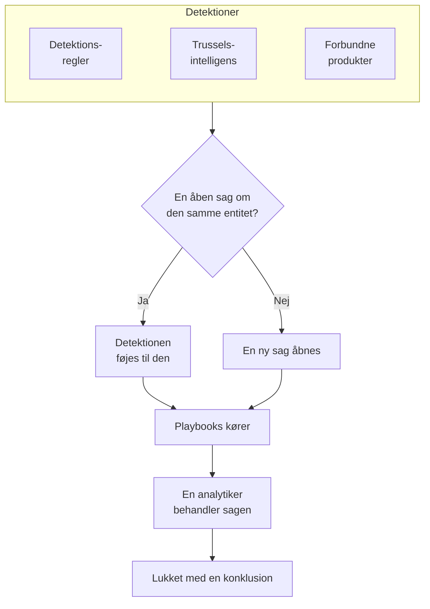

# Sikkerhedssager og playbooks (SOAR)

Security Events gør det, som dine detektionsregler, din trusselsintelligens og dine forbundne sikkerhedsprodukter finder, til sager: én sag for hver ting, der er værd at undersøge, med alle detektioner om den samme bruger, vært eller adresse samlet i den. Analytikere behandler sagerne i en kø, og playbooks reagerer på dem, af sig selv eller med et klik.

:::cards
- [Hvor sager kommer fra](#hvor-sager-kommer-fra): Detektionsregler, trusselsintelligens, forbundne produkter og personer.
- [Behandl en sag](#behandl-en-sag): Tildel den, undersøg dens entiteter, og luk den med en konklusion.
- [Sagsprioriteter og sagsstatusser](#sagsprioriteter-og-sagsstatusser): Omdøb dem, giv dem en anden farve og rækkefølge, og tilføj dine egne.
- [Notifikationer](#notifikationer): Hvem der får besked om en ny sag, en tildeling og et trin, der venter på godkendelse.
- [Playbooks](#playbooks): Trin, der kører på en sag, med godkendelse, hvor det betyder noget.
- [Oversigten](#oversigten): Det, der kræver nogens indsats nu, og hvor hurtigt sager bliver håndteret.
:::

## Sådan virker det

Åbn **Produkter → Security Events → Sikkerhedssager → Åbne sager** for køen. **Tildelt mig**, **Ikke tildelt**, **Lukkede sager** og **Alle sager** er sider for sig ved siden af, og hver viser de sager, navnet siger.

## Før du begynder

Sager og playbooks følger de tre Security-roller. Project Owner og Project Admin kan alt.

| Rolle | Hvad den kan |
| --- | --- |
| Security Admin | Alt, også at slette sager og sætte playbooks op |
| Security Member | Åbne, tildele, ændre og lukke sager, skrive noter, køre playbooks og godkende eller afvise deres trin |
| Security Viewer | Læse sager, detektioner, noter, playbooks og deres kørsler |

Hver af disse rettigheder kan også tildeles for sig, fra at oprette en sag til at godkende en playbooks trin; se [Tilladelsesreference](/docs/permissions/reference).

## Hvor sager kommer fra

| Kilde | Åbner en sag, når | Slås fra med |
| --- | --- | --- |
| Detektionsregler | En regel matcher | **Open a Case on Match** i regelens trin **Ved match** |
| Trusselsintelligens | En begivenhed nævner en kendt indikator | **Open a Case on Match** i feedets trin **Ved match** |
| Forbundne produkter | En advarsel fra selve produktet importeres på eller over forbindelsens tærskel | **Open Cases From** sat til **Aldrig** i forbindelsens trin **Polling** |
| Personer | Nogen åbner en fra **Sikkerhedssager** eller med **Open Case** i en begivenheds panel | Ingen |

Alle kilder er slået til som standard. En forbindelse åbner sager for **Høj og højere**, medmindre du vælger et andet niveau; advarslerne under det importeres stadig som begivenheder.

### Sådan grupperes detektioner

En detektion handler om en entitet: den værdi, dens regel grupperer efter, f.eks. IP-adressen i en brute force-regel, eller den indikator, et match fra trusselsintelligens nævner. En detektion uden en entitet står alene.

- Når en åben sag allerede handler om den entitet, føjes detektionen til den. Sagens entiteter og ATT&CK-mapping vokser, og dens prioritet hæves til detektionens, men sænkes aldrig.
- Når ingen åben sag gør det, åbnes en ny sag, opkaldt efter detektionen, med detektionens prioritet.
- En detektion, der udløses igen, tæller op på sin række i stedet for at tilføje en ny.

En sags prioritet kommer fra detektionens alvorlighed, som projektets indbyggede prioritet for det niveau, uanset hvad du har kaldt den:

| Alvorlighed | Prioritet |
| --- | --- |
| Critical eller Fatal | Kritisk |
| High | High |
| Medium, Unknown eller Other | Medium |
| Low | Low |
| Informational | Til orientering |

## Behandl en sag

Et nyt projekts sager bevæger sig gennem fire statusser, som du kan omdøbe og supplere (se [Sagsprioriteter og sagsstatusser](#sagsprioriteter-og-sagsstatusser)). En sag kan springe en over, f.eks. en false positive, der lukkes direkte fra Ny, og den kan genåbnes.

| Status | Betyder |
| --- | --- |
| Ny | Ingen har kigget på den endnu |
| Undersøger | Nogen er ved at finde ud af, hvad der skete |
| Contained | Truslen kan ikke længere gøre skade; oprydningen mangler stadig |
| Lukket | Færdig, med en konklusion om, hvad det var |

En sag har sin egen sidemenu, ligesom en hændelse, og hver del af sagen er en side for sig:

| Afsnit i sidemenuen | Sider |
| --- | --- |
| **Oversigt** | **Oversigt**, **Tidslinje** |
| **Undersøgelse** | **Detections**, **Entiteter**, **Playbook-kørsler** |
| **Noter** | **Private noter** |
| **Avanceret** | **Auditlogs**, **Slet sag**, foldet sammen, indtil du klikker på **Avanceret** |

Hver side beholder sagens sidehoved øverst: nummer, prioritet, status og titel, **Tildel til mig**, **Run Playbook**, **Erklær hændelse** og **Close Case**, og i menuen ⋯ ved siden af **Angiv prioritet**, **Tildel til en anden**, **Skift status**, **Rediger sag** og **Slet sag**. Så kan sagen behandles fra enhver af dens sider, og et link til sagen åbner stadig dens **Oversigt**.

- **Oversigt**: sagens beskrivelse, etiketter og statustrin, hvem der har den, og hvad der åbnede den, og dens tal: hvor mange detektioner den har, hvor længe den har været åben, og hvor lang tid det tog at kvittere for den og inddæmme den.
- **OneUptime AI**, på **Oversigt**: hvad OneUptime AI fik ud af sagen, den prioritet og playbook, den foreslår, og beviserne bag. Se [OneUptime AI i sikkerhed](/docs/telemetry/security-ai).
- **MITRE ATT&CK**, på **Oversigt**: de taktikker og teknikker, som sagens detektioner knyttes til, hver med et link til sin side på attack.mitre.org.
- **Tidslinje**: alt, hvad der skete med sagen, med hvem der gjorde det.
- **Detections**: det, der blev udløst og åbnede sagen eller blev føjet til den, hvor ofte, og den seneste matchende begivenhed.
- **Entiteter**: de brugere, værter og adresser, sagen handler om, med deres aktivitet på tværs af alle dine sikkerhedsbegivenheder de seneste 7 dage. Hver af dem åbnes i **Korrelér**.
- **Playbook-kørsler**: hvad hver playbook gjorde på sagen, trin for trin, og de trin, der venter på godkendelse. Mens kørsler venter, viser menuen, hvor mange de er, ved siden af **Playbook-kørsler**.
- **Private noter**: hvad teamet skrev om sagen.
- **Auditlogs**: hver ændring af sagen, og hvem der lavede den. Se [Auditlogs](/docs/configuration/audit-logs).
- **Slet sag**: sletter sagen for altid, med dens detektioner, noter, tidslinje og playbook-kørsler. Vil du beholde den som dokumentation, så luk den i stedet med en konklusion.

### Behandl sager fra køen

Du behøver ikke åbne en sag for at behandle den. I køens lister har menuen ⋯ på en sags række **Tildel til mig**, **Tildel til en anden**, **Skift status** og **Skift prioritet**. For at behandle flere sager på én gang vælger du dem og bruger de samme handlinger under **Massehandlinger**: De viser, hvilke sager der blev ændret, hvilke der blev ladt være, og hvorfor.

- For at give en sag til en anden bruger du **Tildel til en anden** og vælger én person eller et team. Et teams sag venter under **Ikke tildelt**, indtil nogen fra teamet tager den.
- En status, der lukker en sag, beder om en konklusion og en afsluttende note, ligesom **Close Case** gør.
- En lukket sag tildeles ikke nogen. For at arbejde med den igen genåbner du den med **Skift status**.

### Luk en sag

**Close Case** beder om en konklusion og en valgfri afsluttende note:

| Konklusion | Betyder |
| --- | --- |
| True Positive | Ondsindet eller uautoriseret aktivitet fandt faktisk sted |
| Benign Positive | Aktiviteten var reel, men forventet, f.eks. en penetrationstest eller en administrativ opgave |
| False Positive | Detektionen var forkert: reglen eller dataene fejltolkede normal aktivitet |
| Undetermined | Der var ikke nok information til at afgøre det |

Konklusionerne tælles på oversigten. En regel, hvis sager bliver ved med at blive lukket som False Positive, er en regel, der bør finjusteres.

En sag, der er åbnet fra Google SecOps-advarsler, lukker dem også i Google SecOps med afgørelsen og afslutningsnoten, når dens forbindelse har **Luk advarsler, når deres sag lukkes** slået til: se [Google SecOps](/docs/integrations/google-secops#luk-advarsler-når-deres-sag-lukkes).

### Erklær en hændelse

**Erklær hændelse** åbner en OneUptime-hændelse for sagen med den alvorlighed, du vælger, og forbinder de to begge veje: hændelsens beskrivelse nævner sagen, og sagens hoved linker til hændelsen. Vagtordningen, statussider og postmortem tager over derfra. Det kræver en rolle, der både kan behandle sager og oprette hændelser.

## Sagsprioriteter og sagsstatusser

Hvert projekt har sine egne sagsprioriteter og sagsstatusser, under **Produkter → Security Events → Indstillinger → Sagsprioriteter** og **Sagsstatusser**. Omdøb dem, giv dem en anden farve, træk dem i en anden rækkefølge, og tilføj dine egne, f.eks. en status "Triage" eller en prioritet "Nødsituation" over **Kritisk**. Et nyt navn vises alle steder på én gang: i køen, på sagssiderne og oversigten, i notifikationer, i Slack og Microsoft Teams og i playbook-beskeder.

Nogle er indbyggede, fordi OneUptime læser, hvad de betyder. De kan omdøbes og få en anden farve, men ikke slettes eller arkiveres, og de beholder deres rækkefølge:

| Indbygget | Hvad OneUptime gør med den |
| --- | --- |
| Den nye status | Nye sager starter i den |
| Den kvitterede status | Når en sag når den, registreres det, hvornår sagen blev kvitteret, og **Reopen** flytter en lukket sag tilbage til den |
| Den inddæmmede status | Når en sag når den, registreres det, hvornår sagen blev inddæmmet |
| Den lukkede status | **Close Case** flytter en sag til den, med en konklusion |
| Prioriteterne Kritisk, High, Medium, Low og Til orientering | En detektion åbner sin sag med prioriteten for sin alvorlighed, og en sag, som nogen åbner, starter på Medium |

- Hvor en status står, afgør, hvad en sag i den tæller som, som kolonnen **Tæller som** viser: fra den kvitterede status og ned som kvitteret, fra den inddæmmede status og ned som inddæmmet, fra den lukkede status og ned som lukket. En status, du tilføjer, kommer lige over den lukkede status, og når du flytter en sag til en status, der lukker den, bliver du først bedt om en konklusion.
- En prioritets plads er dens hastegrad, den mest presserende først: **For Cases At Least**, valgene for notifikationer og reglerne for Slack og Microsoft Teams læser denne rækkefølge. En prioritet, du tilføjer, kommer sidst, og kolonnen **Detekteringens alvorlighed** viser, hvilke detektioner der åbner deres sager med hver indbygget prioritet.

For at holde op med at bruge en status eller prioritet, du selv har lavet, skal du bruge **Arkiver** i dens række. Ingen kan vælge den igen, og API'et, Terraform og MCP afviser den, men de sager, der har den, beholder den, og du kan stadig filtrere på den. Arkiverede værdier står i den foldede sektion **Arkiverede sagsstatusser** eller **Arkiverede sagsprioriteter** under tabellen, hvor **Fjern fra arkiv** henter en tilbage. **Slet** afvises, så længe sager har værdien, eller en playbook kører fra prioriteten.

## Notifikationer

OneUptime giver folk besked om tre ting på en sag. Ingen behøver at sætte noget op: et projekt, der kun har klikket på **Slå anbefalet til**, får besked om sine sager med prioritet High og Kritisk via e-mail og push.

| Notifikation | Hvem får besked | Som standard |
| --- | --- | --- |
| Ny sikkerhedssag | Alle, der kan se projektets sager, når en sag åbnes eller stiger, ved den prioritet, de har valgt, eller højere | E-mail og push, for sager med High og Kritisk |
| Sikkerhedssag tildelt mig | Den person, sagen er tildelt, og medlemmerne af det team, den er tildelt | E-mail og push |
| Playbook-trin venter på min godkendelse | De personer på sagen, der kan godkende trinnet: den person, sagen er tildelt, og medlemmerne af dens team. Kan ingen af dem godkende, alle i projektet, der kan | E-mail og push |

- Kun personer, der kan se sagen, får besked om den: Project Owners, Project Admins og rollerne Security Admin, Security Member og Security Viewer. En rolle, der er begrænset til bestemte etiketter, får kun besked om sagerne med de etiketter.
- Ingen får besked om det, de selv gjorde: den, der åbner en sag manuelt, tildeler den eller starter en kørsel, får ingen notifikation om det.
- Hver person hører om en sag én gang. En sag, der åbnes på Medium og senere stiger til Kritisk, når ved stigningen frem til dem, der har valgt High eller Kritisk, og ikke igen til dem, der har valgt Medium, for de hørte om den, da den blev åbnet.
- Testangrebet fra **Send et testangreb** åbner en sag, der ikke giver nogen besked.
- En sag med Kritisk og et trin, der venter på godkendelse, sendes med det samme og holdes aldrig tilbage i en [e-mailoversigt](/docs/emails/notification-rollup).
- Sagens **Tidslinje** viser, hvem der fik besked, og hvornår.

### Vælg, hvad du får besked om

Hver person vælger selv under **Brugerindstillinger → Notifikationsindstillinger → Sikkerhed**: kanalerne for hver notifikation (e-mail, sms, opkald, push, Telegram, Slack, Microsoft Teams eller webhook) og, under **Ny sikkerhedssag**, den prioritet, der giver dem besked:

| Valg | Giver besked om sager med |
| --- | --- |
| Kun Kritisk | Kritisk |
| Høj og højere | Kritisk og High (standard) |
| Mellem og højere | Kritisk, High og Medium |
| Lav og højere | Alle prioriteter undtagen Til orientering |
| Alle sager | Alle prioriteter |

Valgene følger projektets sagsprioriteter under deres egne navne: dette er et nyt projekts valg.

Der sendes ingen WhatsApp-beskeder for sikkerhedssager. En push-notifikation åbner OneUptime-appen, og dens link åbner sagen i browseren.

### Slå op i Slack- og Microsoft Teams-kanaler

For at slå op i en kanal tilføjer du en regel under **Produkter → Security Events → Arbejdsområde → Slack** (eller **Microsoft Teams**). Er ingen af dem forbundet, er sektionens eneste punkt **Forbind Slack eller Teams**. En regel angiver de kanaler, den slår op i (og i Microsoft Teams chattene), og, hvis du vil, de sager, den gælder for:

| Betingelse | Matcher på |
| --- | --- |
| Prioritet for sikkerhedssag | En af projektets sagsprioriteter, f.eks. Kritisk eller High |
| Titel på sikkerhedssag, Beskrivelse af sikkerhedssag | Tekst, som sagens titel eller beskrivelse indeholder, starter med eller slutter med |
| Status for sikkerhedssag | En af projektets sagsstatusser, f.eks. Ny eller Lukket |
| Kilde til sikkerhedssag | Detection Rule, Threat Intel, Connected Product eller Manual |
| Etiketter på sikkerhedssag | Sagens etiketter |

De tre notifikationer slås hver op i kanalerne for hver regel, sagen matcher i det øjeblik. En regel, hvor **Prioritet for sikkerhedssag** indeholder en af **Kritisk** og **High**, slår sager med High og Kritisk op, når de åbnes, og en sag med Medium, når den stiger til High. En sikkerhedssag får aldrig sin egen kanal.

## Playbooks

En playbook er en liste over trin, der kører på en sag. Opret en under **Produkter → Security Events → Playbooks**, ud fra en skabelon eller fra bunden, og tilføj dens trin på dens side. Et projekt uden playbooks ser skabelonerne i stedet for en tom liste; når der er playbooks, åbner **Opret fra skabelon** ved listen dem, med **Tilføjet** ved dem, projektet allerede har.

### Hvornår en playbook kører

| Kørsler | Hvornår |
| --- | --- |
| Case Opened | Én gang, når en sag åbnes |
| Detection Added | Hver gang en ny detektion føjes til en åben sag |
| Vurderet som sandsynligvis ondsindet | Én gang, når OneUptime AI's vurdering læser sagen som Sandsynligvis ondsindet |
| Manual | Kun når nogen kører den fra en sag |

Enhver aktiveret playbook kan også køres manuelt med **Run Playbook** på en sag. En playbook, der kører af sig selv, kan afgrænses:

- **For Cases At Least**: kun sager med denne prioritet eller højere.
- **Only For Detections From**: kun når detektionen bag sagen kom fra denne kilde.
- **Only For These Detection Rules**: kun når den kom fra en af disse regler.

En deaktiveret playbook kører hverken af sig selv eller manuelt.

### Trin

| Kategori | Trin | Hvad det gør |
| --- | --- | --- |
| Case | Assign the case | Giver sagen til en person, et team eller begge |
| Case | Set the priority | Hæver eller sænker sagens prioritet |
| Case | Set the status | Flytter sagen til en anden af projektets statusser, med den konklusion, du vælger, når den status lukker den |
| Case | Add a note | Skriver en note på sagen, f.eks. en tjekliste til analytikeren |
| Case | Add labels | Mærker sagen med etiketter |
| Investigate | Check entities against threat intel | Slår hver entitet op i din trusselsintelligens og kan hæve prioriteten ved et match |
| Investigate | Look up entity activity | Tæller hver entitets sikkerhedsbegivenheder over et nyligt tidsvindue og noterer det på sagen |
| Notify | Email people | Sender brugere og teams en opsummering af sagen på e-mail med et link til den |
| Notify | Post to Slack | Slår en opsummering af sagen op i en Slack-kanal |
| Notify | Post to Microsoft Teams | Slår en opsummering af sagen op i en Microsoft Teams-kanal |
| Escalate | Page on-call | Kører en vagtpolitik |
| Escalate | Declare an incident | Åbner en OneUptime-hændelse, der er knyttet til sagen |
| Contain | Suspend the user in Okta | Suspenderer den bruger, sagen handler om, i Okta |
| Contain | End the user's Okta sessions | Logger den bruger, sagen handler om, ud af Okta og tilbagekalder deres tokens |
| Contain | Contain the host in CrowdStrike | Isolerer den vært, sagen handler om, fra netværket med CrowdStrike Falcon |
| Contain | Isolate the device in Microsoft Defender | Isolerer den vært, sagen handler om, med Microsoft Defender for Endpoint |
| Contain | Unsuspend the user in Okta | Ophæver suspenderingen af den bruger, sagen handler om, i Okta |
| Contain | Lift containment in CrowdStrike | Ophæver CrowdStrike Falcons netværksisolering af den vært, sagen handler om |
| Contain | Release the device in Microsoft Defender | Frigiver den vært, sagen handler om, fra isoleringen i Microsoft Defender for Endpoint |
| Automate | Send a webhook | Sender sagen som JSON til en URL |
| Automate | Run a workflow | Starter et OneUptime-workflow med sagen som input |

En playbook har højst 25 trin. De kører i rækkefølge, hvert trin, når det foregående er færdigt. Hvert trin kan også:

- **Needs Approval**: stoppe kørslen før trinnet, indtil nogen godkender det på sagen. De fire trin, der lukker nogen ude, stopper altid kørslen, medmindre en Security Admin slår det fra.
- **Only If Threat Intel Matched**: springe trinnet over, medmindre et tidligere trin **Check entities against threat intel** i kørslen fandt en kendt indikator.
- **Carry On If It Fails**: køre det næste trin, selv om dette mislykkes. Er den slået fra, stopper et mislykket trin kørslen.

### Inddæmning

Contain-trinnene handler gennem en [forbindelse for sikkerhedsbegivenheder](/docs/telemetry/security-events#forbind-et-sikkerhedsprodukt) til produktet, og den skal have mere end læseadgang:

| Trin | Forbindelse | Kræver |
| --- | --- | --- |
| Suspend the user in Okta, End the user's Okta sessions, Unsuspend the user in Okta | Okta System Log | Et API-token, der må administrere brugere |
| Contain the host in CrowdStrike, Lift containment in CrowdStrike | CrowdStrike Falcon | En API-klient med skriveadgang til scopet Hosts |
| Isolate the device in Microsoft Defender, Release the device in Microsoft Defender | Microsoft Defender XDR | En app med tilladelsen Machine.Isolate |

Et Contain-trin handler kun på de brugere eller værter, sagen handler om, aldrig på alle dem, den nævner:

- Den værdi, en af sagens detektioner er grupperet efter, f.eks. den konto, en regel for umulige rejser grupperer efter, eller den vært, en advarsel fra et forbundet produkt nævner.
- En bruger eller vært i sagen, som din trusselsintelligens kender som en indikator.

En sag, der er grupperet efter en adresse, f.eks. et brute force-angreb mod din VPN, handler om ingen af delene: dens Contain-trin springes over, og den forsøgte konto og den ramte gateway lades i fred. Et trin handler på højst 10 brugere eller værter. Det finder hver af dem i produktet ud fra navnet og skriver på kørslen, hvad det gjorde med hver enkelt: udført, allerede udført, ikke fundet, afvist eller beskyttet.

#### Beskyttede entiteter

**Protected Entities**, under **Playbooks** i menuen, viser de brugere og værter, som ingen playbook inddæmmer, f.eks. nødadgangskonti, domænecontrollere og VPN-gateways. En værdi matcher uden forskel på store og små bogstaver, og `*` står for en vilkårlig række tegn: `svc-*` beskytter alle tjenestekonti. Et trin melder en beskyttet bruger eller vært som beskyttet og lader den være i fred. Security Admins vedligeholder listen.

#### Godkendelse

De fire trin, der lukker nogen ude, venter på godkendelse. Kun en Security Admin kan slå **Needs Approval** fra for et af dem, og OneUptime registrerer, hvem der gjorde det. Godkendelsen viser under **Act On** de brugere eller værter, trinnet ville handle på, alle markeret: fjern markeringen ved dem, det skal lade være i fred. Beskyttede brugere og værter tilbydes ikke. Den, der startede en kørsel, kan ikke godkende dens trin: det gør en anden, men vedkommende kan stadig afvise det.

#### Fortryd

Fortryd-trinnene handler på de brugere eller værter, sagen handler om, ligesom de trin, de fortryder. Når kørslen er stoppet, har en inddæmmet bruger eller vært også sin egen knap på sit trin: **Unsuspend**, **Lift Containment** eller **Frigiv**. En afsluttet Okta-session kan ikke fortrydes. Alt, hvad der fortrydes, gemmes på sagens tidslinje og i projektets auditlog.

### Beskeder

En note, en e-mail, et Slack-opslag og et Teams-opslag kan bruge sagens værdier:

| Pladsholder | Bliver til |
| --- | --- |
| `{{case.number}}` | Sagsnummeret, f.eks. CASE-42 |
| `{{case.title}}` | Sagens titel |
| `{{case.priority}}` | Sagens prioritet, som dit projekt kalder den, f.eks. High |
| `{{case.status}}` | Sagens status, som dit projekt kalder den, f.eks. Investigating |
| `{{case.assignee}}` | Hvem sagen er tildelt |
| `{{case.url}}` | Et link til sagen i OneUptime |
| `{{case.entities}}` | De brugere, værter og adresser, sagen handler om |
| `{{case.detections}}` | Hvor mange detektioner sagen indeholder |

En e-mail eller et opslag uden egen besked sender en opsummering af sagen.

### Kørsler og godkendelser

Hver kørsel vises på sin sag og under **Produkter → Security Events → Playbooks → Playbook-kørsler**, trin for trin:

| Kørselsstatus | Betyder |
| --- | --- |
| Queued | Venter på en worker |
| Kører | Kører sine trin |
| Waiting for Approval | Holdt tilbage før et trin, der kræver godkendelse |
| Lykkedes | Alle trin kørte eller blev sprunget over |
| Mislykkedes | Et trin mislykkedes, og kørslen stoppede |
| Annulleret | Nogen annullerede den eller afviste et trin |

Et trin, der venter på godkendelse, viser **Approve** og **Reject** på kørslen med en valgfri kommentar. En godkendelse fører kørslen videre fra det trin; en afvisning afslutter den. Beslutningen, hvem der traf den, og deres kommentar gemmes på trinnet, på sagens tidslinje og i projektets auditlog. **Venter på godkendelse**, under **Playbooks** i menuen, viser de kørsler, der venter på en beslutning, og tæller dem; **Playbook-kørsler** viser hver kørsel. På **Playbook-kørsler** og på en playbooks side er hver kørsel én linje, der siger, hvor langt den nåede, eller hvilket trin den stoppede ved; **Vis trin** åbner dens trin. En kørsel, der venter på godkendelse, åbner af sig selv.

En kørsel, der holder op med at høre fra sin worker, f.eks. efter en genstart, bliver samlet op igen: en kørsel i kø sættes i kø igen efter 2 minutter, og en kørsel, der ikke har meldt noget i 30 minutter, markeres som mislykket.

## Oversigten

**Produkter → Security Events → Oversigt** er der, hvor produktet åbner:

- De åbne sager, der er tildelt dig, de åbne sager, som ingen har taget, og de playbook-trin, der venter på godkendelse; hvert tal åbner siden, der viser dem.
- **Gennemsnitlig tid til kvittering**, **Gennemsnitlig tid til inddæmning** og **Gennemsnitlig tid til lukning** over de sager, der er åbnet inden for de seneste 30 dage: fra en sag åbnes, til nogen tager den (tildeler en person eller flytter den til en status, der tæller som kvitteret), til en status, der tæller som inddæmmet, og til en, der tæller som lukket. En sag, der stadig venter, tælles ikke med i et gennemsnit.
- De sager, der er åbnet hver dag i 30 dage, efter prioritet, og de detektioner, der er rejst hver dag i 14 dage, efter kilde.
- De åbne sager efter prioritet og efter status, de entiteter, som flest fund nævner, de detektioner, der blev udløst oftest, ATT&CK-taktikkerne bag sagerne og konklusionerne fra de seneste 30 dage.

Over dem viser et bånd, hvordan sikkerhed er sat op: dens kilder, detektioner, sager og playbooks, hver med sine tal. Et projekt, der endnu ikke har sat det op, ser **Slå anbefalet til** og **Send et testangreb** der; se [Kom godt i gang med sikkerhed](/docs/telemetry/security-getting-started). Når intet kræver nogen, siger siden **Alt er roligt**, og diagrammerne vises, så snart der er noget at vise.

## Find trusler

- **Entiteter** rangerer de brugere, værter, adresser og hashes, som dine fund nævner oftest, over det seneste døgn, den seneste uge eller måned, og slår enhver værdi op på tværs af 30 dages begivenheder. Vælg en entitet for at åbne den i **Korrelér**.
- **Rule Library** har færdige detektionsregler til trusler mod identitet, endpoints, cloud, netværk, web og Kubernetes. Hver er en Sigma-regel, skrevet til de felter, som alle forbundne kilder normaliseres til. Dens række viser, hvad den finder, de MITRE ATT&CK-taktikker og -teknikker, den er mærket med, de hændelser, den læser, og om der er kommet nogen inden for de seneste 7 dage (**Modtages** eller **Modtages ikke**), samt dens alvorlighed. Afgræns listen efter kategori, efter de data, reglerne læser, og efter om du har tilføjet dem, eller søg i den efter navn, ATT&CK-teknik eller alvorlighed; sidens adresse husker filtrene. Vælg en regel for at se detaljerne: hvordan du begynder at sende de hændelser, den læser, hvordan den kører, og dens Sigma-regel. **Tilføj** opretter den som din egen detektionsregel, slået til, og den åbner sager i stedet for advarsler; du ændrer den under **Detection Rules** som enhver anden. Reglerne markeret **Anbefalet** finder trusler i data, OneUptime allerede har, og én knap tilføjer dem, du ikke har endnu.
- **ATT&CK Coverage** viser taktikkerne i MITRE ATT&CK, hver med hvor mange af dens teknikker dine aktiverede regler dækker, og hvor mange flere **Rule Library** har regler til. Åbn en taktik for dens teknikker, eller skift til **Matrix** for hele matricen. Vælg en teknik for at se de regler fra biblioteket, der dækker den, og åbne **Rule Library** på dem.

## Automatisér

- **Arbejdsgange**: en sag eller en note kan starte et workflow, når den oprettes, opdateres eller slettes. Et trin **Run a workflow** starter et workflow, hvis trigger er en webhook.
- **API**: sager, noter, detektioner, playbooks, kørsler, beskyttede entiteter samt sagsprioriteter og sagsstatusser har det samme REST API som resten af OneUptime, under `/security-case`, `/security-case-note`, `/security-detection`, `/security-playbook`, `/security-playbook-run`, `/security-protected-entity`, `/security-case-priority` og `/security-case-status`. Se [API-reference](/docs/api-reference/api-reference).
- AI-agenter: MCP-serveren har værktøjer til sager, noter, detektioner, playbooks samt sagsprioriteter og sagsstatusser. Se [MCP-server](/docs/ai/mcp-server).
- Terraform: ressourcerne `oneuptime_security_case_priority` og `oneuptime_security_case_status` holder et projekts prioriteter og statusser som kode.

## Fejlfinding

:::details En regel matcher, men ingen sag åbnes
Tjek **Open a Case on Match** i regelens trin **Ved match**. En detektion om en entitet, der allerede har en åben sag, føjes til den sag i stedet for at åbne en ny: kig efter den under **Detections** på den åbne sag.
:::

:::details Ingen fik besked om en sag
Se sagens **Tidslinje**, som viser, hvem der fik en notifikation. En notifikation om **Ny sikkerhedssag** går til de personer, hvis valgte prioritet sagen når, så en sag med Medium giver ikke besked til nogen, der har beholdt standarden, **Høj og højere**. Tjek, at de personer, der burde få besked, kan se sikkerhedssager (en Security-rolle, Project Owner eller Project Admin), og at notifikationen er slået til for dem under **Brugerindstillinger → Notifikationsindstillinger → Sikkerhed**.
:::

:::details En playbook kørte ikke
Tjek, at den er aktiveret, at dens indstilling **Trigger** passer (Case Opened kører én gang, når en sag åbnes), og at sagen opfylder dens indstillinger **For Cases At Least**, **Only For Detections From** og **Only For These Detection Rules**. En sag, der er åbnet manuelt, har ingen detektion, så en playbook, der er begrænset til en kilde eller til regler, kører ikke på den.
:::

:::details Et Contain-trin mislykkedes
Åbn kørslen på sagen: trinnet fortæller for hver bruger eller vært, om produktet afviste den, ikke fandt den eller ikke kunne nås. Tjek, at forbindelsens legitimation må foretage ændringen, og brug **Test forbindelse** i dens række.
:::

:::details Et Contain-trin blev sprunget over
Sagen handler ikke om nogen bruger eller vært, f.eks. kun om en adresse, eller alle de brugere eller værter, den handler om, er beskyttede. Åbn kørslen på sagen: trinnet fortæller, hvilken af de to det er.
:::

:::details En status eller prioritet kan ikke slettes eller arkiveres
En indbygget kan omdøbes og få en anden farve, men aldrig slettes eller arkiveres: dens **Arkiver** er låst, med begrundelsen. En af dine egne kan ikke slettes, så længe sager har den, eller en playbook kører fra den: flyt først sagerne til en anden, eller arkiver den.
:::

## Næste trin

:::cards
- [Sikkerhedsbegivenheder](/docs/telemetry/security-events): Send begivenheder, skriv detektionsregler, og forbind sikkerhedsprodukter.
- [Trusselsintelligens](/docs/telemetry/threat-intelligence): Match dine begivenheder mod STIX/TAXII-feeds.
- [OneUptime AI i sikkerhed](/docs/telemetry/security-ai): Vurder sager, skriv udkast til detektionsregler, og spørg om sikkerhed med AI.
- [Tilladelsesreference](/docs/permissions/reference): Security-rollerne, og hvad hver af dem kan.
:::
