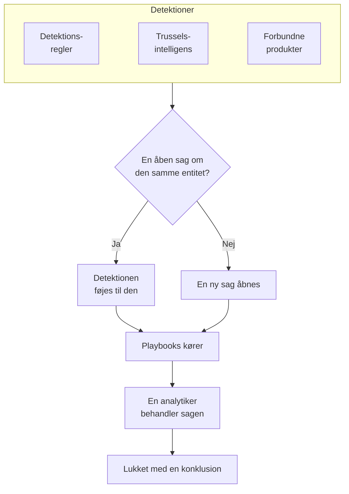

# Sikkerhedssager og playbooks (SOAR)

Security Events gør det, som dine detektionsregler, din trusselsintelligens og dine forbundne sikkerhedsprodukter finder, til sager: én sag for hver ting, der er værd at undersøge, med alle detektioner om den samme bruger, vært eller adresse samlet i den. Analytikere behandler sagerne i en kø, og playbooks reagerer på dem, af sig selv eller med et klik.

:::cards
- [Hvor sager kommer fra](#hvor-sager-kommer-fra): Detektionsregler, trusselsintelligens, forbundne produkter og personer.
- [Behandl en sag](#behandl-en-sag): Tildel den, undersøg dens entiteter, og luk den med en konklusion.
- [Playbooks](#playbooks): Trin, der kører på en sag, med godkendelse, hvor det betyder noget.
- [Oversigten](#oversigten): Det, der kræver nogens indsats nu, og hvor hurtigt sager bliver håndteret.
:::

## Sådan virker det

Åbn **Produkter → Security Events → Security Cases**. Køen viser først de åbne sager; **Assigned to Me**, **Unassigned**, **Lukket** og **Alle** er de andre visninger.

## Før du begynder

Sager og playbooks følger de tre Security-roller. Project Owner og Project Admin kan alt.

| Rolle | Hvad den kan |
| --- | --- |
| Security Admin | Alt, også at slette sager og sætte playbooks op |
| Security Member | Åbne, tildele, ændre og lukke sager, skrive noter, køre playbooks og godkende eller afvise deres trin |
| Security Viewer | Læse sager, detektioner, noter, playbooks og deres kørsler |

Hver af disse rettigheder kan også tildeles for sig, fra at oprette en sag til at godkende en playbooks trin; se [Tilladelsesreference](/docs/permissions/reference).

## Hvor sager kommer fra

| Kilde | Åbner en sag, når | Slås fra med |
| --- | --- | --- |
| Detektionsregler | En regel matcher | **Open a Case on Match** i regelens trin **Ved match** |
| Trusselsintelligens | En begivenhed nævner en kendt indikator | **Open a Case on Match** i feedets trin **Ved match** |
| Forbundne produkter | En advarsel fra selve produktet importeres på eller over forbindelsens tærskel | **Open Cases From** sat til **Aldrig** i forbindelsens trin **Polling** |
| Personer | Nogen åbner en fra **Security Cases** eller med **Open Case** i en begivenheds panel | Ingen |

Alle kilder er slået til som standard. En forbindelse åbner sager for **High and above**, medmindre du vælger et andet niveau; advarslerne under det importeres stadig som begivenheder.

### Sådan grupperes detektioner

En detektion handler om en entitet: den værdi, dens regel grupperer efter, f.eks. IP-adressen i en brute force-regel, eller den indikator, et match fra trusselsintelligens nævner. En detektion uden en entitet står alene.

- Når en åben sag allerede handler om den entitet, føjes detektionen til den. Sagens entiteter og ATT&CK-mapping vokser, og dens prioritet hæves til detektionens, men sænkes aldrig.
- Når ingen åben sag gør det, åbnes en ny sag, opkaldt efter detektionen, med detektionens prioritet.
- En detektion, der udløses igen, tæller op på sin række i stedet for at tilføje en ny.

En sags prioritet kommer fra detektionens alvorlighed:

| Alvorlighed | Prioritet |
| --- | --- |
| Critical eller Fatal | Kritisk |
| High | High |
| Medium, Unknown eller Other | Medium |
| Low | Low |
| Informational | Til orientering |

## Behandl en sag

En sag bevæger sig gennem fire statusser. Den kan springe en over, f.eks. en false positive, der lukkes direkte fra Ny, og den kan genåbnes.

| Status | Betyder |
| --- | --- |
| Ny | Ingen har kigget på den endnu |
| Undersøger | Nogen er ved at finde ud af, hvad der skete |
| Contained | Truslen kan ikke længere gøre skade; oprydningen mangler stadig |
| Lukket | Færdig, med en konklusion om, hvad det var |

Sagens side har alt, hvad du skal bruge for at behandle den:

- Øverst: **Assign to Me**, **Run Playbook**, **Erklær hændelse** og **Close Case**, statustrinnene og prioriteten under menuen ved siden af dem.
- **Detections**: det, der blev udløst og åbnede sagen eller blev føjet til den, hvor ofte, og den seneste matchende begivenhed.
- **Entiteter**: de brugere, værter og adresser, sagen handler om, med deres aktivitet på tværs af alle dine sikkerhedsbegivenheder de seneste 7 dage. Hver af dem åbnes i **Korrelér**.
- **MITRE ATT&CK**: de taktikker og teknikker, som sagens detektioner knyttes til, hver med et link til sin side på attack.mitre.org.
- **Playbook Runs**: hvad hver playbook gjorde på sagen, trin for trin, og de trin, der venter på godkendelse.
- **Noter** og **Tidslinje**: hvad teamet skrev, og alt, hvad der skete, med hvem der gjorde det.

For at behandle flere sager på én gang vælger du dem i køen og bruger **Assign to Me**, **Change Status** eller **Change Priority**.

### Luk en sag

**Close Case** beder om en konklusion og en valgfri afsluttende note:

| Konklusion | Betyder |
| --- | --- |
| True Positive | Ondsindet eller uautoriseret aktivitet fandt faktisk sted |
| Benign Positive | Aktiviteten var reel, men forventet, f.eks. en penetrationstest eller en administrativ opgave |
| False Positive | Detektionen var forkert: reglen eller dataene fejltolkede normal aktivitet |
| Undetermined | Der var ikke nok information til at afgøre det |

Konklusionerne tælles på oversigten. En regel, hvis sager bliver ved med at blive lukket som False Positive, er en regel, der bør finjusteres.

### Erklær en hændelse

**Erklær hændelse** åbner en OneUptime-hændelse for sagen med den alvorlighed, du vælger, og forbinder de to begge veje: hændelsens beskrivelse nævner sagen, og sagens hoved linker til hændelsen. Vagtordningen, statussider og postmortem tager over derfra. Det kræver en rolle, der både kan behandle sager og oprette hændelser.

## Playbooks

En playbook er en liste over trin, der kører på en sag. Opret en under **Produkter → Security Events → Playbooks**, ud fra en skabelon eller fra bunden, og tilføj dens trin på dens side.

### Hvornår en playbook kører

| Kørsler | Hvornår |
| --- | --- |
| Case Opened | Én gang, når en sag åbnes |
| Detection Added | Hver gang en ny detektion føjes til en åben sag |
| Manual | Kun når nogen kører den fra en sag |

Enhver aktiveret playbook kan også køres manuelt med **Run Playbook** på en sag. En playbook, der kører af sig selv, kan afgrænses:

- **For Cases At Least**: kun sager med denne prioritet eller højere.
- **Only For Detections From**: kun når detektionen bag sagen kom fra denne kilde.
- **Only For These Detection Rules**: kun når den kom fra en af disse regler.

En deaktiveret playbook kører hverken af sig selv eller manuelt.

### Trin

| Kategori | Trin | Hvad det gør |
| --- | --- | --- |
| Case | Assign the case | Giver sagen til en person, et team eller begge |
| Case | Set the priority | Hæver eller sænker sagens prioritet |
| Case | Set the status | Flytter sagen til Undersøger, Contained eller Lukket med den konklusion, du vælger |
| Case | Add a note | Skriver en note på sagen, f.eks. en tjekliste til analytikeren |
| Case | Add labels | Mærker sagen med etiketter |
| Investigate | Check entities against threat intel | Slår hver entitet op i din trusselsintelligens og kan hæve prioriteten ved et match |
| Investigate | Look up entity activity | Tæller hver entitets sikkerhedsbegivenheder over et nyligt tidsvindue og noterer det på sagen |
| Notify | Email people | Sender brugere og teams en opsummering af sagen på e-mail med et link til den |
| Notify | Post to Slack | Slår en opsummering af sagen op i en Slack-kanal |
| Notify | Post to Microsoft Teams | Slår en opsummering af sagen op i en Microsoft Teams-kanal |
| Escalate | Page on-call | Kører en vagtpolitik |
| Escalate | Declare an incident | Åbner en OneUptime-hændelse, der er knyttet til sagen |
| Contain | Suspend the user in Okta | Suspenderer hver af sagens brugere i Okta |
| Contain | End the user's Okta sessions | Logger hver af sagens brugere ud af Okta og tilbagekalder deres tokens |
| Contain | Contain the host in CrowdStrike | Isolerer hver af sagens værter fra netværket med CrowdStrike Falcon |
| Contain | Isolate the device in Microsoft Defender | Isolerer hver af sagens værter med Microsoft Defender for Endpoint |
| Automate | Send a webhook | Sender sagen som JSON til en URL |
| Automate | Run a workflow | Starter et OneUptime-workflow med sagen som input |

En playbook har højst 25 trin. De kører i rækkefølge, hvert trin, når det foregående er færdigt. Hvert trin kan også:

- **Needs Approval**: stoppe kørslen før trinnet, indtil nogen godkender det på sagen. Det er slået til som standard for de fire Contain-trin, som handler uden for OneUptime.
- **Only If Threat Intel Matched**: springe trinnet over, medmindre et tidligere trin **Check entities against threat intel** i kørslen fandt en kendt indikator.
- **Carry On If It Fails**: køre det næste trin, selv om dette mislykkes. Er den slået fra, stopper et mislykket trin kørslen.

### Inddæmning

Contain-trinnene handler gennem en [forbindelse for sikkerhedsbegivenheder](/docs/telemetry/security-events#forbind-et-sikkerhedsprodukt) til produktet, og den skal have mere end læseadgang:

| Trin | Forbindelse | Kræver |
| --- | --- | --- |
| Suspend the user in Okta, End the user's Okta sessions | Okta System Log | Et API-token, der må administrere brugere |
| Contain the host in CrowdStrike | CrowdStrike Falcon | En API-klient med skriveadgang til scopet Hosts |
| Isolate the device in Microsoft Defender | Microsoft Defender XDR | En app med tilladelsen Machine.Isolate |

Et Contain-trin handler på højst 10 af sagens brugere eller værter. Det finder hver af dem i produktet ud fra navnet og skriver på sagen, hvad det gjorde med hver enkelt: inddæmmet, allerede inddæmmet, ikke fundet eller afvist.

### Beskeder

En note, en e-mail, et Slack-opslag og et Teams-opslag kan bruge sagens værdier:

| Pladsholder | Bliver til |
| --- | --- |
| `{{case.number}}` | Sagsnummeret, f.eks. CASE-42 |
| `{{case.title}}` | Sagens titel |
| `{{case.priority}}` | Critical, High, Medium, Low eller Informational |
| `{{case.status}}` | New, Investigating, Contained eller Closed |
| `{{case.assignee}}` | Hvem sagen er tildelt |
| `{{case.url}}` | Et link til sagen i OneUptime |
| `{{case.entities}}` | De brugere, værter og adresser, sagen handler om |
| `{{case.detections}}` | Hvor mange detektioner sagen indeholder |

En e-mail eller et opslag uden egen besked sender en opsummering af sagen.

### Kørsler og godkendelser

Hver kørsel vises på sin sag og under **Produkter → Security Events → Playbooks → Playbook Runs**, trin for trin:

| Kørselsstatus | Betyder |
| --- | --- |
| Queued | Venter på en worker |
| Kører | Kører sine trin |
| Waiting for Approval | Holdt tilbage før et trin, der kræver godkendelse |
| Lykkedes | Alle trin kørte eller blev sprunget over |
| Mislykkedes | Et trin mislykkedes, og kørslen stoppede |
| Annulleret | Nogen annullerede den eller afviste et trin |

Et trin, der venter på godkendelse, viser **Approve** og **Reject** på kørslen med en valgfri kommentar. En godkendelse fører kørslen videre fra det trin; en afvisning afslutter den. Beslutningen, hvem der traf den, og deres kommentar gemmes på trinnet og på sagens tidslinje. **Playbook Runs** viser først de kørsler, der venter på godkendelse, og menupunktet **Playbooks** tæller dem.

En kørsel, der holder op med at høre fra sin worker, f.eks. efter en genstart, bliver samlet op igen: en kørsel i kø sættes i kø igen efter 2 minutter, og en kørsel, der ikke har meldt noget i 30 minutter, markeres som mislykket.

## Oversigten

**Produkter → Security Events → Oversigt** er der, hvor produktet åbner:

- De åbne sager, der er tildelt dig, de åbne sager, som ingen har taget, og de playbook-trin, der venter på godkendelse.
- **Mean Time to Acknowledge**, **Mean Time to Contain** og **Mean Time to Close** over de sager, der er åbnet inden for de seneste 30 dage: fra en sag åbnes, til nogen tager den (tildeler en person eller flytter den ud af Ny), til Contained og til Lukket. En sag, der stadig venter, tælles ikke med i et gennemsnit.
- De sager, der er åbnet hver dag i 30 dage, efter prioritet, og de detektioner, der er rejst hver dag i 14 dage, efter kilde.
- De åbne sager efter prioritet og efter status, konklusionerne fra de seneste 30 dage, ATT&CK-taktikkerne bag sagerne, de detektioner, der blev udløst oftest, og de entiteter, som flest fund nævner.

Over dem viser et bånd, hvordan sikkerhed er sat op: dens kilder, detektioner, sager og playbooks, hver med sine tal. Et projekt, der endnu ikke har sat det op, ser **Turn on recommended** og **Send a test attack** der; se [Kom godt i gang med sikkerhed](/docs/telemetry/security-getting-started). Når intet kræver nogen, siger siden **All quiet**, og diagrammerne vises, så snart der er noget at vise.

## Find trusler

- **Entiteter** rangerer de brugere, værter, adresser og hashes, som dine fund nævner oftest, over det seneste døgn, den seneste uge eller måned, og slår enhver værdi op på tværs af 30 dages begivenheder.
- **Rule Library** har færdige detektionsregler til trusler mod identitet, endpoints, cloud, netværk, web og Kubernetes. Hver er en Sigma-regel, skrevet til de felter, som alle forbundne kilder normaliseres til. **Tilføj regel** opretter den som din egen detektionsregel, slået til, og den åbner sager i stedet for advarsler; du ændrer den under **Detection Rules** som enhver anden. Reglerne markeret **Anbefalet** finder trusler i data, OneUptime allerede har, og én knap tilføjer dem, du ikke har endnu.
- **ATT&CK Coverage** tegner MITRE ATT&CK-matricen, fremhæver de teknikker, dine aktiverede regler dækker, og sætter en ramme om dem, en regel fra biblioteket ville dække.

## Automatisér

- **Arbejdsgange**: en sag eller en note kan starte et workflow, når den oprettes, opdateres eller slettes. Et trin **Run a workflow** starter et workflow, hvis trigger er en webhook.
- **API**: sager, noter, detektioner, playbooks og kørsler har det samme REST API som resten af OneUptime, under `/security-case`, `/security-case-note`, `/security-detection`, `/security-playbook` og `/security-playbook-run`. Se [API-reference](/docs/api-reference/api-reference).
- AI-agenter: MCP-serveren har værktøjer til sager, noter, detektioner og playbooks. Se [MCP-server](/docs/ai/mcp-server).

## Fejlfinding

:::details En regel matcher, men ingen sag åbnes
Tjek **Open a Case on Match** i regelens trin **Ved match**. En detektion om en entitet, der allerede har en åben sag, føjes til den sag i stedet for at åbne en ny: kig efter den under **Detections** på den åbne sag.
:::

:::details En playbook kørte ikke
Tjek, at den er aktiveret, at dens indstilling **Trigger** passer (Case Opened kører én gang, når en sag åbnes), og at sagen opfylder dens indstillinger **For Cases At Least**, **Only For Detections From** og **Only For These Detection Rules**. En sag, der er åbnet manuelt, har ingen detektion, så en playbook, der er begrænset til en kilde eller til regler, kører ikke på den.
:::

:::details Et Contain-trin mislykkedes
Åbn kørslen på sagen: trinnet fortæller for hver bruger eller vært, om produktet afviste den, ikke fandt den eller ikke kunne nås. Tjek, at forbindelsens legitimation må foretage ændringen, og brug **Test forbindelse** i dens række.
:::

## Næste trin

:::cards
- [Sikkerhedsbegivenheder](/docs/telemetry/security-events): Send begivenheder, skriv detektionsregler, og forbind sikkerhedsprodukter.
- [Trusselsintelligens](/docs/telemetry/threat-intelligence): Match dine begivenheder mod STIX/TAXII-feeds.
- [Tilladelsesreference](/docs/permissions/reference): Security-rollerne, og hvad hver af dem kan.
:::
