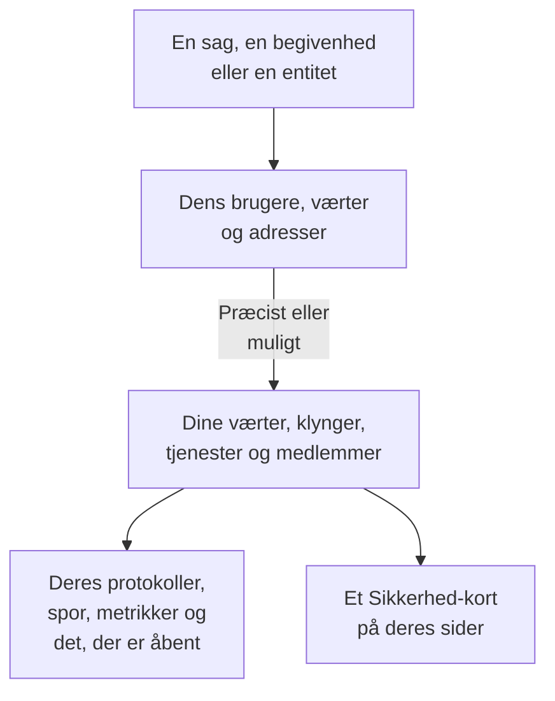

# Forbundne signaler

En sikkerhedssag siger, hvilke brugere, værter og adresser den handler om. Forbundne signaler siger, hvilke af dem OneUptime allerede kender - dine værter, containerværter, Kubernetes-klynger, netværksenheder, tjenester og medlemmer - og hvad der skete på hver af dem omkring sagen: dens protokoller, spor og metrikker, de hændelser og advarsler, der er åbne på den, de monitorer, der overvåger den, og hvad der ændrede sig på den. Omvendt siger siden for en vært, en klynge, en tjeneste eller et medlem, hvad Security Events har fundet om den.

:::cards
- [Hvor du ser det](#hvor-du-ser-det): En sags side, en begivenheds fane, en entitets side og siderne for det, de nævner.
- [Hvordan en værdi matches](#hvordan-en-værdi-matches): Hvad der tæller som den samme post, og hvad der kun muligvis gør.
- [Hvad hver post viser](#hvad-hver-post-viser): Dens signaler omkring sagen, og hvad der er åbent på den.
- [Hvem ser hvad](#hvem-ser-hvad): Hver post læses med læserens egen rolle.
:::

## Sådan virker det

OneUptime slår hver værdi op blandt projektets poster, siger, hvor sikkert hvert match er, og viser, hvad der skete på hver post omkring sagen.

## Før du begynder

- Sikkerhedsbegivenheder, der kommer ind, og værter, Kubernetes-klynger, tjenester eller medlemmer i projektet, som de kan nævne. Se [Kom godt i gang med sikkerhed](/docs/telemetry/security-getting-started).
- En rolle, der kan læse sikkerhedsbegivenheder, og de slags poster, du vil se.

## Hvor du ser det

- **Forbundne signaler**, en side i hver sikkerhedssag: åbn en sag under **Produkter → Security Events → Sikkerhedssager → Åbne sager**, og derefter **Forbundne signaler** efter **Entiteter** i dens menu.
- **Forbundet**, en fane i hver sikkerhedsbegivenhed: åbn en begivenhed under **Produkter → Security Events → Begivenheder**. Den viser, hvad begivenheden nævner, i timen omkring den.
- En entitets side under **Produkter → Security Events → Entitetsrisiko**: hvor OneUptime kender brugeren, værten eller adressen, omkring dens seneste sikkerhedsbegivenhed.
- Et **Sikkerhed**-kort på siden for hver vært, Docker-vært, Podman-vært, Kubernetes-klynge, netværksenhed, tjeneste, hvert medlem og hvert inventarelement: de åbne sikkerhedssager, der nævner den, hvor mange sikkerhedsbegivenheder og fund der nævnte den i de seneste 7 dage, den alvorligste af dem og dens risiko. **Åbn i Security Events** åbner den der.
- Et **Sikkerhed**-kort på en hændelses side, når en sikkerhedssag erklærede hændelsen (**Erklæret fra**), eller åbne sager nævner en vært eller klynge, den berører (**Åbne sager, der nævner det, den berører**).

## Hvordan en værdi matches

Hver bruger, vært og adresse, som en sag eller en begivenhed nævner, slås op blandt projektets poster:

| Det, sagen eller begivenheden nævner | Matchet til | Hvor sikkert |
| --- | --- | --- |
| Et værts- eller domænenavn, der er det samme som navnet, en vært, en containervært, en klynge eller en netværksenhed rapporterer | Den post | Præcist |
| Det samme navn, givet uden at sige, at det er en vært | Den post | Muligt |
| En kort eller fuld form af en posts navn, som `web-1` og `web-1.acme.internal` | Den post | Muligt |
| En offentlig IP-adresse, som kun én post har | Den post | Præcist |
| En privat IP-adresse, eller en, som flere poster har | Hver post, der har den | Muligt |
| Et medlems e-mail | Det medlem | Præcist |
| Den post, en protokollinje blev sendt under, for de begivenheder, der læses fra dine protokoller | Den vært, klynge eller tjeneste | Præcist |
| Et rent brugernavn, en URL, en filhash eller en proces | Intet: ingen post er nøglet efter dem | - |

- Et muligt match viser **Muligt match** ved siden af navnet og siger hvorfor. Det tælles aldrig med på postens side, og en hændelse, som sagen erklærer, knyttes aldrig til det.
- Det, der blev søgt efter og ikke er en post i projektet, står under **Ikke i OneUptime**. En værdi står aldrig der, når en slags post, den kunne være, ikke kunne læses.
- Der vises højst 10 poster for en sag, de præcise først.

## Hvad hver post viser

- Dens signaler, hver åbnet på posten og sagens periode: **Protokoller**, **Spor** og **Metrikker**, en tjenestes **Undtagelser**, en klynges **Kubernetes-hændelser**, postens **Topologi** og dens element i **Inventar**, når inventaret har et.
- De hændelser og advarsler, der er åbne på den nu, og de monitorer, der overvåger den, hver med sin egen side.
- Hvad der ændrede sig på den i perioden: en tjenestes udrulninger, en klynges rollouts og en værts rettelser.

| Hvor | Periode |
| --- | --- |
| En sag | Fra 30 minutter før dens første detektion til 30 minutter efter dens seneste, højst dens seneste 24 timer |
| En begivenhed | 30 minutter før og efter den |
| En entitets side | 30 minutter før og efter dens seneste sikkerhedsbegivenhed |
| En posts **Sikkerhed**-kort | De seneste 7 dage |

## Hvem ser hvad

- Forbundne signaler og en posts **Sikkerhed**-kort kræver en rolle, der kan læse sikkerhedsbegivenheder: Security Admin, Security Member, Security Viewer, Project Owner eller Project Admin. Alle andre ser ingen sikkerhedsdata på nogen side. Se [Roller](/docs/permissions/reference#roller).
- En hændelses **Sikkerhed**-kort kræver en rolle, der kan læse sikkerhedssager.
- Hver post læses med din egen rolle. En slags post, din rolle ikke kan læse, udelades, og siden siger det; en, der ikke kunne læses lige nu, siger det også, med **Prøv igen**.
- En posts side viser kun sit **Sikkerhed**-kort i et projekt, der bruger Security Events: et, der har modtaget en sikkerhedsbegivenhed i de seneste 7 dage.

## Hændelser, som en sag erklærer

**Erklær hændelse** på en sag, eller et playbook-trin, der erklærer en, knytter hændelsen til de værter, Docker- og Podman-værter, Kubernetes-klynger og tjenester, som sagen er præcist forbundet med. Hændelsen vises på deres sider, og deres ejeres regler gælder for den, og dens feed nævner sagen, og hvad den blev knyttet til. Et muligt match knyttes aldrig.

## OneUptime AI

OneUptime AI's triage af en sag læser dens forbundne signaler: hvad der er åbent, og hvad der ændrede sig på de værter, tjenester og medlemmer, som sagen nævner. En hændelses undersøgelse læser den sikkerhedssag, der erklærede den, og de åbne sager, der nævner det, den berører. Se [OneUptime AI i sikkerhed](/docs/telemetry/security-ai).

## Fejlfinding

:::details En vært, sagen nævner, står ikke på listen
Kontrollér, at sagen nævner værten, som værten nævner sig selv, eller nævner en offentlig adresse, som kun den vært har. Et kort navn som `web-1` for `web-1.acme.internal` står som et muligt match, og et rent brugernavn, en URL, en filhash eller en proces slås slet ikke op.
:::

:::details Den rigtige vært står som et muligt match
Et muligt match tælles eller knyttes aldrig, så et navn, som to maskiner deler, aldrig fortæller dig noget om den forkerte. Lad dine protokoller og detektioner nævne værten ved det navn, den rapporterer.
:::

:::details En værts side har intet Sikkerhed-kort
Kortet vises for en rolle, der kan læse sikkerhedsbegivenheder, i et projekt, der har modtaget en sikkerhedsbegivenhed i de seneste 7 dage. En vært, som intet har nævnt i den tid, viser én linje, der siger det.
:::

:::details Siden siger, at din rolle ikke kan se en slags post
Hver post læses med din egen rolle. Bed en Project Owner eller Project Admin om en rolle, der kan læse den slags post.
:::

## Næste skridt

:::cards
- [Sikkerhedssager og playbooks](/docs/telemetry/security-cases): Arbejd med en sag, og erklær en hændelse ud fra den.
- [Sikkerhedsbegivenheder (SIEM)](/docs/telemetry/security-events): Begivenhederne bag en sag og de protokoller, de læses fra.
- [Entitetsrisiko (risikobaseret alarmering)](/docs/telemetry/security-entity-risk): En entitets side, dens risiko og hvor OneUptime kender den.
- [OneUptime AI i sikkerhed](/docs/telemetry/security-ai): Hvordan en triage læser, hvad en sag nævner.
:::
