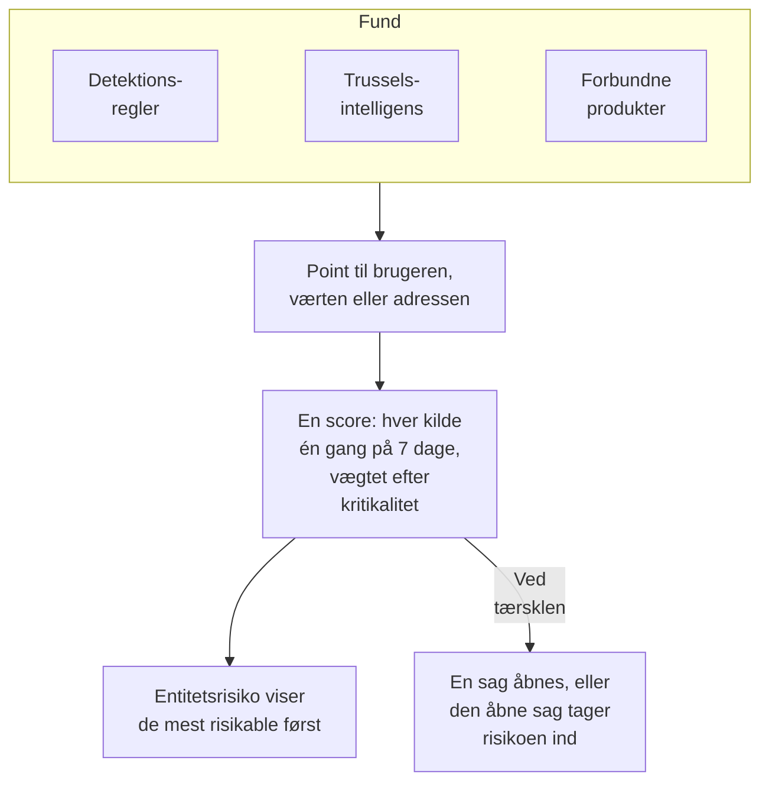

# Entitetsrisiko (risikobaseret alarmering)

Et enkelt fund siger sjældent meget. En byge af mislykkede logins, en første sudo på en vært og et login fra et nyt land er hver især et blik værd; den samme konto i alle tre inden for en uge er en sag værd. Entitetsrisiko lægger sammen, hvad dine detektionsregler, din trusselsintelligens og dine forbundne produkter finder om hver bruger, vært og IP-adresse, viser de mest risikable først og åbner en sag om den, hvis risiko når projektets tærskel.

:::cards
- [Sådan tælles en score](#sådan-tælles-en-score): Point efter alvorlighed, og hver kilde én gang om ugen.
- [Risikoniveauer og sager](#risikoniveauer-og-sager): Hvad en score svarer til, og hvornår en sag åbnes.
- [Entitetskritikalitet](#entitetskritikalitet): Lad det, der betyder mere, tælle mere, og det, der betyder mindre, tælle mindre.
- [En entitets side](#en-entitets-side): Hvorfor den er risikabel, dens måned og sagerne om den.
- [Risikopoint på en detektionsregel](#risikopoint-på-en-detektionsregel): En regels egen vægt i scoren.
:::

## Sådan virker det

Åbn **Produkter → Security Events → Entitetsrisiko**: hver bruger, vært og IP-adresse med risiko lige nu, de mest risikable først, med niveau, hvor meget den betyder, hvad der fandt den og hvornår. Hver af dem åbner på sin egen side.

## Før du begynder

- Sikkerhedshændelser, der kommer ind, og detektionsregler, trusselsintelligens eller forbundne produkter, der finder noget i dem. Se [Kom godt i gang med sikkerhed](/docs/telemetry/security-getting-started).
- Detektionsregler, der grupperer efter et felt, som nævner nogen: **Group By Field**, fx `principalUser`, `principalHost` eller `principalIp`, eller de felter, en korrelation grupperer efter. En regel, der ikke grupperer efter noget, tilføjer ingen risiko.
- For at ændre **Risikoscoring**: Project Owner eller Project Admin for dens kontakt og dens tærskel, og en rolle, der må oprette detektionsregler, for dens liste over entiteter. Security Viewer læser det hele. Se [Roller](/docs/permissions/reference#roller).

## Sådan tælles en score

Hvert fund giver risikopoint til den bruger, vært eller IP-adresse, det handler om:

| Et fund med alvorlighed | Giver |
| --- | --- |
| Lav | 10 point |
| Mellem | 25 point |
| Høj | 50 point |
| Kritisk | 75 point |

- Et informativt fund giver intet, og et fund med ukendt alvorlighed tæller som Mellem.
- En detektionsregels point går til den værdi, den grupperer efter. Et match i trusselsintelligens tæller for den IP-adresse, indikatoren nævner. Et forbundet produkts alarm tæller for den bruger og den vært, den nævner, ellers for dens IP-adresse.
- Hver kilde tæller én gang. En detektionsregel, et trusselsintelligens-feed eller et forbundet produkts regel tæller én gang på 7 dage, med det højeste, den lagde til, uanset hvor tit den udløses: én støjende regel kan aldrig få en entitet til at se værre ud end tre forskellige.
- En kilde, der ikke har fundet noget i 7 dage, holder op med at tælle, og scoren falder. Scorerne tjekkes hvert 15. minut, så en score falder til tiden uden et nyt fund.

En entitets score er summen af dens kilder, vægtet efter dens kritikalitet. Testangrebet fra **Send et testangreb**, og en sag, som nogen åbner i hånden, tilføjer ingen risiko.

## Risikoniveauer og sager

Hver score svarer til et niveau i forhold til projektets tærskel, 100, medmindre du ændrer den:

| Risikoscore | Svarer til | Hvad der sker |
| --- | --- | --- |
| 1 til 49 | Lav | Vises under Entitetsrisiko |
| 50 til 99 | Mellem | Vises under Entitetsrisiko |
| 100 til 199 | Høj | En sag åbnes, som Høj |
| 200 eller mere | Kritisk | En sag åbnes, som Kritisk |

Når en entitets risiko når tærsklen, rejses der en detektion fra kilden Entitetsrisiko om den. Den kommer ind i den åbne sag om entiteten eller åbner en, der er opkaldt efter den, fx `High risk — k.morgan@acme-commerce.example`, og den viser de kilder, der bidrog mest til risikoen, op til 10, med deres point, hvor tit hver blev udløst og hvornår sidst.

Når der er åbnet en sag om en entitets risiko, tælles det, der lå bag, ikke igen: en ny sag åbnes kun, når kilder, der er nye siden da, igen når tærsklen. En sag, der er lukket som håndteret, åbnes ikke igen af de samme fund.

Skift tærsklen under **Produkter → Security Events → Indstillinger → Risikoscoring → Risikotærskel**: et heltal fra 10 til 10000. Mellem starter ved halvdelen og Kritisk ved det dobbelte, på alle sider.

### Slå risikosager til eller fra

**Risikosager**, under **Indstillinger → Risikoscoring**, afgør, om risiko åbner sager, og gemmes, når du slår den om. Nye projekter starter med den slået til. Et projekt, der er oprettet før entitetsrisiko, holder den slået fra, indtil nogen slår den til, og **Entitetsrisiko** siger det over sin liste. Risiko scores og vises under alle omstændigheder.

## Entitetskritikalitet

Nogle entiteter betyder mere end andre: en domænecontroller, en leders konto, en betalingsserver. Andre betyder mindre, fx en sårbarhedsscanner, hvis scanninger er forventede. Angiv dem under **Indstillinger → Risikoscoring → Entitetskritikalitet** med **Tilføj Entitet**:

| Kritikalitet | Tæller dens risiko |
| --- | --- |
| Lav | ×0.5 |
| Ikke angivet | ×1 |
| Høj | ×1.5 |
| Ekstrem | ×2 |

En post er en værdi eller et `*`-mønster, uanset store og små bogstaver: `dc-*` navngiver hver domænecontroller, og `*@contractors.example` hver ekstern konsulent. **Type** begrænser den til brugere, værter eller IP-adresser; tom passer på dem alle. Når flere poster nævner en entitet, tæller den mest specifikke: en udskrevet værdi før et mønster, og et længere mønster før et kortere. En ændring når hver entitets score inden for få minutter.

## En entitets side

Klik på **Vis** i en række i **Entitetsrisiko**, eller på risikoen ved siden af en entitet på en sags side **Entiteter**:

| Del | Hvad den viser |
| --- | --- |
| Overskriften | Dens slags og kritikalitet, dens score og niveau, og hvordan scoren regnes ud |
| **Aktivitet** | Dens sikkerhedshændelser og fund fra de sidste 7 dage |
| **Hvad bidrager til dens risiko** | Hver kilde, dens alvorlighed, de point den giver, hvor tit den blev udløst og hvornår sidst |
| **Risiko de sidste 30 dage** | Dens score ved slutningen af hver dag, farvet efter niveau |
| **Sager om den** | De sikkerhedssager, der er åbnet om den, de nyeste først |

**Åbn i Korrelér** tegner en graf over dens hændelser, og **Søg i dens hændelser** åbner **Begivenheder** på dens uge. **Nulstil risiko** rydder dens score og kilder, fx efter en planlagt test: det, der findes derefter, tæller fra nul, og dens sager ændres ikke. Nulstilling kræver en rolle, der må slette sikkerhedsdata, og [revisionsloggen](/docs/configuration/audit-logs) registrerer den.

OneUptime AI læser risikoen for en sags entiteter, når den triagerer sagen. Se [OneUptime AI i sikkerhed](/docs/telemetry/security-ai).

## Risikopoint på en detektionsregel

En detektionsregel giver pointene for sit niveau, ud fra sit Sigma-`level`. For at give den sin egen vægt skal du åbne regelens formular, gå til **Ved match**, åbne **Flere felter** og angive **Risikopoint**, fra 0, som ikke giver nogen risiko, til 100. Lad den stå tom for pointene for dens niveau.

## Fejlfinding

:::details En entitet står ikke under Entitetsrisiko
Tjek, at en detektionsregel, et trusselsintelligens-feed eller et forbundet produkt har fundet noget om den inden for de sidste 7 dage, og at reglen grupperer efter et felt, der nævner den. Informative fund giver intet, og en kilde, der ikke har fundet noget i 7 dage, holder op med at tælle.
:::

:::details En entitets risiko nåede tærsklen, og ingen sag blev åbnet
Tjek, at **Risikosager** er slået til under **Indstillinger → Risikoscoring**. Hvis der før er åbnet en sag om entitetens risiko, tæller kun kilder, der er nye siden da, med i den næste.
:::

:::details En regel udløses igen og igen, og entitetens score stiger ikke
Sådan tælles der: en kilde tæller én gang på 7 dage, med det højeste, den lagde til. Sænk en støjende regels **Risikopoint**, eller giv en entitet, hvis fund er forventede, lav kritikalitet.
:::

:::details En score er ikke summen af dens kilder
Dens kritikalitet vægter den. Entitetens side viser summen af dens kilder og vægten, fx 100 fra dens kilder × 2 = 200.
:::

## Næste skridt

:::cards
- [Sikkerhedssager og playbooks](/docs/telemetry/security-cases): Arbejd med de sager, risiko åbner, og luk dem med en vurdering.
- [Sikkerhedsbegivenheder (SIEM)](/docs/telemetry/security-events): Detektionsregler, Korrelér og hændelserne bag hvert fund.
- [Trusselsintelligens (STIX/TAXII)](/docs/telemetry/threat-intelligence): De match, der bidrager til en adresses risiko.
- [OneUptime AI i sikkerhed](/docs/telemetry/security-ai): Hvordan en triage læser risikoen for en sags entiteter.
:::
