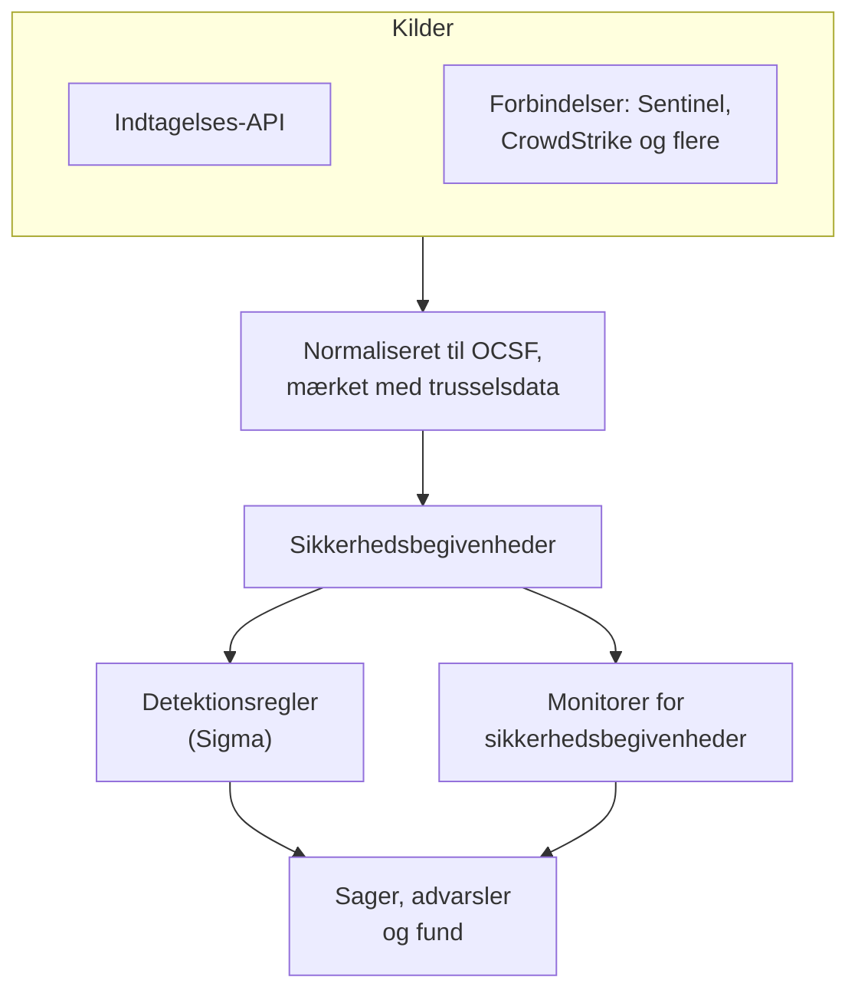
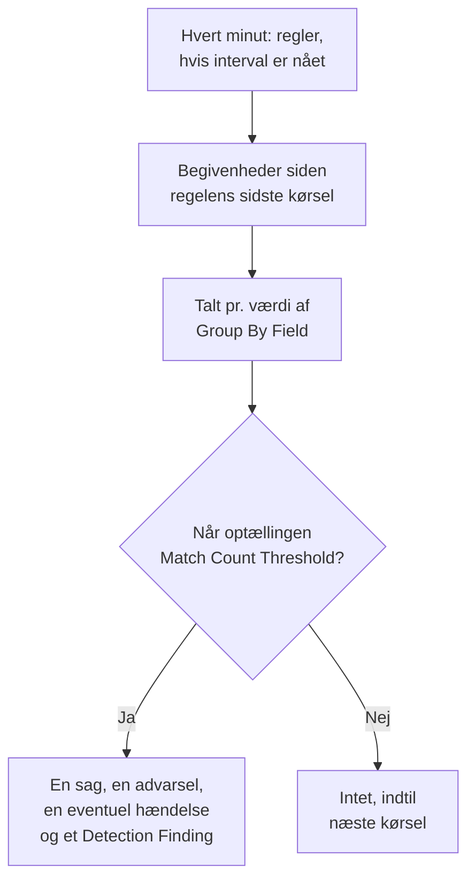

# Sikkerhedsbegivenheder (SIEM)

OneUptime gemmer sikkerhedsbegivenheder ved siden af dine logs, traces og metrikker og giver dem alle den samme form, [OCSF](https://schema.ocsf.io/) (Open Cybersecurity Schema Framework), uanset hvilket format de ankom i. Send begivenheder fra en hvilken som helst kilde, søg i dem, og find de vigtige med Sigma-detektionsregler, trusselsintelligens og monitorer. Det, de finder, bliver til [sager](/docs/telemetry/security-cases), der skal behandles, og playbooks reagerer på dem.

:::cards
- [Send begivenheder](#send-sikkerhedsbegivenheder): En HTTPS-POST, et Fluent Bit-output eller en forbindelse til et sikkerhedsprodukt.
- [Søg og korrelér](#udforsk-sikkerhedsbegivenheder): Begivenhedsoversigten og korrelationsgrafen.
- [Detektionsregler](#detektionsregler): Sigma-regler, der åbner sager og advarsler.
- [Monitorer](#monitorer-for-sikkerhedsbegivenheder): Optællinger over et glidende vindue, med en status, der retter sig igen.
:::

## Sådan virker det



Åbn **Produkter → Security Events** under **Observabilitet**. Menuen har en sektion for hver del af sikkerheden og en side for sig for hver ting i den:

| Side | Sektion | Hvad den bruges til |
| --- | --- | --- |
| **Oversigt** | Oversigt | Hvordan sikkerhed er sat op, hvad der kræver nogen nu, og hvor hurtigt sager håndteres |
| **Åbne sager** | Sikkerhedssager | Køen: hver sag, der ikke er lukket endnu, grupperet efter hvad den handler om |
| **Tildelt mig** | Sikkerhedssager | De åbne sager, der er tildelt dig |
| **Ikke tildelt** | Sikkerhedssager | De åbne sager, som ingen har taget |
| **Lukkede sager** | Sikkerhedssager | De sager, der er lukket med en vurdering, de nyeste først |
| **Alle sager** | Sikkerhedssager | Hver sag, åben eller lukket |
| **Begivenheder** | Begivenheder | Søg i og filtrér alle begivenheder, og åbn en for at se alle dens felter |
| **Campaigns** | Begivenheder | Hver adresse, der sendte angrebsforespørgsler, og om nogen af dens forespørgsler kom igennem |
| **Entitetsrisiko** | Begivenheder | Hver bruger, vært og adresse, scoret efter hvad der er fundet om den i denne uge, de mest risikable først |
| **Korrelér** | Begivenheder | En graf over de begivenheder, der deler en vært, en bruger eller en IP-adresse |
| **Detektionsregler** | Detections | Sigma-regler, der kører efter en tidsplan og åbner sager |
| **Regelundtagelser** | Detections | Det, dine regler springer over med vilje, som en scanner eller en planlagt test, hver med hvem der tilføjede den og hvorfor |
| **Overvågningslister** | Detections | De lister, dine regler sammenligner med, som VIP-brugere, kritiske værter, kendte ondsindede filhashes og de adresser, administratorer må logge ind fra |
| **Regelbibliotek** | Detections | Færdige detektionsregler at tilføje, hver med de hændelser, den læser, og om de kommer ind, med de anbefalede markeret |
| **Trusselsinformation** | Detections | STIX/TAXII-feeds med kendte ondsindede indikatorer |
| **ATT&CK-dækning** | Detections | De MITRE ATT&CK-teknikker, dine regler dækker |
| **Playbooks** | Playbooks | Trin, der kører på sager, af sig selv eller manuelt |
| **Godkendelser** | Playbooks | De playbook-trin, der venter på, at nogen godkender eller afviser dem |
| **Playbook-kørsler** | Playbooks | Hvad hver playbook gjorde, trin for trin |
| **Beskyttede entiteter** | Playbooks | De brugere og værter, som ingen playbook inddæmmer |
| **Indstillinger** | AI | Om OneUptime AI vurderer hver ny sag |
| **Forbindelser** | Connections | Dine logs, de sikkerhedsprodukter, OneUptime henter fra, og de SIEM'er, det sender til |
| **Opsætningsvejledning** | Connections | Kodestykker til at sende begivenheder, udfyldt med din ingestion-nøgle |
| **Sagsprioriteter** | Indstillinger | Hvor presserende en sag er: projektets egne prioriteter, den mest presserende først |
| **Responsmål** | Indstillinger | Hvor hurtigt en sag med hver prioritet skal tages og inddæmmes |
| **Sagsstatusser** | Indstillinger | De trin, en sag går igennem, og hvad en sag i hvert trin tæller som |
| **Risikoscoring** | Indstillinger | Om en entitets risiko åbner en sag, ved hvilken risiko, og hvor meget hver entitet betyder |

**Detektioner**, **AI**, **Forbindelser** og **Indstillinger**, som sættes op én gang, forbliver foldet sammen, indtil du åbner dem. Ny i sikkerhed? [Kom godt i gang med sikkerhed](/docs/telemetry/security-getting-started) sætter det op med to klik.

## Før du begynder

Sikkerhedsdata kan kun læses af rollerne Project Owner og Project Admin og af de tre Security-roller; andre roller ser intet i Security Events. Se [Roller](/docs/permissions/reference#roller).

| Rolle | Hvad den kan |
| --- | --- |
| Security Admin | Alt: begivenheder, sager, playbooks, detektionsregler, threat intel-feeds og forbindelser |
| Security Member | Læse begivenheder og threat intel, behandle sager, køre playbooks og godkende deres trin samt oprette, ændre og slette detektionsregler og feeds. Den kan ikke sætte playbooks eller forbindelser op eller slette sikkerhedsdata. |
| Security Viewer | Læse begivenheder, sager, playbooks, regler, feeds, indikatorer og forbindelser |

## Send sikkerhedsbegivenheder

:::steps
### Opret en ingestion-nøgle

Åbn **Projektindstillinger → Telemetri og APM → Indtagelsesnøgler**, og klik på **Opret ingestion-nøgle**. Sikkerhedsbegivenheder bruger de samme nøgler som resten af din telemetri.

### Send dine begivenheder

Send JSON til `/security-events/v1/ingest` med nøglen i `x-oneuptime-token`:

:::tabs
@tab OCSF
```bash
curl -X POST "https://oneuptime.com/security-events/v1/ingest?format=ocsf" \
  -H "Content-Type: application/json" \
  -H "x-oneuptime-token: YOUR_INGESTION_TOKEN" \
  -H "x-oneuptime-service-name: my-security-source" \
  -d '{ "events": [ { "class_uid": 3002, "severity_id": 4, "status": "Failure", "message": "Failed logon for alice", "actor": { "user": { "name": "alice" } }, "src_endpoint": { "ip": "203.0.113.7", "hostname": "laptop-alice" } } ] }'
```
@tab Google UDM
```bash
curl -X POST "https://oneuptime.com/security-events/v1/ingest?format=udm" \
  -H "Content-Type: application/json" \
  -H "x-oneuptime-token: YOUR_INGESTION_TOKEN" \
  -d '{ "events": [ { "metadata": { "event_type": "USER_LOGIN" }, "principal": { "hostname": "laptop-alice", "user": { "userid": "alice" }, "ip": ["203.0.113.7"] }, "security_result": [{ "severity": "HIGH", "action": ["BLOCK"] }] } ] }'
```
@tab Generic JSON
```bash
curl -X POST "https://oneuptime.com/security-events/v1/ingest" \
  -H "Content-Type: application/json" \
  -H "x-oneuptime-token: YOUR_INGESTION_TOKEN" \
  -d '{ "events": [ { "severity": "high", "event_type": "ssh_brute_force", "message": "12 failed SSH logins in 60s", "username": "root", "hostname": "web-01", "src_ip": "203.0.113.7" } ] }'
```
:::

Endpointet svarer `200`, når begivenhederne står i kø. En begivenhed uden tidspunkt, som disse, placeres i det øjeblik, den ankommer.

### Find dem under Begivenheder

Åbn **Produkter → Security Events → Begivenheder**. Begivenhederne vises inden for få sekunder med deres alvorlighed, klasse, bruger, vært og IP-adresser udfyldt.
:::

### Formater

| `format` | Hvad det læser | Accepteres også |
| --- | --- | --- |
| `ocsf` | OCSF-begivenheds-JSON (`class_uid`, `severity_id` osv.) | Ingen |
| `udm` | UDM-begivenheder fra Google SecOps (Chronicle) (`metadata.event_type` osv.) | `chronicle`, `google-secops` |
| `google-secops-alert` | Detektioner og advarsler fra Google SecOps: SOAR-webhooks og detektionsstrømmen | `secops-alert`, `detection` |
| `generic` | Al anden JSON, læst ud fra almindelige feltnavne | Ingen |

Angiv formatet med `?format=`, med headeren `x-oneuptime-security-event-format` eller med et felt `"format"` på øverste niveau. Udelader du det, bestemmes hver begivenheds format for sig, så én webhook kan blande detektioner med rå begivenheder.

- Brødteksten kan være én begivenhed, et array af begivenheder eller `{ "events": [...] }`.
- Headeren `x-oneuptime-service-name` angiver den telemetritjeneste, begivenhederne hører til. Uden den hører de til den tjeneste, der er opkaldt efter den første begivenheds produkt eller leverandør, eller til `Security Events`.
- Intet kasseres, fordi det ikke kunne tilknyttes: hvert felt fra kilden havner i begivenhedens attributter.

### Felter i generisk JSON

En generisk begivenhed læses ud fra almindelige feltnavne:

| Begivenhedens felt | Læses fra den første af |
| --- | --- |
| `message` | `message`, `msg`, `summary`, `description`, `title` |
| `severityName` | `severity`, `severity_name`, `level`, `priority`, `risk_level` |
| `time` | `timestamp`, `time`, `@timestamp`, `event_time`, `created_at` |
| `principalUser` | `user`, `username`, `user_name`, `account`, `actor` |
| `principalHost` | `host`, `hostname`, `computer`, `device`, `machine` |
| `principalIp` | `source_ip`, `src_ip`, `client_ip`, `ip` |
| `targetIp` | `destination_ip`, `dest_ip`, `dst_ip`, `target_ip` |
| `className` | `event_type`, `category`, `type`, `action` |
| `ruleName` | `rule`, `rule_name`, `signature`, `detection` |
| `productName` | `product`, `product_name`, `source`, `log_source` |
| `processName` | `process_name`, `process.name`, `proc.name`, `comm` |
| `processPath` | `process_path`, `Image`, `NewProcessName`, `exe`, `process.executable` |
| `processCommandLine` | `command_line`, `CommandLine`, `cmdline`, `process.command_line`, `proc.cmdline`, `process` |
| `parentProcessName` | `parent_process_name`, `process.parent.name`, `proc.pname` |
| `parentProcessPath` | `parent_process_path`, `ParentImage`, `ParentProcessName`, `process.parent.executable` |
| `parentProcessCommandLine` | `parent_command_line`, `ParentCommandLine`, `process.parent.command_line`, `proc.pcmdline` |

Et ord for alvorlighed bliver et OCSF-niveau: `info` læses som Informational, `warning` som Low, `error` som Medium, `alert` som Critical og `emergency` som Fatal.

### Videresend med Fluent Bit

For at sende sikkerhedslogs, du allerede indsamler, f.eks. auditd, syslog eller Falco, tilføjer du et `http`-output til Fluent Bit:

```ini title="fluent-bit.conf"
[OUTPUT]
    Name             http
    Match            security.*
    Host             oneuptime.com
    Port             443
    tls              On
    URI              /security-events/v1/ingest
    Format           json
    Json_date_key    timestamp
    Json_date_format iso8601
    Header           x-oneuptime-token YOUR_INGESTION_TOKEN
    Header           x-oneuptime-service-name my-security-source
    Retry_Limit      5
```

Siden **Opsætningsvejledning**, under **Forbindelser**, har disse kodestykker med din egen vært og nøgle udfyldt.

### Find sikkerhedshændelser i dine logs

Kortet **Dine logs**, øverst på **Forbindelser**, gør de logs, du allerede sender til OneUptime, til en kilde. Med **Find sikkerhedshændelser i dine logs** slået til læses projektets nye logs hvert minut, og hvert SSH-login, hver sudo-kommando, hver Kubernetes-auditpost, hver AWS CloudTrail-ændring og hvert webangreb i dem gemmes som en sikkerhedshændelse. Se [Kom godt i gang med sikkerhed](/docs/telemetry/security-getting-started#find-sikkerhedshændelser-i-dine-logs) for, hvad hver slags dækker.

### Forbind et sikkerhedsprodukt

**Forbindelser** henter data fra et sikkerhedsprodukt for dig og importerer dets nye poster som sikkerhedsbegivenheder. En forbindelse indeholder produktets indstillinger og en krypteret legitimation; en worker henter fra den med det interval, du angiver, og springer poster over, som den allerede har importeret.

| Produkt | Importerer | Opsætningsvejledning |
| --- | --- | --- |
| Google SecOps (Chronicle) | Regeldetektioner, kuraterede detektioner og advarsler, som Detection Findings | [Google SecOps](/docs/integrations/google-secops) |
| Microsoft Sentinel | Hændelser, som Incident Findings | [Microsoft Sentinel](/docs/integrations/microsoft-sentinel) |
| Microsoft Defender XDR | Advarsler, som Detection Findings | [Microsoft Defender XDR](/docs/integrations/microsoft-defender-xdr) |
| CrowdStrike Falcon | Advarsler, som Detection Findings | [CrowdStrike Falcon](/docs/integrations/crowdstrike-falcon) |
| Splunk Enterprise Security | Notable events eller en hvilken som helst søgning, som Detection Findings | [Splunk Enterprise Security](/docs/integrations/splunk) |
| Elastic Security | Detektionsadvarsler, som Detection Findings | [Elastic Security](/docs/integrations/elastic-security) |
| AWS Security Hub | Findings, som Detection og Compliance Findings | [AWS Security Hub](/docs/integrations/aws-security-hub) |
| Okta System Log | Begivenheder om login, MFA, konti og politikker | [Okta System Log](/docs/integrations/okta) |

- Produktets egne advarsler på eller over **Open Cases From** (**Høj og højere**, medmindre du vælger et andet niveau, eller **Aldrig**) åbner [sager](/docs/telemetry/security-cases), grupperet efter den bruger, vært eller adresse, de handler om.
- En forbindelse læser poster efter det tidspunkt, produktet oprettede dem, ikke efter tidspunktet for den aktivitet, de beskriver. En SIEM-regel, der kører hver time, opretter detektioner længe efter de begivenheder, den matchede, og de importeres alligevel.
- Den første hentning kigger 24 timer tilbage, så en ny forbindelse viser nylige poster med det samme.
- **Test forbindelse** i forbindelsens række tjekker adgangen til produktet, og at OneUptimes egne workers kører, og importerer intet. **Kør nu** henter med det samme.

## Hvad en begivenhed indeholder

Hver begivenhed gemmes med typede felter og kildens payload:

| Gruppe | Felter |
| --- | --- |
| Klassificering | `categoryName`, `className`, `activityName`, `statusName`, med deres OCSF-ID'er (`categoryUid`, `classUid`) |
| Alvorlighed | `severityName`, en af Unknown, Informational, Low, Medium, High, Critical, Fatal eller Other, og `severityId` |
| Hvem gjorde det | `principalUser`, `principalHost`, `principalIp`, `principalProcess` |
| Hvad det ramte | `targetUser`, `targetHost`, `targetIp`, `targetPort`, `targetResource` |
| Processen | `processName`, `processPath` og `processCommandLine`: ved procesaktivitet den proces, der blev startet, åbnet, injiceret i eller afsluttet, ellers den proces, der handlede. `parentProcessName`, `parentProcessPath` og `parentProcessCommandLine`: den proces, der startede den |
| Kilde | `productName`, `vendorName`, `ruleId`, `ruleName`, `eventUid` |
| Indhold | `message`, `mitreTactics`, `mitreTechniques` og `observables`: hver bruger, vært, IP-adresse, domæne og hash fra begivenheden |
| Attributter | Hele kildens payload, fladet ud til nøgler med punktummer |

Hændelser, der blev gemt før OneUptime 14.0.84, lader procesfelterne stå tomme og nævner kun deres proces som `principalProcess`, den proces, der handlede. De udfyldes ikke bagefter: de beholder det, de blev gemt med, indtil deres opbevaring udløber.

## Udforsk sikkerhedsbegivenheder

**Begivenheder** er en telemetrioversigt ligesom oversigterne for logs og traces: et diagram over vinduets begivenheder efter alvorlighed, en sidebjælke med facetter, listen og et panel med hvert felt og hver attribut i den begivenhed, du åbner. Vinduet, filtrene og søgningen ligger alle i URL'en, så en filtreret visning kan deles og overlever en genindlæsning.

### Søgning

Søgefeltet taler det samme sprog som de andre telemetrioversigter (se [Søgesyntaks](/docs/telemetry/search-syntax)):

| Syntaks | Betyder | Eksempel |
| --- | --- | --- |
| fritekst | Beskeden indeholder den | `failed logon` |
| `"quoted phrase"` | Hold ordene sammen | `"brute force"` |
| `<field>:<value>` | Et typet felt | `severity:Critical` |
| `@<attribute>:<value>` | En kildeattribut | `@threat.matched:true` |
| `-<filter>` | Ikke dette | `-severity:Informational` |
| `<field>:(a OR b)` | En hvilken som helst af disse værdier | `severity:(High OR Critical)` |
| `<field>:a*` | `*` er vilkårlig tekst, `?` ét tegn | `host:web-*` |
| `@<attribute>:*` | Attributten findes | `@threat.indicator_id:*` |
| `@<attribute>:~text` | Attributten indeholder teksten | `@finding_info.title:~ransom` |

Et felt er enten et kort navn (`severity`, `class`, `category`, `activity`, `status`, `vendor`, `product`, `rule`, `user`, `host`, `ip`, `targetuser`, `targethost`, `targetip`, `processname`, `commandline`, `parentprocessname`, `observable`, `tactic`, `technique`, `requestoutcome`, `trace`, `session`) eller feltets eget navn, f.eks. `severityName` eller `principalHost`. Alle andre navne læses som en kildeattribut. `observable:<value>` finder hver begivenhed, der nævner en værdi, uanset hvilken side af aktiviteten den var på.

### Facetter

Sidebjælken tæller vinduets begivenheder efter **Kilde**, **Alvorlighed**, **Request Outcome**, **Begivenhedsklasse**, **Kategori**, **Aktivitet**, **Status**, **Leverandør**, **Produkt**, **Detektionsregel**, **Kildebruger**, **Kildevært**, **Proces** og **Overordnet proces**. Klik på en værdi for kun at beholde dens begivenheder, eller på minusset ved siden af for at udelade dem. Klik igen for at fortryde. Diagrammet og hver optælling beskriver præcis begivenhederne på listen.

### Hvad der skete bagefter

En begivenhed læst fra en loglinje, der blev skrevet i en sporet forespørgsel, følges ind i den forespørgsel. Dens panel viser, hvor langt forespørgslen kom (**Afvist**, **Reached App**, **Errored** eller **Reached Database**), hvem der sendte den, og linker til dens trace, dens undtagelse, dens sessionsafspilning og selve loglinjen. En loglinje, en trace og en undtagelse, der er en del af et angreb, siger det også på deres egne sider.

### Campaigns

**Campaigns** viser hver adresse, der sendte angrebsforespørgsler, som én række med angrebstyperne, værktøjerne og de forespørgsler, den sendte, og hvor mange der kom igennem. De adresser, hvis forespørgsler nåede din app, kommer først.

### Korrelér

**Korrelér** tegner begivenhederne omkring en vært, en bruger eller en IP-adresse: deres begivenhedsklasser omkring det, du søgte efter, markeret med deres værste alvorlighed, og de andre værdier fra de samme begivenheder på den ydre ring. Klik på en klasse for at vise dens begivenheder, eller på en værdi for at korrelere på den næste gang. Hver observable i en begivenheds panel under **Begivenheder** åbner **Korrelér** på den.

## Detektionsregler

En detektionsregel er en [Sigma](https://sigmahq.io/)-regel, et åbent YAML-format til at beskrive mistænkelig aktivitet, som OneUptime kører efter en tidsplan mod dine begivenheder. Når den matcher, åbner den en [sag](/docs/telemetry/security-cases) eller føjer matchet til en åben sag, åbner en advarsel, eventuelt en hændelse, og skriver et Detection Finding tilbage i begivenhederne. **Regelbibliotek** har færdige regler at starte fra.



### Opret en regel

:::steps
1. Åbn **Produkter → Security Events → Detektioner → Detektionsregler**, og klik på **Opret Detektionsregel**.
2. Indsæt regelens YAML i **Sigma-regel (YAML)** under **Sigma-regel**. Den fortolkes, når du gemmer, så en fejl vises i formularen.
3. **Navn** udfyldes med regelens `title`: skriv ovenpå for at kalde reglen noget andet. En ny regel kører; **Aktiveret** står i dens redigeringsformular.
4. Lad **Åbn en sag ved match** være slået til under **Ved match** for at samle regelens match i sager efter den værdi, reglen grupperer efter.
5. Vælg under **Advarsler og hændelser**, hvad et match ellers udløser: **Opret en advarsel** (standard), **Erklær en hændelse**, **Begge** eller **Ingen af dem**, med en valgfri **Advarselsalvor** eller **Hændelsesalvor**.
6. **Flere felter** rummer **Beskrivelse**, **Skriv Detection Finding ved match** (til) og hvordan match tælles; se [Evalueringsindstillinger](#evalueringsindstillinger).
:::

En første regel, der matcher mislykkede logins uden for `10.x.x.x`:

```yaml title="failed-logon-burst.yml"
title: Failed logon burst
description: Repeated authentication failures from one source.
level: high
tags:
  - attack.t1110
  - attack.ta0006
detection:
  selection:
    className: Authentication
    statusName: Failure
  filter_internal:
    principalIp|startswith: '10.'
  condition: selection and not filter_internal
```

### Hvad en regel kan udtrykke

OneUptime kører den boolske kerne af Sigma:

- Selektioner er feltkort (hvert felt skal matche; en liste af værdier matcher en hvilken som helst af dem) eller nøgleordslister, der matcher hvor som helst i beskeden.
- Betingelser kombinerer selektioner med `and`, `or`, `not` og parenteser eller med `1 of selection_*`, `all of selection_*`, `any of them` og `all of them`.
- Feltmodifikatorer: `contains`, `startswith`, `endswith`, `all`, `re`, `cased`, `gt`, `gte`, `lt`, `lte`, `cidr`, `exists`, `windash` og `expand`, som læser en [overvågningsliste](#overvågningslister). Tekst sammenlignes uden hensyn til store og små bogstaver, medmindre du tilføjer `cased`.
- Et felt er et typet felt (`principalUser`), en almindelig Sigma-stavemåde af et (`CommandLine`, `src_ip`, `Hostname`) eller en hvilken som helst attributnøgle, stavet som i begivenheden (`threat.matched`).
- `Image` og `CommandLine` læser den proces, som begivenheden handler om, ved en processtart den, der startede (`processPath`, `processCommandLine`), og `ParentImage` og `ParentCommandLine` den proces, der startede den (`parentProcessPath`, `parentProcessCommandLine`). `principalProcess` er den proces, der handlede, hvilket ved en processtart er den overordnede.
- `level` angiver alvorligheden: `informational`, `low`, `medium`, `high` eller `critical`, og `medium`, når den mangler. ATT&CK-ID'er i `tags` (`attack.t1110`, `attack.ta0006`) udfylder fundets MITRE-felter.

Aggregeringer som `| count() by principalIp > 5` afvises, når du gemmer: brug i stedet en [korrelationsregel](#korrelationsregler) eller **Grupperingsfelt** og **Grænse for antal match**. `logsource` er kun informativ og indsnævrer intet: læg det filter i en selektion, f.eks. `className: Authentication`. En `timeframe` ignoreres, fordi regelens interval bestemmer dens vindue.

### Korrelationsregler

En [Sigma-korrelation](https://sigmahq.io/docs/meta/correlations.html) udløses af flere hændelser sammen i stedet for én. Indsæt den i **Sigma-regel (YAML)** sammen med de regler, den læser, som YAML-dokumenter adskilt af `---`, eller navngiv regler, projektet allerede har, med deres Sigma-`name` eller -`id`. **Regelbibliotek** har færdige, f.eks. mislykkede logins efterfulgt af et vellykket.

| Type | Udløses, når | Vises som |
| --- | --- | --- |
| `event_count` | Én gruppe når et antal hændelser inden for `timespan` | Antal hændelser |
| `value_count` | Én gruppe viser et antal forskellige værdier af et felt inden for `timespan` | Forskellige værdier |
| `temporal` | Hver regel matcher for den samme gruppe inden for `timespan`, i vilkårlig rækkefølge | Hændelser sammen |
| `temporal_ordered` | Reglerne matcher i deres rækkefølge for den samme gruppe inden for `timespan` | Sequence |
| `new_value` | En gruppe viser en værdi af et felt, den ikke har vist inden for `timespan` | First seen |

```yaml title="failed-then-success.yml"
title: Failed sign-ins, then a success from the same address
level: high
correlation:
  type: temporal_ordered
  rules:
    - failed_sign_ins
    - successful_sign_in
  group-by:
    - principalIp
  timespan: 10m
---
title: Five failed sign-ins
name: failed_sign_ins
correlation:
  type: event_count
  rules:
    - failed_sign_in
  group-by:
    - principalIp
  timespan: 10m
  condition:
    gte: 5
---
title: Failed sign-in
name: failed_sign_in
detection:
  selection:
    className: Authentication
    statusName: Failure
  condition: selection
---
title: Successful sign-in
name: successful_sign_in
detection:
  selection:
    className: Authentication
    statusName: Success
  condition: selection
```

- En gruppe er værdien af felterne i `group-by`, f.eks. én adresse. Optællinger er rullende: et udbrud, som to kørsler deler, tælles stadig helt inden for sit `timespan`, som højst er 24 timer.
- `new_value` er OneUptimes egen type, da Sigma ikke har nogen korrelation for "set første gang": den sammenligner med op til 30 dages historik. `value_sum`, `value_avg`, `value_percentile` og `value_median` afvises, når du gemmer.
- Kolonnen **Type** i **Detektionsregler** angiver hver regels slags, og formularen siger i én sætning, hvad reglen leder efter.

### Evalueringsindstillinger

| Felt | Hvad det gør |
| --- | --- |
| **Evalueringsinterval (minutter)** | Hvor ofte reglen kører: hele minutter, 1 til 1440. Formularen for en ny regel starter på 5. |
| **Grupperingsfelt** | Valgfrit. Match, der deler dette felts værdi, f.eks. `principalHost`, tælles, advares og dedupliceres samlet: én advarsel pr. vært i stedet for hundredvis. |
| **Felt til unik optælling** | Valgfrit. Tæl de forskellige værdier af dette felt i stedet for de matchende begivenheder. Tomme værdier tælles ikke. |
| **Grænse for antal match** | En gruppe udløses kun, når dens optælling når dette tal inden for én kørsel: 1 til 1000000, og 1 udløses ved ethvert match. |

Group By og Distinct Count tager de samme feltnavne som reglen. Med dem siger tærsklen "så mange, fra den samme ting, i én kørsel", uden en monitor ovenpå:

| Mål | Group By Field | Distinct Count Field | Tærskel |
| --- | --- | --- | --- |
| Advar ved ethvert match | Tom | Tom | 1 |
| Én advarsel pr. vært | `principalHost` | Tom | 1 |
| Brute force: 5 mislykkede logins fra én IP | `principalIp` | Tom | 5 |
| Password spraying: én IP, der fejler mod 5 forskellige konti | `principalIp` | `principalUser` | 5 |
| Portscanning: én IP, der rammer 20 forskellige porte | `principalIp` | `targetPort` | 20 |

### Hvornår en regel kører

OneUptime tjekker hvert minut for aktiverede regler, hvis interval er gået siden deres sidste kørsel. Hver kørsel læser de begivenheder, hvis begivenhedstidspunkt ligger mellem den forrige kørsel og for to minutter siden, og går så videre. De to minutter giver plads til begivenheder, der stadig er på vej, for eksempel en loglinje, der læses et minut efter, at den blev skrevet:

- Vinduerne ligger i forlængelse af hinanden og glider ikke. Med et interval på 10 minutter kan fejl kl. 09:58 og 10:01 lande i forskellige kørsler og tælles hver for sig, så hold en margin, når du vælger en tærskel.
- Efter et hul, f.eks. et worker-nedbrud eller en regel, der er slået til igen, dækker den næste kørsel hele hullet, op til de seneste 24 timer.
- En begivenhed, der ankommer mere end to minutter for sent, efter at en kørsel har dækket dens tidspunkt, gemmes og kan søges, men den regel læser den aldrig.
- Hver gruppe, der når tærsklen, bliver et Detection Finding, op til 10.000 pr. kørsel. Advarsler, hændelser og sager åbnes for de 100 med de højeste optællinger; resten deler én sag om reglen, og reglens **Seneste fejl** fortæller, hvor mange grupper der matchede.

### Alvorlighed

En regels `level` er alvorligheden af dens fund: `informational`, `low`, `medium`, `high` og `critical` bliver til Informational, Low, Medium, High og Critical. Dens advarsler og hændelser får en af dit projekts alvorligheder i denne rækkefølge:

1. Regelens **Advarselsalvor** (eller **Hændelsesalvor**), når den er angivet.
2. Din alvorlighed, der er opkaldt efter niveauet, f.eks. High, uanset store og små bogstaver.
3. Efter rang: regler med `critical` og `high` får din mest alvorlige alvorlighed, de andre din mindst alvorlige.

> [!TIP]
> Opkald dine advarselsalvorligheder efter Sigma-niveauerne (Critical, High, Medium, Low, Informational), så lander hver regel på den rigtige uden en indstilling pr. regel.

### Advarsler og fund

Hver gruppe, der udløses, åbner en advarsel med titlen `[Detection] <rule name> — <group value>`, eller `[Detection] <rule name>` for en regel uden Group By Field. Så længe den er åben, åbner flere match for den gruppe ikke en ny. En regel ser kun match og kan ikke se, at et angreb er stoppet, så dens advarsler forbliver åbne, indtil nogen løser dem.

Et Detection Finding er en sikkerhedsbegivenhed af klassen `Detection Finding` (OCSF-klasse 2004) fra produktet `OneUptime Detections`, med regelens MITRE-tags, gruppeværdien først i `observables` og disse attributter:

| Attribut | Værdi |
| --- | --- |
| `oneuptime.detection.rule_id` | ID'et på den regel, der blev udløst |
| `oneuptime.detection.rule_name` | Regelens navn |
| `oneuptime.detection.match_count` | Hvor mange begivenheder der ligger bag fundet |
| `oneuptime.detection.distinct_count` | Hvor mange forskellige værdier der ligger bag det, for en regel med et Distinct Count Field |
| `oneuptime.detection.group_value` | Gruppens værdi, for en regel med et Group By Field |
| `oneuptime.detection.sigma_id` | Sigma-regelens egen `id` |

Fund er almindelige begivenheder: søg efter dem under **Begivenheder**, og pivotér på dem i **Korrelér**. For at afprøve en ny regel i stilhed slår du alle handlinger undtagen fundet fra, indtil du stoler på den.

### Undtagelser

En undtagelse er noget, en regel springer over, fordi du forventer det, som en sårbarhedsscanner, et natligt backupjob eller en planlagt penetrationstest. Den gør reglen stille for netop den ene ting uden at slå den fra, og reglens andre match udløser stadig. Alle undtagelser står under **Produkter → Security Events → Detektioner → Regelundtagelser**: tilføj en der med **Tilføj Regelundtagelse**, med **Tilføj undtagelse** i en regels række, eller med **Tilføj undtagelse** i en detektions række på en sag, som starter med detektionens regel og det, den udløste for.

| Det, reglen springer over | Hvad den matcher |
| --- | --- |
| **En entitet** | En bruger, vært eller IP-adresse, hvor som helst en hændelse nævner den: som den, der handlede (`principalUser`, `principalHost`, `principalIp`), som den, der blev handlet på (`targetUser`, `targetHost`, `targetIp`), eller blandt dens `observables` |
| **En værdi** | Ét felts værdi, med feltet navngivet, som en regel navngiver det: `processName`, `principalUser` eller en attributnøgle som `http.user_agent` |
| **Et tidsvindue** | Alle hændelser fra **Begynder den** til **Slutter den**, højst 30 dage fra hinanden |

- Værdier matcher uanset store og små bogstaver, og `*` står for en vilkårlig række tegn: `svc-*` springer alle tjenestekonti over, og `*.lab.example.com` alle værter i et domæne. En IP-adresse kan være et interval, som `10.20.0.0/16`. En værdi, der kun er `*`, afvises: slå en regel fra for at stoppe den.
- Hver undtagelse siger hvorfor i sin **Årsag**, som alle, der læser listen, ser, og gemmer, hvem der tilføjede den og hvornår. En entitet eller en værdi kan have en dato i **Udløber den**, hvorefter reglen ser den igen; et tidsvindue slutter af sig selv.
- **Status** siger, hvor hver enkelt står: **Aktiv**, **Kommende** for et vindue, der ikke er begyndt, **Udløbet** eller **Afsluttet**. Under en regels navn i **Detektionsregler** tæller en linje dens aktive undtagelser, og **Vis undtagelser** i reglens række åbner listen filtreret på den.
- Oversprungne hændelser udelades, før reglen tæller noget, så de tæller aldrig med i dens **Grænse for antal match** og åbner ingen sag, alarm, hændelse eller fund. Undtagelser gælder for hver kørsel af reglen, korrelationer med, og for **Kør på tidligere hændelser**, men aldrig for et testangreb, der tjekker, at hændelser kommer igennem.
- En regel har højst 100 undtagelser. Den, der må redigere detektionsregler, tilføjer, ændrer og fjerner dem, alle Security-roller kan læse dem, og hver ændring gemmes i projektets revisionslog.

### Overvågningslister

En overvågningsliste er en liste, dit team vedligeholder én gang, og som enhver regel kan læse, som VIP-brugere, kritiske værter, kendte ondsindede filhashes eller de adresser, administratorer må logge ind fra. Alle lister ligger under **Produkter → Security Events → Detektioner → Overvågningslister**: Opret en der med **Opret Overvågningsliste**, som spørger om dens navn og hvad den indeholder, eller tilføj en almindelig fra **Start med en almindelig liste**. En listes side viser dens værdier, og **Brug den i en regel** giver en selektion, der læser listen, til at kopiere ind i en regel.

En regel læser en liste med `expand` og listens navn mellem to `%`-tegn. Denne regel udløser, når en administrator logger ind fra en adresse, der ikke er på den tilladte liste:

```yaml title="admin-sign-in-from-outside.yml"
title: Admin sign-in from outside the allowed addresses
detection:
  admin_sign_in:
    className: Authentication
    principalUser|expand: '%admins%'
  allowed:
    principalIp|expand: '%admin_addresses%'
  condition: admin_sign_in and not allowed
level: high
```

- En liste indeholder brugere, værter, IP-adresser, filhashes, domæner, URL'er, processer eller andre værdier, valgt når den oprettes. En værdi matcher uanset store og små bogstaver, og `*` står for en vilkårlig række tegn: `svc-*` matcher alle tjenestekonti. En liste med IP-adresser tager også intervaller som `10.20.0.0/16`, og en liste med filhashes MD5-, SHA-1-, SHA-256- og SHA-512-hashes.
- Tilføj værdier én ad gangen med **Tilføj Værdi**, eller mange på én gang med **Importér værdier**: indsæt dem, eller vælg en `.txt`- eller `.csv`-fil, én værdi pr. linje, med en valgfri note efter et komma. **Føj til listen** beholder de værdier, der allerede er på den, og **Erstat listen** fjerner dem, importen ikke har.
- I stedet for at vedligeholde værdier kan en liste med IP-adresser, filhashes, domæner eller URL'er følge et feed med trusselsinformation: Dens værdier er så feedets aktive indikatorer af listens type, holdt opdateret, efterhånden som feedet læses.
- `expand` bruges alene, fordi listens værdier afgør, hvordan de matcher. Et felt med flere værdier, som `observables`, matcher, når en af dem er på listen. **Læses af** nævner de regler, der læser hver liste, og under en regels YAML nævner dens formular de lister, reglen læser.
- En regel nævner en liste uanset store og små bogstaver. En regel, der nævner en liste, projektet ikke har, afvises, når du gemmer den, og en liste, som regler læser, kan ikke omdøbes eller slettes, før ingen regel læser den.
- En ændring af en liste når alle regler, der læser den, ved reglens næste kørsel. Korrelationsregler og **Kør på tidligere hændelser** læser også lister.
- En liste rummer højst 5.000 værdier, heraf højst 100 med `*` og 100 intervaller, og et projekt har højst 200 lister: Følg et feed med trusselsinformation for en længere liste. Den, der må oprette, redigere eller slette detektionsregler, må gøre det samme med lister, og den, der må redigere detektionsregler, tilføjer, ændrer og fjerner deres værdier. Alle Security-roller kan læse dem, og hver ændring gemmes i projektets revisionslog.

### Kør på tidligere hændelser

**Kør på tidligere hændelser** viser, hvad en regel ville have fundet, hvis den havde kørt, uden at åbne, sende eller skrive noget. Den findes i en regels række, for reglen som gemt, og under **Sigma-regel (YAML)** i reglens formular, for reglen, som den står der, før du gemmer den. Vælg **Seneste 24 timer**, **Seneste 7 dage** eller **Seneste 30 dage**.

- En regel tælles, som dens kørsler tæller den: i vinduer så lange som dens **Evalueringsinterval (minutter)**, hvor en gruppe udløser i et vindue, når dens antal der når **Grænse for antal match**. En korrelation læses over hele perioden og viser de grupper, den ville have matchet, hver med det, der skete.
- Svaret siger, hvor mange gange reglen ville have udløst, hvor mange gange om dagen, for hvor mange brugere, værter eller adresser, og hvor mange hændelser der matchede. De 50 grupper, der udløste mest, vises, hver med sine hændelser og hvornår den sidst udløste.
- En gemt regels undtagelser gælder, og svaret siger, hvor mange hændelser de sprang over, og hvor mange udløsninger de forhindrede. En regel, der ikke ville have udløst, siger, hvor tæt den kom: hvor mange hændelser der matchede, og den grænse, ingen gruppe nåede i ét vindue.
- En regel, der ville udløse mere end 20 gange om dagen, udløser oftere, end et menneske kan nå at se på, og svaret siger det, med måder at gøre den mere stille på.
- Den læser kun de kilder, du må læse. En kørsel, der tager mere end 45 sekunder, stoppes og siger det: vælg en kortere periode.

## Monitorer for sikkerhedsbegivenheder

En monitor for sikkerhedsbegivenheder tæller de begivenheder, der matcher dens filtre, over et glidende vindue og kører de sædvanlige monitorkriterier på optællingen: den ændrer monitorens status, åbner advarsler eller hændelser og tilkalder vagthavende. Opret en under **Overvågninger → Opret monitor** med **Sikkerhedshændelser** som type; den vises der sammen med dine andre monitorer.

Dens formular viser **Monitor events that include this text**, **Monitor Security Events for (time)**, **Event Severity** og **Begivenhedsklasse**. **Filtrér efter telemetritjeneste** og **Filtrér efter attributter** venter under **Flere felter**, hvis overskrift viser dem, en monitor bruger. Dens kriterier tjekker **Security Event Count**.

| | Detektionsregel | Monitor for sikkerhedsbegivenheder |
| --- | --- | --- |
| Matcher | En Sigma-regel | Filtre på alvorlighed, klasse, besked, tjeneste og attributter |
| Vindue | I forlængelse af hinanden, ét pr. kørsel | Glidende: de seneste 5 sekunder til 24 timer |
| Tæller pr. gruppe | Ja, med **Grupperingsfelt** | Nej: én optælling for alt, der matcher |
| Åbner | Advarsler, hændelser og fund | En status, advarsler og hændelser |
| Retter sig igen | Nej: advarsler forbliver åbne, indtil de er løst | Ja: statussen vender tilbage, når optællingen gør |

Skriv selve detektionen som en regel med dens tærskel. Brug en monitor, når du vil have et glidende vindue, en status, der retter sig selv igen, en statusside eller forskellige vagtpolitikker pr. kriterium.

### Hold øje med dine detektioner

Fund er begivenheder, så en monitor kan overvåge selve reglerne:

- Storme: en monitor på klassen `Detection Finding`, der tæller hvert fund. Tyve forskellige regler, der udløses inden for en time, er et signal, ingen enkelt regel kan se.
- Ændringer i hyppighed: filtrér på én regels `oneuptime.detection.rule_id`. En regel, der udløses ugentligt og pludselig udløses halvtreds gange i timen, kræver en anden reaktion.
- Stilhed: fund, der falder til nul, når du normalt ser nogle få, betyder som regel, at en kilde er holdt op med at sende. Brug et kriterium, der tjekker for en optælling under et tal.

Handlingen **Opret monitor** i en regels række åbner en ny monitor, der allerede er sat op på denne måde: klassen `Detection Finding`, regelens ID (aldrig dens navn, som en omdøbning ville ændre) og den seneste time. En sådan monitor tæller fund, ét pr. gruppe pr. kørsel, ikke begivenhederne bag dem. For at kræve et antal begivenheder, før noget udløses, bruger du regelens **Grænse for antal match**.

## Trusselsintelligens

**Trusselsinformation** abonnerer på STIX/TAXII-feeds med kendte ondsindede IP-adresser, domæner, URL'er, e-mailadresser og filhashes. Begivenheder, der nævner en af dem, mærkes med `threat.*`-attributter, når de ankommer, som regler og monitorer kan filtrere på, og hvert minut matches nylige begivenheder mod feedsene, hvilket åbner advarsler og fund, ligesom en regel gør. Se [Trusselsintelligens](/docs/telemetry/threat-intelligence).

## Opbevaring og fakturering

Sikkerhedsbegivenheder faktureres pr. indtaget GB ligesom resten af din telemetri og opbevares i din telemetriopbevaringsperiode: projektets **Standardopbevaring (dage)** under **Projektindstillinger → Telemetri og APM → Dataopbevaring** eller en opbevaring, der er angivet på den telemetritjeneste, de hører til. Når en begivenheds opbevaring udløber, slettes den.

## Fejlfinding

:::details Begivenhederne vises ikke
Tjek nøglen i `x-oneuptime-token` og stien, `/security-events/v1/ingest`. Tjek derefter vinduet under **Begivenheder**, det seneste døgn, medmindre du ændrer det: en begivenhed placeres på sit eget tidspunkt, så en med et ældre tidsstempel falder uden for det.
:::

:::details En regel matcher aldrig
Tjek dens **Status**: med **Deaktiveret** kører reglen ikke, og med **Kørsel mislykkedes** viser **Vis fejl** i dens række hvorfor. Åbn en begivenhed, du forventede ville matche, og sammenlign den med reglen felt for felt: en almindelig værdi skal være lig med hele feltet, så brug `contains` eller `*` til en del af et felt. En attribut navngives som i begivenheden (`threat.matched`, ikke `attributes.threat.matched`). Med en tærskel over 1 skal matchene falde inden for én kørsel.
:::

:::details En regel matchede, men ingen advarsel blev åbnet
**Advarsler og hændelser** står på **Erklær en hændelse** eller **Ingen af dem**, eller en advarsel for den samme regel og gruppeværdi er stadig åben, og senere match lægges ind i den. Et projekt skal have mindst én advarselsalvorlighed, for at regler kan åbne advarsler.
:::

:::details En regel åbner for mange advarsler
Hver værdi af **Grupperingsfelt** får sin egen advarsel: gruppér efter noget grovere, hæv tærsklen, eller tilføj et Distinct Count Field. Er det hyppigheden, du bekymrer dig om, og ikke hvert match, så sæt **Advarsler og hændelser** til **Ingen af dem**, og sæt en monitor på regelens fund.
:::

:::details En regel udløser på noget, du forventer
Tilføj en undtagelse for det i stedet for at slå reglen fra: **Tilføj undtagelse** i detektionens række på dens sag starter med reglen og det, den udløste for. For at ændre selve reglen viser **Kør på tidligere hændelser** under dens YAML, hvad ændringen ville have fundet, før du gemmer.
:::

:::details En undtagelse springer ikke over det, den skal
Tjek dens **Status** i **Regelundtagelser**: en undtagelse med status **Udløbet** springer intet over, og et tidsvindue springer kun hændelserne mellem sine to tidspunkter over. En entitet søges som den, der handlede, som den, der blev handlet på, og blandt hændelsens `observables`; for at springe en værdi i et andet felt over, tilføj en undtagelse af typen **En værdi**, der navngiver feltet. Uden `*` skal en værdi være lig med hele feltet: `svc-*` springer `svc-backup` over, og `svc-` gør ikke.
:::

:::details En regel, der læser en overvågningsliste, matcher ikke
Åbn listen, og tjek dens værdier: En værdi uden `*` skal svare til hele feltet, uanset store og små bogstaver, og en liste, der følger et feed med trusselsinformation, indeholder kun feedets aktive indikatorer af dens type. Tjek, at reglen læser det felt, dine hændelser udfylder: **Brug den i en regel** begynder med det felt, en liste af dens type plejer at stå i. En ændring af en liste når en regel ved dens næste kørsel.
:::

:::details En overvågningsliste kan ikke omdøbes eller slettes
Regler læser den stadig via dens navn, og meddelelsen nævner dem. Ret navnet i de regler, eller tag listen ud af dem, og omdøb eller slet den derefter.
:::

:::details At køre en regel på tidligere hændelser finder intet
Den læser kun den periode, du vælger, og de kilder, du må læse. Når hændelser matchede, men ingen gruppe nåede **Grænse for antal match** i ét vindue, siger svaret, hvor mange der matchede: sænk grænsen, eller tæl over et længere **Evalueringsinterval (minutter)**.
:::

## Næste trin

:::cards
- [Trusselsintelligens](/docs/telemetry/threat-intelligence): Match dine begivenheder mod STIX/TAXII-feeds.
- [Sikkerhedssager og playbooks](/docs/telemetry/security-cases): Behandl det, dine regler finder, og reagér med playbooks.
- [Google SecOps](/docs/integrations/google-secops): Hent Chronicles detektioner og begivenheder ind.
- [Søgesyntaks](/docs/telemetry/search-syntax): Alt, hvad søgefeltet forstår.
- [Tilladelsesreference](/docs/permissions/reference): Security-rollerne, og hvad hver af dem kan.
:::
