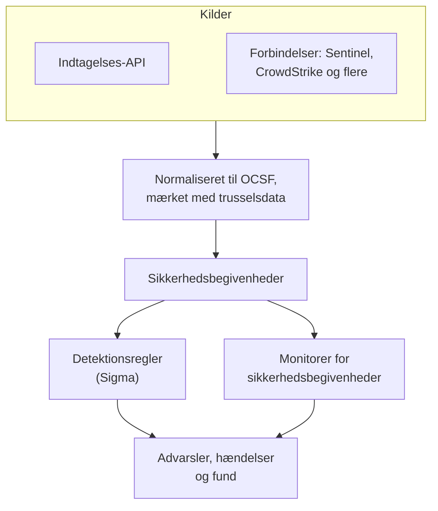
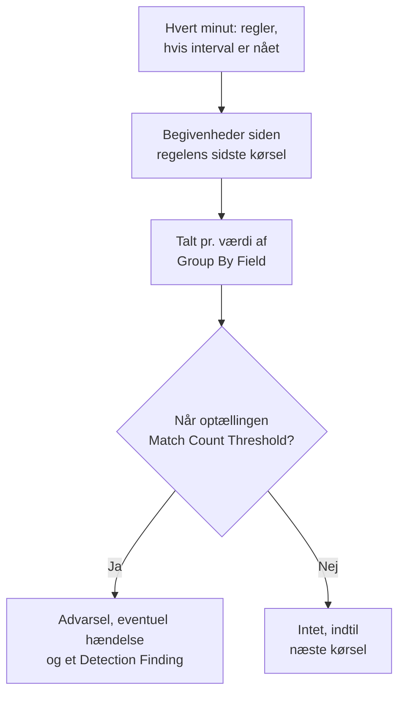

# Sikkerhedsbegivenheder (SIEM)

OneUptime gemmer sikkerhedsbegivenheder ved siden af dine logs, traces og metrikker og giver dem alle den samme form, [OCSF](https://schema.ocsf.io/) (Open Cybersecurity Schema Framework), uanset hvilket format de ankom i. Send begivenheder fra en hvilken som helst kilde, søg i dem, og gør de vigtige til advarsler med Sigma-detektionsregler, trusselsintelligens og monitorer.

:::cards
- [Send begivenheder](#send-sikkerhedsbegivenheder): En HTTPS-POST, et Fluent Bit-output eller en forbindelse til et sikkerhedsprodukt.
- [Søg og korrelér](#udforsk-sikkerhedsbegivenheder): Begivenhedsoversigten og korrelationsgrafen.
- [Detektionsregler](#detektionsregler): Sigma-regler, der åbner advarsler.
- [Monitorer](#monitorer-for-sikkerhedsbegivenheder): Optællinger over et glidende vindue, med en status, der retter sig igen.
:::

## Sådan virker det



Åbn **Produkter → Security Events** under **Observabilitet**. Fanerne:

| Fane | Hvad den bruges til |
| --- | --- |
| **Begivenheder** | Søg i og filtrér alle begivenheder, og åbn en for at se alle dens felter |
| **Korrelér** | En graf over de begivenheder, der deler en vært, en bruger eller en IP-adresse |
| **Detection Rules** | Sigma-regler, der kører efter en tidsplan og åbner advarsler |
| **Threat Intel** | STIX/TAXII-feeds med kendte ondsindede indikatorer |
| **Monitorer** | Projektets monitorer for sikkerhedsbegivenheder |
| **Connections** | Sikkerhedsprodukter, som OneUptime henter nye poster fra |
| **Opsætningsvejledning** | Kodestykker til at sende begivenheder, udfyldt med din ingestion-nøgle |

## Før du begynder

Sikkerhedsdata kan kun læses af rollerne Project Owner og Project Admin og af de tre Security-roller; andre roller ser intet i Security Events. Se [Roller](/docs/permissions/reference#roller).

| Rolle | Hvad den kan |
| --- | --- |
| Security Admin | Alt: begivenheder, detektionsregler, threat intel-feeds og forbindelser |
| Security Member | Læse begivenheder og threat intel samt oprette, ændre og slette detektionsregler og feeds. Den kan ikke sætte forbindelser op eller slette sikkerhedsdata. |
| Security Viewer | Læse begivenheder, regler, feeds, indikatorer og forbindelser |

## Send sikkerhedsbegivenheder

:::steps
### Opret en ingestion-nøgle

Åbn **Projektindstillinger → Telemetri og APM → Indtagelsesnøgler**, og klik på **Opret ingestion-nøgle**. Sikkerhedsbegivenheder bruger de samme nøgler som resten af din telemetri.

### Send dine begivenheder

Send JSON til `/security-events/v1/ingest` med nøglen i `x-oneuptime-token`:

:::tabs
@tab OCSF
```bash
curl -X POST "https://oneuptime.com/security-events/v1/ingest?format=ocsf" \
  -H "Content-Type: application/json" \
  -H "x-oneuptime-token: YOUR_INGESTION_TOKEN" \
  -H "x-oneuptime-service-name: my-security-source" \
  -d '{ "events": [ { "class_uid": 3002, "severity_id": 4, "time": 1755770400000, "status": "Failure", "message": "Failed logon for alice", "actor": { "user": { "name": "alice" } }, "src_endpoint": { "ip": "203.0.113.7" } } ] }'
```
@tab Google UDM
```bash
curl -X POST "https://oneuptime.com/security-events/v1/ingest?format=udm" \
  -H "Content-Type: application/json" \
  -H "x-oneuptime-token: YOUR_INGESTION_TOKEN" \
  -d '{ "events": [ { "metadata": { "event_type": "USER_LOGIN", "event_timestamp": "2026-08-21T10:00:00Z" }, "principal": { "user": { "userid": "alice" }, "ip": ["203.0.113.7"] }, "security_result": [{ "severity": "HIGH", "action": ["BLOCK"] }] } ] }'
```
@tab Generic JSON
```bash
curl -X POST "https://oneuptime.com/security-events/v1/ingest" \
  -H "Content-Type: application/json" \
  -H "x-oneuptime-token: YOUR_INGESTION_TOKEN" \
  -d '{ "events": [ { "timestamp": "2026-08-21T10:00:00Z", "severity": "high", "event_type": "ssh_brute_force", "message": "12 failed SSH logins in 60s", "username": "root", "hostname": "web-01", "src_ip": "203.0.113.7" } ] }'
```
:::

Endpointet svarer `200`, når begivenhederne står i kø.

### Find dem under Begivenheder

Åbn **Produkter → Security Events → Begivenheder**. Begivenhederne vises inden for få sekunder med deres alvorlighed, klasse, bruger, vært og IP-adresser udfyldt.
:::

### Formater

| `format` | Hvad det læser | Accepteres også |
| --- | --- | --- |
| `ocsf` | OCSF-begivenheds-JSON (`class_uid`, `severity_id` osv.) | Ingen |
| `udm` | UDM-begivenheder fra Google SecOps (Chronicle) (`metadata.event_type` osv.) | `chronicle`, `google-secops` |
| `google-secops-alert` | Detektioner og advarsler fra Google SecOps: SOAR-webhooks og detektionsstrømmen | `secops-alert`, `detection` |
| `generic` | Al anden JSON, læst ud fra almindelige feltnavne | Ingen |

Angiv formatet med `?format=`, med headeren `x-oneuptime-security-event-format` eller med et felt `"format"` på øverste niveau. Udelader du det, bestemmes hver begivenheds format for sig, så én webhook kan blande detektioner med rå begivenheder.

- Brødteksten kan være én begivenhed, et array af begivenheder eller `{ "events": [...] }`.
- Headeren `x-oneuptime-service-name` angiver den telemetritjeneste, begivenhederne hører til. Uden den hører de til den tjeneste, der er opkaldt efter den første begivenheds produkt eller leverandør, eller til `Security Events`.
- Intet kasseres, fordi det ikke kunne tilknyttes: hvert felt fra kilden havner i begivenhedens attributter.

### Felter i generisk JSON

En generisk begivenhed læses ud fra almindelige feltnavne:

| Begivenhedens felt | Læses fra den første af |
| --- | --- |
| `message` | `message`, `msg`, `summary`, `description`, `title` |
| `severityName` | `severity`, `severity_name`, `level`, `priority`, `risk_level` |
| `time` | `timestamp`, `time`, `@timestamp`, `event_time`, `created_at` |
| `principalUser` | `user`, `username`, `user_name`, `account`, `actor` |
| `principalHost` | `host`, `hostname`, `computer`, `device`, `machine` |
| `principalIp` | `source_ip`, `src_ip`, `client_ip`, `ip` |
| `targetIp` | `destination_ip`, `dest_ip`, `dst_ip`, `target_ip` |
| `className` | `event_type`, `category`, `type`, `action` |
| `ruleName` | `rule`, `rule_name`, `signature`, `detection` |
| `productName` | `product`, `product_name`, `source`, `log_source` |

Et ord for alvorlighed bliver et OCSF-niveau: `info` læses som Informational, `warning` som Low, `error` som Medium, `alert` som Critical og `emergency` som Fatal.

### Videresend med Fluent Bit

For at sende sikkerhedslogs, du allerede indsamler, f.eks. auditd, syslog eller Falco, tilføjer du et `http`-output til Fluent Bit:

```ini title="fluent-bit.conf"
[OUTPUT]
    Name             http
    Match            security.*
    Host             oneuptime.com
    Port             443
    tls              On
    URI              /security-events/v1/ingest
    Format           json
    Json_date_key    timestamp
    Json_date_format iso8601
    Header           x-oneuptime-token YOUR_INGESTION_TOKEN
    Header           x-oneuptime-service-name my-security-source
    Retry_Limit      5
```

Fanen **Opsætningsvejledning** har disse kodestykker med din egen vært og nøgle udfyldt.

### Forbind et sikkerhedsprodukt

**Connections** henter data fra et sikkerhedsprodukt for dig og importerer dets nye poster som sikkerhedsbegivenheder. En forbindelse indeholder produktets indstillinger og en krypteret legitimation; en worker henter fra den med det interval, du angiver, og springer poster over, som den allerede har importeret.

| Produkt | Importerer | Opsætningsvejledning |
| --- | --- | --- |
| Google SecOps (Chronicle) | Regeldetektioner, kuraterede detektioner og advarsler, som Detection Findings | [Google SecOps](/docs/integrations/google-secops) |
| Microsoft Sentinel | Hændelser, som Incident Findings | [Microsoft Sentinel](/docs/integrations/microsoft-sentinel) |
| Microsoft Defender XDR | Advarsler, som Detection Findings | [Microsoft Defender XDR](/docs/integrations/microsoft-defender-xdr) |
| CrowdStrike Falcon | Advarsler, som Detection Findings | [CrowdStrike Falcon](/docs/integrations/crowdstrike-falcon) |
| Splunk Enterprise Security | Notable events eller en hvilken som helst søgning, som Detection Findings | [Splunk Enterprise Security](/docs/integrations/splunk) |
| Elastic Security | Detektionsadvarsler, som Detection Findings | [Elastic Security](/docs/integrations/elastic-security) |
| AWS Security Hub | Findings, som Detection og Compliance Findings | [AWS Security Hub](/docs/integrations/aws-security-hub) |
| Okta System Log | Begivenheder om login, MFA, konti og politikker | [Okta System Log](/docs/integrations/okta) |

- En forbindelse læser poster efter det tidspunkt, produktet oprettede dem, ikke efter tidspunktet for den aktivitet, de beskriver. En SIEM-regel, der kører hver time, opretter detektioner længe efter de begivenheder, den matchede, og de importeres alligevel.
- Den første hentning kigger 24 timer tilbage, så en ny forbindelse viser nylige poster med det samme.
- **Test forbindelse** i forbindelsens række tjekker adgangen til produktet, og at OneUptimes egne workers kører, og importerer intet. **Run now** henter med det samme.

## Hvad en begivenhed indeholder

Hver begivenhed gemmes med typede felter og kildens payload:

| Gruppe | Felter |
| --- | --- |
| Klassificering | `categoryName`, `className`, `activityName`, `statusName`, med deres OCSF-ID'er (`categoryUid`, `classUid`) |
| Alvorlighed | `severityName`, en af Unknown, Informational, Low, Medium, High, Critical, Fatal eller Other, og `severityId` |
| Hvem gjorde det | `principalUser`, `principalHost`, `principalIp`, `principalProcess` |
| Hvad det ramte | `targetUser`, `targetHost`, `targetIp`, `targetPort`, `targetResource` |
| Kilde | `productName`, `vendorName`, `ruleId`, `ruleName`, `eventUid` |
| Indhold | `message`, `mitreTactics`, `mitreTechniques` og `observables`: hver bruger, vært, IP-adresse, domæne og hash fra begivenheden |
| Attributter | Hele kildens payload, fladet ud til nøgler med punktummer |

## Udforsk sikkerhedsbegivenheder

**Begivenheder** er en telemetrioversigt ligesom oversigterne for logs og traces: et diagram over vinduets begivenheder efter alvorlighed, en sidebjælke med facetter, listen og et panel med hvert felt og hver attribut i den begivenhed, du åbner. Vinduet, filtrene og søgningen ligger alle i URL'en, så en filtreret visning kan deles og overlever en genindlæsning.

### Søgning

Søgefeltet taler det samme sprog som de andre telemetrioversigter (se [Søgesyntaks](/docs/telemetry/search-syntax)):

| Syntaks | Betyder | Eksempel |
| --- | --- | --- |
| fritekst | Beskeden indeholder den | `failed logon` |
| `"quoted phrase"` | Hold ordene sammen | `"brute force"` |
| `<field>:<value>` | Et typet felt | `severity:Critical` |
| `@<attribute>:<value>` | En kildeattribut | `@threat.matched:true` |
| `-<filter>` | Ikke dette | `-severity:Informational` |
| `<field>:(a OR b)` | En hvilken som helst af disse værdier | `severity:(High OR Critical)` |
| `<field>:a*` | `*` er vilkårlig tekst, `?` ét tegn | `host:web-*` |
| `@<attribute>:*` | Attributten findes | `@threat.indicator_id:*` |
| `@<attribute>:~text` | Attributten indeholder teksten | `@finding_info.title:~ransom` |

Et felt er enten et kort navn (`severity`, `class`, `category`, `activity`, `status`, `vendor`, `product`, `rule`, `user`, `host`, `ip`, `targetuser`, `targethost`, `targetip`, `observable`, `tactic`, `technique`) eller feltets eget navn, f.eks. `severityName` eller `principalHost`. Alle andre navne læses som en kildeattribut. `observable:<value>` finder hver begivenhed, der nævner en værdi, uanset hvilken side af aktiviteten den var på.

### Facetter

Sidebjælken tæller vinduets begivenheder efter **Kilde**, **Alvorlighed**, **Begivenhedsklasse**, **Category**, **Aktivitet**, **Status**, **Leverandør**, **Produkt**, **Detection Rule**, **Kildebruger** og **Kildevært**. Klik på en værdi for kun at beholde dens begivenheder, eller på minusset ved siden af for at udelade dem. Diagrammet og hver optælling beskriver præcis begivenhederne på listen.

### Korrelér

**Korrelér** tegner begivenhederne omkring en vært, en bruger eller en IP-adresse: deres begivenhedsklasser omkring det, du søgte efter, markeret med deres værste alvorlighed, og de andre værdier fra de samme begivenheder på den ydre ring. Klik på en klasse for at vise dens begivenheder, eller på en værdi for at korrelere på den næste gang. Hver observable i en begivenheds panel under **Begivenheder** åbner **Korrelér** på den.

## Detektionsregler

En detektionsregel er en [Sigma](https://sigmahq.io/)-regel, et åbent YAML-format til at beskrive mistænkelig aktivitet, som OneUptime kører efter en tidsplan mod dine begivenheder. Når den matcher, åbner den en advarsel, eventuelt en hændelse, og skriver et Detection Finding tilbage i begivenhederne.



### Opret en regel

:::steps
1. Åbn **Produkter → Security Events → Detection Rules**, og klik på **Opret Detection Rule**.
2. Giv den et **Navn** under **Grundlæggende oplysninger**, og lad **Aktiveret** være slået til.
3. Indsæt regelens YAML i **Sigma Rule (YAML)** under **Sigma Rule**. Den fortolkes, når du gemmer, så en fejl vises i formularen.
4. Angiv under **Evaluering**, hvor ofte den kører, og hvor mange match den kræver; se [Evalueringsindstillinger](#evalueringsindstillinger).
5. Vælg under **Ved match**, hvad et match gør: **Create Alert on Match** (til), **Create Incident on Match** (fra) og **Write Detection Finding on Match** (til), med en valgfri **Advarselsalvor** og **Hændelsesalvor**.
:::

En første regel, der matcher mislykkede logins uden for `10.x.x.x`:

```yaml title="failed-logon-burst.yml"
title: Failed logon burst
description: Repeated authentication failures from one source.
level: high
tags:
  - attack.t1110
  - attack.ta0006
detection:
  selection:
    className: Authentication
    statusName: Failure
  filter_internal:
    principalIp|startswith: '10.'
  condition: selection and not filter_internal
```

### Hvad en regel kan udtrykke

OneUptime kører den boolske kerne af Sigma:

- Selektioner er feltkort (hvert felt skal matche; en liste af værdier matcher en hvilken som helst af dem) eller nøgleordslister, der matcher hvor som helst i beskeden.
- Betingelser kombinerer selektioner med `and`, `or`, `not` og parenteser eller med `1 of selection_*`, `all of selection_*`, `any of them` og `all of them`.
- Feltmodifikatorer: `contains`, `startswith`, `endswith`, `all`, `re`, `cased`, `gt`, `gte`, `lt`, `lte`, `cidr`, `exists` og `windash`. Tekst sammenlignes uden hensyn til store og små bogstaver, medmindre du tilføjer `cased`.
- Et felt er et typet felt (`principalUser`), en almindelig Sigma-stavemåde af et (`CommandLine`, `src_ip`, `Hostname`) eller en hvilken som helst attributnøgle, stavet som i begivenheden (`threat.matched`).
- `level` angiver alvorligheden: `informational`, `low`, `medium`, `high` eller `critical`, og `medium`, når den mangler. ATT&CK-ID'er i `tags` (`attack.t1110`, `attack.ta0006`) udfylder fundets MITRE-felter.

Aggregeringer som `| count() by principalIp > 5` afvises, når du gemmer: brug i stedet **Group By Field** og **Match Count Threshold**. `logsource` er kun informativ og indsnævrer intet: læg det filter i en selektion, f.eks. `className: Authentication`. En `timeframe` ignoreres, fordi regelens interval bestemmer dens vindue.

### Evalueringsindstillinger

| Felt | Hvad det gør |
| --- | --- |
| **Evaluation Interval (Minutes)** | Hvor ofte reglen kører: hele minutter, 1 til 1440. Formularen for en ny regel starter på 5. |
| **Group By Field** | Valgfrit. Match, der deler dette felts værdi, f.eks. `principalHost`, tælles, advares og dedupliceres samlet: én advarsel pr. vært i stedet for hundredvis. |
| **Distinct Count Field** | Valgfrit. Tæl de forskellige værdier af dette felt i stedet for de matchende begivenheder. Tomme værdier tælles ikke. |
| **Match Count Threshold** | En gruppe udløses kun, når dens optælling når dette tal inden for én kørsel: 1 til 1000000, og 1 udløses ved ethvert match. |

Group By og Distinct Count tager de samme feltnavne som reglen. Med dem siger tærsklen "så mange, fra den samme ting, i én kørsel", uden en monitor ovenpå:

| Mål | Group By Field | Distinct Count Field | Tærskel |
| --- | --- | --- | --- |
| Advar ved ethvert match | Tom | Tom | 1 |
| Én advarsel pr. vært | `principalHost` | Tom | 1 |
| Brute force: 5 mislykkede logins fra én IP | `principalIp` | Tom | 5 |
| Password spraying: én IP, der fejler mod 5 forskellige konti | `principalIp` | `principalUser` | 5 |
| Portscanning: én IP, der rammer 20 forskellige porte | `principalIp` | `targetPort` | 20 |

### Hvornår en regel kører

OneUptime tjekker hvert minut for aktiverede regler, hvis interval er gået siden deres sidste kørsel. Hver kørsel læser de begivenheder, hvis begivenhedstidspunkt ligger mellem den forrige kørsel og nu, og går så videre:

- Vinduerne ligger i forlængelse af hinanden og glider ikke. Med et interval på 10 minutter kan fejl kl. 09:58 og 10:01 lande i forskellige kørsler og tælles hver for sig, så hold en margin, når du vælger en tærskel.
- Efter et hul, f.eks. et worker-nedbrud eller en regel, der er slået til igen, dækker den næste kørsel hele hullet, op til de seneste 24 timer.
- En begivenhed, der ankommer sent, med et tidspunkt fra før regelens sidste kørsel, gemmes og kan søges, men den regel læser den aldrig.
- Højst 100 grupper udløses pr. kørsel: dem med de højeste optællinger.

### Alvorlighed

En regels `level` er alvorligheden af dens fund: `informational`, `low`, `medium`, `high` og `critical` bliver til Informational, Low, Medium, High og Critical. Dens advarsler og hændelser får en af dit projekts alvorligheder i denne rækkefølge:

1. Regelens **Advarselsalvor** (eller **Hændelsesalvor**), når den er angivet.
2. Din alvorlighed, der er opkaldt efter niveauet, f.eks. High, uanset store og små bogstaver.
3. Efter rang: regler med `critical` og `high` får din mest alvorlige alvorlighed, de andre din mindst alvorlige.

> [!TIP]
> Opkald dine advarselsalvorligheder efter Sigma-niveauerne (Critical, High, Medium, Low, Informational), så lander hver regel på den rigtige uden en indstilling pr. regel.

### Advarsler og fund

Hver gruppe, der udløses, åbner en advarsel med titlen `[Detection] <rule name> — <group value>`, eller `[Detection] <rule name>` for en regel uden Group By Field. Så længe den er åben, åbner flere match for den gruppe ikke en ny. En regel ser kun match og kan ikke se, at et angreb er stoppet, så dens advarsler forbliver åbne, indtil nogen løser dem.

Et Detection Finding er en sikkerhedsbegivenhed af klassen `Detection Finding` (OCSF-klasse 2004) fra produktet `OneUptime Detections`, med regelens MITRE-tags, gruppeværdien først i `observables` og disse attributter:

| Attribut | Værdi |
| --- | --- |
| `oneuptime.detection.rule_id` | ID'et på den regel, der blev udløst |
| `oneuptime.detection.rule_name` | Regelens navn |
| `oneuptime.detection.match_count` | Hvor mange begivenheder der ligger bag fundet |
| `oneuptime.detection.distinct_count` | Hvor mange forskellige værdier der ligger bag det, for en regel med et Distinct Count Field |
| `oneuptime.detection.group_value` | Gruppens værdi, for en regel med et Group By Field |
| `oneuptime.detection.sigma_id` | Sigma-regelens egen `id` |

Fund er almindelige begivenheder: søg efter dem under **Begivenheder**, og pivotér på dem i **Korrelér**. For at afprøve en ny regel i stilhed slår du alle handlinger undtagen fundet fra, indtil du stoler på den.

## Monitorer for sikkerhedsbegivenheder

En monitor for sikkerhedsbegivenheder tæller de begivenheder, der matcher dens filtre, over et glidende vindue og kører de sædvanlige monitorkriterier på optællingen: den ændrer monitorens status, åbner advarsler eller hændelser og tilkalder vagthavende. Opret en under **Overvågninger → Opret monitor** med **Security Events** som type; **Security Events → Monitorer** viser dem alle.

Dens formular viser **Monitor events that include this text**, **Monitor Security Events for (time)**, **Event Severity** og **Begivenhedsklasse**. **Filtrér efter telemetritjeneste** og **Filtrér efter attributter** venter under **Flere felter**, hvis overskrift viser dem, en monitor bruger. Dens kriterier tjekker **Security Event Count**.

| | Detektionsregel | Monitor for sikkerhedsbegivenheder |
| --- | --- | --- |
| Matcher | En Sigma-regel | Filtre på alvorlighed, klasse, besked, tjeneste og attributter |
| Vindue | I forlængelse af hinanden, ét pr. kørsel | Glidende: de seneste 5 sekunder til 24 timer |
| Tæller pr. gruppe | Ja, med **Group By Field** | Nej: én optælling for alt, der matcher |
| Åbner | Advarsler, hændelser og fund | En status, advarsler og hændelser |
| Retter sig igen | Nej: advarsler forbliver åbne, indtil de er løst | Ja: statussen vender tilbage, når optællingen gør |

Skriv selve detektionen som en regel med dens tærskel. Brug en monitor, når du vil have et glidende vindue, en status, der retter sig selv igen, en statusside eller forskellige vagtpolitikker pr. kriterium.

### Hold øje med dine detektioner

Fund er begivenheder, så en monitor kan overvåge selve reglerne:

- Storme: en monitor på klassen `Detection Finding`, der tæller hvert fund. Tyve forskellige regler, der udløses inden for en time, er et signal, ingen enkelt regel kan se.
- Ændringer i hyppighed: filtrér på én regels `oneuptime.detection.rule_id`. En regel, der udløses ugentligt og pludselig udløses halvtreds gange i timen, kræver en anden reaktion.
- Stilhed: fund, der falder til nul, når du normalt ser nogle få, betyder som regel, at en kilde er holdt op med at sende. Brug et kriterium, der tjekker for en optælling under et tal.

Handlingen **Opret monitor** i en regels række åbner en ny monitor, der allerede er sat op på denne måde: klassen `Detection Finding`, regelens ID (aldrig dens navn, som en omdøbning ville ændre) og den seneste time. En sådan monitor tæller fund, ét pr. gruppe pr. kørsel, ikke begivenhederne bag dem. For at kræve et antal begivenheder, før noget udløses, bruger du regelens **Match Count Threshold**.

## Trusselsintelligens

**Threat Intel** abonnerer på STIX/TAXII-feeds med kendte ondsindede IP-adresser, domæner, URL'er, e-mailadresser og filhashes. Begivenheder, der nævner en af dem, mærkes med `threat.*`-attributter, når de ankommer, som regler og monitorer kan filtrere på, og hvert minut matches nylige begivenheder mod feedsene, hvilket åbner advarsler og fund, ligesom en regel gør. Se [Trusselsintelligens](/docs/telemetry/threat-intelligence).

## Opbevaring og fakturering

Sikkerhedsbegivenheder faktureres pr. indtaget GB ligesom resten af din telemetri og opbevares i din telemetriopbevaringsperiode: projektets **Standardopbevaring (dage)** under **Projektindstillinger → Telemetri og APM → Dataopbevaring** eller en opbevaring, der er angivet på den telemetritjeneste, de hører til. Når en begivenheds opbevaring udløber, slettes den.

## Fejlfinding

:::details Begivenhederne vises ikke
Tjek nøglen i `x-oneuptime-token` og stien, `/security-events/v1/ingest`. Tjek derefter vinduet under **Begivenheder**, det seneste døgn, medmindre du ændrer det: en begivenhed placeres på sit eget tidspunkt, så en med et ældre tidsstempel falder uden for det.
:::

:::details En regel matcher aldrig
Tjek, at den er **Aktiveret**, og læs **Last Evaluated** og **Last Error** i dens række. Åbn en begivenhed, du forventede ville matche, og sammenlign den med reglen felt for felt: en almindelig værdi skal være lig med hele feltet, så brug `contains` eller `*` til en del af et felt. En attribut navngives som i begivenheden (`threat.matched`, ikke `attributes.threat.matched`). Med en tærskel over 1 skal matchene falde inden for én kørsel.
:::

:::details En regel matchede, men ingen advarsel blev åbnet
**Create Alert on Match** er slået fra, eller en advarsel for den samme regel og gruppeværdi er stadig åben, og senere match lægges ind i den. Et projekt skal have mindst én advarselsalvorlighed, for at regler kan åbne advarsler.
:::

:::details En regel åbner for mange advarsler
Hver værdi af **Group By Field** får sin egen advarsel: gruppér efter noget grovere, hæv tærsklen, eller tilføj et Distinct Count Field. Er det hyppigheden, du bekymrer dig om, og ikke hvert match, så slå **Create Alert on Match** fra, og sæt en monitor på regelens fund.
:::

## Næste trin

:::cards
- [Trusselsintelligens](/docs/telemetry/threat-intelligence): Match dine begivenheder mod STIX/TAXII-feeds.
- [Google SecOps](/docs/integrations/google-secops): Hent Chronicles detektioner og begivenheder ind.
- [Søgesyntaks](/docs/telemetry/search-syntax): Alt, hvad søgefeltet forstår.
- [Tilladelsesreference](/docs/permissions/reference): Security-rollerne, og hvad hver af dem kan.
:::
