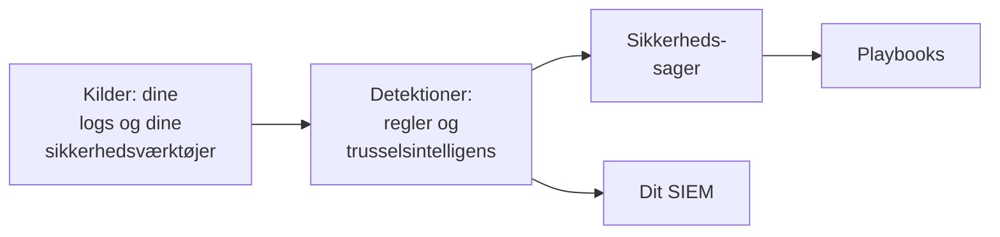

# Kom godt i gang med sikkerhed

OneUptime finder trusler i data, du allerede har - dine logs, de sikkerhedsværktøjer, du bruger, og alt, hvad du sender det -, samler fundene i sager og reagerer med playbooks. To klik sætter det op, og der er intet at installere.

:::cards
- [Sæt det op](#sæt-det-op): Slå det til, som de fleste teams har brug for, og se et testangreb åbne en sag.
- [Sådan virker det](#sådan-virker-det): Kilder, detektioner, sager og playbooks, og hvad hver af dem gør.
- [Dine logs](#find-sikkerhedshændelser-i-dine-logs): De sikkerhedshændelser, der allerede ligger i de logs, du sender til OneUptime.
- [Dit SIEM](#send-det-oneuptime-finder-til-dit-siem): Send det, OneUptime finder, til Google SecOps.
:::

## Før du begynder

Det kræver rollen Project Owner, Project Admin eller Security Admin at sætte sikkerhed op. Rollerne Security Member og Security Viewer læser det, der bliver fundet; se [Roller](/docs/permissions/reference#roller).

## Sæt det op

:::steps
### Slå det til, som de fleste teams har brug for

Åbn **Produkter → Security Events**. Klik på **Slå anbefalet til** på **Oversigt**. Det slår tre ting til på én gang: **Find sikkerhedshændelser i dine logs**, de anbefalede detektionsregler og **Enrich New Cases**, en playbook, der tjekker hver ny sag mod trusselsintelligens og efterlader en tjekliste til triage på den.

### Send et testangreb

Klik på **Send et testangreb**. Et dusin mislykkede logins fra én dokumentationsadresse går gennem den rigtige behandling: De gemmes, brute force-reglen fanger dem, og en sag åbnes. Ingen bliver tilkaldt, og intet SIEM modtager dem.

### Åbn sagen

Klik på **Åbn sagen**. Sådan ser et rigtigt fund ud: hændelserne bag det, adressen, det handler om, og hvad **Enrich New Cases** fandt. Luk den som en test, når du er færdig.
:::

Derefter åbner **Oversigt** på det, der kræver nogen, under **Kræver opmærksomhed**: dine åbne sager, dem ingen har taget, og de playbook-trin, der venter på en godkendelse. Når der ikke er nogen, står der **Alt er roligt**.

## Sådan virker det

| Del | Hvor | Hvad den gør |
| --- | --- | --- |
| **Kilder** | **Connections** | Dine logs, de sikkerhedsprodukter, OneUptime henter fra, og alt, hvad du sender |
| **Detections** | **Detections** | Sigma-regler og feeds med trusselsintelligens, der leder efter trusler i hver hændelse |
| **Sikkerhedssager** | **Sikkerhedssager** | Det, der blev fundet, grupperet efter den bruger, vært eller adresse, det handler om |
| **Playbooks** | **Playbooks** | Trin, der kører på nye sager: beriger dem, giver besked, åbner en hændelse eller inddæmmer |

Øverst på **Oversigt**, under det, der kræver nogen, viser hver del sine tal: kilderne og deres hændelser fra de seneste 24 timer, de regler, der er slået til, de åbne sager og de playbooks, der reagerer. En del, der ikke er sat op, siger det og åbner siden, hvor du sætter den op.

## Find sikkerhedshændelser i dine logs

Kortet **Dine logs**, øverst på **Connections**, kræver ingen installation. Med **Find sikkerhedshændelser i dine logs** slået til læser OneUptime projektets nye logs hvert minut og gør de linjer, det genkender, til sikkerhedshændelser:

| Logs | Hvad der bliver en sikkerhedshændelse |
| --- | --- |
| SSH-logins | Mislykkede og vellykkede SSH-logins fra en servers auth-log, journal eller syslog |
| sudo | Kommandoer kørt som en anden bruger, forkerte sudo-adgangskoder og personer, der ikke må bruge sudo |
| Kubernetes-auditlogs | Ændringer i klyngen, shells åbnet i pods, læste secrets og afviste anmodninger |
| AWS CloudTrail | Logins til konsollen, ændringer i dine AWS-konti og kald, som AWS afviste |
| Webangreb | Anmodninger i en webservers adgangslog, der forsøger SQL-injektion, path traversal eller Log4Shell |

Dine logs forbliver, som de er. Kun de linjer, der betyder noget for sikkerheden, bliver til hændelser: aldrig hver side, en webserver har leveret, eller hver læsning af et API.

## Send det, OneUptime finder, til dit SIEM

Arbejder dit team allerede i et SIEM, sender OneUptime også sine fund dertil. Klik på **Tilføj destination** under **Connections → Send til dit SIEM**, udfyld region, instans og servicekontonøgle for dit Google SecOps, og klik på **Send en testhændelse**, før du gemmer. Se [Send sikkerhedshændelser til Google SecOps](/docs/integrations/google-secops#send-sikkerhedshændelser-til-google-secops).

## Fejlfinding

:::details Turn on recommended er nedtonet
Din rolle må ikke tilføje detektionsregler, playbooks eller logkilden. Spørg en Project Owner, en Project Admin eller en Security Admin, eller få dem til at give dig rollen Security Admin.
:::

:::details Turn on recommended kunne ikke slå alt til
Kortet nævner alt, det ikke kunne slå til, og hvorfor: din rolle, din plan eller en fejl hos OneUptime. Alt andet er slået til. Ret det, kortet nævner, og klik derefter på **Prøv igen**: kun det, der stadig mangler, slås til, og intet tilføjes to gange.
:::

:::details Testangrebet åbnede ingen sag
Sagen åbnes som regel, før knappen svarer; når reglen stadig er ved at indhente, siger den det, og sagen åbnes inden for et minut. Se under **Sikkerhedssager** igen, og tjek under **Detections**, at brute force-reglen er slået til.
:::

:::details Der kommer ingen sikkerhedshændelse fra mine logs
Tjek, at **Find sikkerhedshændelser i dine logs** er slået til, og at kortet **Dine logs** viser, hvornår der sidst blev tjekket. Kun de slags linjer, der står i tabellen ovenfor, bliver til hændelser: En server, der ikke sender SSH-, sudo-, audit-, CloudTrail- eller adgangslogs, har intet at finde.
:::

:::details Oversigt siger, at den seneste sikkerhedshændelse kom for dage siden
Intet har nået Security siden da. Åbn **Connections**, og tjek, at **Dine logs** og hver forbindelse stadig er slået til, og hvornår hver sidst har tjekket.
:::

:::details Kortet, der slår Security til, er væk
Nogen har lukket det med **Luk**. Så længe intet overvåges for trusler endnu, tilbyder **Oversigt** **Sæt Security op**, som henter det tilbage.
:::

## Næste trin

:::cards
- [Sikkerhedsbegivenheder (SIEM)](/docs/telemetry/security-events): Send hændelser, søg i dem, og skriv detektionsregler.
- [Sikkerhedssager og playbooks (SOAR)](/docs/telemetry/security-cases): Behandl sagerne, og reager med playbooks.
- [Trusselsintelligens (STIX/TAXII)](/docs/telemetry/threat-intelligence): Sammenhold dine hændelser med kendte ondsindede indikatorer.
- [Google SecOps](/docs/integrations/google-secops): Hent detektioner fra Google SecOps ind, og send det, OneUptime finder, derud.
:::
