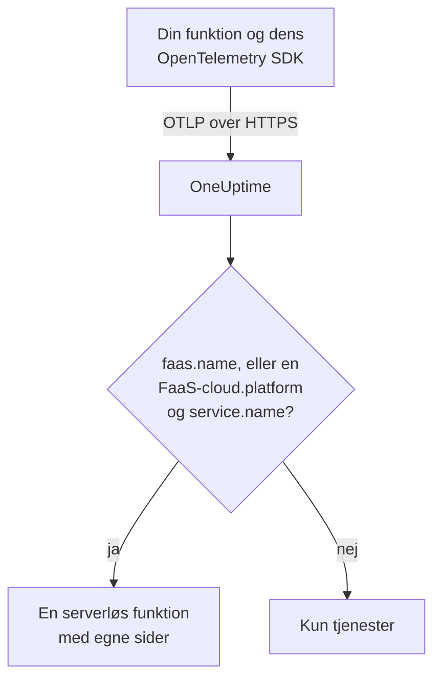

# Serverløse funktioner

OneUptime genkender en serverløs funktion i det øjeblik, den modtager OpenTelemetry-data fra den, og viser den under **Serverløse funktioner** med dens traces, logs og metrikker. Det virker for AWS Lambda, Google Cloud Functions, Azure Functions, Cloudflare Workers og enhver anden FaaS-runtime, der kan sende OpenTelemetry. Der er intet at oprette i hånden: instrumentér funktionen med OpenTelemetry SDK'et til dens runtime, og ret dens OTLP-eksportør mod OneUptime.

:::cards
- [Sådan identificerer OneUptime en funktion](#sådan-identificerer-oneuptime-en-funktion): `faas.name`, eller en FaaS-`cloud.platform` med et `service.name`.
- [Send en funktions telemetri](#send-en-funktions-telemetri): Eksportørens indstillinger og Lambda-laget.
- [Azure Functions](#azure-functions): Én funktion pr. Function App, fra Functions-værten.
- [Fejlfinding](#fejlfinding): En funktion, der ikke dukker op, eller hvis sider er tomme.
:::

## Sådan virker det

OneUptime læser ressourceattributterne i hver batch, efterhånden som den ankommer. En ressource med et `faas.name`, eller med en FaaS-`cloud.platform` som `aws_lambda` eller `azure_functions` sammen med et `service.name`, er en serverløs funktion: OneUptime opretter den med dens første data og arkiverer telemetrien under den.



## Før du begynder

- En indtagelsesnøgle. Opret en under **Projektindstillinger → Telemetri og APM → Indtagelsesnøgler**, og kopiér dens værdi.
- OpenTelemetry SDK'et, eller et autoinstrumenteringslag, til din funktions sprog.

## Sådan identificerer OneUptime en funktion

OneUptime identificerer hver funktion ud fra ressourceattributten `faas.name`. Nogle platformes ressourcedetektorer sætter den aldrig ([Azure Functions](#azure-functions) er det typiske tilfælde), så når en ressource ikke har noget `faas.name`, men dens `cloud.platform` er en FaaS-platform, bruger OneUptime i stedet dens `service.name` som funktionens identitet og udfylder `faas.name` med den værdi på hvert span, hver log, hver metrik og hver profil, den gemmer, så funktionens sider finder al dens telemetri:

| Attribut | Påkrævet | Formål |
| --- | --- | --- |
| `faas.name` | **ja**, medmindre de næste to er sat | Funktionens identitet (fx `checkout-handler`) |
| `cloud.platform` | med `service.name`, når der ikke er noget `faas.name` | `aws_lambda`, `gcp_cloud_functions`, `azure_functions`, `tencent_cloud_scf` eller `alibaba_cloud_fc` |
| `service.name` | på en FaaS-`cloud.platform` uden `faas.name` | Funktionens identitet, skrevet ind i telemetrien som `faas.name` |
| `faas.version` | nej | Vises på oversigten |
| `faas.instance` | nej | Følges pr. instans på siden **Instanser** |
| `cloud.provider` / `cloud.region` / `cloud.account.id` | nej | Vises på oversigten |
| `process.runtime.name` / `process.runtime.version` | nej | Vises som runtime på oversigten |

Et `faas.name`, du selv sætter, bliver aldrig erstattet. Værdien af `cloud.platform` skal staves som angivet (den punktede `azure.functions`, som nogle Azure-detektorer sender, accepteres også), og `service.name` skal være en ressourceattribut: headeren `x-oneuptime-service-name` navngiver en tjeneste, ikke en funktion.

> [!NOTE]
> En funktion, der også sætter `service.name`, vises stadig også under **Tjenester**. **Serverløse funktioner** er visningen bygget til funktioner, afgrænset af `faas.name`.

## Send en funktions telemetri

:::steps
### Sæt OTLP-eksportørens miljøvariabler

De fleste sprogs autoinstrumenteringer læser OpenTelemetrys standardmiljøvariabler:

```bash
OTEL_EXPORTER_OTLP_ENDPOINT="https://oneuptime.com/otlp"
OTEL_EXPORTER_OTLP_HEADERS="x-oneuptime-token=YOUR_TELEMETRY_INGESTION_TOKEN"
OTEL_RESOURCE_ATTRIBUTES="faas.name=checkout-handler,faas.version=1.4.2"
```

Hvis du selv hoster OneUptime, så erstat endpointet med `https://YOUR-ONEUPTIME-HOST/otlp`. På Azure Functions skal du udelade `faas.name` fra `OTEL_RESOURCE_ATTRIBUTES` – se [Azure Functions](#azure-functions).

> [!WARNING]
> Indtagelsesnøglen er en hemmelighed. Brug en indtagelsesnøgle af typen **Server**, sat som en miljøvariabel for funktionen. En nøgle, der når en browser, kan læses af alle, der ser sidens kildekode.

### Tilføj OpenTelemetry Lambda-laget (AWS Lambda)

På AWS Lambda er den enkleste vej [OpenTelemetry Lambda-laget](https://opentelemetry.io/docs/faas/lambda-auto/). Tilknyt laget til din funktions runtime, og sæt:

```bash
AWS_LAMBDA_EXEC_WRAPPER=/opt/otel-handler
OTEL_EXPORTER_OTLP_ENDPOINT=https://oneuptime.com/otlp
OTEL_EXPORTER_OTLP_HEADERS=x-oneuptime-token=YOUR_TELEMETRY_INGESTION_TOKEN
```

Laget sætter `faas.name` ud fra funktionens navn, og dets ressourcedetektor udfylder `cloud.platform`, `cloud.region` og `cloud.account.id`. På en anden platform springer du dette trin over.

### Kald funktionen, og kontrollér, at den ankommer

Kontrollér, at OneUptime accepterer nøglen:

```bash
curl -i https://oneuptime.com/otlp/v1/validate \
  -H "x-oneuptime-token: YOUR_TELEMETRY_INGESTION_TOKEN"
```

`200` med `"valid": true` betyder, at OneUptime accepterer nøglen; `401` betyder, at den er ukendt, tilbagekaldt, deaktiveret eller udløbet. Kald derefter funktionen. Så snart den sender et span, en log eller en metrik, vises den under **Produkter → Infrastruktur → Serverløs → Alle funktioner**.
:::

## Azure Functions

Azure Functions-værten kan selv sende OpenTelemetry, så en Function App rapporterer sine kald (traces, logs og metrikker) uden kodeændringer, uanset hvilket sprog den er skrevet i. Microsofts vejledning er [Use OpenTelemetry with Azure Functions](https://learn.microsoft.com/en-us/azure/azure-functions/opentelemetry-howto).

### Sådan vises en Function App

Azures ressourcedetektorer (Functions-værtens egen, den isolerede .NET-workers i `Microsoft.Azure.Functions.Worker.OpenTelemetry` og Node.js-detektoren i `@opentelemetry/resource-detector-azure`) beskriver **Function App'en**, ikke en enkelt funktion, og ingen af dem sætter `faas.name`:

| Attribut | Værdi |
| --- | --- |
| `service.name` | Function App'ens navn, fra `WEBSITE_SITE_NAME` |
| `cloud.provider` | `azure` |
| `cloud.platform` | `azure_functions`; Node.js-detektoren skriver `azure.functions`, som OneUptime omskriver |
| `cloud.region` | Appens region, fra `REGION_NAME` |
| `cloud.resource_id` | `/subscriptions/<subscription>/resourceGroups/<group>/providers/Microsoft.Web/sites/<app>` |
| `faas.instance` | Instansen, fra `WEBSITE_INSTANCE_ID`: kun Node.js-detektoren |

Så OneUptime identificerer funktionen ud fra `service.name`, udfylder `faas.name` med Function App'ens navn og viser **én serverløs funktion pr. Function App**. Ressourcen beskriver appen, ikke én af dens funktioner: hver instans rapporterer de samme attributter på app-niveau, uanset hvilken af appens funktioner den kører, og på Flex Consumption-planen skalerer nogle funktioner endda ud på deres egne instanser. De enkelte funktioner findes i selve telemetrien:

- Værten starter et span for hvert kald, navngivet efter den funktion, den kørte: søg efter det navn på funktionens side **Spor**.
- Værten registrerer `faas.invoke_duration`, et histogram i sekunder, med funktionens navn i datapunktattributten `faas.name`: gruppér metrikken efter den på siden **Metrikker** eller i et dashboard for hver funktions latenstid.

Tilføj ikke `faas.name` til `OTEL_RESOURCE_ATTRIBUTES` på en Function App, som det generelle eksempel i [første trin](#sæt-otlp-eksportørens-miljøvariabler) gør. Programindstillinger når alle appens processer, så telemetrien fra alle dens funktioner ville bære det ene navn, og OneUptime erstatter aldrig et `faas.name`, den får. Microsofts vejledning siger det samme: læg ikke funktionsspecifikke værdier på ressourcen. Lad den være usat, så får funktionen navn efter appen.

Værten og den isolerede .NET-worker bruger `OTEL_SERVICE_NAME` i stedet for appens navn, når den er sat. Hold alle processer i én app på det samme `service.name`: værten og sprog-workeren sender begge telemetri, og en worker, der rapporterer et andet navn, skaber en anden serverløs funktion. En worker, hvis ressource ikke har nogen FaaS-`cloud.platform`, hører slet ikke til nogen serverløs funktion – se [Instrumentér din funktionskode](#instrumentér-din-funktionskode-valgfrit).

:::steps
### Slå OpenTelemetry til i Functions-værten

Tilføj `"telemetryMode": "OpenTelemetry"` i roden af appens `host.json`:

```json title="host.json"
{
  "version": "2.0",
  "telemetryMode": "OpenTelemetry"
}
```

Værten sender derefter, uanset appens sprog, sine egne traces (et span pr. kald plus processor-spans fra Service Bus og Event Hubs bag udløste funktioner), sine logs og metrikker, herunder `faas.invoke_duration`.

### Ret værten mod OneUptime

Sæt eksportøren som programindstillinger:

```bash
az functionapp config appsettings set \
  --name my-function-app \
  --resource-group my-rg \
  --settings \
    OTEL_EXPORTER_OTLP_ENDPOINT=https://oneuptime.com/otlp \
    OTEL_EXPORTER_OTLP_PROTOCOL=http/protobuf \
    "OTEL_EXPORTER_OTLP_HEADERS=x-oneuptime-token=YOUR_TELEMETRY_INGESTION_TOKEN"
```

Hvis du selv hoster OneUptime, så erstat endpointet med `https://YOUR-ONEUPTIME-HOST/otlp`. `OTEL_EXPORTER_OTLP_PROTOCOL=http/protobuf` har betydning: værtens .NET-eksportør bruger som standard gRPC, og med `http/protobuf` sender den til `/otlp/v1/traces`, `/otlp/v1/metrics` og `/otlp/v1/logs` under endpointet. Værten sender kun OTLP, så længe `OTEL_EXPORTER_OTLP_ENDPOINT` er sat.

> [!WARNING]
> Dette token er en hemmelighed: brug en indtagelsesnøgle af typen **Server**. Programindstillinger er krypteret, når de er gemt; vil du i stedet opbevare tokenet i Key Vault, så sæt `OTEL_EXPORTER_OTLP_HEADERS` til en Key Vault-reference som `@Microsoft.KeyVault(SecretUri=https://my-vault.vault.azure.net/secrets/oneuptime-otlp-headers/)`, og giv appens administrerede identitet rollen **Key Vault Secrets User** på vaulten. Referencen opløses til hemmelighedens værdi, som den er gemt, så gem hele headeren, `x-oneuptime-token=YOUR_TELEMETRY_INGESTION_TOKEN`, ikke kun tokenet.

Behold `APPLICATIONINSIGHTS_CONNECTION_STRING`, hvis du stadig vil have Application Insights: med begge sat sender værten de samme OpenTelemetry-data til Application Insights og til OneUptime. Fjern den for kun at sende til OneUptime.

### Instrumentér din funktionskode (valgfrit)

Værten sporer allerede hvert kald. For at tilføje spans og logs fra din egen kode, forbundet med værtens, skal du også slå OpenTelemetry til i sprog-workeren. Den sender med de samme `OTEL_EXPORTER_OTLP_*`-indstillinger:

- **C# (isolated worker)**: tilføj NuGet-pakkerne `Microsoft.Azure.Functions.Worker.OpenTelemetry`, `OpenTelemetry.Extensions.Hosting` og `OpenTelemetry.Exporter.OpenTelemetryProtocol`, og derefter i `Program.cs`: `builder.Services.AddOpenTelemetry().UseFunctionsWorkerDefaults().UseOtlpExporter();`
- **JavaScript / TypeScript**: `npm install @azure/functions-opentelemetry-instrumentation` sammen med OpenTelemetry Node.js SDK'et og dets OTLP-eksportører, og registrér `AzureFunctionsInstrumentation` i en fil, som feltet `main` i `package.json` medtager.
- **Java**: tilføj Maven-afhængigheden `com.microsoft.azure.functions:azure-functions-java-opentelemetry`.
- **Python**: sæt programindstillingen `PYTHON_ENABLE_OPENTELEMETRY=true`, tilføj de OpenTelemetry-pakker, Microsoft angiver (blandt dem `opentelemetry-sdk` og `opentelemetry-exporter-otlp`), til `requirements.txt`, og konfigurér eksportørerne i `function_app.py`.
- **PowerShell**: sæt programindstillingen `OTEL_FUNCTIONS_WORKER_ENABLED=True`, og indlæs modulet `AzureFunctions.PowerShell.OpenTelemetry.SDK` fra `profile.ps1`.

Microsofts vejledning har den fulde kode til hvert sprog. .NET-workeren (via `UseFunctionsWorkerDefaults()`) og Python-workeren (via `PYTHON_ENABLE_OPENTELEMETRY`) beder værten om at overlade deres logs til dem, så de logs ikke sendes to gange.

En workers spans og logs når kun funktionens sider, når dens ressource beskriver appen på samme måde som værtens: det samme `service.name` og en FaaS-`cloud.platform`. Den isolerede .NET-worker (via `UseFunctionsWorkerDefaults()`) og Microsofts Node.js-eksempel (via de Azure-detektorer, som `getResourceDetectors()` indeholder) rapporterer begge dele. Microsofts Python-eksempel bygger sin ressource uden en Azure-detektor, så som udgangspunkt rapporterer det ingen af delene, og dets telemetri når aldrig funktionen. Til Python, eller enhver worker, der er sat op uden en Azure Functions-ressourcedetektor, skal du tilføje to programindstillinger mere. Alle appens processer læser dem, værten medregnet, så de alle rapporterer den samme identitet:

```bash
az functionapp config appsettings set \
  --name my-function-app \
  --resource-group my-rg \
  --settings \
    OTEL_SERVICE_NAME=my-function-app \
    "OTEL_RESOURCE_ATTRIBUTES=cloud.provider=azure,cloud.platform=azure_functions"
```

Sæt `OTEL_SERVICE_NAME` til Function App'ens eget navn. Det er det navn, værten og Node.js-detektoren rapporterer uden den, så funktionen beholder den identitet, den allerede har.
:::

### Begrænsninger

- **C#-in-process-apps** kan ikke bruge OpenTelemetry: flyt dem først til modellen med isoleret worker.
- **Logstreaming** i Azure-portalen virker ikke, mens værten er i OpenTelemetry-tilstand, og portalens liste _Recent function invocations_ kræver telemetrien i Application Insights. Brug i stedet funktionens sider **Protokoller** og **Spor** i OneUptime.
- Afsnittet `logging.applicationInsights` i `host.json` gælder ikke længere, så snart `telemetryMode` er `OpenTelemetry`.
- **Instanser** viser `faas.instance`-værdier. Af detektorerne ovenfor er det kun Node.js-detektoren, der sætter den, så siden forbliver tom for telemetri fra værten og .NET-workeren.

## Hvad du får

Så snart funktionen sender et span, en log eller en metrik, vises den under **Serverløse funktioner**. Dens **Oversigt** viser:

- **Kald**, **fejlrate** og **p95-varighed**, beregnet ud fra dine traces over et tidsinterval, du vælger, med trenddiagrammer.
- **Instanser**: en live liste over de `faas.instance`-værdier, funktionen rapporterer.
- Fulde sider **Protokoller**, **Spor** og **Metrikker**, afgrænset til denne funktion.

## Mærk funktioner, og tildel ejere

En ressourceattribut, der starter med `oneuptime.label.`, bliver en projektetiket på funktionen: `oneuptime.label.team=payments` tilføjer etiketten `team:payments`. Tilføj attributterne til `OTEL_RESOURCE_ATTRIBUTES`:

```bash
OTEL_RESOURCE_ATTRIBUTES="faas.name=checkout-handler,oneuptime.label.team=payments,oneuptime.label.env=production"
```

Vil du i stedet mærke funktioner eller tildele ejere ud fra deres navne, så åbn **Produkter → Infrastruktur → Serverløs**, og brug **Etiketregler** og **Ejerregler** i sidemenuen. Regler kører, når en funktion oprettes, også automatisk fundne. For at anvende en regel på de funktioner, du allerede har, skal du bruge dens **Run Now** (se [Kør regler på eksisterende ressourcer](/docs/configuration/run-rules-now)).

## Fejlfinding

:::details Funktionen vises ikke under Serverløse funktioner
Kontrollér i denne rækkefølge:

1. Funktionen er blevet kaldt, siden du satte variablerne: den sender kun telemetri, mens den kører.
2. På AWS Lambda er laget tilknyttet til funktionens runtime, og `AWS_LAMBDA_EXEC_WRAPPER` er `/opt/otel-handler`: uden wrapperen starter lagets instrumentering aldrig.
3. Andre steder indlæser funktionens kode OpenTelemetry SDK'et eller autoinstrumenteringen: variablerne alene sender ingenting.
4. Ressourcen bærer `faas.name`, eller en FaaS-`cloud.platform` og et `service.name`. Uden dem arkiveres telemetrien i stedet under **Tjenester**, som en tjeneste.
5. Funktionen kan nå din OneUptime-URL. En funktion på et privat netværk skal have en rute ud til den, fx en NAT-gateway.
:::

:::details Funktionen er på listen, men dens sider er tomme
Funktionens **Oversigt**, **Protokoller**, **Spor** og **Metrikker** viser telemetri, hvis `faas.name` er præcis lig med funktionens navn, inklusive store og små bogstaver. En funktion, der er navngivet via en FaaS-`cloud.platform` og dens `service.name`, behøver ikke sit eget `faas.name`: OneUptime skriver `service.name` ind i telemetrien som `faas.name`, efterhånden som den ankommer. Telemetri, der blev gemt, før OneUptime begyndte at udfylde `faas.name`, opdateres ikke og holdes uden for siderne: kald funktionen for at sende ny telemetri. Kontrollér også tidsintervallet øverst på siden.
:::

:::details Funktionen vises som afbrudt
En funktion bliver afbrudt, når OneUptime ikke har modtaget noget fra den i 15 minutter; OneUptime tjekker hvert 5. minut, og tid, hvor OneUptime selv ikke modtog data, tæller ikke med. En funktion, der kun kører en gang imellem, er afbrudt mellem kørslerne: den bliver forbundet igen med sin næste telemetri.
:::

## Næste trin

:::cards
- [OpenTelemetry](/docs/telemetry/open-telemetry): Send traces, logs og metrikker fra ethvert program.
- [Køer](/docs/telemetry/queues): De køer og emner, dine funktioner publicerer til og forbruger fra.
- [Trace-monitor](/docs/monitor/traces-monitor): Få besked om en funktions mislykkede eller langsomme kald.
:::
