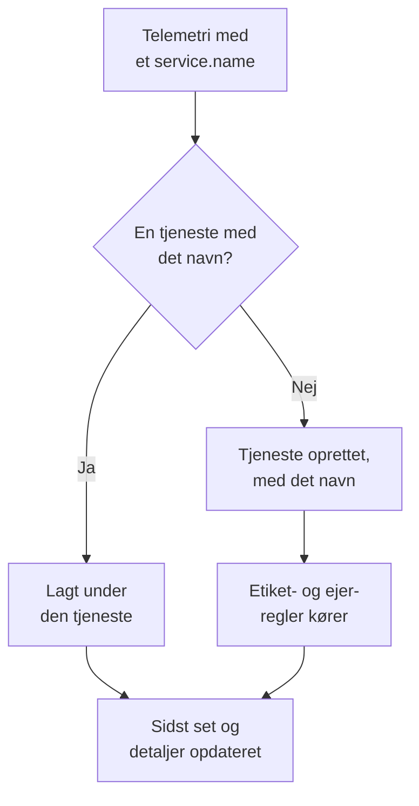

# Tjenestekatalog

Tjenestekataloget viser de applikationer og microservices, du kører. OneUptime tilføjer en tjeneste, første gang dens telemetri ankommer, og samler derefter dens protokoller, spor, metrikker, undtagelser, hændelser og ejere på én side, så alle kan se, hvad en tjeneste gør, hvem der ejer den, og hvordan den har det.

:::cards
- [Sådan kommer en tjeneste ind i kataloget](#sådan-kommer-en-tjeneste-ind-i-kataloget): Dens `service.name`, ved dens første telemetri.
- [Find en tjeneste](#find-en-tjeneste): Listen, dens filtre og dens kolonner.
- [En tjenestes sider](#en-tjenestes-sider): Alt om én tjeneste.
- [Arkivér eller slet en tjeneste](#arkivér-eller-slet-en-tjeneste): Behold historikken, eller fjern den.
:::

## Sådan kommer en tjeneste ind i kataloget

Du behøver ikke at oprette tjenester. Hver batch af telemetri navngiver den tjeneste, der sendte den, i ressourceattributten `service.name`. OneUptime lægger batchen under tjenesten med det navn og opretter tjenesten, når projektet ikke har en endnu.

- **Navnet er tjenestens identitet.** Store og små bogstaver betyder ikke noget i sammenligningen, så `Checkout-API` og `checkout-api` er én tjeneste. Et nyt `service.name` starter en ny tjeneste.
- **Containere navngiver sig selv.** Telemetri fra Docker- og Podman-agenterne navngiver en tjeneste efter dens container, når den ikke har et `service.name`.
- **En indtagelsesnøgle kan bestemme tjenesten.** OpenTelemetry-data, der sendes med en nøgle med et **Fastgjort tjenestenavn**, lægges under det navn, uanset hvad deres `service.name` siger. Se [Indtagelsesnøgler](/docs/telemetry/ingestion-keys#lås-en-browsernøgle-ned).
- **Browsere og telefoner er ikke tjenester.** Telemetri fra en browser eller en mobilapp hører i stedet til en [RUM-applikation](/docs/rum/applications).
- **Etiketter kan følge med telemetrien.** En ressourceattribut med navnet `oneuptime.label.<name>` giver tjenesten etiketten `<name>:<value>`, for eksempel `oneuptime.label.team=payments` for `team:payments`.

Hver gang der ankommer telemetri, rykker tjenestens **Sidst set** frem, og dens detaljer opdateres ud fra de ressourceattributter, der følger med:

| Detalje | Fra attributten |
| --- | --- |
| Tjenesteversion | `service.version` |
| Udrulningsmiljø | `deployment.environment.name` eller `deployment.environment` |
| Tjenestens navnerum | `service.namespace` |
| Kørselsmiljø | `process.runtime.name` og `process.runtime.version` |
| Teknologi | `telemetry.sdk.language` eller kørselsmiljøet |
| Cloud | `cloud.provider`, `cloud.platform`, `cloud.region` og `cloud.account.id` |

## Før du begynder

- **Telemetri, der ankommer** med et `service.name`. Se [OpenTelemetry](/docs/telemetry/open-telemetry): `OTEL_SERVICE_NAME` sætter det.
- **En rolle, der må læse tjenester.** Project Owner, Project Admin, Project Member, Viewer, Settings Admin, Settings Member eller Settings Viewer, eller en brugerdefineret rolle med tilladelsen Read Service. At oprette, ændre og slette tjenester kræver Project Owner, Project Admin, Project Member, Settings Admin eller Settings Member, eller de tilsvarende tjenestetilladelser.

## Find en tjeneste

Gå til **Produkter → Ressourcer → Tjenester**. **Alle tjenester** viser hver tjeneste med **Navn**, **Beskrivelse**, **Technology**, **Sidst set**, **Etiketter** og **Ejere**.

- Søg på navn eller beskrivelse, og filtrér på ejer eller etiket med bjælken over listen.
- Markér flere tjenester for at give dem alle etiketter eller ejere på én gang, eller for at arkivere dem.
- Klik på en tjeneste for at åbne dens sider.

For at tilføje en tjeneste, før dens telemetri ankommer, for eksempel for at angive dens ejere først, skal du klikke på **Opret Tjeneste** og angive dens **Navn** præcis som dens `service.name` bliver. Etiket- og ejerregler kører på den som på en opdaget tjeneste. Når den er gemt, åbner opsætningsvejledningen til OpenTelemetry med det navn i hvert kodeuddrag, og dens sidste trin, **Vent på forbindelse**, fortæller, hvornår tjenestens første data kommer ind.

## En tjenestes sider

En tjenestes sidemenu har fem sektioner:

| Sektion | Sider |
| --- | --- |
| **Grundlæggende** | **Oversigt**: forespørgsler, fejlrate og p95-latens fra dens spans, diagrammer og dens detaljer. **Anbefalinger**: færdige monitorer til tjenesten, valgt efter dens sprog. **Ejere**: de personer og teams, der har ansvaret for den. **Feed**: alt, hvad der er sket med den, fra hvordan den blev oprettet, til hver ændring siden. |
| **Telemetri** | Dens **Protokoller**, **Spor**, **Metrikker**, **Ydeevneprofiler**, **Undtagelser** og **Source Maps**, allerede filtreret til denne tjeneste. |
| **Aktivitet** | De **Hændelser**, **Advarsler** og begivenheder under **Planlagt vedligeholdelse**, der berører den. |
| **Udvikler** | **Terraform**, **API** og **AI-assistenter**: tjenesten styret fra kode. Sektionen er foldet sammen fra start. |
| **Avanceret** | **Indstillinger**, **Auditlogs** og **Slet tjeneste**. **Avanceret** er foldet sammen fra start: fold den ud først. |

Ejere betyder noget ud over siden: en rolle med omfanget Owned læser telemetrien for de tjenester, som du eller dine teams ejer. Se [Telemetri](/docs/permissions/index#telemetri).

## Skift en tjeneste

:::steps
### Åbn dens indstillinger

Åbn tjenesten, fold **Avanceret** ud i dens sidemenu, og klik på **Indstillinger**.

### Omdøb eller beskriv den

Klik på **Rediger detaljer** under **Tjenestedetaljer** for at ændre dens **Navn**, **Beskrivelse** eller **Etiketter**. Navnet skal stadig matche det `service.name`, som dens telemetri rapporterer: skift det også i din OpenTelemetry-opsætning, ellers opretter den næste telemetri en ny tjeneste.

### Vælg dens farve og teknologistak

Klik på **Rediger indstillinger** under **Tjenesteindstillinger**. **Tjenestefarve** markerer tjenesten i diagrammer og lister; en ny tjeneste får sin egen. **Teknologistak** er valgfri: lad den stå tom for at vise det sprog, der er registreret ud fra dens telemetri.
:::

Den samme side rummer tjenestens opbevaring, sammenklappet under **Yderligere indstillinger**. Kortene **Opbevaring af telemetridata** og **Opbevaring efter telemetritype** gemmer dens telemetri længere eller kortere end projektets standardopbevaring. De er en del af [Enterprise Edition](/docs/self-hosted/enterprise) og af Scale-planen på OneUptime Cloud; uden dem viser siden, hvad de tilføjer, og tjenesten beholder projektets opbevaring.

## Giv etiketter og ejere automatisk

Regler giver nye tjenester deres etiketter og ejere, når de oprettes, opdagede tjenester medregnet. Du finder dem under **Tjenester → Indstillinger → Ejerregler** og **Tjenester → Indstillinger → Etiketregler**; **Indstillinger** er foldet sammen fra start i sidemenuen. Se [Etiket- og ejerregler](/docs/configuration/label-and-owner-rules).

## Arkivér eller slet en tjeneste

Arkivér en tjeneste, du ikke længere holder øje med, men hvis historik du vil beholde. En arkiveret tjeneste er skjult i **Alle tjenester**, men den bliver ved med at indsamle telemetri. Arkivér den fra dens side **Indstillinger**, eller markér flere i listen. For at hente en tilbage skal du åbne **Tjenester → Avanceret → Arkiveret**.

> [!WARNING]
> Når du sletter en tjeneste, slettes også dens source maps samt de metrik-pipelineregler og LLM-omkostningsbudgetter, der er sat for den. Hvis OneUptime stadig modtager dens telemetri, oprettes tjenesten igen, uden de etiketter, ejere og indstillinger, du gav den. Arkivér den i stedet for at tage den af listen og beholde alt.

## Fejlfinding

:::details En tjeneste vises to gange
To værdier af `service.name` nåede OneUptime, for eksempel fra to versioner af din opsætning eller efter en omdøbning i kun den ene ende. Telemetri matches på navn: sørg for, at hver instans rapporterer det samme `service.name`, og arkivér eller slet derefter den tjeneste, du ikke længere har brug for.
:::

:::details Min tjeneste er ikke i kataloget
Kontrollér, at dens telemetri har et `service.name`. Telemetri fra en browser eller en mobilapp går i stedet til Real User Monitoring, og en vært eller klynge uden tjenestenavn lægges under den vært eller klynge.
:::

:::details Sidst set halter bagefter
**Sidst set** opdateres omtrent én gang i minuttet, ikke ved hver batch, så den kan halte omkring et minut efter den levende telemetri.
:::

## Næste skridt

:::cards
- [Protokoludforsker](/docs/telemetry/logs-explorer): Søg i en tjenestes protokoller.
- [Sporudforsker](/docs/telemetry/traces-explorer): Følg dens forespørgsler.
- [Undtagelsessporing](/docs/telemetry/exceptions): Gennemgå de fejl, den kaster.
- [Etiket- og ejerregler](/docs/configuration/label-and-owner-rules): Giv nye tjenester etiketter og ejere.
:::
