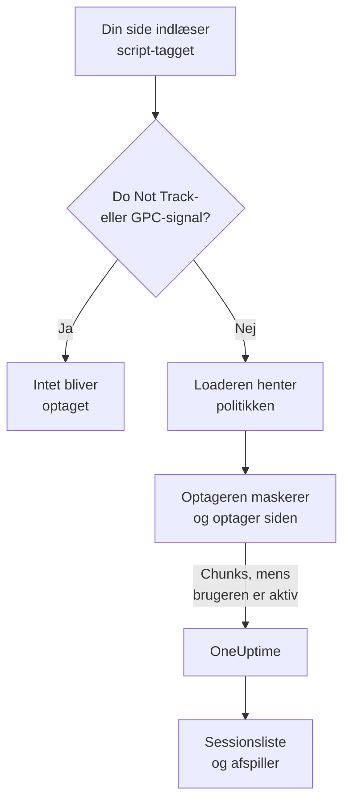
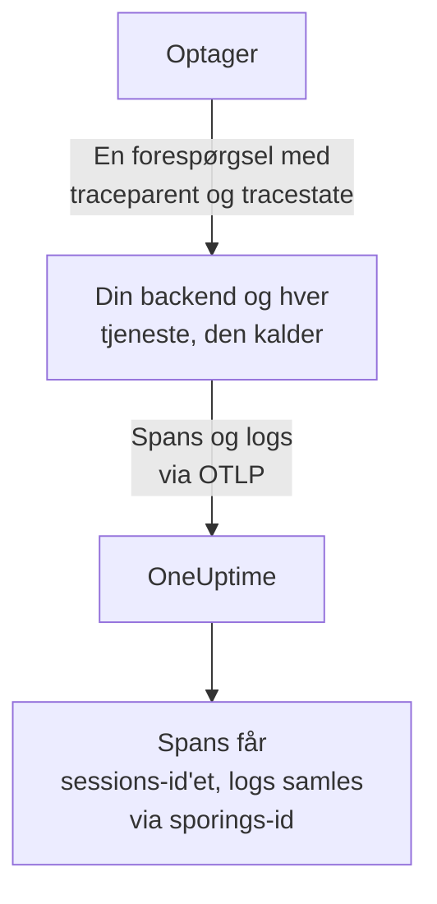
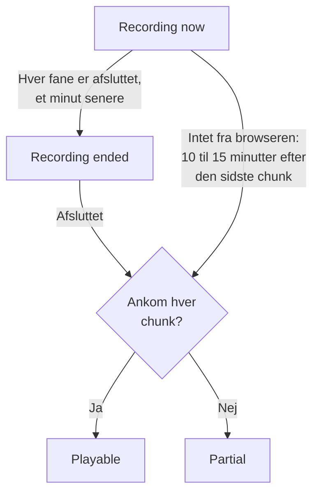
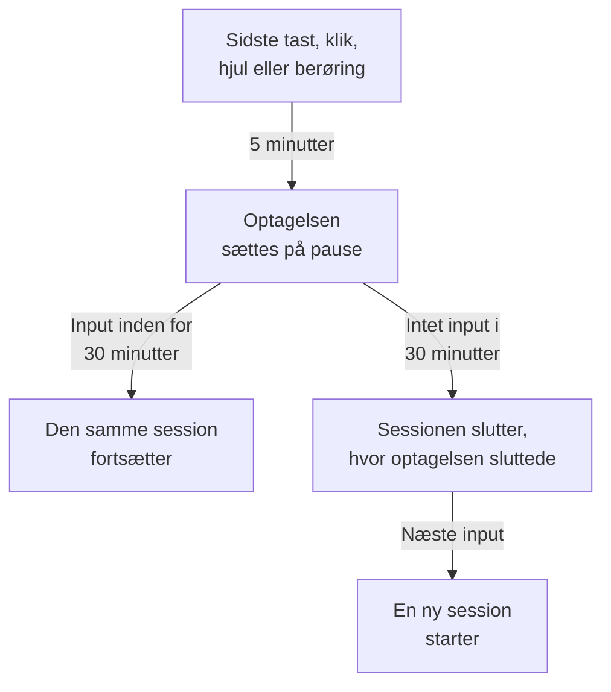

# Sessionsafspilning

Sessionsafspilning optager det, rigtige brugere så i din web- eller React Native-app, og afspiller det ved siden af fejl, spor og logs fra den samme session. Du tilføjer ét script-tag, vælger, hvad der maskeres, og ser enhver session fra dens RUM-applikation.

:::cards
- [Sådan virker det](#sådan-virker-det): En loader, en politik og en optager, der uploader undervejs.
- [Installation](#installation): Ét script-tag på hver side, eller React Native-SDK'et.
- [Privatliv](#privatliv): Hvad der maskeres, samtykke, og hvem der kan sende optagelser.
- [Korrelér med resten af din telemetri](#korrelér-med-resten-af-din-telemetri): Backend-spor, -logs og -fejl, kædet sammen uden kode.
- [Se en session](#se-en-session): Sessionslisten, siden Brugere, brugerflows og afspilleren.
- [Optagelsesstatus](#optagelsesstatus): Hvorfor intet kommer ind, og alarmer, før et budget er brugt op.
:::

## Sådan virker det

Scriptet på din side er en lille loader. Den tjekker browserens privatlivssignaler, henter applikationens politik fra OneUptime og indlæser først derefter optageren, som maskerer siden, mens den optager den, og uploader den i chunks, mens brugeren er aktiv.



Som standard optages og uploades hver session, mens den foregår, ikke kun dem, der gik galt. Det er i de sessioner, hvor intet gik galt, at du finder kassen, som ingen gennemførte, formularen, som alle opgav, og siden, der ifølge en kunde «så forkert ud».

For at gemme mindre arbejder to indstillinger i applikationens politik sammen:

| Indstilling | Standard | Hvad den ændrer |
| --- | --- | --- |
| **Stikprøveprocent** | 100 | Hvor mange sessioner der er kvalificerede. Halvér den, og du halverer både de gemte bytes og de lagrede slutbrugerdata. Beslutningen træffes én gang pr. session ud fra en hash af sessions-id'et, så en session bliver aldrig halvt optaget. |
| **Hvornår en optagelse skal uploades** | _Always_ | Med _On error or frustration_ holder optageren en ringbuffer i hukommelsen og uploader kun, når noget går galt. Der findes så en optagelse af næsten hver mislykket session, til en pris omkring 15 gange lavere end at optage alle, men du kan ikke se en session, der ikke gik galt. |

## Før du begynder

- En RUM-applikation. Opret en under **Produkter → Ressourcer → Overvågning af reelle brugere**, eller lad din telemetri oprette den: se [Administrer applikationer](/docs/rum/applications).
- En **Browser**-indtagelsesnøgle, fra **Projektindstillinger → Telemetri og APM → Indtagelsesnøgler**. En Browser-nøgle virker kun fra de oprindelser, du angiver på den: se [Angiv dine tilladte oprindelser i produktion](#angiv-dine-tilladte-oprindelser-i-produktion).

Sessionsafspilning er slået til som standard. Dens indstillinger findes tre steder:

| Hvor | Hvad der er der |
| --- | --- |
| Applikationens side **Replay Policy** | Politikken (optagelse, maskering, samtykke, sporing og grænser), et resumé af **Optagelsens tilstand**, kortet **Hvad en optagelse indeholder**, panelet **Test your installation** og **Record a specific user's next session**. |
| Applikationens side **Sundhed** | Om optagelser kommer ind, og hvorfor ikke, når de ikke gør. Se [Optagelsesstatus](#optagelsesstatus). |
| **Overvågning af reelle brugere → Indstillinger → Sessionsafspilning** | Kontakten for hele projektet, der stopper alle applikationer på én gang, og en skrivebeskyttet liste over hver applikations politik. |

## Installation

Tilføj ét script-tag til hver side, du vil optage.

:::steps
### Opret en Browser-nøgle

Under **Projektindstillinger → Telemetri og APM → Indtagelsesnøgler** skal du klikke på **Opret ingestion-nøgle**, vælge **Browser** som **Nøgletype** og angive dit sites oprindelser under **Tilladte oprindelser**. Kopiér derefter nøglens **Hemmelig nøgle**. [Browseropsætning](/docs/rum/browser-setup#sæt-det-op) viser hver skærm.

### Tilføj script-tagget

Sæt tagget på hver side med din nøgle og din applikations identifikator:

```html
<script
  src="https://oneuptime.com/telemetry/session-replay/v1/recorder.js"
  data-oneuptime-token="YOUR_TELEMETRY_INGESTION_KEY"
  data-oneuptime-app-identifier="storefront-web"
  crossorigin="anonymous"
  async
></script>
```

`data-oneuptime-app-identifier` skal svare til RUM-applikationens identifikator, den samme værdi, som du bruger til `service.name`. Applikationens side **Dokumentation**, i sektionen **Sessionsafspilning** i dens sidemenu, viser denne snippet med begge værdier allerede udfyldt sammen med dens varianter til Next.js / React og Google Tag Manager.

### Tjek, at optagelser kommer ind

Åbn en af dine sider, og klik rundt i nogle sekunder. Inden for cirka et minut vises sessionen på applikationens side **Sessionsafspilning**, markeret som **Optager nu**. Gør den ikke det, siger applikationens side **Sundhed** hvorfor: se [Optagelsesstatus](#optagelsesstatus).
:::

Scriptet på `/v1/recorder.js` er en lille loader. Den tjekker Do Not Track, henter din applikations politik og indlæser først derefter `/latest/recorder.js`. Politikken og optageren leveres med `no-store`, så en ændring i en af dem når den næste sideindlæsning uden at vente på, at en browsercache udløber.

### Script-taggets attributter

| Attribut | Påkrævet | Hvad den gør |
| --- | --- | --- |
| `data-oneuptime-token` | Ja | Dit indtagelsestoken til telemetri. |
| `data-oneuptime-app-identifier` | Ja | RUM-applikationens identifikator. |
| `data-oneuptime-host` | Nej | OneUptime-oprindelsen. Udeladt udledes den af scriptets egen `src`, så du har kun brug for den, når du leverer scriptet via dit eget domæne. |
| `data-oneuptime-user-ref` | Nej | Den slutbrugerreference, der er kendt ved sideindlæsning (et bruger-id, aldrig en e-mailadresse, du ikke vil gemme). Det samme, som `identify()` sætter senere; det er den eneste form, der virker for [Optag en bestemt brugers næste session](#optag-en-bestemt-brugers-næste-session). |
| `data-oneuptime-respect-do-not-track` | Nej | Respekterer som standard Do Not Track og Global Privacy Control. Sæt den til `"false"` for at optage uanset signalet; se [Do Not Track](#do-not-track). |
| `data-oneuptime-debug` | Nej | `"true"` udskriver optagerens beslutninger i konsollen. Se [Fejlfinding af sessionsafspilning](/docs/rum/session-replay-troubleshooting). |
| `data-oneuptime-offline-storage` | Nej | Sæt den til `"false"` for kun at holde chunks, der optages, mens den besøgende er offline, i hukommelsen i stedet for også at gemme dem i browserens IndexedDB. Se [Offlinetilstand](#offlinetilstand). |

De samme indstillinger kan gives i en global i stedet for på tagget, og det er det, tag managers og bundlede installationer bruger:

```js
window.__ONEUPTIME_SESSION_REPLAY__ = {
  host: "https://oneuptime.com",
  token: "YOUR_TELEMETRY_INGESTION_KEY",
  appIdentifier: "storefront-web",
  userRef: "user-123", // optional
  respectDoNotTrack: true, // optional
  debug: false, // optional
  offlineStorage: true, // optional; false keeps offline chunks in memory only
};
```

### Sådan ser en sund installation ud

Åbn DevTools → Network, og filtrér på `session-replay`. En fungerende side producerer:

1. **Én `GET .../session-replay/v1/config`** pr. sideindlæsning — hentningen af politikken.
2. **En `POST .../session-replay/v1/chunk` omtrent hvert 15. sekund, mens brugeren foretager sig noget**, eller tidligere, når 256 KB hændelser har hobet sig op. En inaktiv fane producerer ingen hændelser og derfor ingen POST'er: bevæg musen eller klik, før du vurderer en installation ud fra fanen Network.
3. Når fanen skjules, og igen når siden går, en `POST`, der sendes med `keepalive`. At forlade siden — fanen lukket, genindlæst eller sendt til en anden side, eller siden lagt i browserens back/forward-cache (hver `pagehide`) — markerer den som den sidste, hvilket fortæller OneUptime, at den fanes optagelse er slut; en side, som brugeren henter tilbage fra back/forward-cachen, fortsætter med at optage som en ny fane i den samme session. En fane, der kun skjules, forbliver åben, så optagelsen fortsætter, når brugeren vender tilbage til den. Hele dens body holder sig under 56 KB — optagerens andel af browserens keepalive-kvote på 64 KB pr. oprindelse — og kan bære flere chunks som frames i den ene forespørgsel: den afsluttende chunk, de stykker, en stor afsluttende chunk blev delt i (højst 48 KB hændelser hver, så framens header stadig kan være der), og enhver chunk, der stadig ventede på et nyt forsøg. En chunk, der allerede er større end det budget, når fanen kun skjules, går i stedet den almindelige vej, mens siden stadig lever og kan sende den.

Med udløseren _On error or frustration_ sker trin 2 ikke, før en udløser går af — se [Fejlfinding](#fejlfinding).

## Installation i React Native

React Native-SDK'et optager hierarkiet af native views som syntetiske hændelser, der er kompatible med rrweb, så mobiloptagelser åbner i den samme sessionsliste og den samme afspiller som weboptagelser. Det tager ikke skærmbilleder. Afspilleren markerer hver optagelse som en React Native-app, og dens fane **Fidelity** forklarer de native flader, der ikke kunne gengives.

:::steps
### Installér SDK'et

SDK'et understøtter React Native-apps til iOS og Android. Installér det med dets peer dependency til den vedvarende outbox:

```bash
npm install @oneuptime/react-native-replay @react-native-async-storage/async-storage
```

I et iOS-projekt uden Expo skal du køre din sædvanlige CocoaPods-installation efter at have tilføjet pakkerne; aktuelle versioner af React Native linker Android automatisk uden manuel registrering. Optageren har sit eget native modul til view-træet ud over Async Storage, så Expo-projekter skal bruge et brugerdefineret udviklings- eller produktionsbuild (for eksempel EAS Build eller et prebuild). Expo Go kan ikke køre dette SDK, fordi ingen af de to native moduler kan føjes til Expo Gos faste binære fil.

### Start optageren, og omslut din app

Start singletonen én gang, og sæt provideren over den del af appen, du vil optage:

```tsx
import {
  OneUptimeReplay,
  OneUptimeReplayProvider,
} from "@oneuptime/react-native-replay";

OneUptimeReplay.start({
  host: "https://oneuptime.com",
  token: "YOUR_TELEMETRY_INGESTION_KEY",
  appIdentifier: "storefront-mobile",
  mobileAppIdentifier: "com.example.storefront",
  appName: "Storefront", // optional, shown in session details
  appVersion: "4.2.0", // optional, shown in session details
});

export default function App() {
  return (
    <OneUptimeReplayProvider>
      <Navigation />
    </OneUptimeReplayProvider>
  );
}
```

`appIdentifier` er RUM-applikationens identifikator. `mobileAppIdentifier` er det Android-application-id eller den iOS-bundle-identifier, der leveres i den binære fil, ikke et visningsnavn. Brug den samme værdi i [`app://`-listerne over tilladte oprindelser](#angiv-dine-tilladte-oprindelser-i-produktion). SDK'et henter applikationens afspilningspolitik fra `host`; sampling, udløser, samtykke, opbevaring og uploadbudgetter forbliver styret af serveren.
:::

Provideren har en native rod, der ikke kan klappes sammen, og optager dens view-træ og start-, bevægelses- og sluthændelser for berøringer. Hvis du allerede selv bygger optagerinstanser, så send en med `<OneUptimeReplayProvider recorder={recorder}>`. `MobileReplayRecorder` eksporteres også til isolerede integrationer eller integrationer med flere klienter; de fleste apps bør bruge singletonen.

### React Native-API

Importér `OneUptimeReplay` direkte, eller kald `useOneUptimeReplay()` under provideren. Singletonen stiller dette til rådighed:

| Metode | Hvad den gør |
| --- | --- |
| `start(options)` | Henter politikken og starter optagelsen. Påkrævede indstillinger er `host`, `token`, `appIdentifier` og `mobileAppIdentifier`; `appName` og `appVersion` er valgfrie visningsmetadata, og `connectivity` er en valgfri kilde til netværksstatus for [offlinetilstand](#offlinetilstand). |
| `stop()` | Tømmer det, der kan sendes, stopper optagelsen og frakobler livscyklushandlerne. |
| `identify(userRef, traits?)` | Knytter den indloggede bruger og valgfrie egenskaber til, afhængigt af **Registrér slutbrugerens identitet**. |
| `setTags(tags)` / `addTag(key, value)` | Erstatter alle sessionens søgbare tags, eller tilføjer ét tag uden at erstatte de andre. |
| `track(name, properties?)` | Sætter en apphændelse på afspilningens tidslinje. |
| `setRoute(route)` | Optager en renset logisk skærm eller rute efter en navigation. Kald den fra din navigators callback ved ruteskift. |
| `captureSession(reason?)` | Uploader med _On error or frustration_ ringbufferen af en årsag, appen definerer, som en bruger, der trykker på «Rapportér et problem». |
| `captureError(error)` | Optager en håndteret JavaScript-fejl og udløser fejlstyret optagelse. |
| `grantConsent()` / `revokeConsent()` | Tillader uploads, eller sletter straks bufferen i hukommelsen, den gemte outbox, sessionen og besøgs-id'et. Senere samtykke starter med nye identifikatorer. |
| `getSessionId()` / `onSessionChange(listener)` | Læser det aktuelle afspilningssessions-id med samtykke, eller abonnerer på det, for at korrelere spor og logs. Lytteren modtager også `null`, når optagelsen eller samtykket ophører. |
| `getDiagnostics()` | Returnerer optagerens tilstand og dens seneste beslutninger uden at returnere indholdet af de optagne views. |

SDK'et lytter på React Natives `AppState`: at gå i baggrunden lukker og tømmer hændelser med samtykke, mens optagelse fra før samtykke forbliver i hukommelsen alene. Før optagelsen i forgrunden genoptages, opdaterer SDK'et politikken uden at bruge et cachelagret svar. Det opdaterer også politikken med jævne mellemrum, mens det er aktivt, så deaktivering, samtykke, sampling, målretning og identitetsskift træder i kraft i en app, der står åben længe. Kald `stop()`, når din integration afmonteres permanent; almindelig navigation mellem skærme skal bruge `setRoute()` i stedet for at stoppe og genstarte optageren.

**Hvornår en mobilsession slutter på grund af inaktivitet.** Fem minutter uden input sætter allerede optagelsen på pause (se [Inaktiv tid](#inaktiv-tid)). Tredive minutter uden nogen berøring og uden noget optaget SDK-kald (`track()`, `setTags()`, `identify()` og lignende, foretaget mens optagelsen kørte) afslutter sessionen. Den slutter ved den seneste aktivitet, eller for en session på pause ved pausen, hvor dens optagelse sluttede — ikke når appen vender tilbage, eller optageren opdager det — så tid i baggrunden eller på pause lægges aldrig til slutningen af en session. En app, der står åben i forgrunden, starter ikke en ny session hver halve time. Den næste session begynder, når brugeren vender tilbage: deres første berøring, skærmtastaturet, der vises eller skjules, appen, der vender tilbage til forgrunden, eller et kald til `captureSession()`. Den åbner med et nyt snapshot af skærmen. Indtil da returnerer `getSessionId()` `null`, og `onSessionChange()` kaldes med `null`. Fejl, navigation og kald til `track()` i mellemtiden optages ikke.

For at korrelere mobiltelemetri med en afspilning skal du abonnere med `onSessionChange()` og sætte den returnerede værdi som attributten `session.id` i din OpenTelemetry-instrumentering. Erstat den attribut, hver gang callbacken udløses, og ryd den også, når værdien er `null`. Afspilnings-SDK'et ændrer ikke det native netværk og ændrer ikke selv en OpenTelemetry-provider.

### Privatliv og maskering i React Native

Mobiloptagelse er bevidst strengere end webbens maskeringstilstande. Native UI-tekst, tilgængelighedsværdier, inputværdier og billedpixels serialiseres aldrig; serveren modtager en wireframe-struktur, selv når applikationens maskeringstilstand på web ville tillade læsbar tekst. Metadata, som kalderen leverer, såsom brugerreferencer, hændelsesnavne, ruter og søgbare tags, følger API-kontrakten, så læg ikke hemmeligheder i de felter. Omslut et særligt følsomt undertræ med `<ReplayMask>` for at erstatte det område med en privatlivspladsholder og bevare layoutet omkring det.

Samtykke udledes ikke af en tilladelse i styresystemet eller af dit samtykkebanner. Med _Require explicit_ skal du kun kalde `grantConsent()`, når din app har det nødvendige samtykke. At kalde `revokeConsent()` smider både uafsendte data i køen og gemte data væk samt de identifikatorer, der kunne knytte en senere session til den tilbagekaldte.

Mobiloptageren optager views' grænser og typer, berøringspositioner, logiske ruter, brugerdefinerede hændelser og JavaScript-fejl. Disse begrænsninger rapporteres altid på afspillerens fane Fidelity:

- Pixels i native `Image` er uigennemsigtige; kun rammen gengives.
- Indholdet i `WebView` ligger uden for React Native-træet. Installér weboptageren inde i den hostede side, hvis den har brug for sin egen optagelse.
- Canvas, Skia, OpenGL, kort, kameraforhåndsvisninger, video og andre specialtegnede flader er uigennemsigtige.
- Berøringsstier inden i `ReplayMask` eller en uigennemsigtig flade optages ikke. Den native bro tjekker berøringens reelle mål og dets forfædre og undertrykker gestussen, hvis det privatlivstjek ikke kan gennemføres.
- Animationer fra Reanimated, native-driver og UI-tråden samples ved snapshots af view-træet og genskabes ikke billede for billede.
- Native nedbrud, der afslutter JavaScript, før det kan tømme, kræver et native nedbruds-SDK; `captureError()` dækker håndterede JavaScript-fejl, ikke nedbrudsdumps på procesniveau.

## Identificer dine brugere

Hver session er anonym, indtil din side siger, hvem den tilhører. Uden det kan listen stadig gruppere en browsers sessioner under et anonymt besøgs-id (se [Anonyme besøgende](#anonyme-besøgende) nedenfor), men intet nævner personen eller knytter vedkommendes anden browser til den første. Kald `identify()`, så snart du ved det, eller sæt det i kø, før scriptet indlæses — i begge tilfælde anvendes det, før den første chunk uploades, så sessionen kan søges frem efter bruger fra det øjeblik, den vises:

```js
// After the script has loaded:
OneUptimeReplay.identify("user-123", { plan: "pro", tenant: "acme" });

// Or at any time, whether or not the script has loaded yet:
(window.OneUptimeReplayQueue = window.OneUptimeReplayQueue || []).push([
  "identify",
  "user-123",
  { plan: "pro", tenant: "acme" },
]);
```

- Referencen er det, sessionslisten viser, og det, som søgninger med `user:` matcher. Egenskaber vises i afspillerens header og i sessionens detaljepanel.
- **Identiteten tilhører sessionen, ikke kun siden.** En session spænder over hver sideindlæsning og hver fane i besøget, og så snart en hvilken som helst af dens sider kalder `identify()`, er hele sessionen den brugers — også siderne fra før login, fordi de er det samme besøg. Hver senere side og fane i sessionen nævner også brugeren, selv en, der aldrig selv kalder `identify()`: destinationssiden for omdirigeringen efter login, et link, der er åbnet i en ny fane. Så længe **Registrér slutbrugerens identitet** er slået til, husker optageren, hvem den aktuelle session tilhører, i `localStorage` under `oneuptime.replay.user` — sessions-id'et og referencen, intet andet, og med samtykket _Require explicit_ først efter at samtykke er givet — og kun for den session: den næste session (efter 30 minutters inaktivitet eller grænsen på 4 timer) starter anonymt, indtil en side identificerer den, medmindre den side, der startede den, selv havde identificeret brugeren. Så kald `identify()` ved hver sideindlæsning, hvor din app kender brugeren, ikke kun lige efter login.
- **En anden bruger får sin egen session.** Når `identify()` nævner en anden end den bruger, sessionen allerede tilhører — én person loggede ud, og en anden loggede ind i den samme browser, i denne fane eller en anden —, slutter den aktuelle session, stadig arkiveret under den første bruger, og en ny session begynder for den anden. Lyttere på `onSessionChange` får besked, og afspilleren viser skiftet som slutningen på én optagelse og begyndelsen på den næste. At identificere den samme bruger igen ændrer intet; referencer sammenlignes, efter at mellemrum i enderne er fjernet, og med forskel på store og små bogstaver, præcis som serveren sammenligner dem.
- Det, `identify()` giver optageren, uploades kun med optagelsen, mens **Registrér slutbrugerens identitet** er slået til for applikationen (standard). Er det slået fra, udelader optageren referencen og egenskaberne fra chunken, og serveren gemmer **overhovedet intet** om personen — ingen reference, ingen nøglebaseret hash af den, ingen egenskaber. De sessioner er virkelig pseudonyme, og prisen er, at de ikke kan slettes _pr. bruger_: en sletteanmodning har intet at matche, så brug i stedet `BySessionId`, `ByDateRange` eller `ByRumApplication` (se [Slet sessioner](#slet-sessioner)). Hvis det betyder mere for dig at kunne efterkomme en sletteanmodning pr. bruger end ikke at gemme nogen identifikator, så lad kontakten være slået til — den gemte nøgle er en envejs nøglebaseret hash, der kan sammenlignes, men ikke læses, og kun den separate etiket bærer selve referencen.
- Én reference forlader browseren uanset den kontakt, med vilje: den, din side leverer **ved indlæsning** via `data-oneuptime-user-ref` eller `userRef` på init-globalen, rejser som en forespørgselsheader ved hentningen af politikken ved hver sideindlæsning, fordi det er sådan, [Optag en bestemt brugers næste session](#optag-en-bestemt-brugers-næste-session) genkender en besøgende, før nogen optager findes. Serveren sammenligner den med det aktiverede mål og smider den væk; den skrives ikke ind i sessionen, medmindre identitetsoptagelse er slået til, og optageren sender den igen med optagelsen. En reference, der sendes til `identify()`, sendes aldrig på denne måde.
- Egenskaber er begrænset til 20 nøgler, 40 tegn pr. nøgle og 200 pr. værdi, konverteres til strenge og går gennem applikationens maskeringstilstand: under _Mask all text_ maskeres de før upload.
- At læse identiteten tilbage i dashboardet kræver den samme tilladelse som at se optagelsen (se [Hvem kan se en optagelse](#hvem-kan-se-en-optagelse)); andre roller ser «Identity hidden».

### Anonyme besøgende

En side, der aldrig kalder `identify()`, har stadig brug for, at dens sessioner kan grupperes, ellers fortæller en liste med fyrre _Anonymous_-rækker dig ikke, om én person havde den samme fejl fyrre gange, eller om fyrre personer havde den én gang. Derfor opretter optageren et tilfældigt besøgs-id pr. browserprofil og pr. oprindelse — 32 hexadecimale tegn med små bogstaver, gemt i `localStorage` under `oneuptime.replay.visitor` ved siden af sessionsposten, så et site, der leveres fra to værtsnavne eller porte, vises som to besøgende, og kun `identify()` forener dem — og sender det som `meta.visitorId` på hver chunk, der bærer metadata: den første chunk, den afsluttende chunk og chunken efter et kald til `identify()` eller `setTags()`. Serveren tjekker dets form og gemmer det på sessionen med de samme adgangsregler som resten af sessionens header. Det overlever sessions-id'et med vilje: skiftet efter 30 minutters inaktivitet og grænsen på 4 timer starter en ny session, og den nye session bærer det samme besøgs-id, så to besøg fra den samme browser med en uges mellemrum vises sammen på [siden Brugere](#siden-brugere) og i afspillerens menu med andre sessioner (se [Afspilleren](#afspilleren)).

Vær præcis om, hvad det ikke er:

- **Det er ikke en identitet.** Det er tilfældigt, oprettes i browseren og er ikke afledt af noget, din side leverede, eller af noget ved enheden. To browsere på den samme bærbare, eller den samme person på en telefon og en computer, er to besøgende; kun `identify()` forener dem. Et privat vindue får et nyt id, der forsvinder med vinduet, og hvor intet kan skrives til lageret (Safaris private tilstand, blokerede sitedata), varer id'et én sideindlæsning.
- **Det afhænger ikke af Capture end-user identity.** Den kontakt afgør, om referencen og egenskaberne forlader browseren; besøgs-id'et sendes under alle omstændigheder, fordi det ikke nævner nogen. Hvis du ikke vil have, at der oprettes noget id, er svaret ingen optager: slå sessionsafspilning fra for applikationen, eller lad [Do Not Track](#do-not-track) blive respekteret.
- **Det følger sessions-id'ets samtykkeregler.** `revokeConsent()` fjerner det fra lageret sammen med sessionen, intet skrives, mens samtykket er trukket tilbage, og en senere `grantConsent()` opretter et nyt — så en bruger, der trækker samtykket tilbage og vender tilbage, kædes ikke igen sammen med de sessioner, vedkommende bad dig glemme. Under Do Not Track eller Global Privacy Control kører ingen optager, så der oprettes intet id.
- **Det rejser aldrig på dine egne forespørgsler.** Den sporingskontekst, som optageren tilføjer til din sides forespørgsler til dens egen oprindelse, nævner sessionen, aldrig den besøgende (se [Hvad dine egne forespørgsler bærer](#hvad-dine-egne-forespørgsler-bærer)); besøgs-id'et går kun til OneUptime, med optagelsen.
- **Det kan ikke være mål for en sletteanmodning.** Anmodningstyperne er ikke ændret (se [Slet sessioner](#slet-sessioner)); en søgning med `visitor:` indsnævrer listen til én browsers sessioner, og derfra tager du de sessions-id'er, der skal slettes.

`OneUptimeReplay.getVisitorId()` returnerer det aktuelle id, eller en tom streng, før optageren starter, efter `stop()` og mellem en `revokeConsent()` og den næste `grantConsent()`. Optagere, der blev bygget, før dette fandtes, sendte intet, så de sessioner, de optog, har et tomt `visitorId`: listen viser dem som _Anonymous_, og siden Brugere arkiverer dem under **Unlinked sessions**. En optager, der opretter et, angiver `visitor-id` blandt sine `capabilities` i `getDiagnostics()` og på siden **Sundhed**.

## JavaScript-API

Optageren publicerer `window.OneUptimeReplay`. Fordi den indlæses asynkront, skal alt, hvad din side kalder, før den er ankommet, gå gennem kommandokøen — `window.OneUptimeReplayQueue` er et almindeligt array af `[command, ...arguments]`-elementer, som optageren tømmer, så snart den starter, og den accepterer hver kommando nedenfor ved navn:

```js
(window.OneUptimeReplayQueue = window.OneUptimeReplayQueue || []).push(
  ["grantConsent"],
  ["identify", "user-123", { plan: "pro" }],
  ["setTags", { build: "1.4.2" }],
  ["onSessionChange", (sessionId, tabId) => console.log(sessionId)],
);
```

`grantConsent`, `revokeConsent`, `stop`, `identify`, `setTags` og `addTag` anvendes, før optageren starter, så en samtykkebeslutning i køen afgør, om noget uploades, og en identitet i køen rejser allerede på den første chunk. `track`, `captureSession` og `onSessionChange` kører lige efter, at den starter.

| Metode | Hvad den gør |
| --- | --- |
| `identify(userRef, traits?)` | Knytter slutbrugeren til sessionen — til hver side og fane i den, fra dens begyndelse (se [Identificer dine brugere](#identificer-dine-brugere)). `traits` er et objekt med streng-, tal- eller booleanværdier (≤ 20 nøgler, nøgle ≤ 40 tegn, værdi ≤ 200 tegn), maskeret under _Mask all text_ og kun uploadet, når **Registrér slutbrugerens identitet** er slået til. At kalde den igen for den samme bruger sender identiteten (og eventuelle nye egenskaber) igen på den næste chunk; at nævne en anden bruger afslutter sessionen og starter en ny for vedkommende. |
| `track(name, properties?)` | Optager en forretningshændelse (`"checkout_failed"`) på tidslinjen. `name` ≤ 64 tegn, ≤ 20 egenskabsnøgler med de samme værdigrænser som egenskaber. Op til 50 pr. chunk på 15 sekunder; derudover bærer chunken én markør «events dropped» med antallet. |
| `setTags(tags)` / `addTag(key, value)` | Tags pr. session (`{ build: "1.4.2", experiment: "new-checkout" }`), ≤ 20 tags, nøgle ≤ 32 tegn, værdi ≤ 128. Søgbare fra sessionslisten med `tag:key=value` og vist i sessionsdetaljerne. `setTags` **erstatter** hele mappet, så et andet `setTags({ experiment })` fjerner et tag `build`, som det første satte; `addTag` sætter én nøgle og beholder resten. Byg mappet i ét kald til `setTags`, eller brug `addTag`, efterhånden som du lærer hver værdi at kende. |
| `captureSession(reason?)` | Tvinger med _On error or frustration_ denne session til at uploade fra sin ringbuffer og fremad; med _Always_ ændrer den intet ved upload, men `reason` (≤ 80 tegn) markeres alligevel på tidslinjen. Brug den fra din egen knap «rapportér et problem». |
| `onSessionChange(listener)` | `listener(sessionId, tabId)` kaldes straks, hvis der findes en session, og igen, hver gang id'et ændres — når brugeren vender tilbage efter 30 minutters inaktivitet, ved grænsen på 4 timer, når `identify()` nævner en anden bruger, eller når en anden fane fra den samme besøgende skiftede session først. Returnerer en funktion, der afmelder abonnementet. **Valgfri**: forespørgsler til din egen oprindelse kæder din backends spans, logs og undtagelser sammen med optagelsen uden den (se [Korrelér med resten af din telemetri](#korrelér-med-resten-af-din-telemetri)). Brug den til at sætte `session.id` på telemetri, som siden selv producerer, som spans fra OpenTelemetry-browser-SDK'et; se [Din egen sides browsertelemetri](#din-egen-sides-browsertelemetri). |
| `grantConsent()` | Tillader uploads i samtykketilstanden _Require explicit_. Før dette uploades intet. |
| `revokeConsent()` | Smider alt i bufferen væk og stopper uploads. Optageren kører videre kun i hukommelsen, så en senere `grantConsent()` fortsætter med et nyt sessions-id. |
| `getSessionId()` | Det aktuelle sessions-id, eller `null`, når intet optages. Foretræk `onSessionChange()`, som også følger sessionsskift. |
| `getVisitorId()` | Det [anonyme besøgs-id](#anonyme-besøgende) — 32 hexadecimale tegn, ét pr. browserprofil, det samme på tværs af sessionsskift — eller `""`, før optageren starter, efter `stop()` og mens samtykket er trukket tilbage. Tilfældigt og ikke en identitet; afhænger ikke af **Registrér slutbrugerens identitet**. |
| `stop()` | Uploader den sidste chunk, forsegler sessionen og stopper resten af sidens levetid. |
| `setDebug(enabled)` | Udskriver fra nu af optagerens beslutninger i konsollen. |
| `getDiagnostics()` | Alt, hvad optageren besluttede, uanset om diagnostik var slået til. Se nedenfor. |

### `getDiagnostics()`

Det første, du skal indsætte i en supportsag. Det indeholder qua sin opbygning intet sideindhold (se [Hvad diagnostikken aldrig indeholder](/docs/rum/session-replay-troubleshooting#hvad-diagnostikken-aldrig-indeholder)).

```js
copy(JSON.stringify(OneUptimeReplay.getDiagnostics(), null, 2));
```

| Felt | Betydning |
| --- | --- |
| `state` | `none` (der blev ikke bygget nogen optager), `not-started`, `recording` (kun i hukommelsen), `uploading`, `paused` (ingen har rørt siden i fem minutter, så intet fanges før næste input — se [Inaktiv tid](#inaktiv-tid)), `not-sampled` eller `stopped`. |
| `stopReason` | Hvorfor den stoppede, hvis den gjorde: `api` (din `stop()`), `server-directive`, `transport-failure` eller `chunk-cap`. |
| `bootstrapDecision` | Hvorfor artefaktet byggede en optager eller ej: `started`, `privacy-signal`, `directive-stop`, `already-started`, `cancelled-before-start` (en `revokeConsent`/`stop` i køen) eller `not-started`. |
| `decisions` | Hver gates svar: `isSampled`, `captureTrigger`, `consentMode`, `consentState`, `uploadsAllowed`, `uploadBlockedBy` (`consent`, `transport` eller `null`), `lastDirective` og dets årsag samt `startDecision` (`recording-and-uploading`, `recording-into-memory`, `not-sampled`, `not-started`). |
| `capabilities` | Hvad dette build af optageren fanger: `click-events`, `web-vitals`, `custom-events`, `traits`, `tags`, `visibility`, `visitor-id`. Dashboardets side **Sundhed** viser den samme liste for den seneste session, så det er let at få øje på en optagelse fra en gammel side, der har været åben længe. |
| `tags`, `hasTraits`, `triggerReason`, `isRecording`, `isUploading`, `sessionId`, `tabId`, `visitorId`, `version` | Sessionens aktuelle tilstand. `isRecording` er kun true, mens optageren faktisk optager. `visitorId` er `null`, indtil der findes en optager, og `""`, mens samtykket er trukket tilbage. |
| `records` | De seneste 250 beslutninger med stabile koder — inklusive loaderens, fra før artefaktet fandtes. Hver kode forklares i [Fejlfinding af sessionsafspilning](/docs/rum/session-replay-troubleshooting#koder). |

## Privatliv

**Maskering sker ved optagelsen, på slutbrugerens enhed, før noget uploades.** Serveren modtager aldrig det, der blev maskeret, så en maskeringsbeslutning kan ikke fortrydes bagefter og heller ikke anvendes med tilbagevirkende kraft. På web afhænger det, der maskeres, af tilstanden; React Native sender altid den strengere wireframe-struktur, der er beskrevet i [Privatliv og maskering i React Native](#privatliv-og-maskering-i-react-native). Kortet **Hvad en optagelse indeholder** på applikationens side **Replay Policy** omformulerer disse beslutninger til almindelige sætninger for det, du har konfigureret.

Politikkens privatlivsindstillinger, med det navn, **Rediger politik** giver dem:

| Indstilling | Standard | Hvad den gør |
| --- | --- | --- |
| **Optag sessioner for denne applikation** | Til | Applikationens egen kontakt. Slå den fra for at holde op med at optage denne applikation. |
| **Maskeringstilstand** | _Mask sensitive inputs only_ | Adgangskoder, kortfelter og felter til engangskoder maskeres. Resten af siden, dens statiske tekst og almindelige inputværdier, optages, som den så ud. Se [Vælg en maskeringstilstand med omtanke](#vælg-en-maskeringstilstand-med-omtanke). |
| **Samtykke** | _Not required_ | Uploads starter med det samme. Vælg _Require explicit_, hvis du har brug for en samtykkeudveksling for hver session, som de fleste deployments i EU vil have. |
| **Hvornår en optagelse skal uploades** | _Always_ | Hver samplet session uploades fra sin første hændelse. Vælg _On error or frustration_ for kun at uploade, når noget går galt. |
| **Stikprøveprocent** | 100 % | Andelen af sessioner, der kan optages, og omkostningsknappen. 0 % sammen med _Always_ optager slet intet, og politiksiden advarer, når du sætter det. |
| **Tilladte oprindelser** | Tom: enhver oprindelse | Angiv dine domæner for at begrænse, hvem der kan sende optagelser. Se [Angiv dine tilladte oprindelser i produktion](#angiv-dine-tilladte-oprindelser-i-produktion). |
| **Registrér slutbrugerens identitet** | Til | Slutbrugerens reference og egenskaber, som din side leverer, gemmes, så du kan finde en navngiven kundes session. Slå det fra for at holde optagelser pseudonyme: slået fra gemmes intet om personen, ikke engang den nøgle, som en sletteanmodning pr. bruger skulle matche ([Identificer dine brugere](#identificer-dine-brugere)). Påvirker ikke det [anonyme besøgs-id](#anonyme-besøgende), som er tilfældigt, ikke nævner nogen og sendes under alle omstændigheder. |
| **Sporvideregivelse fra samme oprindelse** | Til | Mens en session uploader, bærer din sides forespørgsler til dens egen oprindelse en W3C-`traceparent` og en `tracestate`, der nævner sessionen, så din backends telemetri kædes sammen med optagelsen uden kode. Din backends OpenTelemetry videresender begge til hver tjeneste, den kalder. Se [Hvad dine egne forespørgsler bærer](#hvad-dine-egne-forespørgsler-bærer). |
| **Registrér land** | Til | Kun landet, aldrig en IP-adresse. |
| **Optag canvasindhold** | Fra | Canvas og WebGL optages ikke. |
| **Opbevaring** | 7 dage | Kortere end resten af din telemetri, med vilje. 1, 14, 30 og 90 dage er også tilgængelige. |
| **Månedligt budget (GB)** | Tom | En valgfri grænse for uploadede bytes pr. kalendermåned for denne applikation. Tom eller 0 betyder ingen grænse. |

### Vælg en maskeringstilstand med omtanke

> [!WARNING]
> Standarden optager en læsbar side, fordi en wireframe sjældent er nok til fejlsøgning. Alt, hvad der vises på din side, er i optagelsen: et ordrenummer, en e-mailadresse i en header, et fejlbanner, der citerer brugerdata. Og alt, hvad der skrives i et felt, som din markup ikke erklærer følsomt. Maskering sker i browseren før upload, så en strengere tilstand senere renser ikke optagelser, der allerede er lavet.

De tre tilstande, fra mindst til mest privat:

| Tilstand | Sidens statiske tekst | Almindelige inputværdier | Felter til adgangskode, kort og OTP |
| --- | --- | --- | --- |
| Mask sensitive inputs only *(standard)* | optaget | optaget | maskeret |
| Mask inputs only | optaget | maskeret | maskeret |
| Mask all text | maskeret | maskeret | maskeret |

Under _Mask all text_ er afspilningen en wireframe: tekstnoder, de etiketter, som optageren knytter til klik, egenskaber fra `identify()` og egenskaber fra `track()` maskeres før upload, og afspilleren indlæser ingen af sidens billeder eller webskrifttyper fra deres adresser. Optagelsen gemmer stadig de adresser, og en session, der er optaget i denne tilstand, afspilles uden dem, med én undtagelse: et billede, som siden havde som `data:`-URL, er en del af selve optagelsen og vises stadig. Blokér elementer, der på den måde kan vise et personligt billede, som forhåndsvisningen af et dokument, brugeren uploader. Typografiark indlæses stadig, så layoutet bevarer sin form (se [Billeder, typografi og skrifttyper under afspilning](#billeder-typografi-og-skrifttyper-under-afspilning)).

Hvis dine sider viser personoplysninger, så hæv tilstanden, eller tilføj maskerings- eller blokeringsselektorer for de konkrete elementer: se [Markér dit eget indhold](#markér-dit-eget-indhold). Selektorer er det rette værktøj, når kun få områder er følsomme; en strengere tilstand er det rette værktøj, når du ikke kan opremse dem.

### Angiv dine tilladte oprindelser i produktion

Sessionsafspilning virker fra starten med en tom liste over tilladte oprindelser, som accepterer optagelser fra enhver oprindelse. Det er bekvemt at komme i gang med og forkert til produktion.

Dit indtagelsestoken leveres til klienten — i sidens JavaScript eller i mobilappens binære fil — så der er to gates, og de kombineres:

- **På nøglen.** Opret indtagelsesnøglen med **Browser** som **Nøgletype**. For web skal du angive dens **Tilladte oprindelser** (`https://app.example.com`, eller `https://*.example.com` for ét underdomæneniveau). For React Native skal du tilføje den præcise appidentitet som `app://com.example.storefront`. Giv også nøglen en **Udløber den**: så holder et kopieret token op med at virke på en dato, du vælger, i stedet for aldrig.
- **På applikationen.** **Replay Policy → Tilladte oprindelser** begrænser, hvem der kan skrive optagelser til denne applikation, uanset hvilken nøgle der præsenteres. Tilføj de samme weboprindelser og de præcise mobile `app://`-identiteter her.

En `app://`-post er det bogstavelige præfiks plus det normaliserede Android-application-id eller den iOS-bundle-identifier, der leveres som `mobileAppIdentifier`. Sammenligningen skelner ikke mellem store og små bogstaver, efter at mellemrum er fjernet, og en gyldig reverse-DNS-identifikator er gjort til små bogstaver. Mobile identiteter accepterer **ikke** jokertegn: `app://*.example.com` er ugyldig. Mobil-SDK'et sender ingen browser-`Origin`; det sender sin optagertype og appidentiteten i egne headere. Hvis en forespørgsel bærer en rigtig `Origin`, vinder den oprindelse altid — de mobile headere kan aldrig bruges til at omgå browserens oprindelsestjek.

Den mobile identitet er selvangivne HTTP-metadata, ikke en platformsattestering fra Apple/Google og ikke et bevis for, at forespørgslen kom fra din signerede binære fil. Den, der trækker tokenet ud af klienten, kan sende en forespørgsel, der ikke kommer fra en browser, med den samme appidentitetsheader. Præcise `app://`-poster forhindrer stadig utilsigtet brug på tværs af apps og adskiller de mobile identiteter, du vil acceptere, men kald dem ikke en ægthedsgrænse. Sæt en udløbsdato, rotér eksponerede nøgler, og hold hastigheds- og bytebudgetterne slået til for at begrænse misbrug; læg aldrig en serverhemmelighed i appen som beskyttelse, for den kan trækkes ud.

En forespørgsel skal igennem begge lister over tilladte oprindelser. På webforespørgsler forhindrer browserens kontrollerede tjek af `Origin`, at et websted genbruger et andet websteds nøgle; på native forespørgsler begrænser og opdeler kontrollerne ovenfor en selvangivet identitet. Angiv begge lister, før du sender rigtig trafik til nogen af optagerne; afviste uploads vises på siden **Sundhed** som `origin-not-allowed`.

### Altid maskeret

Altid maskeret uanset tilstand, og ikke konfigurerbart:

- **Adgangskoder**, også efter en knap «vis adgangskode». Et felt, der én gang har været et adgangskodefelt, forbliver maskeret, og selve typeskiftet undertrykkes.
- **Kortfelter**, genkendt via `autocomplete` (`cc-number`, `cc-csc`, `cc-exp`), fordi kortinput er `type="text"` og ellers ville være usynlige for typebaseret maskering.
- **Engangskoder** (`autocomplete="one-time-code"`).
- **Værdier i filinput** — browseren afslører det rigtige filnavn, og filnavne er ofte personlige.
- **Forespørgselsstrenge og fragmenter**: fjernes fra de side-URL'er, optagelsen gemmer, og fra hver netværksforespørgsels URL, og stisegmenter, der ligner identifikatorer (UUID'er, e-mailadresser, lange cifferrækker, lange uigennemsigtige tokens), erstattes. Det er den ene kanal, tekstmaskering ikke dækker: ellers ville et link til nulstilling af adgangskode ende i sessionslisten. Adresser inde i siden er noget andet. Et links mål renses kun på denne måde under _Mask all text_; i de to andre tilstande optages det som resten af siden. Adresser på billeder, typografiark og skrifttyper bevares, som siden skrev dem, i alle tilstande, forespørgselsstreng inklusive, fordi afspilningen indlæser dem derfra (under _Mask all text_ kun typografiark; se [Billeder, typografi og skrifttyper under afspilning](#billeder-typografi-og-skrifttyper-under-afspilning)). Blokér et element, hvis billedadresse bærer noget følsomt, som et signeret token.
- **Udklipsholderhændelser**: optages aldrig.
- **Tastetrykkenes rytme** kvantiseres, fordi tiden mellem tastetryk afslører det indtastede indhold, selv når værdien er maskeret.
- **Bodies og headere i forespørgsler og svar**: optages aldrig. En netværksrække i afspilleren bærer metoden, URL'en, statussen, tidsforløbet, antallet af bytes og sporings-id'et — intet andet. (Optageren _tilføjer_ sporingskontekst til forespørgsler til din egen oprindelse; se [Hvad dine egne forespørgsler bærer](#hvad-dine-egne-forespørgsler-bærer).)
- **Kliketiketter**: kommer fra et elements `aria-label` eller synlige tekst, aldrig fra værdien af et formularfelt, og udelades helt inden i maskerede områder.

Maskerede værdier bevarer ikke længden. Et maskeret felt er en pladsholder med fast bredde, så det kan ikke bruges til at udlede længden af en adgangskode eller et kortnummer.

### Markér dit eget indhold

```html
<!-- Not recorded at all: the element and its subtree are omitted. -->
<div class="oneuptime-block">...</div>

<!-- Recorded, but all text inside is masked. -->
<div class="oneuptime-mask">...</div>

<!-- Recorded, but input events inside are dropped. -->
<div class="oneuptime-ignore">...</div>
```

Du kan også tilføje **Ekstra maskeringsselektorer** og **Blokeringsselektorer** på din applikations side **Replay Policy** uden at ændre din markup. Med standardtilstanden for maskering er de det primære værktøj til at beskytte indhold, som din markup ikke erklærer følsomt.

### Hvad dine egne forespørgsler bærer

Optageren optager aldrig en forespørgsels headere eller body, men den **tilføjer** sporingskontekst til nogle af din egen sides forespørgsler, og det går til din backend i stedet for til OneUptime. Det er det, der kæder backend-telemetri sammen med en optagelse (se [Korrelér med resten af din telemetri](#korrelér-med-resten-af-din-telemetri)):

```text
traceparent: 00-<32 hex trace id>-<16 hex parent id>-01
tracestate:  oneuptime=sid:<32 hex session id>;p:<16 hex parent id>
```

- **Hvilke forespørgsler.** Kald til `fetch` og `XMLHttpRequest` til sidens **egen oprindelse**, foretaget mens sessionen **uploader**, undtagen sidens egne OpenTelemetry-eksporter (`POST`-forespørgsler til stier, der ender på `/v1/traces`, `/v1/logs` eller `/v1/metrics`). Der tilføjes intet før samtykke under _Require explicit_, efter `revokeConsent()`, under _On error or frustration_, indtil en udløser går af, i en ikke-samplet session, mens optagelsen er [sat på pause, fordi ingen er på siden](#inaktiv-tid), eller efter `stop()`. En `traceparent` eller `tracestate`, som forespørgslen allerede bærer, erstattes aldrig: den beholder sin egen, og optageren tilføjer kun det, der mangler. `;p:` vises kun, når optageren selv oprettede `traceparent`. Forespørgsler til andre oprindelser får intet, medmindre du angiver oprindelsen i **Oprindelser for sporvideregivelse**, og så kun en `traceparent`, som ikke bærer noget sessions-id.
- **Hvad sessions-id'et er.** Det samme tilfældige id på 32 hexadecimale tegn, som optagelsen arkiveres under. Det siger intet om personen og forbliver det samme hele besøget, indtil 30 minutters inaktivitet eller grænsen på 4 timer afslutter sessionen, `identify()` nævner en anden bruger, eller en `revokeConsent()` efterfulgt af `grantConsent()` opretter et nyt. En session, der sluttede på grund af inaktivitet, sender intet id, før brugeren vender tilbage, hvilket starter den næste session. Det [anonyme besøgs-id](#anonyme-besøgende), brugerreferencen og egenskaberne rejser aldrig på denne måde.
- **Hvor det ender.** Din backends OpenTelemetry holder `tracestate` sammen med sporet og videresender det på hvert kald, den foretager, til dine andre tjenester og til ethvert tredjeparts-API, den kalder med sporingskontekst, præcis som sporings-id'et. OneUptime læser medlemmet på hvert span ved indtagelse, gemmer sessions-id'et i spannets kolonne for sessions-id og fjerner medlemmet fra den trace state, det gemmer.
- **Hvad det kæder sammen.** Et backend-span, en log eller en undtagelse, der nævner brugeren (en attribut `enduser.id`, en e-mailadresse i en loglinje), er nu ét klik fra optagelsen, selv med **Registrér slutbrugerens identitet** slået fra: den kontakt afgør, hvad optagelsen gemmer, ikke hvad din backend logger. Hvis optagelser ikke må kunne kædes sammen med, hvem brugeren var, så slå også **Sporvideregivelse fra samme oprindelse** fra.
- **Hvem der kan påstå det.** Som al sporingskontekst skrives medlemmet af klienten. En, der kendte et sessions-id, kunne sende det til dit API og få spans fra sine egne forespørgsler arkiveret under den session. Sessions-id'er er tilfældige værdier på 128 bit, så vedkommende ville først skulle bruge id'et. Det samme gælder det spor, en klient nævner: en forespørgsel, der sender en `traceparent` fra et spor, den kender, sammen med sin egen sessions medlem, trækker det spors backend-rækker ind i sin sessions panel og inden for rækkevidden af den sessions sletning. Sletning fjerner kun et helt spor, når det udelukkende tilhører de slettede sessioner; fra et spor, der deles med andre sessioner, fjerner den kun de rækker, der er markeret med de slettede id'er (se [Slet sessioner](#slet-sessioner)).

Slå det fra pr. applikation med **Sporvideregivelse fra samme oprindelse** på siden **Replay Policy**; se [Slå automatisk sammenkædning fra](#slå-automatisk-sammenkædning-fra).

### Samtykke

```js
// After the user accepts. Nothing is uploaded before this.
window.OneUptimeReplay.grantConsent();

// Drops everything buffered and stops uploading. A later grantConsent()
// continues on a fresh session.
window.OneUptimeReplay.revokeConsent();
```

Dit banner afgøres normalt, før optagerens script indlæses, så sæt beslutningen i kø i stedet for at vente på globalen:

```js
(window.OneUptimeReplayQueue = window.OneUptimeReplayQueue || []).push(["grantConsent"]);
```

Under _Require explicit_ optager optageren i hukommelsen fra den første hændelse og uploader hele bufferen, så snart samtykket kommer, så sekunderne, før banneret blev accepteret, går ikke tabt. Indtil det kommer, siger siden **Sundhed** «waiting for consent», som er et svar fra politikken og ikke en fejl.

`revokeConsent()` glemmer tre ting, og en senere `grantConsent()` genskaber de to første:

- Sessions-id'et, så en bruger, der trækker samtykket tilbage og vender tilbage, ikke kædes sammen med den samme session igen.
- Det [anonyme besøgs-id](#anonyme-besøgende), der fjernes fra lageret sammen med sessionen. Intet skrives, mens samtykket er trukket tilbage, og `getVisitorId()` svarer `""` indtil næste samtykke — så sessioner, der optages efter fornyet samtykke, grupperes med hinanden, aldrig med dem, brugeren bad dig glemme.
- Hvem sessionen tilhørte (`oneuptime.replay.user`), som fjernes fra lageret sammen med sessionen. En side, der kaldte `identify()`, beholder referencen i hukommelsen, og den session, som et senere samtykke starter, tilhører igen den bruger; intet er tilbage af den tilbagekaldte sessions bruger, som en senere side kunne samle op.

Den samme gate styrer den [sporingskontekst, som optageren tilføjer til dine egne forespørgsler](#hvad-dine-egne-forespørgsler-bærer): der sendes intet sessions-id før `grantConsent()` eller efter `revokeConsent()`, og efter fornyet samtykke bærer forespørgsler den nye sessions id, aldrig det tilbagekaldte.

### Do Not Track

`navigator.doNotTrack` og `navigator.globalPrivacyControl` respekteres, før konfigurationsforespørgslen foretages: en side, der intet siger på sit script-tag, trækker sig for en bruger, der sender et af signalerne, uden at der foretages nogen forespørgsel om vedkommende bare for at finde ud af, om vedkommende ville være blevet optaget. Loaderen logger `privacy-signal`, og intet andet sker.

Reglen har én undtagelse. Sæt `data-oneuptime-respect-do-not-track="false"` (eller `respectDoNotTrack: false` på init-globalen) for at optage uanset signalet, hvis dit retsgrundlag virkelig ikke afhænger af det. Kun sidens egen markup kan sige det: intet i dashboardets politik lemper det, og en side, der intet siger, respekterer signalet.

## Content Security Policy

> [!IMPORTANT]
> Hvis dit site sender en Content Security Policy, fejler optageren lydløst, indtil du tillader den. Ingen fejl når OneUptime fra dine brugeres browsere, så det er det første, du skal tjekke, når der ikke vises nogen optagelser.

Tilføj OneUptime-oprindelsen til de direktiver, du allerede har. Erstat dem ikke, ellers lukker du dine egne scripts ude af din side:

```text
script-src  'self' https://oneuptime.com;
connect-src 'self' https://oneuptime.com;
```

Hvis du selv hoster OneUptime, så brug din egen vært i stedet.

Endnu en ting, der har med CSP at gøre, og som handler om typografiark snarere end om din politik: optageren kan kun gemme et typografiark, som den kan læse. Et typografiark fra en anden oprindelse kan kun læses, når dets server sender en header `Access-Control-Allow-Origin`, der tillader dit site, **og** dit `<link>` bærer `crossorigin="anonymous"`. Ellers gemmer optagelsen kun dets adresse, og afspilningen indlæser det derfra i seerens browser; se [Billeder, typografi og skrifttyper under afspilning](#billeder-typografi-og-skrifttyper-under-afspilning). Tilføj kun attributten, når headeren er på plads: `crossorigin` uden headeren får din egen side til at afvise typografiarket.

Brug panelet **Test your installation** på applikationens side **Replay Policy** til at bekræfte tokenet, politikkens kontakter og listerne over tilladte oprindelser fra serversiden. Det kan ikke tjekke din CSP: en CSP er en header, som dit eget site sender til dine egne besøgende, og intet på serversiden ser den nogensinde. En CSP-blokering viser sig kun indirekte der: `script-src` blokerer optageren, så panelets række _Recorder loaded on your site_ bliver ved med at vente; `connect-src` blokerer upload, så den række består, mens rækken for den modtagne optagelse under den bliver ved med at vente. I begge tilfælde logger browserkonsollen på den blokerede side afvisningen, og det er det eneste positive bevis.

## Korrelér med resten af din telemetri

At installere optageren er nok til at kæde en optagelse sammen med din backends spor, logs og undtagelser. Der er ingen kode at tilføje til siden eller til dine tjenester.



Mens en session uploader, bærer hver `fetch` og `XMLHttpRequest`, som din side foretager **til sin egen oprindelse**, sessionens W3C-sporingskontekst:

- en `traceparent`, oprettet af optageren, medmindre forespørgslen allerede har en, eller en anden sporingsagent på siden er konfigureret til at spore den, og i så fald overlader optageren den til agenten;
- et `tracestate`-medlem, `oneuptime=sid:<session id>`, medmindre forespørgslen allerede bærer en `tracestate`.

Optageren overlader kun `traceparent` til en anden agent, når den agent er konfigureret til at spore forespørgslen: OpenTelemetry-browser-SDK'ets fetch- eller XMLHttpRequest-instrumentering; Datadog RUM, når den er startet og sporer sessionen, når den første post i dens `allowedTracingUrls`, der matcher forespørgslens URL, bruger propagatoren `tracecontext` (en post uden `propagatorTypes` bruger den); en aktiv Elastic APM RUM-agent med distribueret sporing slået til og dens standardheadernavn `traceparent` (`distributedTracingHeaderName`); eller New Relic med distribueret sporing slået til. Den tilføjer stadig sit `tracestate`-medlem. Med de tre første kædes forespørgslen kun sammen, hvis den agent faktisk sender en W3C-`traceparent` med den, og Datadog sender kun en i en sporet Datadog-session, der er samplet til spor. New Relic sender sin egen `tracestate` med sin `traceparent`, og den indtager medlemmets plads, så New Relic-forespørgsler bliver aldrig markeret med sessionen og kædes kun sammen via sporings-id (se [Hvad der ikke kædes sammen automatisk](#hvad-der-ikke-kædes-sammen-automatisk)). En agent, der blot er indlæst, forhindrer ikke optageren i at oprette en: Datadog RUM uden en post i `allowedTracingUrls` for din oprindelse, før den er startet, eller dens `trackingConsent` er givet, eller i en session, den ikke sporer.

Forespørgsler til samme oprindelse foretager ingen CORS-preflight, så disse headere udløser ikke dit API's CORS-regler; den eneste undtagelse er en [omdirigering til en anden oprindelse](#omdirigeringer-til-en-anden-oprindelse).

Din backends OpenTelemetry-SDK udtrækker begge headere, hvert span, den registrerer for forespørgslen, arver trace state, og hvert kald, den foretager til en anden tjeneste, videresender den. Så ved indtagelse markerer OneUptime spans fra **hver tjeneste, der fortsætter W3C-sporingskonteksten**, med sessions-id'et, og de undtagelser, der er registreret på de spans. OTLP-logposter bærer ingen trace state, så backend-logs, og undtagelser rapporteret via logs, samles med optagelsen **via sporings-id**, når du åbner den. Når optageren oprettede `traceparent`, bærer medlemmet også dens overordnede id (`;p:<parent id>`): det browserspan eksporteres aldrig, og indtagelsen bruger id'et til at holde din backends indgangsspan som rodspan i stedet for et, der mangler sin overordnede. Et span, der bærer både medlemmet og en attribut `session.id`, arkiveres under medlemmets id, fordi `session.id` også er samtalenøglen i flere LLM-SDK'er.

Afspillerens faner **Protokoller**, **Spor** og **Fejl** viser så de rækker på optagelsens ur, og hver forespørgsels række på fanen **Netværk** linker til dens backend-spor. Hvad disse headere betyder for privatlivet, står i [Hvad dine egne forespørgsler bærer](#hvad-dine-egne-forespørgsler-bærer).

### API'er på en anden oprindelse

En forespørgsel til en anden oprindelse får som standard intet: at tilføje en hvilken som helst header gør en simpel forespørgsel på tværs af oprindelser til en med preflight, og et API, der ikke tillader headeren, ville begynde at fejle, fordi du har installeret en optager. For at kæde en sammen skal du tilføje dens oprindelse til **Oprindelser for sporvideregivelse** på siden **Replay Policy**, på trinnet **Ydeevne og sporing** i **Rediger politik**. Angiv kun en oprindelse, hvis API tillader `traceparent` i `Access-Control-Allow-Headers`; det er hele grunden til, at det er en eksplicit liste.

Forespørgsler til en oprindelse på listen får kun en `traceparent`, ingen `tracestate` og derfor intet sessions-id, og deres backend-telemetri matches med optagelsen **via sporings-id** gennem de sporings-id'er, optagelsen observerede. Forespørgsler, der allerede bærer en `traceparent`, og `fetch`-kald med et `Request`-objekt i stedet for en URL, berøres ikke på denne vej.

### Sampling af spor startet i browseren

Optageren opretter sin `traceparent` med samplingflaget slået til (`-01`), fordi en backend, der følger sin overordnedes beslutning, ellers ville smide hvert span i forespørgslen væk. Bagsiden er, at standardsamplerne `ParentBased` beholder hvert spor, som optageren starter, selv hvis din backend sampler sine egne rodspor med for eksempel 10 %: forespørgslerne til samme oprindelse i hver session, der uploader, og forespørgslerne til oprindelserne i **Oprindelser for sporvideregivelse** i hver session, hvor optageren kører, optaget eller ej. Sporvolumen og indtagelsesomkostninger kan stige, når dine sider kører optageren. `OTEL_TRACES_SAMPLER=parentbased_traceidratio` opfører sig på samme måde: dens ratio gælder kun for rodspans.

For at bevare ratiosampling på spor, der er startet i browseren, skal du give en ratiosampler for samplede fjerntliggende overordnede **kun til den eller de tjenester, dine sider kalder direkte**. Lad standardsampleren `ParentBased` være på hver tjeneste, som de kalder, så de følger det første hops beslutning:

:::tabs
@tab Node.js
```js
import {
  ParentBasedSampler,
  TraceIdRatioBasedSampler,
} from "@opentelemetry/sdk-trace-base";

const sampler = new ParentBasedSampler({
  root: new TraceIdRatioBasedSampler(0.1),
  remoteParentSampled: new TraceIdRatioBasedSampler(0.1),
});
```
@tab Java
```java
Sampler sampler = Sampler.parentBasedBuilder(Sampler.traceIdRatioBased(0.1))
    .setRemoteParentSampled(Sampler.traceIdRatioBased(0.1))
    .build();
```
@tab Python
```python
from opentelemetry.sdk.trace.sampling import ParentBased, TraceIdRatioBased

sampler = ParentBased(
    root=TraceIdRatioBased(0.1),
    remote_parent_sampled=TraceIdRatioBased(0.1),
)
```
@tab Go
```go
sampler := sdktrace.ParentBased(
    sdktrace.TraceIDRatioBased(0.1),
    sdktrace.WithRemoteParentSampled(sdktrace.TraceIDRatioBased(0.1)),
)
```
:::

Sæt ikke denne delegat på tjenester længere nede i kæden. `TraceIdRatioBased` hasher sporings-id'et forskelligt i hvert sprogs SDK: JavaScript laver XOR af sine 32-bit-ord, Go og Python bruger dets nederste 64 bit, og Java bruger den absolutte værdi af de nederste 64 bit med fortegn. En tjeneste længere nede i et andet sprog ville smide spans fra spor væk, som det første hop beholdt, og ville også sample spor, der begynder i din backend, igen. OpenTelemetry-specifikationen anbefaler kun denne sampler til rodspans. For en ensartet samplingrate på tværs af tjenester skal du i stedet bruge tail sampling i en OpenTelemetry Collector.

Et spor, som din backend så smider væk, når aldrig OneUptime, så det kædes heller ikke sammen. Eller slå [automatisk sammenkædning](#slå-automatisk-sammenkædning-fra) fra. En `traceparent`, som sidens egen instrumentering sætter, bærer den instrumenterings beslutning, ikke optagerens.

### Slå automatisk sammenkædning fra

**Sporvideregivelse fra samme oprindelse**, på siden **Replay Policy** ved siden af **Oprindelser for sporvideregivelse**, er slået til som standard for hver applikation. Slået fra tilføjer optageren intet til forespørgsler til samme oprindelse fra næste sideindlæsning, og **Oprindelser for sporvideregivelse** fortsætter med at virke som før for hver oprindelse, den indeholder. Så hvis du har sat din egen oprindelse der (tidligere versioner af denne side sagde, at du skulle), så fjern den også, ellers får dine egne forespørgsler stadig en `traceparent`. Med diagnostik slået til siger optageren ved start, hvilken der gælder: `same-origin-propagation`, med `enabled` og en `reason` (se [Fejlfinding af sessionsafspilning](/docs/rum/session-replay-troubleshooting#koder)).

### Omdirigeringer til en anden oprindelse

En forespørgsel til samme oprindelse, som din server omdirigerer til en anden oprindelse (en download, der omdirigeres til en forudsigneret URL hos S3, GCS eller Azure Blob, en avatar, der leveres fra et CDN), tager de tilføjede headere med sig, og browseren skal så først bede den oprindelse om tilladelse med en CORS-preflight. Hvis den oprindelse ikke tillader `traceparent` og `tracestate`, fejler forespørgslen.

Optageren opdager det. Når en forespørgsel, som den tilføjede headere til, fejler på netværksniveau, holder den op med at tilføje dem resten af sideindlæsningen og logger `same-origin-propagation-tripped`. En `fetch` `GET` eller `HEAD` uden body prøves igen én gang, præcis som din side gjorde det, og din side får resultatet af det nye forsøg. Intet andet prøves igen: en `XMLHttpRequest` kan ikke prøves igen, og det kan en `fetch` med en anden metode eller med body heller ikke, så den forespørgsel fejler. For at løse det permanent skal du tillade `traceparent` og `tracestate` i den anden oprindelses CORS-konfiguration (bucketens `AllowedHeaders` på S3), eller slå **Sporvideregivelse fra samme oprindelse** fra og fjerne din egen oprindelse fra **Oprindelser for sporvideregivelse**, hvis du har sat den der.

### Hvad der ikke kædes sammen automatisk

- **Forespørgsler, som optageren ikke ser:** dokumentnavigationer og formularindsendelser, serverrendering af en side, WebSocket og server-sent events, `navigator.sendBeacon` og forespørgsler fra Web Workers eller Service Workers.
- **Forespørgsler, der foretages, før optageren starter** ved hver sideindlæsning. Optageren indlæses asynkront, ofte efter at sidens første forespørgsler er gået af sted.
- **Forespørgsler, der foretages, mens sessionen ikke uploader:** før samtykke under _Require explicit_, efter `revokeConsent()`, før en udløser under _On error or frustration_ (de bufrede sekunder før udløseren kædes kun sammen gennem en `traceparent`, som din egen side satte) og i en ikke-samplet session.
- **Forespørgsler, der allerede bærer en `tracestate`**, fra Datadog RUM, Elastic RUM eller din egen instrumentering, og hver forespørgsel, som New Relic sporer. Optageren skriver ikke i en anden leverandørs header. Disse forespørgsler kædes stadig sammen via sporings-id, når optagelsen observerede deres `traceparent`. New Relic sender med distribueret sporing slået til sin egen `tracestate` med hver `traceparent`, den tilføjer, i stedet for medlemmet, så ingen af dens forespørgsler bliver markeret med sessionen. Dens `XMLHttpRequest`-kald og dens `fetch`-kald med et `Request`-objekt kædes stadig sammen via sporings-id. En `fetch`, der kaldes med en URL, kædes slet ikke sammen, når New Relic indlæses først (dens snippet står i sidens `<head>`), fordi New Relic så tilføjer sine headere til en kopi af forespørgslens indstillinger, som optageren aldrig ser.
- **Forespørgsler uden `traceparent`.** Trace state rejser kun med et spor, så en forespørgsel, som din egen instrumentering bevidst lader være usporet (en URL i dens `ignoreUrls`), kædes ikke sammen.
- **Forespørgsler, som en anden sporingsagent skulle spore, men sendte uden en W3C-`traceparent`.** Når Datadog RUM sporer sessionen og har URL'en med i `allowedTracingUrls`, eller en Elastic APM RUM-agent er aktiv med distribueret sporing slået til, overlader optageren `traceparent` til den agent og tilføjer kun sit `tracestate`-medlem. Hvis agenten så ikke sender nogen `traceparent`, smider din backend den ensomme `tracestate` væk, og intet kædes sammen. Datadog sender kun en i de sessioner, den sampler til spor: med en `traceSampleRate` under 100 og standarden `traceContextInjection: "sampled"` kædes forespørgslerne i dens andre sessioner ikke sammen. `traceSampleRate: 100` kæder hver session, Datadog sporer, sammen. `traceContextInjection: "all"` får Datadog til også at sende en `traceparent` i de andre sessioner, men markeret som ikke samplet, så de kædes kun sammen, hvis din backend beholder de spor (standardsampleren `ParentBased` smider dem væk). Med diagnostik slået til nævner `same-origin-propagation` med `reason: "agent-stand-down"` agenten, første gang optageren trækker sig i en sideindlæsning. Hvis agenten sprang forespørgslen over af en anden grund (i Elastic `fetch` eller `xmlhttprequest` i dens `disableInstrumentations`), så konfigurér den til at sende en W3C-`traceparent` til din egen oprindelse.
- **Din sides egne OpenTelemetry-eksporter.** En `POST` til samme oprindelse, hvis sti ender på `/v1/traces`, `/v1/logs` eller `/v1/metrics` (browserexporteren, der sender gennem en proxy på din egen oprindelse), får intet fra optagerens vej for samme oprindelse, så eksport af din browsertelemetri tilføjer ikke et backend-spor pr. batch til optagelsen. Andre forespørgsler til sådanne stier, som en `GET /api/v1/logs` på dit eget API, kædes sammen som altid. Hvis din egen oprindelse også er i **Oprindelser for sporvideregivelse** (tidligere versioner af denne side sagde, at du skulle sætte den der), får de eksporter stadig den listes `traceparent`, så fjern din oprindelse fra listen.
- **Backends, der ikke fortsætter W3C-sporingskonteksten:** en tjeneste, hvis propagatorer udelader W3C-`tracecontext` (OpenTelemetry-SDK'et til Go videregiver intet, før du kalder `otel.SetTextMapPropagator(propagation.TraceContext{})`; opsætninger med kun B3 eller kun X-Ray), og proxyer eller CDN'er, der fjerner `traceparent` og `tracestate`, før din backend ser dem.
- **API'er på en anden oprindelse**, som du ikke har angivet i [Trace propagation origins](#apier-på-en-anden-oprindelse).
- **Sider uden en reel egen oprindelse:** sandboxede iframes, `about:blank`, `srcdoc` og `file:`-sider.
- **React Native.** SDK'et instrumenterer ikke netværket, så kæd selv mobiltelemetri sammen med `onSessionChange()` (se [React Native-API](#react-native-api)).

### Din egen sides browsertelemetri

Backend-telemetri har ikke brug for noget af dette. Hvis siden også kører [OpenTelemetry-browser-SDK'et](/docs/rum/browser-setup), er dets egne spans (dokumentindlæsninger, ruteskift, de fejl, du rapporterer) separat telemetri, som headerne ikke berører. For også at arkivere dem under optagelsen skal du markere hvert span med `session.id`, når det starter, ved hjælp af `onSessionChange`, som udløses straks, når der findes en session, og igen ved hvert sessionsskift:

```js
let replaySessionId = null;

(window.OneUptimeReplayQueue = window.OneUptimeReplayQueue || []).push([
  "onSessionChange",
  (sessionId) => {
    replaySessionId = sessionId;
  },
]);

// Add to the spanProcessors of your WebTracerProvider.
const replaySessionSpanProcessor = {
  onStart: (span) => {
    if (replaySessionId) {
      span.setAttribute("session.id", replaySessionId);
    }
  },
  onEnd: () => {},
  forceFlush: () => Promise.resolve(),
  shutdown: () => Promise.resolve(),
};
```

En spanprocessor markerer hvert span med det id, der var gældende, da det startede. At skrive id'et i `resource.attributes` i stedet ville ommærke spans, der stadig venter i eksportbatchen, når sessionen skifter. I modsætning til de automatiske headere får lytteren id'et, så snart optageren starter, før samtykke eller en udløser, så gør markeringen betinget af din egen samtykkestatus, hvis det betyder noget. [Browseropsætning](/docs/rum/browser-setup#knyt-spor-til-sessionsafspilning) viser, hvor dette hører hjemme i en komplet opsætning.

### Hvor sammenkædningerne er

En undtagelse i dashboardet viser et kort **Watch what the user saw**, når der findes en optagelse af en session, der havde den fejl, og åbner afspilleren ti sekunder før undtagelsen med fanen Errors valgt. Et spans detaljer tilbyder **Watch session at this span**; en logrækkes detaljer tilbyder **View session replay** på linjens tidspunkt, når loggen selv bærer sessions-id'et, og en log, der er kædet sammen via sporings-id, når optagelsen gennem sit spor. I den anden retning linker hver netværks-, log-, spor- og fejlrække i afspilleren til sporvisningen, logudforskeren afgrænset til sessionen på det tidspunkt eller undtagelsesgruppen.

## Se en session

### Sessionslisten

Applikationens side **Sessionsafspilning** viser sessionerne i det valgte tidsrum (som standard de seneste 24 timer), fra nyeste til ældste. Om optagelser kommer ind lige nu, og hvorfor ikke, når de ikke gør, står på applikationens side **Sundhed** (se [Optagelsesstatus](#optagelsesstatus)); når listen er tom, nævner dens tomme tilstand den samme årsag.

Hver række viser:

| Kolonne | Hvad den viser |
| --- | --- |
| **Session** | Indgangsstien og under den op til tre af de sider, der blev besøgt bagefter («→ /cart → /checkout → /pay +2»), derefter hvornår sessionen startede og, hvor der er plads, det korte sessions-id. En pulserende prik markerer en session, der stadig optages. |
| **User & device** | En avatar og et navn: den identificerede brugers reference; _Visitor a1b2c3_ (de første seks tegn af det [anonyme besøgs-id](#anonyme-besøgende)) for en uidentificeret session fra en aktuel optager; _Anonymous_, når sessionen ikke bærer nogen af dem; eller _Hidden_, når din rolle ikke må læse identiteten. Derefter browser, styresystem, enhedstype og land. Klik på navnet for at indsnævre listen til den person: et `user:`-token for en identificeret bruger (vises i søgefeltet), et `visitor:`-token for en besøgende og et filter på pseudonym nøgle, når etiketten er skjult for dig. |
| **Varighed** | Varighed, sider, klik og den inaktive andel («idle 40%»). Tal vises først, når de er målt; en session, der endnu ikke er afsluttet, siger «counting». |
| **Signaler** | Fejl, raseri-, døde og fejlklik, raseri-genindlæsninger, spor, undtagelsesgrupper og _Slow_ (et ydelsesbudget gik af). Hvert mærke åbner afspilleren på den tilsvarende fane i hændelsespanelet. En afsluttet session uden noget at rapportere siger _Clean_; en, der endnu ikke er afsluttet, _Not counted yet_. |
| **Optagelse** | Et mærke, der ærligt siger, om der er optagelse at se, plus udløserens årsag («Always-on», «Sampled (25%)», «Error», «Frustration», «Slow page», «Manual»). |
| **Handlinger** | **Watch** er rækkens knap. Rækkens menu **⋯** har **Vis ID**, sessionens hele ID til at kopiere, og, når sessionen havde en fejl, **Watch from first error**, som åbner afspilleren ved den første fejl med fanen Errors valgt. **Watch** tilbydes kun, hvor der findes en optagelse; ellers siger rækken _Signals only_. Klik hvor som helst på en række for at åbne den; Cmd/Ctrl-klik åbner en ny fane. |

Optagelsesmærkets tilstande:

| Mærke | Betydning |
| --- | --- |
| **Optager nu** | Sessionen optages muligvis stadig; optagelsen afspilles, efterhånden som den ankommer, og afspilleren opdateres hvert 30. sekund. Skifter til _Recording ended_ omkring et minut efter, at hver fane i sessionen er afsluttet. Varighed, sider og signaler tælles, når sessionen afsluttes (se nedenfor). |
| **Optagelse afsluttet** — finalizing | Alle sessionens faner er afsluttet, så intet optages længere. Optagelsen kan allerede afspilles; varighed, sider og signaler tælles kort efter, når sessionen afsluttes, og rækken skifter til _Playable_ eller _Partial_. |
| **Kan afspilles** — expires in 6d | Optagelsen er gemt med den dato, hvor den forlader opbevaringen. |
| **Delvis** — about 45s missing | Nogle chunks ankom aldrig. Afspilleren springer hullerne over og markerer dem på tidslinjen. |
| **Kun metadata** | Kun sessionens metadata er tilbage — signalerne, enheden og sidelisten — og optagelsen er ikke længere gemt. |
| **Optagelse mistet** | En session blev åbnet, men dens optagelse ankom aldrig eller udløb, før den kunne behandles. Signaler og tal er stadig korrekte; der er intet at afspille. |



**Hvornår en session slutter på grund af inaktivitet.** Tredive minutter uden tastetryk, klik, musebevægelse, rullehjul eller berøring i nogen af sessionens faner afslutter den — hvor dens optagelse sluttede, ikke når optageren opdagede det —, så en side, der står åben på en computer, vises i listen med den tid, nogen faktisk brugte på den, og dens varighed svarer til den optagelse, du kan afspille. Optagelsen havde allerede været [sat på pause](#inaktiv-tid) i 25 af de minutter, så intet fra dem blev fanget eller gemt. Derefter optager fanen intet, før brugeren vender tilbage; deres første klik, rulning eller tastetryk starter en ny session på et nyt snapshot med det samme besøgs-id. En fane, der står åben hele natten, giver derfor én session, ikke én hver halve time.

**Hvornår en session afsluttes.** En sessions varighed, sider og signaler tælles, og dens mærke falder på plads som _Playable_ eller _Partial_, så snart der ikke vil komme mere for den. En fane er afsluttet, når dens side forsvandt — lukket, genindlæst, forladt til fordel for en anden side eller lagt i back/forward-cachen — eller når den nåede grænsen for chunks (480 chunks, omkring to timers sammenhængende optagelse), hvorefter OneUptime ikke accepterer mere fra den. Når hver fane i en session er afsluttet, venter OneUptime omkring et minut, hvis den næste side i den samme app skulle tage sessionen op; gør ingen det, siger rækken **Optagelse afsluttet**, og sessionen afsluttes normalt inden for omkring endnu et minut. Når browseren aldrig siger, at fanen er afsluttet — en mobilbrowser, der er swipet væk, en browser, der gik ned eller kasserede en fane i baggrunden —, afsluttes sessionen i stedet 10 til 15 minutter efter sin sidste chunk og siger **Optager nu** indtil da. Det samme gælder en side, der stadig kører en ældre optager end den, denne version af OneUptime publicerer, når den går ind i back/forward-cachen: ældre optagere markerede ikke det som en afslutning.

Mens den listeside, du er på, viser en session, der ikke er afsluttet, opdaterer listen sig selv hvert 30. sekund og bevarer dine filtre og din side — kun mens dens browserfane er synlig, og i op til 10 minutter efter, at du sidst indlæste listen eller vendte tilbage til dens fane; derefter læser **Opdater** i menuen **⋯** den igen og genstarter de 10 minutter. En opdatering venter, mens din markør er over listen, eller en række har fokus, så den række, du er ved at åbne, ikke flytter sig under din hånd.

En række chips over listen afgrænser den, hver chip efter ét felt. **Signal** beholder én slags session: Errors, Frustration, Identified (siden kaldte `identify()`), Playable, Slow (ydelsesudløser), Live (endnu ikke afsluttet: optager stadig, eller afsluttet og tælles stadig) eller Traced (bærer mindst ét backend-sporings-id). **Browser**, **Operativsystem**, **Enhed**, **Land**, **Trigger** og **Varighed** beholder hver én værdi; **Ryd alt** for enden af rækken tømmer dem alle. Afsnittet **Sortér** i menuen **⋯** ved siden af søgefeltet ordner listen efter Nyeste, Længste, Flest fejl eller Mest frustration. Sidestørrelsen er 20, 50 eller 100.

**Søgning.** Søgefeltet er feltet **Søg…** øverst i listen; `/` åbner det fra hvor som helst på siden, og så længe det er tomt, viser det de tokens, det accepterer. Det accepterer fritekst og tokens, som kombineres:

| Token | Matcher |
| --- | --- |
| `user:jane@acme.com` | Den identificerede brugers reference. Skrives aldrig i URL'en. |
| `visitor:<id>` | Hver session fra én browser via dens fulde [anonyme besøgs-id](#anonyme-besøgende). At klikke på et _Visitor_-navn, eller på **Sessioner** i en række på siden Brugere, sætter det for dig; det skrives i URL'en som `visitor`. |
| `url:/checkout` eller `page:/checkout` | Sessioner, hvis indgangs-URL eller en besøgt rute starter med den sti (en fuld `https://`-URL virker også). |
| `tag:build=1.4.2` | Et tag, der er sat med `setTags()` / `addTag()`. Gentag tokenet for flere tags. |
| `browser:Chrome` `os:macOS` `device:mobile` `country:DE` | Enhedsoplysninger. `device:` er `desktop`, `mobile` eller `tablet`. |
| `trigger:error` | Udløserens årsag: `error`, `frustration` (eller `rage`), `slow` (eller `performance`), `sampled` (eller `always`), `manual`. |
| `min:2m` | Mindste varighed: `90`, `90s`, `2m`, `1h30m` eller `1:30`. |
| `id:<sessionId>` | Indsnævrer listen til id'er med det præfiks; et tryk på `Enter` åbner sessionen direkte. |

Tekst uden token læses ud fra sin form: alt, der starter med `/` eller `http`, er et URL-præfiks, alt, der indeholder `@`, er en brugerreference, og alt andet er en fritekstsøgning i præfikset for sessions-id'et, indgangs- og udgangs-URL'er, besøgte ruter, præcise sporings-id'er og — når din rolle må læse den — brugerens etiket. Fritekst er begrænset til 200 tegn og et vindue på 30 dage; et større tidsrum svarer «narrow the range» i stedet for en tom liste. Sæt anførselstegn om en værdi, der indeholder mellemrum. Feltet beholder det, du søger efter, og chipsene viser resten: et token `browser:`, `os:`, `device:`, `country:`, `trigger:` eller `min:` indsnævrer listen, mens du skriver, og `Enter` flytter det over i dets chip. **Filter** i menuen **⋯** åbner de samme felter som en formular plus et filter på præcis rute, som feltet ikke dækker.

Listens URL bærer hele tilstanden — `signal`, `browser`, `os`, `device`, `country`, `route`, `urlPrefix`, `tag` (kan gentages), `minDuration`, `trigger`, `sort`, `q`, `visitor`, `userKey`, `range` eller et absolut par `startTime`/`endTime` og `page` —, så en filtreret visning kan linkes fra en hændelse. Brugerens reference er det eneste filter, der aldrig skrives i URL'en. De to personfiltre, der skrives, nævner ikke nogen i sig selv: `visitor` er optagerens tilfældige id, og `userKey` er den pseudonyme nøgle, som serveren gemmer en identificeret bruger under — det filter, listen anvender, når du klikker på et navn, som din rolle ser som _Hidden_. Den rå nøgle vises aldrig; filterets etiket siger «pseudonymous key».

Hvis din rolle ikke må læse slutbrugerens identitet, dropper serveren et `user:`-filter, og listen viser en meddelelse **User filter ignored** i stedet for stille at svare for alle. Filtre på `visitor:` og på pseudonym nøgle har ikke den gate, fordi ingen af de tokens siger, hvem personen er.

**Når hver session er anonym.** Hvis hver række på siden er uidentificeret, siger en diskret note over listen det — _No session here is linked to a signed-in user_ — og forklarer, at et kald til `OneUptimeReplay.identify()`, når din side ved, hvem der er logget ind, grupperer sessioner pr. person her og i afspilleren, og at sessioner fra den samme browser indtil da grupperes efter besøgs-id. Den linker til opsætningsvejledningen og til siden Brugere, og at lukke den gør den tavs for den fane. Den skal bruge mindst tre rækker for at blive vist, og den vises ikke, når en rækkes identitet blot er skjult for din rolle, da den række sagtens kan være en identificeret person.

### Siden Brugere

Siden Brugere er en selvstændig side ved siden af sessionslisten: **Replay Users** i sektionen **Sessionsafspilning** i applikationens sidemenu, på `.../session-replay-users`, og den kan nås fra banneret om `identify()` over sessionslisten. Den viser det samme tidsrum grupperet efter person. Hvor sessionslisten besvarer «hvad skete der», besvarer siden Brugere «hvem havde problemer, og hvor ofte»: én række pr. identificeret bruger, én pr. [anonym besøgende](#anonyme-besøgende) og højst én række **Unlinked sessions** for optagelser fra en optager, der ikke sendte noget besøgs-id. Rækkerne sorteres efter, hvornår personen sidst blev set. Siden har ingen søge-, sorterings- eller filterkontroller, fordi grupperingen ikke understøtter nogen; kun tidsrummet gælder, og det er det eneste, de to sider deler — URL'en bærer det med de samme nøgler `range` eller `startTime`/`endTime`, så et link til den ene side åbner den anden på det samme vindue.

En række for en besøgende tæller kun de sessioner, hvor ingen blev identificeret; at åbne dens sessioner viser hver session fra den browser, også dem, der blev optaget, efter at personen loggede ind, så listen kan have flere rækker end tallet.

| Kolonne | Hvad den viser |
| --- | --- |
| **Bruger** | Avataren og navnet efter de samme regler som sessionslisten — referencen, _Visitor a1b2c3_ eller _Hidden_ —, med browser, styresystem og land fra personens seneste session og, for en identificeret bruger, hvor mange egenskaber den bar. |
| **Sessioner** | Hvor mange sessioner der er i tidsrummet, og hvor mange der stadig optages («2 live») eller, når der ingen er, hvornår personen først blev set. |
| **Sidst set** | Hvornår deres seneste session startede. |
| **Tid** | Den optagne tid lagt sammen på tværs af deres sessioner og det samlede antal sider. |
| **Signaler** | Totaler for fejl og frustration på tværs af deres sessioner (fejlmærket siger, i hvor mange sessioner de opstod); _Clean_, når der ingen er. |
| **Handlinger** | **Sessioner** åbner sessionslisten filtreret på den person med det samme tidsrum — for en identificeret bruger viser listen `user:<reference>` i søgefeltet, for en besøgende `visitor:` og den pseudonyme nøgle, når etiketten er skjult for dig. Selve referencen rejser aldrig i URL'en: linket bærer kun den pseudonyme nøgle, og listen slår navnet op fra din egen browserfane. **Watch latest** åbner deres seneste session i afspilleren — fra rækkens menu **⋯**, når **Sessioner** tilbydes, eller som rækkens eget link, når det ikke gør. |

Identificerede brugere grupperes efter den pseudonyme nøgle, som serveren gemmer referencen under, så grupperingen virker for roller, der ikke må læse identiteten; etiketten og egenskaberne sendes kun til roller, der må, og ellers siger rækken _Hidden_. Besøgende grupperes efter besøgs-id. Det er også sidens ærlige begrænsning: en person, der browsede anonymt og derefter loggede ind i den samme browser, tælles i sin besøgsrække for sessionerne før `identify()` og i sin brugerrække derefter. Afspillerens menu med andre sessioner forener begge; grupperingen gør ikke. Rækken **Unlinked sessions** tilbyder ikke filteret **Sessioner** — intet i de sessioner gør det muligt at vælge dem som gruppe —, selvom **Watch latest** stadig åbner den nyeste.

Grupperingen beregnes på serveren (`POST /telemetry/rum/session-replay/users`, med de samme tilladelser som listen) i stedet for ved at gruppere sessionslisten i browseren, fordi listen pagineres med keyset: en side med 20 sessioner ville sige «3 sessions» om en person, der havde 30, med de øvrige 27 på sider, du ikke havde hentet. Serveren grupperer hele tidsrummet og paginerer i stedet personerne.

### Brugerflows

**User Flows** findes i sektionen **Sessionsafspilning** i applikationens sidemenu, på `.../user-flows`. Den tegner, hvordan folk bevæger sig gennem din app fra side til side, ud fra optagelserne i det valgte tidsrum (som standard en uge): hvor de lander, hvilken side de går til derefter, hvor de forlader den, og hvor de går i ring.

Flowkortet har én kolonne pr. trin. En side er en boks, hvis højde er antallet af sessioner på det trin, og et bånd mellem to bokse er lige så tykt som antallet af sessioner, der foretog den bevægelse. En rød stump, der går ud fra en boks, er de sessioner, der forlod appen der; en grå udtoning betyder, at stien fortsætter ud over den sidste kolonne. Et bånd tegnet med ravgult er et, hvor de fleste sessioner gik tilbage til en side, de allerede havde set. En rød prik på en boks betyder, at sessioner havde en fejl på den side. Hold markøren over en boks eller et bånd for at følge dens trafik gennem kortet; klik for detaljepanelet.

| Kontrol | Hvad den gør |
| --- | --- |
| **From session start** | Trin 1 er hver sessions landingsside. |
| **After a page** | Forankrer kortet ved én side og følger sessioner fra første gang, de nåede den — «hvor går folk hen efter `/pricing`?» |
| **Before a page** | Følger sessioner baglæns fra første gang, de nåede en side — «hvordan kommer folk til `/checkout`?» Ankeret tegnes til højre. |
| **Trin** / **Pages per step** | Hvor mange kolonner der tegnes, og hvor mange sider en kolonne nævner, før resten samles i **Other pages** (klik på den for at se, hvad den indeholder). |
| **Sessioner** | Alle sessioner, kun sessioner med fejl eller kun sessioner med frustrationssignaler (raseriklik, døde klik, fejlklik, raseri-genindlæsninger). |
| **Enhed** | Kun sessioner fra computer, mobil eller tablet. |
| **Group IDs in URLs** | Slået til som standard: `/orders/1042` og `/orders/1043` er én side, `/orders/:id`. Tal, hexadecimale id'er og lange tokens af bogstaver og cifre grupperes, ligesom hvert segment, som optageren allerede har erstattet med `[redacted]`. |
| **Hide this page** | I en sides detaljepanel. Fjerner siden fra hver sti, så en mellemside til login eller samtykke holder op med at dele stier i to; skjulte sider vises over kortet og kan vises igen. |

En sides detaljepanel viser, hvor mange sessioner der nåede den på det trin, hvor mange der forlod den der, hvor mange der havde en fejl der, hvor besøgende kom fra, og hvor de gik hen derefter i hele tidsrummet, op til fem sessioner at se og et link til sessionslisten filtreret på hver session, der besøgte siden. For et bånd viser det hver sides andel og de sessioner, der foretog præcis den bevægelse.

Over kortet nævner nogle få fund de sider, du skal se på først: den side, hvor den største andel af besøgende havde en fejl, den side, hvor flest stier, der var på vej et sted hen, slutter (sider, som næsten ingen fortsætter fra, som en ordrebekræftelse, behandles som naturlige afslutninger og nævnes aldrig), den side med mest frustration og det par sider, som folk går frem og tilbage mellem (A → B → A). Hvert fund kræver mindst tre sessioner. Klik på et for at rette kortet mod den side. Under kortet viser **Top paths** hele stier efter, hvor mange sessioner der gik dem, **Pages** har hver sides indgange, udgange, udgangsrate, fejl og frustration, og **Back and forth** viser sløjferne.

Hver kontrol bevares i URL'en, så et kort er et link, du kan dele.

Hvad kortet er bygget af: hver optagelses-chunk bærer i rækkefølge de sider, der blev besøgt, mens den var åben, og chunks sorteres efter tid på tværs af faner (optageren starter en ny fane ved hver fuld sideindlæsning). En side, der gentages lige efter hinanden — en genindlæsning eller to chunks på én side — tæller én gang, og to besøg på den samme side inden for én chunk tæller også én gang, så kortet viser stier i stedet for præcise antal sidevisninger. Fejl og frustration tilskrives den side, som en chunk blev tømt fra. Siden læser de 5000 seneste optagne sessioner i tidsrummet og siger det, når tidsrummet havde flere; kun optagne sessioner vises, så sampling og optagelsesudløsere former den, ligesom de former sessionslisten. Siden leveres af `POST /telemetry/rum/session-replay/user-flow` med de samme tilladelser og det samme abonnement som sessionslisten.

### Afspilleren

Afspilleren åbner som standard i bred tilstand — RUM-sidemenuen flytter sig, så scenen og hændelsespanelet får bredden; tryk på `W`, eller brug **Wide** i headeren for at få den tilbage. Headeren er en kompakt bjælke i stedet for et resumékort, fordi hver række, den ikke optager, er en række, optagelsen får. Dens første linje bærer **All recordings** (tilbage til listen med dine filtre intakte), brugeren (eller _Visitor a1b2c3_ for en anonym session, der bærer et [besøgs-id](#anonyme-besøgende), _Anonymous_, når den ikke gør, _Identity hidden_, når din rolle ikke må læse identiteten), denne persons andre sessioner og knapperne **Kopiér link**, **Sessionsdetaljer**, **Wide** og **Theater**. Dens anden linje bærer browser, styresystem, viewport og land, hvornår sessionen blev optaget, det korte sessions-id og afspilningshovedet som forskydning og som rigtigt klokkeslæt, så du kan krydstjekke paneler med et blik.

Fra 1280px bredde og op tilpasser afspilleren sig vinduet: scenen optager hver pixel, som headeren, tidslinjen og kontrollerne ikke optager, så optagelsen tegnes så stor, som skærmen tillader, i stedet for i en fast boks. Den er aldrig lavere end 720px, så i et lavt vindue på en bærbar ruller siden lidt i stedet for at klemme optagelsen ind i den stribe, der er tilbage efter rammen — at skjule tidslinjens signalbaner fra kontrolmenuen giver omkring 90px mere tilbage til billedet. Under den bredde falder siden tilbage til et almindeligt flow — scenen bevarer optagelsens billedformat, højst 70 % af vinduets højde, og hændelsespanelet flytter sig ned under den.

**Denne persons andre sessioner.** Ved siden af identiteten siger headeren, hvor mange sessioner der er, for eksempel _3 sessions_: hver session fra den samme person i de 30 dage før denne, indtil nu — matchet via den pseudonyme brugernøgle for en identificeret bruger, ellers via besøgs-id'et og via begge, når sessionen bærer begge, så sessioner, som en bruger optog, før vedkommende loggede ind i den samme browser, er med. Tredive dage er et fast vindue, der holder opslaget billigt; opbevaring kan nå 90 dage, og ældre sessioner kan stadig nås med listens filtre `user:` og `visitor:`. Tallet åbner en rullemenu, der viser dem fra nyeste til ældste — hvornår, indgangssiden, browser og enhed, varighed, et antal fejl, en rød prik for den, der stadig optages, og _Watching_ på den, der er på skærmen —, og knapperne **Older** / **Newer** ved siden af går gennem dem; `{` og `}` gør det samme fra tastaturet og står på genvejsoversigten `?`. En session uden andre i vinduet siger _Only session in 30 days_. En session, der hverken bærer en brugernøgle eller et besøgs-id — optaget af en ældre optager for en side, der aldrig identificerede nogen —, siger _Not linked to other sessions_, fordi der ikke er noget at slå dens andre sessioner op efter. Når en optagelse er afspillet til ende, og den samme person har en nyere session, tilbyder slutkortet over scenen **Next session by this user** ved siden af **Watch again**, som åbner den samme optagelse, som `}` ville.

Over scenen viser en URL-bjælke den side, brugeren var på ved afspilningshovedet, med knapper til at kopiere og åbne, og en etiket viser den optagne viewport og den skala, den tegnes i. Ved siden af har scenens tilpasning tre valg: **Fit** skalerer hele siden til scenen, **Bredde** fylder scenens bredde og ruller optagelsen lodret — sådan læser du en høj side i detaljer i stedet for som et miniaturebillede — og **1:1** tegner den i optagne pixels og ruller i begge retninger (etiketten udelader procenten der, da 1:1 per definition er 100 %). `Z` skifter mellem de tre, og valget huskes til den næste optagelse, du åbner. Mobiloptagelser tegnes i en telefonformet ramme.

Brug **Select text** i den bjælke til at sætte afspilningen på pause og kopiere synlig tekst fra den optagne side til en fejlrapport, en søgning eller en terminal. Siden forbliver skrivebeskyttet: links navigerer ikke, kontroller og medier virker ikke, og redigering, indsættelse, klipning, træk og indsendelse af formularer er blokeret. Al rulning under inspektionen gendannes, når du forlader den; at starte afspilning, springe i tid eller skifte optaget fane forlader først markeringstilstanden. Kopiering kan ikke afsløre indhold, der blev maskeret eller blokeret ved optagelsen; optagelser med _Mask all text_ indeholder stadig pladsholdere i stedet for de oprindelige ord.

Mens afspilningen er på pause, tilbyder en skærmbilleddock i scenens nederste højre hjørne **Copy image** og **Download**. Begge tager scenens billede som PNG — i den optagne viewports størrelse, eller op til det dobbelte på en skærm med høj tæthed, med markøren, hvor scenen tegner den — og en miniature bekræfter, hvad der blev taget. **Copy image** lægger det i udklipsholderen, klar til at indsætte i et issue eller en chat; **Download** gemmer det som `session-replay-<session>-<offset>.png`, med navn efter sessionen og afspilningshovedet (og fanen, når sessionen har mere end én). Billedet tegnes igen i din browser ud fra selve afspilningen, og intet hentes for at lave det, så det kan være enklere end scenen: de fleste billeder, som scenen indlæste fra andre sites, tegnes som grå bokse i samme størrelse, fordi browseren ikke lader en side læse deres pixels; CSS-baggrundsbilleder og webskrifttyper udelades, så tekst tegnes i en reserveskrifttype; og reglerne i et typografiark fra et andet site, som browseren ikke lader siden læse, udelades, bortset fra at det, det skjuler med `display: none` eller `visibility`, forbliver skjult. Derfor kan tekst, der kun er til skærmlæsere, og alt andet, som det typografiark beskærer, transformerer eller flytter ud af skærmen, vises i billedet, selvom scenen ikke viser det. Et billede, som scenen ikke kunne indlæse, tegnes ødelagt; et, der stadig indlæses, forbliver tomt, også et, hvis adresse lige har ændret sig, mens scenen stadig viser det forrige billede; og indhold, der blev maskeret eller blokeret ved optagelsen, forbliver maskeret. Browsere lader kun en sikker side (`https`) kopiere billeder; på en installation med almindelig http siger **Copy image** det og tilbyder **Download** i stedet. Docken flytter sig, mens **Select text** er slået til.

Kontrollerne under scenen står på én række: afspil/pause, aktuel tid og varighed, −10s / +10s, en hastighedsmenu (0,25× til 8×), **Skip idle**, forrige / næste fejl, næste frustration, en knap **?**, der viser alle tastaturgenveje, og en menu til musesporet, panelets følgefunktion, tidslinjens signalbaner og om afspilningen fortsætter på tværs af faner.

**Tidslinjen** viser, hvilken optagelse der findes, og hvad der skete i den:

- Sporet er farvet efter, hvad der er indlæst, og hvad der stadig er på serveren. **Gaps** — strækninger, som optageren aldrig leverede — er skraveret med ravgult og mærket («18s missing»); afspilningen springer over dem med en meddelelse på to sekunder i stedet for at afspille mutationer hen over et hul. **Inaktiv**-strækninger (fem sekunder eller mere uden mus, rulning, input eller klik) er skraveret med gråt og mærket; **Skip idle** springer dem over, og en etiket over scenen tilbyder det samme spring, når afspilningshovedet er i en. En strækning, hvor fanen var i baggrunden (brugeren skiftede fane), tegnes stiplet. En strækning **Recording paused**, hvor optageren stoppede, fordi ingen rørte siden (se [Inaktiv tid](#inaktiv-tid)), tegnes med lodrette streger og en stiplet kant. Afspilningen springer altid over den med en meddelelse som _Skipped 23m: recording paused while the page was idle_, fordi intet blev optaget der, og hændelsespanelet markerer, hvor optagelsen satte på pause, og hvor den fortsatte.
- Aktivitetsbanen viser, hvor meget der skete i hvert segment. Tre markørbaner viser Errors (klientfejl, serverundtagelser og fejllogs), Network / Traces (4xx-, 5xx- og mislykkede forespørgsler, langsomme forespørgsler, spans med fejl) og Navigation / Frustration (ruteskift, raseri-, døde og fejlklik, raseri-genindlæsninger). Markører, der overlapper, samles i en pille med et tal. Markører, der tegnes hule, er omtrentlige — det segment, de tilhører, er ikke afkodet endnu — og udfyldes, når det indlæses. **Hide signal lanes** i kontrolmenuen fjerner de tre baner og forklaringen og giver højden tilbage til optagelsen; sporet bevarer sine farver og de markører, der advarer om, at en strækning ikke kan afspilles, og valget huskes.
- Hold markøren over for en forhåndsvisning af tiden, den nærmeste rute og signalerne inden for to sekunder; klik på en markør for at springe til et sekund før den og vælge den i hændelsespanelet; træk for at spole; brug rullehjulet til at gå et sekund ad gangen.

**Faner.** En session har én optagelse pr. fane, og optageren starter et nyt fane-id ved hver sideindlæsning — så en besøgende, der gik gennem fire sider, kommer ind som fire «faner» i én session, og en besøgende med to vinduer åbne tilføjer flere. Vælgeren i headeren viser først de faner, der stadig er åbne, hver med en grøn prik, der viser, at den stadig optager, og derefter de lukkede; hver pille nævner den side, fanen var på, og hvor længe den varede («Tab 3 · /checkout · 30s»), og en linje over dem tæller dem («3 tabs · 1 open · 2 closed»). At skifte fane holder afspilningshovedet, hvor det er på sessionens ur. Pillerne ombrydes på ekstra rækker i stedet for at rulle vandret, og en fane uden gemt optagelse er deaktiveret og siger det.

Over seks faner holder striben op med at vokse: den viser de åbne faner og den, du ser, og _All 11 tabs_ åbner en vælger, der viser dem alle. Vælgeren grupperer dem i åbne, lukkede eller uden optagelse med et tal på hver overskrift, filtrerer, mens du skriver en side eller et fanenummer, og giver hver række siden, hvornår fanen blev åbnet, hvor længe den varede, dens fejl og frustrationssignaler, en bjælke, der placerer fanen på sessionens ur, så «den, der var åben, da det gik i stykker» kan findes ud fra positionen, og **Watching** på den fane, der er på skærmen. Når en session er slut, er intet åbent længere, så overskrifterne falder sammen til én liste.

**Afspil et helt besøg.** Fordi hver sideindlæsning er en anden fane, ville afspilningen ellers stoppe ved hver side i et besøg. Det gør den ikke: når den fane, du ser, slutter, og en anden har senere optagelse, går afspilleren videre til den fane og fortsætter afspilningen og siger, hvilken den gik til. Så et besøg på fire sider afspilles fra start til slut med ét tryk på Afspil. Gennemgangen følger sessionens ur, går ind i hver fane højst én gang og stopper, når der ikke er noget efter — hvor slutkortet tilbyder **Watch again** og, når den samme person har en, **Next session by this user**.

Den tiltvinger sig aldrig noget. En fane, du har sat på pause ved slutningen, forbliver på pause, og at vælge en fane selv i vælgeren giver dig kontrollen over gennemgangen tilbage for den strækning. For at se én sideindlæsning ad gangen skal du slå det fra med **Stop at the end of each tab** i kontrollernes rullemenu; valget huskes, og etiketten _Continue in Tab 2_ i headeren og på slutkortet er så måden at komme videre på — ét klik skifter fane og fortsætter. Den etiket er også det, du får, hvor gennemgangen nægter at flytte dig — stoppet på pause ovenfor, og en fane, den allerede er gået ind i én gang. En side, som brugeren vendte tilbage til via browserens back/forward-cache, vises som sin egen fane.

**Livesessioner.** Mens en session stadig optages, viser headeren en rød pille **Live**, og afspilleren henter ny optagelse hvert 30. sekund uden at skrive ekstra poster i adgangsloggen. Pillen slukker omkring et minut efter, at hver fane i sessionen er afsluttet; afspilleren bliver ved med at tjekke hvert 30. sekund, indtil sessionen er afsluttet, så dens tal vises uden genindlæsning.

**Teatertilstand og links.** `F` eller **Theater** går i fuld skærm med hændelsespanelet ved siden af; `Esc` afslutter. **Kopiér link** (eller `C`) kopierer en URL til det aktuelle øjeblik, inklusive den valgte række og fane i hændelsespanelet, så en kollega åbner præcis det, du ser. URL-parametrene er `t` (sekunder fra start), `at` (et absolut tidspunkt i Unix-millisekunder — det, links fra logs og undtagelser bruger; har forrang for `t`), `tab`, `rail`, `signal` og `q` (en søgning i hændelsespanelet).

**Sessionsdetaljer** (`I`) åbner et sidepanel med tre faner: **Session** (oplysningerne, de observerede sporings-id'er og undtagelsesgrupper, sessionens tags og egenskaber), **Privatliv** (den maskeringstilstand, den samtykkestatus og den optagerversion, sessionen blev optaget med) og **Fidelity** (hver meddelelse om, hvad optagelsen ikke kunne fange — et typografiark fra en anden oprindelse, et canvas, en iframe, et snapshot, der var for stort til at gemme, optagerfejl —, med hvad hver betyder for afspilningen, og under **Missing assets** de billeder og typografiark, der ikke blev indlæst i din browser, mens du så).

### Hændelsespanelet

Ved siden af scenen viser panelet alt, hvad der skete, på optagelsens ur, med en fast skillelinje «now», der følger afspilningshovedet. Klik på en række for at springe til et sekund før den; fold den ud for detaljen. Hver fane viser et tal, så snart det er hentet — aldrig et antaget nul. `R` skjuler og viser panelet igen i enhver bredde; skjult efterlader det en smal strimmel **Begivenheder** ved kanten, der åbner det igen. (Sammenfoldningsknappen i panelets egen header er en computermulighed, så på en smal skærm bruger du `R`.)

| Fane | Hvad den viser |
| --- | --- |
| **Alle** | Alt nedenfor, samlet. |
| **Konsol** | Output fra `console.error` og `console.warn`, med argumenter, der er overfladisk serialiseret og maskeret. |
| **Netværk** | Hver `fetch` og XHR: metode, URL, status, varighed, bytes i forespørgsel og svar, initiator. Når der findes et backend-spor for forespørgslen, viser rækken det inline: rodspan, tjeneste, varighed, status, antal spans og eventuelle fejllogs fra det spor. Optageren fanger højst 500 forespørgsler pr. session. |
| **Nav** | Ruteskift, fulde sideindlæsninger og gendannelser fra back/forward-cachen, med sidens LCP, når den blev målt. |
| **Interaktioner** | Klik med elementets selektor og etiket, plus raseri-, døde og fejlklik og raseri-genindlæsninger. Optagelser fra før kliketiketter fandtes, viser kun koordinater. |
| **Ydeevne** | Web vitals (LCP, CLS, INP, FCP, TTFB med deres vurderinger) og de hændelser for ydelsesbudgetter, der gik af. |
| **Fejl** | Optagelsens fejl på klientsiden samlet med undtagelserne på serversiden, der er kædet sammen med sessionen, markeret med dens id eller i et af dens spor; en klientfejl og en serverundtagelse med den samme meddelelse inden for to sekunder af hinanden relateres til hinanden, men slås aldrig sammen. |
| **Protokoller** | Din backends logs i denne sessions spor, samlet via sporings-id, plus enhver log, der selv bærer sessions-id'et, fra logudforskeren. Se [Korrelér med resten af din telemetri](#korrelér-med-resten-af-din-telemetri). |
| **Spor** | Din backends spor, der er kædet sammen med denne session: de spans, der ved indtagelse blev markeret med dens id, og de spor, dens forespørgsler bar. Én række pr. spor med et lille vandfaldsdiagram i detaljen. |

Logs, Traces og serverhalvdelen af Errors læses med de samme tilladelser som siderne Logs, Traces og Exceptions; en rolle uden dem ser en låst fane, der nævner tilladelsen. Rækker, som serveren har markeret, placeres på optagelsens ur ved at forankre dem til spor, som optagelsen selv observerede; panelet siger, om forankringen lykkedes («server times anchored via 6 traces»), eller om rækkens tid er omtrentlig.

Panelets søgefelt (`/`) accepterer fritekst og tokens: `status:500`, `status:>=400`, `status:5xx`, `status:failed`, `level:error`, `kind:network`, `trace:<id>`, `method:post`, `url:/api/orders`, `service:payment`. En omfangsvælger indsnævrer enhver fane til ±30 sekunder omkring afspilningshovedet. Panelet følger afspilningshovedet, indtil du ruller det; en etiket **Resume following** (eller `M`) slår følgefunktionen til igen.

### Tastaturgenveje

Tryk på `?` i afspilleren for denne liste. Genveje udløses aldrig, mens du skriver i et felt.

| Taster | Handling |
| --- | --- |
| `Space`, `K` | Afspil eller sæt på pause |
| `J` / `L` | 10 sekunder tilbage / frem |
| `ArrowLeft` / `ArrowRight` | 5 sekunder tilbage / frem |
| `Shift + ArrowLeft` / `Shift + ArrowRight` | 30 sekunder tilbage / frem |
| `,` / `.` | 1 sekund tilbage / frem |
| `0` … `9` | Spring til 0 % til 90 % af sessionen |
| `Home` / `End` | Spring til start / slut |
| `<` / `>` | Langsommere / hurtigere |
| `S` | Spring den aktuelle inaktive strækning over |
| `Shift + S` | Slå overspringning af inaktiv tid til eller fra |
| `E` / `Shift + E` | Næste / forrige fejl |
| `N` | Næste frustration |
| `[` / `]` | Forrige / næste række i panelets aktuelle fane |
| `{` / `}` | Forrige / nyere session fra denne bruger |
| `J` / `K` (panel i fokus) | Næste / forrige række i panelet |
| `Enter` (panel i fokus) | Spring til den valgte række i panelet |
| `Escape` | Ryd markeringen, eller luk et modalvindue |
| `F` | Teatertilstand |
| `W` | Bredt layout |
| `M` | Følg afspilningshovedet i panelet |
| `R` | Vis eller skjul hændelsespanelet |
| `Z` | Skift scenens tilpasning (Fit, Width, 1:1) |
| `/` | Søg i panelet |
| `C` | Kopiér et link til dette øjeblik |
| `I` | Sessionsdetaljer |
| `?` | Genvejsoversigt |

## Optagelsesstatus

Applikationens side **Sundhed**, i sektionen **Sessionsafspilning** i dens sidemenu, besvarer fra serversiden spørgsmålet «bliver noget optaget, og hvis ikke, hvorfor?», og siden **Replay Policy** gentager dens diagnose på én linje over politikken. Diagnosen nævner én årsag, sætter tal på den og tilbyder én handling; den siger aldrig «disconnected» uden en grund. Tilstandene i den rækkefølge, de tjekkes:

| Tilstand | Hvad den betyder | Hvad du gør |
| --- | --- | --- |
| `disabled-project` | Hovedkontakten for hele projektet er slået fra. | Slå den til under **Overvågning af reelle brugere → Indstillinger → Sessionsafspilning**. |
| `disabled-app` | Sessionsafspilning er slået fra for denne applikation. | Slå den til under **Replay Policy**. |
| `budget-paused` | Applikationens månedlige budget eller deploymentets daglige bytegrænse er brugt op; aktive optagere har fået besked på at stoppe. | Hæv budgettet, eller vent til næste dag / måned. Opsæt [alarmer for lagerbudgettet](#alarmer-for-lagerbudgettet) for at høre om det, før det sker. |
| `refusing` | Uploads ankommer og afvises — diagnosen siger den vigtigste årsag og antallet de seneste 24 timer, for eksempel `origin-not-allowed` (212 uploads fra en oprindelse, der ikke er blandt dine tilladte oprindelser) eller `not-sampled`. | Følg årsagen: redigér de tilladte oprindelser, hæv samplingsprocenten og så videre. |
| `never-loaded` | Ingen browser har nogensinde hentet denne applikations politik. Script-tagget er ikke på siden, eller identifikatoren matcher ikke. | Opsætningsvejledningen på applikationens side **Dokumentation**, i dens sektion **Sessionsafspilning**, fører dig igennem det. |
| `loaded-never-uploaded` | Optageren hentede sin politik for nylig, men ingen chunk er nogensinde ankommet. Detaljen forklarer det ud fra politikken: sampling er på 0 %, samtykketilstanden er _Require explicit_, og siden har ikke givet det, udløseren er _On error or frustration_, og intet er gået af — eller, med en sund politik, afviser en CSP eller en annonceblokering indtagelses-URL'en. | Handlingen svarer til årsagen. |
| `stale` | Optagere bliver ved med at hente politikken, men ingen chunk er ankommet i mere end seks timer. | De samme årsager som ovenfor, på en side, der plejede at virke: tjek, hvad der er ændret. |
| `healthy-quiet` | Ingen chunk i mere end seks timer, **og** ingen side har hentet politikken de seneste 24 timer heller, uden at noget er slået fra, over budget eller afvist. Ingen optager kører på denne applikation lige nu — en app med lav trafik eller en stagingapp, eller en snippet, der ikke længere er på siden. Siden sætter tal på begge former for stilhed. | Hvis dine sider bliver leveret, så tjek, at script-tagget stadig er på dem; ellers intet. |
| `healthy` | Chunks ankommer: diagnosen viser alderen på den seneste chunk, dagens sessioner og samplingsprocenten. | Intet. |
| `unknown` | Statusendpointet kunne ikke læses. | Prøv igen; tjek den tilladelsesfejl, siden viser. |

Under diagnosen opdeler siden en optagelse i fire faser — **Recorder loaded**, **Recording allowed**, **Chunks received** og **Sessions in 24h** —, hver markeret med grønt, ravgult eller rødt efter, hvad serveren ved om den, så den første ravgule eller røde fase er der, hvor optagelser stopper. Derunder viser den pr. årsag uploads, der blev afvist ved gaten, og chunks, der blev smidt væk efter accept, de bytes, der er brugt i dag og denne måned i forhold til deres grænser, politikken, som optageren modtager den, etiketten på det publicerede optagerartefakt og egenskaberne hos den nyeste optager, der rapporterede. Tællere, der kommer fra Valkey, viser **ukendt** — aldrig 0 — når Valkey ikke kan nås. Nederst tager **Ask the browser** outputtet fra `getDiagnostics()` og forklarer hver kode i det.

### Alarmer for lagerbudgettet

De to lagerbudgetter — projektets daglige uploadgrænse og en applikations valgfri **Månedligt budget (GB)** — håndhæves stille: så snart et er brugt op, får optagerne besked på at stoppe, og optagelser holder simpelthen op med at komme ind. For at nogen hører om det, helst før det sker, skriver OneUptime hvert 5. minut som metrikker, hvor meget af hvert der er brugt, og almindelige [Metrik-monitorer](/docs/monitor/metrics-monitor) giver alarm på dem.

**Opsætning.** Fire færdige alarmer overvåger disse budgetter, på applikationens fane **Anbefalinger** under **Sessionsafspilning**:

| Anbefaling | Alvorlighed | Giver alarm, når |
| --- | --- | --- |
| **Session Replay Daily Budget Nearly Spent** | Advarsel | Projektet har brugt 80 % af dagens grænse. |
| **Session Replay Daily Budget Spent** | Kritisk | Projektets daglige grænse er brugt op: hver optager i projektet har fået besked på at stoppe indtil 00:00 UTC. |
| **Session Replay Monthly Budget Nearly Spent** | Advarsel | Applikationen har brugt 80 % af sit månedlige budget. |
| **Session Replay Monthly Budget Spent** | Kritisk | Applikationens månedlige budget er brugt op: dens optagere har fået besked på at stoppe indtil den 1. i næste måned (UTC), eller indtil budgettet bliver hævet. |

Så længe sessionsafspilning er slået til for applikationen, tilbydes det daglige par, så snart den har optaget en afspilning, og det månedlige par, så snart den også har et **Månedligt budget (GB)** på sin side **Replay Policy**; mangler et af dem på en applikation, hvor du bruger sessionsafspilning, siger fanen hvorfor. Så snart det daglige par tilbydes, åbner **Opsæt advarsler** i panelet **Storage budget** på siden **Sundhed** fanen filtreret på budgetalarmerne, også dem, du allerede har oprettet. Hver alarm, du opretter, er en almindelig Metrik-monitor på applikationen, og den hændelse og alarm, den åbner, siger, hvad du skal gøre. For at få et budget til at holde længere skal du sænke **Stikprøveprocent**, kun uploade _On error or frustration_ eller indsnævre **Tilladte oprindelser** på **Replay Policy** — hver af dem stopper en upload, før den tælles — eller hæve **Månedligt budget (GB)**. Den daglige grænse kan ikke hæves fra dashboardet; på en selvhostet installation er den `SESSION_REPLAY_MAX_BYTES_PER_PROJECT_PER_DAY` (se [Noter om selvhosting](#noter-om-selvhosting)).

**Én daglig monitor dækker projektet.** Den daglige grænse tilhører projektet, ikke en applikation: alle dens applikationer bruger af den sammen, og hver applikation, der optager, bærer projektets tal, så det daglige par tilbydes på hver af dem, og en daglig monitor på en hvilken som helst af dem dækker dem alle. Opret det daglige par på én applikation, en, der beholder sessionsafspilning slået til (dens monitor ser kun de punkter, der er skrevet for den applikation), og afvis de daglige kort på de andre; ellers giver én opbrugt dag én alarm pr. applikation. Det månedlige par er hver applikations eget: opret det overalt, hvor du sætter et budget.

**Metrikkerne.**

| Metrik | Enhed | Aggregering | Hvad den indeholder |
| --- | --- | --- | --- |
| `oneuptime.rum.session.replay.budget.project.daily.used.bytes` | `By` | Max | De uploadbytes fra sessionsafspilning, der er talt mod projektets daglige grænse siden 00:00 UTC, alle dens applikationer samlet, som optagerne sendte dem (normalt komprimeret). |
| `oneuptime.rum.session.replay.budget.project.daily.used.percent` | `%` | Max | Det samme, som procent af den daglige grænse. Ved 100 eller mere får hver optager i projektet besked på at stoppe indtil 00:00 UTC. |
| `oneuptime.rum.session.replay.budget.application.monthly.used.bytes` | `By` | Max | De uploadbytes fra sessionsafspilning, der er talt mod applikationens månedlige budget siden den 1. i måneden (UTC). |
| `oneuptime.rum.session.replay.budget.application.monthly.used.percent` | `%` | Max | Det samme, som procent af dens **Månedligt budget (GB)**. Ved 100 eller mere får dens optagere besked på at stoppe indtil den 1. i næste måned (UTC), eller indtil budgettet bliver hævet. |

Procenterne rundes ned til 0,01, så 100 eller mere betyder præcis det, som uploadgaten forstår ved opbrugt. De har intet loft: den upload, der krydser en grænse, afvises, men forbliver talt med, så et opbrugt budget kan vise lidt over 100, og et månedligt budget, der er sænket under det allerede brugte, viser et godt stykke over.

Hvert punkt arkiveres under den RUM-applikation, det blev skrevet for, og det er sådan, en monitor, der er oprettet fra en anbefaling, kun overvåger sin egen applikation. Projektets daglige tal skrives derfor én gang for hver applikation, der optager, med den samme værdi på hver: aggregér det med Max, læg det aldrig sammen.

| Attribut | På | Værdi |
| --- | --- | --- |
| `projectId` | Alle fire | Projektets ID. |
| `rumApplicationId` | Det månedlige par | Applikationens ID. Filtrér på dette: det ændres aldrig. |
| `rumApplicationName` | Det månedlige par | Applikationens navn, da punktet blev skrevet; udeladt, når det er tomt. |

Det daglige par bærer kun `projectId`: dets tal er projektets, og intet i et dagligt punkt siger, hvilken applikation der brugte det.

**Når der ikke skrives noget punkt.** Et manglende punkt er et hul i grafen, aldrig et 0:

- Ingen upload er talt endnu i dag, eller denne måned for det månedlige par — for eksempel mellem 00:00 UTC og dagens første upload.
- Forbrugstællerne kan ikke læses fra Valkey. Et ukendt tal skrives aldrig som 0, ligesom siden Health viser **ukendt** i stedet for 0. Åbne alarmer løses, så snart deres vindue ikke indeholder noget punkt, og åbner igen, med en ny underretning, når tællerne kan læses, og budgettet stadig er over tærsklen.
- Sessionsafspilning er slået fra for applikationen (**Replay Policy**) eller for hele projektet (**Overvågning af reelle brugere → Indstillinger → Sessionsafspilning**).
- Applikationen har aldrig optaget en afspilning.
- Applikationen har intet månedligt budget: intet tælles mod et budget, der ikke er sat, så der er slet intet månedligt par. At fjerne budgettet gør dets månedlige monitorer tavse, og det månedlige tal tæller kun uploads, der foretages, mens et budget er sat: et, der sættes første gang midt i måneden, tæller fra det øjeblik, ikke fra den 1., mens et, der fjernes og sættes igen i den samme måned, fortsætter månedens tidligere optælling.

**Opret din egen monitor.** En [Metrik-monitor](/docs/monitor/metrics-monitor), som du selv opretter, har brug for de samme indstillinger, som anbefalingerne bruger:

- Find metrikkerne i projektets metrikudforsker (**Metrikker** i hovednavigationen) og i en monitors metrikvælger, når deres første punkt er skrevet. De står ikke på applikationens egen fane **Metrikker**.
- Sæt det [rullende tidsvindue](/docs/monitor/metrics-monitor#glidende-tidsvindue) til 15 minutter eller mere. Der kommer et punkt hvert 5. minut, så et kortere vindue kan indeholde ét punkt eller intet, og et tomt vindue løser alarmen: én forsinket kørsel ville få den til at blafre.
- Sæt forespørgslens aggregering til **Maks.** og kriteriets til **Maximum Value**. **Sum** lægger aflæsninger sammen — kopierne af det daglige tal, én pr. applikation, der optager, og i kriteriet hver aflæsning i vinduet — og **Antal** tæller aflæsningerne i stedet for at bruge deres værdier.
- Filtrér det månedlige par på `rumApplicationId` for at overvåge én applikation, eller [gruppér efter](/docs/monitor/metrics-monitor#advarsler-pr-serie-group-by) det for én alarm pr. applikation. Det daglige par har ikke brug for noget filter: én monitor dækker projektet.
- Lad **Hvis ingen data** (under kriteriets **Flere felter**) stå på **Ignore**. Huller er normale her — intet skrives før dagens eller månedens første upload, eller mens tællerne ikke kan læses — og **Trigger** ville give alarm ved hvert af dem.
- Giv alarm på procenten, ikke på bytene. Grænserne tælles i binære enheder — «GB» på siden Health er 1024³ bytes — mens grafer skalerer bytes i decimale enheder, så en dag, der bruger standardgrænsen på 1 GB op, vises i grafen som omkring 1,07 GB.

**Hvornår alarmer åbner og løses.** En overskridelse skrives ved den næste kørsel hvert 5. minut, så en alarm åbner inden for omkring 6 minutter. Den løses 10 til 15 minutter efter, at værdien igen er faldet under tærsklen, når den sidste aflæsning på eller over den har forladt vinduet på 15 minutter: de daglige alarmer af sig selv omkring 00:10–00:15 UTC, de månedlige på samme tidspunkt den 1. i måneden, eller 10 til 15 minutter efter, at budgettet er hævet. En daglig grænse, der bruges op i de sidste minutter før 00:00 UTC, giver måske slet ingen alarm: dagen slutter, før den næste kørsel kan skrive den.

**Opbevaring og forbrug.** Disse serier opbevares lige så længe som monitormetrikker: **30 dage** som standard, sat på en selvhostet installation af **Opbevaring af overvågningsmålinger (dage)** i Admin Dashboards indstillinger for **Dataopbevaring**. De tæller ikke som telemetriforbrug. Metriknavne, der starter med `oneuptime.rum.session.replay.`, uanset store og små bogstaver, er reserveret til dem: metrikker, som dine egne applikationer sender under sådan et navn, eller omdøber til et med en regel i en metrikpipeline, smides væk ved indtagelse, og en optageregel kan ikke gemmes med sådan et navn som output.

## Ydelsesudløsere for optagelse

Under standardudløseren _Always_ uploades hver samplet session, så disse budgetter ændrer intet ved, hvad der optages — de markerer kun de hændelser, der overskred dem, på tidslinjen og på fanen **Ydeevne**. Når udløseren er _On error or frustration_, udvider de udløserne til sessioner, der blot var *langsomme*. Sæt dem på siden **Replay Policy**, på trinnet **Ydeevne og sporing** i **Rediger politik**:

| Budget | Går af, når | Foreslået udgangspunkt |
| --- | --- | --- |
| **Budget for Largest Contentful Paint (ms)** | Sidens LCP overskrider budgettet | 4000 — grænsen for en «poor» LCP |
| **Budget for lange opgaver (ms)** | En enkelt opgave på hovedtråden blokerer i mindst budgettet | 200+ — browsere rapporterer kun opgaver over 50 ms |
| **Budget for langsomme anmodninger (ms)** | En `fetch`/XHR lykkes, men tager mindst budgettet | Dit API's forventede timeouts |

Hvert budget er slået fra ved `0` (standard). Sessioner, der fanges på denne måde, vises med udløserens årsag `performance` (_Slow_ i listen). Mislykkede og annullerede forespørgsler tælles ikke her — en 5xx eller en netværksfejl udløser allerede via fejlvejen.

Uafhængigt af budgetterne rapporterer optageren hver sides Core Web Vitals — LCP, CLS, INP, FCP og TTFB med deres vurdering good / needs-improvement / poor — som **Ydeevne**-rækker. Vitals udløser aldrig en upload af sig selv. CLS og INP dækker hele sidens levetid: vokser en af dem, efter at den besøgende er vendt tilbage til fanen, rapporteres den igen som en ny række, og de to rækkers detaljer linker til hinanden.

Optageren måler hver vital, som Googles bibliotek `web-vitals` gør, så en optagelse giver de samme tal som din egen web-vitals-telemetri for det samme besøg. Tre slags sideindlæsning måles anderledes end en almindelig:

- En side, som browseren har forhåndsgengivet, før den besøgende åbnede den, sådan som Chrome gør med en side, den forventer bliver åbnet fra adresselinjen, måles fra det øjeblik, den blev åbnet: dens FCP, LCP og TTFB udelader den tid, den ventede uset, og det gør LCP-budgettet også. Hver af dens vitals siger det i sine detaljer.
- En side, der blev åbnet i en fane i baggrunden, rapporterer ingen FCP, LCP eller CLS. Browseren tegner først en skjult side, når den bliver vist, så de tal ville måle fanen, ikke siden.
- En side, der blev gendannet fra back/forward-cachen, rapporterer sit eget sæt: TTFB 0, FCP og LCP frem til dens første billede tilbage på skærmen, derefter CLS og INP for det besøg. Hver af dem siger det i sine detaljer.

INP rapporteres pr. visning, ikke pr. sideindlæsning. I en enkeltsidesapp lukker hvert ruteskift (`pushState`, `replaceState`, tilbage/frem eller en hashrute `#/`) den aktuelle visning og starter en ny, så et besøg gennem fem ruter får op til fem INP-rækker, hver mærket med sin rute. En interaktion tilhører den visning, den startede i: det klik, der navigerede fra `/products` til `/cart`, tæller for `/products`, som er den side, der var langsom til at svare. Hver INP-række siger også, hvad den langsomme interaktion var — markør eller tastatur, elementet (en strukturel selektor som `div#checkout > button.pay`, bygget som et kliks og uden nogensinde at indeholde tekst eller attributværdier), og hvordan dens tid fordelte sig på inputforsinkelse, behandling og præsentation. En visning rapporteres omkring et sekund efter, at brugeren forlader den, eller når fanen skjules.

Fejl kan være en for støjende udløser: et tredjepartsscript, der kaster en fejl på hver side, ville uploade hver session. Angiv deres meddelelser i **Mønstre for ignorerede fejl**, på trinnet **Optagelse** i **Rediger politik**, som kun viser det under _On error or frustration_, den eneste udløser, det ændrer: et JSON-array med op til 20 regulære udtryk på op til 200 tegn hver, der sammenlignes med meddelelsen og kilde-URL'en i en ufanget fejl, for eksempel `["ResizeObserver loop"]`. En matchende fejl optages stadig i sessionen; den starter bare ikke længere en upload. Støj fra `Script error.` uden stak fra andre oprindelser ignoreres automatisk.

## Optag en bestemt brugers næste session

Når en navngiven kunde rapporterer et problem, du ikke kan genskabe, så aktivér et engangsmål i stedet for at vente på en fejl.

:::steps
### Åbn politikken

Åbn applikationens side **Replay Policy**, og find **Record a specific user's next session**.

### Aktivér målet

Indtast den samme slutbrugerreference, som din side leverer, og klik på **Record next session**.

### Vent på besøget

Den brugers næste besøg optages fra den første hændelse med udløserens årsag `manual`.
:::

Dets begrænsninger, så «aktiveret» ikke læses som «garanteret»:

- Din side skal levere referencen **ved indlæsning** — attributten `data-oneuptime-user-ref` eller `userRef` på init-globalen —, fordi målet matches, når politikken hentes, før optagerens artefakt findes. En reference, der sættes senere via `identify()`, kommer for sent til den sideindlæsning, selvom den stadig gør sessionen søgbar med `user:`.
- Samtykke gælder stadig. En målrettet session i tilstanden _Require explicit_ uploader intet, før din side giver samtykke.
- Målet udløber efter 24 timer, forbruges af den første matchende sideindlæsning, og kun en nøglebaseret hash af referencen gemmes på serveren.

## Inaktiv tid

En fane, som ingen bruger, holder op med at koste noget efter fem minutter.



- **Hvad der tæller som, at nogen er der.** Et tastetryk, en museknap, en mus, der bevæger sig, rullehjulet eller en berøring på siden. Det, siden gør af sig selv, tæller ikke, uanset hvor meget det ændrer siden: et dashboard, der gentegnes efter hver forespørgsel, et ur, der tikker, en karrusel, der ruller af sig selv, et framework, der skriver i et felt, en animation, en video, der afspilles.
- **De første fem minutter optages som sædvanligt.** Ingen kan vide, at en bruger er gået, før vedkommende har været væk et stykke tid, så indtil da optages siden som ethvert andet øjeblik. En side, der ikke ændrer sig, uploader intet i den tid, fordi optageren kun sender det, der ændrede sig; en side, der ændrer sig af sig selv, uploader de ændringer.
- **Efter fem minutter uden input sættes optagelsen på pause.** Optageren sætter en markør _Recording paused_ i slutningen af optagelsen, sender det, den holdt på, og holder op med at observere siden: ingen DOM-ændringer, ingen snapshots, ingen opfangning af konsol, netværk eller fejl, ingen uploads, intet gemt og intet arbejde på din side. Forespørgsler, som din side foretager til sin egen oprindelse, bærer intet sessions-id, mens den er på pause. En fejl eller en 5xx i baggrunden tæller hverken mod sessionen eller starter, under _On error or frustration_, en upload, og et kald til `track()` droppes. Før pausen rapporterer optageren sidens web vitals, som den ville gøre, når fanen skjules, så en fane, der senere lukkes af en, der er gået, stadig har dem.
- **Det næste input genoptager den samme session.** Inden for 30 minutter efter det sidste input genoptager brugerens næste tast, klik, rulning eller berøring optagelsen i den samme session og den samme fane på et nyt snapshot af siden, som den er på det tidspunkt, efterfulgt af en markør _Recording resumed_. Efter 30 minutter er sessionen slut, ved slutningen af dens optagelse, og det input starter en ny session under det samme besøgs-id. I begge tilfælde viser det første snapshot efter pausen siden, som brugeren fandt den, da vedkommende kom tilbage. Det, der ændrede sig, mens ingen var der, optages ikke.
- **Varigheden tæller optagelse, ikke fravær.** En session, der slutter under pausen, slutter ved sin markør _Recording paused_, uanset om fanen lukkes, `stop()` kaldes, eller de 30 minutter løber ud, så en fane, der står åben over frokosten, vises ikke som en time lang i listen. En session, der fortsætter, vises fra sin første optagelse til sin sidste, med strækningen på pause indeni, og listens inaktive andel tæller den strækning som inaktiv.
- **Afspilningen springer strækningen på pause over.** Afspilleren tegner den på tidslinjen som _Recording paused_ og springer over den af sig selv med en meddelelse, uanset hvad **Skip idle** er sat til, fordi der ikke er noget optaget at se. Almindelige inaktive strækninger, som er optagelse, hvor intet skete, følger **Skip idle** som før.
- **Lager og omkostning.** Intet uploades under pausen, så inaktiv tid ud over de første fem minutter lægger intet til de gemte bytes, til dine daglige og månedlige budgetter eller til de data, dine brugeres browsere sender. Opbevaring regnes fra sessionens start og afhænger ikke af inaktiv tid.
- **Ikke en indstilling.** De fem minutter og de 30 minutter er faste. Fem minutter er et godt stykke længere end den længste tid, nogen læser én skærm uden at rulle eller bevæge musen, og det, en side gør derefter, uden at nogen ser på den, er ikke det, en afspilning er til for. For at optage et øjeblik, mens ingen er ved siden, skal du kalde `OneUptimeReplay.captureSession()`. Det genoptager optagelsen med det samme, og optagelsen sættes på pause igen ved det næste tjek, hvis der stadig ikke er nogen.
- **React Native** sætter på pause på samme måde. Efter fem minutter uden en berøring stopper samplingen af view-træet (`getDiagnostics().status` viser `paused`), indtil den næste berøring, skærmtastaturet, der vises eller skjules, eller appens tilbagevenden til forgrunden genoptager den i den samme session. Den sættes aldrig på pause, mens skærmtastaturet er fremme, fordi indtastning på det ikke når noget view, som SDK'et kan se.

Sider tager dette i brug, næste gang de indlæses. En fane, der har været åben siden før din OneUptime blev opdateret, bliver ved med at optage inaktiv tid, indtil den genindlæses.

## Offlinetilstand

Begge optagere fortsætter med at optage, når enheden mister forbindelsen, og uploader alt, hvad de har optaget, i rækkefølge og under den samme session, når den kommer tilbage. Der er intet at konfigurere.

- **Et udfald er ikke en fejl.** En forespørgsel, der aldrig når OneUptime, tæller ikke mod optagerens afbryder eller mod chunken, uanset hvor længe udfaldet varer. Begrænsninger fra serveren ventes ud på samme måde. (Browseroptageren tæller stadig en fejl før sin allerførste vellykkede upload, fordi det også er sådan, en annonceblokering, der afviser upload-URL'en, ser ud.)
- **Den uploader, så snart den kan.** Browseroptageren sender intet, mens browseren melder sig offline, og tømmer efterslæbet ved browserens hændelse `online`; React Native-SDK'et prøver igen med en blid tilbagetrækning, igen når appen vender tilbage til forgrunden, og straks, hvis du giver det en kilde `connectivity` som NetInfo: `connectivity: { subscribe: (listener) => NetInfo.addEventListener((state) => listener(state.isConnected)) }`.
- **En lukket fane eller en dræbt app mister intet.** Browseroptageren skriver også det, den har i kø, til browserens IndexedDB (databasen `oneuptime-session-replay`), inklusive de sidste sekunder af en fane, der blev lukket offline, og den næste side i din app, der indlæses med forbindelse, uploader det. React Native-SDK'et holder sin kø i AsyncStorage, komprimeret, og uploader den ved næste opstart. En app, der startes uden forbindelse, optager under den seneste politik, den fik (højst tre dage gammel), og henter en ny, når den kan.
- **Optagelser beholder deres rigtige tid.** En session, der blev optaget under en flyvning og uploadet ved landing, vises i sessionslisten på det tidspunkt, den fandt sted, ikke det tidspunkt, den ankom.
- **Begrænset og privat.** Browserens kø rummer op til 240 chunks eller 4 MB, den mobile outbox 240 chunks eller 3 MB komprimeret; derudover smides de ældste chunks væk, og afspilleren viser hullet. Det, der gemmes, er det samme maskerede indhold, som ville være blevet uploadet, slettes efter tre dage, hvis det aldrig blev sendt, og slettes straks af `revokeConsent()`. En side, der ikke har fået samtykke, uploader intet af det, en tidligere side har gemt. Sæt `data-oneuptime-offline-storage="false"` for kun at holde chunks i kø i hukommelsen.

En webside, der _indlæses_, mens den er offline, optager ikke: optageren skal hente din applikations politik fra OneUptime, før den starter.

## Hvad der ikke optages

De fleste af disse nævnes på afspillerens fane **Fidelity** i stedet for at stå tomme uden varsel, og listen **Missing assets** på den samme fane nævner de billeder og typografiark, der ikke blev indlæst, mens du så:

| Ikke fanget | Hvorfor |
| --- | --- |
| Canvas / WebGL | Slået fra som standard. Kan slås til pr. applikation; det er dyrt og kan fange tegnede brugerdata. |
| Iframes fra andre oprindelser | Betalings-iframes forbliver sorte bokse. Det er tilsigtet. |
| Lukkede shadow roots | Kan ikke gennemløbes, så de optages ikke i stedet for at blive optaget umaskeret. |
| Billeder | Gemmes som adresser i stedet for filer og indlæses fra det oprindelige site, mens du ser — aldrig under _Mask all text_. Et billede, der er indlejret som en `data:`-URL, er en del af optagelsen og vises i alle tilstande. Se [Billeder, typografi og skrifttyper under afspilning](#billeder-typografi-og-skrifttyper-under-afspilning). |
| Webskrifttyper | For store til at optage. Afspilningen indlæser dem fra deres oprindelige adresser, når skrifttypens server tillader det — aldrig under _Mask all text_ — og falder tilbage til en systemskrifttype, når den ikke gør. Se [Billeder, typografi og skrifttyper under afspilning](#billeder-typografi-og-skrifttyper-under-afspilning). |
| `<video>` / `<audio>` | De afspilles ikke i afspilningen: deres kilder er ofte signerede URL'er, der udløber, og afspilningspositionen kan ikke synkroniseres. Et plakatbillede vises, hvor siden har sat et (ikke under _Mask all text_); en plakatadresse, som siden skrev relativt, opløses først mod den optagne sides adresse, så den hentes fra dit site, aldrig fra OneUptime. |
| Typografiark fra andre oprindelser | Optages ikke, medmindre de leveres med `Access-Control-Allow-Origin` og linkes med `crossorigin`. Afspilningen indlæser dem i stedet fra deres oprindelige adresser, og en meddelelse siger det. Se [Optag et typografiark fra en anden oprindelse](#optag-et-typografiark-fra-en-anden-oprindelse). |
| Et meget stort DOM-snapshot | Et snapshot, som optageren ikke kunne gemme, rapporteres, og afspilningen starter fra det næste. |
| Signaler over en grænse | Konsoloutput, netværksforespørgsler og klik er begrænset pr. session eller pr. chunk; hændelsespanelet markerer, hvor optagelsen stoppede. |
| En forhåndsgengivet side, før den åbnes | Chrome kan indlæse og køre en side, den forventer bliver åbnet som den næste, før nogen åbner den, og det kan et websteds speculation rules også. Optagelsen starter, når den besøgende åbner siden, ud fra det, vedkommende ser i det øjeblik, og en side, der aldrig åbnes, optager intet. |
| Billedpixels i React Native | Billedets ramme bevares som en uigennemsigtig pladsholder; brugernes fotos og downloadede pixels kopieres ikke. |
| WebViews i React Native | Uden for det native view-træ. Optag om nødvendigt den hostede side separat med weboptageren. |
| Canvas og specialtegning i React Native | Skia, OpenGL, kort, forhåndsvisninger fra kamera/video og lignende flader er uigennemsigtige pladsholdere. |
| Animationsbilleder i React Native | Native bevægelse og bevægelse på UI-tråden samples ved snapshots i stedet for at blive genskabt billede for billede. |

## Billeder, typografi og skrifttyper under afspilning

En optagelse gemmer sidens struktur, tekst og typografi, men ikke de filer, siden indlæste. For et billede gemmer den adressen — `src`, `srcset`, en videos `poster`, en `url()` i sidens CSS — og aldrig selve billedet. Et typografiark, som optageren kan læse, kopieres helt ind i optagelsen; et, den ikke kan læse, et typografiark fra en anden oprindelse, der ikke deles med din side via CORS, gemmes kun som sin adresse. Webskrifttyper gemmes som de adresser, deres regler `@font-face` nævner. Optageren downloader aldrig et billede eller en skrifttype for at gemme det (et billede, som din side indlejrer som en `data:`-URL, er en del af markuppen og optages sammen med den).

**Afspilningen indlæser de filer fra deres oprindelige adresser, i din browser, mens du ser.** Billeder (inklusive `srcset`-kandidater, videoplakater og CSS-baggrundsbilleder), de typografiark, som optageren ikke kunne læse, og webskrifttyper hentes fra de sites, din side indlæste dem fra, sådan som din brugers browser hentede dem, bortset fra at forespørgslen kommer fra din browser og fra OneUptime-oprindelsen. En videoplakat, hvis adresse din side skrev relativt (`poster="/media/hero.jpg"`), optages sådan, så før afspilningen opløser afspilleren den mod den optagne sides adresse, som optagelsen gemmer den (oprindelse og sti): den går også til dit site, aldrig til OneUptime, og hvor afspilleren ikke har nogen sideadresse at opløse den mod, udelades plakaten. Det virker for de optagelser, du allerede har, også dem, der blev lavet, før OneUptime indlæste disse filer under afspilning: intet i en optagelse skal ændres, fordi det er afspilleren, der indlæser dem.

Alt andet forbliver blokeret inde i afspilningen: scripts, `fetch`-, XHR- og WebSocket-forbindelser, indlæsning af en side i en ramme, `<object>` og `<embed>`, video og lyd og indsendelse af formularer. En optaget side kan ikke køre kode, åbne en forbindelse, indlejre en anden side eller sende en formular, mens du ser den.

Under _Mask all text_ indlæser afspilleren hverken billeder eller webskrifttyper fra deres adresser. Optagelsen gemmer de adresser, men afspilningen forbliver den wireframe, som den tilstand lover, og en optagelsesnote under afspilleren siger _Images and web fonts are not loaded_. Typografiark indlæses stadig, så layoutet bevarer sin form, og din browser kontakter stadig de sites, de kommer fra (se [Hvad det afslører at se en afspilning](#hvad-det-afslører-at-se-en-afspilning)). Et billede, som din side havde som en `data:`-URL, er undtagelsen: det er en del af optagelsen i stedet for en adresse, så det vises stadig, i denne tilstand som i de andre. Blokér et element, der på den måde kan vise et personligt billede, som forhåndsvisningen af et dokument, brugeren uploader (se [Markér dit eget indhold](#markér-dit-eget-indhold)).

En session, hvis maskeringstilstand ikke blev rapporteret, eller som ikke er en, dette dashboard genkender, afspilles også uden sine billeder og webskrifttyper for en sikkerheds skyld; dens tekst afspilles, som den blev optaget. Afspilleren går ud fra den maskeringstilstand, sessionen rapporterer, som er tilstanden for dens seneste sideindlæsning: en session, hvis politik blev lempet, mens den optog, afspilles under den lempede tilstand og indlæser sine billeder.

### Hvad en fil skal bruge for at vises i afspilningen

Fordi forespørgslen kommer fra din browser i stedet for din brugers, og fra OneUptime-oprindelsen i stedet for dit sites, vises en fil kun, når:

- **Den ikke kræver login.** Din browser har intet af din brugers session, så en fil, som kun en indlogget bruger kan hente — en privat avatar, en vedhæftet fil, et billede bag et login — indlæses ikke.
- **Den ikke kræver en `Referer` fra dit site.** Forespørgsler efter billeder og typografiark fra afspilningen bærer ingen `Referer`, og forespørgsler fra sidens CSS (baggrundsbilleder, skrifttyper) bærer din OneUptime-oprindelse i Chrome og Edge, så en hotlink-beskyttelse, der kun accepterer dit eget sites adresse, afviser dem. Få den til at acceptere forespørgsler uden `Referer` og forespørgsler, hvis `Referer` er din OneUptime-oprindelse.
- **Dens server lader andre sites bruge den.** `Cross-Origin-Resource-Policy: same-origin` eller `same-site` afviser ethvert andet site, også afspilningen; send `cross-origin` på statiske filer eller slet ingen sådan header. Webskrifttyper, og billeder, som din side indlæser med en attribut `crossorigin`, har også brug for `Access-Control-Allow-Origin` sat til `*` eller til din OneUptime-oprindelse.
- **Den stadig findes.** Afspilningen beder om filen, som den er nu. En udrulning, der omdøbte sine hashede filer, et slettet billede eller et udløbet signeret link efterlader et hul, hvor din bruger så filen. At holde den forrige udrulnings filer online, så længe du beholder optagelser, undgår det.
- **Din browser kan nå den.** Filer på et intranet, bag en VPN eller bag en liste over tilladte IP-adresser indlæses kun på et netværk, der kan nå dem.
- **Den leveres via `https`, når dashboardet gør.** På et `https`-dashboard blokerer browseren typografiark, skrifttyper, `srcset`-kandidater og billeder inden i `<picture>` via `http://` som blandet indhold og opgraderer andre `http://`-billeder (et almindeligt ``, en videoplakat, en CSS-baggrund) til `https://`, hvilket fejler, hvor værten ikke svarer på `https`.
- **Intet i din egen browser afviser den.** En annonce- eller trackerblokering, eller en anden udvidelse, afviser filerne fra værterne på sine lister i en afspilning, som den gør alle andre steder, selv hvor din bruger så dem.

Ikoner, der tegnes fra en SVG-sprite-fil (`<use href="/icons.svg#close">`), gengives aldrig. Browsere lader kun `<use>` pege på en fil på sidens egen oprindelse, og afspilningens oprindelse er OneUptimes, så en sprite på dit eget domæne er også uden for rækkevidde. En sprite, der er indlejret i siden (`<use href="#close">`), virker.

**Selvhostet:** hvis en reverse proxy foran OneUptime tilføjer en header `Content-Security-Policy` til dashboardet, gælder den politik også inde i afspilningen. Dens `img-src`, `style-src` og `font-src` skal tillade de sites, dine optagne sider indlæser filer fra (`https:` dækker dem), ellers vises de filer ikke.

### Optag et typografiark fra en anden oprindelse

Et typografiark, som optageren kunne læse, er en del af optagelsen, så dets regler afspilles uanset, hvad seerens browser kan nå (de billeder og skrifttyper, det nævner, indlæses stadig fra deres adresser). For at få et fra en anden oprindelse optaget skal du levere det med en header `Access-Control-Allow-Origin`, der tillader dit site (`*`, eller dit sites oprindelse), **og** tilføje `crossorigin="anonymous"` til dets `<link>`:

```html
<link rel="stylesheet" href="https://cdn.example.com/app.css" crossorigin="anonymous" />
```

Sæt headeren op først, og tilføj aldrig attributten alene: med `crossorigin` og uden header afviser din egen side typografiarket, for dine brugere såvel som i afspilningen.

### Hvad det afslører at se en afspilning

At indlæse disse filer får din browser til at kontakte de sites, som den optagne side brugte:

- De sites ser din IP-adresse og din user agent, og hvornår du så.
- Forespørgsler efter billeder og typografiark bærer ingen `Referer`. Afspilleren fjerner også den optagne sides egne referrer-indstillinger — en attribut `referrerpolicy`, et tag `<meta name="referrer">` — fra optagelsen, før den afspilles, så intet på siden kan sætte en tilbage. Forespørgsler fra den optagne sides CSS — dens baggrundsbilleder og skrifttyper — bærer din OneUptime-oprindelse (`https://oneuptime.com/`, eller din egen vært) i Chrome og Edge, og de forespørgsler, som et typografiark, der er indlæst fra sin egen adresse, foretager, bærer højst det typografiarks adresse, som de gør på dit site. Ingen forespørgsel til et andet site bærer afspilningens URL eller sessions-id'et. En forespørgsel, som sidens CSS foretager tilbage til selve OneUptime-værten, er undtagelsen: Chrome og Edge sender den med afspillerens fulde adresse.
- Et ``, hvis attributter `width` og `height` begge er 1 eller mindre, som sporings- og konverteringspixels som regel er, hentes aldrig under afspilning. Ethvert andet billede, som din side bruger som tracker (et, der er skaleret eller skjult med CSS, for eksempel), hentes igen fra din browser, hver gang afspilningen ses, og kan tælle endnu en sidevisning, konvertering eller et salg i den tjeneste, sendt med de cookies, din browser gemmer til den. Hold sådanne elementer ude af optagelsen med **Blokeringsselektorer** eller `.oneuptime-block`.
- Adresser indlæses, som siden skrev dem, forespørgselsstreng inklusive, så et signeret link, der stadig er gyldigt, virker. For helt at holde et elements adresser ude af optagelsen skal du blokere det med `.oneuptime-block` eller en post i **Blokeringsselektorer** (se [Markér dit eget indhold](#markér-dit-eget-indhold)): et blokeret element optages slet ikke. Blokering når ikke en adresse, der er skrevet i et typografiark: den er en del af typografiarket, ikke af elementet.

### Når en fil ikke indlæses

Afspilleren fortæller dig det. Når billeder eller typografiark ikke indlæses i din browser, siger den første optagelsesnote under afspilleren det — _2 images didn't load in this replay_, med de sites, de kom fra, og hvad der kan stoppe en fil, fra din brugers login til en annonce- eller trackerblokering i din egen browser — og **Sessionsdetaljer** (`I`) → **Fidelity** → **Missing assets** viser hver adresse. Begge dækker hver fane, afspilleren har afspillet, siden du åbnede sessionen, ikke kun siden på scenen. Listen beholder de første 200 adresser: derudover siger noten det, for eksempel _At least 200 images didn't load in this replay_, og listen slutter med _More failed than this; only the first 200 are listed._ Begge linker til [Billeder, ikoner eller typografi mangler i afspilningen](/docs/rum/session-replay-troubleshooting#billeder-ikoner-eller-typografi-mangler-i-afspilningen), som gennemgår årsagerne, og hvad der skal ændres. Listen dækker ``-billeder og `<link>`-typografiark. Et CSS-baggrundsbillede eller en skrifttype, der fejler, vises ikke, og det gør intet inde i en shadow root eller en ramme heller, så kig efter dem i din browsers udviklerværktøjer. Et billede, som din side oprettede i browseren (en `blob:`-adresse, som forhåndsvisninger af uploads og billeder hentet med et token ofte er), indlæses aldrig i en afspilning, fordi adressen kun betyder noget inde i din brugers fane, og det vises heller ikke.

## Opbevaring og sletning

Optagelser opbevares som standard i 7 dage; 1, 14, 30 og 90 dage er også tilgængelige pr. applikation. Udløbet beregnes fra sessionens start, ikke fra hvornår hver chunk ankom, så en session udløber som en helhed i stedet for først at miste sine sidste minutter. Sessionslisten viser udløbet på hver række («expires in 6d»).

Vær opmærksom på, at sessionsrækken udløber sammen med sin optagelse: antal fejl, frustrationssignaler, enhedsoplysninger og resten af metadataene deler optagelsens opbevaring og er væk, når den er. De spans og undtagelser, der er markeret med sessionens id, følger i stedet applikationens opbevaring af telemetri og kan stadig søges frem efter sessions-id i deres egne udforskere; backend-logs, der er kædet sammen via sporings-id, kan stadig søges frem efter det sporings-id. Fjernelsen kører i baggrunden, så i et kort stykke tid efter udløbet kan en session stadig stå i listen, mens afspilleren forklarer, at dens optagelse er udløbet; når rækken er væk, svarer et gemt link «expired on ⟨date⟩ under the application's N-day retention».

### Slet sessioner

For at efterkomme en sletteanmodning skal du indsende en sletteanmodning via OneUptimes API — ressourcen `/rum-session-erasure-request`; der er endnu ingen formular i dashboardet til det. En anmodning kræver `CreateRumSessionErasureRequest` (eller en projektejer / -administrator) og tager:

| Felt | Værdier |
| --- | --- |
| `requestType` | `BySessionId`, `ByIdentifiedUserKey`, `ByDateRange` eller `ByRumApplication`. |
| `targetValue` | Sessions-id'et, slutbrugernøglen, som den er gemt på sessionen (envejsafledningen af referencen — den rå reference accepteres aldrig, med vilje), eller applikationens id. Bruges ikke til et datointerval. |
| `startDate` / `endDate` | Vinduet for `ByDateRange`. |
| `rumApplicationId` | Den applikation, anmodningen gælder for. |

To ærlige begrænsninger ved `ByIdentifiedUserKey`. Nøglen vises intetsteds i dashboardet: den kommer tilbage som `identifiedUserKey` på hver række i sessionslistens API (`POST /telemetry/rum/session-replay/list`), så i dag starter en sletning pr. bruger med en søgning `user:` der og en kopi af det felt. Og en session, der blev optaget, mens **Registrér slutbrugerens identitet** var slået fra, har slet ingen nøgle — intet om personen blev gemt —, så den kan kun nås via sessions-id, datointerval eller applikation.

Hver anmodning registrerer sin `status` (`Pending`, `InProgress`, `Completed`, `Failed`), tallene `sessionsDeleted` og `chunksDeleted` og en eventuel `failureReason`; `ReadRumSessionErasureRequest` lader nogen gennemgå dem. Sletning fjerner optagelsen og den telemetri, der er kædet sammen med de sessioner, og enhver optagelse, der stadig er undervejs, når anmodningen fuldføres, smides væk i stedet for at blive skrevet. Et link til en slettet session svarer «erased» i stedet for «not found». Den sammenkædede telemetri er:

- hvert span og hver undtagelse, der er markeret med sessionens id, inklusive de backend-spans, der er markeret [automatisk](#korrelér-med-resten-af-din-telemetri) i hver tjeneste, der videresendte sporingskonteksten, og enhver log, der selv bærer id'et;
- logs, undtagelser og spans i hvert spor, der kun tilhører de slettede sessioner: hvert markeret span i sporet bærer et af deres id'er, og intet i sporet startede mere end ti minutter før det første eller efter det sidste af de spans. Det dækker backend-logs fra de forespørgsler, dine sider foretog til deres egen oprindelse, som deler et sporings-id med de markerede spans.

Sletning følger ikke et sporings-id længere, så den lader stå:

- telemetri, som afspilleren kun matchede med optagelsen via et sporings-id, som optagelsen observerede, fordi intet i det spor bærer sessions-id'et: forespørgsler til API'er på en anden oprindelse, der er angivet i [Trace propagation origins](#apier-på-en-anden-oprindelse), forespørgsler, der allerede bar en `tracestate`, og andre sporings-id'er, som din side satte på forespørgsler, der ikke bar noget sessions-id;
- resten af et spor, der deles med andre sessioner, eller af et, der startede mere end ti minutter før sit første markerede span eller fortsatte mere end ti minutter efter sit sidste (et sporings-id, som din side genbruger på tværs af besøgende, et langvarigt spor, som forespørgslen sluttede sig til): kun dets rækker, der er markeret med et slettet id, fjernes, fordi de andre kan tilhøre andre personer;
- resten af et spor, der kun deles af slettede sessioner, som sletningen behandler i forskellige batches. Sletning bedømmer ejerskab pr. batch på op til 1000 sessioner, så i en sletning, der dækker flere sessioner end det (normalt pr. applikation eller pr. datointerval), kan et spor, som to af dem deler, tælle som delt i hver batch, og kun dets rækker, der er markeret med et slettet id, fjernes.

Slet selv den telemetri efter sporings-id, eller lad opbevaringen af telemetri fjerne den. Sletning fjerner kun rækker i dette projekt. Og en fane, der stadig er åben, når dens session slettes, bliver ved med at sende det slettede id på sine forespørgsler, indtil den session slutter (30 minutters inaktivitet eller grænsen på 4 timer), så backend-spans, der markeres efter sletningen, fjernes ikke; opbevaringen af telemetri fjerner dem.

Fordi markeringen når hver tjeneste, som en browserforespørgsel passerede, fjerner en sletning pr. applikation eller pr. datointerval også backend-spans, -logs og -undtagelser fra den browsertrafik inden for begrænsningerne ovenfor, hvilket på en travl applikation er mange rækker. Sletning efter brugernøgle, datointerval eller applikation finder sine sessioner via sessionslisten, som udløber sammen med optagelsen (se ovenfor); når en optagelse er udløbet, skal du slette dens telemetri med `BySessionId`, da id'et står på de markerede spans, eller lade opbevaringen af telemetri fjerne den.

## Hvem kan se en optagelse

At se en optagelse er en separat tilladelse fra at vise sessioner, og ingen af dem gives af Viewer-rollen for hele projektet. Projektejere og -administratorer har dem alle.

| Tilladelse | Låser op for |
| --- | --- |
| `ReadRumSessionReplay` (_List Session Replays_) | Sessionslisten, siden Brugere og hver sessions metadata: tal, signaler, enhed, besøgs-id'et — men ikke optagelsen, og ikke hvem brugeren var. En supportmedarbejder kan sortere, hvilke sessioner der havde fejl, uden at afspille nogens skærm. |
| `ReadRumSessionReplayPayload` (_Watch Session Replays_) | At afspille en optagelse og læse den identificerede brugers reference og egenskaber i listen, afspilleren og filteret `user:`. |
| `ReadRumSessionReplayAudit` (_Read Session Replay Audit_) | **Adgangslog for afspilninger** — hvem der så hvad. |
| `DeleteRumSessionReplay` (_Delete Session Replays_) | At slette optagelser. |
| `CreateRumSessionErasureRequest` / `ReadRumSessionErasureRequest` | At indsende og gennemgå sletteanmodninger. |

Etiketbaseret adgang gælder: et medlem, der er begrænset til et sæt etiketter, kan kun nå applikationer, der har en af dem, og identitetsgaten respekterer det samme omfang. Et medlem, hvis tildeling er begrænset til **Owned**, når de applikationer, som vedkommende eller et af vedkommendes teams ejer, og en blokering med etiketter på en af disse tilladelser fjerner de applikationer, der har de etiketter, uanset hvad medlemmet ellers har. Se [Telemetri](/docs/permissions/index) i Brugere, teams og tilladelser.

Hver afspilning registreres i et revisionsspor på applikationens side **Adgangslog for afspilninger**: hvem der så hvilken session, hvornår, fra hvilken IP-adresse og user agent, hvor længe (rapporteret i intervaller på 15 sekunder, mens afspilleren faktisk afspiller, så «< 15s» betyder, at den blev åbnet og lukket), og årsagen — den hændelse eller undtagelse, seeren kom fra, når der var en. At opdatere en livesession tilføjer ingen poster; hver åbning af afspilleren tilføjer én.

## Fejlfinding

Under standardudløseren _Always_ sender en fungerende side en chunk omtrent hvert 15. sekund, mens brugeren foretager sig noget; en inaktiv side sender intet, så interagér med den, før du beslutter, at installationen er i stykker. Under _On error or frustration_ foretager en sund side præcis én forespørgsel til OneUptime pr. sideindlæsning, hentningen af konfigurationen, og sender intet andet, før der opstår en fejl, en 5xx, et frustrationssignal eller en overskridelse af et ydelsesbudget. Set fra en Netværk-fane ligner det præcis en installation, der ikke virker.

To ting fortæller dig, hvilken af dem du har foran dig:

- **Fra serversiden** applikationens side **Sundhed** (se [Optagelsesstatus](#optagelsesstatus)) og panelet **Test your installation** på **Replay Policy**.
- **Fra browsersiden** optagerens egen diagnostik. Slå den til, og genindlæs:

  ```js
  localStorage.setItem("oneuptime.sessionReplay.debug", "true");
  // then reload the page
  ```

  Hver beslutning, optageren træffer, udskrives så med en stabil kode, og `OneUptimeReplay.getDiagnostics()` returnerer de seneste 250 af dem med optagerens `state`, `decisions` og `capabilities`, uanset om diagnostik var slået til, da de skete. Den bærer intet sideindhold, så den kan trygt indsættes i en supportsag, og siden **Sundhed** har et felt, der forklarer den for dig.

[Fejlfinding af sessionsafspilning](/docs/rum/session-replay-troubleshooting) forklarer hver kode, og hvad du gør ved den. Hvis optagelser kommer ind og afspilles, men billeder, ikoner eller typografi mangler i dem, så se [Billeder, ikoner eller typografi mangler i afspilningen](/docs/rum/session-replay-troubleshooting#billeder-ikoner-eller-typografi-mangler-i-afspilningen).

## Noter om selvhosting

- Sessionsafspilning er som standard slået til på deploymentniveau. Sæt `SESSION_REPLAY_ENABLED_BY_DEFAULT=false` for at slå den fra for hele instansen — optagere, der allerede kører på kunders sider, holder så op med at optage, ikke kun med at uploade.
- Sæt `SESSION_REPLAY_MAX_BYTES_PER_PROJECT_PER_DAY` for at begrænse diskforbruget. Afspilning er den største tabel i systemet, og en ubegrænset konfiguration kan presse ClickHouse ud i kapacitetsbeskæring. Når grænsen er brugt op, siger siden **Sundhed** «Uploads paused for today». Appen håndhæver grænsen, og baggrundsworkeren beregner procenterne bag [alarmerne for lagerbudgettet](#alarmer-for-lagerbudgettet) ud fra sin egen kopi af variablen, så begge har brug for den samme værdi. Med Docker Compose skal du sætte den i `config.env`: én `app`-container kører begge. Med Helm skal du sætte den i chartets fælles `extraEnv`, og også i `app.extraEnv` eller `worker.extraEnv`, hvis du sætter en af dem, fordi en komponent, der sætter sin egen `extraEnv`, erstatter chartets fælles liste i stedet for at føje til den. Forbrugstællerne holdes i Valkey, som som standard kører uden persistens, så en genstart af Valkey nulstiller dem: dagens forbrug, og hver applikations måned, starter forfra fra 0.
- Optagelser gemmes i ClickHouse. Der kræves ingen objektlagring.
- En header `Content-Security-Policy`, som en reverse proxy tilføjer til OneUptime-dashboardet, gælder også inde i afspilningen, så dens `img-src`, `style-src` og `font-src` skal tillade de sites, dine optagne sider indlæser billeder, typografiark og skrifttyper fra. Se [Billeder, typografi og skrifttyper under afspilning](#billeder-typografi-og-skrifttyper-under-afspilning).
- `SESSION_REPLAY_DEBUG=true` får hver optager, som dette deployment leverer, til at udskrive sine beslutninger i browserkonsollen. Det er den ene diagnostikkontakt, der ikke kræver nogen ved den browser, hvor det går galt, så den er nyttig, når en kunde rapporterer «der sker ingenting» på en side, hvor du ikke kan åbne en konsol. Den ændrer ingen politik — hverken sampling, maskering eller samtykke —, men den logger på hver side, hver optager kører på, så slå den til, indsaml én genindlæsning, og slå den fra igen.

## Næste skridt

:::cards
- [Fejlfinding af sessionsafspilning](/docs/rum/session-replay-troubleshooting): Hver kode fra optageren, og hvad du gør ved den.
- [Browseropsætning](/docs/rum/browser-setup): Tilføj OpenTelemetry-spor, -logs og Core Web Vitals til de samme sider.
- [Administrer applikationer](/docs/rum/applications): Opbevaring, etiketter, og hvem der må se optagelser.
- [Metrik-monitor](/docs/monitor/metrics-monitor): Giv alarm på lagerbudgettets metrikker, eller på alt andet, din app sender.
:::
