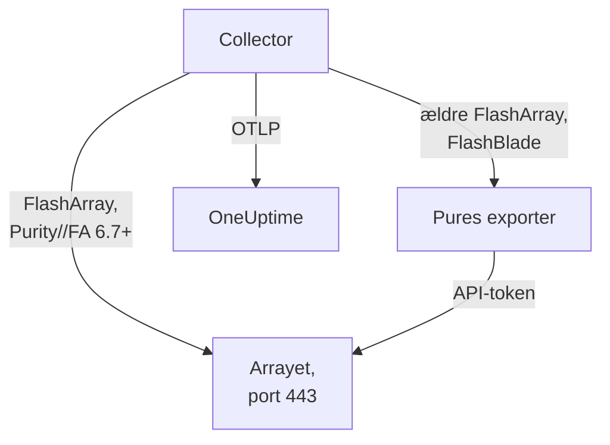

# Lagerarray-agent

OneUptimes Storage Array-agent overvåger lagerarrays: kapacitet og datareduktion, latens, IOPS og båndbredde, volumes, værter, pods og replikering, hardwaretilstand, filsystemer og buckets. Den er en almindelig OpenTelemetry Collector, der scraper arrayets OpenMetrics-endpoints med en skrivebeskyttet brugers API-token, stempler hver metrik med dit arrays identitet og sender den til OneUptime. [Lagerarray-monitorer](/docs/monitor/storage-array-monitor) advarer ud fra det, der ankommer.

:::cards
- [Installér agenten](#installer-agenten): En skrivebeskyttet bruger, derefter installationsscriptet eller Docker Compose.
- [Hvad agenten indsamler](#hvad-agenten-indsamler): Hvert endpoint og de sider, der bygges ud fra det.
- [Overvågning af flere arrays](#overvågning-af-flere-arrays): Én agent pr. array, på én maskine.
- [Fejlfinding](#fejlfinding): Et diagnosescript og de sædvanlige problemer.
:::

## Sådan virker det

Storage Arrays er et produkt, der virker på samme måde for alle leverandører. Det understøtter:

| Array | Sådan læser agenten det | Collector-konfiguration |
| --- | --- | --- |
| **Pure Storage FlashArray**, Purity//FA 6.7 og senere | Arrayets eget OpenMetrics-endpoint (`https://<array>/metrics/...?namespace=purefa`): intet kører ved siden af collectoren | `otel-collector-config.yaml` (standarden) |
| **Pure Storage FlashArray**, ældre Purity//FA | Pures FlashArray OpenMetrics-exporter, som den samme Compose-fil kører som tjenesten `pure-fa-exporter` | `otel-collector-config.flasharray-exporter.yaml` |
| **Pure Storage FlashBlade** | Pures FlashBlade OpenMetrics-exporter, som den samme Compose-fil kører som tjenesten `pure-fb-exporter` | `otel-collector-config.flashblade.yaml` |

Pure Storage skiftede navn til **Everpure** i februar 2026. FlashArray, FlashBlade og Purity beholdt deres navne, og det gjorde metrikkerne `purefa_*` og `purefb_*` også, så alt på denne side gælder for arrays, der sælges under begge navne.



Én agent overvåger ét array: Kør én agent pr. array (se [Overvågning af flere arrays](#overvågning-af-flere-arrays)). Arrayet registrerer sig med sine første data under det navn, agenten stempler på hver metrik som `storage.array.name`.

## Før du begynder

- Docker Engine 20.10 eller nyere med Docker Compose v2-pluginet, på en maskine, der kan nå arrayets administrationsgrænseflade over HTTPS (TCP 443).
- En administratorkonto på arrayet til at oprette en bruger med den indbyggede rolle **readonly** og et API-token til den.
- En indtagelsesnøgle. Opret en under **Projektindstillinger → Telemetri og APM → Indtagelsesnøgler**, og kopiér dens værdi.

### Hvor agenten skal køre

Agenten taler med arrayets administrationsgrænseflade over HTTPS, så den kan køre på enhver maskine med Docker og en rute til administrationsnetværket på TCP 443: en overvågningsvært eller en lille administrations-VM. Foretræk en maskine, hvis eget lager ikke ligger på det array, den overvåger: Hvis arrayet går ned, bør din overvågning ikke gå ned med det. Den valgfrie syslog-listener kræver også, at arrayet kan nå agenten på syslog-porten (se [Send arrayets syslog](#valgfrit-send-arrayets-syslog)).

## Installer agenten

:::steps
### Opret den skrivebeskyttede bruger og API-tokenet

Agenten læser kun. Giv den sin egen bruger med den indbyggede rolle **readonly**, aldrig en administrator, og et API-token til den bruger. Opret tokenet **uden udløbsdato**, ellers stopper agenten den dag, tokenet udløber.

:::tabs
@tab Purity CLI
Log ind på FlashArray med SSH som administrator. Den første kommando beder om den nye brugers adgangskode; den anden udskriver brugerens API-token, et UUID:

```bash
pureadmin create --role readonly oneuptime
pureadmin create --api-token oneuptime
```
@tab FlashArray GUI
1. Åbn _Settings → Users and Policies_ (_Settings → Access_ i ældre udgivelser).
2. Vælg **Create User…** i ⋮-menuen i panelet **Users**, kald brugeren `oneuptime`, og giv den rollen readonly.
3. Vælg **Create API Token…** i den nye brugers ⋮-menu, lad **Expires In** være tom, og kopiér tokenet.
@tab FlashBlade
Opret på samme måde en bruger med rollen **readonly** og et API-token til den: i FlashBlade-GUI'ens brugerindstillinger eller med `pureadmin` i Purity//FB-CLI'en. I en udgivelse uden lokale brugere skal du bruge en konto fra en katalogtjeneste (LDAP eller Active Directory), hvis gruppe er knyttet til rollen readonly. FlashBlade-API-tokens starter med `T-`.
:::

### Kontrollér, om FlashArray leverer sine egne metrikker

Pure dokumenterer det native OpenMetrics-endpoint for **Purity//FA 6.7.0 og senere** (udfasningsmeddelelsen for Pures FlashArray-exporter siger 6.6.11 og senere). Den hurtigste måde at finde ud af det på er at spørge arrayet fra den maskine, agenten skal køre på:

```bash
curl -k 'https://<array>/metrics/array?namespace=purefa' --header 'Authorization: Bearer <api-token>' | grep purefa_info
```

En linje `purefa_info{...} 1` betyder, at arrayet leverer sine metrikker nativt: Brug standardkonfigurationen. En `404` betyder, at det ikke gør: Brug exporter-konfigurationen, som kører Pures exporter ved siden af collectoren. Pure har udfaset den exporter, så skift til den native konfiguration, når arrayet er opgraderet. En FlashBlade går altid gennem Pures FlashBlade-exporter, så spring dette trin over for den.

### Installer og start agenten

:::tabs
@tab install.sh
Hent installationsscriptet, og kør det på den maskine, der skal være vært for agenten:

```bash
curl -sSL https://raw.githubusercontent.com/OneUptime/oneuptime/master/agents/StorageArrayAgent/install.sh -o install.sh
bash install.sh
```

Scriptet spørger, hvilket array det er (en FlashArray, der leverer native metrikker, en FlashArray med ældre Purity//FA eller en FlashBlade), og derefter efter din OneUptime-URL, indtagelsesnøglen, et navn til arrayet, arrayets administrationsadresse og den skrivebeskyttede brugers API-token (læst uden ekko). Det installerer i `/opt/oneuptime-storage-array-agent`, henter Compose-filen og alle tre collector-konfigurationer, skriver en fil med `0600` ved navn `.env` med den matchende konfiguration og Compose-profil og starter agenten med Docker Compose. Det sætter hver værdi i anførselstegn til Docker Compose, præcis som du skrev den. Kører du det igen, genbruger det alt i en eksisterende `.env` i stedet for at spørge igen og beholder en fil, du har redigeret, som `<file>.bak.<timestamp>`, før den erstattes.
@tab Docker Compose
Hent `docker-compose.yml` og de tre filer `otel-collector-config*.yaml` fra [StorageArrayAgent-mappen](https://github.com/OneUptime/oneuptime/tree/master/agents/StorageArrayAgent) ind i en ny mappe:

```bash
curl -fsSLO https://raw.githubusercontent.com/OneUptime/oneuptime/master/agents/StorageArrayAgent/docker-compose.yml
curl -fsSLO https://raw.githubusercontent.com/OneUptime/oneuptime/master/agents/StorageArrayAgent/otel-collector-config.yaml
curl -fsSLO https://raw.githubusercontent.com/OneUptime/oneuptime/master/agents/StorageArrayAgent/otel-collector-config.flasharray-exporter.yaml
curl -fsSLO https://raw.githubusercontent.com/OneUptime/oneuptime/master/agents/StorageArrayAgent/otel-collector-config.flashblade.yaml
```

Opret en `.env`-fil ved siden af dem. Den indeholder API-tokenet, så hold den privat med `chmod 600 .env`. For en FlashArray, der leverer native metrikker:

```bash title=".env"
ONEUPTIME_URL=YOUR_ONEUPTIME_URL
ONEUPTIME_TELEMETRY_INGESTION_KEY=YOUR_TELEMETRY_INGESTION_TOKEN
STORAGE_ARRAY_NAME=my-storage-array
STORAGE_SYSTEM=purestorage.flasharray
STORAGE_ARRAY_COLLECTOR_CONFIG=otel-collector-config.yaml
COMPOSE_PROFILES=
PURE_FA_ENDPOINT=fa-prod-01.example.com
PURE_FA_API_TOKEN=YOUR_READ_ONLY_API_TOKEN
PURE_FB_ENDPOINT=
PURE_FB_API_TOKEN=
STORAGE_ARRAY_INSECURE_SKIP_VERIFY=true
```

For en FlashArray med ældre Purity//FA skal du sætte `STORAGE_ARRAY_COLLECTOR_CONFIG=otel-collector-config.flasharray-exporter.yaml` og `COMPOSE_PROFILES=flasharray-exporter`. For en FlashBlade skal du sætte `STORAGE_SYSTEM=purestorage.flashblade`, `STORAGE_ARRAY_COLLECTOR_CONFIG=otel-collector-config.flashblade.yaml` og `COMPOSE_PROFILES=flashblade` og udfylde `PURE_FB_ENDPOINT` og `PURE_FB_API_TOKEN` i stedet for parret `PURE_FA_*`. Start agenten:

```bash
docker compose up -d
```
:::

### Kontrollér, at agenten kører

```bash
docker compose ps
docker logs -f oneuptime-storage-array-agent
```

`docker compose ps` viser collectoren (`oneuptime-storage-array-agent`) og, med en exporter-konfiguration, exporteren (`pure-fa-exporter` eller `pure-fb-exporter`). Collectorens logs bør vise denne linje, når den er startet:

```text
Everything is ready. Begin running and processing data.
```

### Find arrayet i OneUptime

Åbn **Produkter → Infrastruktur → Storage Arrays → All Storage Arrays**. Efter det første scrape (omkring et minut) er arrayet der med sin kapacitet, ydelse, åbne advarsler og hardware. Volumes, værter og pods følger inden for 2 minutter, en FlashBlades filsystemer og buckets inden for 5 og FlashArray-mapper inden for 30.
:::

## Miljøvariabler

Installationsscriptet skriver disse til `/opt/oneuptime-storage-array-agent/.env`; en Docker Compose-installation læser dem fra `.env` ved siden af `docker-compose.yml`. Efter at have ændret en skal du køre `docker compose up -d` i den mappe.

| Variabel | Påkrævet | Beskrivelse |
| --- | --- | --- |
| `ONEUPTIME_URL` | Ja | Din OneUptime-URL, såsom `https://oneuptime.com` eller din selvhostede instans. Brug `http://` og dens port, hvis instansen kun bruger HTTP. |
| `ONEUPTIME_TELEMETRY_INGESTION_KEY` | Ja | Indtagelsesnøglen fra **Projektindstillinger → Telemetri og APM → Indtagelsesnøgler**. |
| `STORAGE_ARRAY_NAME` | Ja | Det navn, arrayet registreres under i OneUptime, stemplet på hver metrik som ressourceattributten `storage.array.name`. Hold det stabilt: at ændre det senere registrerer et andet array. Collectoren nægter at starte uden det. |
| `STORAGE_SYSTEM` | Nej | Platformen, stemplet som ressourceattributten `storage.system`: `purestorage.flasharray` eller `purestorage.flashblade`. Standard er `purestorage.flasharray`. |
| `STORAGE_ARRAY_COLLECTOR_CONFIG` | Nej | Hvilken medfølgende collector-konfiguration der kører: `otel-collector-config.yaml` (FlashArray, nativ: standarden), `otel-collector-config.flasharray-exporter.yaml` (ældre FlashArray) eller `otel-collector-config.flashblade.yaml` (FlashBlade). |
| `COMPOSE_PROFILES` | Nej | Starter den exporter, som den valgte konfiguration scraper: tom for den native FlashArray-konfiguration, `flasharray-exporter` eller `flashblade` for de to andre. |
| `PURE_FA_ENDPOINT` | FlashArray | FlashArrayens administrationsadresse: et værtsnavn eller en IP uden `https://`. |
| `PURE_FA_API_TOKEN` | FlashArray | API-tokenet for FlashArray-brugeren med rollen readonly. |
| `PURE_FB_ENDPOINT` | FlashBlade | FlashBladens administrationsadresse: et værtsnavn eller en IP uden `https://`. |
| `PURE_FB_API_TOKEN` | FlashBlade | API-tokenet for FlashBlade-brugeren med rollen readonly. |
| `STORAGE_ARRAY_INSECURE_SKIP_VERIFY` | Nej | `true` accepterer arrayets selvsignerede certifikat på det native endpoint; `false` verificerer det. Standard er `true`. Pures exportere verificerer aldrig arrayets certifikat, så det gælder ikke for dem. |

## Sådan scraper agenten

- **Ét scrape-job pr. endpoint, hvert læst så ofte, som det er værd.** FlashArray: `/metrics/array` hvert 60. sekund; `/metrics/volumes`, `/metrics/hosts` og `/metrics/pods` hvert 2. minut; `/metrics/directories` hvert 30. minut, som er Pures eget råd, da mappernes plads er dyr for arrayet at beregne. FlashBlade: `/metrics/array` hvert 60. sekund; `/metrics/filesystems` og `/metrics/objectstore` hvert 5. minut, igen efter Pures råd om at læse filsystem- og objektlager-endpointene sjældnere end arrayet.
- **Hvert job mærker sine serier med `scrape_endpoint: <endpoint>`.** Hvert endpoint eksporterer også `purefa_info` eller `purefb_info`, så OneUptime ved, hvilke familier en batch er den komplette liste over: Det er sådan, en slettet volume, vært, pod, et filsystem eller en bucket forlader inventaret i stedet for at blive hængende. Behold labels, som de leveres.
- **Latens pr. volume og pr. vært beholder tre dimensioner.** Hver volume og vært eksporterer sin latens i op til seksten `dimension`'er. En regel `metric_relabel_configs` beholder `usec_per_read_op`, `usec_per_write_op` og `usec_per_mirrored_write_op` og dropper opdelingen efter QoS-hastighedsgrænse, kø, SAN og servicetid, som mangedobler serierne i et stort array. Den arraydækkende opdeling på `purefa_array_performance_latency_usec` bevares. Slet reglen for også at beholde opdelingen pr. volume.
- **API-tokenet er et Bearer-token.** Den native konfiguration sender det til selve arrayet; exporter-konfigurationerne sender det kun til exporteren over Compose-netværket, og exporternes porte udgives aldrig.
- **Ingen `send_batch_max_size`.** OneUptime genopbygger inventaret ud fra ét helt scrape pr. forespørgsel, så den medfølgende processor `batch` deler aldrig et scrape over flere eksporter. Behold batch-indstillingerne, som de leveres.

## Hvad agenten indsamler

Pures semantiske konventioner deles af det native FlashArray-endpoint og begge exportere. Hver værdi er en gauge, som arrayet selv beregner (latenser i mikrosekunder pr. operation, gennemløb pr. sekund), så der skal ikke beregnes rater, og objekter navngives med **datapunkt-labels**: `name` for volumes, pods, mapper, filsystemer og buckets, `host` for værter, `component_name` for FlashArray-hardware. Agenten tilføjer ressourceattributterne `storage.array.name` og `storage.system`, så OneUptime arkiverer alt under dit array:

| Endpoint | Metrikfamilier | Hvad OneUptime bygger ud fra dem |
| --- | --- | --- |
| FlashArray `/metrics/array` | `purefa_info`, `purefa_alerts_open`, `purefa_array_space_*`, `purefa_array_performance_*`, `purefa_hw_component_status`, `purefa_hw_component_temperature_celsius`, `purefa_hw_controller_info`, `purefa_drive_capacity_bytes`, `purefa_network_interface_*` | Arrayets navn, Purity-version og system-ID; kapacitet, brugt plads og datareduktion; antal åbne advarsler; arrayets tilstand; siden **Hardware** (komponenter, drev, controllere, netværksgrænseflader) |
| FlashArray `/metrics/volumes` | `purefa_volume_performance_*`, `purefa_volume_space_*`, `purefa_volume_qos_*` | Siden **Diskenheder**: tildelt og fysisk størrelse, datareduktion, læse- og skrivelatens, IOPS og båndbredde pr. volume |
| FlashArray `/metrics/hosts` | `purefa_host_connectivity_info`, `purefa_host_connections_info`, `purefa_host_performance_*`, `purefa_host_space_*` | Siden **Værter**: forbindelse (redundante stier eller ej), tilsluttede volumes, latens, IOPS og båndbredde pr. vært |
| FlashArray `/metrics/pods` | `purefa_pod_performance_*`, `purefa_pod_space_*`, `purefa_pod_replica_links_*`, `purefa_pod_mediator_status` | Siden **Replication**: ActiveCluster- og ActiveDR-pods, replikalinkenes status og forsinkelse |
| FlashArray `/metrics/directories` | `purefa_directory_performance_*`, `purefa_directory_space_*` | Siden **Directories** (FlashArray File Services) |
| FlashBlade `/metrics/array` | `purefb_info`, `purefb_alerts_open`, `purefb_array_space_*`, `purefb_array_performance_*`, `purefb_hardware_health` | FlashBladens navn, Purity-version og system-ID; kapacitet og datareduktion; antal åbne advarsler; arrayets tilstand; siden **Hardware** |
| FlashBlade `/metrics/filesystems` | `purefb_file_systems_space_*`, `purefb_file_systems_performance_*` | Siden **File Systems**: tildelt og brugt plads, datareduktion, latens, IOPS og båndbredde pr. filsystem |
| FlashBlade `/metrics/objectstore` | `purefb_buckets_space_*`, `purefb_buckets_quota_space_bytes`, `purefb_buckets_object_count`, `purefb_buckets_performance_*`, `purefb_object_store_accounts_*` | Siden **Buckets**: plads, kvote, antal objekter og ydelse pr. bucket, grupperet efter konto |

Arrayets tilstand på dets side **Oversigt** er **Kritisk**, så længe det rapporterer en åben kritisk advarsel eller en hardwarekomponent, et drev eller en controller, der er kritisk, fejlet, mangler eller er usund; **Warning**, så længe det rapporterer en åben advarsel på advarselsniveau eller en forringet eller ukendt komponent; og ellers **OK**. I monitorkriterier får arrayets attributter præfikset `resource.` (`resource.storage.array.name`, `resource.storage.system`), mens datapunkt-labels står uden præfiks (`name`, `host`, `dimension`, `space`).

## Valgfrit — Send arrayets syslog

Som standard sender agenten kun metrikker, så arrayets side **Protokoller** forbliver tom. Arrays videresender deres advarsler og audit-hændelser som syslog, og hver medfølgende collector-konfiguration har et udkommenteret `syslog`-receiverpar (TCP og UDP på port 5514, RFC 3164), forbundet til en udkommenteret pipeline `logs`, der stempler `storage.array.name`, så loggene lander på dit array.

:::steps
### Slå receiverne til

Fjern udkommenteringen af de to receivere `syslog/*` og pipelinen `logs` i den collector-konfiguration, du bruger. RFC 3164-tidsstempler har ingen tidszone: Sæt `location` til arrayets tidszone, medmindre dets ur kører på UTC.

### Åbn porten

Fjern udkommenteringen af blokken `ports:` i `docker-compose.yml`, så maskinen udgiver `5514/tcp` og `5514/udp`, og kør derefter `docker compose up -d`. Åbn porten i maskinens firewall for arrayets administrationsnetværk.

### Peg arrayet på agenten

Gør dette som administrator, ikke som den skrivebeskyttede overvågningsbruger. På en FlashArray skal du åbne _Settings → System → Syslog Servers_, tilføje `udp://<agent-host>:5514` (eller `tcp://<agent-host>:5514`) og sende en testbesked. På en FlashBlade skal du tilføje en syslog-server med den samme URI i dens syslog-indstillinger. Begge arrays accepterer formen `PROTOCOL://HOST:PORT`, også via deres REST-API'er (`syslog-servers`).
:::

En syslog-receiver lytter kun på én transport, og derfor er TCP og UDP to receivere: Lad den ene stå udkommenteret, hvis du kun har brug for den anden. Collectorens standard-image læser syslog, som den er: Der kræves intet brugerdefineret image.

## Mærk arrayet med projektetiketter

En ressourceattribut, der starter med `oneuptime.label.`, bliver en projektetiket på lagerarrayet: `oneuptime.label.<dimension>=<value>` er etiketten `<dimension>:<value>`. Tilføj attributterne til processoren `resource` i den collector-konfiguration, du bruger, ved siden af `storage.array.name`:

```yaml
processors:
  resource:
    attributes:
      # ...existing attributes...
      - key: oneuptime.label.team
        value: storage
        action: upsert
      - key: oneuptime.label.env
        value: production
        action: upsert
```

Collectoren læser kun sin konfiguration, når den starter: Kør `docker compose restart oneuptime-storage-array-agent`. Arrayet viser derefter etiketterne `team:storage` og `env:production`. Etiketter sammenlignes uden hensyn til store og små bogstaver, så en eksisterende etiket `Production` genbruges i stedet for at blive dubleret, og agenten fjerner aldrig en etiket, som nogen har tilføjet i OneUptime.

## Overvågning af flere arrays

Én agent læser ét array. For at overvåge flere fra den samme maskine skal du installere hver i sin egen mappe med sin egen `.env`, fx `INSTALL_DIR=/opt/oneuptime-storage-array-agent-fa02 bash install.sh`, og give hver sit eget `container_name` i dens `docker-compose.yml` (fx `oneuptime-storage-array-agent-fa02`): To containere kan ikke dele et navn. Giv mappen til diagnosescriptet med `-d`.

## Kør som en systemd-tjeneste

For at starte agenten sammen med maskinen og genstarte den, når den fejler, skal du installere dens systemd-enhed. Den antager, at agenten bor i `/opt/oneuptime-storage-array-agent`, hvor installationsscriptet lægger den:

```bash
sudo curl -fsSL https://raw.githubusercontent.com/OneUptime/oneuptime/master/agents/StorageArrayAgent/systemd/oneuptime-storage-array-agent.service -o /etc/systemd/system/oneuptime-storage-array-agent.service
sudo systemctl daemon-reload
sudo systemctl enable --now oneuptime-storage-array-agent
```

## Opgradering af agenten

Agenten rapporterer den collector-version, dens filer fastlåser, som sin **Agentversion**. Når den er ældre end den version, denne OneUptime-udgivelse fastlåser, vises et advarselstegn ved siden af den på arrayets side **Oversigt**. Vælg det for at se disse kommandoer. En agent, der blev installeret, før dens filer rapporterede en version, viser ingen, før den er opgraderet på denne måde.

Collector-imaget er fastlåst i `docker-compose.yml`, og dens konfigurationer er filer ved siden af, så et pull alene flytter ikke agenten frem. Kør `install.sh` igen: det genbruger hver værdi i din eksisterende `.env` (der spørges ikke om noget igen), fornyer `docker-compose.yml` og de tre collector-konfigurationer (en fil, du har redigeret, beholdes som `<file>.bak.<timestamp>`) og genopretter agenten, så collectoren læser sin nye konfiguration. En agent, der er installeret uden for `/opt/oneuptime-storage-array-agent`, skal have sin mappe: `INSTALL_DIR=<folder> bash install.sh`.

```bash
curl -sSL https://raw.githubusercontent.com/OneUptime/oneuptime/master/agents/StorageArrayAgent/install.sh -o install.sh
bash install.sh
```

Installerede du den i stedet med Docker Compose? Hent Compose-filen og de tre collector-konfigurationer igen i agentens mappe (og foretag igen eventuelle ændringer, du lavede i dem), hent derefter imagene, og genopret agenten:

```bash
curl -fsSLO https://raw.githubusercontent.com/OneUptime/oneuptime/master/agents/StorageArrayAgent/docker-compose.yml
curl -fsSLO https://raw.githubusercontent.com/OneUptime/oneuptime/master/agents/StorageArrayAgent/otel-collector-config.yaml
curl -fsSLO https://raw.githubusercontent.com/OneUptime/oneuptime/master/agents/StorageArrayAgent/otel-collector-config.flasharray-exporter.yaml
curl -fsSLO https://raw.githubusercontent.com/OneUptime/oneuptime/master/agents/StorageArrayAgent/otel-collector-config.flashblade.yaml
docker compose pull
docker compose up -d --force-recreate
```

## Afinstallation af agenten

```bash
cd /opt/oneuptime-storage-array-agent
docker compose down
```

Slet derefter den skrivebeskyttede bruger og dens API-token på arrayet, hvis du ikke længere har brug for dem.

## Fejlfinding

:::details Kør diagnosescriptet først
Agenten leveres med et script, [`troubleshoot.sh`](https://github.com/OneUptime/oneuptime/blob/master/agents/StorageArrayAgent/troubleshoot.sh), der kontrollerer hele kæden: container-runtimen; arrayets endpoint præcis, som collectoren når det (det native endpoint eller Pures exporter: DNS, TLS, om en FlashArray overhovedet har det native endpoint, og om arrayet accepterer API-tokenet, som scriptet giver til curl via stdin); arraynavnet stemplet på hver metrik; tokenets form; collectorens egne metrikker; og om OneUptime accepterer indtagelsesnøglen. Den sidste kontrol betyder mest. OneUptime afviser en forkert nøgle med `401` (`422` for en deaktiveret nøgle eller en browsernøgle), og collectoren behandler begge som permanente: den dropper batchen og logger én `Exporting failed`-fejl, som er let at overse, mens containeren forbliver sund. Scriptet spørger `GET <url>/otlp/v1/validate` inde fra agentens netværk efter et direkte `200` (gyldig) eller `401` (ugyldig) og falder tilbage til `POST /fluentd/v1/logs` på ældre servere.

```bash
curl -sSL https://raw.githubusercontent.com/OneUptime/oneuptime/master/agents/StorageArrayAgent/troubleshoot.sh -o troubleshoot.sh
bash troubleshoot.sh    # add -d <dir> if you installed outside /opt/oneuptime-storage-array-agent
```

Det slutter med en konklusion, der navngiver den mest sandsynlige årsag.
:::

:::details Der vises intet array i OneUptime
1. Læs collectorens logs: `docker logs oneuptime-storage-array-agent`. `server returned HTTP status 401` betyder, at arrayet afviste API-tokenet, `404` at FlashArray ikke har et nativt endpoint, `x509` at TLS-verifikation er slået til over for arrayets selvsignerede certifikat, `no such host` eller `connection refused` et forkert `PURE_FA_ENDPOINT` eller `PURE_FB_ENDPOINT`, og en `401` ved eksport en forkert indtagelsesnøgle.
2. Spørg arrayet fra agentens netværk. Collector-imaget har hverken shell eller curl, så spørg fra en container i dets netværk: `docker run --rm --network container:oneuptime-storage-array-agent curlimages/curl -sk -H 'Authorization: Bearer <api-token>' 'https://<array>/metrics/array?namespace=purefa'` bør udskrive `purefa_*`-linjer.
3. Kontrollér, at `STORAGE_ARRAY_NAME` er sat: Arrayet findes ud fra sin ressourceattribut `storage.array.name`, og collectoren nægter at starte uden den.
:::

:::details Arrayet vises som afbrudt
Et array bliver afbrudt, når OneUptime ikke har modtaget noget fra det i 15 minutter; OneUptime tjekker hvert 5. minut, og tid, hvor OneUptime selv ikke modtog data, tæller ikke med. Kontrollér, at collectoren kører (`docker compose ps`), at dens logs ikke viser scrape- eller eksportfejl, og at maskinen stadig når arrayet og din OneUptime-URL. Arrayet bliver forbundet igen med sine næste data.
:::

:::details FlashArray svarer 404
Dens Purity//FA har intet nativt OpenMetrics-endpoint. Kør `install.sh` igen, og vælg muligheden for ældre Purity, eller sæt `STORAGE_ARRAY_COLLECTOR_CONFIG=otel-collector-config.flasharray-exporter.yaml` og `COMPOSE_PROFILES=flasharray-exporter` i `.env`, og kør `docker compose up -d`. Når arrayet er opgraderet til Purity//FA 6.7 eller senere, skal du skifte tilbage til den native konfiguration og fjerne profilen.
:::

:::details Arrayet afviser API-tokenet
Kontrollér, at du indsatte API-tokenet og ikke brugerens adgangskode, at brugeren stadig findes og har rollen readonly, og at tokenet ikke er udløbet. Opret et nyt token (`pureadmin create --api-token oneuptime` på en FlashArray), læg det i `.env`, og kør `docker compose up -d`. Gennem Pures exportere vises et afvist token i collectorens log som et HTTP `400` fra exporteren, hvis body lyder `failed to login`.
:::

:::details x509- eller TLS-fejl
Arrays præsenterer som standard et selvsigneret certifikat, som intet Docker-image stoler på. Sæt enten `STORAGE_ARRAY_INSECURE_SKIP_VERIFY=true` (det praktiske valg på et privat administrationsnetværk), eller installér et certifikat på arrayet fra en CA, som collector-imaget stoler på.
:::

:::details pure-fa-exporter eller pure-fb-exporter kan ikke slås op
Exporteren kører ikke: `COMPOSE_PROFILES` skal matche `STORAGE_ARRAY_COLLECTOR_CONFIG` (`flasharray-exporter` for FlashArray-exporter-konfigurationen, `flashblade` for FlashBlade-konfigurationen). Ret `.env`, og kør `docker compose up -d`; `docker compose ps` viser derefter exporteren.
:::

:::details Slettede volumes eller værter bliver i inventaret
OneUptime fjerner et objekt, når et komplet scrape af dets endpoint ikke længere har det, hvilket den genkender på labelet `scrape_endpoint`. Hvis du har erstattet den medfølgende collector-konfiguration med din egen, så behold labels `scrape_endpoint` på dens scrape-jobs; ellers forlader objekter kun inventaret, når de bliver forældede.
:::

:::details Metrikker lander under det forkerte array
OneUptime registrerer et lagerarray ud fra dets `storage.array.name`, som agenten tager fra `STORAGE_ARRAY_NAME`. At ændre det efter de første data opretter et andet array i stedet for at omdøbe det første.
:::

:::details Send metrikker uden agenten
Agenten er én almindelig collector-konfiguration, så collectors, du allerede kører, kan gøre det samme arbejde: Kopiér scrape-jobbene og processoren `resource` fra den medfølgende konfiguration ind i din egen. Ressourceattributten `storage.array.name` er det, der registrerer arrayet i OneUptime, og sletningerne af `service.name` / `service.instance.id` forhindrer, at dataene arkiveres under en tjeneste: Behold begge, og behold labels `scrape_endpoint`.
:::

## Næste trin

:::cards
- [Lagerarray-monitor](/docs/monitor/storage-array-monitor): Advar om advarsler, kapacitet, latens, hardware, værtsstier, replikering og filsystemer.
- [VMware-agent](/docs/telemetry/vmware): Kører du VMware på arrayet? Se også dets datastores og VM'er.
- [OpenTelemetry-collector på værten](/docs/telemetry/host-otel-collector): Operativsystemets visning af de maskiner, der bruger arrayet.
:::
