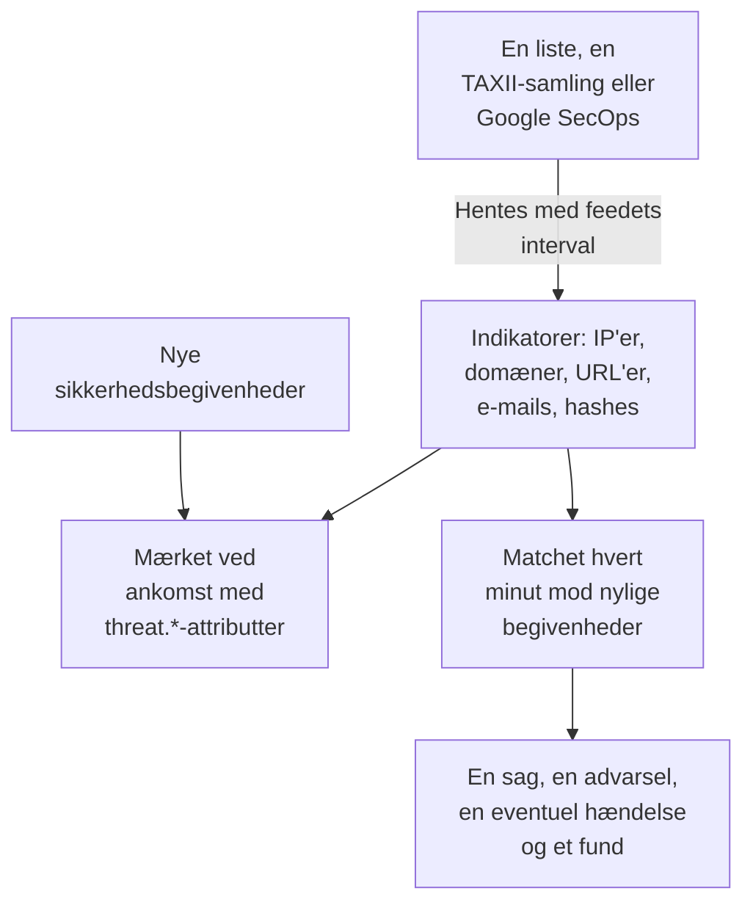

# Trusselsintelligens (STIX/TAXII)

Et threat intel-feed bringer kendte ondsindede IP-adresser, domæner, URL'er, e-mailadresser og filhashes ind i OneUptime og fortæller dig, når dine [sikkerhedsbegivenheder](/docs/telemetry/security-events) nævner en af dem. Et feed læser én kilde: en liste med indikatorer på en https-adresse, såsom de gratis lister, OneUptime tilføjer med ét klik, en TAXII 2.1-samling af STIX 2.1-indikatorer fra din egen MISP-, OpenCTI- eller OpenTAXII-server eller en udbyder, eller de indikatorer, Google SecOps har fundet i dine begivenheder.

:::cards
- [Tilføj en gratis liste](#tilføj-en-gratis-liste): Feodo Tracker, Emerging Threats og Tor-exitnoderne, med ét klik.
- [Abonnér på et feed](#abonnér-på-et-feed): En listes adresse, en TAXII-samling eller en Google SecOps-forbindelse.
- [Hvad der indtages](#hvad-der-indtages): De indikatormønstre, OneUptime beholder, og hvor længe.
- [Sådan findes match](#sådan-findes-match): Mærket, når begivenheder ankommer, og matchet hvert minut.
- [Trusselsniveauer](#trusselsniveauer): Hvordan en indikators confidence bliver til en alvorlighed.
:::

## Sådan virker det



## Før du begynder

- Til en liste: en `https`-adresse, der downloader en tekstfil med én indikator pr. linje.
- Til et TAXII-feed: en TAXII 2.1-server, der udgiver STIX 2.1-objekter af typen `indicator`, og ID'et på den samling, der skal hentes fra. Et TAXII-feed logger ind anonymt, med et bearer-token eller med HTTP Basic-godkendelse.
- Til et Google SecOps-feed: en [Google SecOps-forbindelse](/docs/integrations/google-secops#opsæt-den-administrerede-connector), hvis tjenestekonto kan søge i indikatormatches: rollen `roles/chronicle.viewer` kan.
- Servere, der kræver et TLS-klientcertifikat (mutual TLS), f.eks. CISA AIS, understøttes ikke. MITREs offentlige ATT&CK-server udgiver teknikker og grupper frem for indikatorer, så et feed, der peger på den, forbliver tomt.
- En rolle, der kan oprette feeds: Project Owner, Project Admin, Security Admin eller Security Member. Security Viewer kan læse feeds og indikatorer. Se [Roller](/docs/permissions/reference#roller).

## Tilføj en gratis liste

Kortet **Gratis lister** på **Trusselsinformation** tilføjer en gratis blokeringsliste med ét klik: klik på **Tilføj liste** ved en liste, og OneUptime opretter et feed, der downloader den efter listens tidsplan. En liste, som projektet allerede læser, viser **Tilføjet**.

| Liste | Udgivet af | Læses | Confidence | Et match åbner |
| --- | --- | --- | --- | --- |
| Feodo Trackers botnet-C2-servere | abuse.ch | Hver time | 90, Critical | En sag og en advarsel |
| Emerging Threats' kompromitterede værter | Proofpoint Emerging Threats | Hver dag | 70, High | En sag og en advarsel |
| Tor-exitnoder | The Tor Project | Hver time | 30, Low | En sag |

En listes felt linker til dens vilkår: Feodo Tracker er fri til al brug (CC0), og Emerging Threats-listen er BSD-licenseret. Et feed, der er tilføjet fra en liste, redigeres og slettes som alle andre.

## Abonnér på et feed

:::steps
### Gå til Threat Intel

Åbn **Produkter → Security Events → Detektioner → Trusselsinformation**.

### Opret feedet

Klik på **Opret Feed med trusselsinformation**, og vælg dets **Kilde**: **Liste over indikatorer**, **TAXII-samling** eller **Google SecOps**. Næste trin spørger kun om den kilde: en listes **Liste-URL**, en samlings **TAXII-server** og **Login** eller **Google SecOps-forbindelse**. **Ved match** kommer til sidst. Felterne står i tabellen nedenfor.

### Tjek den første hentning

Inden for et minut eller to viser feedets række **Senest hentet**, og **Oversigt over seneste hentning** fortæller, hvad hentningen fik med. Indikatorerne vises i tabellen **Indikatorer** under feedsene.
:::

| Felt | Hvad du skal angive |
| --- | --- |
| **Kilde** | Hvor indikatorerne kommer fra. Den fastlægges, når feedet oprettes: et feed fra en anden kilde er et nyt feed. |
| **Liste-URL** | Til en liste: `https`-adressen på en tekstfil med én IP-adresse, ét domæne, én URL eller én filhash pr. linje. |
| **Sikkerhed** | Til en liste: hvor sikker listen er, 1 til 100. Hver indikator på listen får værdien, og den bestemmer [trusselsniveauet](#trusselsniveauer); tom er Medium. |
| **Google SecOps-forbindelse** | Til Google SecOps: den forbindelse, hvis nøgle læser de indikatorer, Google SecOps har fundet. **Forbind Google SecOps** åbner **Forbindelser**, når der ikke er nogen. |
| **Rod-URL til TAXII-API** | Serverens TAXII 2.1-API-rod, f.eks. `https://taxii.example.com/api1/`. Samlingerne adresseres under den. |
| **Samlings-id** | Den samling, der udgiver indikatorerne. |
| **Hentningsinterval (minutter)** | Hvor ofte kilden læses: 1 til 1440 minutter, 60 som standard. En liste læses højst hvert 15. minut. |
| **Mindste sikkerhed** | Til en TAXII-samling eller Google SecOps: indikatorer med en lavere confidence springes over, 0 til 100, og 0 beholder alt. Indikatorer uden confidence slipper altid igennem. |
| **Login** | Hvordan OneUptime logger ind: **Ingen login** til en offentlig samling, **Bearer-token** til et token fra serverens operatør eller **Brugernavn og adgangskode** til HTTP Basic-godkendelse. |
| **API-token**, **Brugernavn til Basic Auth** og **Adgangskode til Basic Auth** | Spørges der kun om for det valgte login. |
| **Åbn en sag ved match** | Slået til som standard: hver begivenhed, der nævner en indikator, åbner en [sag](/docs/telemetry/security-cases) om den eller føjes til den åbne sag, der allerede handler om den. |
| **Advarsler og hændelser** | **Opret en advarsel** som standard: hver matchet indikator åbner en advarsel. |
| **Advarselsalvor** | Alvorligheden af hver advarsel, dette feed åbner. Lad den være tom for at bruge hver indikators trusselsniveau. |
| **Erklær en hændelse** eller **Begge** | Under **Advarsler og hændelser**. Hændelser driver vagteskalering, SLA'er og statussider, og advarsler er som regel nok til indikatormatch. |
| **Hændelsesalvor** | Som **Advarselsalvor**, for hændelser. |
| **Skriv Detection Finding ved match** | Slået til som standard: hvert match skriver et fund ind i begivenhedsstrømmen. |

Et TAXII-feeds tokens og adgangskoder krypteres og vises aldrig igen, når du har gemt dem. For at ændre dem vælger du **Opdater legitimationsoplysninger** i feedets række og derefter **Bearer-token**, **Brugernavn og adgangskode** eller **Ingen login**, som rydder det gemte: dit valg erstatter feedets login, så når du gemmer et token, ryddes en gemt adgangskode, og omvendt.

### Sådan hentes et feed

Hver hentning beder om de objekter, der er tilføjet siden den forrige, via TAXII's markør `added_after`, og læser op til 10 sider med 500 objekter. En stor samling synkroniseres derfor over flere hentninger: **Oversigt over seneste hentning** fortæller, når der er flere sider tilbage. For at gøre en stor første synkronisering færdig hurtigere sænker du **Hentningsinterval (minutter)**, helt ned til 1, indtil den har indhentet det.

Hentningerne præsenterer sig med user agent `OneUptime/<version> (+https://oneuptime.com)`. Hvis udbyderens firewall svarer `403`, så bed dem om at tillade den: mange firewalls blokerer anmodninger, der ligner et unavngivet script.

Et deaktiveret feed hentes ikke og matches ikke. De indikatorer, det allerede har, bliver ved med at mærke nye begivenheder, indtil de udløber.

### Sådan læses en liste

- Hver hentning downloader hele listen og læser den en linje ad gangen: den første værdi på en linje, op til et mellemrum, en tabulator, et komma eller et semikolon. Linjer, der starter med `#`, `;` eller `//`, er kommentarer, en port efter en adresse eller et domæne fjernes, og et adresseinterval som `198.51.100.0/24` springes over.
- En værdi forbliver en aktiv indikator i 2 dage efter den hentning, der sidst læste den, og en værdi, listen fjerner, holder op med at matche ved næste hentning. En liste, der ikke er ændret, skrives igen én gang om dagen.
- En liste rummer højst 50.000 indikatorer. **Oversigt over seneste hentning** fortæller, hvor mange der blev læst, hvor mange linjer der blev sprunget over, og hvor mange der blev udeladt.
- Adressen skal bruge `https` og er underlagt de samme udgående regler som en forbindelse: på OneUptime Cloud afvises en privat adresse.

### Sådan læses Google SecOps

- Hver hentning læser de indikatormatches, Google SecOps har registreret siden forrige hentning, med Mandiants attributter: det matchede domæne, den matchede adresse eller filhash, dens confidence, dens kategori og de kampagner og aktører, den er knyttet til. Den første hentning læser de seneste 7 dage.
- En indikator forbliver aktiv i 30 dage, efter at Google SecOps sidst så den, eller indtil dens kilde siger, at den ikke længere er aktiv, og en, som en analytiker har slået lyden fra i Google SecOps, holder også op med at matche her.
- Et match, som Google SecOps markerer som et aktivt brud, er Critical, og et med høj prioritet er mindst High.

## Hvad der indtages

Fra en TAXII-samling beholder OneUptime STIX-objekter af typen `indicator`, hvis mønster er simpel lighed på en af disse typer. En liste og Google SecOps giver de samme typer:

| Type | Eksempelmønster |
| --- | --- |
| IPv4-adresse (`ipv4-addr`) | `[ipv4-addr:value = '198.51.100.7']` |
| IPv6-adresse (`ipv6-addr`) | `[ipv6-addr:value = '2001:db8::7']` |
| Domænenavn (`domain-name`) | `[domain-name:value = 'evil.example']` |
| URL (`url`) | `[url:value = 'http://evil.example/payload']` |
| E-mailadresse (`email-addr`) | `[email-addr:value = 'billing@evil.example']` |
| Filhash, SHA-256 (`file-hash-sha256`) | `[file:hashes.'SHA-256' = 'e3b0…b855']` |
| Filhash, SHA-1 (`file-hash-sha1`) | `[file:hashes.'SHA-1' = 'da39…0709']` |
| Filhash, MD5 (`file-hash-md5`) | `[file:hashes.MD5 = 'd41d…427e']` |

Sammenligninger, der er forbundet med `OR`, inden for ét `[...]` eller på tværs af flere, er fine, og hver værdi bliver sin egen indikator:

```text
[domain-name:value = 'evil.example' OR domain-name:value = 'evil2.example']
[ipv4-addr:value = '198.51.100.7'] OR [url:value = 'http://evil.example/x']
```

Alle andre mønstre, med `AND`, `FOLLOWEDBY`, `NOT`, `LIKE`, `MATCHES`, en tidsangivelse som `WITHIN` eller en anden objekttype, springes helt over og tælles som ikke understøttet i **Oversigt over seneste hentning**. At oversætte kun en del af et `AND`-mønster ville matche langt mere, end feedets forfatter mente.

### Hvor længe en indikator forbliver aktiv

- En indikator matcher fra sin `valid_from` til sin `valid_until`. Uden `valid_until` forbliver den aktiv i 365 dage fra `valid_from`, og en ny hentning forlænger ikke det.
- En tilbagekaldt indikator, eller en, der er opdateret med en `valid_until` i fortiden, holder op med at matche, så snart opdateringen er hentet. Det samme gælder en værdi, som udbyderen fjerner fra et opdateret mønster.
- Værdier gemmes med små bogstaver og matches uanset store og små bogstaver.

Tabellen **Indikatorer** viser indikatorerne, som de er gemt, med en **Status** på **Aktiv**, **Udløbet** eller **Tilbagekaldt**. En genhentet indikator kan vises to gange i et stykke tid, og en udløbet eller tilbagekaldt række bliver stående på listen, indtil oprydningen i lageret fjerner den, op til omkring en måned efter at den er udløbet. Matchning tjekker altid gyldighed og tilbagekaldelse, så sådan en række matcher aldrig.

## Sådan findes match

### Mærket, når begivenheder ankommer

Hver indkommende sikkerhedsbegivenhed, fra indtagelses-API'et eller en forbindelse, tjekkes mod dine aktive indikatorer, før den gemmes. Når en af dens observables (de IP-adresser, værter, domæner, hashes og brugere, der er taget fra begivenheden) er lig med en indikators værdi, stemples begivenheden med disse attributter:

| Attribut | Værdi |
| --- | --- |
| `threat.matched` | Altid `"true"` på en mærket begivenhed |
| `threat.indicator_id` | STIX-indikatorens ID, eller `list` eller `google-secops` for de kilder |
| `threat.indicator_type` | Indikatorens type, f.eks. `ipv4-addr` eller `file-hash-sha256` |
| `threat.indicator_value` | Den matchede værdi, med små bogstaver |
| `threat.feed` / `threat.feed_id` | Det feed, indikatoren kom fra |
| `threat.confidence` | Indikatorens STIX-confidence |
| `threat.match_count` | Hvor mange af begivenhedens observables der matchede en indikator |

Når flere indikatorer matcher én begivenhed, er det den med den højeste confidence, der udfylder disse værdier. Det er almindelige attributter, så du kan søge på dem under **Begivenheder**, filtrere monitorer for sikkerhedsbegivenheder med dem og bruge dem i detektionsregler:

```yaml title="threat-intel-logon.yml"
title: High-confidence indicator in a successful logon
level: critical
detection:
  selection:
    threat.matched: 'true'
    threat.confidence|gte: 80
    className: Authentication
    statusName: Success
  condition: selection
```

Mærkningen kender kun de indikatorer, der findes, når en begivenhed ankommer: begivenheder mærkes aldrig igen senere.

### Matchet hvert minut

Hvert minut matches hvert aktiveret feeds aktive indikatorer mod de begivenheder, hvis begivenhedstidspunkt ligger efter feedets forrige tjek. Det fanger intelligens, der ankom, efter at en begivenhed blev mærket.

- Det første tjek dækker de seneste 15 minutter. Efter et nedbrud indhenter det næste tjek højst de seneste 24 timer.
- Hvert vindue tjekkes én gang. Intelligens, der ankommer, efter at dens vindue er tjekket, gælder kun for senere begivenheder.
- En begivenhed, der ankommer sent, med et tidspunkt fra før det forrige tjek, mærkes stadig ved ankomst, men matches ikke.
- Hvert tjek registrerer hver matchet indikatorværdi som et Detection Finding, op til 10.000 pr. feed. Advarsler, hændelser og sager åbnes for de 100 værdier, der ses i flest begivenheder; resten deler én sag om feedet, og feedets **Seneste matchfejl** fortæller, hvor mange der matchede.

### Hvad et match gør

- En advarsel med titlen `[Threat Intel] <feed name> — <indicator value>`, én pr. feed og værdi, så længe den forbliver åben. Når den er løst, åbner det næste match en ny. Advarsler løses ikke automatisk.
- En hændelse, kun med **Erklær en hændelse** eller **Begge** under **Advarsler og hændelser**, deduplikeret på samme måde.
- Et Threat Intel-fund, med **Skriv Detection Finding ved match**: en begivenhed `Detection Finding` (OCSF-klasse 2004) fra produktet `OneUptime Threat Intel`, med indikatorens trusselsniveau som alvorlighed og disse attributter:

| Attribut | Værdi |
| --- | --- |
| `oneuptime.threat.feed_id` / `oneuptime.threat.feed_name` | Feedet |
| `oneuptime.threat.indicator_id` | STIX-indikatorens ID, eller `list` eller `google-secops` for de kilder |
| `oneuptime.threat.indicator_type` / `oneuptime.threat.indicator_value` | Det, der matchede |
| `oneuptime.threat.confidence` | Indikatorens confidence |
| `oneuptime.threat.match_count` | Hvor mange begivenheder der ligger bag dette fund |

Fund matches aldrig selv, så ét match kan ikke udløse et andet.

## Trusselsniveauer

Indikatorer har intet Sigma-niveau: deres STIX-`confidence` bestemmer i stedet et trusselsniveau.

| Indikatorens confidence | Trusselsniveau |
| --- | --- |
| 90 til 100 | Critical |
| 70 til 89 | High |
| 40 til 69 | Medium |
| 1 til 39 | Low |
| Uden score (0 eller mangler) | Medium |

En indikator uden score tæller som Medium: nogen valgte trods alt at lægge den i et feed. Trusselsniveauet er fundets alvorlighed og vælger advarslens alvorlighed blandt dit projekts alvorligheder i denne rækkefølge:

1. Feedets **Advarselsalvor** (eller **Hændelsesalvor**), når den er angivet: den gælder for hvert match fra feedet.
2. Din alvorlighed, der er opkaldt efter trusselsniveauet, f.eks. High, uanset store og små bogstaver.
3. Efter rang: Critical og High får din mest alvorlige alvorlighed, Medium og Low din mindst alvorlige.

Trusselsniveauet hører til hver indikator, ikke til feedet, så ét feed kan åbne en Critical-advarsel og en Low-advarsel i det samme minut. **Mindste sikkerhed** filtrerer på det samme tal: et minimum på 70 beholder kun High- og Critical-indikatorer plus dem uden score, som altid slipper igennem.

## Hold øje med et feeds match

Handlingen **Opret monitor** i et feeds række åbner en ny monitor for sikkerhedsbegivenheder, der tæller feedets fund: begivenhedsklassen `Detection Finding`, filtreret på feedets ID i `oneuptime.threat.feed_id` (aldrig dets navn, som en omdøbning ville ændre), over den seneste time. Brug den til en pludselig bølge af match eller til et travlt feed, der bliver stille.

## Opbevaring og fakturering

Indikatorer er konfiguration, ikke telemetri, og faktureres ikke som indtagne data. De fund, et match skriver, er almindelige sikkerhedsbegivenheder, der faktureres og opbevares som resten: se [Sikkerhedsbegivenheder](/docs/telemetry/security-events#opbevaring-og-fakturering).

## Fejlfinding

:::details Last Error er angivet efter en hentning
`401` eller `403`: legitimationen er forkert eller mangler; erstat den med **Opdater legitimationsoplysninger**. En `403` kan også være udbyderens firewall, der blokerer user agent. `404`: tjek **Rod-URL til TAXII-API**, som normalt slutter med en sti som `/api1/`, og **Samlings-id**. Fejlen forsvinder ved den næste vellykkede hentning.
:::

:::details Feedet hentes, men ingen indikatorer vises
Læs **Oversigt over seneste hentning**. Ingen objekter hentet: samlingen er tom eller udgiver ingen indikatorer. Ikke understøttede mønstre: udbyderen bruger mønsterfunktioner, som denne side angiver som sprunget over. Under minimum confidence: sænk **Mindste sikkerhed**. Allerede inaktive: udbyderen sendte indikatorer, der allerede var tilbagekaldt eller udløbet.
:::

:::details Der findes indikatorer, men intet matcher
Matchning sammenligner en indikators værdi med en begivenheds observables, ikke med hvert felt: åbn en begivenhed, du forventede ville matche, under **Begivenheder**, og tjek, at dens observables indeholder værdien. Kun indikatorer med statussen **Aktiv** matcher. Står der **Sammenligning mislykkedes** i feedets **Status**, viser **Vis fejl** i dets række hvorfor.
:::

:::details Et listefeeds Seneste fejl siger, at adressen svarede med en webside
**Liste-URL** åbner en side, såsom en login- eller fejlside, ikke listen: åbn den i en browser, og kopiér adressen på selve filen. En liste, hvis tekst ikke indeholder nogen IP-adresse, noget domæne, nogen URL eller nogen filhash, afvises på samme måde, og feedets indikatorer bevares, som de var.
:::

:::details Et Google SecOps-feeds Seneste fejl siger HTTP 403
Forbindelsens tjenestekonto kan ikke søge i indikatormatches: giv den `roles/chronicle.viewer`. Hvis forbindelsen er slettet, siger feedet det: rediger det, og vælg en anden **Google SecOps-forbindelse**.
:::

:::details Et match åbnede ingen advarsel
**Advarsler og hændelser** står på **Erklær en hændelse** eller **Ingen af dem**, eller en advarsel for det samme feed og den samme værdi er stadig åben, og senere match lægges ind i den. Et projekt skal have mindst én advarselsalvorlighed, for at et feed kan åbne advarsler.
:::

## Næste trin

:::cards
- [Sikkerhedsbegivenheder](/docs/telemetry/security-events): Send begivenheder, søg i dem, og skriv detektionsregler.
- [Google SecOps](/docs/integrations/google-secops): Hent Chronicles detektioner og begivenheder ind.
- [Tilladelsesreference](/docs/permissions/reference): Security-rollerne, og hvad hver af dem kan.
:::
