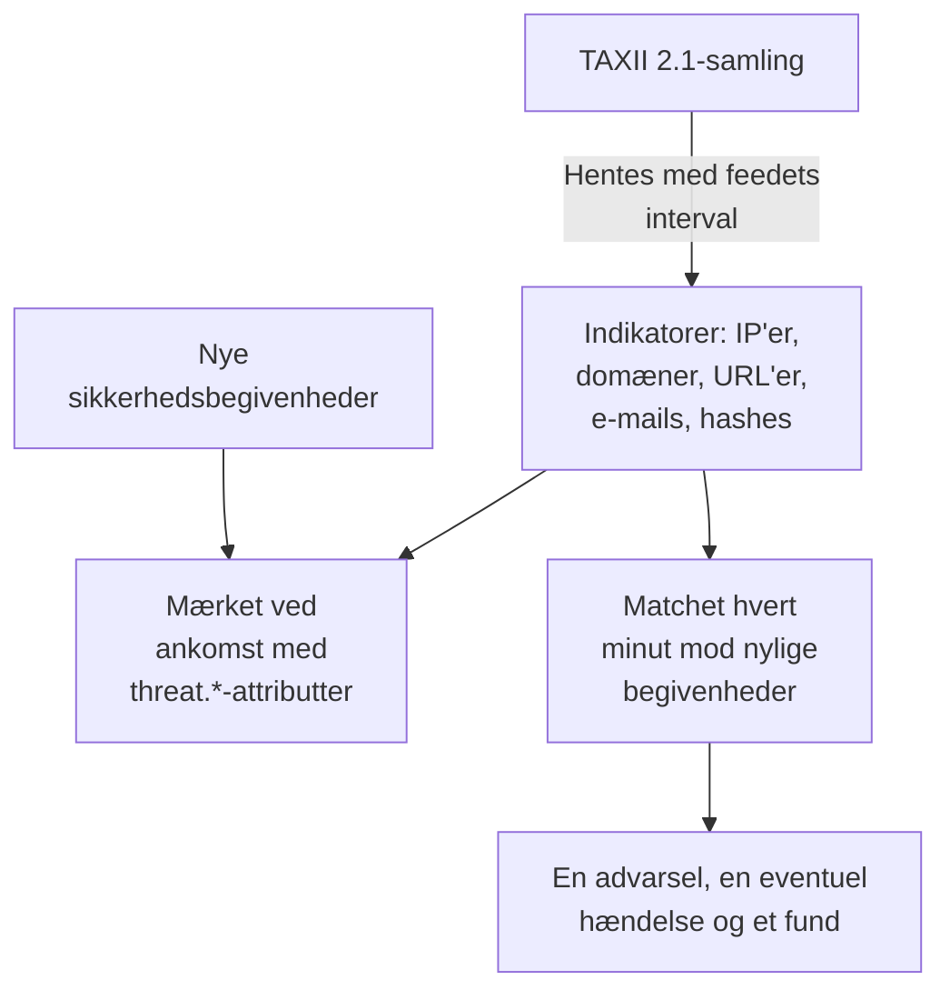

# Trusselsintelligens (STIX/TAXII)

Et threat intel-feed bringer kendte ondsindede IP-adresser, domæner, URL'er, e-mailadresser og filhashes ind i OneUptime og fortæller dig, når dine [sikkerhedsbegivenheder](/docs/telemetry/security-events) nævner en af dem. Hvert feed abonnerer på én TAXII 2.1-samling af STIX 2.1-indikatorer: din egen MISP-, OpenCTI- eller OpenTAXII-server eller en udbyders samling. OneUptime leverer ikke selv noget feedindhold: du kommer med samlingerne, ligesom du kommer med Sigma-reglerne.

:::cards
- [Abonnér på et feed](#abonnér-på-et-feed): En TAXII-server, en samling og hvordan der logges ind.
- [Hvad der indtages](#hvad-der-indtages): De indikatormønstre, OneUptime beholder, og hvor længe.
- [Sådan findes match](#sådan-findes-match): Mærket, når begivenheder ankommer, og matchet hvert minut.
- [Trusselsniveauer](#trusselsniveauer): Hvordan en indikators confidence bliver til en alvorlighed.
:::

## Sådan virker det



## Før du begynder

- En TAXII 2.1-server, der udgiver STIX 2.1-objekter af typen `indicator`, og ID'et på den samling, der skal hentes fra. Et feed logger ind anonymt, med et bearer-token eller med HTTP Basic-godkendelse.
- Servere, der kræver et TLS-klientcertifikat (mutual TLS), f.eks. CISA AIS, understøttes ikke. MITREs offentlige ATT&CK-server udgiver teknikker og grupper frem for indikatorer, så et feed, der peger på den, forbliver tomt.
- En rolle, der kan oprette feeds: Project Owner, Project Admin, Security Admin eller Security Member. Security Viewer kan læse feeds og indikatorer. Se [Roller](/docs/permissions/reference#roller).

## Abonnér på et feed

:::steps
### Gå til Threat Intel

Åbn **Produkter → Security Events → Threat Intel**.

### Opret feedet

Klik på **Opret Threat Intel Feed**, og udfyld de fire trin: **Grundlæggende oplysninger**, **TAXII Server**, **Godkendelse** og **Ved match**. Felterne står i tabellen nedenfor.

### Tjek den første hentning

Inden for et minut eller to viser feedets række **Last Polled**, og **Last Poll Summary** fortæller, hvad hentningen fik med. Indikatorerne vises i tabellen **Indicators** under feedsene.
:::

| Felt | Hvad du skal angive |
| --- | --- |
| **TAXII API Root URL** | Serverens TAXII 2.1-API-rod, f.eks. `https://taxii.example.com/api1/`. Samlingerne adresseres under den. |
| **Collection ID** | Den samling, der udgiver indikatorerne. |
| **Poll Interval (Minutes)** | Hvor ofte der hentes nye objekter: 1 til 1440 minutter, 60 som standard. |
| **Minimum Confidence** | Indikatorer med en lavere STIX-`confidence` springes over: 0 til 100, og 0 beholder alt. Indikatorer uden confidence slipper altid igennem. |
| **API Token** | Et bearer-token, til en samling, der beder om et. |
| **Basic Auth Username** og **Basic Auth Password** | Til en samling, der bruger HTTP Basic-godkendelse. Lad begge og tokenet være tomme for en offentlig samling. |
| **Create Alert on Match** | Slået til som standard: hver matchet indikator åbner en advarsel. |
| **Advarselsalvor** | Alvorligheden af hver advarsel, dette feed åbner. Lad den være tom for at bruge hver indikators trusselsniveau. |
| **Create Incident on Match** | Slået fra som standard. Hændelser driver vagteskalering, SLA'er og statussider, og advarsler er som regel nok til indikatormatch. |
| **Hændelsesalvor** | Som **Advarselsalvor**, for hændelser. |
| **Write Detection Finding on Match** | Slået til som standard: hvert match skriver et fund ind i begivenhedsstrømmen. |

Tokens og adgangskoder krypteres og vises aldrig igen, når du har gemt dem. For at ændre dem vælger du **Update Credentials** i feedets række og derefter **API Token (Bearer)**, **Basic Auth** eller **Anonymous (clear stored credentials)**: dit valg erstatter feedets login, så når du gemmer et token, ryddes en gemt adgangskode, og omvendt.

### Sådan hentes et feed

Hver hentning beder om de objekter, der er tilføjet siden den forrige, via TAXII's markør `added_after`, og læser op til 10 sider med 500 objekter. En stor samling synkroniseres derfor over flere hentninger: **Last Poll Summary** fortæller, når der er flere sider tilbage. For at gøre en stor første synkronisering færdig hurtigere sænker du **Poll Interval (Minutes)**, helt ned til 1, indtil den har indhentet det.

Hentningerne præsenterer sig med user agent `OneUptime/<version> (+https://oneuptime.com)`. Hvis udbyderens firewall svarer `403`, så bed dem om at tillade den: mange firewalls blokerer anmodninger, der ligner et unavngivet script.

Et deaktiveret feed hentes ikke og matches ikke. De indikatorer, det allerede har, bliver ved med at mærke nye begivenheder, indtil de udløber.

## Hvad der indtages

OneUptime beholder STIX-objekter af typen `indicator`, hvis mønster er simpel lighed på en af disse typer:

| Type | Eksempelmønster |
| --- | --- |
| IPv4-adresse (`ipv4-addr`) | `[ipv4-addr:value = '198.51.100.7']` |
| IPv6-adresse (`ipv6-addr`) | `[ipv6-addr:value = '2001:db8::7']` |
| Domænenavn (`domain-name`) | `[domain-name:value = 'evil.example']` |
| URL (`url`) | `[url:value = 'http://evil.example/payload']` |
| E-mailadresse (`email-addr`) | `[email-addr:value = 'billing@evil.example']` |
| Filhash, SHA-256 (`file-hash-sha256`) | `[file:hashes.'SHA-256' = 'e3b0…b855']` |
| Filhash, SHA-1 (`file-hash-sha1`) | `[file:hashes.'SHA-1' = 'da39…0709']` |
| Filhash, MD5 (`file-hash-md5`) | `[file:hashes.MD5 = 'd41d…427e']` |

Sammenligninger, der er forbundet med `OR`, inden for ét `[...]` eller på tværs af flere, er fine, og hver værdi bliver sin egen indikator:

```text
[domain-name:value = 'evil.example' OR domain-name:value = 'evil2.example']
[ipv4-addr:value = '198.51.100.7'] OR [url:value = 'http://evil.example/x']
```

Alle andre mønstre, med `AND`, `FOLLOWEDBY`, `NOT`, `LIKE`, `MATCHES`, en tidsangivelse som `WITHIN` eller en anden objekttype, springes helt over og tælles som ikke understøttet i **Last Poll Summary**. At oversætte kun en del af et `AND`-mønster ville matche langt mere, end feedets forfatter mente.

### Hvor længe en indikator forbliver aktiv

- En indikator matcher fra sin `valid_from` til sin `valid_until`. Uden `valid_until` forbliver den aktiv i 365 dage fra `valid_from`, og en ny hentning forlænger ikke det.
- En tilbagekaldt indikator, eller en, der er opdateret med en `valid_until` i fortiden, holder op med at matche, så snart opdateringen er hentet. Det samme gælder en værdi, som udbyderen fjerner fra et opdateret mønster.
- Værdier gemmes med små bogstaver og matches uanset store og små bogstaver.

Tabellen **Indicators** viser indikatorerne, som de er gemt, med en **Status** på **Aktiv**, **Udløbet** eller **Revoked**. En genhentet indikator kan vises to gange i et stykke tid, og en udløbet eller tilbagekaldt række bliver stående på listen, indtil oprydningen i lageret fjerner den, op til omkring en måned efter at den er udløbet. Matchning tjekker altid gyldighed og tilbagekaldelse, så sådan en række matcher aldrig.

## Sådan findes match

### Mærket, når begivenheder ankommer

Hver indkommende sikkerhedsbegivenhed, fra indtagelses-API'et eller en forbindelse, tjekkes mod dine aktive indikatorer, før den gemmes. Når en af dens observables (de IP-adresser, værter, domæner, hashes og brugere, der er taget fra begivenheden) er lig med en indikators værdi, stemples begivenheden med disse attributter:

| Attribut | Værdi |
| --- | --- |
| `threat.matched` | Altid `"true"` på en mærket begivenhed |
| `threat.indicator_id` | STIX-indikatorens ID |
| `threat.indicator_type` | Indikatorens type, f.eks. `ipv4-addr` eller `file-hash-sha256` |
| `threat.indicator_value` | Den matchede værdi, med små bogstaver |
| `threat.feed` / `threat.feed_id` | Det feed, indikatoren kom fra |
| `threat.confidence` | Indikatorens STIX-confidence |
| `threat.match_count` | Hvor mange af begivenhedens observables der matchede en indikator |

Når flere indikatorer matcher én begivenhed, er det den med den højeste confidence, der udfylder disse værdier. Det er almindelige attributter, så du kan søge på dem under **Begivenheder**, filtrere monitorer for sikkerhedsbegivenheder med dem og bruge dem i detektionsregler:

```yaml title="threat-intel-logon.yml"
title: High-confidence indicator in a successful logon
level: critical
detection:
  selection:
    threat.matched: 'true'
    threat.confidence|gte: 80
    className: Authentication
    statusName: Success
  condition: selection
```

Mærkningen kender kun de indikatorer, der findes, når en begivenhed ankommer: begivenheder mærkes aldrig igen senere.

### Matchet hvert minut

Hvert minut matches hvert aktiveret feeds aktive indikatorer mod de begivenheder, hvis begivenhedstidspunkt ligger efter feedets forrige tjek. Det fanger intelligens, der ankom, efter at en begivenhed blev mærket.

- Det første tjek dækker de seneste 15 minutter. Efter et nedbrud indhenter det næste tjek højst de seneste 24 timer.
- Hvert vindue tjekkes én gang. Intelligens, der ankommer, efter at dens vindue er tjekket, gælder kun for senere begivenheder.
- En begivenhed, der ankommer sent, med et tidspunkt fra før det forrige tjek, mærkes stadig ved ankomst, men matches ikke.
- Hvert tjek matcher højst 100 indikatorværdier pr. feed: dem, der ses i flest begivenheder.

### Hvad et match gør

- En advarsel med titlen `[Threat Intel] <feed name> — <indicator value>`, én pr. feed og værdi, så længe den forbliver åben. Når den er løst, åbner det næste match en ny. Advarsler løses ikke automatisk.
- En hændelse, kun med **Create Incident on Match**, deduplikeret på samme måde.
- Et Threat Intel-fund, med **Write Detection Finding on Match**: en begivenhed `Detection Finding` (OCSF-klasse 2004) fra produktet `OneUptime Threat Intel`, med indikatorens trusselsniveau som alvorlighed og disse attributter:

| Attribut | Værdi |
| --- | --- |
| `oneuptime.threat.feed_id` / `oneuptime.threat.feed_name` | Feedet |
| `oneuptime.threat.indicator_id` | STIX-indikatorens ID |
| `oneuptime.threat.indicator_type` / `oneuptime.threat.indicator_value` | Det, der matchede |
| `oneuptime.threat.confidence` | Indikatorens confidence |
| `oneuptime.threat.match_count` | Hvor mange begivenheder der ligger bag dette fund |

Fund matches aldrig selv, så ét match kan ikke udløse et andet.

## Trusselsniveauer

Indikatorer har intet Sigma-niveau: deres STIX-`confidence` bestemmer i stedet et trusselsniveau.

| Indikatorens confidence | Trusselsniveau |
| --- | --- |
| 90 til 100 | Critical |
| 70 til 89 | High |
| 40 til 69 | Medium |
| 1 til 39 | Low |
| Uden score (0 eller mangler) | Medium |

En indikator uden score tæller som Medium: nogen valgte trods alt at lægge den i et feed. Trusselsniveauet er fundets alvorlighed og vælger advarslens alvorlighed blandt dit projekts alvorligheder i denne rækkefølge:

1. Feedets **Advarselsalvor** (eller **Hændelsesalvor**), når den er angivet: den gælder for hvert match fra feedet.
2. Din alvorlighed, der er opkaldt efter trusselsniveauet, f.eks. High, uanset store og små bogstaver.
3. Efter rang: Critical og High får din mest alvorlige alvorlighed, Medium og Low din mindst alvorlige.

Trusselsniveauet hører til hver indikator, ikke til feedet, så ét feed kan åbne en Critical-advarsel og en Low-advarsel i det samme minut. **Minimum Confidence** filtrerer på det samme tal: et minimum på 70 beholder kun High- og Critical-indikatorer plus dem uden score, som altid slipper igennem.

## Hold øje med et feeds match

Handlingen **Opret monitor** i et feeds række åbner en ny monitor for sikkerhedsbegivenheder, der tæller feedets fund: begivenhedsklassen `Detection Finding`, filtreret på feedets ID i `oneuptime.threat.feed_id` (aldrig dets navn, som en omdøbning ville ændre), over den seneste time. Brug den til en pludselig bølge af match eller til et travlt feed, der bliver stille.

## Opbevaring og fakturering

Indikatorer er konfiguration, ikke telemetri, og faktureres ikke som indtagne data. De fund, et match skriver, er almindelige sikkerhedsbegivenheder, der faktureres og opbevares som resten: se [Sikkerhedsbegivenheder](/docs/telemetry/security-events#opbevaring-og-fakturering).

## Fejlfinding

:::details Last Error er angivet efter en hentning
`401` eller `403`: legitimationen er forkert eller mangler; erstat den med **Update Credentials**. En `403` kan også være udbyderens firewall, der blokerer user agent. `404`: tjek **TAXII API Root URL**, som normalt slutter med en sti som `/api1/`, og **Collection ID**. Fejlen forsvinder ved den næste vellykkede hentning.
:::

:::details Feedet hentes, men ingen indikatorer vises
Læs **Last Poll Summary**. Ingen objekter hentet: samlingen er tom eller udgiver ingen indikatorer. Ikke understøttede mønstre: udbyderen bruger mønsterfunktioner, som denne side angiver som sprunget over. Under minimum confidence: sænk **Minimum Confidence**. Allerede inaktive: udbyderen sendte indikatorer, der allerede var tilbagekaldt eller udløbet.
:::

:::details Der findes indikatorer, men intet matcher
Matchning sammenligner en indikators værdi med en begivenheds observables, ikke med hvert felt: åbn en begivenhed, du forventede ville matche, under **Begivenheder**, og tjek, at dens observables indeholder værdien. Kun indikatorer med statussen **Aktiv** matcher. Tjek **Last Match Error** på feedet.
:::

:::details Et match åbnede ingen advarsel
**Create Alert on Match** er slået fra, eller en advarsel for det samme feed og den samme værdi er stadig åben, og senere match lægges ind i den. Et projekt skal have mindst én advarselsalvorlighed, for at et feed kan åbne advarsler.
:::

## Næste trin

:::cards
- [Sikkerhedsbegivenheder](/docs/telemetry/security-events): Send begivenheder, søg i dem, og skriv detektionsregler.
- [Google SecOps](/docs/integrations/google-secops): Hent Chronicles detektioner og begivenheder ind.
- [Tilladelsesreference](/docs/permissions/reference): Security-rollerne, og hvad hver af dem kan.
:::
