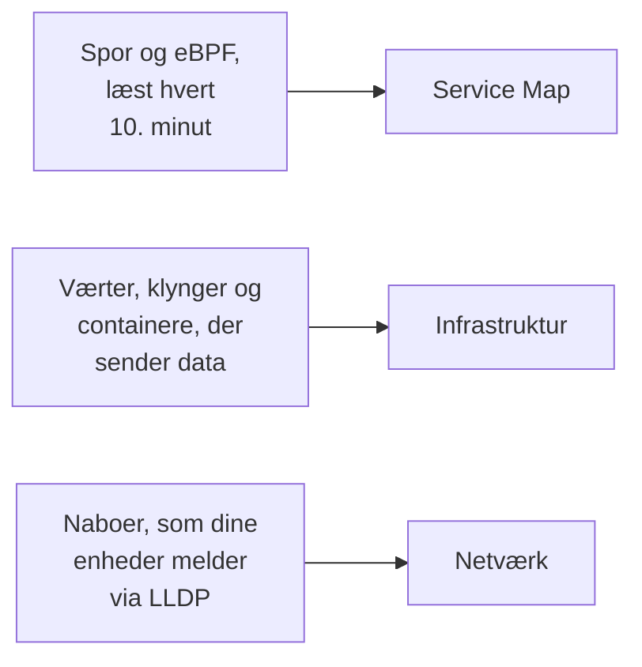

# Topologi

Topologi tegner, hvordan dine systemer hænger sammen: hvilke tjenester der kalder hvilke, hvad der kører hvor, og hvordan dine netværksenheder er kablet. OneUptime bygger den ud fra den telemetri, du allerede sender, så der er intet at tegne i hånden, og den viser med et blik, hvor fejl og hændelser sidder.

:::cards
- [Åbn Topologi](#åbn-topologi): Tre visninger af én side.
- [Læs tjenestekortet](#læs-tjenestekortet): Hvem der kalder hvem, og hvor sunde kaldene er.
- [Udforsk din infrastruktur](#udforsk-din-infrastruktur): Hvor hver tjeneste kører.
- [Se dit netværk](#se-dit-netværk): Enheder og deres forbindelser, live.
:::

## Sådan bygges kortet

Hver visning i Topologi bygges ud fra en anden slags telemetri:

- **Kun det, der var aktivt, tegnes.** En visning viser de tjenester og ressourcer, der sendte data i tidsintervallet, og de forbindelser, der blev set i det. Slå **Show inactive** til for også at tegne de tavse.
- **Kald tælles over et nyligt vindue.** OneUptime leder efter kald mellem tjenester hvert 10. minut, og trafiktallene dækker de seneste 15 minutter, ikke hele tidsintervallet.
- **Netværksvisningen er live.** Den viser dine enheder, som de er forbundet nu, så den har intet tidsinterval.

## Før du begynder

- **Telemetri, der ankommer.** Tjenestekortet kræver spor: se [OpenTelemetry](/docs/telemetry/open-telemetry). Infrastrukturvisningen kræver en vært eller en klynge, der sender data: se [Kubernetes-agenten](/docs/telemetry/kubernetes-agent). Netværksvisningen kræver netværksenheder: se [Netværksenheds-monitor](/docs/monitor/network-device-monitor).
- **En rolle, der læser telemetri.** Project Owner, Project Admin, Project Member, Viewer, Telemetry Admin, Telemetry Member eller Telemetry Viewer, eller en brugerdefineret rolle med tilladelsen Read Telemetry Service.

## Åbn Topologi

Gå til **Produkter → Observabilitet → Topologi**. **Inventar → Topology Map** åbner den samme side. Den åbner på **Service Map** for **Past 1 Day**.

| Visning | Spørgsmålet, den besvarer |
| --- | --- |
| **Service Map** | Hvilke tjenester afhænger af hinanden? |
| **Infrastruktur** | Hvad kører hvor i din infrastruktur? |
| **Netværk** | Hvordan er dine netværksenheder forbundet? |

Ved siden af tidsvælgeren tilføjer **Show inactive** det, der ikke sendte data i intervallet, og opdateringsknappen indlæser visningen igen. **What is shown · About this data** fortæller, hvad visningen tegner, og hvor ofte den beregnes. Adresselinjen husker den visning, du er i, så et link, du deler, åbner den samme visning.

## Læs tjenestekortet

**Service Map** tegner hver tjeneste, der sendte data, og de databaser, API'er og message brokers, de kalder, også når de ikke selv sender telemetri. Pile peger fra kalder til den kaldte, og tykkere linjer bærer flere anmodninger. Tallene over den viser, hvor mange tjenester, afhængigheder og forbindelser den tegner, og hvor mange der kræver opmærksomhed.

Hver tjeneste viser sin status, beregnet ud fra de kald, den modtog i de seneste 15 minutter:

| Status | Hvornår |
| --- | --- |
| **Sund** | Højst 1 % af de modtagne kald fejlede. |
| **Some errors** | Mere end 1 % og mindre end 5 % fejlede. |
| **High error rate** | 5 % eller mere fejlede. |
| **Entry point** | Den modtog ingen kald, men foretog nogle: en webfrontend eller et planlagt job. |
| **No calls observed** | Den hverken foretog eller modtog et kald. |

En tjeneste med en aktiv hændelse eller advarsel viser i stedet, hvor mange, og ligesom en tjeneste med **Some errors** eller en **High error rate** tæller den som en, der kræver opmærksomhed.

:::steps
### Find de tjenester, der kræver opmærksomhed

Klik på **Kræver opmærksomhed** for kun at beholde de tjenester og deres direkte forbindelser, eller søg efter navn i feltet over kortet.

### Åbn en tjeneste

Klik på en tjeneste for at se dens anmodninger, fejl og gennemsnitlige latenstid i de seneste 15 minutter, dens **Aktive hændelser** og **Aktive advarsler**, og links til **Traces for this service** og dens **Inventory details**.

### Åbn en forbindelse

Klik på en pil for at se dens anmodningsrate, fejlrate og gennemsnitlige latenstid. Mellem to tjenester, du instrumenterer, har den også en **History** over kald, fejl og latenstid.
:::

**Connection labels** skriver et tal på hver pil: **Request rate**, **Fejlrate** eller **Average latency**, eller intet, før du holder musen over. **Tabel** viser de samme tjenester med deres **Anmodninger**, **Fejlrate**, **Avg latency** og **Connections**, og **Show on map** tegner en af dem.

## Udforsk din infrastruktur

**Infrastruktur** viser, hvor dine tjenester kører: klynger, værter, pods, containere og de andre ressourcer, der sender data. Replikaer af én workload samles i én post, og du kan åbne hvad som helst for at se indeni.

- **Gennemse den på din måde.** Vis den som **List** eller **Map**, fra hele din infrastruktur ned til én pod. Tallene over den viser, hvor mange ressourcer og workloads den tegner, hvor mange tjenester den kan placere, og hvor mange tavse ressourcer den udelader.
- **Find en ressource.** Søg efter den ved navn, og klik på **View details** for at åbne dens side.
- **Skift mellem visninger.** En tjeneste, der står på en ressource, åbner på **Service Map**, og de ressourcer, en tjeneste kører på, åbner på **Infrastruktur**.

## Se dit netværk

**Netværk** er det levende kort over dine netværksenheder, bygget ud fra de naboer, de melder via LLDP, og via CDP på Cisco-enheder. Det har ingen tidsvælger: forbindelserne opdaterer sig selv.

Hvis du grupperer enheder i lokationer, åbner visningen på dine lokationer: vælg en, eller skift til **All devices**. **Map options** arrangerer kortet og vælger, hvad det omfatter, og **Eksportér PDF** gemmer det kort, du ser. Netværksenhedernes sider tegner det samme kort: se [Netværkstopologi](/docs/monitor/network-device-monitor#netværkstopologi).

## Fejlfinding

:::details Tjenestekortet viser tjenester, men ingen forbindelser
OneUptime finder kald mellem tjenester i dine spor hvert 10. minut. Det ser et kald, når en anmodning bærer sporkontekst, `traceparent`-headeren, fra én instrumenteret tjeneste til den næste, som OpenTelemetrys HTTP- og gRPC-instrumenteringer gør; når en tjeneste melder klient-spans for de databaser og API'er, den kalder; eller når Kubernetes-agenten kører med eBPF.
:::

:::details En tjeneste, jeg har fjernet, er stadig på kortet
Den sendte data inden for tidsintervallet. Vælg et kortere interval, eller vent, til dens seneste telemetri falder uden for intervallet. Med **Show inactive** slået til tegner kortet også det, der er holdt op med at sende data.
:::

:::details Kortet siger, at kun en del af det vises
Et meget stort projekt når kortets grænser, og en meddelelse fortæller, hvor mange ressourcer eller forbindelser det viser. Søg efter en tjeneste, eller brug **Show on map** i tabellen, for at tegne en læsbar del af det.
:::

## Næste skridt

:::cards
- [Tjenestekatalog](/docs/telemetry/services): Alt om én tjeneste.
- [Sporudforsker](/docs/telemetry/traces-explorer): Anmodningerne bag hver pil.
- [Inventar – Oversigt](/docs/inventory/overview): Hver ressource, kortet tegner.
- [Netværksenheds-monitor](/docs/monitor/network-device-monitor): Sæt dit netværk på kortet.
:::
