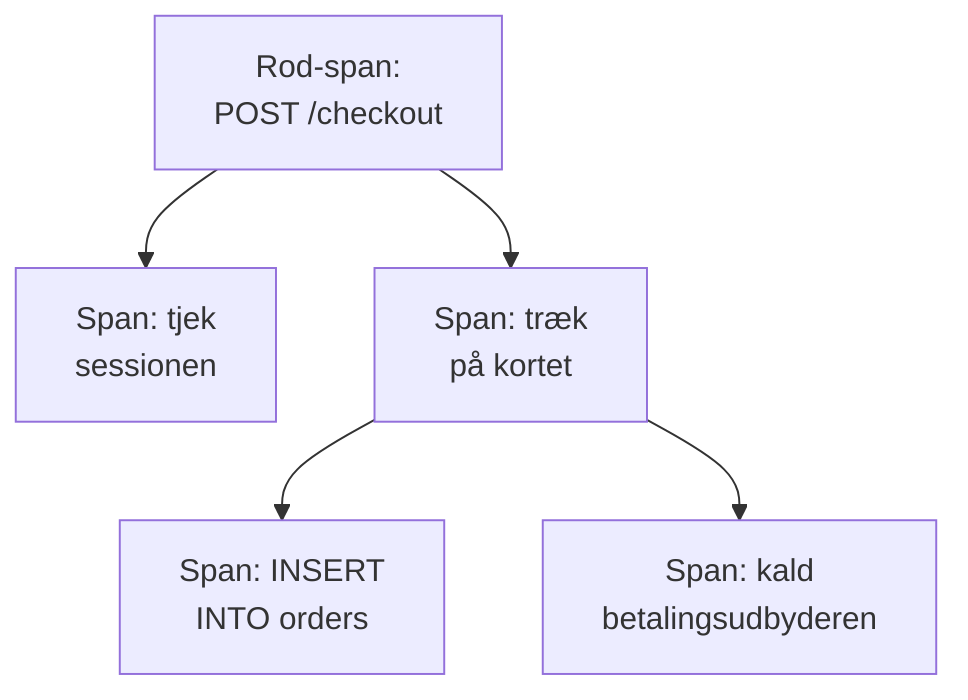

# Sporudforsker

Sporudforskeren finder de forespørgsler, der er gået gennem dine tjenester: de langsomme, de fejlede, dem der rørte én bestemt kundes konto. Søg i og filtrér de spans, dine tjenester sender, og åbn derefter et spor for at se hvert trin i forespørgslen som vandfald, flammegraf eller tjenestekort.

:::cards
- [Find en forespørgsel](#find-en-forespørgsel): Søg i spans, og filtrér derefter efter tjeneste, status eller type.
- [Læs et spor](#læs-et-spor): Hvor tiden gik hen, og hvilket trin der fejlede.
- [Vis dine spans i diagrammer](#vis-dine-spans-i-diagrammer): Antal forespørgsler og svartider, grupperet efter dit valg.
- [Indsigter i spor](#indsigter-i-spor): Fejlrater, latens og de langsomste forespørgsler.
:::

## Spor og spans

Et spor er én forespørgsel på vej gennem dit system. Hvert trin, den tager, såsom en HTTP-handler, en databaseforespørgsel eller et kald til en anden tjeneste, er et span, og spans ligger inde i de spans, der startede dem. Det første span i et spor, uden forælder, er dets rod-span: forespørgslens indgangspunkt.

Hver række i udforskeren er et span, så en travl tjeneste fylder listen med sine databaseforespørgsler og interne kald. For at vise én række pr. forespørgsel skal du vælge **Root spans** under **Span-kategori** i sidepanelet.

Udforskeren har fire faner:

| Fane | Hvad den bruges til |
| --- | --- |
| **Seer** | Søg i og filtrér spans, og åbn deres spor. Den åbner på den seneste time, nyeste først, 50 spans pr. side. |
| **Indsigter** | Antal forespørgsler, fejlrater og latens pr. tjeneste, og de forespørgsler, der er værd at kigge på. |
| **Opsætningsvejledning** | Sådan sender du spor med OpenTelemetry med en af dine indtagelsesnøgler. |
| **Indstillinger** | Hvad der sker med spans, når de ankommer: **Pipelines**, **Drop-filtre**, **Scrub-regler** og **Optagelsesregler**. |

## Før du begynder

- **Spor, der ankommer.** Instrumentér dine tjenester med [OpenTelemetry](/docs/telemetry/open-telemetry). Fanen **Opsætningsvejledning** viser koden til dit sprog.
- **En rolle, der må læse telemetri.** Project Owner, Project Admin, Project Member, Viewer, Telemetry Admin, Telemetry Member eller Telemetry Viewer, eller en brugerdefineret rolle med tilladelsen Read Telemetry Service Traces. Dens omfang afgør, hvis spans du ser: se [Telemetri](/docs/permissions/index#telemetri).

## Find en forespørgsel

:::steps
### Åbn Seer

Gå til **Produkter → Observabilitet → Spor**. **Seer** viser spans fra den seneste time, nyeste først, hver med status, tjeneste, navn og varighed.

### Vælg tidsintervallet

Vælg et interval i tidsvælgeren, eller træk hen over diagrammet over listen for at zoome ind på en spids. Dobbeltklik på diagrammet for at zoome ud igen. Se [Zoom ind på et tidsinterval](/docs/telemetry/charts-and-time-ranges).

### Søg

Skriv en forespørgsel, og tryk på Enter, for eksempel `service:checkout status:error duration:>500`. Løse ord søger i span-navne, og `@key:value` søger i en attribut som `@http.route:/orders`. Se [Søgesyntaks](/docs/telemetry/search-syntax#spor).

### Indsnævr med filtre

Klik på en værdi i sidepanelet **Filtre** for at tilføje den som en chip. Sidepanelet filtrerer efter **Tjeneste**, efter den vært, klynge eller anden ressource, der sendte spannet, efter **Status**, **Span-kategori**, **Har undtagelse**, **Span-type**, **Span-navn**, **Service Instance** og **Værtens navn**.

### Åbn et span

Klik på en række for at folde den ud: dens attributter samt de protokoller og undtagelser, den registrerede. Klik på **See full trace** for at åbne hele dens spor.
:::

Din søgning, dine chips og tidsintervallet gemmes i sidens adresse, så en genindlæsning, et bogmærke eller et delt link åbner de samme spans.

## Læs et spor

Et spors side begynder med forespørgslens tal:

| Tal | Hvad det er |
| --- | --- |
| Varighed | Hvor lang tid hele forespørgslen tog. |
| Spans | Hvor mange spans sporet har. |
| Tjenester | Hvor mange tjenester forespørgslen gik igennem. |
| Fejl | Hvor mange spans der sluttede med en fejlstatus. Klik på det for kun at vise dem. |
| Dybde | Den dybeste kæde af indlejrede spans. |

Under dem vælger du en af fire visninger:

| Visning | Hvad den viser |
| --- | --- |
| **Waterfall** | Hvert span på en tidslinje, indlejret under det span, der startede det. Slå **Critical path** til for at fremhæve den kæde af spans, der afgjorde, hvor lang tid forespørgslen tog. |
| **Flammegraf** | Det samme træ som stablede bjælker, hvor de bredeste bjælker tog længst tid. |
| **Service map** | De tjenester, forespørgslen gik igennem, og kaldene mellem dem. |
| **Operations** | Én række pr. tjeneste og span-navn med kald, fejl, egen tid og samlet tid. En operation, der kaldes 10 gange eller mere fra ét forælder-span, markeres: ofte en N+1-forespørgsel eller en løkke, der kunne samles. |

Klik på et span i en vilkårlig visning for at åbne dets panel med faner for dets attributter, begivenheder, protokoller, undtagelser og links samt dets profil eller LLM-kald, når det har et. Søg i sporets spans efter navn, ID eller tjeneste med søgefeltet ved siden af visningerne (tryk på `/`), og slå **Errors only** til for kun at beholde de spans, der fejlede.

Et stort spor indlæser 500 spans ad gangen. Klik på knappen nederst i sporet for at indlæse flere eller dem alle.

> [!TIP]
> **Fix performance with AI** leder i sporet efter et kendt ydeevnemønster: en N+1-forespørgsel, et span, der tager det meste af tiden, eller kald efter hinanden, der kunne køre parallelt. Når den finder et, starter den en AI-opgave, der åbner en pull request med rettelsen. Se [Rettelsesopgaver](/docs/ai/ai-agent).

## Vis dine spans i diagrammer

Diagrammet over listen viser antallet af spans over tid, fordelt på status. Vælg et andet mål i diagrammets hoved for i stedet at vise deres gennemsnitlige, mediane (P50) eller P95-svartid.

For mere skal du skifte listen fra **Spans** til **Analytics**. Vælg en tidsserie, en topliste eller en tabel; mål antal forespørgsler, antal fejl eller svartider (gennemsnit, P50, P90, P95, P99, minimum eller maksimum); og gruppér efter span-navn, tjeneste, status, span-type eller en vilkårlig attribut og derefter efter et andet felt. En topliste eller en tabel viser fra 5 til 100 grupper.

## Følg, gem og del

- Klik på **Sat på pause** over listen for at slå live-opdateringer til. Knappen viser derefter **Live**, og listen kigger efter nye spans hvert 10. sekund. Klik igen for at sætte på pause.
- **Saved Views** gemmer en søgning, dens filtre og tidsintervallet under et navn til alle i projektet. Gemte visninger fungerer som i [Protokoludforsker](/docs/telemetry/logs-explorer#gem-en-visning).
- Knapperne **Protokoller** og **Metrikker** åbner de udforskere for det samme tidsvindue, med så meget af din filtrering, som de kan bruge. Peg på en knap for at se, hvad den ikke kan tage med.

## Indsigter i spor

Fanen **Indsigter** opsummerer forespørgslerne i et tidsinterval:

- antallet af forespørgsler, fejlraten og P50-, P95- og P99-latensen;
- en sundhedstabel over dine tjenester, sorteret efter fejlrate, så de tjenester, der kræver opmærksomhed, kommer først;
- de seneste fejlede forespørgsler og de langsomste.

Begræns den til bestemte tjenester med rullelisten ved siden af tidsvælgeren.

## Hvad der sker med spans, når de ankommer

Fanen **Indstillinger** rummer de regler, OneUptime anvender på spans, når de ankommer, ligesom for protokoller. De virker på de spans, der ankommer bagefter, ikke på gemte.

| Regel | Hvad den gør |
| --- | --- |
| **Drop-filtre** | Kassér spans, du ikke vil beholde, eller behold kun en stikprøve af dem. |
| **Scrub-regler** | Maskér følsomme data i span-attributter. |
| **Pipelines** | Ændr og berig spans: hver pipeline udvælger spans med et filter og kører derefter sine processorer i rækkefølge. |
| **Optagelsesregler** | Gør hvert minut span-antal, fejlantal og varigheder til nye metrikker. Se [Optagelsesregler for logs](/docs/telemetry/log-recording-rules). |

## Fejlfinding

:::details Et spor siger, at der ikke blev fundet nogen spans
Spans ankommer normalt inden for et minut efter, at forespørgslen er færdig. Klik på **Opdater** på sporets side for at tjekke igen.
:::

:::details Nogle spans står på øverste niveau i vandfaldet
De peger på et forælder-span, som OneUptime ikke har modtaget, ofte fordi den tjeneste, der skrev forælderen, endnu ikke sender spor til OneUptime. Instrumentér også den tjeneste.
:::

:::details Listen viser langt flere rækker end forespørgsler
Hver række er et span, ikke en forespørgsel. Vælg **Root spans** under **Span-kategori** i sidepanelet for at vise én række pr. forespørgsel.
:::

## Næste skridt

:::cards
- [Søgesyntaks](/docs/telemetry/search-syntax): Hvert filter, søgefeltet forstår.
- [Trace-monitor](/docs/monitor/traces-monitor): Få besked om fejlede eller langsomme forespørgsler.
- [Undtagelsessporing](/docs/telemetry/exceptions): Gennemgå de fejl, dine spans registrerer.
- [Protokoludforsker](/docs/telemetry/logs-explorer): Læs de protokollinjer, en forespørgsel skrev.
:::
