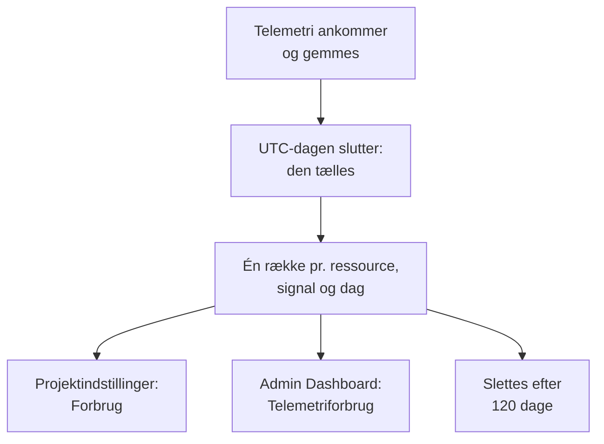

# Telemetriforbrug

Se, hvor meget telemetri hvert projekt, og hver tjeneste eller ressource i det, sender: protokoller, metrikker, spor, undtagelser, profiler, sessionsafspilninger og sikkerhedshændelser. Forbrug tælles på alle OneUptime-installationer, med eller uden fakturering, så du kan finde det, der fylder dit lager, uden at forespørge ClickHouse.

:::cards
- [Sådan tælles forbrug](#sådan-tælles-forbrug): Én gang om dagen, for hver ressource og hvert signal.
- [Se et projekts forbrug](#se-et-projekts-forbrug): Projektindstillinger → Telemetri og APM → Forbrug.
- [Se alle projekters forbrug](#se-alle-projekters-forbrug): Admin Dashboard, for instansadministratoren.
- [Hvor længe forbrug opbevares](#hvor-længe-forbrug-opbevares): 120 dage, medmindre du ændrer det.
:::

## Sådan tælles forbrug

Én gang om dagen, efter at en dag er slut i UTC, tæller OneUptime, hvad hver ressource i hvert projekt sendte den dag, for hvert signal, og gemmer optællingen som én række pr. ressource, signal og dag.



- **En dag tælles, når den er slut.** Hver dag tælles senest omkring kl. 08:00 UTC dagen efter, så dagens forbrug vises i morgen. En dag, der ikke kunne tælles, forsøges igen i en uge.
- **Størrelsen er den lagrede størrelse.** Hvert signal tælles som størrelsen af de rækker, det gemmes i, før komprimering. Sessionsafspilninger tælles som de bytes, optagerne uploadede.
- **Undtagelser vises for sig.** De undtagelser, der registreres på spans og i protokoller, har deres egen total, kolonne og del af diagrammet, og **Spor** tæller spans. De har ikke deres egen række: hver række for spor angiver, hvor meget af den der var undtagelser. En dag, der blev talt, før undtagelser blev vist for sig, har dem stadig med i **Spor**, som før.
- **Profiler omfatter deres samples.**
- **OneUptimes egen telemetri tælles ikke.** Målinger fra monitorer, advarsler, hændelser og SLO'er, målinger fra Dataobservabilitet og budgetmetrikkerne for sessionsafspilninger skrives af OneUptime selv.
- **På OneUptime Cloud er det disse rækker, telemetri faktureres ud fra.** På en installation uden fakturering tælles forbrug uden omkostninger, og der opkræves intet for det, heller ikke hvis fakturering slås til senere.
- **Undtagelser faktureres som en del af Spor.** På OneUptime Cloud faktureres spor for deres spans og deres undtagelser samlet, til prisen for spor, som de altid er blevet. At undtagelser vises for sig, ændrer ikke noget ved din faktura, og de opkræves aldrig to gange.
- **Et budget tælles adskilt fra forbruget.** Et [indtagelsesbudget](/docs/telemetry/ingestion-budgets) tæller telemetri, efterhånden som den ankommer, dekomprimeret, så det kan stoppe en dags telemetri samme dag. Mens et er angivet, åbner denne side med dagens budgetter. Undtagelser har ikke deres eget budget: de tælles med i budgettet for de spor eller protokoller, de ankommer i.

## Før du begynder

- **En rolle, der læser projektets telemetri.** Projektejer, Projektadministrator, Projektmedlem, Seer, Telemetriadministrator, Telemetrimedlem eller Telemetriseer, eller en af faktureringsrollerne. Rollen skal omfatte hele projektet: en rolle, der er begrænset til nogle etiketter, viser ikke forbrug.
- **Telemetri i projektet.** Forbrug tælles for den telemetri, projektets [indtagelsesnøgler](/docs/telemetry/ingestion-keys) sender.

## Se et projekts forbrug

:::steps
### Åbn Forbrug

Gå til **Projektindstillinger → Telemetri og APM → Forbrug**. **Telemetri og APM** starter sammenklappet i sidemenuen: klik på den for at åbne den.

### Vælg en periode

Siden åbner på **Seneste 30 dage**. Vælg **Seneste 7 dage** eller **Seneste 90 dage** i feltet øverst til højre på kortet **Telemetriforbrug**. En periode slutter med i går, den nyeste dag, der er talt.

### Find det, der er vokset

Kortet **Forbrug pr. ressource** viser hver tjeneste og ressource, der har sendt noget i perioden, de største først. Klik på en kolonnes titel for at sortere efter den, og på en ressources navn for at åbne dens side.
:::

Siden har tre kort:

| Kort | Hvad det viser |
| --- | --- |
| **Telemetriforbrug** | Periodens **Total**, en total for hvert signal og et diagram over hver dag med signalerne stablet. |
| **Forbrug pr. ressource** | Hver **Ressource** med dens type, en kolonne for hvert signal, **Total** og **Opbevaring** for dens telemetri. |
| **Telemetri-forbrugshistorik** | Én række pr. produkt, ressource og dag, med filtre for **Produkt**, **Dag** og **Tjeneste**. En række for **Spor** rummer spans og undtagelser samlet, sådan som spor faktureres, og angiver under **Indtaget data (i GB)**, hvor meget af den der var undtagelser. |

Telemetri, der ikke angav en tjeneste, vises som **Ukendt tjeneste**. En ressource, der er slettet siden, eller hvis type din rolle ikke læser, vises med sin type og begyndelsen af sit ID.

## Hvem ser hvad

| Rolle | Ser |
| --- | --- |
| Projektejer, Projektadministrator, Faktureringsadministrator, Faktureringsmedlem, Faktureringsseer, Manage Billing | Hvor meget hver ressource sendte, og hvor længe det opbevares, og på OneUptime Cloud hvad det kostede |
| Projektmedlem, Seer, Telemetriadministrator, Telemetrimedlem, Telemetriseer | Hvor meget hver ressource sendte, og hvor længe det opbevares |

Hvad forbruget kostede, vises kun på OneUptime Cloud: en installation uden fakturering opkræver intet for det. Se [Fakturering og forbrug](/docs/configuration/billing#brugshistorik) for priserne.

## Se alle projekters forbrug

På en selvhostet installation ser instansadministratoren alle projekters forbrug i Admin Dashboard:

:::steps
### Åbn Telemetriforbrug

Åbn menuen i Admin Dashboard, og klik på **Telemetriforbrug**. Listen viser hvert projekt, der har sendt noget i perioden, de største først, med en kolonne for hvert signal og **Total**.

### Find de største projekter

Vælg en periode øverst til højre på kortet, og klik på en kolonnes titel for at sortere efter den: **Total**, et signal eller **Projekt** for navnet.

### Åbn et projekt

Klik på et projekts navn. Dets side **Telemetriforbrug** under **Projekter** i Admin Dashboard viser dets forbrug pr. dag, signal og ressource, som dets medlemmer ser det.
:::

## Hvor længe forbrug opbevares

Forbrug opbevares i 120 dage, medmindre du ændrer det, med fakturering slået til eller fra. Det er, hvor længe forbrugsoptællingerne opbevares, ikke selve telemetrien: se [Dataopbevaring](/docs/telemetry/data-retention) for den.

:::steps
### Åbn Dataopbevaring

Gå til **Indstillinger → Dataopbevaring** i Admin Dashboard.

### Angiv antallet af dage

Klik på **Rediger opbevaring af telemetriforbrug** på kortet **Opbevaring af telemetriforbrug**, indtast **Opbevaring af telemetriforbrug (dage)** fra 30 til 1095, og klik på **Gem ændringer**. Lad feltet stå tomt for 120 dage.
:::

Forbrug, der er ældre end det, slettes én gang om dagen. Opbevaringen er aldrig kortere end 30 dage: en dag, der er talt, slettes aldrig for så at blive talt igen.

## Læs forbruget med API'et

`GET /api/telemetry-usage/project` svarer med ét projekts forbrug over en periode af UTC-dage, som siden viser det. Kald det med en [API-nøgle](/docs/permissions/index#api-nøgler), der har en af rollerne ovenfor:

```bash
curl 'https://oneuptime.com/api/telemetry-usage/project?startDay=2026-10-01&endDay=2026-10-31' \
  -H "ApiKey: $ONEUPTIME_API_KEY"
```

`startDay` og `endDay` er dage skrevet `YYYY-MM-DD`, begge medregnet, og en periode kan være op til 1095 dage lang. Svaret indeholder totalerne, hver dag pr. signal og hver ressource pr. signal, i GB, med omkostningen kun der, hvor fakturering er slået til, og nøglen kan læse fakturering. Undtagelser ligger under `Exceptions`, adskilt fra `Traces`, og en dag, der blev talt, før undtagelser blev vist for sig, har dem med i `Traces`.

## Fejlfinding

:::details Siden Forbrug viser Intet telemetriforbrug endnu
En dag tælles, når den er slut i UTC, senest omkring kl. 08:00 UTC dagen efter: et projekt, der begyndte at sende i dag, viser sin første dag i morgen. Kontrollér, at projektet modtager telemetri i explorerne.
:::

:::details Tallene er større end min ClickHouse-disk
Forbrug er størrelsen af rækkerne før komprimering. ClickHouse komprimerer det, den gemmer, så den disk, den bruger, er flere gange mindre.
:::

:::details En ressource vises med sin type og et ID
Ressourcen er slettet, siden den sendte telemetrien, eller din rolle læser ikke den type ressource. Dens forbrug tælles stadig.
:::

:::details Spor faldt den dag, Undtagelser dukkede op
Undtagelser blev tidligere talt med i **Spor**. Fra den første dag, der blev talt med undtagelser for sig, tæller **Spor** spans, og **Undtagelser** tæller undtagelserne. Tilsammen er de det, **Spor** var, og det, spor faktureres for.
:::

## Næste skridt

:::cards
- [Drop-filtre og scrub-regler](/docs/telemetry/drop-filters-and-scrub-rules): Hold op med at gemme den telemetri, du ikke har brug for.
- [Dataopbevaring](/docs/telemetry/data-retention): Opbevar telemetri så længe som nødvendigt, og ikke længere.
- [Fakturering og forbrug](/docs/configuration/billing): Hvad telemetri koster på OneUptime Cloud.
- [Indtagelsesnøgler](/docs/telemetry/ingestion-keys): Send telemetri til dit projekt.
- [Indtagelsesbudgetter](/docs/telemetry/ingestion-budgets): Begræns, hvor meget af hvert signal et projekt sender på en dag.
:::
