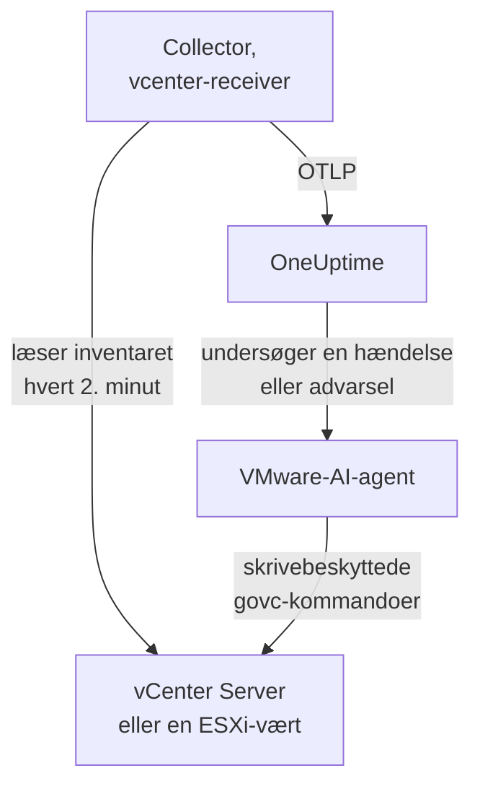

# VMware-agent

OneUptimes VMware-agent overvåger VMware vSphere: vCenter Server, ESXi-værter, virtuelle maskiner, datastores, klynger, ressourcepuljer og vSAN. Den er en almindelig OpenTelemetry Collector, hvis [`vcenter`-receiver](https://github.com/open-telemetry/opentelemetry-collector-contrib/tree/main/receiver/vcenterreceiver) læser vSphere-API'et med en skrivebeskyttet bruger, stempler hver metrik med dit vCenters navn og sender den til OneUptime: intet plugin på vCenter og intet inde i VM'erne. [VMware-monitorer](/docs/monitor/vmware-monitor) advarer ud fra det, der ankommer.

:::cards
- [Installér agenten](#installer-agenten): En skrivebeskyttet bruger, derefter installationsscriptet, Docker Compose eller systemd.
- [Hvad agenten indsamler](#hvad-agenten-indsamler): Hvert vSphere-objekt, dets identitet og dets metrikker.
- [AI-agent](#ai-agent): Lad OneUptime AI læse vCenter, mens den undersøger.
- [Fejlfinding](#fejlfinding): Et diagnosescript og de sædvanlige problemer.
:::

## Sådan virker det

Én agent overvåger ét vSphere-endpoint: en **vCenter Server**, der dækker hvert datacenter, hver klynge og hver vært, den administrerer, eller en **selvstændig ESXi-vært**, som intet vCenter administrerer. Kør én agent pr. vCenter. Collectoren gennemgår hele inventaret én gang pr. indsamling (som standard hvert 2. minut) og sender én ressource pr. objekt. Den samme Compose-fil kører VMware-AI-agenten ved siden af, til OneUptime AI. Vil du hellere undgå Docker? Den samme collector med den samme konfiguration kører også som systemd-tjeneste på enhver Linux-maskine.



vCenter registrerer sig med sine første data under det navn, agenten stempler på hver metrik som `vmware.vcenter.name`. Vil du overvåge et vCenter helt uden at køre agenten, så se [VMware uden agent](/docs/telemetry/vmware-agentless): En af dine probes indsamler de samme data med en skrivebeskyttet konto.

## Før du begynder

- Docker Engine 20.10 eller nyere med Docker Compose v2-pluginet eller, for at installere uden Docker, en Linux-maskine (x86_64 eller arm64) med systemd 235 eller nyere. Uanset hvad skal maskinen kunne nå vCenter over HTTPS (TCP 443).
- vCenter Server eller ESXi 7.0 eller nyere: Receiveren understøtter vSphere 7 og 8.
- En konto, der kan oprette en vSphere-bruger og give den en rolle på det øverste vCenter-objekt.
- En indtagelsesnøgle. Opret en under **Projektindstillinger → Telemetri og APM → Indtagelsesnøgler**, og kopiér dens værdi.

### Hvor agenten skal køre

Agenten taler med vCenter over HTTPS, så den behøver ikke at køre i nærheden af det, og ideelt set bør den hverken køre på vCenter Server Appliance eller i en VM på den klynge, den overvåger: Hvis den klynge går ned, går din overvågning ned med den. En lille administrations-VM på separat hardware, en overvågningsvært eller enhver maskine, der kører Docker (eller, uden Docker, enhver Linux-maskine med systemd) og når vCenter på TCP 443, er det rette sted. Den valgfrie syslog-listener kræver også, at ESXi-værterne kan nå agenten på syslog-porten (se [Send ESXi-syslog](#valgfrit-send-esxi-syslog)).

## Installer agenten

:::steps
### Opret den skrivebeskyttede vSphere-bruger

Agenten læser kun: inventaret, ydelsestællere og vSAN-statistik. Giv den sin egen konto med den indbyggede rolle **Read-Only**, aldrig en administrator.

:::tabs
@tab vSphere Client
1. Opret kontoen: Åbn _Menu → Administration → Single Sign On → Users and Groups_, vælg domænet `vsphere.local` (eller din identitetskilde), klik på **Add**, kald brugeren `oneuptime`, og angiv en adgangskode. Brugeren er derefter `oneuptime@vsphere.local`.
2. Tildel rollen: Vælg det øverste objekt **vCenter Server** i inventaret _Hosts and Clusters_, åbn fanen **Permissions**, klik på **Add**, vælg brugeren, sæt rollen til **Read-Only**, og markér **Propagate to children**.
@tab govc
Fra en maskine med administratorlegitimationsoplysninger:

```bash
govc sso.user.create -p 'a-strong-password' -R ReadOnly oneuptime
govc permissions.set -principal oneuptime@vsphere.local -role ReadOnly -propagate=true /
```
@tab PowerCLI
Fra en session, der er forbundet til vCenter som administrator:

```powershell
New-SsoPersonUser -UserName oneuptime -Password 'a-strong-password'
New-VIPermission -Entity (Get-Folder -NoRecursion) -Principal 'VSPHERE.LOCAL\oneuptime' -Role ReadOnly -Propagate:$true
```
@tab ESXi Host Client
For en selvstændig ESXi-vært (uden vCenter) skal du oprette brugeren under _Host → Manage → Security & Users → Users_ og give den rollen Read-Only under _Host → Manage → Security & Users → Permissions_. Eller kør i værtens shell `esxcli system account add` og derefter `esxcli system permission set --id oneuptime --role ReadOnly`.
:::

> [!IMPORTANT]
> Udbredelsen er den del, folk overser. Receiveren gennemgår datacentre, klynger, værter, VM'er, datastores og ressourcepuljer, og hvert objekt, som brugeren ikke kan se, udelades i stilhed. En Read-Only-rolle, der er tildelt på vCenter-objektet _uden_ udbredelse, giver et inventar uden indhold og et dashboard fuld af nuller.

### Installer og start agenten

:::tabs
@tab install.sh
Hent installationsscriptet, og kør det på den maskine, der skal være vært for agenten:

```bash
curl -sSL https://raw.githubusercontent.com/OneUptime/oneuptime/master/agents/VMwareAgent/install.sh -o install.sh
bash install.sh
```

Scriptet spørger efter din OneUptime-URL, indtagelsesnøglen, et navn til vCenter, vCenter-endpointet og de skrivebeskyttede legitimationsoplysninger (det læser adgangskoden uden ekko), og om AI-agenten må anvende rettelser (i så fald efter en vSphere-bruger til den selv og de VM'er, den aldrig må ændre). Det installerer i `/opt/oneuptime-vmware-agent`, skriver en fil med `0600` ved navn `.env` og starter agenten med Docker Compose. Det sætter hver værdi i anførselstegn til Docker Compose, præcis som du skrev den, så en adgangskode med `$`, `#`, mellemrum eller anførselstegn virker, som du skrev den. Kører du scriptet igen, genbruger det alt i en eksisterende `.env` i stedet for at spørge igen, og det er sådan, du [opgraderer agenten](#opgradering-af-agenten).
@tab Docker Compose
Hent `docker-compose.yml` og `otel-collector-config.yaml` fra [VMwareAgent-mappen](https://github.com/OneUptime/oneuptime/tree/master/agents/VMwareAgent) ind i en ny mappe, og opret derefter en `.env`-fil ved siden af dem. Den indeholder en adgangskode, så hold den privat med `chmod 600 .env`:

```bash title=".env"
ONEUPTIME_URL=YOUR_ONEUPTIME_URL
ONEUPTIME_TELEMETRY_INGESTION_KEY=YOUR_TELEMETRY_INGESTION_TOKEN
VMWARE_VCENTER_NAME=my-vcenter
VCENTER_ENDPOINT=https://vcsa.example.com
VCENTER_USERNAME=oneuptime@vsphere.local
VCENTER_PASSWORD=a-strong-password
VCENTER_INSECURE_SKIP_VERIFY=true
VCENTER_COLLECTION_INTERVAL=2m
```

En adgangskode med `$`, `#`, mellemrum eller anførselstegn skal i enkelte anførselstegn (se [vCenter afviser login](#fejlfinding)). Start agenten:

```bash
docker compose up -d
```
@tab systemd
Agenten behøver ikke Docker: Den er én OpenTelemetry Collector-binær og én konfigurationsfil. På en Linux-maskine (x86_64 eller arm64) med systemd 235 eller nyere (Ubuntu 18.04, Debian 10, RHEL 8 eller nyere) skal du køre den udgivelse af `otelcol-contrib`, som agenten fastlåser, med den samme `otel-collector-config.yaml`, som en systemd-tjeneste. Den enhed, agenten leverer til det, [`oneuptime-vmware-agent-native.service`](https://github.com/OneUptime/oneuptime/blob/master/agents/VMwareAgent/systemd/oneuptime-vmware-agent-native.service), kører collectoren som en midlertidig, uprivilegeret bruger uden capabilities og uden noget, den kan skrive til.

Hent collectoren, konfigurationen og enheden, og installér dem i `/opt/oneuptime-vmware-agent`:

```bash
cd "$(mktemp -d)"
VERSION=0.161.0   # the collector release the agent pins
ARCH=$(uname -m | sed 's/x86_64/amd64/;s/aarch64/arm64/')
curl -fL -o otelcol-contrib.tar.gz \
  https://github.com/open-telemetry/opentelemetry-collector-releases/releases/download/v${VERSION}/otelcol-contrib_${VERSION}_linux_${ARCH}.tar.gz
curl -fsSLO https://raw.githubusercontent.com/OneUptime/oneuptime/master/agents/VMwareAgent/otel-collector-config.yaml
curl -fsSL -o oneuptime-vmware-agent.service \
  https://raw.githubusercontent.com/OneUptime/oneuptime/master/agents/VMwareAgent/systemd/oneuptime-vmware-agent-native.service

sudo install -d -m 0755 /opt/oneuptime-vmware-agent
sudo tar --no-same-owner --preserve-permissions -xzf otelcol-contrib.tar.gz -C /opt/oneuptime-vmware-agent otelcol-contrib
sudo install -m 0644 otel-collector-config.yaml /opt/oneuptime-vmware-agent/otel-collector-config.yaml
sudo install -m 0644 oneuptime-vmware-agent.service /etc/systemd/system/oneuptime-vmware-agent.service
```

Indstillingerne skal i `/opt/oneuptime-vmware-agent/.env`: de samme variabler som i Docker-installationens `.env`. Den indeholder en adgangskode, så gør den læsbar for root alene, før du åbner den:

```bash
sudo touch /opt/oneuptime-vmware-agent/.env
sudo chmod 600 /opt/oneuptime-vmware-agent/.env
sudoedit /opt/oneuptime-vmware-agent/.env
```

Skriv dette i den:

```bash
ONEUPTIME_URL=YOUR_ONEUPTIME_URL
ONEUPTIME_TELEMETRY_INGESTION_KEY=YOUR_TELEMETRY_INGESTION_TOKEN
VMWARE_VCENTER_NAME=my-vcenter
VCENTER_ENDPOINT=https://vcsa.example.com
VCENTER_USERNAME="oneuptime@vsphere.local"
VCENTER_PASSWORD="a-strong-password"
VCENTER_INSECURE_SKIP_VERIFY=true
VCENTER_COLLECTION_INTERVAL=2m
```

systemd læser denne fil, ikke en shell: Hold brugernavnet og adgangskoden i dobbelte anførselstegn, hvor hvert `\` skrives `\\` og hvert `"` skrives `\"` — `DOMAIN\user` er `"DOMAIN\\user"` —, mens `$`, `#`, `'` og mellemrum går ind, som de er. Det er den form, alle systemd-versioner læser ens; ældre versioner (fx RHEL 8's) fjerner en backslash selv inden for enkelte anførselstegn. Start derefter agenten, og lad den starte ved hver opstart:

```bash
sudo systemctl daemon-reload
sudo systemctl enable oneuptime-vmware-agent
sudo systemctl restart oneuptime-vmware-agent
```

Denne installation kører kun collectoren: [AI-agenten](#ai-agent) leveres kun som container-image. Kør én agent pr. vCenter: Hvis du går væk fra Docker-installationen, så kør først `docker compose down` der, ellers ankommer hver metrik to gange.
:::

### Bekræft installationen

Kontrollér, at agenten kører, og læs collectorens logs:

```bash
docker compose ps
docker logs -f oneuptime-vmware-agent
```

Installeret med systemd? Kontrollér i stedet tjenesten og dens journal:

```bash
systemctl status oneuptime-vmware-agent --no-pager
sudo journalctl -u oneuptime-vmware-agent -f
```

Collectorens logs bør vise denne linje, når den er startet:

```text
Everything is ready. Begin running and processing data.
```

### Find vCenter i OneUptime

Intet sendes, før den første fulde gennemgang af inventaret er færdig, så giv det ét indsamlingsinterval (som standard 2 minutter). Åbn derefter **Produkter → Infrastruktur → VMware → Alle vCenter**: vCenter er der med sine datacentre, klynger, ESXi-værter, virtuelle maskiner, datastores og ressourcepuljer.
:::

## Miljøvariabler

Docker Compose læser disse fra `.env` ved siden af `docker-compose.yml`; systemd-installationen læser dem fra `/opt/oneuptime-vmware-agent/.env`, og dens enhed giver de samme standardværdier.

| Variabel | Påkrævet | Beskrivelse |
| --- | --- | --- |
| `ONEUPTIME_URL` | Ja | Din OneUptime-URL, såsom `https://oneuptime.com` eller din selvhostede instans. Brug `http://` og dens port, hvis instansen kun bruger HTTP. |
| `ONEUPTIME_TELEMETRY_INGESTION_KEY` | Ja | Indtagelsesnøglen fra **Projektindstillinger → Telemetri og APM → Indtagelsesnøgler**. |
| `VMWARE_VCENTER_NAME` | Ja | vCenters navn i OneUptime, stemplet på hver metrik som ressourceattributten `vmware.vcenter.name`. Hold det stabilt: at ændre det senere registrerer et andet vCenter. Standard er `vmware-vcenter`. |
| `VCENTER_ENDPOINT` | Ja | Skemaet og værten for vCenter Server eller en selvstændig ESXi-vært, **uden** `/sdk`, fx `https://vcsa.example.com`. |
| `VCENTER_USERNAME` | Ja | vSphere-brugeren med rollen Read-Only, fx `oneuptime@vsphere.local` (eller `DOMAIN\user` for en Active Directory-identitetskilde). |
| `VCENTER_PASSWORD` | Ja | Den brugers adgangskode. Indeholder den `$`, `#`, mellemrum eller anførselstegn, så sæt den i enkelte anførselstegn i Docker-installationens `.env` (`install.sh` gør det for dig), og i dobbelte i systemd-installationens (se [Fejlfinding](#fejlfinding)). |
| `VCENTER_INSECURE_SKIP_VERIFY` | Nej | `true` accepterer vCenters selvsignerede standardcertifikat (VMCA); `false` holder TLS-verifikationen slået til. Standard er `false`. |
| `VCENTER_COLLECTION_INTERVAL` | Nej | Hvor ofte hele inventaret læses. Hæv det til `5m` eller `10m` for meget store vCentre. Standard er `2m`. |

AI-agentens egne indstillinger findes under [AI-agent](#ai-agent).

## Hvad agenten indsamler

Ved hvert `VCENTER_COLLECTION_INTERVAL` gennemgår receiveren hele vSphere-inventaret og sender én OpenTelemetry-ressource pr. objekt. Hvert objekts identitet ligger i dets **ressourceattributter** — `vcenter.datacenter.name`, `vcenter.cluster.name`, `vcenter.host.name`, `vcenter.vm.name` / `vcenter.vm.id`, `vcenter.datastore.name`, `vcenter.resource_pool.name` / `vcenter.resource_pool.inventory_path` — og agenten tilføjer `vmware.vcenter.name` oveni, så OneUptime arkiverer alt under dit vCenter:

| vSphere-objekt | Identitet (ressourceattributter) | Metrikker |
| --- | --- | --- |
| Datacenter | `vcenter.datacenter.name` | `vcenter.datacenter.cluster.count`, `vcenter.datacenter.host.count`, `vcenter.datacenter.vm.count`, `vcenter.datacenter.datastore.count`, `vcenter.datacenter.disk.space`, `vcenter.datacenter.cpu.limit`, `vcenter.datacenter.memory.limit` |
| Klynge | + `vcenter.cluster.name` | `vcenter.cluster.cpu.effective`, `vcenter.cluster.cpu.limit`, `vcenter.cluster.memory.effective`, `vcenter.cluster.memory.limit`, `vcenter.cluster.host.count`, `vcenter.cluster.vm.count`, `vcenter.cluster.vm_template.count`, `vcenter.cluster.vsan.*` (gennemløb, operationer, latens, overbelastninger) |
| ESXi-vært | + `vcenter.host.name` (og `vcenter.cluster.name`, når værten er i en klynge) | `vcenter.host.cpu.usage` / `.capacity` / `.utilization` / `.reserved`, `vcenter.host.memory.usage` / `.utilization` / `.capacity`, `vcenter.host.disk.latency.avg` / `.latency.max` / `.throughput`, `vcenter.host.network.usage` / `.throughput` / `.packet.rate` / `.packet.drop.rate` / `.packet.error.rate`, `vcenter.host.vsan.*` |
| Virtuel maskine | + `vcenter.host.name`, `vcenter.vm.name`, `vcenter.vm.id` (instans-UUID); `vcenter.resource_pool.*` eller `vcenter.virtual_app.*` | `vcenter.vm.disk.usage`, `vcenter.vm.disk.utilization`, `vcenter.vm.memory.usage` / `.utilization` / `.ballooned` / `.swapped` / `.swapped_ssd`; kun tændte VM'er: `vcenter.vm.cpu.usage`, `vcenter.vm.cpu.readiness`, `vcenter.vm.cpu.utilization`, `vcenter.vm.disk.latency.avg` / `.latency.max` / `.throughput`, `vcenter.vm.network.*`, `vcenter.vm.vsan.*` |
| VM-skabelon | `vcenter.vm_template.name`, `vcenter.vm_template.id` | kun `vcenter.vm.disk.usage` |
| Datastore | + `vcenter.datastore.name` | `vcenter.datastore.disk.usage`, `vcenter.datastore.disk.utilization` |
| Ressourcepulje | + `vcenter.resource_pool.name`, `vcenter.resource_pool.inventory_path` | `vcenter.resource_pool.cpu.usage` / `.cpu.shares`, `vcenter.resource_pool.memory.usage` / `.memory.shares` / `.memory.ballooned` / `.memory.swapped` / `.memory.granted` |

Tællings- og kapacitetsmetrikker fordeler sig over **datapunktattributter**, som er præcis det, du filtrerer og grupperer efter i monitorkriterier:

| Attribut | Værdier | Båret af |
| --- | --- | --- |
| `direction` | `read` / `write` for disk, `transmitted` / `received` for netværk | Disklatens og -gennemløb, netværksgennemløb og pakkerater |
| `disk_state` | `available` / `used` | `vcenter.datastore.disk.usage`, `vcenter.vm.disk.usage`, `vcenter.datacenter.disk.space` |
| `status` | `red` / `yellow` / `green` / `gray` (objektets samlede status i vSphere) | `vcenter.datacenter.cluster.count` / `.host.count` / `.vm.count` |
| `power_state` | Værter: `on` / `off` / `standby` / `unknown`; VM'er: `on` / `off` / `suspended` / `unknown` | `vcenter.datacenter.host.count` / `.vm.count`, `vcenter.cluster.vm.count` |
| `effective` | `true` / `false` (gemt som strenge) | `vcenter.cluster.host.count` |
| `object` | NIC-, disk- eller vCPU-instansen (fx `vmnic0`) | Disk- og netværksserier pr. enhed for værter og VM'er |
| `cpu_reservation_type` | `total` / `used` | `vcenter.host.cpu.reserved` |
| `type` | Hukommelse: `guest` / `host` / `overhead`, `private` / `shared`; vSAN: `read` / `write` / `unmap` | Hukommelsesserier for ressourcepuljer, vSAN-latens og -operationer |

Enhederne er receiverens egne OTLP-enheder, som OneUptime skalerer til visning: `MHz` for CPU-forbrug og -kapacitet, `%` for udnyttelse og CPU-ready, `MiBy` for hukommelse i værter, VM'er og ressourcepuljer, `By` for hukommelse i klynger og datacentre og al diskplads, `ms` for disklatens i værter og VM'er og `us` (mikrosekunder) for vSAN-latens. I monitorkriterier får identitetsattributterne præfikset `resource.` (`resource.vcenter.host.name`, `resource.vmware.vcenter.name`), mens datapunktattributter står uden præfiks (`disk_state`, `power_state`, `status`).

`vcenter.host.memory.capacity` er som standard slået fra upstream; den medfølgende konfiguration slår den til, fordi OneUptime dividerer med den for værternes hukommelsesudnyttelse. En kommentar i `otel-collector-config.yaml` viser de andre valgfrie metrikker (`vcenter.vm.cpu.time`, `vcenter.vm.memory.granted`, `vcenter.host.memory.active`, `vcenter.host.memory.ballooned`, `vcenter.host.memory.granted`, `vcenter.vm.network.broadcast.packet.rate`, `vcenter.vm.network.multicast.packet.rate`): Slå enhver af dem til på samme måde.

### VM'ers strømtilstand

Receiveren sender ingen metrik for en VM's strømtilstand. Den sender `vcenter.vm.cpu.*` **kun for tændte VM'er**, så OneUptime udleder tilstanden af det, der ankom i hver indsamling: En VM, der rapporterede CPU-metrikker, er **Powered on**; en, der kun rapporterede hukommelses- og diskforbrug, er **Powered off** (eller suspenderet: vSphere skelner ikke mellem de to her). VM-skabeloner har ingen strømtilstand. Dette læser **en hel indsamling ad gangen**, og derfor har den medfølgende processor `batch` en stor `send_batch_size` og med vilje ingen `send_batch_max_size`: En indsamling, der er delt over to eksporter, ville nulstille inventarets tællinger og "slukke" VM'er. Behold batch-indstillingerne, som de leveres.

## vCenter i OneUptime


Siden **Oversigt** besvarer først "er dette vCenter sundt": de effektive værter, værternes CPU og hukommelse vægtet efter kapacitet, den fyldteste datastore og den værste CPU-ready-tid for en VM. Når noget er forringet, navngiver den det ansvarlige objekt, så du ikke skal lede.

### ESXi-værter


### Virtuelle maskiner


Slukkede virtuelle maskiner og skabeloner vises også. vCenter rapporterer kun CPU-tællere for tændte VM'er, så deres CPU-kolonner viser N/A i stedet for et misvisende nul.

### Datastores


## Valgfrit — Send ESXi-syslog

Som standard sender agenten kun metrikker, så vCenters side **Protokoller** forbliver tom. ESXi-værter (og vCenter selv) kan videresende deres syslog til enhver listener, og den medfølgende `otel-collector-config.yaml` har et udkommenteret `syslog`-receiverpar (TCP og UDP på port 5514, RFC 3164: ESXi's eget format), forbundet til en udkommenteret pipeline `logs`, der stempler `vmware.vcenter.name`, så loggene lander på dit vCenter.

:::steps
### Slå receiverne til

Fjern udkommenteringen af de to receivere `syslog/*` og pipelinen `logs` i `otel-collector-config.yaml`.

### Åbn porten

Fjern udkommenteringen af blokken `ports:` i `docker-compose.yml`, så maskinen udgiver `5514/tcp` og `5514/udp`, og kør derefter `docker compose up -d`. Med systemd er der ingen port at udgive, da collectoren lytter på selve maskinen: Kør i stedet `sudo systemctl restart oneuptime-vmware-agent`. Åbn porten i maskinens firewall for ESXi-administrationsnetværket.

### Peg hver ESXi-vært på agenten

I vSphere Client skal du vælge værten, åbne _Configure → System → Advanced System Settings_, redigere `Syslog.global.logHost` og sætte den til `udp://<agent-host>:5514` (eller `tcp://<agent-host>:5514`; adskil flere mål med kommaer). Tillad derefter den udgående trafik under _Configure → System → Firewall → Edit → syslog_. Eller på hver vært med `esxcli`:

```bash
esxcli system syslog config set --loghost='udp://<agent-host>:5514'
esxcli system syslog reload
esxcli network firewall ruleset set --ruleset-id=syslog --enabled=true
```

Med PowerCLI på tværs af en hel klynge: `Get-VMHost | Get-AdvancedSetting -Name Syslog.global.logHost | Set-AdvancedSetting -Value 'udp://<agent-host>:5514' -Confirm:$false`.
:::

En syslog-receiver lytter kun på én transport, og derfor er TCP og UDP to receivere: Lad den ene stå udkommenteret, hvis du kun har brug for den anden. TLS-syslog (`ssl://`) skal termineres foran agenten; selve receiveren taler almindelig TCP og UDP. Collectorens standard-image læser syslog, som den er: Der kræves intet brugerdefineret image.

## Mærk vCenter med projektetiketter

En ressourceattribut, der starter med `oneuptime.label.`, bliver en projektetiket på vCenter: `oneuptime.label.<dimension>=<value>` er etiketten `<dimension>:<value>`. Tilføj attributterne til processoren `resource` i `otel-collector-config.yaml`, ved siden af `vmware.vcenter.name`:

```yaml
processors:
  resource:
    attributes:
      # ...existing attributes...
      - key: oneuptime.label.team
        value: platform
        action: upsert
      - key: oneuptime.label.env
        value: production
        action: upsert
```

Collectoren læser kun sin konfiguration, når den starter: Kør `docker compose restart oneuptime-vmware-agent` eller `sudo systemctl restart oneuptime-vmware-agent` med systemd. vCenter viser derefter etiketterne `team:platform` og `env:production`. Etiketter sammenlignes uden hensyn til store og små bogstaver, så en eksisterende etiket `Production` genbruges i stedet for at blive dubleret, og agenten fjerner aldrig en etiket, som nogen har tilføjet i OneUptime.

## Kør som en systemd-tjeneste

Docker-installationen kan også køre under systemd, så den starter med maskinen og genstarter, når den fejler. Dens enhed omslutter Docker Compose og antager, at agenten bor i `/opt/oneuptime-vmware-agent`, hvor installationsscriptet lægger den:

```bash
sudo curl -fsSL https://raw.githubusercontent.com/OneUptime/oneuptime/master/agents/VMwareAgent/systemd/oneuptime-vmware-agent.service -o /etc/systemd/system/oneuptime-vmware-agent.service
sudo systemctl daemon-reload
sudo systemctl enable --now oneuptime-vmware-agent
```

Installationen uden Docker er allerede en systemd-tjeneste med sin egen enhed.

## Opgradering af agenten

Agenten rapporterer den collector-version, dens filer fastlåser, som sin **Agentversion**. Når den er ældre end den version, denne OneUptime-udgivelse fastlåser, vises et advarselstegn ved siden af den, på vCenters side **Oversigt** og i listen **Alle vCenter**. Vælg det for at se disse kommandoer. En agent, der blev installeret, før dens filer rapporterede en version, viser ingen, før den er opgraderet på denne måde.

Collectoren er fastlåst i `docker-compose.yml` (eller, uden Docker, af den udgivelse, du hentede), og dens konfiguration er en fil ved siden af, så et pull alene flytter ikke agenten frem:

:::tabs
@tab install.sh
Kør `install.sh` igen: Det genbruger hver værdi i din eksisterende `.env` (der spørges ikke om noget igen), fornyer `docker-compose.yml` og `otel-collector-config.yaml` og genopretter agenten, så collectoren læser sin nye konfiguration.

```bash
curl -sSL https://raw.githubusercontent.com/OneUptime/oneuptime/master/agents/VMwareAgent/install.sh -o install.sh
bash install.sh
```
@tab Docker Compose
Hent begge filer igen i agentens mappe (og foretag igen eventuelle ændringer, du lavede i dem), hent derefter imagene, og genopret agenten:

```bash
curl -fsSLO https://raw.githubusercontent.com/OneUptime/oneuptime/master/agents/VMwareAgent/docker-compose.yml
curl -fsSLO https://raw.githubusercontent.com/OneUptime/oneuptime/master/agents/VMwareAgent/otel-collector-config.yaml
docker compose pull
docker compose up -d --force-recreate
```
@tab systemd
Kør installationskommandoerne igen: De henter den udgivelse, denne OneUptime fastlåser, med den nyeste `otel-collector-config.yaml` og enhed og lader din `.env` være, som den er (foretag igen eventuelle ændringer, du lavede i konfigurationen). Genstart derefter tjenesten:

```bash
cd "$(mktemp -d)"
VERSION=0.161.0   # the collector release the agent pins
ARCH=$(uname -m | sed 's/x86_64/amd64/;s/aarch64/arm64/')
curl -fL -o otelcol-contrib.tar.gz \
  https://github.com/open-telemetry/opentelemetry-collector-releases/releases/download/v${VERSION}/otelcol-contrib_${VERSION}_linux_${ARCH}.tar.gz
curl -fsSLO https://raw.githubusercontent.com/OneUptime/oneuptime/master/agents/VMwareAgent/otel-collector-config.yaml
curl -fsSL -o oneuptime-vmware-agent.service \
  https://raw.githubusercontent.com/OneUptime/oneuptime/master/agents/VMwareAgent/systemd/oneuptime-vmware-agent-native.service

sudo install -d -m 0755 /opt/oneuptime-vmware-agent
sudo tar --no-same-owner --preserve-permissions -xzf otelcol-contrib.tar.gz -C /opt/oneuptime-vmware-agent otelcol-contrib
sudo install -m 0644 otel-collector-config.yaml /opt/oneuptime-vmware-agent/otel-collector-config.yaml
sudo install -m 0644 oneuptime-vmware-agent.service /etc/systemd/system/oneuptime-vmware-agent.service
sudo systemctl daemon-reload
sudo systemctl restart oneuptime-vmware-agent
```
:::

## Afinstallation af agenten

:::tabs
@tab Docker Compose
```bash
cd /opt/oneuptime-vmware-agent
docker compose down
```
@tab systemd
```bash
sudo systemctl disable --now oneuptime-vmware-agent
sudo rm /etc/systemd/system/oneuptime-vmware-agent.service
sudo systemctl daemon-reload
sudo rm -r /opt/oneuptime-vmware-agent
```
:::

Fjern derefter brugeren `oneuptime`s tilladelse i vCenter, hvis du ikke længere har brug for den, og AI-agentens egen bruger, hvis du oprettede en.

## AI-agent

Agentens `docker-compose.yml` kører også **VMware-AI-agenten**, `oneuptime-vmware-ai-agent` (image `oneuptime/resource-ai-agent:release`). Mens OneUptime AI undersøger en hændelse eller advarsel på dette vCenter, kører den skrivebeskyttede `govc`-kommandoer gennem den — `govc vm.info web-01`, `govc events -n 50 /DC/vm/web-01`, `govc metric.sample -n 12 /DC/vm/web-01 cpu.usage.average` — og anvender, kun hvis du tillader det, rettelser som at tænde en VM igen. Den registrerer sig som vCenter med navnet `VMWARE_VCENTER_NAME`, ligesom collectoren, og vises på vCenters side **AI → AI-agent** i OneUptime.

- **AI-undersøgelser er slået til som standard.** Så snart agenten forbinder, undersøger OneUptime AI hændelser og advarsler på dette vCenter med den, og vCenters side **Oversigt** viser agentens status. For at stoppe skal du sætte `ONEUPTIME_AI_INVESTIGATION=false`, hvor agenten kører (**Skift** under **Hvad AI må gøre** på AI-agentens side viser hvordan), eller udelade agenten.
- **vSphere-rollen er den hårde grænse.** Undersøgelser logger ind som collectorens bruger **Read-Only** (`VCENTER_USERNAME` / `VCENTER_PASSWORD`), der kan læse og intet andet. Rettelser kræver en bruger til AI-agenten selv, hvis rolle må tænde, slukke og nulstille VM'er (`VirtualMachine.Interact.PowerOn`, `PowerOff` og `Reset`), kun tildelt på de mapper, AI må rette, og angivet som `ONEUPTIME_AI_VCENTER_USERNAME` / `ONEUPTIME_AI_VCENTER_PASSWORD`.
- Den er **skrivebeskyttet**, medmindre du sætter `ONEUPTIME_AI_ALLOW_WRITES=true`; `ONEUPTIME_AI_WRITE_TARGETS` (VM- og værtsnavne eller inventarstier) begrænser, hvad en rettelse må røre. Den ændrer aldrig den VM, der er opkaldt efter værten i `VCENTER_ENDPOINT` — normalt vCenter-appliancen — og kender kun appliancen under det navn: Når `VCENTER_ENDPOINT` er en IP-adresse, eller appliancens VM har et andet navn, så sæt den VM i `ONEUPTIME_AI_PROTECTED_TARGETS` sammen med den VM, agenten kører på. `ONEUPTIME_AI_FIXES` i samme `.env` angiver, hvordan rettelser kører — `ask-for-approval` (en person godkender hver enkelt), `automatic` eller `bypass-approval` — og AI-agentens side viser det skrivebeskyttet ([Hvad AI må gøre, fastsat af agenten](/docs/ai/infrastructure-ai-agents#what-ai-may-do-set-by-the-agent)).
- For at verificere vCenters certifikat i stedet for at springe verifikationen over skal du montere dets CA i containeren og sætte `VCENTER_CA_FILE`; på et vCenter med flere datacentre skal du sætte `GOVC_DATACENTER`.
- Den kører som UID 1000 uden capabilities og kører aldrig gæsteoperationer, snapshots, `esxcli` eller noget, der opretter eller ødelægger en VM. Slet tjenesten `oneuptime-vmware-ai-agent` fra `docker-compose.yml`, hvis du ikke bruger OneUptime AI.
- Installationen uden Docker har ingen AI-agent: Den leveres kun som container-image. For at tilføje en skal du køre den med Docker på en hvilken som helst maskine, der kan nå vCenter — hent `docker-compose.yml`, skriv en `.env` ved siden af med indstillingerne fra `/opt/oneuptime-vmware-agent/.env`, i enkelte anførselstegn, som Docker Compose vil have dem, og start AI-agenten alene med `docker compose up -d oneuptime-vmware-ai-agent` (ikke collectoren, som allerede kører).

Hvad den må køre, hvordan rettelser virker, og hvordan du fejlsøger den: [Infrastructure AI Agents](/docs/ai/infrastructure-ai-agents#vmware-vcenter). Agentens README har de nøjagtige kommandoer til rollen for rettelser.

## Fejlfinding

:::details Kør diagnosescriptet først
Agenten leveres med et script, [`troubleshoot.sh`](https://github.com/OneUptime/oneuptime/blob/master/agents/VMwareAgent/troubleshoot.sh), der kontrollerer hele kæden: container-runtimen, om vCenter svarer og accepterer legitimationsoplysningerne, vCenter-navnet stemplet på hver metrik, tokenets form, collectorens egne metrikker, og om OneUptime accepterer indtagelsesnøglen. Den sidste kontrol betyder mest. OneUptime afviser en forkert nøgle med `401` (`422` for en deaktiveret nøgle eller en browsernøgle), og collectoren behandler begge som permanente: den dropper batchen og logger én `Exporting failed`-fejl, som er let at overse, mens containeren forbliver sund. Scriptet spørger `GET <url>/otlp/v1/validate` inde fra agentens netværk efter et direkte `200` (gyldig) eller `401` (ugyldig), falder tilbage til `POST /fluentd/v1/logs` på ældre servere og spørger efter `<VCENTER_ENDPOINT>/sdk/vimServiceVersions.xml` på samme måde, så DNS-, firewall- og TLS-fejl viser sig præcis, som collectoren møder dem.

```bash
curl -sSL https://raw.githubusercontent.com/OneUptime/oneuptime/master/agents/VMwareAgent/troubleshoot.sh -o troubleshoot.sh
bash troubleshoot.sh    # add -d <dir> if you installed outside /opt/oneuptime-vmware-agent
```

Det slutter med en konklusion, der navngiver den mest sandsynlige årsag.
:::

:::details Installeret uden Docker
Diagnosescriptet kræver Docker. Uden det kører collectoren på selve maskinen, så kontrollér den samme kæde direkte: tjenesten og dens log, vCenters API på collectorens egen netværksvej, om OneUptime accepterer indtagelsesnøglen (`"valid":true` med `"keyType":"Server"`) og collectorens egne tællere, som den leverer på `127.0.0.1:8890` i stedet for `8888`, så den kan køre ved siden af en anden collector:

```bash
systemctl status oneuptime-vmware-agent --no-pager
sudo journalctl -u oneuptime-vmware-agent -n 100 --no-pager
curl -sk https://<vcenter-host>/sdk/vimServiceVersions.xml
curl -s -H "x-oneuptime-token: <key>" https://<oneuptime-host>/otlp/v1/validate
curl -s http://127.0.0.1:8890/metrics | grep -E 'otelcol_(receiver_accepted|exporter_sent|exporter_send_failed)_metric_points'
```

Loggen læses som containerens, så punkterne nedenfor gælder. En tjeneste, der bliver ved med at genstarte, logger hvorfor: `Failed with result 'resources'` betyder, at systemd ikke kan læse `/opt/oneuptime-vmware-agent/.env`, og `cannot unmarshal the configuration` eller `requires positive value` betyder, at en værdi i den ikke er en, collectoren accepterer. systemd læser `.env` efter sine egne regler, og ældre versioner (fx RHEL 8's) fjerner en backslash selv inden for enkelte anførselstegn: Hold brugernavnet og adgangskoden i dobbelte anførselstegn, hvor hvert `\` skrives `\\` og hvert `"` skrives `\"`, den ene form, alle versioner læser, som den er skrevet. Da collectoren stoler på maskinens CA-lager, kan du beholde TLS-verifikationen slået til: Tilføj vCenters rodcertifikat (`.0`-filerne under `certs/lin/` i `https://<vcenter>/certs/download.zip`) til `/usr/local/share/ca-certificates/` med et `.crt`-navn, og kør `update-ca-certificates` på Debian og Ubuntu, eller til `/etc/pki/ca-trust/source/anchors/`, og kør `update-ca-trust` på RHEL; genstart derefter tjenesten.
:::

:::details Der vises intet vCenter i OneUptime
1. Læs collectorens logs: `docker logs oneuptime-vmware-agent`. En loginfejl (`incorrect user name or password`, `InvalidLogin`) betyder forkerte legitimationsoplysninger, `x509: certificate signed by unknown authority` betyder, at TLS-verifikation er slået til over for et selvsigneret certifikat, `connection refused` eller `no such host` betyder et forkert `VCENTER_ENDPOINT`, og en `401` ved eksport betyder en forkert indtagelsesnøgle.
2. Kontrollér, at vCenter svarer fra agentens netværk. Collector-imaget har hverken shell eller curl, så spørg fra en container i dets netværk: `docker run --rm --network container:oneuptime-vmware-agent curlimages/curl -sk https://<vcenter-host>/sdk/vimServiceVersions.xml` bør udskrive et XML-dokument, der nævner `urn:vim25`.
3. Kontrollér, at `VMWARE_VCENTER_NAME` er sat: vCenter findes ud fra sin ressourceattribut `vmware.vcenter.name`.
4. Giv det ét indsamlingsinterval: Intet sendes, før den første fulde gennemgang af inventaret er færdig.
:::

:::details vCenter vises som afbrudt
Et vCenter bliver afbrudt, når OneUptime ikke har modtaget noget fra det i 15 minutter; OneUptime tjekker hvert 5. minut, og tid, hvor OneUptime selv ikke modtog data, tæller ikke med. Kontrollér, at collectoren kører, at dens logs ikke viser eksportfejl, og at en indsamling bliver færdig inden for `VCENTER_COLLECTION_INTERVAL` (se punktet om store inventarer nedenfor). vCenter bliver forbundet igen med sine næste data.
:::

:::details x509- eller TLS-fejl
vCenter-appliances præsenterer et certifikat, som deres egen VMCA har udstedt, og som intet Docker-image stoler på. Sæt enten `VCENTER_INSECURE_SKIP_VERIFY=true` (det praktiske valg på et privat administrationsnetværk), eller erstat vCenters maskincertifikat med et fra en CA, som collector-imaget stoler på. Peg **ikke** endpointet på en `http://`-URL: vCenter leverer kun sit API over HTTPS.
:::

:::details vCenter afviser login (401 eller InvalidLogin)
Brug den fulde principal — `oneuptime@vsphere.local` eller `DOMAIN\user` / `user@domain.example` for en Active Directory-identitetskilde — og kontrollér, hvordan adgangskoden er skrevet i `.env`. Docker Compose v2 udvider `$VAR`-referencer i værdier uden anførselstegn og i dobbelte anførselstegn og læser et mellemrum efterfulgt af `#` som starten på en kommentar, så en adgangskode, der indeholder `$`, `#`, mellemrum eller anførselstegn, skal i enkelte anførselstegn — `VCENTER_PASSWORD='p@ss$word'` — hvilket er det, `install.sh` skriver. En adgangskode, der selv indeholder et enkelt anførselstegn, skal i dobbelte anførselstegn, hvor hvert `$` skrives `$$`, og `"` / `\` escapes med en backslash. En låst konto (for mange mislykkede forsøg) afviser også en korrekt adgangskode: Kontrollér _Administration → Single Sign On → Users and Groups_.
:::

:::details Værter vises, men ingen VM'er, datastores eller klynger (NoPermission)
Rollen Read-Only blev tildelt på vCenter-objektet uden **Propagate to children**, eller på et snævrere objekt end vCenter-roden. Objekter, som brugeren ikke kan se, udelades i stilhed. Ret tilladelsen på det øverste vCenter-objekt med udbredelse slået til; den næste indsamling udfylder inventaret.
:::

:::details Alle VM'er vises som slukkede
En VM's strømtilstand udledes af `vcenter.vm.cpu.*`-datapunkter, der ankommer i den samme indsamling som dens hukommelses- og diskdatapunkter (se [VM'ers strømtilstand](#vmers-strømtilstand)). Hvis du har ændret processoren `batch` og tilføjet en `send_batch_max_size`, deles et stort inventar over flere eksporter, og CPU-datapunkterne lander i en anden forespørgsel end resten: Sæt de medfølgende batch-indstillinger tilbage.
:::

:::details Store inventarer: langsomme indsamlinger, fejl med vpxd.stats.maxQueryMetrics
Hver indsamling gennemgår hele inventaret og laver én ydelsesforespørgsel pr. batch af objekter. For vCentre med tusindvis af VM'er:

- Hæv `VCENTER_COLLECTION_INTERVAL` til `5m` eller `10m`. En indsamling, der tager længere tid end intervallet, springes over, ikke overlappet, så et for kort interval efterlader kun huller.
- Receiveren beder om op til `max_query_metrics: 256` entiteter pr. ydelsesforespørgsel. vCenter begrænser dette med `vpxd.stats.maxQueryMetrics` (som standard 256 i vCenter 7 og 8). Hvis en administrator har sænket den, logger collectoren `The maximum number of performance metrics per query exceeded`: Sænk `max_query_metrics` i `otel-collector-config.yaml`, så de passer, eller hæv vCenter-indstillingen under _vCenter → Configure → Advanced Settings_.
- Hold øje med collectorens hukommelse: Den medfølgende `memory_limiter` tillader 512 MiB. Hvis loggen siger, at limiteren dropper data, så hæv `limit_mib` (og giv containeren mere hukommelse).
:::

:::details Overvågning af en selvstændig ESXi-vært (uden vCenter)
Peg `VCENTER_ENDPOINT` på selve værten (`https://esxi01.example.com`) med en lokal ESXi-bruger, der har rollen Read-Only. Alt, hvad én vært ved, indsamles: værten, dens VM'er, datastores og ressourcepuljer. En selvstændig vært har intet datacenter- eller klyngeobjekt, så de sider forbliver tomme, og den har intet vCenter-REST-API, så diagnosescriptet rapporterer kontrollen af legitimationsoplysningerne som uafklaret (collectorens log har svaret der).
:::

:::details Metrikker lander under det forkerte vCenter
OneUptime registrerer et vCenter ud fra dets `vmware.vcenter.name`, som agenten tager fra `VMWARE_VCENTER_NAME`. At ændre det efter de første data opretter et andet vCenter i stedet for at omdøbe det første.
:::

:::details Send metrikker uden agenten
vSphere har ingen egen OpenTelemetry-push, så agenten (eller enhver OpenTelemetry Collector med `vcenter`-receiveren) er vejen ind. Kører du allerede collectors, så tilføj `vcenter`-receiveren til en af dem i stedet for at køre denne agent: Kopiér `vcenter`-receiveren og processoren `resource` fra den medfølgende `otel-collector-config.yaml` ind i din egen konfiguration. Ressourceattributten `vmware.vcenter.name` er det, der registrerer vCenter i OneUptime, og sletningerne af `service.name` / `service.instance.id` forhindrer, at dataene arkiveres under en tjeneste: Behold begge.
:::

## Næste trin

:::cards
- [VMware-monitor](/docs/monitor/vmware-monitor): Advar om værter, VM'er, datastores, klynger, datacentre og vSAN.
- [VMware uden agent](/docs/telemetry/vmware-agentless): Lad i stedet en probe indsamle vCenter.
- [Infrastructure AI Agents](/docs/ai/infrastructure-ai-agents): Hvad VMware-AI-agenten må køre, og hvordan rettelser virker.
- [OpenTelemetry-collector på værten](/docs/telemetry/host-otel-collector): Operativsystemets visning inde i VM'erne eller af agentens maskine.
:::
