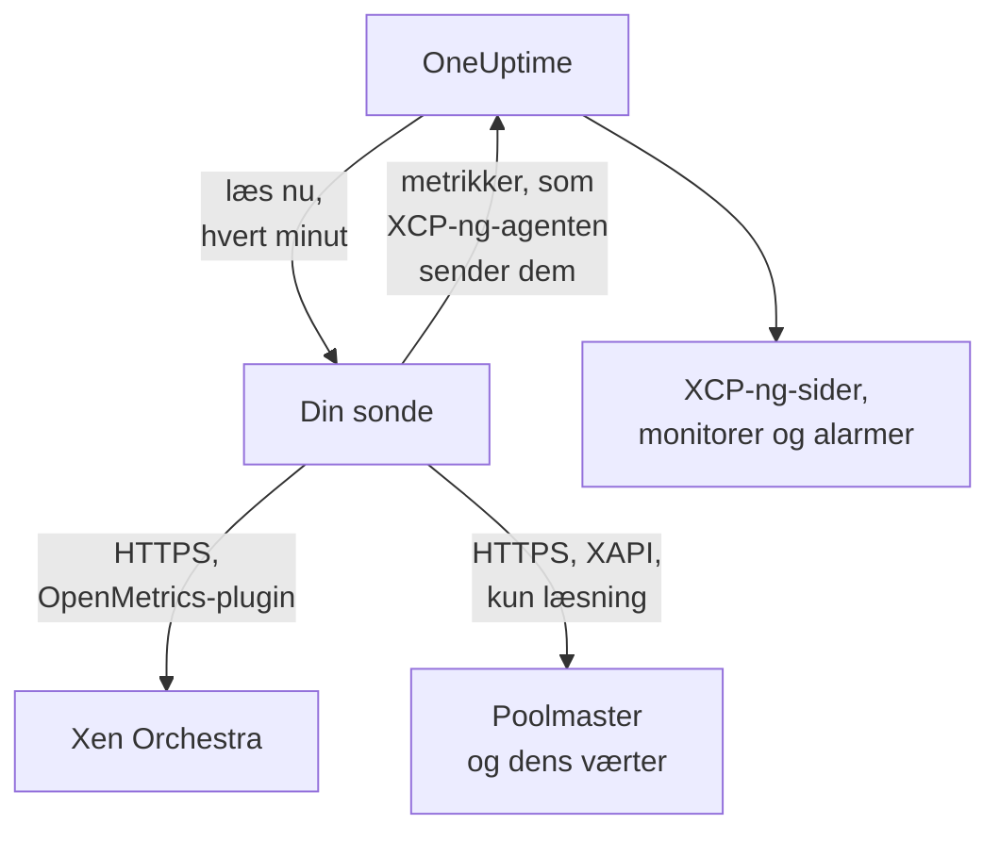

# XCP-ng uden agent

Overvåg XCP-ng-pools uden at installere noget: En OneUptime-sonde læser dem, enten via den Xen Orchestra, der administrerer dem, eller, for en pool uden Xen Orchestra, direkte fra XAPI på poolens master. Hver pool får de samme sider, [XCP-ng-monitorer](/docs/monitor/xcp-ng-monitor) og skabeloner som en pool, [XCP-ng-agenten](/docs/telemetry/xcp-ng) sender. Der er ingen agent at installere, opgradere eller holde kørende.

:::cards
- [Før du begynder](#før-du-begynder): En sonde, der når Xen Orchestra eller poolen, og skrivebeskyttet adgang.
- [Forbind Xen Orchestra](#forbind-xen-orchestra): Hver pool, den administrerer, via én forbindelse.
- [Forbind en pool uden Xen Orchestra](#forbind-en-pool-uden-xen-orchestra): Én pool, læst fra dens master.
- [Fejlfinding](#fejlfinding): Hvad hver besked betyder, og hvad der løser den.
:::

## Sådan virker det

Hvert minut læser sonden hver forbindelse og sender det, den læste, til OneUptime:

- **Xen Orchestra**: Sonden læser Xen Orchestras OpenMetrics-plugin med pluginens hemmelighed, præcis som XCP-ng-agenten gør, så hver pool, Xen Orchestra administrerer, kommer med de samme serier.
- **En pools XAPI**: Sonden logger ind på poolmasteren og foretager de læsninger, Xen Orchestras plugin selv foretager: poolens poster og metrikkerne for hver kørende vært, læst fra den vært. Den gør dem til de samme serier, som pluginet leverer, så poolen læses præcis, som den ville blive via Xen Orchestra. Den lægger også poolens XAPI-beskeder, såsom en VM, der gik ned, eller en vært, som HA mistede, i poolens feed.

Hver pool registrerer sig ud fra sin UUID ved sin første læsning, ligesom agentens pools, og vises under **XCP-ng → Alle pools**.

## Hvilken måde at forbinde på

| | Xen Orchestra, fra en sonde | En pools XAPI, fra en sonde | XCP-ng-agenten |
|---|---|---|---|
| Hvad du kører | En sonde, du allerede kører, eller en ny | En sonde, du allerede kører, eller en ny | Agenten, på sin egen maskine |
| Hvad den læser | Hver pool, Xen Orchestra administrerer | Én pool | Hver pool, Xen Orchestra administrerer |
| Hvad den skal bruge | OpenMetrics-pluginens hemmelighed og eventuelt et skrivebeskyttet API-token | En konto til poolen: root eller en Active Directory-bruger med rollen read-only | OpenMetrics-pluginens hemmelighed |
| Hvor hemmelighederne opbevares | Krypteret i OneUptime, kun sendt til sonden | Krypteret i OneUptime, kun sendt til sonden | I agentens fil `.env` |
| XAPI-beskeder i poolens feed | Ikke med | Med | Ikke med |

Alle tre sender de samme serier. En pool læses af én af dem ad gangen, så dens historik forbliver én linje, uanset hvem der læser den.

## Før du begynder

- **En sonde, der når adressen på TCP 443.** Det er som regel en [brugerdefineret sonde](/docs/probe/custom-probe) i samme netværk. På OneUptime Cloud modtager de delte sonder aldrig XCP-ng-hemmeligheder, så tilføj din egen sonde. På en selvhostet instans kan instansens egne sonder også læse.
- **For Xen Orchestra:** Xen Orchestra 6.9 eller nyere med dens OpenMetrics-plugin slået til: Følg [Slå OpenMetrics-pluginet til](/docs/telemetry/xcp-ng#slå-openmetrics-pluginet-til), og kopiér dens hemmelighed. Eventuelt et API-token til en Xen Orchestra-bruger med den indbyggede rolle **Read only**: OneUptime kontrollerer, at det kun læser, og advarer dig, før det udløber.
- **For en pool uden Xen Orchestra:** XCP-ng 8.2 eller nyere og adressen på dens master. XAPI's roller gælder kun Active Directory-brugere, så dens ene lokale konto, `root`, kan ændre alt i poolen. For skrivebeskyttet adgang skal du føje poolen til Active Directory og give en bruger rollen `read-only`.

> [!IMPORTANT]
> Forbind en pool via Xen Orchestra eller via dens XAPI, ikke begge: Den anden forbindelse, der læser en pool, overlader den til den første.

## Forbind Xen Orchestra

:::steps
### Åbn forbindelser
Åbn **XCP-ng → Forbindelser** i OneUptime, og klik på **Forbind XCP-ng**.

### Vælg Xen Orchestra
Under **Hvad der skal læses** vælger du **Xen Orchestra**. Indtast **Xen Orchestra-adresse**, den, du åbner den på i en browser, f.eks. `https://xo.example.com`, og vælg den sonde, der når den.

### Indtast pluginens hemmelighed
Indsæt **OpenMetrics-hemmelighed**. Tilføj et **API-token** til den skrivebeskyttede bruger, hvis du har et.

### Test forbindelsen, og stol på certifikatet
Klik på **Test forbindelse**. Xen Orchestra underskriver sit eget certifikat, så testen viser det: Kontrollér dets fingeraftryk, og klik derefter på **Stol på dette certifikat**. Resultatet viser de pools, Xen Orchestra leverer, med deres værter, VM'er og lagerdepoter.

### Navngiv den, og forbind
Navnet er som standard Xen Orchestras værtsnavn, og hver pool, den læser, viser det. Klik på **Forbind XCP-ng**, så åbnes forbindelsens side.
:::

## Forbind en pool uden Xen Orchestra

:::steps
### Start fra forbindelserne
Åbn **XCP-ng → Forbindelser** i OneUptime, og klik på **Forbind XCP-ng**.

### Vælg poolen
Under **Hvad der skal læses** vælger du **En pool uden Xen Orchestra**. Indtast **Poolmasterens adresse**, f.eks. `https://10.0.0.10`, og vælg den sonde, der når den.

### Indtast kontoen
Indtast **Brugernavn** og **Adgangskode**: `root` eller en Active Directory-bruger med rollen read-only, skrevet med sit domæne, f.eks. `EXAMPLE\oneuptime`.

### Test forbindelsen, og stol på masterens certifikat
Klik på **Test forbindelse**. Hver XCP-ng-vært underskriver sit eget certifikat, så testen viser masterens: Kontrollér dets fingeraftryk, og klik derefter på **Stol på dette certifikat**. Resultatet siger, hvilken XCP-ng masteren kører, og hvad kontoen kan læse, og advarer dig, når kontoen kan ændre poolen.

### Navngiv poolen, og forbind
Klik på **Forbind XCP-ng**, så åbnes forbindelsens side.
:::

Forbindelsens side viser, hvordan dens læsning står. Den viser **Kontrollerer** indtil den første læsning, som begynder inden for et minut, derefter **Indsamler**, og de pools, den læser, vises under **Pools, den læser**.

Kommer ingen sonde efter forbindelsen i 20 minutter, fordi den er offline eller for gammel, viser siden **Indsamler ikke** og siger det. Når ingen sonde må læse forbindelsen, viser den straks **Indsamler ikke** og siger, hvad der skal ændres: en hemmelighed, et brugernavn eller en adgangskode mangler, ingen sonde er sat til at læse den, dens sonde må ikke læse den (en delt sonde på OneUptime Cloud eller et andet projekts), eller dens sonde er afbrudt.

## Pools, agenten allerede sender

En pool, som XCP-ng-agenten registrerede, overtages af den første forbindelse, der læser den: dens historik fortsætter som én linje, og poolens feed siger, at agenten kan stoppes.

> [!WARNING]
> Stop XCP-ng-agenten, så snart en sonde læser dens pools. Så længe begge kører, kommer hver metrik to gange.

For at skifte tilbage åbner du poolens side **Indstillinger**. Dens kort **Dataindsamling** tilbyder **Brug XCP-ng-agenten** for en pool, en sonde læser, og **Indsaml med en sonde** for en pool, agenten sender. En pool, der er skiftet tilbage til agenten, forbliver hos den, uanset hvad forbindelsen læser.

## Certifikater

Sonden springer aldrig certifikatkontrollen over. Hver forbindelse gennemfører et fuldt TLS-handshake, og derefter:

- uden et betroet certifikat skal certifikatet komme fra en udsteder, som sondens maskine har tillid til, for den indtastede adresse;
- med et betroet certifikat skal adressen vise præcis det certifikat, genkendt på sit SHA-256-fingeraftryk, uanset hvilket navn certifikatet bærer. Xen Orchestras eget certifikat nævner ingen adresse og betros på denne måde.

For at kontrollere et fingeraftryk kører du `openssl s_client -connect xo.example.com:443 </dev/null | openssl x509 -noout -fingerprint -sha256` fra sondens maskine og sammenligner det med selve certifikatet: på en poolmaster `openssl x509 -noout -fingerprint -sha256 -in /etc/xensource/xapi-ssl.pem`.

For en pool stoler du på masterens certifikat. Poolen viser selv det certifikat, hver af dens værter leverer, og sonden læser hver anden vært fastlåst til det. Når en anden vært bliver master, følger sonden kun med til en vært, poolen stod inde for ved sin seneste læsning. Når et certifikat ændres, stopper læsningen med **Certifikatet er ændret**, og det nye certifikat vises: Intet sendes, før du stoler på det, på forbindelsens side.

## De gemte hemmeligheder

Hemmeligheden, tokenet og adgangskoden er krypteret og kun skrivbare: Ingen kan læse dem igen, og API'et returnerer dem aldrig. De sendes kun til den sonde, der læser forbindelsen, og som holder dem i hukommelsen.

En gemt hemmelighed sendes kun til den adresse, via den sonde og til det certifikat, den blev indtastet til. Ændrer du adressen, sonden eller det betroede certifikat under **Rediger forbindelse**, skal den indtastes igen, så ingen, der kan redigere forbindelsen, kan sende den et andet sted hen, og et gemt API-token, der ikke indtastes igen, glemmes. Stoler du på det certifikat, sonden fandt på den gemte adresse, beholdes de. **Fjern API-tokenet** sletter tokenet fra OneUptime: Tilbagekald det også i Xen Orchestra.

## API-tokenet

Et API-token er valgfrit: Metrikkerne kommer via pluginens hemmelighed. Med et token kontrollerer hver læsning det højst én gang i timen:

- **Det læser kun.** Et token, hvis bruger er administrator, eller hvis rolle må ændre noget, består ikke testen og vises som et problem på forbindelsens side. OneUptime gemmer kun skrivebeskyttede tokens.
- **Det læser det, OneUptime har brug for.** Xen Orchestra svarer på en liste, en bruger ikke må læse, med en tom liste, så tokenet skal kunne læse alarmer, beskeder og logfiler for sikkerhedskopier. Den indbyggede rolle **Read only** læser alle tre.
- **Hvornår det udløber.** Xen Orchestra glemmer et token i samme øjeblik, det udløber. To uger før siger forbindelsens side og feedet for hver pool, den læser, det. Opret et nyt token til den samme bruger, og indtast det under **Rediger forbindelse**.

## Reference

| Indstilling | Standard | Bemærkninger |
|---|---|---|
| Læs hvert | 1 minut | Fra 1 til 60 minutter. Hvert minut svarer til XCP-ng-agenten; læs en stor Xen Orchestra sjældnere for at skåne den. |
| Læsninger ad gangen | 4 pr. sonde | En læsning, der er langsommere end sit interval, springes over og stables aldrig. |
| Største læsning | Omkring 48 MiB | Større Xen Orchestra-instanser kræver XCP-ng-agenten. |
| XAPI-beskeder | 200 pr. læsning | Fra det øjeblik, poolen er forbundet, hver leveret én gang, den ældste først. |
| Forbindelsestest | 90 sekunder til start | En test, som ingen sonde tager i tide, eller som kører længere end 150 sekunder, besvares som mislykket. |

## Fejlfinding

:::details Certifikatet er ikke betroet
Xen Orchestra og XCP-ng-værter underskriver som standard deres egne certifikater. Sammenlign det viste fingeraftryk med certifikatet, og klik derefter på **Stol på dette certifikat**.
:::

:::details Certifikatet er ændret
Intet sendes, før du stoler på det nye certifikat. Har du fornyet det, så kontrollér det nye fingeraftryk, stol på det, og indtast hemmelighederne igen under **Rediger forbindelse**.
:::

:::details Xen Orchestra afviste hemmeligheden
Kopiér hemmeligheden igen fra **Settings → Plugins → openmetrics** i Xen Orchestra, og indtast den under **Rediger forbindelse**.
:::

:::details OpenMetrics-plugin svarer ikke
Indlæs **openmetrics** under **Settings → Plugins** i Xen Orchestra, og slå **Auto-load** til, så det kommer igen efter en genstart.
:::

:::details Denne Xen Orchestra har intet OpenMetrics-plugin
Pluginet kræver Xen Orchestra 6.9 eller nyere og på en Xen Orchestra Appliance en Premium-licens. Uden den skal du i stedet forbinde hver pool via dens XAPI.
:::

:::details Ingen pool er forbundet
Xen Orchestra rapporterer ingen forbundet pool. Tilføj eller genforbind dine pools i Xen Orchestra, og test igen.
:::

:::details API-tokenet kan ændre Xen Orchestra
OneUptime gemmer kun skrivebeskyttede tokens. Opret et til en bruger, der har en kopi af den indbyggede rolle **Read only** og ingen anden rolle.
:::

:::details API-tokenet kan ikke læse alarmer, beskeder eller sikkerhedskopier
Giv tokenets bruger en kopi af Xen Orchestras indbyggede rolle **Read only**, som læser alle tre.
:::

:::details API-tokenet er udløbet
Opret et nyt token til den skrivebeskyttede bruger i Xen Orchestra, og indtast det under **Rediger forbindelse**. Metrikkerne bliver ved med at komme imens.
:::

:::details XAPI afviste login
Kontrollér brugernavn og adgangskode. En Active Directory-bruger skrives med sit domæne, f.eks. `EXAMPLE\oneuptime`.
:::

:::details Denne vært er ikke poolmasteren
Et medlem af poolen svarer med sin masters adresse, som beskeden nævner. Indtast den adresse, og test igen.
:::

:::details Kontoen kan ikke læse poolen
Giv Active Directory-brugeren rollen read-only på poolen, eller brug en konto, der har den.
:::

:::details Sonden får intet svar
Sondens netværk kan ikke nå adressen på TCP 443. Tillad det i firewallen, eller vælg en sonde i samme netværk.
:::

:::details Sonden tog ikke imod dette
Sonden er offline eller kører en OneUptime-version, der er ældre end læsning af XCP-ng. Kontrollér i tabellen **Brugerdefinerede sonder**, at den er forbundet, og opdater den.
:::

:::details Denne forbindelse er for stor til at blive læst fra en sonde
Dens metrikker er større, end én upload fra en sonde må være. Brug [XCP-ng-agenten](/docs/telemetry/xcp-ng) til den.
:::

## Næste trin

:::cards
- [XCP-ng-monitor](/docs/monitor/xcp-ng-monitor): Alarmér på pools, værter, VM'er og lagerdepoter.
- [Brugerdefineret sonde](/docs/probe/custom-probe): Kør en sonde i poolernes netværk.
- [XCP-ng-agent](/docs/telemetry/xcp-ng): Læs Xen Orchestra med agenten i stedet.
:::
