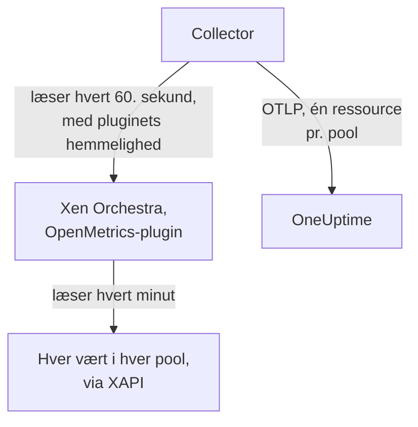

# XCP-ng-agent

OneUptimes XCP-ng-agent overvåger de XCP-ng-pools, som en Xen Orchestra administrerer: deres værter, VM'er, lagerdepoter og virtuelle diske. Den er en standard OpenTelemetry Collector, der læser Xen Orchestras eget OpenMetrics-plugin med pluginets hemmelighed og sender det, den læser, til OneUptime, hvor hver pool vises med sin inventar. Ingen adgangskode til en pool eller til Xen Orchestra når nogensinde frem til agenten. [XCP-ng-monitorer](/docs/monitor/xcp-ng-monitor) advarer på det, der kommer ind. Vil du læse de samme pools uden at installere noget, fra en OneUptime-sonde, så se [XCP-ng uden agent](/docs/telemetry/xcp-ng-agentless).

:::cards
- [Installer agenten](#installer-agenten): Slå pluginet til, og brug derefter installationsscriptet eller Docker Compose.
- [Xen Orchestras certifikat](#xen-orchestras-certifikat): Hvordan agenten stoler på Xen Orchestra, aldrig ved at springe kontrollen over.
- [Hvad agenten indsamler](#hvad-agenten-indsamler): Hver serie fra pluginet, og de tællere, der i virkeligheden er rater.
- [Fejlfinding](#fejlfinding): Et diagnosescript og de sædvanlige problemer.
:::

## Hvad du får

- **Hver pool for sig.** Hver pool, som Xen Orchestra administrerer, bliver en XCP-ng-pool i OneUptime, genkendt på sit XAPI-UUID og navngivet, som Xen Orchestra navngiver den. To pools bag én Xen Orchestra er to pools, og det er sikkert at omdøbe en pool i OneUptime: telemetri knyttes til den via dens UUID.
- **Dens inventar.** Poolens værter, VM'er, lagerdepoter og virtuelle diske med deres tilstand og deres metrikker. Kontroldomæner (dom0) rapporterer sig som VM'er, og poolens sider skjuler dem, medmindre du beder om dem.
- **Én agent pr. Xen Orchestra.** Pluginet leverer hver pool, som dets Xen Orchestra er forbundet til, så én agent læser dem alle, og en pool, der forbindes senere, vises ved næste læsning.

## Sådan virker det

Agenten er én container, som du kører med Docker Compose på én maskine: en standard OpenTelemetry Collector uden noget eget OneUptime-image. Hvert 60. sekund beder den Xen Orchestra om `/openmetrics/metrics` med pluginets hemmelighed som Bearer-token, over Xen Orchestras egen adresse og eget certifikat. Pluginet læser hver værts metrikker via XAPI med en opløsning på 60 sekunder. Collectoren beholder poolernes serier, grupperer dem pr. pool og sender dem til OneUptime over OTLP.



Hver pool registrerer sig selv med sine første data under det UUID, som agenten sætter på dens serier som `xcp_ng.pool.id`, og det navn, Xen Orchestra giver den, `xcp_ng.pool.name`. En pool uden navn i Xen Orchestra hedder "Pool" efterfulgt af begyndelsen af dens UUID, indtil du omdøber den.

## Før du begynder

- Xen Orchestra 6.9 eller senere, forbundet til de pools, du vil overvåge, med dens OpenMetrics-plugin. På en Xen Orchestra Appliance (XOA) kræver pluginet en Premium-licens; en Xen Orchestra bygget fra kildekoden indeholder det.
- Docker Engine 20.10 eller senere med Docker Compose v2-pluginet, `curl` og `openssl` på en maskine, der når Xen Orchestra over HTTPS.
- Et certifikat på Xen Orchestra, der nævner den adresse, agenten forbinder til. Det selvsignerede certifikat, Xen Orchestra laver til sig selv, nævner ingen, så ingen nuværende TLS-klient kan kontrollere det, og en Xen Orchestra bygget fra kildekoden serverer almindelig HTTP, indtil du giver den et: se [Xen Orchestras certifikat](#xen-orchestras-certifikat).
- En indtagelsesnøgle. Opret en under **Projektindstillinger → Telemetri og APM → Indtagelsesnøgler**, og kopiér dens værdi.
- Udgående HTTPS fra den maskine til din OneUptime-URL.

### Understøttede versioner

| | Understøttet | Hvorfor |
| --- | --- | --- |
| Xen Orchestra | 6.9 eller senere, med OpenMetrics-pluginet `xo-server-openmetrics` 1.9 | Pluginet beholder sin hemmelighed, når Xen Orchestra genstarter, indeholder rettelserne af hukommelseslækagerne ved læsning og leverer hver serie, som poolens sider læser: værters og VM'ers tilstand, lagerdepoter og virtuelle diske. Et ældre plugin kunne lave en ny hemmelighed ved en genstart og låse agenten ude, indtil nogen kopierede den igen. |
| XCP-ng | 8.3 LTS | Understøttet af Vates til den 30. november 2028. XCP-ng 8.2 nåede slutningen af sin levetid den 16. september 2025. |
| XenServer | Ikke afprøvet endnu | Xen Orchestra rapporterer en XenServer-pool, den administrerer, med de samme serier, så det burde virke, men ingen har afprøvet en med OneUptime endnu. |

### Hvor agenten skal køre

Agenten taler med Xen Orchestra over HTTPS, så den kan køre på enhver maskine med Docker og en rute dertil: selve Xen Orchestras maskine, en overvågningsvært eller en lille administrations-VM. Vælg helst en maskine, hvis VM ikke kører på de pools, den overvåger: når en pool går ned, skal din overvågning ikke gå ned med den. Én agent læser én Xen Orchestra; se [Læsning af flere Xen Orchestras](#læsning-af-flere-xen-orchestras) for flere.

## Slå OpenMetrics-pluginet til

Agenten læser hver pool via Xen Orchestras OpenMetrics-plugin med pluginets hemmelighed.

:::steps
### Slå pluginet til

Åbn *Settings → Plugins* i Xen Orchestra, find **openmetrics**, og slå det til. Første gang det starter, laver det en hemmelighed, og Xen Orchestra beholder den på tværs af genstarter.

### Kopiér dets hemmelighed

Åbn pluginets indstillinger, og kopiér dets **Prometheus secret**: du giver den til agenten i næste trin. Du kan også skrive din egen hemmelighed der og gemme den. Hold den privat: den, der har den, kan læse hver pools metrikker.

### Kontrollér, at det svarer

Pluginet svarer på Xen Orchestras egen adresse og med dens eget certifikat, på `/openmetrics/metrics`, og kun på en forespørgsel, der sender dets hemmelighed med. Dets sundhedstjek kræver ingen, så netop denne forespørgsel må springe certifikatkontrollen over med `-k`; agenten gør det aldrig:

```bash
curl -k https://xo.example.com/openmetrics/health
```

Det svarer `{"status":"ok"}`, så længe pluginet kører. En `404` betyder, at pluginet ikke er slået til.
:::

## Installer agenten

:::steps
### Installer og start agenten

Hver OneUptime leverer agentens installationsscript og filer fra sin egen udgivelse: Kommandoerne nedenfor henter dem fra `https://oneuptime.com`, så på en selvhostet OneUptime skal du erstatte den adresse med din URL. Installationsscriptet gemmes først som `install.sh`, så du kan læse det, før du kører det.

:::tabs
@tab install.sh
Hent installationsscriptet, og kør det på den maskine, der skal være vært for agenten:

```bash
curl -fsSL https://oneuptime.com/install/xcp-ng-agent -o install.sh
bash install.sh
```

Scriptet beder om din OneUptime-URL, indtagelsesnøglen, Xen Orchestras adresse, som du åbner den i en browser (såsom `https://xo.example.com` eller `https://10.0.0.5:8443`), pluginets hemmelighed (vises ikke, mens du skriver) og hvad denne Xen Orchestra skal hedde i OneUptime. Derefter læser det Xen Orchestras certifikat: et certifikat, som denne maskine allerede stoler på, kontrolleres mod dens CA-bundt; ethvert andet vises med sit SHA-256-fingeraftryk, og du svarer **y** for at stole på det certifikat og intet andet, når du har sammenlignet fingeraftrykket med det på Xen Orchestras maskine. Det slår aldrig kontrollen fra. Til sidst beder det pluginet om dets metrikker med hemmeligheden og nævner de pools, Xen Orchestra rapporterer, før det installerer noget. Det installerer i `/opt/oneuptime-xcp-ng-agent`, skriver med rettighederne `0600` en `.env`-fil og `xo-ca.pem`, de certifikater, agenten stoler på for Xen Orchestra, og starter agenten med Docker Compose. Hvis du kører scriptet igen, genbruger det alt i den `.env` i stedet for at spørge igen; sådan [opgraderer du agenten](#opgradering-af-agenten).
@tab Docker Compose
Hent `docker-compose.yml` og `otel-collector-config.yaml` fra din OneUptime ind i en ny mappe:

```bash
mkdir oneuptime-xcp-ng-agent && cd oneuptime-xcp-ng-agent
curl -fsSLO https://oneuptime.com/install/xcp-ng-agent/docker-compose.yml
curl -fsSLO https://oneuptime.com/install/xcp-ng-agent/otel-collector-config.yaml
```

Opret en `.env`-fil ved siden af dem. Den indeholder pluginets hemmelighed, så hold den privat med `chmod 600 .env`:

```bash title=".env"
ONEUPTIME_URL=YOUR_ONEUPTIME_URL
ONEUPTIME_TELEMETRY_INGESTION_KEY=YOUR_TELEMETRY_INGESTION_TOKEN
XO_SCHEME=https
XO_ADDRESS=xo.example.com
XO_OPENMETRICS_SECRET='your-plugin-secret'
XO_NAME='Xen Orchestra'
XO_TLS_SERVER_NAME=
```

`XO_ADDRESS` er Xen Orchestras `host` eller `host:port` uden `https://`. Sæt pluginets hemmelighed i enkelte anførselstegn, og skriv hvert `$` i den som `$$`: collectoren læser værdien én gang til og ville tage et `$` for begyndelsen af en variabel. En hemmelighed med et `'` i kan ikke stå i enkelte anførselstegn: lad installationsscriptet skrive den, eller vælg en anden hemmelighed i Xen Orchestra.

Gem derefter Xen Orchestras certifikat som `xo-ca.pem` ved siden af `docker-compose.yml`: agenten kontrollerer Xen Orchestra mod denne fil og intet andet. For at stole på Xen Orchestras eget certifikat skal du læse det og sammenligne dets fingeraftryk med det på Xen Orchestras maskine, før du bruger det:

```bash
openssl s_client -connect xo.example.com:443 -servername xo.example.com </dev/null 2>/dev/null \
  | openssl x509 -out xo-ca.pem
openssl x509 -in xo-ca.pem -noout -fingerprint -sha256
```

Har din egen CA udstedt certifikatet, så kopiér i stedet den CA's certifikat til `xo-ca.pem`; har en offentlig CA udstedt det, så kopiér denne maskines CA-bundt (`cp /etc/ssl/certs/ca-certificates.crt xo-ca.pem`). Start agenten:

```bash
docker compose up -d
```
:::

### Kontrollér, at agenten kører

```bash
docker compose ps
docker logs -f oneuptime-xcp-ng-agent
```

`docker compose ps` viser collectoren, `oneuptime-xcp-ng-agent`. Dens logs bør vise denne linje, når den er startet:

```text
Everything is ready. Begin running and processing data.
```

### Find poolerne i OneUptime

Åbn **Produkter → Infrastruktur → XCP-ng → Alle pools**. Hver pool, Xen Orchestra rapporterer, vises cirka et minut efter den første læsning under det navn, Xen Orchestra giver den, med sine værter, VM'er og sit lager. Dens side **Topologi** tegner dem som ét kort: se [Topologi](/docs/telemetry/topology#åbn-en-ressources-eget-kort).
:::

## Xen Orchestras certifikat

Agenten kontrollerer Xen Orchestras certifikat ved hver læsning, mod `xo-ca.pem` og intet andet, og springer aldrig kontrollen over: pluginets hemmelighed følger med i hver forespørgsel. `xo-ca.pem` indeholder én af tre ting:

- **Xen Orchestras eget certifikat**, fastlåst via sit SHA-256-fingeraftryk (`XO_TLS_FINGERPRINT`): agenten stoler på det certifikat og intet andet.
- **Den CA, der udstedte det** (`XO_CA_FILE`), for et certifikat fra din egen CA.
- **Denne maskines CA-bundt**, for et certifikat, som denne maskine allerede stoler på, såsom et fra en offentlig CA.

Under alle omstændigheder skal certifikatet nævne den adresse, agenten forbinder til. Agenten kontrollerer de navne, et certifikat er udstedt til, dets alternative emnenavne (subject alternative names), som enhver nuværende TLS-klient gør, og aldrig selve emnet. Det selvsignerede certifikat, Xen Orchestra laver til sig selv, nævner ingen, så agenten kan ikke stole på det, fastlåst eller ej, og fejler med `x509: certificate is not valid for any names`; installationsscriptet stopper ved et sådant certifikat og siger hvorfor.

### Giv Xen Orchestra et certifikat, der nævner dens adresse

Brug et certifikat fra din egen CA eller fra en offentlig, eller lav et selvsigneret på Xen Orchestras maskine, der nævner Xen Orchestras adresse, med dens navn og dens adresse i sine alternative emnenavne:

```bash
sudo mkdir -p /etc/ssl/xo
sudo openssl req -x509 -newkey rsa:2048 -nodes -days 825 \
  -subj "/CN=xo.example.com" \
  -addext "subjectAltName=DNS:xo.example.com,IP:10.0.0.5" \
  -keyout /etc/ssl/xo/key.pem -out /etc/ssl/xo/cert.pem
```

Peg xo-servers HTTPS-listener på de to filer, som den bruger, xo-server kører som (root som standard), skal kunne læse, i en konfigurationsfil for sig: `/etc/xo-server/config.httpscert.toml` på en XOA eller ved siden af xo-servers `config.toml` for en Xen Orchestra bygget fra kildekoden. Xen Orchestras listenere er nummererede, og den anden, `http.listen.1`, er dens HTTPS-listener:

```toml
[http.listen.1]
port = 443
cert = '/etc/ssl/xo/cert.pem'
key = '/etc/ssl/xo/key.pem'
```

Genstart derefter xo-server med `systemctl restart xo-server`, og installer agenten, eller kør installationsscriptet igen: det læser det nye certifikat og viser dets fingeraftryk til kontrol. Eller lad Xen Orchestra selv bestille et Let's Encrypt-certifikat, som en XOA kan (se Xen Orchestras dokumentation): det er offentligt betroet, så agenten behøver ingen indstilling. Med et certifikat, der nævner Xen Orchestra ved et andet navn end adressen i `XO_ADDRESS`, skal du sætte `XO_TLS_SERVER_NAME` til det navn; installationsscriptet udfylder det fra certifikatet, når det kan.

Når et fastlåst certifikat fornyes, holder agenten op med at læse Xen Orchestra, indtil den stoler på det nye. Kør installationsscriptet igen: det viser det nye fingeraftryk og stopper uden at ændre noget. Kontrollér det fingeraftryk på Xen Orchestras maskine, og kør derefter scriptet én gang til med det: `XO_TLS_FINGERPRINT=<new fingerprint> bash install.sh`. Installeret med Docker Compose: skriv `xo-ca.pem` igen, og kør `docker compose up -d --force-recreate`.

## Miljøvariabler

Installationsscriptet skriver dem til `/opt/oneuptime-xcp-ng-agent/.env`; en Docker Compose-installation læser dem fra `.env` ved siden af `docker-compose.yml`. Når du har ændret en variabel, så kør `docker compose up -d` i den mappe.

| Variabel | Påkrævet | Beskrivelse |
| --- | --- | --- |
| `ONEUPTIME_URL` | Ja | Din OneUptime-URL, såsom `https://oneuptime.com` eller din selvhostede instans. Brug `http://` og dens port, hvis instansen kun bruger HTTP. |
| `ONEUPTIME_TELEMETRY_INGESTION_KEY` | Ja | Indtagelsesnøglen fra **Projektindstillinger → Telemetri og APM → Indtagelsesnøgler**. |
| `XO_URL` | Installationsscript | Xen Orchestras adresse, som du åbner den i en browser, såsom `https://xo.example.com` eller `https://10.0.0.5:8443`. Installationsscriptet udleder `XO_SCHEME` og `XO_ADDRESS` af den. |
| `XO_SCHEME` | Nej | `https`, standarden. `http` kun i et laboratorium: hemmeligheden går så ukrypteret over netværket. |
| `XO_ADDRESS` | Ja | Xen Orchestras `host` eller `host:port` uden skema. |
| `XO_OPENMETRICS_SECRET` | Ja | OpenMetrics-pluginets hemmelighed, sendt som Bearer-token. Hvert `$` i den skrives som `$$`. |
| `XO_NAME` | Nej | Hvad denne Xen Orchestra hedder i OneUptime, sat som `xen_orchestra.name` på hver pool, den læser, og vist i hver pools **Indstillinger**. Som standard Xen Orchestras adresse. |
| `XO_TLS_FINGERPRINT` | Installationsscript | SHA-256-fingeraftrykket af Xen Orchestras eget certifikat, som `openssl x509 -fingerprint -sha256` viser det, koloner valgfri, når agenten stoler på det certifikat og intet andet. Installationsscriptet afviser et certifikat, der ikke passer til det. |
| `XO_CA_FILE` | Installationsscript | Et CA-bundt, der udstedte Xen Orchestras certifikat; installationsscriptet kontrollerer certifikatet mod det og kopierer det til `xo-ca.pem`. |
| `XO_TLS_SERVER_NAME` | Nej | Det navn, Xen Orchestras certifikat kontrolleres mod, når `XO_ADDRESS` er en adresse, certifikatet ikke nævner. Tom: værten i `XO_ADDRESS`. |
| `ONEUPTIME_AI_XO_READ_TOKEN` | Nej | Et token fra en Xen Orchestra-bruger med en kopi af den indbyggede rolle **Read only** og intet andet: [AI-agenten](#ai-agent) kører, når det er sat, og læser med det. |
| `ONEUPTIME_AI_XO_WRITE_TOKEN` | Nej | Kun til rettelser: et token fra en anden bruger, hvis rolle tillader dem. Uden det ændrer AI-agenten intet. |
| `XCP_NG_POOL_ID` | Nej | XAPI-UUID'et for den pool, AI-agenten betjener. Tom: den ene pool, som dens læsetoken kan se. |
| `ONEUPTIME_AI_AGENT_RESOURCE_NAME` | Nej | Tilsidesætter `XCP_NG_POOL_ID` som den pool, AI-agenten registrerer sig som. |
| `ONEUPTIME_AI_INVESTIGATION` | Nej | `true` eller `false`: om OneUptime AI må køre AI-agentens skrivebeskyttede kommandoer, mens den undersøger. Tom: til. |
| `ONEUPTIME_AI_FIXES` | Nej | `off`, `ask-for-approval`, `automatic` eller `bypass-approval`: hvordan OneUptime AI må anvende en rettelse. Tom: `ask-for-approval`, når skrivning er tilladt, ellers `off`. |
| `ONEUPTIME_AI_ALLOW_WRITES` | Nej | `true` lader AI-agenten anvende rettelser med tokenet til ændringer. Alt andet holder den skrivebeskyttet. |
| `ONEUPTIME_AI_WRITE_TARGETS` | Nej | De `vm/<uuid>`, `host/<uuid>`, `pbd/<uuid>` eller `schedule/<uuid>`, en rettelse må røre, kommasepareret, `*` for en vilkårlig række tegn. Tom: alle. |
| `ONEUPTIME_AI_PROTECTED_TARGETS` | Nej | Det samme for det, OneUptime AI aldrig må ændre, uanset hvem der godkender det: den VM, AI-agenten kører i, og Xen Orchestras egen. |
| `LOG_LEVEL` | Nej | AI-agentens logniveau: `debug`, `info` (standarden), `warn` eller `error`. |
| `COMPOSE_PROFILES` | Nej | `xcp-ng-ai-agent` starter AI-agenten. Installationsscriptet skriver det, når læsetokenet er sat, og fjerner det, når det ikke er. |

## Hvad agenten indsamler

Hvert minut læser agenten pluginet, som via XAPI læser hver værts round-robin-databaser med en opløsning på 60 sekunder. Den beholder serierne `xcp_*` og flytter hver series pool over på den ressource, den sender dem på, som `xcp_ng.pool.id` (poolens UUID, som aldrig ændres) og `xcp_ng.pool.name`:

| Kategori | Serier |
| --- | --- |
| Pool | `xcp_pool_connected`, til stede, så længe Xen Orchestra er forbundet til poolen |
| Værter | `xcp_host_status` (dens strømtilstand, og om den er aktiveret), `xcp_host_uptime_seconds`, `xcp_host_cpu_average`, `xcp_host_cpu_core_usage`, `xcp_host_load`, `xcp_host_load_average`, `xcp_host_memory_*`, `xcp_host_running_vcpus`, `xcp_host_network_*` pr. fysisk interface, `xcp_host_disk_*` pr. lagerdepot, `xcp_host_power_consumption_watts` |
| VM'er | `xcp_vm_status`, `xcp_vm_uptime_seconds`, `xcp_vm_cpu_usage`, `xcp_vm_cpu_core_usage`, `xcp_vm_runstate_*` (CPU-konkurrence), `xcp_vm_memory_*`, `xcp_vm_network_*` pr. interface, `xcp_vm_disk_*` pr. disk, `xcp_vm_power_consumption_watts` |
| Lagerplads | `xcp_sr_physical_size_bytes`, `xcp_sr_physical_usage_bytes`, `xcp_sr_virtual_size_bytes`, `xcp_vdi_virtual_size_bytes`, `xcp_vdi_physical_usage_bytes` |
| XOSTOR | `xcp_xostor_*`, på pools, der kører XOSTOR |

Kontroldomæner rapporterer sig som VM'er med `is_control_domain="true"`. Hver serie fra Xen Orchestra beholder sit navn og sine etiketter, såsom `uuid`, `host_name`, `vm_name`, `sr_name` og `tags`; [XCP-ng-monitoren](/docs/monitor/xcp-ng-monitor#indsamlede-metrikker) nævner dem alle.

### De tællere, der er rater

Xen Orchestra typer otte gennemløbsserier som tællere og kalder dem `_total`, selvom hver indeholder XAPI's rate pr. sekund: `xcp_host_network_receive_bytes_total`, `xcp_host_network_transmit_bytes_total`, `xcp_vm_network_receive_bytes_total`, `xcp_vm_network_transmit_bytes_total`, `xcp_vm_network_receive_errors_total`, `xcp_vm_network_transmit_errors_total`, `xcp_vm_disk_read_bytes_total` og `xcp_vm_disk_write_bytes_total`. Læst som tællere ville hvert diagram over netværks- og diskgennemløb være forkert: en rate, der falder, læses som en nulstilling af tælleren. Agentens processor `transform/xcp-ng-rates` gør dem til gauges med uændrede navne og værdier, så OneUptime gemmer dem som de rater, de er, i bytes eller fejl pr. sekund. OneUptime konverterer også enhver serie, der stadig ankommer som tæller, fra en collector, du selv har konfigureret.

### Hvad OneUptime tilføjer

OneUptime udleder fire 0/1-serier for hver pool, mens dens data ankommer, og advarselsskabelonerne læser dem:

| Serie | 1, så længe |
| --- | --- |
| `xcp_ng.host.running` | Xen Orchestra rapporterer værten som Running; 0, mens den er Halted, eller dens tilstand er Unknown |
| `xcp_ng.host.enabled` | værten er aktiveret; 0 i vedligeholdelsestilstand eller under en evakuering, hvor XAPI ikke starter nogen VM på den |
| `xcp_ng.vm.running` | VM'en er Running; 0, mens den er Halted, Paused eller Suspended |
| `xcp_ng.vm.stopped_after_running` | en VM, der kørte inden for de sidste 24 timer, er Halted eller Paused |

Med en sonde forbundet til Xen Orchestra eller til poolens XAPI afleder OneUptime også disse af det, sonden læser ud over metrikkerne; agenten læser intet af det:

| Serie | Værdi |
| --- | --- |
| `xcp_ng.pool.ha.enabled` | 1, mens poolens HA er slået til, ellers 0 |
| `xcp_ng.pool.ha.can_tolerate_host_failure` | 1, mens HA stadig kan klare et værtsnedbrud, ellers 0: HA's egen plan via XAPI, en vært oppe og aktiveret ud over den, der går ned, via Xen Orchestra |
| `xcp_ng.pool.ha.host_failures_to_tolerate` | hvor mange værtsnedbrud HA er sat til at tåle (kun via XAPI) |
| `xcp_ng.pool.ha.plan_exists_for` | hvor mange værtsnedbrud dens nuværende plan dækker (kun via XAPI) |
| `xcp_ng.vm.backup_overdue` | 1, mens en VM, som et planlagt backupjob omfatter, ikke har haft en vellykket backup inden for sit interval plus en fjerdedel, mindst en time (kun via Xen Orchestra) |
| `xcp_ng.host.missing_patches` | hvor mange patches en vært mangler, tjekket hver sjette time (kun via Xen Orchestra) |

Den sætter også `xcp_ng.scope` (`pool`, `host`, `vm`, `sr`, `vdi` eller `xostor`) og `xcp_ng.id` (det objekts UUID) på hvert punkt, og monitorer og dashboards filtrerer på dem: se [Ressourceidentitet](/docs/monitor/xcp-ng-monitor#ressourceidentitet).

### Hvad agenten ikke beholder

- Xen Orchestras egne processerier (`xo_*`), som ikke hører til nogen pool, og collectorens egne læseserier.
- En værts effekt, som Xen Orchestra læser via IPMI: pluginet sender den måling uden dens pool, så den hører heller ikke til nogen pool. Hver VM's anslåede andel, `xcp_vm_power_consumption_watts`, beholdes.

## Hvad en pools sider viser

Åbn en pool fra **Produkter → Infrastruktur → XCP-ng → Alle pools**. Dens menu indeholder:

| Side | Hvad den viser |
| --- | --- |
| **Oversigt** | Poolens sundhed og det, der kræver opmærksomhed, dens værter, VM'er og lager, dens travleste VM'er og værter og den Xen Orchestra, den læses fra, med agentens version. |
| **Værter**, **VM'er**, **Lagerplads** | Hver vært, VM og hvert lagerdepot, hver med sin egen side og sine diagrammer. **VM'er** skjuler kontroldomæner, medmindre du beder om dem, og et lagerdepots side viser dets virtuelle diske. |
| **Topologi** | Poolen, dens værter, VM'erne på hver vært og de lagerdepoter, de bruger, som ét kort. |
| **Ressourceforbrug** | Diagrammer over poolens værter, VM'er, lager, diske og netværk over tid, én linje pr. vært, VM eller lagerdepot. |
| **Anbefalinger** | De [advarselsskabeloner](/docs/monitor/xcp-ng-monitor#færdige-advarselsskabeloner), der kan slås til, hver én monitor. |
| **Metrikker**, **Protokoller** | Hver af poolens serier i stifinderne, afgrænset til den. Agenten sender kun metrikker, så **Protokoller** viser kun logs, du sender med poolens `xcp_ng.pool.id`. |
| **Hændelser**, **Advarsler**, **Planlagt vedligeholdelse** | Dem, der nævner poolen. |
| **Feed** | Hvad der skete med poolen i OneUptime: hvornår den blev tilføjet, ændret, arkiveret eller gendannet, hvem dens ejere er, og de ejer- og etiketregler, der kørte på den. |
| **Ejere** | Hvem der får besked om den, manuelt eller via ejerregler. |
| **Indstillinger** | Dens navn, den Xen Orchestra, den læses fra, dens navn der og agentens version, samt hvor længe dens telemetri opbevares. |
| **Dokumentation** | Denne opsætning med din URL og nøgle allerede udfyldt. |

Poolens **Oversigt** navngiver dens sundhed, **Sund**, **Forringet** eller **Usund**, ud fra det, der kræver opmærksomhed, og viser det under **Kræver opmærksomhed**, det mest presserende først:

- **Kritisk:** en vært, der er Halted eller i en tilstand, Xen Orchestra ikke kan fastslå (Unknown); et lagerdepot, der er mere end 95 % fuldt, hvor VM'er ikke længere kan skrive.
- **Værd at se på:** en deaktiveret vært, i vedligeholdelsestilstand eller under evakuering; en VM, der er Halted eller Paused og kørte inden for de sidste 24 timer; et lagerdepot, der er mere end 90 % fuldt, hvor advarslen Storage Repository Near Full udløses, eller som via thin provisioning er tildelt ud over sin størrelse.

En suspenderet VM (Suspended) er suspenderet med vilje og tæller aldrig med, ligesom en VM, ingen har set køre i et døgn, eller et kontroldomæne. ISO-biblioteker og flytbare medier indeholder ingen VM-diske, så poolens lagertal udelader dem.

Når Xen Orchestra holder op med at rapportere en pool i 15 minutter, bliver poolen **Afbrudt**, og dens sider beholder det, den sidst rapporterede. En vært, VM, et lagerdepot eller en virtuel disk, der ikke længere optræder i Xen Orchestras rapporter, forlader inventaret 15 minutter senere; at stoppe en VM fjerner den aldrig.

## Mærk poolerne med projektetiketter

En ressourceattribut, der begynder med `oneuptime.label.`, bliver en projektetiket på hver pool, agenten læser: `oneuptime.label.<dimension>=<value>` er etiketten `<dimension>:<value>`. Tilføj attributterne til processoren `resource` i `otel-collector-config.yaml` ved siden af `oneuptime.agent.version`:

```yaml
processors:
  resource:
    attributes:
      # ...existing attributes...
      - key: oneuptime.label.team
        value: platform
        action: upsert
      - key: oneuptime.label.env
        value: production
        action: upsert
```

Collectoren læser kun sin konfiguration ved start: kør `docker compose restart oneuptime-xcp-ng-agent`. Poolerne viser så etiketterne `team:platform` og `env:production`. Etiketter sammenlignes uden hensyn til store og små bogstaver, så en eksisterende etiket `Production` genbruges i stedet for at blive fordoblet, og agenten fjerner aldrig en etiket, som nogen har tilføjet i OneUptime. Når du kører installationsscriptet igen, erstattes en redigeret `otel-collector-config.yaml`, og din gemmes ved siden af som `otel-collector-config.yaml.bak.<timestamp>`.

## Læsning af flere Xen Orchestras

Én agent læser én Xen Orchestra og hver pool, den administrerer. For at læse en anden Xen Orchestra fra den samme maskine skal du installere en anden agent i sin egen mappe med sin egen `.env`, såsom `INSTALL_DIR=/opt/oneuptime-xcp-ng-agent-lab bash install.sh`, og give den sit eget `container_name` i dens `docker-compose.yml` (såsom `oneuptime-xcp-ng-agent-lab`): to containere kan ikke dele et navn. Giv hver sit eget `XO_NAME`, så hver pools **Indstillinger** siger, hvilken Xen Orchestra der læser den, og giv mappen til diagnosescriptet med `-d`.

Lad aldrig to agenter læse den samme pool via to Xen Orchestras, der begge administrerer den: den er én pool i OneUptime via sit UUID og ville blive rapporteret to gange.

## AI-agent

Agentens `docker-compose.yml` har også **XCP-ng-AI-agenten**, `oneuptime-xcp-ng-ai-agent` (image `oneuptime/resource-ai-agent:release`), under profilen `xcp-ng-ai-agent`. Mens OneUptime AI undersøger en hændelse eller advarsel på en pool, kører den skrivebeskyttede `xo-cli`-REST-kommandoer gennem den, såsom `xo-cli rest get vms fields=name_label,power_state filter=power_state:Halted` eller `xo-cli rest get pbds fields=attached,host,SR filter=!attached?`, og anvender, kun hvis du tillader det, rettelser såsom at starte en VM eller tilslutte et lagerdepots PBD. Der er ingen `xo-cli`-binær i den: hver kommando bliver til præcis ét kald til Xen Orchestras REST API, på den adresse og med den `xo-ca.pem`, som collectoren bruger. Den vises på poolens side **AI-agent** i OneUptime.

- **Den skal have sit eget token, skrivebeskyttet.** OpenMetrics-hemmeligheden læser kun metrikker, så AI-agenten læser Xen Orchestras REST API (Xen Orchestra 6.9 eller nyere) med `ONEUPTIME_AI_XO_READ_TOKEN`, et token fra en Xen Orchestra-bruger med en kopi af den indbyggede rolle **Read only** og intet andet. Kør `install.sh` med det sat, eller skriv det, når en første installation spørger: scriptet spørger Xen Orchestra, om det kender tokenet, gemmer det i den `.env` med tilstand 600 og starter AI-agenten. Før agenten kører noget, og hvert 5. minut, kontrollerer den, at tokenet kun kan læse: en administrators token, eller et token, hvis roller tillader en ændring, kører intet.
- **Én pool pr. AI-agent.** `XCP_NG_POOL_ID` er den pool, den betjener, dens XAPI-UUID, som poolens **Indstillinger** viser det. Er den tom, betjener den den ene pool, som dens token kan se. For en Xen Orchestra med flere pools viser agentens README, hvordan du kører én mere pr. pool. En pool, som en sonde læser, behøver ingen XCP-ng-agent: README'en viser også, hvordan du kører AI-agenten alene for den, fra den samme `docker-compose.yml`.
- **AI-undersøgelser er slået til som standard.** Så snart agenten forbinder, undersøger OneUptime AI hændelser og advarsler på poolen med den, og poolens **Oversigt** viser agentens status. For at stoppe skal du sætte `ONEUPTIME_AI_INVESTIGATION=false`, hvor agenten kører (**Skift** under **Hvad AI må gøre** på AI-agentens side viser hvordan), eller udelade tokenet.
- **Rettelser kræver et andet token.** Agenten er skrivebeskyttet, medmindre du sætter `ONEUPTIME_AI_ALLOW_WRITES=true` og `ONEUPTIME_AI_XO_WRITE_TOKEN`, et token fra en anden bruger, hvis rolle tillader rettelserne (en kopi af rollen **VMs power state manager**, suppleret med de rettigheder, agentens README viser). Det bruges til selve ændringen og intet andet. `ONEUPTIME_AI_WRITE_TARGETS` (`vm/<uuid>`, `host/<uuid>`, `pbd/<uuid>`, `schedule/<uuid>`) begrænser, hvad en rettelse må røre; sæt UUID'erne for den VM, agenten kører i, og for Xen Orchestras egen VM i `ONEUPTIME_AI_PROTECTED_TARGETS`. `ONEUPTIME_AI_FIXES` i den samme `.env` angiver, hvordan rettelser kører — `ask-for-approval` (en person godkender hver enkelt), `automatic` eller `bypass-approval` — og AI-agentens side viser det skrivebeskyttet ([Hvad AI må gøre, sat af agenten](/docs/ai/infrastructure-ai-agents#hvad-ai-må-gøre-sat-af-agenten)).
- **Den kontrollerer Xen Orchestras certifikat, som collectoren gør**, på dets subjectAltName og kun mod `xo-ca.pem`, så det certifikat, Xen Orchestra laver til sig selv, også afvises her ([Xen Orchestras certifikat](#xen-orchestras-certifikat)). Den læser aldrig Xen Orchestra over `http://`: dens tokens ville gå ukrypteret over netværket.
- Den kører som UID 1000 uden capabilities og med et skrivebeskyttet rodfilsystem og læser aldrig Xen Orchestras brugere, roller, servere, plugins eller remotes, filtrerer aldrig på en egenskab, der indeholder hemmeligheder, og redigerer, sletter, gendanner eller kloner aldrig noget.

Hvad den må køre, hvordan rettelser virker, og hvordan du fejlsøger den: [Infrastructure AI Agents](/docs/ai/infrastructure-ai-agents#xcp-ng-pools). Agentens README har rollerne og rettighederne til begge tokens.

## Kør som en systemd-tjeneste

For at starte agenten sammen med maskinen og genstarte den, når den fejler, skal du installere dens systemd-enhed. Den antager, at agenten bor i `/opt/oneuptime-xcp-ng-agent`, hvor installationsscriptet lægger den:

```bash
sudo curl -fsSL https://oneuptime.com/install/xcp-ng-agent/systemd/oneuptime-xcp-ng-agent.service -o /etc/systemd/system/oneuptime-xcp-ng-agent.service
sudo systemctl daemon-reload
sudo systemctl enable --now oneuptime-xcp-ng-agent
```

## Opgradering af agenten

Agenten rapporterer den collector-version, dens filer fastlåser, som sin **Agentversion** på hver pools **Oversigt** og **Indstillinger**. Når den er ældre end den version, denne OneUptime-udgivelse fastlåser, vises et advarselstegn ved siden af den. Vælg det for at se disse kommandoer.

Collector-imaget er fastlåst i `docker-compose.yml`, og dens konfiguration er en fil ved siden af, så et pull alene flytter ikke agenten frem. Kør `install.sh` igen: det genbruger hver værdi i din eksisterende `.env` (der spørges ikke om noget igen), kontrollerer Xen Orchestras certifikat på samme måde, fornyer `docker-compose.yml` og `otel-collector-config.yaml` (en fil, du har redigeret, beholdes som `<file>.bak.<timestamp>`), henter imaget og genopretter agenten, så collectoren læser sin nye konfiguration. En agent, der er installeret uden for `/opt/oneuptime-xcp-ng-agent`, skal have sin mappe: `INSTALL_DIR=<folder> bash install.sh`.

```bash
curl -fsSL https://oneuptime.com/install/xcp-ng-agent -o install.sh
bash install.sh
```

Installerede du den i stedet med Docker Compose? Hent begge filer igen i agentens mappe (og foretag igen eventuelle ændringer, du lavede i dem), hent derefter imaget, og genopret agenten. Din `.env` og `xo-ca.pem` bliver:

```bash
curl -fsSLO https://oneuptime.com/install/xcp-ng-agent/docker-compose.yml
curl -fsSLO https://oneuptime.com/install/xcp-ng-agent/otel-collector-config.yaml
docker compose pull
docker compose up -d --force-recreate
```

## Afinstallation af agenten

```bash
cd /opt/oneuptime-xcp-ng-agent
docker compose down
```

Slå derefter OpenMetrics-pluginet fra i Xen Orchestra, hvis intet andet læser det.

## Fejlfinding

:::details Kør diagnosescriptet først
Agenten har et script, [`troubleshoot.sh`](https://oneuptime.com/install/xcp-ng-agent/troubleshoot.sh), der kontrollerer hele kæden i den rækkefølge, dataene rejser: containeren; Xen Orchestras adresse fra agentens eget netværk; pluginets sundhedstjek; Xen Orchestras certifikat mod `xo-ca.pem`, og om et fastlåst certifikat stadig er det, den viser; pluginets hemmelighed; de pools, Xen Orchestra rapporterer; indtagelsesnøglens form; collectorens egne metrikker; og om OneUptime accepterer indtagelsesnøglen. Den sidste kontrol vejer tungest. OneUptime afviser en forkert nøgle med `401` (`422` for en deaktiveret nøgle eller en browsernøgle), og collectoren behandler begge som permanente: den smider batchen væk og logger én fejl `Exporting failed`, som er let at overse, mens containeren forbliver sund. Scriptet kalder `GET <url>/otlp/v1/validate` fra agentens netværk for et øjeblikkeligt `200` (gyldig) eller `401` (ugyldig) og falder tilbage til `POST /fluentd/v1/logs` på ældre servere. Det viser aldrig hemmeligheden eller nøglen.

```bash
curl -fsSL https://oneuptime.com/install/xcp-ng-agent/troubleshoot.sh -o troubleshoot.sh
bash troubleshoot.sh    # add -d <dir> if you installed outside /opt/oneuptime-xcp-ng-agent
```

Det slutter med en konklusion, der navngiver den mest sandsynlige årsag.
:::

:::details Xen Orchestra afviser hemmeligheden (401)
Collectoren logger `server returned HTTP status 401 Unauthorized`. Kopiér hemmeligheden igen fra *Settings → Plugins → openmetrics*, sæt `XO_OPENMETRICS_SECRET` til den i `.env`, i enkelte anførselstegn og med hvert `$` skrevet som `$$`, og kør `docker compose up -d` i agentens mappe. Før 6.8 kunne Xen Orchestra lave en ny hemmelighed ved en genstart: opgrader den.
:::

:::details Pluginet svarer ikke (404, 500, 502 eller 503)
Xen Orchestra svarer, men dens OpenMetrics-plugin gør ikke. Slå pluginet til under *Settings → Plugins → openmetrics*, og kontrollér, at Xen Orchestra er 6.9 eller senere. En XOA kræver en Premium-licens til pluginet. `/openmetrics/health` svarer `{"status":"ok"}` uden hemmelighed, så længe pluginet kører.
:::

:::details Certifikatfejl
- `x509: certificate is not valid for any names`: certifikatet nævner ingen adresse, som Xen Orchestras eget selvsignerede certifikat. [Giv Xen Orchestra et certifikat, der nævner dens adresse](#giv-xen-orchestra-et-certifikat-der-nævner-dens-adresse).
- `x509: certificate is valid for <names>, not <address>`: forbind til et af de navne, eller sæt `XO_TLS_SERVER_NAME` til et af dem.
- `x509: cannot validate certificate for <IP> because it doesn't contain any IP SANs`: `XO_ADDRESS` er en IP-adresse, som certifikatet ikke nævner. Sæt `XO_TLS_SERVER_NAME` til et navn, det nævner, eller kør installationsscriptet igen, som gør det.
- `x509: certificate signed by unknown authority`: `xo-ca.pem` indeholder hverken dette certifikat eller den CA, der udstedte det. Certifikatet er fornyet, eller filen indeholder et andet: kontrollér det nye fingeraftryk på Xen Orchestras maskine, og kør installationsscriptet med det, `XO_TLS_FINGERPRINT=<new fingerprint> bash install.sh`, eller skriv filen igen.
- `unable to read CA cert`: `xo-ca.pem` mangler eller kan ikke læses. Kør installationsscriptet igen.
:::

:::details Læsningen løber ud i en timeout (context deadline exceeded)
Xen Orchestra brugte mere end 50 sekunder, agentens grænse, på at samle metrikkerne, så den læsning sender intet: oftest svarer en vært i en af dens pools den ikke. Kontrollér poolernes værter i Xen Orchestra; agenten læser igen et minut senere.
:::

:::details En pool er Afbrudt
OneUptime markerer en pool som Afbrudt, når intet er læst for den i 15 minutter; OneUptime kontrollerer hvert 5. minut, og tid, hvor den ikke selv modtog data, tæller ikke med.

1. Er alle denne Xen Orchestras pools Afbrudt, så kontrollér agenten: `docker compose ps` og `docker logs oneuptime-xcp-ng-agent` i agentens mappe.
2. Er det kun én, rapporterer Xen Orchestra den ikke længere: under *Settings → Servers* i Xen Orchestra skal poolens server være forbundet. Poolens værter, VM'er og lager bliver, som Xen Orchestra sidst rapporterede dem.
:::

:::details En pool mangler
Xen Orchestra rapporterer kun de pools, den er forbundet til, og agenten læser kun den Xen Orchestra. Forbind poolens server under *Settings → Servers* i Xen Orchestra; poolen vises i OneUptime ved næste læsning. En pool, som en anden Xen Orchestra administrerer, skal have sin egen agent ved siden af den Xen Orchestra.
:::

:::details Gennemløbsdiagrammer ser forkerte ud
De otte serier `_total`, der indeholder rater, skal nå OneUptime som gauges. Har du erstattet den medfølgende `otel-collector-config.yaml` med din egen, så behold processoren `transform/xcp-ng-rates` i den. Læs dem, som de er, i bytes eller fejl pr. sekund: en rate pr. sekund af dem ville være en rate af en rate.
:::

:::details Send metrikker uden agenten
Agenten er én standardkonfiguration af collectoren, så en collector, du allerede kører, kan gøre det samme arbejde: kopiér læsejobbet og processorerne fra den medfølgende konfiguration til din. Ressourceattributten `xcp_ng.pool.id` registrerer hver pool i OneUptime, processoren `groupbyattrs` gør hver pool til én ressource, og fjernelsen af `service.name` og `service.instance.id` forhindrer, at dataene havner under en tjeneste: behold alle tre, og `transform/xcp-ng-rates`.
:::

## Hvad pluginet ikke dækker endnu

Xen Orchestras OpenMetrics-plugin leverer metrikker, så en del af det, du holder øje med i en XCP-ng-pool, er der ikke endnu:

- **Alarmer** ud over XOSTOR's, **HA-tilstanden**, **pool-masteren**, **manglende patches** og **backups**: en OneUptime-sonde læser dem fra Xen Orchestras REST API eller poolens XAPI ([#10997](https://github.com/OneUptime/oneuptime/issues/10997)), se [XCP-ng uden agent](/docs/telemetry/xcp-ng-agentless).
- Hver VM's **snapshots** og **linktilstanden** for en værts fysiske interfaces (PIF'er), som heller ingen sonde læser endnu ([#11328](https://github.com/OneUptime/oneuptime/issues/11328)).
- **Pools uden Xen Orchestra**, eller bag en XOA uden den Premium-licens, pluginet kræver: En OneUptime-sonde læser dem direkte via XAPI ([#10999](https://github.com/OneUptime/oneuptime/issues/10999)), se [XCP-ng uden agent](/docs/telemetry/xcp-ng-agentless).
- **Forbindelse uden agent**: En OneUptime-sonde læser selv Xen Orchestras plugin, som VMware kan ([#10996](https://github.com/OneUptime/oneuptime/issues/10996)), på samme side.

## Næste trin

:::cards
- [XCP-ng-monitor](/docs/monitor/xcp-ng-monitor): Advarsler for pools, værter, VM'er og lagerdepoter.
- [Proxmox-agent](/docs/telemetry/proxmox): Overvåg Proxmox VE-klynger på samme måde.
- [OpenTelemetry-collector på værten](/docs/telemetry/host-otel-collector): Operativsystemets visning inde i dine VM'er.
:::
