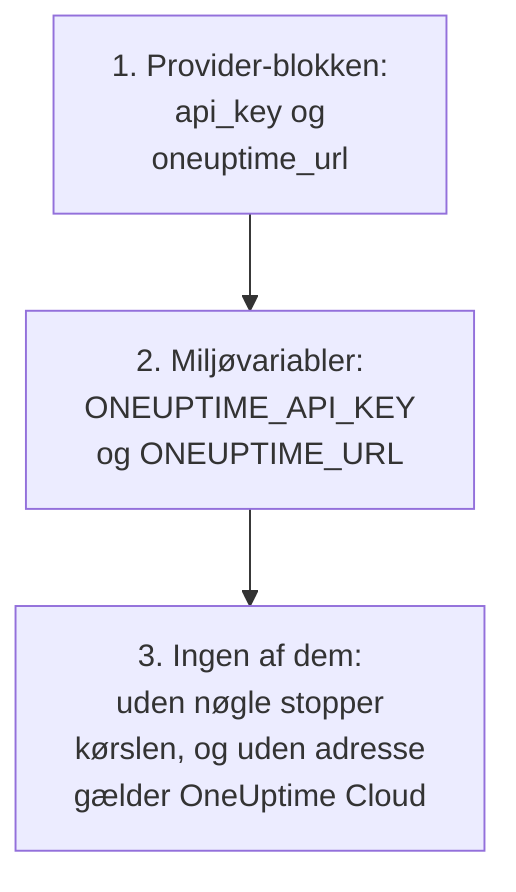
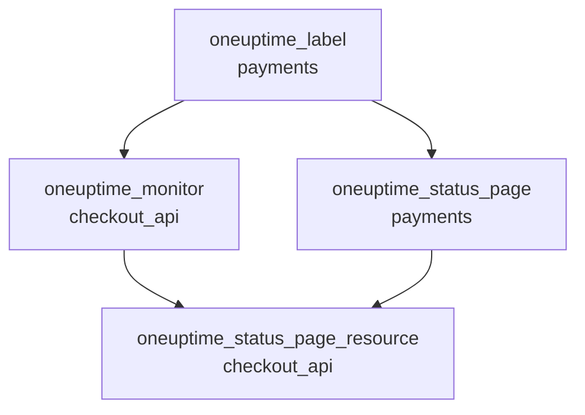

# Komplet vejledning

Denne vejledning dækker det, der kommer efter din første apply: hvordan provideren finder sin API-nøgle, hvordan du opbygger en konfiguration til ét eller flere projekter, hvordan ressourcer henviser til hinanden, hvordan du læser poster, du ikke administrerer, hvordan du holder din state sikker, og hvordan du opgraderer. Ny med provideren? Start med [Hurtig start](/docs/terraform/quick-start).

:::cards
- [Konfigurér provideren](#konfigurér-provideren): API-nøglen og adressen, og hvor provideren læser dem.
- [Opbyg en konfiguration](#opbyg-en-konfiguration): Filer, projekter og mange ressourcer fra én blok.
- [Læs det, der allerede findes](#læs-det-der-allerede-findes): Datakilder, og hvordan et opslag finder sit match.
- [Hold din state sikker](#hold-din-state-sikker): En fjern-backend, og hvad du aldrig må committe.
:::

## Konfigurér provideren

Provideren tager to indstillinger. Hver af dem kommer fra provider-blokken, eller ellers fra en miljøvariabel:

| Indstilling | Miljøvariabel | Når ingen af dem er angivet |
| --- | --- | --- |
| `api_key` | `ONEUPTIME_API_KEY` | Provideren stopper, før noget planlægges: `Missing API Key` |
| `oneuptime_url` | `ONEUPTIME_URL` | `https://oneuptime.com`, som er OneUptime Cloud |



`oneuptime_url` er adressen på din OneUptime, uden `/api`: provideren tilføjer `https://`, når adressen ikke har et skema, og `/api` til sidst. `api_key` er følsom, så Terraform udskriver den aldrig.

Nøglen skal være en API-nøgle til det projekt, du administrerer, med tilladelse til at oprette, læse, ændre og slette hver slags post i din konfiguration: se [Opret en API-nøgle til projektet](/docs/terraform/quick-start#opret-en-api-nøgle-til-projektet). En selv-hostet OneUptimes master-API-nøgle hører ikke til noget projekt, så en oprettelse med den fejler med `ProjectId required`.

### Giv provideren dens nøgle

:::tabs
@tab Miljøvariabel
```bash
export ONEUPTIME_API_KEY="<your-api-key>"
# Only on a self-hosted OneUptime:
export ONEUPTIME_URL="https://oneuptime.example.com"
```

```hcl title="main.tf"
provider "oneuptime" {}
```
@tab Terraform-variabel
```hcl title="variables.tf"
variable "oneuptime_api_key" {
  description = "API key of the OneUptime project"
  type        = string
  sensitive   = true
}

provider "oneuptime" {
  api_key = var.oneuptime_api_key
}
```

```hcl title="terraform.tfvars"
oneuptime_api_key = "<your-api-key>"
```
:::

En miljøvariabel holder nøglen ude af alle filer. En variabelfil er praktisk på din egen maskine: tilføj `terraform.tfvars` til `.gitignore`. I en pipeline angiver du `TF_VAR_oneuptime_api_key` i stedet for at skrive filen.

### Kør den i CI/CD

Giv jobbet nøglen som en hemmelighed, i miljøvariablen `ONEUPTIME_API_KEY`:

:::tabs
@tab GitHub Actions
```yaml title=".github/workflows/oneuptime.yml"
name: OneUptime
on:
  push:
    branches: [main]

jobs:
  apply:
    runs-on: ubuntu-latest
    env:
      ONEUPTIME_API_KEY: ${{ secrets.ONEUPTIME_API_KEY }}
    steps:
      - uses: actions/checkout@v4
      - uses: hashicorp/setup-terraform@v3
      - run: terraform init -input=false
      - run: terraform plan -input=false -out=tfplan
      - run: terraform apply -input=false tfplan
```
@tab GitLab CI
```yaml title=".gitlab-ci.yml"
apply:
  image:
    name: hashicorp/terraform:latest
    entrypoint: [""]
  rules:
    - if: $CI_COMMIT_BRANCH == $CI_DEFAULT_BRANCH
  script:
    - terraform init -input=false
    - terraform plan -input=false -out=tfplan
    - terraform apply -input=false tfplan
```
:::

I GitHub tilføjer du hemmeligheden under **Settings → Secrets and variables → Actions**; i GitLab tilføjer du en maskeret CI/CD-variabel med samme navn. Hold din state i en [fjern-backend](#hold-din-state-sikker), så hver kørsel starter fra den state, den forrige efterlod.

## Opbyg en konfiguration

En opbygning, der fungerer godt:

```text
oneuptime/
├── main.tf          # the terraform and provider blocks
├── variables.tf     # input variables
├── outputs.tf       # the IDs other configurations need
├── shared.tf        # labels, teams and monitor statuses
├── monitors.tf      # monitors and monitor groups
├── status-pages.tf  # status pages and their domains
└── on-call.tf       # on-call policies and escalation rules
```

- **Én konfiguration til hvert projekt.** En API-nøgle hører til ét projekt, så en konfiguration administrerer naturligt ét.
- **Delte poster én gang.** Definér etiketter, teams og monitorstatusser i én fil, og henvis til dem med deres adresse alle andre steder.

### Administrér flere projekter

For at administrere mere end ét projekt fra én konfiguration giver du provideren et alias til hvert projekt, hver med det projekts nøgle. En ressource angiver med `provider`, hvilket alias den bruger:

```hcl
provider "oneuptime" {
  alias   = "production"
  api_key = var.production_api_key
}

provider "oneuptime" {
  alias   = "staging"
  api_key = var.staging_api_key
}

resource "oneuptime_label" "staging_critical" {
  provider = oneuptime.staging

  name  = "critical"
  color = "#FF5733"
}
```

Erklær `production_api_key` og `staging_api_key` som variabler, der er markeret som `sensitive`, som ovenfor.

### Mange ressourcer fra én blok

`for_each` laver én ressource for hver post i et map. Disse monitorer deler deres kriterier og adskiller sig kun i navn og adresse:

```hcl
variable "websites" {
  type = map(string)
  default = {
    homepage = "https://example.com"
    docs     = "https://docs.example.com"
  }
}

resource "oneuptime_monitor" "website" {
  for_each = var.websites

  name                = "Website: ${each.key}"
  monitor_type        = "Website"
  monitoring_interval = "*/5 * * * *"

  monitor_steps = [{
    monitor_destination      = each.value
    monitor_destination_type = "URL"

    criteria = [
      {
        name                  = "Offline"
        filter_condition      = "Any"
        change_monitor_status = true
        monitor_status_id     = data.oneuptime_monitor_status.offline.id

        filters = [
          {
            check_on    = "Is Online"
            filter_type = "False"
          }
        ]
      }
    ]
  }]
}
```

Tilføj et site til mappet, og den næste apply opretter dets monitor. Fjern et, og den sletter den.

## Henvis til andre ressourcer

En ressource, der nævner en anden ressources attribut, afhænger af den, og Terraform ordner arbejdet efter disse henvisninger. Her oprettes etiketten først og slettes sidst, fordi monitoren og statussiden nævner den:



```hcl
resource "oneuptime_label" "payments" {
  name        = "payments"
  description = "Payment infrastructure"
  color       = "#2ECC71"
}

resource "oneuptime_monitor" "checkout_api" {
  name         = "Checkout API"
  description  = "Availability of the checkout API"
  monitor_type = "Manual"
  labels       = [oneuptime_label.payments.id]
}

resource "oneuptime_status_page" "payments" {
  name                  = "Payments Status"
  page_title            = "Payments Status"
  is_public_status_page = true
  labels                = [oneuptime_label.payments.id]
}

resource "oneuptime_status_page_resource" "checkout_api" {
  status_page_id = oneuptime_status_page.payments.id
  monitor_id     = oneuptime_monitor.checkout_api.id
  display_name   = "Checkout API"
}
```

Du har sjældent brug for `depends_on`: tilføj den kun for en rækkefølge, som Terraform ikke kan se ud fra attributterne. Lister af ID'er som `labels` er sæt, så det ændrer intet at bytte om på rækkefølgen.

## Læs det, der allerede findes

Hver ressource har en datakilde med samme navn. En datakilde læser en post, som denne konfiguration ikke administrerer, oprettet i dashboardet eller af en anden konfiguration, så du kan henvise til den uden at overtage den.

```hcl
data "oneuptime_label" "critical" {
  name = "critical"
}

data "oneuptime_monitor_status" "offline" {
  is_offline_state = true
}

data "oneuptime_status_page" "main" {
  id = "5f8a1b2c-3d4e-4f6a-8b9c-0d1e2f3a4b5c"
}

resource "oneuptime_monitor" "database" {
  name         = "Database Health"
  monitor_type = "Manual"
  labels       = [data.oneuptime_label.critical.id]
}
```

Sådan finder et opslag sit match:

| Du angiver | Den finder | Fejl |
| --- | --- | --- |
| `id` | Posten med det ID | `Not Found`, når ingen post har det |
| Andre simple argumenter, et eller flere | Den ene post, der passer med dem alle | `Not Found`, når ingen passer, `Ambiguous Match`, når mere end én passer |
| `id` og et andet argument, eller ingenting | Ingenting | `Invalid Lookup` |

Simple argumenter er tekst, tal og sand eller falsk: et navn, en prioritet, et flag som `is_offline_state`. Lister, JSON-værdier, tidsstempler og hemmeligheder kan man ikke slå op efter. For at overtage en post i stedet for kun at læse den skal du [importere den](/docs/terraform/importing-resources).

## Hold din state sikker

Terraforms state indeholder ID'erne og attributterne for alt, den administrerer, hemmeligheder inklusive. Hold den i en fjern-backend, der låser den, så et team deler én state, og to kørsler aldrig skriver den samtidig. Enhver standard-backend virker, for eksempel en S3-bucket:

```hcl
terraform {
  backend "s3" {
    bucket       = "my-terraform-state"
    key          = "oneuptime/production.tfstate"
    region       = "us-east-1"
    encrypt      = true
    use_lockfile = true
  }
}
```

`use_lockfile` kræver Terraform 1.10 eller OpenTofu 1.10 eller nyere. Før dem låser S3-backenden med en DynamoDB-tabel (`dynamodb_table`).

- **Redigér aldrig din state i hånden.** Brug `terraform state mv` og `terraform state rm`.
- **Commit aldrig `terraform.tfstate` eller en `.tfvars`-fil med en hemmelighed i.**

## Drift, og hvad der ikke skaber den

`terraform plan` sammenligner OneUptime med din konfiguration og viser, hvad der er forskelligt. Nogle forskelle vises aldrig:

- **Tidspunkter sammenlignes som øjeblikke.** `2030-06-01T02:00:00Z` og serverens måde at skrive det samme øjeblik på er ens.
- **Standardværdier, som serveren tilføjer** til en monitors trin eller til en JSON-værdi, er ikke en forskel fra det, du skrev.
- **Det, serveren holder opdateret**, såsom en monitors nuværende status, er heller ikke en forskel.

En værdi, du beregner ved hver kørsel, er derimod: `timestamp()` giver et nyt tidspunkt ved hver kørsel, så en plan viser det altid. Skriv faste tidspunkter i stedet:

```hcl
resource "oneuptime_scheduled_maintenance_event" "database_upgrade" {
  title       = "Database upgrade"
  description = "Planned PostgreSQL upgrade"
  starts_at   = "2030-06-01T02:00:00Z"
  ends_at     = "2030-06-01T04:00:00Z"
}
```

## Opgradér provideren

:::steps
### Læs udgivelsesnoterne

[Terraform Registry](https://registry.terraform.io/providers/oneuptime/oneuptime) og [providerens udgivelser på GitHub](https://github.com/OneUptime/terraform-provider-oneuptime/releases) viser, hvad der er ændret.

### Hæv versionsbegrænsningen

`{{TERRAFORM_PROVIDER_VERSION}}` tager allerede alle {{TERRAFORM_PROVIDER_MAJOR}}.x-udgivelser. En ny hovedversion kræver en ny begrænsning.

### Hent den nye version

```bash
terraform init -upgrade
```

### Planlæg, før du anvender

Kør `terraform plan`, og anvend kun, når den er tom eller viser de ændringer, du forventer.
:::

På en selv-hostet OneUptime opgraderer du først OneUptime og derefter provideren: provideren må ikke være nyere end din OneUptime. Se [Selv-hostet opsætning](/docs/terraform/self-hosted).

## Næste skridt

:::cards
- [Monitortrin](/docs/terraform/monitor-steps): Bestem, hvad en monitor tjekker, og hvad hvert resultat betyder.
- [Eksempler](/docs/terraform/examples): Færdige konfigurationer til de almindelige ressourcer.
- [Import af ressourcer](/docs/terraform/importing-resources): Bring det, du har lavet i dashboardet, ind under Terraform.
- [Fejlfinding](/docs/terraform/troubleshooting): Almindelige fejl, og hvordan du retter dem.
:::
