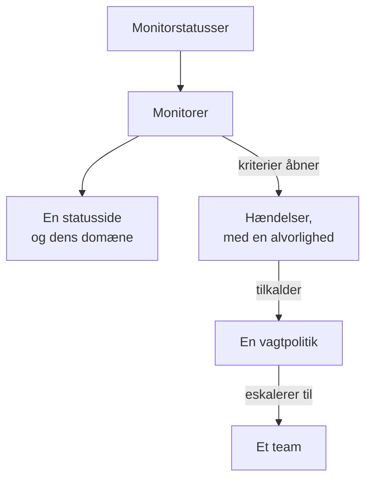

# Eksempler

Færdige konfigurationer til de ressourcer, de fleste projekter starter med. Hver blok kan anvendes, som den er, oven på provider-opsætningen nedenfor, og de fleste kommer fra providerens end-to-end-tests, som anvender dem på en rigtig OneUptime ved hver ændring.

:::cards
- [Monitorer](#monitorer): Website-, API-, ping-, port-, SSL-certifikat-, heartbeat- og manuelle monitorer.
- [Statussider](#statussider): En statusside med en gruppe og en monitor, og et eget domæne.
- [Teams og vagter](#teams-og-vagter): Et team, og en vagtpolitik, der tilkalder det.
- [Hændelser og vedligeholdelse](#hændelser-og-vedligeholdelse): Alvorligheder, tilstande, en erklæret hændelse og et vedligeholdelsesvindue.
:::



## Provider-opsætning

Hvert eksempel forudsætter denne opsætning, med API-nøglen i miljøvariablen `ONEUPTIME_API_KEY`:

```hcl title="main.tf"
terraform {
  required_providers {
    oneuptime = {
      source  = "oneuptime/oneuptime"
      version = "{{TERRAFORM_PROVIDER_VERSION}}"
    }
  }
}

provider "oneuptime" {
  # On a self-hosted OneUptime, add your OneUptime's address:
  # oneuptime_url = "https://oneuptime.example.com"
}
```

## Etiketter

Etiketter sorterer og filtrerer poster. De fleste ressourcer tager et sæt etiket-ID'er i `labels`:

```hcl
resource "oneuptime_label" "production" {
  name        = "production"
  description = "Production infrastructure"
  color       = "#FF5733"
}
```

## Monitorer

Monitorerne nedenfor sætter deres status med tre af de statusser, som alle projekter starter med, læst med datakilder:

```hcl
data "oneuptime_monitor_status" "operational" {
  name = "Operational"
}

data "oneuptime_monitor_status" "degraded" {
  name = "Degraded"
}

data "oneuptime_monitor_status" "offline" {
  name = "Offline"
}
```

Hver monitors `monitor_steps` siger, hvad den tjekker, og hvordan hvert resultat bedømmes: [Monitortrin](/docs/terraform/monitor-steps) forklarer hver attribut.

### Website-monitor

Offline, når sitet ikke svarer, online, når det svarer med 200. End-to-end-testen `35-monitor-with-steps` anvender en monitor med disse tjek:

```hcl
resource "oneuptime_monitor" "website" {
  name                = "Website"
  description         = "Homepage availability and status code"
  monitor_type        = "Website"
  monitoring_interval = "*/5 * * * *"
  labels              = [oneuptime_label.production.id]

  monitor_steps = [{
    monitor_destination      = "https://example.com"
    monitor_destination_type = "URL"
    request_type             = "GET"

    criteria = [
      {
        name                  = "Offline"
        description           = "The website does not respond"
        filter_condition      = "Any"
        change_monitor_status = true
        monitor_status_id     = data.oneuptime_monitor_status.offline.id

        filters = [
          {
            check_on    = "Is Online"
            filter_type = "False"
          }
        ]
      },
      {
        name                  = "Online"
        description           = "The website responds with 200"
        filter_condition      = "All"
        change_monitor_status = true
        monitor_status_id     = data.oneuptime_monitor_status.operational.id

        filters = [
          {
            check_on    = "Is Online"
            filter_type = "True"
          },
          {
            check_on    = "Response Status Code"
            filter_type = "Equal To"
            value       = "200"
          }
        ]
      }
    ]
  }]
}
```

### API-monitor

En `POST` med headere og en JSON-body, nedsat, når svaret er langsomt. End-to-end-testen `35-monitor-with-steps` anvender en lignende API-monitor:

```hcl
resource "oneuptime_monitor" "orders_api" {
  name         = "Orders API"
  description  = "Health check of the orders API"
  monitor_type = "API"

  monitor_steps = [{
    monitor_destination      = "https://api.example.com/v1/health"
    monitor_destination_type = "URL"
    request_type             = "POST"
    request_headers = {
      "Content-Type" = "application/json"
      "Accept"       = "application/json"
    }
    request_body = jsonencode({ check = "health" })

    criteria = [
      {
        name                  = "Offline"
        description           = "The API does not answer, or answers with an error"
        filter_condition      = "Any"
        change_monitor_status = true
        monitor_status_id     = data.oneuptime_monitor_status.offline.id

        filters = [
          {
            check_on    = "Is Online"
            filter_type = "False"
          },
          {
            check_on    = "Response Status Code"
            filter_type = "Greater Than Or Equal To"
            value       = "500"
          }
        ]
      },
      {
        name                  = "Slow"
        description           = "The API takes more than two seconds"
        filter_condition      = "All"
        change_monitor_status = true
        monitor_status_id     = data.oneuptime_monitor_status.degraded.id

        filters = [
          {
            check_on    = "Response Time (in ms)"
            filter_type = "Greater Than"
            value       = "2000"
          }
        ]
      },
      {
        name                  = "Online"
        description           = "The API answers in time"
        filter_condition      = "All"
        change_monitor_status = true
        monitor_status_id     = data.oneuptime_monitor_status.operational.id

        filters = [
          {
            check_on    = "Is Online"
            filter_type = "True"
          }
        ]
      }
    ]
  }]
}
```

### Ping-monitor

En Ping-monitor tager et værtsnavn eller en IP-adresse i stedet for en URL:

```hcl
resource "oneuptime_monitor" "gateway" {
  name         = "Gateway"
  description  = "The gateway answers ping"
  monitor_type = "Ping"

  monitor_steps = [{
    monitor_destination      = "gateway.example.com"
    monitor_destination_type = "Hostname"

    criteria = [
      {
        name                  = "Unreachable"
        filter_condition      = "Any"
        change_monitor_status = true
        monitor_status_id     = data.oneuptime_monitor_status.offline.id

        filters = [
          {
            check_on    = "Is Online"
            filter_type = "False"
          }
        ]
      },
      {
        name                  = "Reachable"
        filter_condition      = "All"
        change_monitor_status = true
        monitor_status_id     = data.oneuptime_monitor_status.operational.id

        filters = [
          {
            check_on    = "Is Online"
            filter_type = "True"
          }
        ]
      }
    ]
  }]
}
```

### Port-monitor

En Port-monitor tilføjer den `port`, der skal tjekkes, som et tal:

```hcl
resource "oneuptime_monitor" "database_port" {
  name         = "Database port"
  description  = "PostgreSQL accepts connections"
  monitor_type = "Port"

  monitor_steps = [{
    monitor_destination      = "db.example.com"
    monitor_destination_type = "Hostname"
    port                     = 5432

    criteria = [
      {
        name                  = "Closed"
        filter_condition      = "Any"
        change_monitor_status = true
        monitor_status_id     = data.oneuptime_monitor_status.offline.id

        filters = [
          {
            check_on    = "Is Online"
            filter_type = "False"
          }
        ]
      },
      {
        name                  = "Open"
        filter_condition      = "All"
        change_monitor_status = true
        monitor_status_id     = data.oneuptime_monitor_status.operational.id

        filters = [
          {
            check_on    = "Is Online"
            filter_type = "True"
          }
        ]
      }
    ]
  }]
}
```

### SSL-certifikatmonitor

Offline, når certifikatet ikke er gyldigt, nedsat, når det udløber om 14 dage eller mindre, sådan som en ny SSL-certifikatmonitor er i dashboardet:

```hcl
resource "oneuptime_monitor" "certificate" {
  name         = "example.com certificate"
  description  = "The TLS certificate of example.com"
  monitor_type = "SSL Certificate"

  monitor_steps = [{
    monitor_destination      = "https://example.com"
    monitor_destination_type = "URL"

    criteria = [
      {
        name                  = "Not valid"
        description           = "Expired, self-signed, untrusted or not reachable"
        filter_condition      = "Any"
        change_monitor_status = true
        monitor_status_id     = data.oneuptime_monitor_status.offline.id

        filters = [
          {
            check_on    = "Is Not A Valid Certificate"
            filter_type = "True"
          }
        ]
      },
      {
        name                  = "Expires soon"
        description           = "Valid, and expires in 14 days or less"
        filter_condition      = "All"
        change_monitor_status = true
        monitor_status_id     = data.oneuptime_monitor_status.degraded.id

        filters = [
          {
            check_on    = "Is Valid Certificate"
            filter_type = "True"
          },
          {
            check_on    = "Expires In Days"
            filter_type = "Less Than Or Equal To"
            value       = "14"
          }
        ]
      },
      {
        name                  = "Valid"
        filter_condition      = "All"
        change_monitor_status = true
        monitor_status_id     = data.oneuptime_monitor_status.operational.id

        filters = [
          {
            check_on    = "Is Valid Certificate"
            filter_type = "True"
          }
        ]
      }
    ]
  }]
}
```

### Manuel monitor

En manuel monitor tjekker ingenting: du sætter selv dens status. Den har ikke brug for `monitor_steps`:

```hcl
resource "oneuptime_monitor" "payment_provider" {
  name         = "Payment provider"
  description  = "Set by hand during the provider's incidents"
  monitor_type = "Manual"
}
```

### Heartbeat-monitor

En monitor for indgående anmodninger venter på anmodninger i stedet for at sende dem: her et backupjob, der melder sig hver nat. Den går offline, når der ikke er kommet nogen anmodning i 25 timer:

```hcl
resource "oneuptime_monitor" "nightly_backup" {
  name         = "Nightly backup"
  description  = "The backup job sends a heartbeat when it finishes"
  monitor_type = "Incoming Request"

  monitor_steps = [{
    criteria = [
      {
        name                  = "No heartbeat"
        filter_condition      = "Any"
        change_monitor_status = true
        monitor_status_id     = data.oneuptime_monitor_status.offline.id

        filters = [
          {
            check_on    = "Incoming Request"
            filter_type = "Not Recieved In Minutes"
            value       = "1500"
          }
        ]
      },
      {
        name                  = "Heartbeat received"
        filter_condition      = "All"
        change_monitor_status = true
        monitor_status_id     = data.oneuptime_monitor_status.operational.id

        filters = [
          {
            check_on    = "Incoming Request"
            filter_type = "Recieved In Minutes"
            value       = "1500"
          }
        ]
      }
    ]
  }]
}

output "nightly_backup_heartbeat_key" {
  value     = oneuptime_monitor.nightly_backup.incoming_request_secret_key
  sensitive = true
}
```

Jobbet sender sin anmodning til `https://oneuptime.com/heartbeat/YOUR_SECRET_KEY`, med den nøgle, som `terraform output -raw nightly_backup_heartbeat_key` udskriver: se [Indgående anmodning-monitor](/docs/monitor/incoming-request-monitor). En servermonitors agent melder sig på samme måde, med `server_monitor_secret_key`.

### Monitorgruppe

En monitorgruppe viser et sæt monitorer med én status:

```hcl
resource "oneuptime_monitor_group" "storefront" {
  name        = "Storefront"
  description = "Everything the shop needs"
}

resource "oneuptime_monitor_group_resource" "website" {
  monitor_group_id = oneuptime_monitor_group.storefront.id
  monitor_id       = oneuptime_monitor.website.id
}

resource "oneuptime_monitor_group_resource" "orders_api" {
  monitor_group_id = oneuptime_monitor_group.storefront.id
  monitor_id       = oneuptime_monitor.orders_api.id
}
```

## Statussider

### En statusside med en gruppe og en monitor

En statusside viser ressourcer og kan sortere dem i grupper. End-to-end-testen `42-status-page-resources` anvender denne opsætning:

```hcl
resource "oneuptime_status_page" "public" {
  name                  = "Public Status"
  description           = "Customer-facing status page"
  page_title            = "System Status"
  page_description      = "Check our system status and incident history"
  is_public_status_page = true
}

resource "oneuptime_status_page_group" "services" {
  status_page_id = oneuptime_status_page.public.id
  name           = "Services"
}

resource "oneuptime_status_page_resource" "website" {
  status_page_id       = oneuptime_status_page.public.id
  status_page_group_id = oneuptime_status_page_group.services.id
  monitor_id           = oneuptime_monitor.website.id
  display_name         = "Website"
}
```

### Et eget domæne

Tre ressourcer arbejder sammen: et domæne i dit projekt, statussiden og statussidens domæne, der forbinder dem. Serveren udfylder `full_domain` og CNAME-verifikationstokenet: angiv dem ikke. End-to-end-testene `12-status-page-domain` og `25-status-page-with-domain` anvender denne opsætning:

```hcl
resource "oneuptime_domain" "company" {
  domain = "example.com"
}

resource "oneuptime_status_page_domain" "status" {
  domain_id      = oneuptime_domain.company.id
  status_page_id = oneuptime_status_page.public.id
  subdomain      = "status"
}

output "status_page_address" {
  # The subdomain and the domain, such as status.example.com.
  value = oneuptime_status_page_domain.status.full_domain
}
```

Et nyt domæne skal bestå DNS-verifikationen, før statussiden svarer på det.

## Teams og vagter

### Et team og dets medlemmer

```hcl
resource "oneuptime_team" "sre" {
  name        = "SRE"
  description = "Site reliability engineering"
}

variable "alice_user_id" {
  description = "Alice's user ID, the last part of the address of her page under Users"
  type        = string
}

resource "oneuptime_team_member" "alice" {
  team_id = oneuptime_team.sre.id
  user_id = var.alice_user_id
}
```

En person, der allerede er med i projektet, kommer straks med i teamet. Alle andre inviteres og er med i teamet, så snart de accepterer. End-to-end-testen `33-team-crud` anvender teamet.

### En vagtpolitik, der tilkalder et team

Politikkens første regel tilkalder teamet, og politikken starter forfra, op til to gange, når ingen kvitterer:

```hcl
resource "oneuptime_on_call_policy" "primary" {
  name                                             = "Primary on-call"
  description                                      = "First line for production incidents"
  repeat_policy_if_no_one_acknowledges             = true
  repeat_policy_if_no_one_acknowledges_no_of_times = 2
}

resource "oneuptime_escalation_rule" "first_line" {
  on_call_duty_policy_id    = oneuptime_on_call_policy.primary.id
  name                      = "Page the SRE team"
  description               = "Moves on after 5 minutes without an acknowledgement"
  order                     = 1
  escalate_after_in_minutes = 5
}

resource "oneuptime_team_on_call_duty_escalation_rule" "sre" {
  on_call_duty_policy_id                 = oneuptime_on_call_policy.primary.id
  on_call_duty_policy_escalation_rule_id = oneuptime_escalation_rule.first_line.id
  team_id                                = oneuptime_team.sre.id
}
```

En monitors kriterier tilkalder politikken via `on_call_policy_ids` på de hændelser, de åbner: se [Hændelser og advarsler](/docs/terraform/monitor-steps#hændelser-og-advarsler).

## Hændelser og vedligeholdelse

### Alvorligheder og tilstande

Alvorligheder rangerer en hændelses påvirkning, og tilstande er trinnene i dens forløb. `order` er der, hvor hver af dem står i listen:

```hcl
resource "oneuptime_incident_severity" "sev1" {
  name        = "SEV-1"
  description = "Full outage, all hands"
  color       = "#E74C3C"
  order       = 1
}

resource "oneuptime_incident_state" "mitigated" {
  name        = "Mitigated"
  description = "Impact contained, fix in progress"
  color       = "#F39C12"
  order       = 3
}
```

`oneuptime_alert_severity` og `oneuptime_alert_state` virker på samme måde for advarsler. End-to-end-testene `03-incident-severity` og `04-incident-state` anvender dem.

### Erklær en hændelse

Det er som regel monitorer, der åbner hændelser, men en hændelse er også en ressource, hvilket passer til en game day. Det er en rigtig hændelse, så hold en øvelse væk fra dine statussider:

```hcl
resource "oneuptime_incident" "drill" {
  title                     = "Disaster recovery drill"
  description               = "A game day: we fail over the database"
  incident_severity_id      = oneuptime_incident_severity.sev1.id
  is_visible_on_status_page = false

  should_status_page_subscribers_be_notified_on_incident_created = false
}
```

End-to-end-testen `28-incident-crud` anvender en hændelse.

### Planlagt vedligeholdelse

Et vedligeholdelsesvindue med faste tidspunkter, vist på dine statussider:

```hcl
resource "oneuptime_scheduled_maintenance_event" "database_upgrade" {
  title                       = "Database maintenance"
  description                 = "Planned PostgreSQL upgrade: writes pause briefly"
  starts_at                   = "2030-06-01T02:00:00Z"
  ends_at                     = "2030-06-01T04:00:00Z"
  is_visible_on_status_page   = true
  monitors                    = [oneuptime_monitor.website.id]
  change_monitor_status_to_id = data.oneuptime_monitor_status.degraded.id
}
```

Tidspunkter er i RFC 3339, og det samme øjeblik skrevet på en anden måde er ingen ændring. End-to-end-testen `30-scheduled-maintenance-crud` anvender vedligeholdelseshændelser.

For at sætte hændelsens monitorer i en status, mens den står på, tilknytter du dem med `monitors` og sætter `change_monitor_status_to_id` til en af dine monitorstatusser: monitorerne skifter til den, når hændelsen starter, og tilbage til operationel, når den slutter. Terraform ændrer `change_monitor_status_to_id` på stedet, indtil hændelsen starter. Når hændelsen er startet, er dens monitorer allerede i den status, og en apply, der ændrer den, fejler med “Change Monitor Status to can no longer be changed: this event has already started.”

## Prober

En egen probe kører tjek fra dit netværk. Dens nøgle er den hemmelighed, proben melder sig med, så giv den videre i en variabel:

```hcl
variable "probe_key" {
  description = "The key the probe signs in with"
  type        = string
  sensitive   = true
}

resource "oneuptime_probe" "eu_west" {
  key           = var.probe_key
  name          = "EU West"
  description   = "Probe in our eu-west-1 network"
  probe_version = "1.0.0"

  should_auto_enable_probe_on_new_monitors = true
}
```

Kør proben med `PROBE_ID` sat til probens `id` og `PROBE_KEY` sat til nøglen: se [Brugerdefinerede probes](/docs/probe/custom-probe). End-to-end-testen `23-probe-crud` anvender prober.

## Næste skridt

:::cards
- [Monitortrin](/docs/terraform/monitor-steps): Hver attribut i en monitors tjek og kriterier.
- [Import af ressourcer](/docs/terraform/importing-resources): Bring det, du har lavet i dashboardet, ind under Terraform.
- [Komplet vejledning](/docs/terraform/complete-guide): Datakilder, state, CI/CD og opgraderinger.
:::
