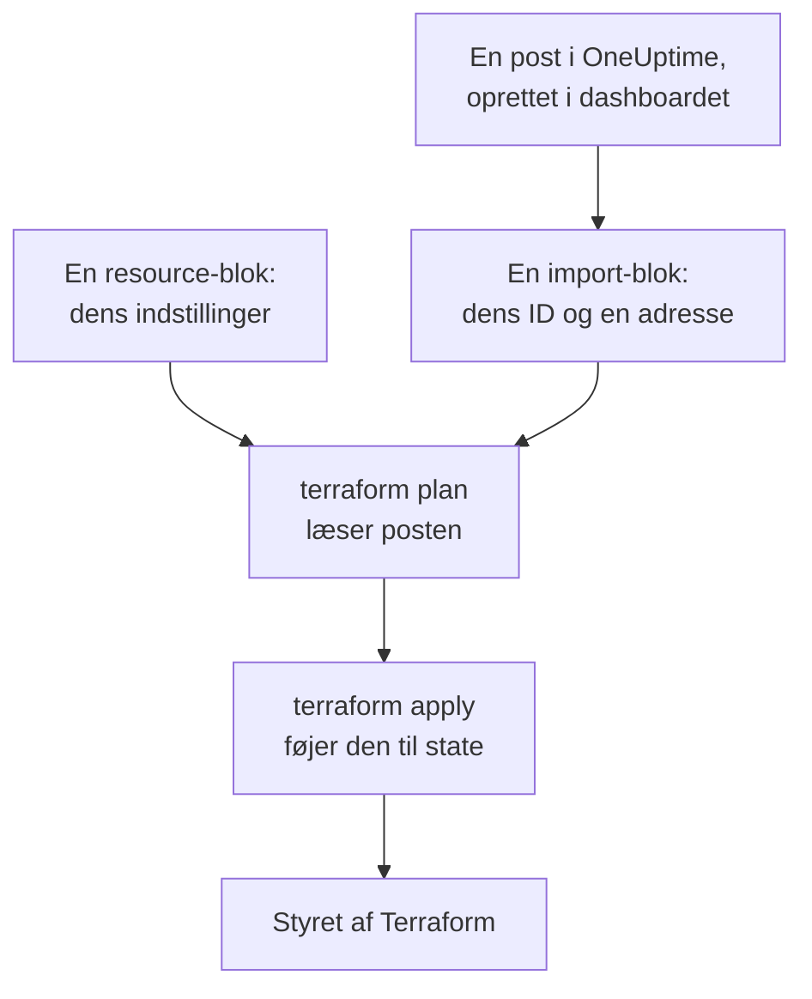
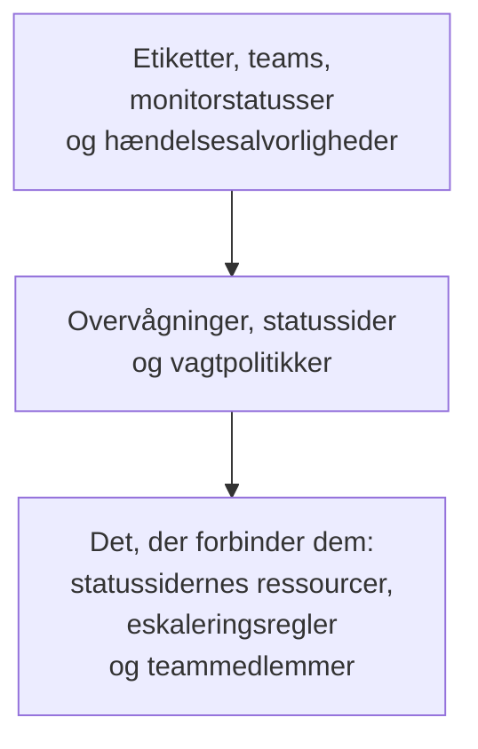

# Import af ressourcer

Du behøver ikke starte forfra for at styre OneUptime med Terraform. Importér de overvågninger, statussider, teams og andre poster, du allerede har, så styrer Terraform dem derfra, som de er. En import læser kun: intet ændres i OneUptime, før du anvender en ændring, du har planlagt.

:::cards
- [Sådan virker en import](#sådan-virker-en-import): Hvad en import læser, og hvad du skriver.
- [Importér én ressource](#importér-én-ressource): Fra dens side i dashboardet, i fire trin.
- [Importér mange ressourcer](#importér-mange-ressourcer): Importblokke for en hel liste, og den konfiguration, Terraform skriver for dig.
- [Stop med at styre en ressource](#stop-med-at-styre-en-ressource): Giv den tilbage til dashboardet uden at slette den.
:::

## Sådan virker en import

En import knytter en post, der allerede findes i OneUptime, til en `resource`-blok i din konfiguration. Du skriver en `import`-blok med postens ID og den adresse, den skal til. Den næste `terraform plan` læser posten via dens ID og viser, at den bliver importeret, sammen med hver forskel mellem posten og din konfiguration. `terraform apply` føjer den til Terraforms state, og derfra styres posten som alt andet, Terraform har oprettet.



Skriv `resource`-blokken, så den siger, hvad posten allerede er. Hvor de er forskellige, viser planen importen og en ændring, og når du anvender den, ændres posten i OneUptime.

### Hvad der kan importeres

Alle providerens ressourcer kan importeres via deres ID, undtagen `oneuptime_file`: OneUptimes API kan ikke læse en fil tilbage, så provideren svarer `Import Not Supported`. Datakilder importeres aldrig. For at bruge en post i din konfiguration uden at styre den skal du i stedet læse den med en [datakilde](/docs/terraform/complete-guide#læs-det-der-allerede-findes).

## Før du begynder

- **Terraform 1.5 eller nyere, eller OpenTofu 1.6 eller nyere.** `import`-blokkene på denne side kræver disse versioner. En ældre Terraform importerer fra [kommandolinjen](#importér-fra-kommandolinjen).
- **En API-nøgle, der kan læse det, du importerer.** Importen læser hver post med providerens nøgle, og at styre den bagefter kræver også tilladelserne til at ændre og slette den. Se [Opret en API-nøgle til projektet](/docs/terraform/quick-start#opret-en-api-nøgle-til-projektet).
- **Provideren i din konfiguration**, sat op som i [Hurtig start](/docs/terraform/quick-start#peg-terraform-mod-oneuptime).

## Importér én ressource

Dashboardet skriver konfigurationen for den ressource, du kigger på, med dens `import`-blok, så du skriver sjældent en i hånden.

:::steps
### Åbn ressourcens Terraform-side

Åbn overvågningen, statussiden eller en anden ressource i dashboardet. Åbn **Udvikler** i dens sidemenu, og derefter **Terraform**.

### Kopiér dens konfiguration

Siden skriver ressourcens `resource`-blok ud fra dens nuværende indstillinger, og en `import`-blok med dens ID. Læg dem begge i en `.tf`-fil:

```hcl title="status-pages.tf"
resource "oneuptime_status_page" "public_status" {
  name       = "Public Status"
  page_title = "Acme Status"

  # Secrets are not shown here: master_password, embedded_overall_status_token.
  # Terraform leaves them as they are in OneUptime.
}

import {
  to = oneuptime_status_page.public_status
  id = "68a1b2c3-d4e5-4f6a-8b9c-0d1e2f3a4b02"
}
```

Den skriver de indstillinger, der afviger fra standardværdierne, og en kommentar efter hvert ID nævner den post, det peger på. Hemmeligheder vises aldrig: dem, ressourcen har brug for, læses fra variabler markeret `sensitive`, og kommentaren nævner dem, den udelader.

### Planlæg

Kør `terraform plan`. Den slutter med `Plan: 1 to import, 0 to add, 0 to change, 0 to destroy.`: Terraform fandt posten, og din konfiguration passer til den.

### Anvend

Kør `terraform apply`. Statussiden er nu i Terraforms state, og den næste plan svarer `No changes.` Bagefter kan du slette `import`-blokken, eller beholde den som en note om, hvor ressourcen kom fra: den gør intet mere, når ressourcen først styres.
:::

### Skriv blokkene selv

Uden dashboardet skriver du selv begge blokke. Start `resource`-blokken med de attributter, ressourcen har brug for, og kør `terraform plan`. Hvor din konfiguration afviger fra posten, viser planen ændringen ved siden af importen:

```text
  # oneuptime_label.critical will be updated in-place
  # (imported from "68a1b2c3-d4e5-4f6a-8b9c-0d1e2f3a4b03")
  ~ resource "oneuptime_label" "critical" {
      ~ color = "#FF5733" -> "#000000"
    }

Plan: 1 to import, 0 to add, 1 to change, 0 to destroy.
```

Kopiér postens værdi ind i din konfiguration (her `color = "#FF5733"`), og planlæg igen, indtil planen viser importen og ingen ændring. Postens ID findes tre steder:

| Hvor | Hvordan |
| --- | --- |
| Ressourcens side | Dens detaljekort slutter med en linje **ID**. Klik på ID'et, eller på kopiknappen ved siden af, for at kopiere hele ID'et. |
| Adresselinjen | ID'et kommer efter listens navn: `/dashboard/<project-id>/monitors/<monitor-id>`. |
| API'et | Hver post har sit ID i `_id`. |

## Importér mange ressourcer

For at importere alle overvågninger, statussider eller andre ressourcer af én slags skal du starte fra deres liste.

:::steps
### Åbn listens Terraform-side

Åbn listen, og derefter **Udvikler** og **Terraform** i dens sidemenu, for eksempel **Overvågninger → Udvikler → Terraform**.

### Kopiér importblokkene

Siden skriver en `import`-blok for hver post (de første 100), med en adresse dannet ud fra postens navn. Læg dem i en fil for sig, som `imports.tf`:

```hcl title="imports.tf"
import {
  to = oneuptime_monitor.homepage
  id = "68a1b2c3-d4e5-4f6a-8b9c-0d1e2f3a4b01"
}

import {
  to = oneuptime_monitor.checkout_api
  id = "68a1b2c3-d4e5-4f6a-8b9c-0d1e2f3a4b05"
}
```

### Lad Terraform skrive konfigurationen

Kør planen med et filnavn til den konfiguration, Terraform skriver. Filen må ikke findes endnu: Terraform skriver kun til en ny fil.

```bash
terraform plan -generate-config-out=monitors.tf
```

Terraform læser hver post og skriver en `resource`-blok for hver `import`-blok, der ikke har en. Den advarer om, at generering af konfiguration er eksperimentel, så læs det, den skrev.

### Gennemse og anvend

Erstat i den nye fil andre posters ID'er med referencer til deres ressourcer, som `labels = [oneuptime_label.critical.id]`, så Terraform ved, i hvilken rækkefølge den skal arbejde. Kør `terraform plan`, indtil den kun viser importerne, og derefter `terraform apply`.
:::

### Et helt projekt

Importér et projekt liste for liste, og start med de poster, andre refererer til. Så kan hver ressourceblok referere til dem før den via adresse i stedet for ID:



Poster, som hvert projekt starter med, som dets monitorstatusser og hændelsesalvorligheder, er ofte bedre at læse med datakilder end at importere: Terraform kan så referere til dem, men ændrer eller sletter dem aldrig. Projektet er importeret, når `terraform plan` svarer `No changes.`

## Importér fra kommandolinjen

`terraform import` importerer én ressource ad gangen og virker med alle versioner af Terraform og OpenTofu. Skriv `resource`-blokken først, og kør derefter kommandoen med blokkens adresse og postens ID:

```bash
terraform import oneuptime_status_page.public_status 68a1b2c3-d4e5-4f6a-8b9c-0d1e2f3a4b02
terraform import oneuptime_label.critical 68a1b2c3-d4e5-4f6a-8b9c-0d1e2f3a4b03
terraform import oneuptime_team.sre 68a1b2c3-d4e5-4f6a-8b9c-0d1e2f3a4b04
```

Hver af dem slutter med `Import successful!`. I modsætning til en `import`-blok skriver kommandoen state med det samme, uden en plan, du kan gennemse først: kør `terraform plan` bagefter, og ret din konfiguration, indtil planen svarer `No changes.`

## Stop med at styre en ressource

For at give en ressource tilbage til dashboardet uden at slette den skal du erstatte dens `resource`-blok med en `removed`-blok, der beholder posten:

```hcl
removed {
  from = oneuptime_team.sre

  lifecycle {
    destroy = false
  }
}
```

Planen siger, at teamet ikke længere styres af Terraform, og ødelægger intet. Anvend den, og slet derefter `removed`-blokken. En `removed`-blok med `destroy = false` kræver Terraform 1.7 eller nyere, eller OpenTofu 1.10 eller nyere. På en ældre version skal du i stedet køre `terraform state rm oneuptime_team.sre`.

> [!WARNING]
> Når du sletter en `resource`-blok, slettes dens post i OneUptime ved næste apply. Under Terraform gør en `removed`-blok uden `destroy = false` det samme: skriv altid `lifecycle`-blokken.

## Godt at vide

- **En import ændrer intet, men det gør næste apply.** Når du anvender en plan, der viser en ændring ved siden af en import, ændres posten i OneUptime. Få først planen til kun at vise importen.
- **Hemmeligheder læses ikke tilbage.** En hemmelighed, som OneUptime aldrig sender tilbage, som en overvågningshemmeligheds `secret_value`, er ikke i state efter en import. Hvis din konfiguration angiver den, viser den første plan den som en ændring, og når du anvender den, skrives hemmeligheden igen.
- **Én konfiguration for hver post.** En post, der er importeret i to konfigurationer, ændres ved hver apply tilbage til det, hver af dem siger.
- **Importerede poster er styrede poster.** `terraform destroy` sletter dem fra OneUptime, ligesom de poster, Terraform har oprettet.

## Fejlfinding

:::details Meddelelsen “Cannot import non-existent remote object”
Ingen post har det ID, eller providerens API-nøgle må ikke læse den: OneUptime svarer ens i begge tilfælde. Kontrollér ID'et, og at nøglen kan læse den slags post.
:::

:::details Meddelelsen “Import Not Supported”
`oneuptime_file` er den eneste ressource, der ikke kan importeres. Udelad den, og lad i stedet Terraform oprette en ny fil.
:::

:::details Meddelelsen “Invalid ID format”
ID'et er ikke en posts ID, for eksempel et navn. En import tager ID'et, et UUID som `68a1b2c3-d4e5-4f6a-8b9c-0d1e2f3a4b02`: kopiér det fra ressourcens side.
:::

:::details Meddelelsen “Target generated file already exists”
`-generate-config-out` nævner en fil, der allerede findes. Nævn en ny fil, eller flyt filens indhold et andet sted hen og slet den.
:::

:::details Meddelelsen “Resource already managed by Terraform”
`terraform import` fik en adresse, der allerede er i state. Importér posten til en anden adresse, eller tjek med `terraform state list`, hvad adressen indeholder.
:::

## Næste skridt

:::cards
- [Komplet vejledning](/docs/terraform/complete-guide): Datakilder, referencer mellem ressourcer, og state.
- [Monitortrin](/docs/terraform/monitor-steps): Læs og ændr det, en importeret overvågning tjekker.
- [Eksempler](/docs/terraform/examples): Færdige konfigurationer til de almindelige ressourcer.
- [Fejlfinding](/docs/terraform/troubleshooting): Almindelige fejl, og hvordan du retter dem.
:::
