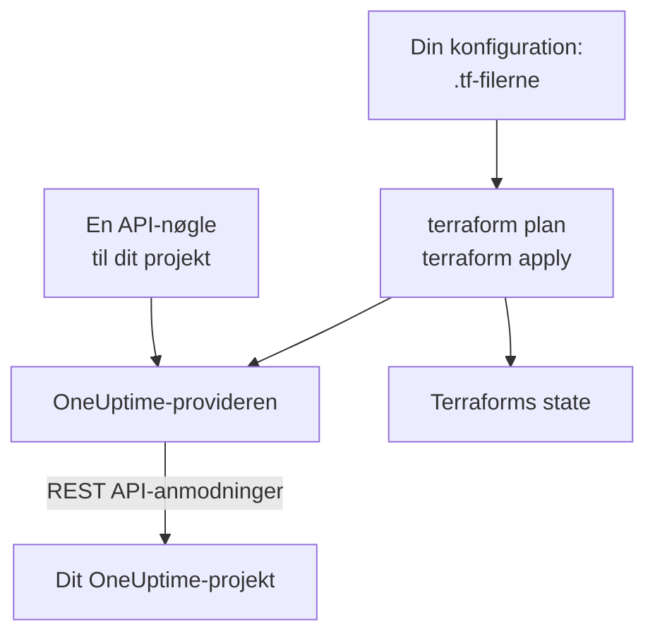

# Terraform – Oversigt

OneUptimes Terraform-provider administrerer dit OneUptime-projekt som kode. Beskriv monitorer, statussider, vagtpolitikker, teams, etiketter og de andre poster i dit projekt i `.tf`-filer, se med `terraform plan`, hvad der vil ændre sig, og gennemfør ændringen med `terraform apply`. Den virker med OneUptime Cloud og med en selv-hostet OneUptime, og med OpenTofu lige så vel som med Terraform.

:::cards
- [Sådan virker provideren](#sådan-virker-provideren): Din konfiguration, planen og API-anmodningerne bag dem.
- [Installér provideren](#installér-provideren): Provider-blokken, og hvilken version du skal vælge.
- [Lad dashboardet skrive den](#lad-dashboardet-skrive-den): Konfiguration og import-blokke til det, du allerede har.
- [Hvad du kan administrere](#hvad-du-kan-administrere): Ressourcer, datakilder, og hvordan deres attributter skrives.
:::

## Sådan virker provideren

Provideren er et plugin, som Terraform henter fra et registry. Ved `terraform apply` laver den hver ændring i planen om til en anmodning til OneUptimes REST API, sendt med en API-nøgle til dit projekt. Terraform gemmer det, den har oprettet, i sin state, så den næste plan kun viser, hvad der er ændret siden.



En API-nøgle hører til ét projekt og afgør, hvad Terraform må læse og ændre i det, så én konfiguration administrerer ét projekt. For at administrere flere giver du provideren et [alias](/docs/terraform/complete-guide#administrér-flere-projekter) til hvert projekt.

## Før du begynder

- **Terraform 1.5 eller nyere, eller OpenTofu 1.6 eller nyere.** De `import`-blokke, som dashboardet skriver, kræver disse versioner.
- **En API-nøgle til dit projekt.** [Hurtig start](/docs/terraform/quick-start#opret-en-api-nøgle-til-projektet) viser, hvordan du opretter en under **Projektindstillinger → Avanceret → API-nøgler**.
- **På OneUptime Cloud abonnementet Growth eller højere.** Et projekts API-nøgler virker kun på det.

## Installér provideren

Tilføj provideren til en `.tf`-fil. `terraform init` henter den fra Terraform Registry, og `tofu init` fra OpenTofu Registry:

```hcl title="main.tf"
terraform {
  required_providers {
    oneuptime = {
      source  = "oneuptime/oneuptime"
      version = "{{TERRAFORM_PROVIDER_VERSION}}"
    }
  }
}

provider "oneuptime" {
  # The API key comes from the ONEUPTIME_API_KEY environment variable.
  # On a self-hosted OneUptime, add your OneUptime's address:
  # oneuptime_url = "https://oneuptime.example.com"
}
```

Hold nøglen ude af dine filer: eksportér den, før du kører Terraform, eller giv den videre i en variabel, der er markeret som `sensitive`. [Komplet vejledning](/docs/terraform/complete-guide#konfigurér-provideren) viser alle måder at give provideren dens nøgle og adresse på.

### Vælg en version

Providerens versioner følger OneUptimes: provider {{TERRAFORM_PROVIDER_MAJOR}}.x er lavet ud fra OneUptime {{TERRAFORM_PROVIDER_MAJOR}}.x. Begrænsningen ovenfor, `{{TERRAFORM_PROVIDER_VERSION}}`, tager den nyeste {{TERRAFORM_PROVIDER_MAJOR}}.x-udgivelse, og det er den rigtige til OneUptime Cloud. På en selv-hostet OneUptime skal du bruge den nyeste provider, der ikke er nyere end din OneUptime: [Selv-hostet opsætning](/docs/terraform/self-hosted) viser, hvordan du låser den.

## Lad dashboardet skrive den

Du behøver ikke skrive en ressource, du allerede har, i hånden. Hver ressource i OneUptime-dashboardet (en monitor, en statusside, et workflow, en vagtpolitik og de andre) har en sektion **Udvikler** i sidemenuen, foldet sammen, indtil du åbner den. Dens side **Terraform** skriver konfigurationen for dig, udfyldt fra dit eget projekt.

:::steps
### Åbn ressourcen

Åbn den monitor, statusside eller anden ressource, som du vil lade Terraform administrere.

### Åbn dens Terraform-side

Åbn **Udvikler** og derefter **Terraform** i sidemenuen.

### Kopiér konfigurationen

Siden skriver ressourcens konfiguration ud fra dens nuværende indstillinger, med en `import`-blok. En kommentar efter hvert ID nævner den post, det peger på (`incident_severity_id = "..." # Critical Incident`).

### Planlæg og anvend

Kør `terraform plan`: den viser ressourcen, der importeres, og intet at ændre. Anvend den, og derefter administrerer Terraform ressourcen.
:::

Under konfigurationen har **Byg videre på den** det, folk ofte tilføjer ved siden af ressourcen, med henvisning til dens adresse: et ejerteam til en hændelse, en gruppe af monitorer til en statusside, en eskaleringsregel til en vagtpolitik.

Listesiderne (for eksempel **Hændelser** eller **Monitorer**) har den samme sektion. Der skriver siden **Terraform** en ny ressource med de felter, de fleste udfylder, ud fra dit projekts egne poster: en hændelse med en af dine alvorligheder, en monitor med de kriterier, en ny monitor får i dashboardet, koblet til dine statusser. Den giver færdige **Almindelige opsætninger** (en statusside med en gruppe og en monitor, en vagtpolitik, der tilkalder et team, en ugentlig vagtrotation) og en `import`-blok til hver ressource, du allerede har (de første 100), klar til `terraform plan -generate-config-out`. Begge sider giver også provider-blokken til din OneUptime: den rigtige `oneuptime_url` og en versionsbegrænsning, der passer til din OneUptime.

Hemmeligheder vises aldrig på disse sider. Når konfigurationen har brug for en (for eksempel en monitors `Authorization`-header), læser den den fra en Terraform-variabel, der er markeret som `sensitive`. Hemmeligheder, den ikke har brug for, udelades, og Terraform lader dem være, som de er i OneUptime.

Den samme sektion har en side **API** med `curl`-kommandoer til ressourcen og en side **AI-assistenter**, som forbinder Claude, GitHub Copilot eller Cursor med [MCP-serveren](/docs/ai/mcp-server).

## Hvad du kan administrere

Provideren har en ressource for hver slags post, du kan oprette via OneUptime-API'et, med navnet `oneuptime_<name>`. Det er disse, de fleste konfigurationer starter med:

| Ressource | Hvad det er |
| --- | --- |
| `oneuptime_monitor` | En monitor: website, API, ping, port, SSL-certifikat, server, indgående anmodning, manuel og alle andre typer |
| `oneuptime_monitor_status` | En monitorstatus, såsom Operational, Degraded eller Offline |
| `oneuptime_monitor_group` | En gruppe af monitorer, vist med én status |
| `oneuptime_status_page` | En offentlig eller privat statusside |
| `oneuptime_status_page_domain` | Et eget domæne til en statusside |
| `oneuptime_domain` | Et domæne i dit projekt, verificeret til statussider |
| `oneuptime_label` | En etiket, til at sortere og filtrere poster |
| `oneuptime_team`, `oneuptime_team_member` | Et team, og hvem der er med i det |
| `oneuptime_on_call_policy`, `oneuptime_escalation_rule` | En vagtpolitik, og de regler, den tilkalder i rækkefølge |
| `oneuptime_incident`, `oneuptime_incident_severity`, `oneuptime_incident_state` | Hændelser, deres alvorligheder og deres tilstande |
| `oneuptime_alert`, `oneuptime_alert_severity`, `oneuptime_alert_state` | Advarsler, deres alvorligheder og deres tilstande |
| `oneuptime_scheduled_maintenance_event` | Et planlagt vedligeholdelsesvindue |
| `oneuptime_probe` | En egen probe, som tjekker fra dit netværk |

[Terraform Registry](https://registry.terraform.io/providers/oneuptime/oneuptime/latest/docs) viser hver ressource med alle dens attributter.

### Læs det, der allerede findes

Hver ressource har en datakilde med samme navn, såsom `data "oneuptime_label"`. En datakilde læser en post, som denne konfiguration ikke administrerer, for eksempel en, der er oprettet i dashboardet. Slå den op med dens `id` eller med dens andre simple argumenter: hvert argument, du angiver, skal passe, og præcis én post må passe med dem alle.

```hcl
data "oneuptime_monitor_status" "offline" {
  name = "Offline"
}

# Any plain argument works. Set several, and all of them must match.
data "oneuptime_monitor_status" "offline_state" {
  is_offline_state = true
}
```

Intet match, eller mere end ét, er en fejl og ikke et tomt eller tilfældigt svar. [Komplet vejledning](/docs/terraform/complete-guide#læs-det-der-allerede-findes) har reglerne.

### Omdøbte ressourcer

Ressourcenavne holder ord som IoT og vCenter samlet: `oneuptime_iot_fleet` og `oneuptime_vcenter`, hvor ældre providere havde `oneuptime_io_t_fleet` og `oneuptime_v_center` (og det samme for deres etiketregler, ejere og feeds). De gamle navne virker stadig som forældede aliasser, og en plan, der bruger et af dem, siger det. For at skifte omdøber du ressourcen i din konfiguration og tilføjer en `moved`-blok, så beholder Terraform den eksisterende ressource i stedet for at erstatte den:

```hcl
# Was: resource "oneuptime_io_t_fleet" "factory"
resource "oneuptime_iot_fleet" "factory" {
  name = "Factory floor"
}

moved {
  from = oneuptime_io_t_fleet.factory
  to   = oneuptime_iot_fleet.factory
}
```

At flytte en ressource til en anden type kræver Terraform 1.8 eller nyere. På en ældre motor beholder du det gamle navn indtil videre: det virker fortsat.

## Sådan skrives attributter

Attributterne følger OneUptime-API'et, i snake_case:

| Slags værdi | Sådan skriver du den | Eksempel |
| --- | --- | --- |
| Tekst, tal, sand eller falsk | Som de er | `is_public_status_page = false` |
| En henvisning til en anden post | Dens ID, som regel en anden ressources `id` | `incident_severity_id = oneuptime_incident_severity.sev1.id` |
| En liste af henvisninger | Et sæt af ID'er, hvis rækkefølge ikke betyder noget | `labels = [oneuptime_label.critical.id]` |
| En farve, et domæne og andre indpakkede værdier | Deres simple værdi | `color = "#FF5733"` |
| En dato og et klokkeslæt | Tekst i RFC 3339 | `starts_at = "2030-06-01T02:00:00Z"` |
| En monitors tjek | Typede indlejrede attributter: se [Monitortrin](/docs/terraform/monitor-steps) | `monitor_steps = [{ ... }]` |
| Andre strukturerede indstillinger | JSON, skrevet med `jsonencode()` | `log_monitor = jsonencode({ ... })` |

To slags værdier tilhører serveren, og dem udelader du:

- **ID'er inde i en ressource.** En monitors trin og kriterier, og deres skabeloner til hændelser og advarsler, har ID'er, som serveren giver og beholder ved hver apply, så hændelser bliver ved med at pege på de kriterier, der udløste dem.
- **Det, serveren holder opdateret.** En monitors nuværende status, eller hvornår den sidst modtog et heartbeat, kan ændre sig mellem `terraform plan` og slutningen af `terraform apply`. Provideren beholder den planlagte værdi for alt, du ikke har angivet, og den næste refresh læser serverens, så dette får aldrig en apply til at fejle eller vises som en ændring.

## Få hjælp

- Fejl og ønsker om funktioner: [github.com/OneUptime/oneuptime/issues](https://github.com/OneUptime/oneuptime/issues).
- Provideren genereres ud fra OneUptimes OpenAPI-specifikation i [OneUptimes hovedrepository](https://github.com/OneUptime/oneuptime). Det udgivne provider-repository er skrivebeskyttet, så rapportér problemer i hovedrepositoryet.

## Næste skridt

:::cards
- [Hurtig start](/docs/terraform/quick-start): Opret en API-nøgle, og anvend dine første ressourcer på ti minutter.
- [Komplet vejledning](/docs/terraform/complete-guide): Godkendelse, projektopbygning, datakilder, state og opgraderinger.
- [Monitortrin](/docs/terraform/monitor-steps): Bestem, hvad en monitor tjekker, og hvad hvert resultat betyder.
- [Eksempler](/docs/terraform/examples): Færdige konfigurationer til de almindelige ressourcer.
- [Import af ressourcer](/docs/terraform/importing-resources): Bring det, du har lavet i dashboardet, ind under Terraform.
:::
