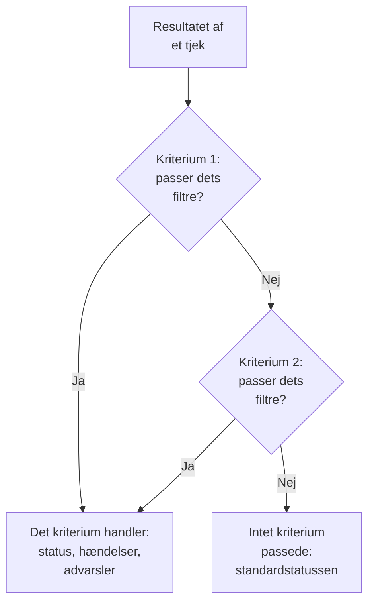
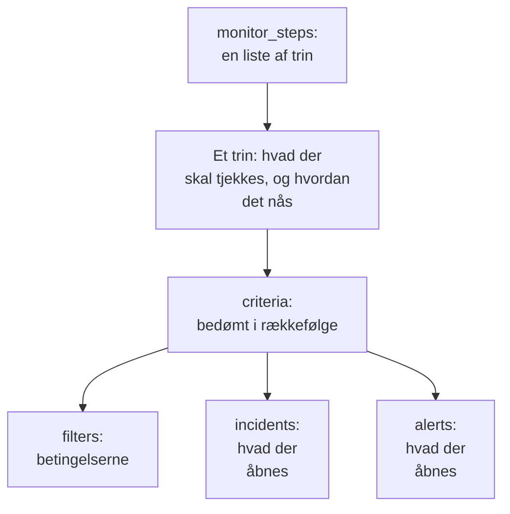

# Monitortrin

`monitor_steps` er den attribut i `oneuptime_monitor`, der siger, hvad en monitor tjekker, og hvordan hvert resultat bedømmes: adressen, der skal tjekkes, anmodningen, der skal sendes, og de kriterier, der gør et resultat til en monitorstatus, en hændelse eller en advarsel. Denne side forklarer hver del af den.

:::cards
- [Sådan bedømmes et tjek](#sådan-bedømmes-et-tjek): Kriterierne i rækkefølge, og det første, der passer.
- [Skriv trinnene](#skriv-trinnene): Deres form, et komplet eksempel og de to regler for værdier.
- [Filterreference](#filterreference): Hvad et filter kan tjekke, og hvordan det sammenligner.
- [Almindelige fejl](#almindelige-fejl): Det, der oftest går galt, og løsningen.
:::

## Sådan bedømmes et tjek

Hvert tjek giver et resultat: en probes svar, et scripts returværdi eller den telemetri, tjekket læser. Trinnets kriterier bedømmer det derefter i deres rækkefølge. Det første kriterium, hvis filtre passer, bestemmer, hvad der sker: det kan ændre monitorens status, åbne hændelser og åbne advarsler. Kriterierne efter det bliver ikke set på for det tjek.



Rækkefølgen af kriterierne betyder altså noget: sæt de kriterier, der advarer, først, det mest alvorlige først, og det sunde sidst. [Attributter for et kriterium](#attributter-for-et-kriterium) forklarer hvorfor, og den ene undtagelse.

## Skriv trinnene

`monitor_steps` er en liste af typede objekter, der skrives direkte i HCL. Der er ingen `jsonencode()`, ingen `{_type, value}`-indpakning, ingen camelCase-nøgle og intet ID at skrive: provideren laver din HCL om til API'ets format, og serveren giver hvert trin, kriterium, hændelsesskabelon og advarselsskabelon sit ID. Den beholder de ID'er ved hver apply ved at matche hvert kriterium og hver skabelon med den, de erstatter, ved navn og ellers ved position, så proberesultater bliver hos deres trin, og hændelser bliver ved med at pege på de kriterier, der udløste dem.



Det mindste nyttige trin tjekker én adresse og har ét kriterium med ét filter:

```hcl
resource "oneuptime_monitor" "example" {
  name         = "Example"
  description  = "The smallest monitor_steps"
  monitor_type = "Website"

  monitor_steps = [{
    monitor_destination      = "https://example.com"
    monitor_destination_type = "URL"
    request_type             = "GET"

    criteria = [
      {
        name             = "Check if online"
        description      = "The website responds"
        filter_condition = "All"

        filters = [
          {
            check_on    = "Is Online"
            filter_type = "True"
          }
        ]
      }
    ]
  }]
}
```

To regler gælder overalt i `monitor_steps`:

- **Udelad det, du ikke bruger.** En attribut, du ikke angiver, sendes ikke til API'et. Skriv aldrig `[]`, `{}` eller `""` som pladsholder: provideren afviser tomme strenge, lister og maps, så en manglende værdi altid betyder "ikke angivet".
- **Filterværdier er strenge.** Et filters `value` er en streng, selv for et tal: `value = "200"`, ikke `value = 200`. Numeriske indstillinger som `port` er tal.

:::details Skift fra provider 1.x, hvor monitor_steps var JSON
I provider 1.x var `monitor_steps` en JSON-streng skrevet med `jsonencode({ _type = "MonitorSteps", value = { ... } })`. Omskriv den som de typede attributter på denne side: fjern indpakningerne `_type` og `value`, skriv camelCase-nøglerne i snake_case (`monitorDestination` bliver til `monitor_destination` og `monitor_destination_type`, `filterCondition` bliver til `filter_condition`, `checkOn` bliver til `check_on`), og slet hvert `id`. Serveren giver nu alle ID'erne, hvilket også gør en ende på de hårdkodede tilfældige ID'er fra issue [#2291](https://github.com/OneUptime/oneuptime/issues/2291). En state, der er gemt som en JSON-streng, opgraderes ikke af sig selv: anvend den nye konfiguration.
:::

### Et komplet eksempel

Denne website-monitor tjekker det, som website-monitoren i providerens end-to-end-tests tjekker (testen `35-monitor-with-steps`): offline, når sitet ikke svarer, online, når det svarer med 200.

```hcl
resource "oneuptime_monitor_status" "operational" {
  name                 = "Operational"
  description          = "Monitor is operational"
  color                = "#2ecc71"
  priority             = 1
  is_operational_state = true
}

resource "oneuptime_monitor_status" "offline" {
  name                 = "Offline"
  description          = "Monitor is offline"
  color                = "#e74c3c"
  priority             = 3
  is_operational_state = false
}

resource "oneuptime_monitor" "website" {
  name         = "Website"
  description  = "Website monitor with explicit steps"
  monitor_type = "Website"

  monitor_steps = [{
    monitor_destination      = "https://example.com" # what to check
    monitor_destination_type = "URL"                 # URL, Hostname or IP
    request_type             = "GET"                 # the HTTP method

    criteria = [ # judged in order: the first match decides
      {
        name                  = "Offline"
        description           = "Check if website is offline"
        filter_condition      = "Any"
        change_monitor_status = true
        create_incidents      = false
        create_alerts         = false
        monitor_status_id     = oneuptime_monitor_status.offline.id

        filters = [
          {
            check_on    = "Is Online"
            filter_type = "False"
          }
        ]
      },
      {
        name                  = "Online"
        description           = "Check if website is online"
        filter_condition      = "All" # All: every filter, Any: at least one
        change_monitor_status = true
        create_incidents      = false
        create_alerts         = false
        monitor_status_id     = oneuptime_monitor_status.operational.id

        filters = [
          {
            check_on    = "Is Online"
            filter_type = "True"
          },
          {
            check_on    = "Response Status Code"
            filter_type = "Equal To"
            value       = "200" # a string, even for a number
          }
        ]
      }
    ]
  }]
}
```

Et kriterium henviser til en status via dens ressource, som `oneuptime_monitor_status.offline.id` gør her, eller til en, dit projekt allerede har, via en [datakilde](/docs/terraform/complete-guide#læs-det-der-allerede-findes).

## Attributter for et trin

Hvert element i `monitor_steps` er én ting at tjekke:

| Attribut | Type | Bruges af | Noter |
| --- | --- | --- | --- |
| `monitor_destination` | string | Website, API, Ping, IP, Port, SSL-certifikat, NTP | URL'en, værtsnavnet eller IP-adressen, der skal tjekkes. Kræver `monitor_destination_type`. |
| `monitor_destination_type` | string | de samme | `URL`, `Hostname` eller `IP`, efter hvad monitortypen tager: en URL til website-, API- og SSL-certifikatmonitorer; et værtsnavn eller en IP-adresse til Ping-, IP-, Port- og NTP-monitorer. |
| `port` | number | Port, NTP | TCP-porten, der skal tjekkes, såsom `443`. For NTP den UDP-port, tidsserveren svarer på: `123`, når den ikke er angivet. |
| `request_type` | string | Website, API | HTTP-metoden: `GET`, `POST`, `PUT`, `DELETE`, `HEAD` eller `PATCH`. Serveren bruger `GET`, når den ikke er angivet. |
| `request_headers` | map(string) | Website, API | Headere, der skal sendes: `{ "Accept" = "application/json" }`. |
| `request_body` | string | API | Anmodningens body, som tekst. |
| `do_not_follow_redirects` | bool | Website, API | Stop ved det første svar i stedet for at følge omdirigeringer. |
| `allow_self_signed_certificates` | bool | Website, API | Acceptér et selvsigneret TLS-certifikat. |
| `tls_client_certificate` | string | Website, API | Et klientcertifikat til gensidig TLS: PEM eller en henvisning `{{monitorSecrets.name}}`. |
| `tls_client_key` | string (følsom) | Website, API | Klientcertifikatets private nøgle. Angiv den sammen med certifikatet. |
| `tls_client_key_passphrase` | string (følsom) | Website, API | Den private nøgles adgangssætning. |
| `request_timeout_in_ms` | number | Tjek, som en probe udfører | Hvor længe ét forsøg må tage, i millisekunder. Proben sænker alt over 60000 til 60000. |
| `retry_count` | number | Tjek, som en probe udfører | Nye forsøg efter et mislykket første forsøg: `0` tjekker én gang, `3` op til fire gange. Proben sænker alt over 3 til 3. |
| `custom_code` | string | Custom JavaScript Code, Synthetic | Det script, trinnet kører. |
| `screen_size_types` | list(string) | Synthetic | `Mobile`, `Tablet` og `Desktop`. |
| `browser_types` | list(string) | Synthetic | `Chromium` og `Firefox`. |
| `retry_count_on_error` | number | Synthetic | Nye forsøg, når scriptet fejler: `0` kører det én gang. |
| `criteria` | list (påkrævet) | Alle | Hvordan hvert resultat bedømmes: se [Attributter for et kriterium](#attributter-for-et-kriterium). |

### Indstillinger for hver monitortype

Monitortyper med mere at angive end en adresse har deres indstillinger (en logforespørgsel, en databaseforbindelse, en klynge at overvåge) i deres egen attribut, som rå JSON skrevet med `jsonencode()`: `log_monitor`, `trace_monitor`, `llm_monitor`, `metric_monitor`, `exception_monitor`, `profile_monitor`, `dns_monitor`, `domain_monitor`, `dnssec_monitor`, `sql_monitor`, `database_monitor`, `external_status_page_monitor`, `network_device_monitor`, `kubernetes_monitor`, `docker_monitor`, `docker_swarm_monitor`, `host_monitor`, `podman_monitor`, `proxmox_monitor`, `vmware_monitor`, `ceph_monitor`, `storage_array_monitor`, `iot_monitor` og `probe_status_monitor`.

Deres JSON er den samme som dashboardets, med nøgler i camelCase. Et ID i den skrives, som API'et skriver det: `{ _type = "ObjectID", value = "..." }`. En Logs-monitor, der tæller fejl fra én tjeneste:

```hcl
resource "oneuptime_service" "checkout" {
  name = "checkout"
}

resource "oneuptime_monitor" "checkout_errors" {
  name         = "Checkout errors"
  monitor_type = "Logs"

  monitor_steps = [{
    log_monitor = jsonencode({
      attributes          = {}
      body                = "error"
      severityTexts       = ["Error"]
      telemetryServiceIds = [{ _type = "ObjectID", value = oneuptime_service.checkout.id }]
      lastXSecondsOfLogs  = 300
    })

    criteria = [
      {
        name             = "Errors found"
        filter_condition = "Any"

        filters = [
          {
            check_on    = "Log Count"
            filter_type = "Greater Than"
            value       = "0"
          }
        ]
      }
    ]
  }]
}
```

> [!TIP]
> Den letteste måde at få denne JSON rigtig på: sæt monitoren op i dashboardet, og åbn derefter dens sektion **Udvikler** og **Terraform**. Siden skriver monitorens `monitor_steps`, med `jsonencode()` og det hele.

## Attributter for et kriterium

Hvert element i `criteria` er én regel: når dens filtre passer, så gør, hvad den siger.

Kriterierne bedømmes fra toppen, og det første, der passer, bestemmer, så sæt de kriterier, der advarer, først, det mest alvorlige først (kritisk, derefter advarsel), og det sunde sidst. Et sundt kriterium øverst er den mest almindelige måde at bygge en monitor på, der aldrig advarer: en bred regel som `Is Online` er `True`, eller en metrikværdi `Greater Than` `0`, passer med næsten hvert tjek, og kriterierne under den bliver aldrig set på. Sat sidst passer det kun, når intet ovenover passede, og det er det, du vil have.

Grupperede metrikmonitorer er den ene undtagelse. Når en metrikmonitors forespørgsel er grupperet (`groupByAttributeKeys` angivet i JSON'en for `metric_monitor`, ved `metricViewConfig.queryConfigs[].metricQueryData.groupByAttributeKeys`), åbner monitoren én advarsel eller hændelse for hver gruppe (hver vært, container eller monteringspunkt), og hvert kriterium bedømmes, så et kritisk kriterium og et advarselskriterium kan udløses for forskellige værter ved det samme tjek. En vært, der bryder begge, tilkaldes stadig kun én gang, af det første kriterium, der passer, så det mest alvorlige skal stadig stå først. Se [Metrik-monitor](/docs/monitor/metrics-monitor).

| Attribut | Type | Hvad det er |
| --- | --- | --- |
| `name` | string (påkrævet) | Navnet, som dashboardet viser. |
| `description` | string | Beskrivelsen, som dashboardet viser. |
| `filter_condition` | string (påkrævet) | `All`: hvert filter skal passe. `Any`: ét er nok. |
| `filters` | list (påkrævet) | Betingelserne, mindst én: se [Filterreference](#filterreference). |
| `change_monitor_status` | bool | Om et match ændrer monitorens status. |
| `monitor_status_id` | string | ID'et på den `oneuptime_monitor_status`, der skiftes til. Angiv det, når `change_monitor_status` er `true`. |
| `create_incidents` | bool | Om et match åbner hændelser. |
| `incidents` | list | De hændelser, der skal åbnes. Udelad den, medmindre `create_incidents = true`. |
| `create_alerts` | bool | Om et match åbner advarsler. |
| `alerts` | list | De advarsler, der skal åbnes. Udelad den, medmindre `create_alerts = true`. |
| `is_enabled` | bool | `true` på serveren, når den ikke er angivet. Angiv `false` for at beholde et kriterium uden at bedømme med det. |
| `incident_grouping` | string (JSON) | Kun monitorer for indgående anmodninger: én hændelse for hver værdi, der findes i anmodningen, såsom `jsonencode({ groupByJSONPath = "..." })`. |
| `open_for_every_email` | bool | Kun monitorer for indgående e-mail: `true` åbner en hændelse (og en advarsel) for hver e-mail, der matcher, i stedet for én ad gangen. |

### Hændelser og advarsler

Et element i `incidents` tager `title` og `description` (begge påkrævet), `incident_severity_id`, `auto_resolve_incident`, `remediation_notes`, `on_call_policy_ids`, `label_ids`, `owner_team_ids`, `owner_user_ids`, `show_incident_on_status_page` og `is_private`. Et element i `alerts` tager de samme, med `alert_severity_id` og `auto_resolve_alert`, og uden `show_incident_on_status_page`.

Dette kriterium markerer monitoren som offline, åbner en hændelse, der tilkalder vagtpolitikken, og løser den, når sitet er tilbage:

```hcl
criteria = [
  {
    name                  = "Offline"
    description           = "The site is unreachable"
    filter_condition      = "Any"
    change_monitor_status = true
    monitor_status_id     = oneuptime_monitor_status.offline.id
    create_incidents      = true

    filters = [
      {
        check_on    = "Is Online"
        filter_type = "False"
      }
    ]

    incidents = [
      {
        title                 = "Website is down"
        description           = "The website did not respond to the probe."
        incident_severity_id  = oneuptime_incident_severity.critical.id
        auto_resolve_incident = true
        on_call_policy_ids    = [oneuptime_on_call_policy.primary.id]
      }
    ]
  }
]
```

## Filterreference

Et filter har `check_on` (hvad der kigges på), `filter_type` (hvordan der sammenlignes) og `value` (hvad der sammenlignes med, som en streng; udelad den ved sand-eller-falsk-tjek som `True` og `False`).

Et filter kan også bedømme et tidsvindue i stedet for det seneste tjek: angiv `evaluate_over_time = true`, vinduets længde i `evaluate_over_time_minutes` og i `evaluate_over_time_type`, hvordan vinduet læses: `Average`, `Sum`, `Maximum Value`, `Minimum Value`, `All Values` eller `Any Value`.

`All Values` betyder, at hvert tjek i vinduet brød reglen, så det passer først, når vinduet er dækket af data: en monitor, der lige er oprettet, venter på, at dens vindue fyldes, i stedet for at passe ved sit første tjek. Giv den et vindue på mindst det dobbelte af monitorens `monitoring_interval`; ellers rummer vinduet ét tjek, og "alle værdier" betyder det samme som "en vilkårlig værdi". `Any Value` passer med vilje ved ét tjek, der bryder reglen.

`evaluate_over_time_no_data_policy` siger, hvad filteret gør, mens vinduet ikke rummer nok data: `Ignore` (standarden) passer ikke, `Trigger` behandler de manglende data som fejlen, ligesom et heartbeat gør, og `Treat As Zero` sammenligner vinduet som et enkelt nul.

### Hvad et filter kan tjekke

De `check_on`-værdier, hver monitortype bruger mest. Dashboardets kriterieeditor tilbyder de samme og viser dem alle:

| Monitortype | `check_on`-værdier |
| --- | --- |
| Website / API | `Is Online`, `Response Time (in ms)`, `Response Status Code`, `Response Body`, `Response Header`, `Response Header Value`, `JavaScript Expression`, `Is Request Timeout` |
| Ping / IP | `Is Online`, `Response Time (in ms)`, `Packet Loss (in %)`, `Jitter (in ms)`, `Is Request Timeout` |
| Port | `Is Online`, `Response Time (in ms)` (dashboardets samlede forbindelsestid), `Port DNS Lookup Time (in ms)`, `Port TCP Connect Time (in ms)`, `Is Request Timeout` |
| SSL-certifikat | `Is Valid Certificate`, `Is Not A Valid Certificate`, `Is Self Signed Certificate`, `Is Expired Certificate`, `Expires In Days`, `Expires In Hours` |
| Indgående anmodning | `Incoming Request`, `Request Body`, `Request Header`, `Request Header Value`, `JavaScript Expression` |
| Indgående e-mail | `Email Received`, `Email Subject`, `Email From Address`, `Email To Address`, `Email Body` |
| Server | `Is Online`, `CPU Usage (in %)`, `Memory Usage (in %)`, `Disk Usage (in %)` (med `disk_path`), `Server Process Name` |
| Logs | `Log Count` |
| Traces | `Span Count` |
| Undtagelser | `Exception Count` |
| Profiler | `Profile Count` |
| AI / LLM | `Bad AI Answers (in %)`, `Bad AI Answers`, `AI Answers` |
| Metrikker | `Metric Value` (metrikfiltre kan tage JSON i `metric_monitor_options`) |
| Brugerdefineret kode / Synthetic | `Result Value` (kan sammenligne ét felt i de returnerede data, angivet i JSON'en i `custom_code_monitor_options`, f.eks. `jsonencode({ resultValuePath = "status" })` — se nedenfor), `Error`, `Execution Time (in ms)` |
| DNS | `DNS Is Online`, `DNS Response Time (in ms)`, `DNS Record Value`, `DNS Record Exists` |
| Domæne | `Domain Expires In Days`, `Domain Is Expired`, `Domain Registrar`, `Domain Name Server` |
| DNSSEC | `DNSSEC Chain Is Valid`, `DNSSEC DS Record Exists At Parent`, `DNSSEC Signature Expires In Days` |
| SQL-forespørgsel | `SQL Is Online`, `SQL Query Row Count`, `SQL Query Scalar Value` |
| Databasesundhed | `Database Is Online`, `Database Metric` (med JSON i `database_monitor_options`, der angiver serien, f.eks. `jsonencode({ metricType = "oneuptime.monitor.database.connections.used.percent" })`), `Database Collection Error` |
| Ekstern statusside | `External Status Page Is Online`, `External Status Page Active Incidents`, `External Status Page Component Status` |
| NTP | `NTP Is Online`, `NTP Is Synchronized`, `NTP Stratum`, `NTP Clock Offset (in ms)`, `NTP Response Time (in ms)`, `NTP Root Dispersion (in ms)` (`NTP Is Online` og `NTP Is Synchronized` tager ingen `value`) |
| Netværksenhed (SNMP) | `SNMP Device Is Online` (den svarer på ping eller SNMP), `SNMP Walk Is Succeeding` (false, når den svarer, men ikke kan gennemløbes), `SNMP OID Value` (SNMP-filtre kan tage JSON i `snmp_monitor_options`) |

### Hvordan et filter sammenligner

| Slags | `filter_type`-værdier |
| --- | --- |
| Sand eller falsk | `True`, `False` |
| Tal | `Equal To`, `Not Equal To`, `Greater Than`, `Less Than`, `Greater Than Or Equal To`, `Less Than Or Equal To` |
| Tekst | `Contains`, `Not Contains`, `Starts With`, `Ends With`, `Is Empty`, `Is Not Empty` |
| Heartbeats | `Recieved In Minutes`, `Not Recieved In Minutes` (stavet, som API'et staver dem) |
| Serverprocesser | `Is Executing`, `Is Not Executing` |
| Scripts | `Evaluates To True` |
| Anomalier, for metrikker, logs og traces | `Anomalously High`, `Anomalously Low`, `Anomalous` |

Et filter, der passer, når et SSL-certifikat udløber om 14 dage eller mindre:

```hcl
filters = [
  {
    check_on    = "Expires In Days"
    filter_type = "Less Than Or Equal To"
    value       = "14"
  }
]
```

Provideren tjekker `check_on`, `filter_type` og de andre faste lister, når den planlægger, så en tastefejl fejler, før noget sendes til API'et. Værdierne er API'ets navne for valgmulighederne i dashboardets kriterieeditor.

### Sammenlign ét felt i et scripts resultat

Scriptet i en Brugerdefineret kode-monitor eller en Synthetic-monitor returnerer `data`, og et filter `Result Value` sammenligner det. Når `data` er et objekt eller et array, angiver `custom_code_monitor_options` det ene felt i det, der skal sammenlignes: **Feltsti** i dashboardets Result Value-filter. Brug punktummer til indlejrede felter og `[n]` til elementer i et array, og udelad attributten for at sammenligne hele værdien:

```hcl
monitor_steps = [{
  custom_code = <<-EOT
    const response = await axios.get("https://api.example.com/health");
    // For example { status: "UP", checks: [{ name: "db", latency: 12 }] }
    return { data: response.data };
  EOT

  criteria = [
    {
      name             = "Unhealthy"
      filter_condition = "Any"
      filters = [
        {
          check_on                    = "Result Value"
          filter_type                 = "Not Equal To"
          value                       = "UP"
          custom_code_monitor_options = jsonencode({ resultValuePath = "status" })
        },
        {
          check_on                    = "Result Value"
          filter_type                 = "Greater Than"
          value                       = "500"
          custom_code_monitor_options = jsonencode({ resultValuePath = "checks[0].latency" })
        }
      ]
    }
  ]
}]
```

`Greater Than` og de andre talbetingelser passer kun med et felt, der er et tal, og et felt, der mangler i de returnerede data, passer kun med `Is Empty`. Se [Advarsler på de returnerede data](/docs/monitor/custom-code-monitor#advarsler-på-de-returnerede-data) for, hvordan stier og betingelser virker.

## Almindelige fejl

1. **Tomme pladsholdere.** `incidents = []`, `request_headers = {}` og `description = ""` afvises: udelad i stedet attributten.
2. **Et tal, hvor der skal stå en streng.** Et filters `value` er en streng, selv for et tal: `value = "200"`. Numeriske indstillinger som `port`, `retry_count`, `request_timeout_in_ms` og `evaluate_over_time_minutes` tager tal.
3. **Den forkerte destinationstype.** `monitor_destination_type = "URL"` med et rent værtsnavn, eller `Hostname` med en fuld URL, får tjekket til at fejle. Website- og API-monitorer tager URL'er; Ping-, IP- og Port-monitorer tager værtsnavne eller IP-adresser.
4. **Et statusskift uden status.** `change_monitor_status = true` uden `monitor_status_id` passer og har ingen status at skifte til.
5. **ID'er.** Intet element i `monitor_steps` har en attribut `id`. Hvis du skifter fra den gamle JSON, så slet dem: serveren giver ID'erne.
6. **JSON skrevet i hånden.** Skriv `log_monitor` og de andre indstillinger med `jsonencode()`, så Terraform sætter dem i anførselstegn og skriver JSON'en på samme måde hver gang. Til `metric_monitor` giver du hele det objekt, dashboardet skriver: serveren normaliserer det.

## Når intet kriterium passer

Et tjek, der ikke passer med noget kriterium, sætter monitoren i dens standardstatus: projektets operationelle status, den, som dashboardet vælger til en ny monitor. Dens åbne hændelser, hvis kriterier har valgt automatisk løsning til, løses også. For selv at bestemme hvert udfald slutter du listen med et bredt sundt kriterium, som eksemplerne på denne side gør.

## En monitor uden trin

`monitor_steps` er valgfri, men en monitor, der oprettes uden, har ingen kriterier at bedømme et resultat efter: prober springer en monitor uden trin over, og den bliver i den status, den startede i. Din state holder attributten tom, og planen forbliver ren. En manuel monitor har aldrig brug for trin: du sætter selv dens status. Alle andre typer har brug for mindst ét trin for at tjekke noget.

## Wireformatet

Bag provideren taler API'et stadig sin egen JSON, hvor hvert rigt objekt er pakket ind som `{_type, value}`:

```json
{
  "_type": "MonitorSteps",
  "value": {
    "monitorStepsInstanceArray": [
      {
        "_type": "MonitorStep",
        "value": {
          "monitorDestination": { "_type": "URL", "value": "https://example.com" },
          "requestType": "GET",
          "monitorCriteria": {
            "_type": "MonitorCriteria",
            "value": { "monitorCriteriaInstanceArray": [ { "_type": "MonitorCriteriaInstance", "value": { "...": "..." } } ] }
          }
        }
      }
    ]
  }
}
```

Provideren bygger dette ud fra din HCL, når den skriver, og læser det tilbage til HCL og udelader det, serveren administrerer (ID'erne og de standardværdier, den tilføjer). Du støder kun på det, når du selv læser API'ets svar, for eksempel i et script, der læser `monitorSteps`.

## Næste skridt

:::cards
- [Eksempler](/docs/terraform/examples): Ping-, port-, SSL-certifikat- og API-monitorer, klar til brug.
- [Komplet vejledning](/docs/terraform/complete-guide): Datakilder, state og opgraderinger.
- [Metrik-monitor](/docs/monitor/metrics-monitor): Metrikforespørgsler, gruppering og anomalier.
- [Fejlfinding](/docs/terraform/troubleshooting): Herunder et inkonsistent resultat efter apply på en monitor.
:::
