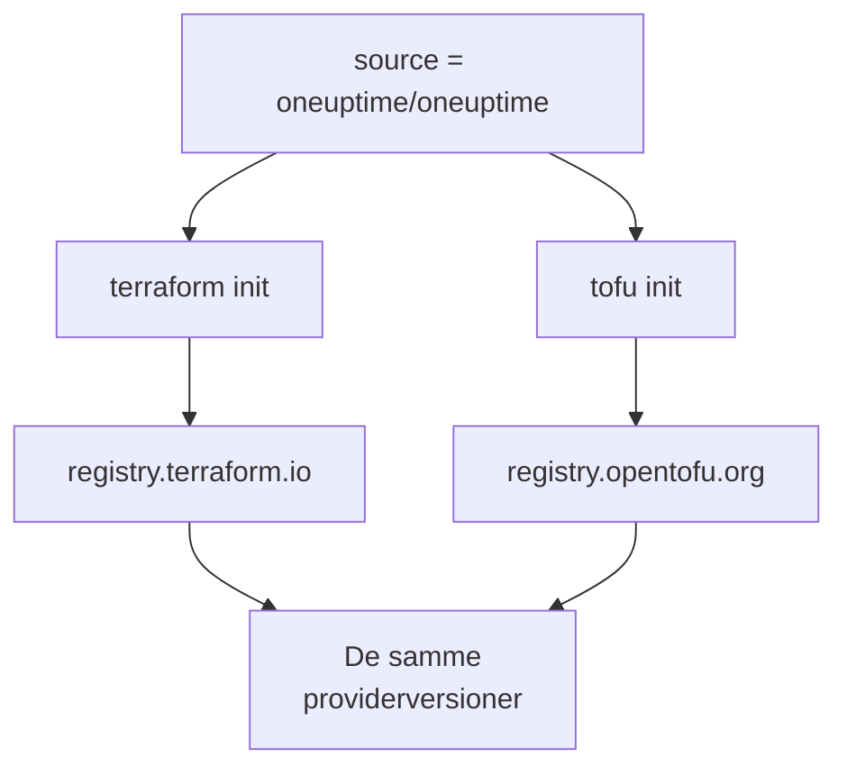

# OpenTofu

OneUptime-provideren virker med [OpenTofu](https://opentofu.org), som den virker med Terraform. Den udgives i [OpenTofu Registry](https://search.opentofu.org/provider/oneuptime/oneuptime/latest), og hver release består de samme end-to-end-test under begge, før den udgives. Din konfiguration ændrer sig ikke: kør `tofu` overalt, hvor denne dokumentation kører `terraform`.

:::cards
- [Brug provideren med OpenTofu](#brug-provideren-med-opentofu): Den samme konfiguration, kørt med `tofu`.
- [Hvad der er anderledes end Terraform](#hvad-der-er-anderledes-end-terraform): Registre, låsefiler, `.tofu`-filer og versioner.
- [Flyt en konfiguration til OpenTofu](#flyt-en-konfiguration-til-opentofu): Skift en eksisterende konfiguration i fire trin.
- [Et genbrugeligt modul](#et-genbrugeligt-modul): Overvågninger, en vagtpolitik og en statusside for én tjeneste.
:::

## Brug provideren med OpenTofu

Du skal bruge OpenTofu 1.6 eller nyere. Deklarér provideren, som du ville gøre for Terraform:

```hcl title="main.tf"
terraform {
  required_providers {
    oneuptime = {
      source  = "oneuptime/oneuptime"
      version = "{{TERRAFORM_PROVIDER_VERSION}}"
    }
  }
}

provider "oneuptime" {
  # The API key comes from the ONEUPTIME_API_KEY environment variable.
  # On a self-hosted OneUptime, add your OneUptime's address:
  # oneuptime_url = "https://oneuptime.example.com"
}
```

Kør den derefter med `tofu`:

```bash
export ONEUPTIME_API_KEY="<your-api-key>"
tofu init
tofu plan
tofu apply
```

`tofu init` henter provideren fra OpenTofu Registry. Alt i [Hurtig start](/docs/terraform/quick-start), [Komplet vejledning](/docs/terraform/complete-guide), [Monitortrin](/docs/terraform/monitor-steps), [Eksempler](/docs/terraform/examples) og [Import af ressourcer](/docs/terraform/importing-resources) gælder, som det er, og den konfiguration, dashboardets **Terraform**-sider skriver, virker uændret.

### Hold registret ude af kildeadressen

`source = "oneuptime/oneuptime"` nævner intet register, så hvert værktøj læser den fra sit eget:



Udelad værtsnavnet. Med et værtsnavn bruger hvert værktøj det register: under `registry.terraform.io/oneuptime/oneuptime` henter OpenTofu også fra Terraform Registry, og Terraform afviser OpenTofu Registrys kopi med `authentication signature from unknown issuer`.

## Hvad der er anderledes end Terraform

| Emne | Under OpenTofu |
| --- | --- |
| Registret | `oneuptime/oneuptime` er `registry.opentofu.org/oneuptime/oneuptime`, som udgiver de samme versioner som Terraform Registry. |
| Signaturer | `tofu init` siger, at signaturvalideringen blev sprunget over: OpenTofu Registry har ingen signeringsnøgle til denne provider, så OpenTofu kontrollerer downloadet mod registrets checksums. |
| `terraform`-blokken | Forbliver `terraform`: den er en del af sproget, og OpenTofu læser den, som den er. |
| `.tofu`-filer | OpenTofu 1.8 og nyere læser også `.tofu`-filer og springer en `.tf`-fil over, som har en `.tofu`-fil med samme navn. Terraform læser kun `.tf`-filer. |
| `required_version` | OpenTofus versioner starter ved 1.6.0, så `>= 1.5.0`, skrevet til Terraform, tillader enhver OpenTofu. |
| Låsefilen | Nævner `registry.opentofu.org/oneuptime/oneuptime`. Et skift af værktøj omskriver den post: commit ændringen. |
| State | OpenTofu læser en state, som Terraform har skrevet, som den er. |
| Variabler | `TF_VAR_name` angiver også en variabel under OpenTofu. |
| CLI-konfigurationsfilen | `~/.tofurc` eller `~/.terraformrc`, eller den fil, `TF_CLI_CONFIG_FILE` nævner. |
| En `removed`-blok | Dens `lifecycle`-blok kræver OpenTofu 1.10 eller nyere. Uden den glemmer OpenTofu ressourcen og beholder posten, hvor Terraform ødelægger den. |
| Flytning til en omdøbt ressourcetype | En `moved`-blok fra `oneuptime_io_t_fleet` til `oneuptime_iot_fleet`, eller mellem de andre omdøbte typer, kræver OpenTofu 1.12 eller nyere. |

## Flyt en konfiguration til OpenTofu

En konfiguration, som Terraform styrer, flytter til OpenTofu, som den er, med sin state:

:::steps
### Installér OpenTofu

Installér OpenTofu: 1.6 er nok til provideren, og 1.12 eller nyere flytter også en ressource til en omdøbt type, som `oneuptime_io_t_fleet` til `oneuptime_iot_fleet`.

### Initialisér med tofu

Kør `tofu init` i konfigurationens mappe. Den henter provideren fra OpenTofu Registry og siger, at den har ændret låsefilen: providerens post nævner nu OpenTofu Registry.

### Planlæg

Kør `tofu plan`. Den læser den state, Terraform efterlod, og svarer `No changes.`

### Commit låsefilen

Commit `.terraform.lock.hcl`, og kør fremover konfigurationen med `tofu`, også i CI.
:::

## Et genbrugeligt modul

[`Examples/opentofu/`](https://github.com/OneUptime/oneuptime/tree/master/Examples/opentofu) i OneUptime-repositoriet indeholder konfigurationer, der kan køres med det samme, og et modul, der sætter én tjeneste op: en overvågning af websitet for hver adresse, du giver det, en etiket på alt, det opretter, en vagtpolitik med én eskaleringsregel, og en statusside, der viser overvågningerne. Det er almindelig HCL, så det virker også under Terraform.

```hcl title="main.tf"
module "storefront" {
  source = "github.com/OneUptime/terraform-provider-oneuptime//modules/monitoring-and-incident-response?ref=vX.Y.Z"

  service_name          = "storefront"
  status_page_is_public = true

  monitors = {
    homepage = { url = "https://example.com" }
    checkout = { url = "https://example.com/checkout" }
    api      = { url = "https://api.example.com/health", expected_status_code = "204" }
  }
}
```

Erstat `vX.Y.Z` med en udgivet providerversion, som den nyeste på [providerens releases](https://github.com/OneUptime/terraform-provider-oneuptime/releases): modulet udgives sammen med provideren, og dets repositorie ændres ved hver release.

Modulet opretter ikke monitorstatusser eller hændelsesalvorligheder. Det slår dem op ved navn, som hvert projekt starter med: `Operational`, `Offline` og `Critical Incident`. Hvis dit projekt har omdøbt dem, så angiv `operational_monitor_status_name`, `offline_monitor_status_name` eller `incident_severity_name`.

Dets eskaleringsregel tilkalder ingen, før du siger hvem: tilføj et team til den med modulets outputs:

```hcl title="main.tf"
resource "oneuptime_team" "storefront" {
  name = "Storefront"
}

resource "oneuptime_team_on_call_duty_escalation_rule" "storefront" {
  on_call_duty_policy_id                 = module.storefront.on_call_policy_id
  on_call_duty_policy_escalation_rule_id = module.storefront.escalation_rule_id
  team_id                                = oneuptime_team.storefront.id
}
```

## Næste skridt

:::cards
- [Hurtig start](/docs/terraform/quick-start): Opret en API-nøgle, og anvend dine første ressourcer.
- [Registerbrug](/docs/terraform/registry): Hvordan versioner nummereres, og låsefilen.
- [Selv-hostet opsætning](/docs/terraform/self-hosted): Din egen OneUptime, og et spejl til offline-maskiner.
- [Fejlfinding](/docs/terraform/troubleshooting): Almindelige fejl, og hvordan du retter dem.
:::
