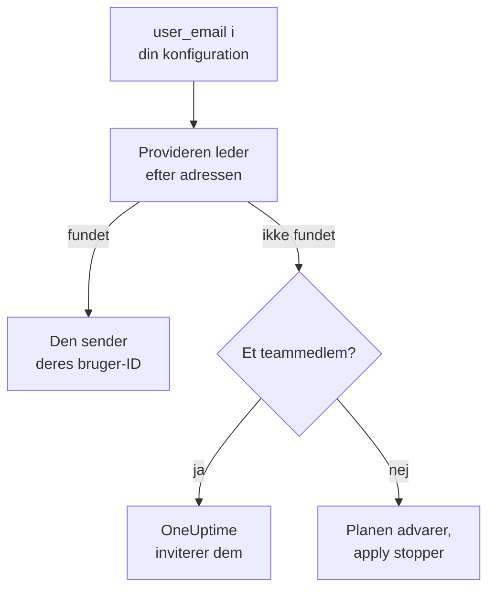

# Personer og teams

Hold styr på, hvem der er i dit projekt, i din Terraform-konfiguration: teams og deres medlemmer, hvem der har vagt, og hvem der ejer hvad. Navngiv hver person med deres e-mailadresse: provideren finder dem og inviterer alle, der er nye i projektet.

:::cards
- [Navngiv personer med e-mailadresse](#navngiv-personer-med-e-mailadresse): Attributten ved siden af hvert bruger-ID.
- [Tag nye personer ind](#tag-nye-personer-ind): Invitér nogen, og giv dem et team, vagter og noget at eje.
- [Fjern personer](#fjern-personer): Fjern nogen, og se, hvad OneUptime fjerner sammen med dem.
- [Importér medlemmer, du allerede har](#importér-medlemmer-du-allerede-har): Via deres team og deres adresse.
:::

## Sådan virker det

Provideren slår adressen op blandt personerne i API-nøglens projekt: dets medlemmer og de personer, der er inviteret til det. Den sender API'et ID'et på den person, den finder. Et teammedlem, der navngives med en adresse, som ingen i projektet har, inviterer i stedet den adresse.



Kun API-nøglens eget projekt bliver gennemsøgt. Ingen uden for det bliver nogensinde fundet, og provideren kan ikke se, om en adresse har en konto andre steder.

## Før du begynder

- **En API-nøgle, der må læse projektets teams.** Provideren finder personer gennem dem.
- **For at tilføje nogen ny, en nøgle, der må invitere personer.** Se [Inviter personer](/docs/permissions/inviting-people).

## Navngiv personer med e-mailadresse

Hver ressource, der navngiver en person, tager deres e-mailadresse ved siden af deres bruger-ID. Angiv en af de to:

| Bruger-ID | E-mailadresse |
| --- | --- |
| `user_id` | `user_email` |
| `owner_users` | `owner_user_emails` |
| `assigned_to_user_id` | `assigned_to_user_email` |
| `override_user_id` | `override_user_email` |

Adressen findes uanset store og små bogstaver og gemmes i state, som du skrev den. Bruger-ID'et udfyldes, så andre ressourcer kan henvise til det.

## Tag nye personer ind

Denne konfiguration føjer Alice, som er ny i projektet, til et team, giver hende vagter fra hendes første dag og gør Bob, som allerede er i projektet, til ejer af en monitor:

```hcl title="people.tf"
resource "oneuptime_team" "sre" {
  name        = "SRE"
  description = "Site reliability engineering"
}

# New to the project: OneUptime invites her.
resource "oneuptime_team_member" "alice" {
  team_id    = oneuptime_team.sre.id
  user_email = "alice@example.com"
}

resource "oneuptime_on_call_policy_schedule" "weekly" {
  name     = "SRE weekly"
  timezone = "UTC"
}

resource "oneuptime_on_call_schedule_layer" "weekly" {
  on_call_duty_policy_schedule_id = oneuptime_on_call_policy_schedule.weekly.id
  name                            = "Weekly"
  starts_at                       = "2030-01-07T09:00:00Z"
  hand_off_time                   = "2030-01-14T09:00:00Z"
}

# Named through her membership, so she is invited first.
resource "oneuptime_on_call_schedule_layer_user" "alice" {
  on_call_duty_policy_schedule_id       = oneuptime_on_call_policy_schedule.weekly.id
  on_call_duty_policy_schedule_layer_id = oneuptime_on_call_schedule_layer.weekly.id
  user_id                               = oneuptime_team_member.alice.user_id
}

resource "oneuptime_monitor" "api" {
  name         = "Public API"
  monitor_type = "Manual"
}

# In the project already: named by his address.
resource "oneuptime_monitor_user_owner" "api" {
  monitor_id = oneuptime_monitor.api.id
  user_email = "bob@example.com"
}
```

`terraform apply` inviterer Alice via e-mail, sådan som en invitation fra dashboardet gør. OneUptime opretter en konto til hende, hvis hun ikke har en. `has_accepted_invitation` forbliver `false`, indtil hun accepterer, og at hun accepterer, er ingen ændring i planen. Den, der allerede er i projektet, kommer straks med i et nyt team.

For at sætte en person, som denne konfiguration inviterer, på vagt eller gøre dem til ejer, så henvis til deres medlemskab med `user_id = oneuptime_team_member.<name>.user_id`: Så inviterer Terraform dem, før den navngiver dem andre steder. En adresse, som ingen i projektet har, er en advarsel i planen og en fejl i apply.

## Find en person

Datakilden `oneuptime_user` slår en person op via `email`, `name` eller `id` og læser deres bruger-ID, deres navn, om de er kommet med, og de teams, de er i:

```hcl
data "oneuptime_user" "alice" {
  email = "alice@example.com"
}

output "alice_teams" {
  value = data.oneuptime_user.alice.team_ids
}
```

Andre datakilder finder en post via adressen på den person, den nævner, ved siden af personens ID. Denne læser Alices medlemskab af SRE-teamet:

```hcl
data "oneuptime_team_member" "alice" {
  team_id    = oneuptime_team.sre.id
  user_email = "alice@example.com"
}
```

## Fjern personer

Fjern personens medlemskaber fra din konfiguration, og anvend den. Ude af deres sidste team i projektet er de ude af projektet, og OneUptime fjerner dem fra hver vagtplan, hver eskaleringsregel og hver stedfortræder og fra det, de ejer: alt, undtagen de hændelser, alarmer og vedligeholdelsesbegivenheder, der er overstået. Fjern de blokke, der navngiver dem, i samme ændring, ellers opretter den næste plan dem igen for en, der ikke længere er i projektet.

Deres OneUptime-konto forbliver deres: Det er kun projektet, de forlader. Et team, der skal beholde et medlem, giver ikke slip på sit sidste medlem, der har accepteret.

## Importér medlemmer, du allerede har

Ingen skærm viser et medlemskabs ID, så importér det via dets teams ID og personens adresse:

```bash
terraform import oneuptime_team_member.alice 6b1d1c2e-4f3a-4b5c-8d6e-7f8091a2b3c4/alice@example.com
```

Adressen forbliver, som du skrev den, så skriv den, som din konfiguration gør. Medlemskabets eget ID importerer det også, og så læses adressen fra OneUptime med små bogstaver.

Ejere og vagtrækker importeres på samme måde, via det, de hører til. En monitors ejer tager monitorens ID og personens adresse. En række, der nævner et team eller en vagtplan, såsom et ejerteam eller det team, en eskaleringsregel kalder op, tager begge ID'er:

```bash
terraform import oneuptime_monitor_user_owner.api 68a1b2c3-d4e5-4f6a-8b9c-0d1e2f3a4b01/bob@example.com
terraform import oneuptime_escalation_rule_team.sre 68a1b2c3-d4e5-4f6a-8b9c-0d1e2f3a4b06/6b1d1c2e-4f3a-4b5c-8d6e-7f8091a2b3c4
```

## Når nogen ændrer deres adresse

En person, der ændrer sin adresse i OneUptime, forbliver den samme person for Terraform: Intet ændrer sig, før du skriver den nye adresse, og så ændrer kun `user_email` sig.

## Fejlfinding

:::details Planen siger, at en adresse endnu ikke er i dette projekt
Ingen i projektet eller inviteret til det har den adresse. Invitér dem først med et `oneuptime_team_member`. Hvis det medlemskab er i samme konfiguration, så henvis til det med `user_id = oneuptime_team_member.<name>.user_id` i stedet for adressen. Hvis de har ændret deres adresse i OneUptime, så brug den nye.
:::

:::details Apply siger, at brugeren allerede er inviteret til dette team
Personen er allerede i teamet. Importér det medlemskab i stedet for at oprette det, som i [Importér medlemmer, du allerede har](#importér-medlemmer-du-allerede-har).
:::

## Næste skridt

:::cards
- [Import af ressourcer](/docs/terraform/importing-resources): Bring resten af dit projekt under Terraform.
- [Inviter personer](/docs/permissions/inviting-people): Sådan virker invitationer i OneUptime.
- [Eksempler](/docs/terraform/examples): Konfigurationer til de almindelige ressourcer, klar til brug.
:::
