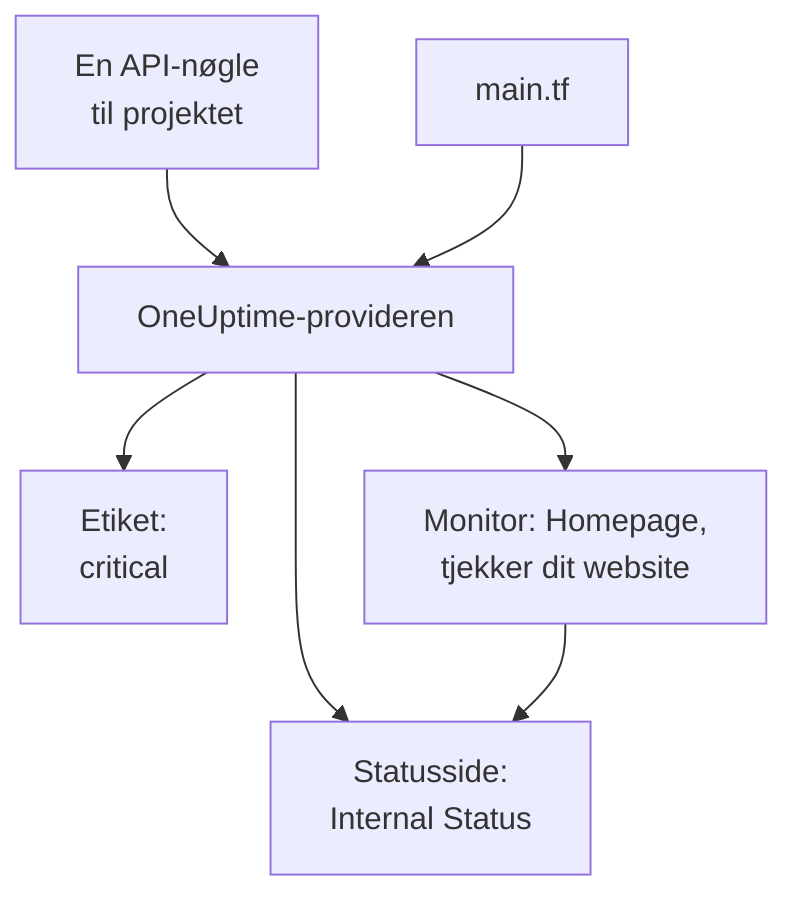

# Hurtig start

Denne vejledning fører dig fra ingenting til et OneUptime-projekt, der administreres af Terraform, på omkring ti minutter. Du opretter en API-nøgle, peger Terraform mod dit projekt og anvender en etiket, en monitor, der tjekker dit website, og en privat statusside, der viser den. Derefter ændrer du en af dem og rydder op.

:::cards
- [Før du begynder](#før-du-begynder): Terraform, et projekt og et abonnement med API-nøgler.
- [Opret dine første ressourcer](#opret-dine-første-ressourcer): Fra en API-nøgle til en anvendt plan, i seks trin.
- [Ændr en ressource](#ændr-en-ressource): Redigér konfigurationen, planlæg og anvend.
- [Fejlfinding](#fejlfinding): De fejl, en første kørsel kan stoppe ved.
:::



## Før du begynder

- **Terraform 1.5 eller nyere, eller OpenTofu 1.6 eller nyere.** Med OpenTofu kører du `tofu` alle steder, hvor denne vejledning kører `terraform`.
- **Et OneUptime-projekt** på [oneuptime.com](https://oneuptime.com) eller på din egen OneUptime, hvor du kan oprette API-nøgler.
- **På OneUptime Cloud abonnementet Growth eller højere.** Et projekts API-nøgler virker kun på det.

## Opret dine første ressourcer

:::steps
### Opret en API-nøgle til projektet

Åbn **Projektindstillinger → Avanceret → API-nøgler** i OneUptime-dashboardet, og klik på **Opret API-nøgle**. Giv den et **Navn**, såsom `terraform`, og vælg **Projektadministrator** under **Adgang**: Terraform opretter, læser, ændrer og sletter alle slags poster, den administrerer, og **Projektadministrator** må gøre alt det. Til en mere begrænset nøgle vælger du **Vælg tilladelser senere** og tilføjer kun de tilladelser, du har brug for, på nøglens side.

Nøglen udløber om et år. For at vælge en anden dato åbner du **Flere felter**, før du opretter den, eller ændrer datoen senere på nøglens side. Når nøglen er oprettet, åbner dens side: kopiér **API-nøgle** fra kortet **API-nøgledetaljer**.

### Gør nøglen tilgængelig for Terraform

Læg nøglen i miljøvariablen `ONEUPTIME_API_KEY` i den shell, du kører Terraform i, så den aldrig havner i en fil:

:::tabs
@tab Linux
```bash
export ONEUPTIME_API_KEY="<your-api-key>"
```
@tab macOS
```bash
export ONEUPTIME_API_KEY="<your-api-key>"
```
@tab Windows
```powershell
$env:ONEUPTIME_API_KEY = "<your-api-key>"
```
:::

### Peg Terraform mod OneUptime

Opret en tom mappe, og i den en fil med navnet `main.tf`:

```hcl title="main.tf"
terraform {
  required_providers {
    oneuptime = {
      source  = "oneuptime/oneuptime"
      version = "{{TERRAFORM_PROVIDER_VERSION}}"
    }
  }
}

provider "oneuptime" {
  # The API key comes from ONEUPTIME_API_KEY.
  # On a self-hosted OneUptime, add your OneUptime's address:
  # oneuptime_url = "https://oneuptime.example.com"
}
```

På en selv-hostet OneUptime skal du læse [Selv-hostet opsætning](/docs/terraform/self-hosted), før du vælger en providerversion.

### Beskriv dine ressourcer

Tilføj disse blokke til `main.tf`. De læser to af de monitorstatusser, som alle projekter starter med, og opretter en etiket, en monitor, der tjekker `https://example.com` hvert femte minut (sæt dit eget website ind der), og en privat statusside, der viser monitoren:

```hcl title="main.tf"
data "oneuptime_monitor_status" "operational" {
  name = "Operational"
}

data "oneuptime_monitor_status" "offline" {
  name = "Offline"
}

resource "oneuptime_label" "critical" {
  name        = "critical"
  description = "Resources that page on-call when down"
  color       = "#FF5733"
}

resource "oneuptime_monitor" "homepage" {
  name                = "Homepage"
  description         = "Checks that the homepage responds"
  monitor_type        = "Website"
  monitoring_interval = "*/5 * * * *"
  labels              = [oneuptime_label.critical.id]

  monitor_steps = [{
    monitor_destination      = "https://example.com"
    monitor_destination_type = "URL"
    request_type             = "GET"

    criteria = [
      {
        name                  = "Offline"
        description           = "The homepage does not respond"
        filter_condition      = "Any"
        change_monitor_status = true
        monitor_status_id     = data.oneuptime_monitor_status.offline.id

        filters = [
          {
            check_on    = "Is Online"
            filter_type = "False"
          }
        ]
      },
      {
        name                  = "Online"
        description           = "The homepage responds"
        filter_condition      = "All"
        change_monitor_status = true
        monitor_status_id     = data.oneuptime_monitor_status.operational.id

        filters = [
          {
            check_on    = "Is Online"
            filter_type = "True"
          }
        ]
      }
    ]
  }]
}

resource "oneuptime_status_page" "internal" {
  name                  = "Internal Status"
  description           = "Status of our internal services"
  page_title            = "Service Status"
  is_public_status_page = false
}

resource "oneuptime_status_page_resource" "homepage" {
  status_page_id = oneuptime_status_page.internal.id
  monitor_id     = oneuptime_monitor.homepage.id
  display_name   = "Homepage"
}

output "monitor_id" {
  value = oneuptime_monitor.homepage.id
}
```

Monitorens `monitor_steps` siger, hvad den tjekker, og hvad hvert resultat betyder: efter hvert tjek sætter det første kriterium, der passer, dens status. [Monitortrin](/docs/terraform/monitor-steps) forklarer hver del.

### Planlæg og anvend

:::tabs
@tab Terraform
```bash
terraform init
terraform plan
terraform apply
```
@tab OpenTofu
```bash
tofu init
tofu plan
tofu apply
```
:::

`init` henter provideren. Planen slutter med `Plan: 4 to add, 0 to change, 0 to destroy.` Skriv `yes` for at anvende den; når den er færdig, udskriver Terraform den nye monitors ID.

### Tjek dashboardet

I OneUptime-dashboardet:

- **Monitorer** viser `Homepage` med etiketten `critical`. Dens første tjek kommer inden for få minutter.
- **Statussider** viser `Internal Status`, som viser `Homepage`.
- **Projektindstillinger → Grundlæggende → Etiketter** viser `critical` i den farve, du har angivet.

Kør `terraform plan` igen. Den svarer `No changes.`: OneUptime indeholder præcis det, konfigurationen siger.
:::

## Ændr en ressource

Ændr konfigurationen, ikke dashboardet. Sæt etikettens `color` til `"#2ECC71"` i `main.tf`, og planlæg og anvend derefter:

```bash
terraform plan
terraform apply
```

Planen slutter med `Plan: 0 to add, 1 to change, 0 to destroy.`: etiketten ændres på stedet. En ændring, som nogen laver i dashboardet på en ressource, Terraform administrerer, vises i den næste plan, og når du anvender den, bliver det, konfigurationen siger, sat tilbage.

## Ryd op

Hvis dette var en prøvetur, så slet det, konfigurationen har oprettet:

```bash
terraform destroy
```

Det sletter etiketten, monitoren, statussiden og dens ressource. De to monitorstatusser bliver: datakilderne læser dem kun.

## Fejlfinding

:::details Meddelelsen “Missing API Key”
Provideren fandt ingen API-nøgle. Eksportér `ONEUPTIME_API_KEY` i den shell, du kører Terraform i, eller angiv `api_key` i provider-blokken, og kør kommandoen igen.
:::

:::details Meddelelsen “the OneUptime API returned status 400: Invalid API Key”
Nøglen er tastet forkert, udløbet eller slettet, eller den hører til en anden OneUptime end den, `oneuptime_url` peger på. Kopiér nøglen igen fra dens side, eller opret en ny.
:::

:::details Meddelelsen “the OneUptime API returned status 402: API keys need the Growth plan”
På OneUptime Cloud virker et projekts API-nøgler kun på abonnementet Growth eller højere. Opgradér projektet under **Projektindstillinger → Fakturering og fakturaer → Fakturering**, så virker den samme nøgle igen.
:::

:::details Meddelelsen “the OneUptime API returned status 422: You do not have permissions to create Monitor”
Nøglen har ingen tilladelse til den slags post. Giv den **Projektadministrator** på nøglens side, eller den tilladelse, meddelelsen nævner.
:::

:::details Meddelelsen “No monitor status matches {name = "Offline"}”
Dit projekts monitorstatusser har andre navne. Brug de navne, du ser under **Overvågninger → Indstillinger → Monitorstatus**, eller slå i stedet statussen op med `is_offline_state = true`.
:::

## Næste skridt

:::cards
- [Komplet vejledning](/docs/terraform/complete-guide): Godkendelse, projektopbygning, datakilder, state og opgraderinger.
- [Monitortrin](/docs/terraform/monitor-steps): Bestem, hvad en monitor tjekker, og hvad hvert resultat betyder.
- [Eksempler](/docs/terraform/examples): Færdige konfigurationer til de almindelige ressourcer.
- [Import af ressourcer](/docs/terraform/importing-resources): Bring det, du har lavet i dashboardet, ind under Terraform.
:::
