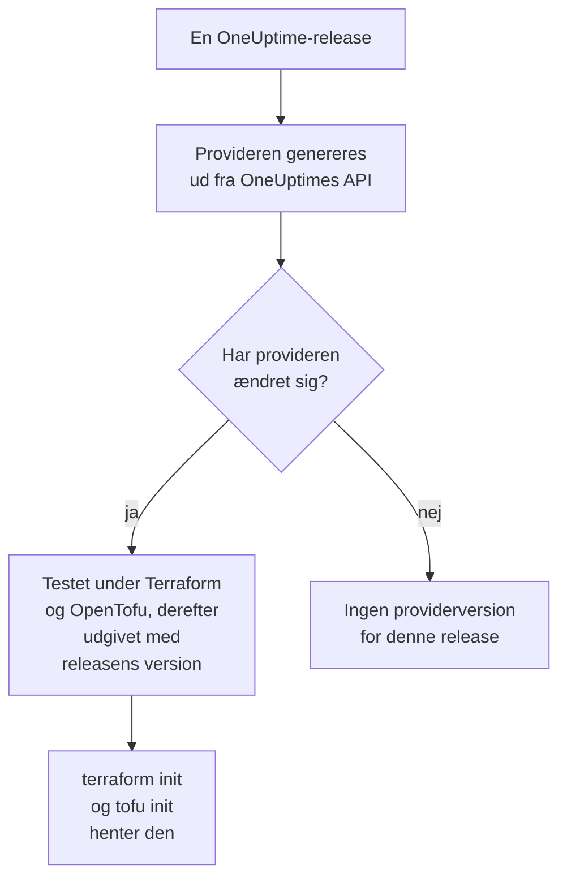

# Registerbrug

OneUptime-provideren udgives i [Terraform Registry](https://registry.terraform.io/providers/oneuptime/oneuptime) og [OpenTofu Registry](https://search.opentofu.org/provider/oneuptime/oneuptime/latest). `terraform init` og `tofu init` henter den derfra: der er intet at installere i hånden. Denne side dækker, hvad der udgives, hvordan versioner nummereres, og hvordan du skifter til en nyere.

:::cards
- [Hvad der udgives](#hvad-der-udgives): Provideren til hver platform, dens reference og dens versioner.
- [Hvordan versioner nummereres](#hvordan-versioner-nummereres): En providers version er den OneUptime-release, der udgav den.
- [Låsefilen](#låsefilen): Den version og de checksums, hver maskine installerer.
- [Skift til en nyere version](#skift-til-en-nyere-version): Læs, hvad der ændrede sig, hent den, og planlæg.
:::

## Hvad der udgives

Hver OneUptime-release genererer provideren ud fra OneUptimes eget API. Når provideren har ændret sig, udgiver releasen den, under releasens version, når den har bestået sine end-to-end-test under Terraform og under OpenTofu:



| Hvad | Hvor |
| --- | --- |
| Provideren, til Linux, macOS, Windows, FreeBSD, OpenBSD og Solaris | Hentes af `terraform init` og `tofu init`, med checksums, som OneUptime signerer |
| Referencen for hver ressource og datakilde, med hver af dens attributter | Registrets dokumentation, grupperet efter produkt: overvågninger, statussider, hændelser, vagter og de andre |
| En vejledning i at bruge provideren med OpenTofu | Registrets vejledninger |
| Hver version, nyeste først | Registrets versionsliste |

Referencen fortæller, hvad hver attribut er. Denne dokumentation viser, hvordan du bruger dem sammen: start fra [Terraform – Oversigt](/docs/terraform/index).

## Hvordan versioner nummereres

En providers version er versionen af den OneUptime-release, der udgav den: provider {{TERRAFORM_PROVIDER_MAJOR}}.0.20 kom med OneUptime {{TERRAFORM_PROVIDER_MAJOR}}.0.20. En release, hvis provider ikke ændrede sig, udgiver ingen, så versionerne har huller, og en begrænsning, der nævner én præcis version, kan nævne en version, der ikke findes. Skriv i stedet et interval:

| Du bruger | Begrænsning | Terraform installerer |
| --- | --- | --- |
| OneUptime Cloud | `{{TERRAFORM_PROVIDER_VERSION}}` | Den nyeste {{TERRAFORM_PROVIDER_MAJOR}}.x-provider |
| En selv-hostet OneUptime | Et interval, der slutter ved din OneUptimes version, som `>= {{TERRAFORM_PROVIDER_MAJOR}}.0, <= {{TERRAFORM_PROVIDER_MAJOR}}.0.40` | Den nyeste provider, der ikke er nyere end din OneUptime |

På en selv-hostet OneUptime kan en provider, der er nyere end din OneUptime, sende indstillinger, som din OneUptime endnu ikke har: [Selv-hostet opsætning](/docs/terraform/self-hosted#vælg-providerversionen) viser, hvordan du skriver dens interval.

```hcl title="main.tf"
terraform {
  required_providers {
    oneuptime = {
      source  = "oneuptime/oneuptime"
      version = "{{TERRAFORM_PROVIDER_VERSION}}"
    }
  }
}
```

Kildeadressen nævner intet register: Terraform læser den fra Terraform Registry, og OpenTofu fra OpenTofu Registry, som udgiver de samme versioner.

## Låsefilen

`terraform init` registrerer den version, den valgte, og checksums for dens downloads i `.terraform.lock.hcl`. Commit den fil: hver maskine og hver CI-kørsel installerer så præcis den version, indtil du vælger en anden. Checksums dækker hver platform, registret udgiver, så én låsefil fungerer lige godt for Linux-, macOS- og Windows-maskiner.

```hcl title=".terraform.lock.hcl"
provider "registry.terraform.io/oneuptime/oneuptime" {
  version     = "{{TERRAFORM_PROVIDER_MAJOR}}.0.20"
  constraints = "{{TERRAFORM_PROVIDER_VERSION}}"
  hashes = [
    "h1:...",
    "zh:...",
  ]
}
```

Låsefilen nævner registret. OpenTofu skriver `registry.opentofu.org/oneuptime/oneuptime`, hvor Terraform skriver `registry.terraform.io/oneuptime/oneuptime`, så et skift af værktøj ændrer låsefilen: `init` erstatter posten og beder dig committe ændringen.

## Skift til en nyere version

:::steps
### Læs, hvad der ændrede sig

[OneUptimes releases](https://github.com/OneUptime/oneuptime/releases) siger, hvad hver release ændrede, provideren inklusive. [Providerens releases](https://github.com/OneUptime/terraform-provider-oneuptime/releases) linker til ændringerne siden den forrige.

### Hent den

```bash
terraform init -upgrade
```

`init -upgrade` tager den nyeste version, din begrænsning tillader, viser den og opdaterer `.terraform.lock.hcl`. Begrænsningen `{{TERRAFORM_PROVIDER_VERSION}}` tager hver {{TERRAFORM_PROVIDER_MAJOR}}.x-release; en ny hovedversion kræver en ny begrænsning.

### Planlæg, før du anvender

Kør `terraform plan`, og anvend kun, når den er tom eller viser de ændringer, du forventer. Commit den opdaterede låsefil.
:::

På en selv-hostet OneUptime skal du opgradere OneUptime først og derefter hæve slutningen af providerens interval.

## Hvor koden bor

Provideren genereres ud fra OneUptime-API'et i [OneUptimes hovedrepositorie](https://github.com/OneUptime/oneuptime), og hver version bygges fra den release, der udgav den. Dens eget repositorie, [OneUptime/terraform-provider-oneuptime](https://github.com/OneUptime/terraform-provider-oneuptime), indeholder det, generatoren skrev, så ændringer laves i hovedrepositoriet: rapportér problemer, også dem i dokumentationen, på [github.com/OneUptime/oneuptime/issues](https://github.com/OneUptime/oneuptime/issues).

## Næste skridt

:::cards
- [Selv-hostet opsætning](/docs/terraform/self-hosted): Versionsintervallet for din egen OneUptime, og et spejl til offline-maskiner.
- [OpenTofu](/docs/terraform/opentofu): Den samme provider og konfiguration, med `tofu`.
- [Komplet vejledning](/docs/terraform/complete-guide): Godkendelse, projektopbygning, datakilder, state og opgraderinger.
- [Fejlfinding](/docs/terraform/troubleshooting): Almindelige fejl, og hvordan du retter dem.
:::
