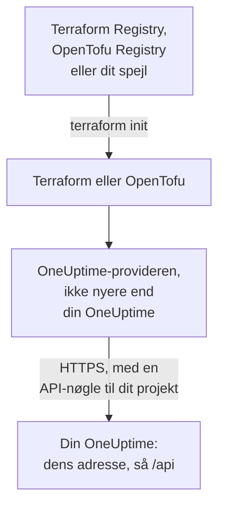

# Selv-hostet opsætning

Provideren virker med din egen OneUptime, som den virker med OneUptime Cloud: de samme ressourcer, de samme attributter og de samme API-nøgler til projektet. Det, du selv skal angive: adressen på din OneUptime, den providerversion, der passer til den, og, hvor du har brug for dem, et spejl til maskiner uden internetadgang og tillid til en privat certifikatudsteder.

:::cards
- [Lad provideren pege på din OneUptime](#lad-provideren-pege-på-din-oneuptime): Dens adresse, og en API-nøgle til dit projekt.
- [Vælg providerversionen](#vælg-providerversionen): Den nyeste provider, der ikke er nyere end din OneUptime.
- [Uden internetadgang](#uden-internetadgang): Spejl provideren ind i dit netværk.
- [TLS og certifikater](#tls-og-certifikater): En privat certifikatudsteder, proxyer og almindelig HTTP.
:::



## Lad provideren pege på din OneUptime

Sæt `oneuptime_url` til den adresse, du åbner dashboardet på: skemaet og værten, uden sti. Provideren tilføjer `https://`, når adressen ikke har et skema, og `/api` til sidst, så `https://oneuptime.example.com` sender hver forespørgsel til `https://oneuptime.example.com/api`.

```hcl title="main.tf"
terraform {
  required_providers {
    oneuptime = {
      source  = "oneuptime/oneuptime"
      version = "{{TERRAFORM_PROVIDER_MATCHING}}"
    }
  }
}

provider "oneuptime" {
  oneuptime_url = "https://oneuptime.example.com"
  # The API key comes from the ONEUPTIME_API_KEY environment variable.
}
```

Adressen kan i stedet komme fra miljøvariablen `ONEUPTIME_URL`, så én konfiguration kan pege på flere installationer:

```bash
export ONEUPTIME_URL="https://oneuptime.example.com"
export ONEUPTIME_API_KEY="<your-api-key>"
```

Adressen er den vært, din installation serveres på: `HOST` og `HTTP_PROTOCOL` i `config.env` med Docker Compose, og `host` og `httpProtocol` i Helm-chartets values.

Nøglen er en API-nøgle til det projekt, du styrer, oprettet i din OneUptimes dashboard under **Projektindstillinger → Avanceret → API-nøgler**, som på OneUptime Cloud. Master-API-nøglen på en selv-hostet OneUptime hører ikke til noget projekt, så en oprettelse med den fejler med `ProjectId required`.

> [!TIP]
> Din OneUptime skriver denne blok for dig. Åbn en vilkårlig ressource eller liste i dashboardet, og derefter **Udvikler** og **Terraform** i dens sidemenu: provider-blokken, den viser, har din OneUptimes adresse og et versionsinterval, der passer til den.

## Vælg providerversionen

Brug den nyeste udgivne provider, der ikke er nyere end din OneUptime. Providerversioner følger OneUptimes: en OneUptime-release, der ændrer provideren, udgiver den under releasens eget versionsnummer, og en provider, der er nyere end din OneUptime, kan sende indstillinger, som din OneUptime endnu ikke har.

Skriv derfor et interval, der slutter ved din OneUptimes version, som dashboardet gør. Blokken ovenfor tager `{{TERRAFORM_PROVIDER_MATCHING}}`, intervallet for den OneUptime, denne dokumentation kommer fra: når du læser den på din egen OneUptime, er det interval dit. Ellers skal du skrive din egen version ind:

:::steps
### Find din OneUptimes version

Spørg din OneUptime om den:

```bash
curl https://oneuptime.example.com/version
```

Svaret er JSON, som `{"version":"{{TERRAFORM_PROVIDER_MAJOR}}.0.40","commit":"..."}`. Som masteradministrator kan du også åbne udgavemærket i headeren på Admin-dashboardet: se [Find din nuværende version](/docs/installation/upgrading#find-din-nuværende-version).

### Skriv den ind i intervallet

Intervallet starter ved hovedversionen og slutter ved din. For en OneUptime {{TERRAFORM_PROVIDER_MAJOR}}.0.40:

```hcl title="main.tf"
terraform {
  required_providers {
    oneuptime = {
      source  = "oneuptime/oneuptime"
      version = ">= {{TERRAFORM_PROVIDER_MAJOR}}.0, <= {{TERRAFORM_PROVIDER_MAJOR}}.0.40"
    }
  }
}
```

Terraform tager den nyeste provider i intervallet. En OneUptime-release, der ikke ændrede provideren, udgiver ingen, og intervallet springer de versioner over, der ikke findes.

### Hent provideren

Kør `terraform init`. Den viser den version, den installerede, og registrerer den i `.terraform.lock.hcl`.
:::

Når du opgraderer, så opgradér OneUptime først. Hæv derefter slutningen af intervallet til dens nye version, og kør `terraform init -upgrade`.

## Uden internetadgang

Når de maskiner, der kører Terraform, ikke kan nå registret, skal du kopiere provideren ind i dit netværk én gang og lade Terraform pege på kopien.

:::steps
### Spejl provideren

Hent på en maskine med internetadgang, i en mappe med din konfiguration, provideren til hver platform, dine maskiner kører på. Uden `-platform` henter kommandoen kun provideren til sin egen platform:

:::tabs
@tab Terraform
```bash
terraform providers mirror -platform=linux_amd64 -platform=darwin_arm64 /srv/terraform-mirror
```
@tab OpenTofu
```bash
tofu providers mirror -platform=linux_amd64 -platform=darwin_arm64 /srv/terraform-mirror
```
:::

Mappen indeholder provideren under registrets adresse, som `registry.terraform.io/oneuptime/oneuptime/`. Kopiér den ind i dit netværk.

### Lad Terraform pege på spejlet

Skriv en CLI-konfigurationsfil, der installerer OneUptime-provideren fra mappen og alt andet som normalt:

:::tabs
@tab Terraform
```hcl title="mirror.tfrc"
provider_installation {
  filesystem_mirror {
    path    = "/srv/terraform-mirror"
    include = ["registry.terraform.io/oneuptime/oneuptime"]
  }
  direct {
    exclude = ["registry.terraform.io/oneuptime/oneuptime"]
  }
}
```
@tab OpenTofu
```hcl title="mirror.tfrc"
provider_installation {
  filesystem_mirror {
    path    = "/srv/terraform-mirror"
    include = ["registry.opentofu.org/oneuptime/oneuptime"]
  }
  direct {
    exclude = ["registry.opentofu.org/oneuptime/oneuptime"]
  }
}
```
:::

Angiv den i `TF_CLI_CONFIG_FILE`, som både Terraform og OpenTofu læser: `export TF_CLI_CONFIG_FILE=/etc/terraform/mirror.tfrc`.

### Initialisér

Kør `terraform init`: den installerer provideren fra spejlet. Den advarer om, at låsefilen nu kun har checksums for denne platform. For at registrere dem for alle platforme skal du køre `terraform providers lock` med de samme `-platform`-indstillinger på maskinen med internetadgang og committe `.terraform.lock.hcl` sammen med din konfiguration.
:::

Spejl igen, hver gang du hæver versionsintervallet.

## TLS og certifikater

Provideren kontrollerer din OneUptimes certifikat mod tillidslageret på den maskine, der kører Terraform, og der er ingen indstilling til at springe kontrollen over. Når certifikatet kommer fra en privat certifikatudsteder, skal du tilføje den udsteder til tillidslageret på hver maskine og CI-runner, der kører Terraform:

:::tabs
@tab Debian / Ubuntu
```bash
sudo cp my-ca.crt /usr/local/share/ca-certificates/
sudo update-ca-certificates
```
@tab RHEL / Fedora
```bash
sudo cp my-ca.crt /etc/pki/ca-trust/source/anchors/
sudo update-ca-trust
```
:::

På Linux, hvor du ikke kan ændre tillidslageret, som i en CI-container, skal du sætte `SSL_CERT_FILE` til en fil, der indeholder din udsteder og de offentlige udstedere. På macOS og Windows skal du tilføje udstederen til systemets certifikatlager.

- **Proxyer.** Provideren sender sine forespørgsler gennem proxyen i `HTTPS_PROXY`, undtagen til værterne i `NO_PROXY`. En reverse proxy foran OneUptime skal sende hver `/api`-sti og headeren `APIKey` uændret igennem.
- **Almindelig HTTP.** En `http://`-adresse virker, til en testinstallation. API-nøglen sendes med hver forespørgsel, så brug HTTPS til alt andet.

## Fejlfinding

:::details Meddelelsen “x509: certificate signed by unknown authority”
Den maskine, der kører Terraform, stoler ikke på din OneUptimes certifikat: tilføj din certifikatudsteder, som [TLS og certifikater](#tls-og-certifikater) viser.
:::

:::details Meddelelsen “invalid character '<' looking for beginning of value”
En webside svarede i stedet for API'et: `oneuptime_url` indeholder en sti, eller en proxy svarede. Sæt den til kun din OneUptimes adresse.
:::

:::details Meddelelsen “no available releases match the given constraints”
Ingen udgivet provider passer til versionsbegrænsningen, for eksempel en begrænsning, der nævner én version, som OneUptime aldrig har udgivet. Skriv et interval, som [Vælg providerversionen](#vælg-providerversionen) viser.
:::

:::details Meddelelsen “ProjectId required”
Nøglen er master-API-nøglen, som ikke hører til noget projekt. Opret en API-nøgle til projektet under **Projektindstillinger → Avanceret → API-nøgler**.
:::

[Fejlfinding](/docs/terraform/troubleshooting) har de andre fejl, og hvad hver enkelt betyder.

## Næste skridt

:::cards
- [Hurtig start](/docs/terraform/quick-start): Opret en API-nøgle, og anvend dine første ressourcer.
- [Registerbrug](/docs/terraform/registry): Hvor provideren udgives, og hvordan versioner nummereres.
- [Fejlfinding](/docs/terraform/troubleshooting): Almindelige fejl, og hvordan du retter dem.
- [Opgradering](/docs/installation/upgrading): Opgradér din OneUptime, før du hæver providerens interval.
:::
