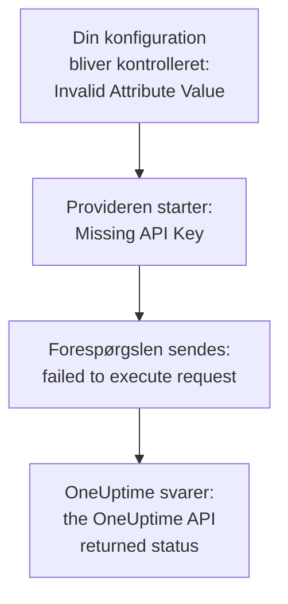

# Fejlfinding

Slå den meddelelse, Terraform skrev, eller det, du så ske, op i tabellen nedenfor: hver række fører til løsningen. Afsnittene efter tabellen forklarer hver fejl, grupperet efter, hvor den kommer fra.

:::cards
- [Find din fejl](#find-din-fejl): Hver meddelelse og hvert symptom på denne side, med løsningen.
- [API-nøgler, tilladelser og abonnementer](#api-nøgler-tilladelser-og-abonnementer): Når OneUptime afviser providerens nøgle.
- [Planer, der ikke falder til ro](#planer-der-ikke-falder-til-ro): Ændringer, der kommer igen, og ressourcer, der forlader state.
- [Forbind til en selv-hostet OneUptime](#forbind-til-en-selv-hostet-oneuptime): Adressen, certifikater og proxyer.
:::

## Find din fejl

| Meddelelse eller symptom | Hvad du skal gøre |
| --- | --- |
| `Missing API Key` | Giv provideren dens nøgle: se [`Missing API Key` eller `Invalid API Key`](#missing-api-key-eller-invalid-api-key) |
| `Invalid API Key` | Kopiér nøglen igen, eller opret en ny: se [`Missing API Key` eller `Invalid API Key`](#missing-api-key-eller-invalid-api-key) |
| `ProjectId required` | Brug en API-nøgle til projektet, ikke en masternøgle: se [`ProjectId required`](#projectid-required) |
| `You do not have permissions to create Monitor` | Giv nøglen den tilladelse, meddelelsen nævner: se [Nøglen mangler en tilladelse](#nøglen-mangler-en-tilladelse) |
| `API keys need the Growth plan` | Flyt projektet tilbage til abonnementet Growth: se [Betaling påkrævet](#betaling-påkrævet) |
| `402` for én ressource eller én indstilling | Opgradér abonnementet, eller lad indstillingen stå på standardværdien: se [Betaling påkrævet](#betaling-påkrævet) |
| `This project has been blocked` | Bed en masteradministrator om at fjerne blokeringen af projektet: se [Et blokeret projekt](#et-blokeret-projekt) |
| `references records that are not in this project` | Brug ID'et på en post i dit eget projekt: se [ID'er fra et andet projekt](#ider-fra-et-andet-projekt) |
| `Not Found` eller `Ambiguous Match` fra en datakilde | Ret opslagets argumenter: se [Opslag, der finder ingen eller flere](#opslag-der-finder-ingen-eller-flere) |
| `Cannot import non-existent remote object` | Kontrollér ID'et og nøglens tilladelser: se [Import af ressourcer](/docs/terraform/importing-resources#fejlfinding) |
| `Provider produced inconsistent result after apply` | Opgradér provideren: se [Inkonsistent resultat efter apply](#inkonsistent-resultat-efter-apply) |
| En plan opretter en ressource, du ikke har tilføjet | Nøglen kan ikke længere læse den, og OneUptime svarede `404`: giv nøglen dens læseadgang tilbage, og importér derefter ressourcen med `terraform import`: se [En ressource forlader state, og næste apply opretter den igen](#en-ressource-forlader-state-og-næste-apply-opretter-den-igen) |
| En `priority` eller `order` ændres efter apply | Giv hver enkelt et nummer, som ingen anden har: se [En prioritet eller rækkefølge, der flytter sig](#en-prioritet-eller-rækkefølge-der-flytter-sig) |
| `Invalid Configuration for Read-Only Attribute` | Fjern attributten fra konfigurationen: se [Skrivebeskyttede attributter](#skrivebeskyttede-attributter) |
| `has been renamed to` | Omdøb ressourcetypen med en `moved`-blok: se [En omdøbt ressourcetype](#en-omdøbt-ressourcetype) |
| En overvågning, der er lavet med Terraform, viser aldrig sine tjek | Opgradér OneUptime: se [Overvågninger fra før trin-ID'er](#overvågninger-fra-før-trin-ider) |
| `must contain at least 1 elements` | Udelad attributten i stedet for at lade den være tom: se [Tomme værdier](#tomme-værdier) |
| JSON fra dashboardet i en `.tf`-fil | Skriv det som HCL: se [JSON fra dashboardet](#json-fra-dashboardet) |
| `no available releases match the given constraints` | Brug et versionsinterval, ikke én præcis version: se [En version, der aldrig blev udgivet](#en-version-der-aldrig-blev-udgivet) |
| `x509: certificate signed by unknown authority` | Stol på din certifikatudsteder: se [Certifikater](#certifikater) |
| `invalid character '<' looking for beginning of value` | Lad `oneuptime_url` pege på selve din OneUptime: se [En webside i stedet for API'et](#en-webside-i-stedet-for-apiet) |
| `connection refused` eller `Client.Timeout exceeded` | Kontrollér adressen, netværket og en eventuel proxy: se [Forbindelser, der fejler](#forbindelser-der-fejler) |

## Sådan læser du en fejl

En fejl nævner det trin, der fejlede, og dens meddelelse siger, hvor den kommer fra:



- En fejl, der kommer før nogen forespørgsel, som `Invalid Attribute Value`, handler om din konfiguration: provideren kontrollerer den, før den taler med OneUptime.
- `failed to execute request` betyder, at forespørgslen aldrig fik et svar: se [Forbind til en selv-hostet OneUptime](#forbind-til-en-selv-hostet-oneuptime).
- `the OneUptime API returned status` er OneUptimes svar: statussen og meddelelsen efter den siger, hvad OneUptime afviste.

Provideren nævner, hvad den var i gang med: `Unable to create monitor` og `Unable to update monitor` for en ændring, og `Unable to parse label response`, når den læser en ressource. En læsning, som OneUptime afviser, rapporteres med opsummeringen `Parse Error`, men meddelelsen efter den er OneUptimes svar, ikke et problem med fortolkningen.

## API-nøgler, tilladelser og abonnementer

### `Missing API Key` eller `Invalid API Key`

`Missing API Key` stopper provideren, før den sender nogen forespørgsel: hverken `api_key` i provider-blokken eller miljøvariablen `ONEUPTIME_API_KEY` er angivet. Eksportér variablen i den shell, du kører Terraform i, eller send nøglen i en variabel markeret `sensitive`.

`Invalid API Key` er OneUptimes svar på en nøgle, den ikke kender: en, der er tastet forkert, udløbet eller slettet, eller en fra en anden OneUptime end den, `oneuptime_url` peger på. Kopiér nøglen igen fra dens side under **Projektindstillinger → Avanceret → API-nøgler**, eller opret en ny.

### `ProjectId required`

Provideren har brug for en API-nøgle til det projekt, den styrer: det er derfra, projektet kommer. En selv-hostet OneUptimes master-API-nøgle hører ikke til noget projekt, så alle oprettelser med den fejler med `ProjectId required`. Opret en API-nøgle til projektet, som i [Opret en API-nøgle til projektet](/docs/terraform/quick-start#opret-en-api-nøgle-til-projektet), og brug den i stedet.

### Nøglen mangler en tilladelse

`You do not have permissions to create Monitor` og lignende meddelelser kommer med status `422`: nøglen må ikke gøre det med den slags post. De nævner de tilladelser, der ville give lov til det. Åbn nøglens side under **Projektindstillinger → Avanceret → API-nøgler**, og giv den en af dem, eller **Projektadministrator**. En import kræver kun tilladelsen til at læse.

### Betaling påkrævet

- **402 Payment Required på hver forespørgsel** — `API keys need the Growth plan...`: på OneUptime Cloud er projektet under **Growth**, og et projekts API-nøgler - også providerens - holder op med at virke under det. Hvert kald, provideren foretager, bliver afvist, også `terraform plan`, indtil projektet er tilbage på Growth; så virker den samme nøgle igen, uden at du skal ændre noget i din konfiguration. Opgradér under **Projektindstillinger → Fakturering og fakturaer → Fakturering**, eller styr projektet i dashboardet imens. Se [API-nøgler og SCIM under deres abonnement](/docs/api-reference/api-reference#api-nøgler-og-scim-under-deres-abonnement).
- **402 Payment Required** — du har nået en grænse i dit OneUptime-abonnement, eller konfigurationen slår en indstilling til, som dit abonnement ikke omfatter (en privat statusside, e-mailrapporter, et offentligt dashboard, en IP-tilladelsesliste...), uanset om `terraform apply` opretter ressourcen med den eller ændrer den senere. Terraform viser OneUptimes meddelelse, som den er. Opgradér abonnementet, eller skær ned i konfigurationen.

At sætte sådan en indstilling tilbage til standardværdien, hvilket slår funktionen fra, virker på alle abonnementer, så en konfiguration, der slår betalte funktioner fra, kan anvendes, efter en prøveperiode udløber, eller abonnementet nedgraderes.

Det samme gælder for de ressourcer, dit abonnement sælger, og som et projekt beholder, efter det er nedgraderet - SSO-udbydere, SCIM-forbindelser, API-nøgler, vagtplaner, og regler og opsummeringer for Slack og Microsoft Teams: under abonnementet (mens projektet stadig er på Growth, som providerens egen API-nøgle kræver) kan dem, projektet allerede har, stadig læses (så `terraform plan` og `import` virker), slettes (så det kan anvendes at fjerne dem fra konfigurationen, eller `terraform destroy`) og slås fra, hvor de har en attribut `is_enabled`. At oprette dem, ændre dem eller slå dem til igen svarer stadig 402.

Andre ressourcer, dit abonnement sælger, som skabeloner, brugerdefinerede felter og overvågningsgrupper, kræver stadig abonnementet for at blive læst, så en plan, der genindlæser dem, svarer 402; de kan dog stadig slettes, for eksempel med `terraform destroy -refresh=false`.

En API-nøgles tilladelser slettes ikke én ad gangen under Growth, da det at slette en blokerende tilladelse ville give nøglen mere adgang: kør `terraform state rm` på tilladelsesressourcerne, ødelæg derefter nøglen, og dens tilladelser forsvinder med den.

### Et blokeret projekt

`This project has been blocked. Please contact your administrator.` kommer med status `403`: en masteradministrator har blokeret projektet, og indtil vedkommende fjerner blokeringen, handler ingen andre end en masteradministrator i det, heller ikke projektets API-nøgler.

## Poster og opslag

### ID'er fra et andet projekt

Hvert ID, en ressource nævner - en overvågnings etiketter, en statussidegruppes statusside, en netværksenheds site, en eskaleringsregels teams - skal være en post i det projekt, din API-nøgle hører til. Et ID på en post i et andet projekt, et ID, der ikke findes, og et ID på en post, nøglen ikke må læse, får alle det samme svar, som nævner feltet og ID'et:

```text
This network device references records that are not in this project: Network Site "…". Please pick values from this project and try again.
```

Det betyder som regel, at et ID er kopieret fra et andet projekts konfiguration eller state, eller at posten er slettet uden for Terraform. Referér til posten via dens ressource eller en datakilde i den samme konfiguration (`oneuptime_label.critical.id`) i stedet for et bogstaveligt ID, og anvend igen. En person, der er angivet som bruger, skal være medlem af projektet.

### Opslag, der finder ingen eller flere

En datakilde finder præcis én post, eller den stopper planen. `Not Found` siger, at ingen post har det `id`, eller at ingen passer til de argumenter, du har angivet; `Ambiguous Match` siger, at flere gør. Ret argumenterne, angiv flere af dem for at indsnævre opslaget til én, eller slå posten op via `id`. [Læs det, der allerede findes](/docs/terraform/complete-guide#læs-det-der-allerede-findes) har reglerne.

## Planer, der ikke falder til ro

### Inkonsistent resultat efter apply

`Provider produced inconsistent result after apply` betyder, at provideren returnerede andre værdier, end den havde planlagt. Ældre providere gjorde det med værdier, som serveren beregner: standardværdier, som serveren tilføjer inde i `monitor_steps`, tidsstempler, som serveren skrev på en anden måde, indpakkede værdier som `probe_version`, og attributter, som serveren holder opdateret, som hvornår en overvågning af indgående forespørgsler sidst modtog sit heartbeat. De læste også et decimaltal som null, når API'et sendte det som tekst, så hver apply af en farveregel for statussidebjælker fejlede på `uptime_percent_greater_than_or_equal_to`. Nuværende providere håndterer alt dette: tidsstempler sammenlignes som tidspunkter, lister af etiketter er mængder, tal læses tilbage, som du skrev dem, og en attribut, du ikke har angivet, beholder sin planlagte værdi, indtil næste genindlæsning læser serverens.

:::steps
1. Opgradér provideren: behold `version = "{{TERRAFORM_PROVIDER_VERSION}}"` i providerkravet, og kør `terraform init -upgrade`.
2. Anvend igen. En ressource, som den fejlede apply efterlod markeret som tainted, erstattes én gang, og planerne er tomme derefter. For i stedet at beholde ressourcen, som den er, skal du først fjerne markeringen via dens adresse: `terraform untaint oneuptime_status_page_history_chart_bar_color.operational`.
:::

Hvis en nuværende provider stadig fejler på denne måde, så rapportér det på [github.com/OneUptime/oneuptime/issues](https://github.com/OneUptime/oneuptime/issues), med providerversionen, ressourcetypen, den mindste `resource`-blok, der fejler, og hele fejlen. Fejlen nævner den attribut, hvis værdi ændrede sig, og det er det mest nyttige at sende.

### En ressource forlader state, og næste apply opretter den igen

En læsning via ID svarer `404` både for en post, der ikke findes, og for en, som API-nøglen ikke må læse: API'et siger intet om en post, det ikke viser dig. Terraform tager en `404` ved genindlæsning for en ressource, der er slettet uden for Terraform. Den fjerner ressourcen fra state, og næste `terraform apply` opretter den igen, ved siden af den, der stadig er der.

Det sker, når den nøgle, der styrer en ressource, ikke længere kan læse den: dens læsetilladelse er begrænset til etiketter, ressourcen ikke har, eller til de ressourcer, dens teams ejer, eller en blokering tager ressourcen væk - eller ressourcens etiketter eller ejere har ændret sig.

**Før du planlægger:**

- Giv nøglen for hver ressourcetype, den styrer, en læsetilladelse, der når hver ressource, den styrer: med omfanget **Alle**, eller begrænset til etiketter, som de ressourcer har. En nøgles tilladelser til at opdatere og slette når kun det, den må læse.
- Læs planen, før du anvender den: en ressource, der er planlagt til oprettelse, og som du ikke har tilføjet, er en, nøglen ikke længere kan læse.

**Når state allerede har mistet en ressource:** giv nøglen dens læseadgang tilbage, og [importér](/docs/terraform/importing-resources) derefter ressourcen i stedet for at anvende, så Terraform overtager den, der findes, i stedet for at oprette en ny. Hvis en kopi allerede er oprettet, så slet den, du ikke vil have.

### En prioritet eller rækkefølge, der flytter sig

Monitorstatusser, hændelses- og alarmtilstande og -alvorligheder, og de andre lister, du sætter i rækkefølge i dashboardet, har hvert nummer én gang. Et nummer, som ingen anden har, beholdes, som det er skrevet. Et nummer, som en anden allerede har, overtages, og dem, der står i vejen, rykker én plads ned, som når du trækker i dashboardet. Så to af dem, der er konfigureret med det samme nummer, bytter plads ved hver apply.

Giv hver enkelt sit eget nummer med mellemrum imellem, som `101`, `102` og `103`, og ændr rækkefølgen af dem, Terraform styrer, i Terraform, ikke ved at trække dem i dashboardet.

### Skrivebeskyttede attributter

`Invalid Configuration for Read-Only Attribute` stopper planen, når en konfiguration angiver en attribut, som kun OneUptime skriver. Hvem der oprettede en post, og hvem der arkiverede, løste eller kvitterede for den, registreres ud fra forespørgslen: den person, der er logget ind, og ingen for en forespørgsel med en API-nøgle, og det er sådan, Terraform logger ind. Så `created_by_user_id`, og alle andre attributter, der slutter på `_by_user_id`, kan læses fra en ressource eller en datakilde, men ikke angives. Det samme gælder `archived_at`: at angive `is_archived` registrerer, hvornår ressourcen blev arkiveret, og at anvende den igen uændret beholder det tidspunkt. Fjern attributten fra ressourceblokken; intet andet ved ressourcen ændrer sig.

### En omdøbt ressourcetype

`has been renamed to` advarer om, at en ressourcetype har et nyt navn. Ressourcetyper holder nu ord som IoT og vCenter hele: `oneuptime_iot_fleet` og `oneuptime_vcenter`, hvor ældre providere delte dem (`oneuptime_io_t_fleet`, `oneuptime_v_center`). De gamle navne virker fortsat som forældede aliasser. For at skifte uden at erstatte noget skal du omdøbe ressourcen i din konfiguration og fortælle Terraform, at den er flyttet:

```hcl
resource "oneuptime_iot_fleet" "factory" {
  name = "Factory floor"
}

moved {
  from = oneuptime_io_t_fleet.factory
  to   = oneuptime_iot_fleet.factory
}
```

`terraform plan` viser så flytningen og ingen anden ændring. Flytning mellem ressourcetyper kræver Terraform 1.8 eller nyere, eller OpenTofu 1.12 eller nyere; på en ældre version skal du beholde det gamle navn, som fortsat virker. Datakilder er omdøbt på samme måde: ændr navnet, og intet andet.

### Overvågninger fra før trin-ID'er

ID'erne inde i en overvågnings trin - for hvert trin, kriterium og hver hændelses- og alarmskabelon - er serverens at give. Ældre OneUptime-versioner gav kun kriterier ID'er, og et nyt sæt ved hver skrivning, så en overvågning, der blev skrevet via API'et, som hver overvågning, provideren lavede, blev gemt med et trin uden ID. Dens prober tjekkede den stadig, og dens status ændrede sig stadig, men overvågningens side kunne ikke finde dens tjek, dens hændelser kunne ikke løse sig selv, og hver `terraform apply`, der ændrede `monitor_steps`, rev åbne hændelser løs fra deres kriterier.

Den nuværende OneUptime giver hver af dem et ID ved oprettelse, beholder dem ved hver apply, og udfylder de manglende på eksisterende overvågninger, når den opgraderes. Intet ændres i din konfiguration: der er stadig ingen ID'er at skrive. En hændelse, som den gamle opførsel efterlod åben, lukkes ved overvågningens næste gendannelse, så længe det kriterium, der åbnede den, stadig findes; en, hvis kriterium en tidligere apply erstattede, skal løses én gang i hånden.

## Konfiguration, som provideren afviser

### Tomme værdier

Provideren afviser en tom liste, et tomt map eller en tom tekst i `monitor_steps` og dens dele, som `monitor_steps = []`, `request_headers = {}` eller `request_body = ""`:

```text
Attribute monitor_steps list must contain at least 1 elements, got: 0
```

Udelad i stedet attributten: en attribut, der ikke er der, er ikke angivet. [Monitortrin](/docs/terraform/monitor-steps) viser, hvad hver del tager.

### JSON fra dashboardet

Den JSON, som dashboardet og API'et viser for en ressource, er det, API'et sender, ikke Terraform-konfiguration: attributnavne er snake_case i Terraform, værdier skrives anderledes, og mange felter tilhører serveren. Indsat i en `.tf`-fil virker den ikke.

- For at overtage ressourcen skal du [importere den](/docs/terraform/importing-resources): dashboardets side **Terraform** skriver konfigurationen for dig.
- For at skrive en ny skal du starte fra [Eksempler](/docs/terraform/examples).
- For en overvågnings trin skal du skrive den typede attribut `monitor_steps`, som [Monitortrin](/docs/terraform/monitor-steps) beskriver: drop `{_type, value}`-indpakningerne, skriv camelCase-nøglerne i snake_case, og udelad hvert `id`.

## Versioner og registret

### En version, der aldrig blev udgivet

`no available releases match the given constraints` betyder, at ingen udgivet version passer til versionsbegrænsningen. Ikke alle OneUptime-releases udgiver en provider: en release, hvis provider ikke ændrede sig, udgiver ingen, så en begrænsning, der nævner én præcis version, kan nævne en version, der ikke findes. Brug i stedet et interval:

```hcl
terraform {
  required_providers {
    oneuptime = {
      source  = "oneuptime/oneuptime"
      version = "{{TERRAFORM_PROVIDER_VERSION}}"
    }
  }
}
```

På en selv-hostet OneUptime skal intervallet stoppe ved din OneUptimes version, som [Selv-hostet opsætning](/docs/terraform/self-hosted#vælg-providerversionen) viser. [Registerbrug](/docs/terraform/registry#hvordan-versioner-nummereres) forklarer, hvordan versioner nummereres.

## Forbind til en selv-hostet OneUptime

### Certifikater

`x509: certificate signed by unknown authority` betyder, at den maskine, der kører Terraform, ikke stoler på det certifikat, din OneUptime viser, som regel et fra en privat certifikatudsteder. Provideren kontrollerer det mod maskinens tillidslager. Tilføj din certifikatudsteder der, på hver maskine og CI-runner, der kører Terraform: se [TLS og certifikater](/docs/terraform/self-hosted#tls-og-certifikater). Der er ingen indstilling til at springe kontrollen over.

### En webside i stedet for API'et

`invalid character '<' looking for beginning of value` betyder, at en webside svarede, hvor provideren ventede API'et: `oneuptime_url` har en sti efter værten, som `/dashboard`, eller en proxy foran OneUptime svarede i stedet. Sæt `oneuptime_url` til kun din OneUptimes adresse, som `https://oneuptime.example.com`: provideren tilføjer selv `/api`.

### Forbindelser, der fejler

`failed to execute request` med `connection refused`, `no such host` eller `Client.Timeout exceeded` betyder, at der ikke kom noget svar tilbage. Kontrollér, at adressen og porten er rigtige og kan nås fra der, hvor Terraform kører, og angiv `HTTPS_PROXY`, hvis maskinen når internettet gennem en proxy. Provideren venter op til 60 sekunder på hvert svar. Den prøver en læsning eller en sletning op til tre gange, når der ikke kommer noget svar, eller svaret er `429`, `502`, `503` eller `504`, men aldrig en oprettelse eller en ændring: når en oprettelse fejler på denne måde, så kig i dashboardet, før du anvender igen, hvis den nu blev lavet.

## Få flere detaljer

Provideren skriver sine advarsler til Terraforms log. Kør kommandoen med `TF_LOG_PROVIDER=WARN` for at se dem, og med `TF_LOG_PATH` for at gemme dem i en fil:

```bash
TF_LOG_PROVIDER=WARN TF_LOG_PATH=terraform.log terraform plan
```

`OneUptime rejected a column in the select; dropping it and retrying` nævner en kolonne, som OneUptime ikke ville sende til providerens nøgle, som regel fordi en tilladelse mangler. Den attribut forbliver tom i state, så den kan vise sig som en ændring i hver plan.

## Sidder du stadig fast?

Opret et issue på [github.com/OneUptime/oneuptime/issues](https://github.com/OneUptime/oneuptime/issues) med providerversionen (`terraform version` viser den efter `init`), ressourceblokken og hele fejlen. Provideren genereres ud fra OneUptimes kode, så dens issues holdes i hovedrepositoriet.

## Næste skridt

:::cards
- [Import af ressourcer](/docs/terraform/importing-resources): Overtag det, du har lavet i dashboardet, og ret importfejl.
- [Selv-hostet opsætning](/docs/terraform/self-hosted): Adressen, versionen og certifikaterne for din egen OneUptime.
- [Komplet vejledning](/docs/terraform/complete-guide): Godkendelse, datakilder, state og opgraderinger.
- [Monitortrin](/docs/terraform/monitor-steps): Hver attribut i en overvågnings tjek.
:::
