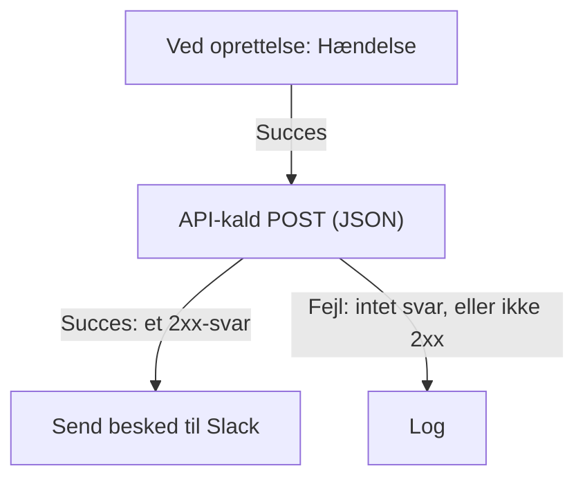

# Arbejdsgangskomponenter

Komponenter er de blokke, du tilføjer efter triggeren. Hver gør én ting — sender en besked, kalder en API, tjekker en betingelse, ændrer en OneUptime-post — og tager derefter en af sine udgange til de blokke, der er forbundet til den. Denne side er kataloget: hvad hver blok har brug for, hvad den returnerer, og hvornår den tager hver udgang.

Du får sjældent brug for at have den åben, mens du bygger. Hver bloks indstillinger slutter med **How to use**: hvad blokken gør, trinnene til at konfigurere den, et eksempel bygget ud fra din egen arbejdsgang og de fejl, folk ofte laver. Se [Opret en arbejdsgang](/docs/workflows/authoring) om at tilføje og forbinde blokke.

:::cards
- [Send en besked](#slack): Slack, Microsoft Teams, Discord, Telegram, IRC, Mattermost og e-mail.
- [Kald en API](#api): Send en forespørgsel til enhver HTTP-API, og læs svaret.
- [Tilføj logik](#conditions): Forgren på en værdi, omform data, vent eller log.
- [Arbejd med OneUptime-poster](#oneuptime-datakomponenter): Find, opret, opdater og slet monitorer, hændelser og meget mere.
:::

## Hvilken komponent skal jeg bruge?

| For at…                                                       | Brug                                                              |
| ------------------------------------------------------------- | ----------------------------------------------------------------- |
| Poste i et chatværktøj                                        | [Slack](#slack), [Microsoft Teams](#microsoft-teams), [Discord](#discord), [Telegram](#telegram), [IRC](#irc) eller [Mattermost](#mattermost) |
| Sende en e-mail gennem din egen mailserver                    | [Email](#email)                                                   |
| Tilkalde en person, et team eller den, der har vagt | [Paging](#paging) |
| Kalde enhver anden API eller din egen tjeneste                | [API](#api)                                                       |
| Opsummere, klassificere eller skrive udkast til tekst         | [Generate Text with AI](#generate-text-with-ai)                   |
| Tage den ene eller den anden vej afhængigt af en værdi        | [Conditions](#conditions)                                         |
| Tage én af flere veje afhængigt af en værdi                   | [Switch / Case](#switch-case)                                     |
| Fortsætte kun, når et par linjer JavaScript siger det        | [Check With JavaScript](#check-with-javascript)                   |
| Omforme data mellem to blokke                                 | [JSON](#json) eller [Custom Code](#custom-code)                   |
| Vente før den næste blok                                      | [Sleep](#sleep)                                                   |
| Starte en anden arbejdsgang                                      | [Execute Workflow](#execute-workflow)                             |
| Læse eller ændre hændelser, monitorer og andre poster         | [OneUptime-datakomponenter](#oneuptime-datakomponenter)           |
| Åbne, kvittere for og løse hændelser eller advarsler for et andet værktøjs problemer | [Hændelser og advarsler fra andre værktøjer](#hændelser-og-advarsler-fra-andre-værktøjer) |
| Kvittere for eller lukke et Zabbix-problem                    | [Zabbix](#zabbix)                                                 |
| Bede en person om at godkende en rettelse til en OpenStack-cloud   | [Propose an OpenStack fix](#propose-an-openstack-fix)             |

En dedikeret blok slår en generisk: Slack-blokken kender Slacks grænser, og en postblok kender postens felter, så du får tydeligere fejl og logs end fra en **API**-blok, der gør det samme arbejde.

## Sådan virker hver blok

En blok kører, når blokken før den tager den udgang, der er forbundet til den. Den læser sine indstillinger, gør sit arbejde og tager så en af sine udgange. Kun de blokke, der er forbundet til den udgang, kører bagefter.



- **Indstillinger** er det, du udfylder. Indstillinger mærket **(Valgfrit)** kan stå tomme. Mindre brugte indstillinger er foldet sammen under **Flere felter**.
- **Uddata** er punkterne på den nederste kant. De fleste blokke har **Succes** og **Fejl**; [Conditions](#conditions) har **Ja** og **Nej**, og [Switch / Case](#switch-case) har én for hvert af sine tilfælde og desuden **Standard**.
- **Returns** er de værdier, en blok giver videre til senere blokke, som en API's **Svarets brødtekst**. En senere blok læser en med `{{local.components.<block ID>.returnValues.<value ID>}}`; knappen **{ }** i en indstilling indsætter den for dig. Se [Variabler](/docs/workflows/variables#komponent-output-data-fra-tidligere-blokke).

En blok, der tager **Fejl**, giver fejlen videre til de blokke, der er forbundet til **Fejl**, og kørslen fortsætter der. Er intet forbundet til **Fejl**, mislykkes kørslen: det, den ellers var i gang med, kører videre, derefter slutter den med status **Fejl**, og blokkens post under kørslens **Trin** siger hvorfor. En påkrævet indstilling, der er efterladt tom, eller en indstilling, der aldrig kan virke, stopper derimod kørslen med en fejl.

## API

Lav en HTTP-forespørgsel til enhver URL. Der er én blok pr. metode: **API-kald GET (JSON)**, **API-kald POST (JSON)**, **API-kald PUT (JSON)**, **API-kald PATCH (JSON)** og **API-kald DELETE (JSON)**.

| Indstilling         | Hvad den gør                                                                                                                         |
| ------------------- | ------------------------------------------------------------------------------------------------------------------------------------ |
| **URL**             | Adressen, der skal kaldes, `http` eller `https`.                                                                                     |
| **Anmodningsbrødtekst**    | Den JSON, der skal sendes. Som regel er det kun `POST`-, `PUT`- og `PATCH`-forespørgsler, der har brug for en.                      |
| **Anmodningsheadere** | Headere, der skal sendes med, som en API-nøgle. Under **Flere felter**. Deres værdier er skjult i kørslens log.                      |
| **Tillad selvsignerede certifikater** | Under **Flere felter**, slået fra som standard. Når den er slået til, tager blokken ethvert certifikat, serveren viser, så et selvsigneret virker, men den kontrollerer hverken værtsnavnet eller gyldighedsdatoerne, og alle på netværksstien kan læse forespørgslen, headere inklusive, og ændre svaret. |
| **CA-certifikat** | Under **Flere felter**, så længe **Tillad selvsignerede certifikater** er slået fra. Certifikatet, i PEM, fra den CA, der har signeret serverens certifikat, eller serverens eget, når det er selvsigneret. Blokken stoler så kun på det certifikat og kontrollerer stadig værtsnavnet og gyldighedsdatoerne. |

| Udgang      | Hvornår                                                                                        |
| ----------- | ---------------------------------------------------------------------------------------------- |
| **Succes** | Serveren svarede med en 2xx-status.                                                            |
| **Fejl**   | Forespørgslen mislykkedes: serveren kunne ikke nås, eller den svarede med en anden status.     |

Uanset hvad returnerer blokken **Svarstatus**, **Svar-headere** og **Svarets brødtekst**, plus **Fejl** med årsagen, når den mislykkedes. Læs et felt i et JSON-svar ved at tilføje dets navn til referencen, som i `{{local.components.api-get-1.returnValues.response-body.id}}`.

En blok læser højst 10 MB af et svar. Et større svar bliver ikke læst: blokken tager **Fejl**, med årsagen.

Omdirigeringer følges ikke, så peg blokken på den adresse, der svarer. Forespørgsler sendes fra OneUptime: en URL, der peger på en privat netværksadresse, afvises, medmindre en administrator af en selvhostet installation tillader det, og kørslen stopper med årsagen. Se [Udgående netværksadgang](/docs/workflows/configuration#udgående-netværksadgang).

En server, hvis certifikat den selv har signeret, eller som din egen CA har signeret, afvises, indtil blokken stoler på den: blokken tager **Fejl**, intet sendes, og **Fejl** siger, hvad der skal ændres. Indsæt det certifikat, der har signeret det, i **CA-certifikat**: CA'ens, eller serverens eget, når det er selvsigneret. Blokken kontrollerer så serverens certifikat mod det, værtsnavn og gyldighedsdatoer inklusive, så en server, der kun udgiver sig for at være din, stadig afvises. Slå kun **Tillad selvsignerede certifikater** til, når du ikke kan indsætte et. Begge gælder kun for denne bloks forespørgsel, aldrig for en anden blok, en anden forespørgsel fra OneUptime eller forbindelsen til en udgående proxy. En server med sådan et certifikat er som regel på dit eget netværk, og blokken når det kun, hvis en administrator af en selvhostet installation tillader private netværksadresser, som beskrevet ovenfor.

**API-kald GET efter ID (JSON)** læser ét element ud fra et ID, der kom et andet sted fra, for eksempel den issue-nøgle, som et webhook sendte. Sæt `{id}` i dens **URL**, hvor ID'et skal stå, som i `https://your-domain.atlassian.net/rest/api/3/issue/{id}`, og ID'et i **ID**. Blokken sætter kun ID'et ind, når det er et rent ID, højst 200 bogstaver, cifre, bindestreger og understregninger, og procentkoder det alligevel: alt andet, for eksempel `x/../users`, tager **Fejl**, før nogen forespørgsel sendes, så tekst udefra ikke kan sende forespørgslen et andet sted hen. Ellers virker den som **API-kald GET (JSON)** og returnerer de samme værdier.

## AI

### Generate Text with AI

Generér ét tekstsvar ud fra en prompt og valgfri JSON-kontekst. Blokken bruger projektets standard-LLM-udbyder eller installationens globale udbyder, når projektet ikke har en. Udbydere konfigureres centralt under **Projektindstillinger → AI → LLM-udbydere**; deres nøgler og endpoints er aldrig indstillinger på blokken.

| Indstilling               | Hvad den gør                                                                                                                                                      |
| ------------------------- | ----------------------------------------------------------------------------------------------------------------------------------------------------------------- |
| **Systeminstruktioner**   | Valgfri vejledning om modellens rolle, tone og begrænsninger.                                                                                                    |
| **Prompt**                | Opgaven. Den sendes præcis, som du skriver den, så Markdown er fint, og den kan indeholde variabler og værdier fra tidligere blokke.                              |
| **Kontekst**               | Valgfri JSON, du bevidst sender med. Den tilføjes efter en eksplicit markering for beskedens slutning og behandles som upålidelige data.                          |
| **Temperatur**           | Under **Flere felter**. Variation fra `0` til `1`; standardværdien er `0.2`, for forudsigelig automatik. Nuværende Claude-modeller, Opus 4.7 og nyere og alle Claude 5-modeller, vælger selv deres sampling: OneUptime udelader **Temperatur** fra deres forespørgsler, så den har ingen virkning på dem. |
| **Maksimalt antal output-tokens** | Under **Flere felter**. Fra `1` til `4096`; standardværdien er `1024`.                                                                                           |

System Instructions, Prompt og den serialiserede Context er tilsammen begrænset til 50.000 tegn. Et billede, der er indlejret i dem som base64, som et skærmbillede fra en syntetisk monitor i en hændelses beskrivelse, erstattes af en kort note som `[image omitted: PNG, 340 KB]`, før de måles, fordi modellen læser tekst, ikke billeder. Kørslens log siger, hvad der blev udeladt. Forespørgslen til udbyderen varer højst 60 sekunder og forsøges én gang. Højst tre AI-forespørgsler fra arbejdsgange kan køre samtidig pr. projekt.

Den returnerer **Svar** (den genererede tekst), **Udbyder** og **Model** (det, der svarede), **Tokens i alt** og **Fuldførelsestokens** (forbruget, som udbyderen rapporterede), **LLM-log-ID** (kaldets post i AI-loggene) og **Fejl**.

Forbind **Succes** til de blokke, der bruger svaret, og **Fejl** til en reserveløsning: fejl i validering, adgang, udbyder, budget, fakturering og timeout tager alle den vej. Blokken sender ingen værktøjer, så modellen kan ikke selv forespørge OneUptime, kalde API'er eller ændre data.

> [!WARNING]
> Modellens output er upålidelig tekst. Gennemgå det, før det når kunder, og lad aldrig fri AI-tekst alene afgøre en destruktiv handling. Se [AI-komponenter](/docs/workflows/configuration#ai-komponenter) for, hvad der sendes til udbyderen, hvad der logges, og hvad det koster.

## Slack

Post en besked i en Slack-kanal via en indgående webhook.

| Indstilling                    | Hvad den gør                                                                                                                                                                                                 |
| ------------------------------ | ------------------------------------------------------------------------------------------------------------------------------------------------------------------------------------------------------------ |
| **URL til indgående webhook for Slack** | Webhooken for den kanal, der skal postes i. Den skal begynde med `https://hooks.slack.com/services/`. Slacks vejledning til at [oprette en](https://api.slack.com/messaging/webhooks) tager et par minutter. |
| **Beskedtekst**               | Teksten, der skal sendes. Den sendes præcis, som du skriver den, så brug Slacks egen formatering: `*bold*`, `_italic_`, `~strikethrough~` og `<https://example.com|a link>`. En tekst, der er længere end én Slack-sektion (3.000 tegn), sendes som flere; ud over ti sektioner afkortes den og slutter med "… (truncated — see OneUptime for the full text)". |

**Succes** udløses, når Slack tog imod beskeden, og **Fejl**, når Slack afviste den, med Slacks årsag i **Fejl**. Disse blokke poster gennem webhooken i deres indstillinger, ikke gennem dit projekts Slack-forbindelse.

## Microsoft Teams

Post en besked i en Microsoft Teams-kanal. Blokken hedder **Send besked til Teams**.

| Indstilling                    | Hvad den gør                                                                                                                                                                                                                                  |
| ------------------------------ | --------------------------------------------------------------------------------------------------------------------------------------------------------------------------------------------------------------------------------------------- |
| **Teams-webhook-URL til indgående beskeder** | Kanalens webhook, der skal postes til, en `https`-URL på `office.com`, `office365.com`, `logic.azure.com` eller `environment.api.powerplatform.com`. Microsofts vejledning viser, hvordan du [opretter en med Teams Workflows](https://support.microsoft.com/en-us/teams/apps-service/create-incoming-webhooks-with-workflows-for-microsoft-teams). |
| **Beskedtekst**               | Teksten, der skal sendes. En besked, der er større, end en indgående webhook tager imod (cirka 12.000 tegn, målt som den sendes), afkortes og slutter med "… (truncated — see OneUptime for the full text)".                                    |

## Discord

Post en besked i en Discord-kanal via en indgående webhook.

| Indstilling                      | Hvad den gør                                                                                                                                       |
| -------------------------------- | -------------------------------------------------------------------------------------------------------------------------------------------------- |
| **Discord-webhook-URL til indgående beskeder** | Kanalens webhook, en `https`-URL på `discord.com` eller `discordapp.com`.                                                                          |
| **Beskedtekst**                 | Teksten, der skal sendes. En besked på mere end 2.000 tegn, Discords grænse, afkortes og slutter med "… (truncated — see OneUptime for the full text)". |

## Telegram

Send en besked til en Telegram-chat med en bot.

| Indstilling            | Hvad den gør                                                                                                                                       |
| ---------------------- | -------------------------------------------------------------------------------------------------------------------------------------------------- |
| **Telegram-bottoken** | Det token, BotFather gav din bot, som `123456789:ABCdef…`. Et token i enhver anden form stopper kørslen, uden at tokenet skrives i loggen.          |
| **Chat-ID**            | Chatten, der skal postes i: dens ID, eller en kanals `@username`. Tilføj først botten til gruppen eller kanalen. For at skrive til en person skal personen have startet en chat med botten. |
| **Beskedtekst**       | Teksten, der skal sendes. En besked på mere end 4.096 tegn, Telegrams grænse, afkortes og slutter med "… (truncated — see OneUptime for the full text)". |

Når Telegram afviser beskeden, udløses **Fejl** med Telegrams årsag.

## IRC

Post en besked i en IRC-kanal på et hvilket som helst IRC-netværk: Libera.Chat, OFTC eller din egen server. IRC har ingen webhooks, så blokken forbinder selv til serveren, går ind i kanalen, sender beskeden og forlader den igen.

| Indstilling      | Hvad den gør                                                                                                                                                                                                                                       |
| ---------------- | -------------------------------------------------------------------------------------------------------------------------------------------------------------------------------------------------------------------------------------------------- |
| **IRC-server**   | Serverens værtsnavn, som `irc.libera.chat`. Kun navnet: intet `ircs://` og ingen port.                                                                                                                                                             |
| **Kanal**      | Kanalen, der skal postes i, som `#ops`. Det skal være en kanal: et kaldenavn, der skrives her, afvises i stedet for at få en privat besked.                                                                                                         |
| **Beskedtekst** | Teksten, der skal sendes. Hver linje sendes som sin egen IRC-besked, og en lang linje deles, så den passer. En besked sendes som højst 15 IRC-linjer: en længere afkortes, og dens sidste linje siger det. IRC har ingen Markdown, så teksten sendes, som den er skrevet; IRC's egne formateringskoder, som fed og farver, virker. |

Under **Flere felter**:

| Indstilling                              | Hvad den gør                                                                                                                                                                                                       |
| ---------------------------------------- | ------------------------------------------------------------------------------------------------------------------------------------------------------------------------------------------------------------------ |
| **Kaldenavn**                             | Hvem beskeden er fra. Standard er `OneUptime`. Er kaldenavnet optaget, prøver blokken det med en understregning eller et tal tilføjet, og derefter med et sådant tegn i stedet for de sidste tegn, til en server, der ikke tager et længere kaldenavn. |
| **Port**                                 | Serverens port. Standard er `6697`, eller `6667` med **Slå TLS fra** slået til.                                                                                                                                    |
| **Slå TLS fra**                          | Blokken forbinder over TLS og tjekker serverens certifikat. Slå dette til kun for en server, der ikke tilbyder TLS; en eventuel adgangskode sendes så ukrypteret. For at stole på et certifikat fra din egen certifikatudsteder sætter en selvhostet installation i stedet `NODE_EXTRA_CA_CERTS`. |
| **Kanalnøgle**                          | Nøglen til en kanal, der har en (tilstand `+k`).                                                                                                                                                                   |
| **Send uden at tilslutte**                 | Poster uden at gå ind i kanalen, så kanalen ikke ser blokken komme og gå. Virker kun, hvor kanalen tager imod beskeder udefra (ingen tilstand `+n`).                                                               |
| **Serveradgangskode**                      | En adgangskode, som serveren eller din bouncer beder om ved forbindelse.                                                                                                                                          |
| **SASL-brugernavn** og **SASL-adgangskode**   | Log ind på din konto på netværk, der bruger SASL, som Libera.Chat, der kræver det for forbindelser fra visse cloud- og VPN-adresser. Udfyld begge eller ingen.                                                     |

**Succes** udløses, når serveren har taget imod hver linje. Blokken tjekker det ved at bede serveren om at svare på et ping efter den sidste linje: en server svarer i rækkefølge, så en eventuel afvisning af beskeden kommer først. En bouncer som ZNC svarer selv på pinget, så blokken lytter et sekund længere efter svaret fra netværket bag den.

**Fejl** udløses, når serveren ikke kan nås, afviser forbindelsen, kaldenavnet, en adgangskode eller kanalen, eller afviser beskeden. Den videregiver årsagen, med serverens egne ord, hvor den gav dem. En manglende **IRC-server**, **Kanal** eller **Beskedtekst**, eller en indstilling, der aldrig kunne virke, stopper derimod kørslen.

Hver kørsel af blokken er sin egen forbindelse, og IRC-netværk begrænser, hvor ofte én adresse må forbinde: en byge af beskeder kan afvises med en årsag som "Reconnecting too fast", og tager **Fejl** som enhver anden afvisning. For en arbejdsgang, der kan udløses mange gange i minuttet, så saml det, den har at sige, i én besked, eller send det gennem din egen server.

Opbevar adgangskoderne i [hemmelige globale variabler](/docs/workflows/variables#globale-variabler), og brug variablen i indstillingen; de er skjult i kørselsloggene under alle omstændigheder. Forbindelser til loopback- (`localhost`, `127.0.0.1`), link-local- og cloudmetadata-adresser afvises. I OneUptime Cloud afvises også en server på en privat netværksadresse eller et navn, der peger på en. Selvhostede installationer kan nå en IRC-server på deres eget netværk, medmindre `DATA_SOURCE_BLOCK_PRIVATE_ADDRESSES` er sat til `true`.

## Mattermost

Post en besked i en Mattermost-kanal via en indgående webhook, i Mattermost Cloud eller på din egen server.

| Indstilling                         | Hvad den gør                                                                                                                                                                                                                                                                       |
| ----------------------------------- | ---------------------------------------------------------------------------------------------------------------------------------------------------------------------------------------------------------------------------------------------------------------------------------- |
| **Mattermost-webhook-URL til indgående beskeder** | Den webhook, der skal postes via, sådan som Mattermost viser den under Integrations, Incoming Webhooks: serverens adresse efterfulgt af `/hooks/` og webhookens ID. Mattermosts vejledning viser, hvordan du [opretter en](https://docs.mattermost.com/developers/integrate/webhooks/incoming). |
| **Beskedtekst**                    | Teksten, der skal sendes. Den sendes præcis, som du skriver den, og Mattermost forstår Markdown: `**bold**`, `_italic_`, links, tabeller og emojis som `:rotating_light:`. Et Mattermost-indlæg kan rumme 16.383 tegn: en længere besked afkortes, så den passer, og slutter med "… (truncated — see OneUptime for the full text)". |

Under **Flere felter**:

| Indstilling  | Hvad den gør                                                                                                                                                                                                  |
| ------------ | ------------------------------------------------------------------------------------------------------------------------------------------------------------------------------------------------------------- |
| **Kanal**  | Poster et andet sted end i webhookens egen kanal: kanalens navn, som det står i dens URL, for eksempel `town-square`, eller `@` efterfulgt af et brugernavn for at sende en direkte besked. En webhook, der er låst til sin kanal, afviser alle andre. |
| **Brugernavn** | Navnet, der skal postes under. Mattermost bruger det kun, hvor en systemadministrator lader integrationer tilsidesætte brugernavne.                                                                           |
| **Ikon-URL** | Billedet, der skal postes med, en `https`-adresse. Mattermost bruger det kun, hvor en systemadministrator lader integrationer tilsidesætte profilbilleder.                                                    |

**Succes** udløses, når Mattermost tog imod beskeden. **Fejl** udløses, når serveren ikke kan nås, eller Mattermost afviser beskeden, og videregiver Mattermosts årsag. En manglende **Mattermost-webhook-URL til indgående beskeder** eller **Beskedtekst**, en URL, der ikke tilhører en indgående webhook, eller en indstilling, der aldrig kunne virke, stopper derimod kørslen.

Opbevar webhook-URL'en i en [hemmelig global variabel](/docs/workflows/variables#globale-variabler): alle, der har den, kan poste i kanalen. Den er skjult i kørselsloggene under alle omstændigheder. Beskeden sendes fra OneUptime, og en omdirigering følges ikke. En webhook på en loopback- (`localhost`, `127.0.0.1`), link-local- eller cloudmetadata-adresse afvises, og det samme gælder en webhook på en privat netværksadresse, medmindre en administrator af en selvhostet installation tillader det med `ALLOW_PRIVATE_NETWORK_WEBHOOKS` eller `PRIVATE_NETWORK_WEBHOOK_ALLOWLIST`. Se [Adgang til privat netværk](/docs/self-hosted/private-network-access).

## Email

Send en e-mail gennem en SMTP-server, som du angiver på blokken. Blokken hedder **Send e-mail**.

| Indstilling                             | Hvad den gør                                                                                          |
| --------------------------------------- | ----------------------------------------------------------------------------------------------------- |
| **E-mail fra**                          | Afsenderen, for eksempel `Alerts <alerts@company.com>`.                                               |
| **Til e-mail**                            | Modtagerens adresse. Adskil flere adresser med kommaer eller semikoloner.                             |
| **Emne**                             | Emnelinjen.                                                                                           |
| **E-mailens brødtekst**                          | Beskeden, sendt som HTML.                                                                             |
| **SMTP-vært** og **SMTP-port**          | Den mailserver, der skal forbindes til.                                                               |
| **SMTP-brugernavn** og **SMTP-adgangskode**  | Valgfrie. Udfyld begge eller ingen.                                                                   |
| **Brug implicit TLS**                    | Slå til for implicit TLS, som regel på port 465. Lad den være slået fra for STARTTLS, som regel på port 587. |

**Succes** udløses, når SMTP-serveren tog imod beskeden. **Fejl** udløses, når SMTP-værten afvises, serveren ikke kan nås, eller den afviser beskeden, og videregiver fejlmeddelelsen. En manglende **Til e-mail**, **E-mail fra**, **SMTP-vært** eller **SMTP-port** stopper derimod kørslen.

Blokken forbinder direkte til serveren i sine indstillinger. Den bruger ikke dit projekts [SMTP](/docs/emails/smtp)-indstillinger eller OneUptimes egen mailserver, og de e-mails, den sender, vises ikke i notifikationsloggene. For at tjekke, hvad den gjorde, ser du på arbejdsgangens [Kørsler](/docs/workflows/runs-and-logs).

Forbindelser til loopback- (`localhost`, `127.0.0.1`), link-local- og cloudmetadata-adresser afvises. I OneUptime Cloud afvises også en SMTP-vært på en privat netværksadresse eller et navn, der peger på en. Selvhostede installationer kan nå en mailserver på deres eget netværk, medmindre `DATA_SOURCE_BLOCK_PRIVATE_ADDRESSES` er sat til `true`. En afvist vært tager udgangen **Fejl**, og intet sendes.

## Paging

Tilkald personer fra en arbejdsgang: hver person får et opkald, en sms, en pushnotifikation eller en e-mail, som personens egne vagtregler siger, indtil nogen kvitterer. Der er en blok for hver måde at sige, hvem der skal tilkaldes. Søg efter `page` i panelet **Tilføj komponent**.

| Blok                        | Hvem den tilkalder |
| --------------------------- | ------------------ |
| **Tilkald brugere**              | De personer, du nævner. |
| **Tilkald et team**             | Alle medlemmer af et team. |
| **Tilkald den, der har vagt** | Den, der har vagt i en vagtplan, når blokken kører. |
| **Start en vagtpolitik**  | En vagtpolitik, som tilkalder gennem sine eskaleringsregler og gentager sig, som den er sat til. |

De første tre tilkalder alle, de nævner, på én gang, og ingen andre bagefter. Brug **Start en vagtpolitik** til eskalering.

Vil du kun tilkalde, når noget er sandt, så sæt [If / Else](#conditions) foran blokken, og forbind den udgang, der skal tilkalde, med den. Med mere end to veje tager [Switch / Case](#switch-case) en vej for hver værdi, og hver vej kan tilkalde en anden.

```mermaid title="Tilkald den, der har vagt, men kun ved kritiske hændelser"
flowchart TB
    trigger["Ved oprettelse: Hændelse"] -->|"Succes"| check["Hvis / Ellers"]
    check -->|"Ja"| page["Tilkald den, der har vagt"]
```

Når du opretter en arbejdsgang, har skabelonerne under **Vagt** denne klar, og en, der tilkalder efter alvorlighed med **Valg / Sag**. Dialogen **Opret en arbejdsgang** spørger, hvem hver af en skabelons tilkaldeblokke tilkalder, så arbejdsgangen åbner med det valgt. En tilkaldeblok, du tilføjer i Byggeren, siger **Click to set up**, indtil du vælger, hvem den tilkalder.

| Indstilling | Hvad den gør |
| ----------- | ------------ |
| **Brugere**, **Teams**, **Vagtplaner** eller **Vagtpolitikker** | Hvem der tilkaldes: hver blok har den, der hører til dens navn. Vælg efter navn, eller tryk på **{ }** for enden af rækken for at tilføje en værdi fra en tidligere blok. En værdi kan indeholde ét ID eller flere og, for **Brugere**, en e-mailadresse. |
| **Tilkaldelsen handler om** | Hvad tilkaldet handler om: **En ny advarsel**, **En hændelse** eller **En advarsel**. At kvittere for tilkaldet kvitterer også for det. |
| **Titel** og **Besked** | Til en ny advarsel. OneUptime opretter en advarsel ud fra dem, og den bliver blandt dine advarsler som enhver anden. |
| **Hændelses-ID** eller **Advarsels-ID** | Til en hændelse eller en advarsel, der allerede findes, som regel den, arbejdsgangen startede på: `{{local.components.incident-on-create-1.returnValues.model._id}}`. |
| **Tilkald som** | Til en hændelse eller en advarsel, der allerede findes, under **Flere felter**. **Modtagere** tager sig af den. **Observatører** holdes orienteret, mens andre håndterer den: når de kvitterer for deres tilkaldelse, siger det kun, at de har set den, og hændelsen eller advarslen bliver ikke kvitteret. |
| **Alvorlighed** | Til en ny advarsel, under **Flere felter**. Den afgør, hvilke af hver persons vagtregler der tilkalder personen. Står den tom, er det projektets mest alvorlige. |

En blok, der føjes til en arbejdsgang, som starter på en hændelse eller en advarsel, er allerede sat til at tilkalde om den post, så den kun spørger, hvem der skal tilkaldes.

**Succes** kører, så snart mindst én person er tilkaldt, eller én politik er startet. **Fejl** kører, når ingen blev tilkaldt, og blokkens værdi **Fejl** siger hvorfor, for eksempel at ingen har vagt i vagtplanen. **Oversigt** siger i én sætning, hvem der blev tilkaldt, og hvem der blev udeladt, klar til at slå op i en kanal, og **Tilkaldte brugere** oplister de tilkaldte personer.

En person, der er fraværende, tilkaldes ikke: i stedet tilkaldes den, personens brugeroverride nævner som dækning. En person, som en vagtpolitik eller et andet tilkald allerede tilkalder om det samme, tilkaldes ikke igen og står stadig under **Tilkaldte brugere**: ender det tilkald uden vedkommendes svar, tilkalder blokkens tilkald selv vedkommende. Et tilkald nævner højst 100 personer, teams og vagtplaner. Se [Sådan nås hver person](/docs/on-call/escalation-rules#sådan-nås-hver-person).

Et tilkald uden en vagtpolitik bag sig står sammen med politikkernes kørsler som **Direkte tilkald**: i vagtloggene for hændelsen eller advarslen, i dens feed og dens Slack- eller Microsoft Teams-kanal og i loggene hos hver tilkaldt person. Det står åbent i 30 minutter, og derefter så længe der stadig går tilkald ud. Har ingen kvitteret til den tid, slutter det uden at tilkalde andre.

> [!WARNING]
> **Kør arbejdsgang** tilkalder personer i virkeligheden, uanset om arbejdsgangen er slået til eller fra, og det gør **Run just this step** også. Angiv dig selv, mens du tester.

## Custom Code

Kør et par linjer JavaScript, når de andre blokke ikke kan det, du har brug for. Blokken hedder **Kør egen JavaScript**.

| Indstilling         | Hvad den gør                                                                                                                         |
| ------------------- | ------------------------------------------------------------------------------------------------------------------------------------ |
| **JavaScript-kode** | Din kode. Det, den returnerer med `return`, bliver blokkens **Værdi**. Den kan bruge `await`.                                       |
| **Argumenter**       | Et JSON-objekt med værdier til koden, som læser dem som `args`. Sæt variabler og værdier fra tidligere blokke her; selve koden kan ikke læse dem. |

```json title="Arguments"
{ "title": "{{local.components.incident-on-create-1.returnValues.model.title}}" }
```

```javascript title="JavaScript Code"
const words = args.title.split(" ");

return {
  shortTitle: words.slice(0, 5).join(" "),
  wordCount: words.length,
};
```

En senere blok læser den korte titel som `{{local.components.javascript-1.returnValues.returnValue.shortTitle}}`.

Koden kører i en sandkasse med `args`, `console.log` (skrevet til kørslens log), `axios` til HTTP-forespørgsler, `crypto` og `sleep`. Den har intet filsystem og ingen proces, og dens forespørgsler er underlagt de samme adresseregler som API-blokken. Den har 5 sekunder som standard; en selvhostet installation ændrer det med `WORKFLOW_SCRIPT_TIMEOUT_IN_MS`.

**Succes** udløses med den returnerede **Værdi**, og **Fejl**, når koden kaster en fejl eller løber tør for tid, med meddelelsen i **Fejl**. Til tungere scripts bruger du i stedet en [Runbook](/docs/runbooks/index).

## Check With JavaScript

Kør et par linjer JavaScript, og tag derefter **Ja** eller **Nej** efter det, de returnerer: en [Custom Code](#custom-code)-blok og en [If / Else](#conditions) efter den, i én blok. Brug den, når én sammenligning ikke er nok til at afgøre det, for eksempel for at læse, hvad et andet værktøj sendte, og springe over det, arbejdsgangen skal lade være.

| Indstilling         | Hvad den gør |
| ------------------- | ------------ |
| **JavaScript-kode** | Din kode. `return true` tager **Ja**. For også at give værdier videre returnerer du et objekt med `proceed: true`, værdierne og en `reason`. |
| **Argumenter**       | Et JSON-objekt med værdier til koden, som læser dem som `args`, som i **Kør egen JavaScript**. |

```javascript title="JavaScript Code"
if (args.environment !== "production") {
  return { proceed: false, reason: "Not production, so nothing was sent." };
}

return { proceed: true, title: args.title.toUpperCase() };
```

Kun `true`, eller et objekt, hvis `proceed` er `true`, tager **Ja**: alt andet tager **Nej**, også et tal eller en tekst. Blokken returnerer **Værdi**, det koden returnerede, som en senere blok læser som `{{local.components.javascript-check-1.returnValues.returnValue.title}}`, og **Årsag**, kodens `reason` eller det, den returnerede, i én sætning, som kørslens fane **Trin** viser ved siden af den udgang, der blev taget.

Koden kører, som **Kør egen JavaScript** kører den: i den samme sandkasse, med de samme `args`, `console.log` og `axios`, og med den samme tidsgrænse. Når den kaster en fejl eller løber tør for tid, tager blokken **Fejl**.

## JSON

Konvertér mellem tekst og JSON, eller kombiner to JSON-objekter.

| Blok             | Tager                                    | Returnerer                                                                                                 |
| ---------------- | ---------------------------------------- | ---------------------------------------------------------------------------------------------------------- |
| **JSON til tekst** | **JSON**, et objekt                      | **Tekst**: objektet som en streng. Praktisk, når den næste blok forventer tekst.                            |
| **Tekst til JSON** | **Tekst**, der kan fylde flere linjer     | **JSON**: det fortolkede objekt, så du kan læse dets felter. Brug den på JSON, der kom som tekst.          |
| **Flet JSON**   | **JSON 1** og **JSON 2**                 | **JSON**: ét objekt med nøglerne fra begge. Hvor begge har en nøgle, vinder **JSON 2**.                    |

**Tekst til JSON** tager **Fejl**, når teksten ikke er JSON. Et manglende input, eller et input til **Flet JSON**, der ikke er et objekt, stopper kørslen.

## Conditions

Forgren på en sammenligning. I panelet **Tilføj komponent** hedder denne blok **Hvis / Ellers**, under **Populære**. Brug [Switch / Case](#switch-case) for at vælge mellem mere end to veje.

Dens indstillinger læses som en sætning: **Hvis** *værdi, der skal tjekkes* *sammenligning* *værdi, der sammenlignes med*, fortsæt på **Ja**, ellers på **Nej**. Under indstillingerne læses betingelsen tilbage med ord, så du kan se, at den siger det, du mener. På lærredet viser blokken også sin betingelse, for eksempel *Hvis environment is equal to “production”*.

| Indstilling        | Hvad den gør                                                                                                                             |
| ------------------ | ---------------------------------------------------------------------------------------------------------------------------------------- |
| **Værdi, der skal tjekkes** | Som regel en værdi fra en tidligere blok. Tryk på **{ }** i feltet for at vælge en, eller skriv `{{`.                                    |
| **Sammenligning**     | Hvordan der sammenlignes, med ord. Sammenligningerne står nedenfor.                                                                      |
| **Sammenlign med**   | Det, der sammenlignes med, skrevet eller valgt på samme måde. **er tom**, **er ikke tom**, **er sand** og **er falsk** bruger det ikke.   |
| **Sammenlign som**     | Foldet væk under sammenligningen: **Tekst**, **Tal** eller **Sand / Falsk**. Vælg **Tekst** for at sortere datoer skrevet `2026-10-01`, eller **Tal** for at gøre `200` og `200.0` ens. |

Sammenligningerne:

- **er lig med** og **er ikke lig med**;
- for tekst: **indeholder**, **indeholder ikke**, **starter med** og **slutter med**;
- for tal: **er større end**, **er større end eller lig med**, **er mindre end** og **er mindre end eller lig med**;
- **er tom** og **er ikke tom**, som tjekker, om værdien overhovedet er der;
- **er sand** og **er falsk**.

Talsammenligningerne sammenligner tal, og tekstsammenligningerne sammenligner tekst, så du har sjældent brug for **Sammenlign som**. Sådan sammenlignes værdierne:

- Som tekst tæller store bogstaver: `Error` er ikke `error`.
- Som tal tæller tekst, der ikke er et tal, som `0`. Indstillingerne gør opmærksom på en sådan skrevet værdi.
- Som sand eller falsk tæller kun `true` som sand.
- **er tom** opfyldes af slet ingenting, blank tekst, en tom liste eller et tomt objekt, eller en værdi, som den tidligere blok ikke havde, som et felt, webhooken ikke sendte. `0` og `false` er værdier, så de er ikke tomme.

**Ja** kører, når betingelsen er opfyldt, og **Nej**, når den ikke er. Blokke, der blev sat op, før indstillingerne havde disse navne, kører præcis som før. Et gammelt valg tilbydes ikke længere: at sammenligne en værdi som **Null** eller **Udefineret**, hvilket ignorerede, hvad værdien indeholdt. En blok, der stadig bruger det, siger det, når du åbner den; vælg **er tom** for at tjekke for en manglende værdi.

## Switch / Case

Tag én af flere veje afhængigt af en værdi. I panelet **Tilføj komponent** hedder denne blok **Valg / Sag**, under **Populære**.

Den sammenligner én værdi med hvert af sine tilfælde efter tur, fra toppen, og fortsætter ad det første tilfælde, der passer, eller ad **Standard**, når intet passer. Kun én vej kører: en værdi, der passer med to tilfælde, tager det første af dem.

| Indstilling        | Hvad den gør |
| ------------------ | ------------ |
| **Værdi, der skal tjekkes** | Den værdi, hvert tilfælde sammenlignes med, som regel fra en tidligere blok. Tryk på **{ }** i feltet for at vælge en, eller skriv `{{`. |
| **Tilfælde**          | En sammenligning og en værdi for hver vej, tjekket fra toppen. Tryk på **Tilføj tilfælde** for at tilføje et til, og træk et tilfælde i dets greb for at flytte det. En blok kan have højst 25 tilfælde. |

Hvert tilfælde er en udgang på lærredet, opkaldt efter sin værdi: et tilfælde, der spørger **er lig med** `production`, er udgangen *production*, og et, der spørger **er større end** `500`, er *is greater than 500*. **Standard** er altid den sidste udgang. Forbind hver udgang med det, der skal køre bagefter.

Et tilfælde passer præcis, når en [If / Else](#conditions) med samme sammenligning og værdi ville tage **Ja**: sammenligningerne er de samme, og værdierne sammenlignes på samme måde. **Sammenlign som** er foldet væk under tilfældene, med et valg for hvert tilfælde.

Når du fjerner et tilfælde, der har en forbindelse, viser indstillingerne, hvilke blokke det førte til, og **Gendan** henter tilfældet tilbage. Når du gemmer, fjernes forbindelsen sammen med tilfældet. Byggerens tjek gør opmærksom på et tilfælde, som intet er forbundet til, og på et tilfælde, der aldrig bliver valgt, fordi et tilfælde ovenover spørger om det samme.

En kørsel, der tager en udgang, som intet er forbundet til, **Standard** medregnet, slutter der uden fejl. Kørslens fane **Trin** viser, hvilket tilfælde der passede og hvorfor, for eksempel *Case 2 matched: the value is equal to “staging”. Case 1 did not.*

## Sleep

Sæt kørslen på pause før den næste blok, for at give et andet system et øjeblik til at indhente sig eller for at følge op senere.

**Dage**, **Timer**, **Minutter** og **Sekunder** lægges sammen. Den længste ventetid er 30 dage: en længere afkortes til 30 dage, og kørslens log siger det.

Mens den venter, lægges kørslen til side med status **Venter** og samles op igen, når tiden er gået, så en lang ventetid holder intet op. En kørsel, hvis arbejdsgang i mellemtiden blev slået fra eller arkiveret, annulleres, når den vågner. En testkørsel, startet mens arbejdsgangen var slået fra, annulleres ikke, fordi den er slået fra.

## Log

Skriv en værdi til kørslens log. Den ændrer intet andet sted, hvilket gør den til den nemmeste måde at se, hvad en værdi indeholdt.

**Værdi** er det, der skal skrives. Den kan fylde flere linjer og indeholde værdier fra tidligere blokke, som `{{local.components.webhook-1.returnValues.request-body}}`. Blokken tager **Ud**, når den er færdig.

## Execute Workflow

Start en anden arbejdsgang i samme projekt. Din arbejdsgang fortsætter uden at vente på, at den anden bliver færdig.

| Indstilling   | Hvad den gør                                                                                                                              |
| ------------- | ----------------------------------------------------------------------------------------------------------------------------------------- |
| **Arbejdsgang**  | Den arbejdsgang, der skal startes. Den skal være aktiveret og, for at modtage argumenter, have en **Manuel**-trigger.                        |
| **Argumenter** | JSON, der skal sendes med. Den anden arbejdsgangs Manual-trigger giver hver nøgle videre som en værdi for sig: med `{"customerId": "42"}` læser det `{{local.components.manual-1.returnValues.customerId}}`. |

**Ud** udløses, så snart den anden arbejdsgang står i kø. **Fejl** udløses, når den ikke kan: den findes ikke, er slået fra eller arkiveret, eller at starte den ville give en løkke.

Brug det til at dele fælles logik: byg en «post i hændelseskanalen»-arbejdsgang én gang, og start den fra hver arbejdsgang, der har brug for det. En kæde af arbejdsgange, der starter hinanden, kan ikke gå i ring tilbage til sig selv og er højst 10 led dyb. Se [Konfiguration og sikkerhed](/docs/workflows/configuration#grænse-for-at-kalde-andre-arbejdsgange).

## Hændelser og advarsler fra andre værktøjer

Hold én hændelse, eller én advarsel, for hvert problem, et andet værktøj fortæller dig om, parret via det værktøjs eget ID for det. **Hændelse fra et andet værktøj** og **Advarsel fra et andet værktøj** er det, skabelonerne til Zabbix, Huntress, Jira og Dynamics 365 er bygget på, og de virker for ethvert værktøj, der kan kalde en arbejdsgangs [Webhook-trigger](/docs/workflows/triggers#webhook). I panelet **Tilføj komponent** ligger de under **Fra andre værktøjer**.

Hver kørsel giver blokken én begivenhed: **Hvad der skete**, og **Eksternt ID**, værktøjets ID for problemet. Blokken leder efter den post, der har det ID, og gør, hvad **Hvad der skete** siger:

| What Happened | Hvad blokken gør |
| ------------- | ---------------- |
| `open`, `problem`, `firing`, `triggered` eller `created` | Åbner en hændelse, eller opretter en advarsel, ud fra **Titel**, **Beskrivelse** og **Alvorlighed**, medmindre en post allerede har ID'et. |
| `acknowledge` eller `acknowledged` | Flytter posten til din første kvitterede tilstand, med **Note** som årsag i dens historik. |
| `resolve`, `resolved`, `recovery`, `ok` eller `closed` | Flytter posten til din første løste tilstand, med **Note** som årsag i dens historik. |
| `note`, `update` eller `comment` | Tilføjer **Note** til posten som en privat note. |
| Navnet på en af dine tilstande | Flytter posten til den tilstand. Skriv `state:` foran et navn, der er et af disse ord, for eksempel `state: Open`. |

| Udgang | Hvornår |
| ------ | ------- |
| **Åbnet**, eller **Oprettet** på blokken til advarsler | Den åbnede en ny post. Forbind en tilkaldeblok her, så kun et nyt problem tilkalder nogen. |
| **Opdateret** | Den flyttede posten til en anden tilstand eller tilføjede noten. |
| **Uændret** | Der var intet at gøre: ingen post har ID'et, posten er allerede i den tilstand eller længere fremme, eller **Hvad der skete** er tom. |
| **Fejl** | Den kunne ikke læse eller ændre posten. Er intet forbundet her, mislykkes kørslen. |

En post bevæger sig kun fremad, og en løst post slet ikke, så når begge værktøjer ændrer den, gør ingen af dem det om, som det andet gjorde. Den gemmer ID'et i et brugerdefineret felt, `externalId`, medmindre **Felt til eksternt ID** nævner et andet, og kun det felt skrives, så postens øvrige brugerdefinerede felter beholder deres værdier. Et ID, som en post har, åbnes aldrig igen, heller ikke når posten er løst: brug et ID, der er nyt for hvert problem, som et Zabbix-hændelses-ID eller et Huntress-rapportnummer er. For i stedet at handle på en post ud fra dens eget ID, som Jira-skabelonerne gør med det ID, en issues etiketter bærer, sætter du det i **Hændelses-ID** eller **Advarsels-ID**.

**Alvorlighed** nævner en af dine alvorligheder ved dens navn eller ID, uanset store og små bogstaver, eller ved dens plads blandt dem: `most severe`, `middle` eller `least severe`. Sådan fordeles et værktøjs egne niveauer over de alvorligheder, du selv har navngivet. Står den tom, eller nævner den ingen af dem, er det din mest alvorlige, og kørslens log siger det. En ny hændelse holdes væk fra dine statussider, og deres abonnenter får ikke besked, fordi et andet værktøjs tekst er skrevet til det værktøjs brugere: slå **Vis på statussider** til for at vise den.

Under **Flere felter** er **Årsag** årsagen i postens historik, når den flytter sig, og **Note** tilføjes så ved siden af som en privat note, til et værktøj, der siger noget, når det kvitterer eller løser. **Brugerdefinerede felter** giver en ny post flere brugerdefinerede felter, som et JSON-objekt, **Etiketter** ID'erne på dens etiketter, adskilt af kommaer, og **Berørte ressourcer** de ressourcer, den handler om, som på **Opret Hændelse (én post)**. **Note i stedet for at løse** tilføjer noten og lader dit team løse posten. Blokken returnerer **Oversigt**, det den gjorde, i én sætning, og posten, så en senere blok læser dens ID som `{{local.components.incident-from-another-tool-1.returnValues.record._id}}`.

## Zabbix

Kvitter for eller luk et problem i Zabbix, eller tilføj en besked til det, gennem Zabbix' API. Blokken hedder **Opdatér Zabbix-problem**, og [Zabbix-skabelonerne](/docs/integrations/zabbix) sender med den det, der sker i OneUptime, tilbage til Zabbix.

| Indstilling | Hvad den gør |
| ----------- | ------------ |
| **Zabbix-URL** | Den adresse, du åbner Zabbix på, for eksempel `https://zabbix.example.com`. Forespørgsler går til dens `api_jsonrpc.php`. |
| **API-token** | Et API-token for en Zabbix-bruger, der må kvittere for, kommentere og lukke problemer. Gem det i en hemmelig variabel. |
| **Begivenheds-ID** | Problemets hændelses-ID, som regel det, en hændelse eller en advarsel gemmer i sine brugerdefinerede felter. |
| **Hvad der skal gøres** | `acknowledge`, `close` eller `message`. Står den tom, opdateres Zabbix ikke. |
| **Besked** | Det, Zabbix gemmer på problemet, højst 2.048 tegn: en længere besked bliver afkortet. |
| **Zabbix 6.0** | Under **Flere felter**. Zabbix 6.0 læser tokenet fra forespørgslens body, ikke fra dens `Authorization`-header: slå dette til for den, og fra igen, når du opgraderer, for Zabbix 7.2 og senere afviser et token i body. |

For at kvittere eller lukke læser blokken først problemet. Et problem, som Zabbix allerede har løst, eller allerede har kvitteret for, når det er alt, du beder om, bliver ladt, som det er, og blokken tager **Uændret**, ligesom for et problem, Zabbix ikke har, eller som tokenets bruger ikke kan se. Et problem, hvis trigger ikke tillader, at problemer lukkes manuelt, bliver kvitteret for i stedet, og dets besked siger, at det forbliver åbent, indtil Zabbix ser det komme sig.

**Opdateret** udløses, når Zabbix tog imod opdateringen, og **Fejl**, når Zabbix ikke kunne nås eller afviste den, med Zabbix' begrundelse: Zabbix besvarer en afvist forespørgsel med en successtatus, så blokken læser, hvad Zabbix svarede, i stedet for statussen. Den returnerer **Oversigt**, det den gjorde, i én sætning.

## OpenStack

### Propose an OpenStack fix

Beder en person om at godkende én ændring af den OpenStack-cloud, en advarsel eller hændelse handler om. Den foretager aldrig ændringen. Rettelsen venter på advarslen eller hændelsen og i de kanaler, den skriver til, ligesom en, OneUptime AI foreslår, uanset cloudens rettelsestilstand. En arbejdsgang kan ikke godkende det, den selv foreslår.

Den kræver ingen AI-model og følger de samme regler som en rettelse, OneUptime AI foreslår: kommandopolitikken, agentens skrivemål og beskyttede mål samt agentens læsning af, hvad ændringen berører. En evakuering af en vært, der stadig er oppe, eller en, agenten ikke kan læse fuldt ud, foreslås ikke.

| Indstilling | Hvad den gør |
| ----------- | ------------ |
| **Advarsels-ID** | Den advarsel, rettelsen er til, som regel det ID, din trigger returnerede. Udfyld enten denne eller **Hændelses-ID**, og cloudens kommer fra det, posten er knyttet til. |
| **Hændelses-ID** | Den hændelse, rettelsen er til, som regel det ID, din trigger returnerede. Udfyld enten denne eller **Advarsels-ID**. |
| **Kommando** | Den ændring, der skal foreslås, i den ene stavemåde, OneUptime tager imod. Se [de ændringer, en rettelse kan foretage](/docs/telemetry/openstack#rettelser). Den kan bruge værdier fra tidligere blokke og læses, når de er udfyldt. |
| **Hvorfor** | Det, den person, der godkender, læser først. Står den tom, siger den, hvilken arbejdsgang der bad om det. |
| **OpenStack-cloud-ID** | Under **Flere felter**. Kun for en post, der er knyttet til mere end én cloud eller til ingen. |

Den returnerer **Forslags-ID** (rettelsen, der venter på godkendelse), **Niveau** (Sikker eller Mere risikabelt, som OneUptime læser kommandoen) og **Venter allerede** (sand, når den samme ændring på den cloud allerede ventede, så der ikke blev tilføjet en anden).

**Succes** udløses, når en person er blevet spurgt, uden at vente på svaret. **Fejl** udløses, når intet blev foreslået, med årsagen i **Fejl**: kommandoen afvises, rettelser er ikke tilladt på den cloud endnu, eller et projekts arbejdsgange har foreslået 20 rettelser den seneste time.

Skabelonen [Foreslå at tage en fejlende OpenStack compute-tjeneste ud af planlægningen](/docs/workflows/authoring) er et sted at starte.

## OneUptime-datakomponenter

For hver slags post i OneUptime (monitorer, hændelser, advarsler, statussider, vagtpolitikker og mange flere) har panelet **Tilføj komponent** disse komponenter: under **OneUptime-ressourcer** klikker du på posttypen (**Gennemse alle ressourcer** har dem, der ikke vises), eller du søger på typens navn. Hver titel genereres ud fra posttypen, så sættet for Monitor lyder:

| Komponent                | Hvad den gør                                                                   |
| ------------------------ | ------------------------------------------------------------------------------ |
| **Find Monitor (én post)**     | Læser én post, der matcher forespørgslen.                                      |
| **Find Monitorer (flere poster)**   | Læser en liste af poster, der matcher forespørgslen.                           |
| **Opret Monitor (én post)**   | Tilføjer én post ud fra et JSON-objekt.                                        |
| **Opret Monitorer (flere poster)** | Tilføjer flere poster ud fra et JSON-array.                                    |
| **Opdater Monitor (én post)**   | Anvender de data, der skal skrives, på én matchende post.                      |
| **Opdater Monitorer (flere poster)** | Anvender de data, der skal skrives, på matchende poster, op til **Grænse**.     |
| **Slet Monitor (én post)**   | Sletter én matchende post.                                                     |
| **Slet Monitorer (flere poster)** | Sletter matchende poster, op til **Grænse**.                                    |

Det samme sæt giver dig fire triggere — **Ved oprettelse: Monitor**, **Ved opdatering: Monitor**, **Ved oprettelse eller opdatering: Monitor** og **Ved sletning: Monitor**. Se [Triggere](/docs/workflows/triggers#oneuptime-begivenhedstriggere).

En type tilbyder kun de komponenter, dens model tillader. En skrivebeskyttet type har de to Find-komponenter og intet andet, så finder du ikke **Slet Monitor (én post)** i panelet, tillader den type det ikke.

Sådan læser og ændrer en arbejdsgang OneUptime-data. For eksempel kan en webhook fra dit CI-værktøj bruge **Opret Hændelse (én post)** til at åbne en hændelse med detaljerne om fejlen.

Disse komponenter handler som Projektadministrator for arbejdsgangens projekt: det, en Projektadministrator ikke må, eller som dit abonnement ikke omfatter, afvises, og kørslens log siger hvorfor. Se [Hvad arbejdsgangstrin må gøre](/docs/workflows/configuration#hvad-arbejdsgangstrin-må-gøre).

### Erklær en hændelse ud fra en skabelon

**Opret Hændelse (én post)** kan erklære hændelsen ud fra en af dine [hændelsesskabeloner](/docs/incidents/settings#hændelsesskabeloner): vælg den under **Hændelsesskabelon**, trinnets første indstilling. Skabelonen udfylder alle de felter, som **JSON-objekt** udelader — titlen, beskrivelsen, alvorligheden, starttilstanden, monitorerne og andre ressourcer, vagtpolitikkerne, etiketterne, statussiderne og de brugerdefinerede felter — og dens ejere bliver hændelsens ejere. Alt, hvad du angiver i **JSON-objekt**, går forud for skabelonens, også tilstanden, så med en valgt skabelon behøver **JSON-objekt** kun det, der skal være anderledes, og kan stå tomt.

Hændelsen registrerer den skabelon, den blev erklæret ud fra, i `createdIncidentTemplateId`. Den kolonne sætter OneUptime selv: et trin, der sender den i **JSON-objekt**, afvises, og dets kørselslog henviser dig til **Hændelsesskabelon**. En skabelon fra et andet projekt, eller en, der er slettet, får trinnet til at tage sin udgang **Fejl**, og på et abonnement, der ikke omfatter hændelsesskabeloner, afvises trinnet med det abonnement, der kræves. Se [Sådan anvendes en skabelon](/docs/incidents/settings#sådan-anvendes-en-skabelon).

### Knyt de ressourcer til, det handler om

**Opret Hændelse (én post)** og **Opret Advarsel (én post)** har en indstilling **Berørte ressourcer**: de værter, netværksenheder, klynger, databaser eller tjenester, posten handler om, efter navn, adresse eller ID, adskilt af kommaer — skrevet ind eller hentet fra et tidligere trin, som den vært, en advarsel fra et andet værktøj nævner. Hver post søges i alle de slags ressourcer, posten kan rumme, som hel værdi og uden hensyn til store og små bogstaver: efter navn, en netværksenhed også efter den adresse, den polles på, eller sit DNS-navn, en vært efter det navn, dens agent rapporterer, eller en af dens IP-adresser, og en cloudressource efter udbyderens ID. Hver ressource, en post passer på, knyttes til, ved siden af det, **JSON-objekt** og skabelonen allerede knytter til, op til 50 ud fra de første 25 poster.

En post, der ikke passer på noget, stopper ikke trinnet: posten oprettes alligevel, og kørselsloggen siger, hvad hver post knyttede til, og hvilke der ikke passede på noget. Arkiverede ressourcer knyttes ikke til. Monitorer slås ikke op: nævn dem i **JSON-objekt** (`monitors` på en hændelse, `monitorId` på en advarsel), fordi det at knytte en monitor til en hændelse sætter dens overvågning på pause.

### Hvem der ejer den fra starten

**Opret Hændelse (én post)** og **Opret Advarsel (én post)** har indstillingerne **Ejer-brugere** og **Ejer-teams**: de personer og teams, der ejer posten, fra den bliver oprettet. Vælg dem, eller tag dem fra et tidligere trin: en brugers id eller e-mailadresse, et teams id, flere adskilt af kommaer eller en liste. Postens ejere hører, at den er oprettet, omkring et minut efter oprettelsen, alle de ejere, den har til den tid: dem, der vælges her, er altid blandt dem, mens ejere, som et senere trin tilføjer, går glip af det, når det trin kører mere end et minut senere, og Projektejere får besked i stedet.

Trinnet spørger, om det må tilføje dem, som Projektadministrator for arbejdsgangens projekt, før posten gemmes: ejere, det ikke må tilføje, får oprettelsen afvist. En person, der ikke er medlem af projektet, eller et team, der ikke er et af projektets, udelades, og kørselsloggen siger det: posten oprettes alligevel. Ejere, der tilføjes på denne måde, får ikke besked om, at de er tilføjet: beskeden om, at posten er oprettet, er den, de får.

## Arbejd med poster

Hvert felt på en datakomponent bruger postens egne **kolonne**navne — de samme navne som API'et, ikke etiketterne i dashboardets formular. ID-kolonnen er `_id`. Stavemåden `id` accepteres som alias overalt, hvor du kan skrive et kolonnenavn, men `_id` er det, en post returnerer, så det er det, du skal læse på vej ud:

```json
{ "_id": "00000000-0000-0000-0000-000000000000" }
```

**Forespørgsel** afgør, hvilke poster komponenten arbejder på. Nøgler er kolonner, værdier er det, der skal matches:

```json
{ "monitorType": "Website", "isEnabled": true }
```

En forespørgsel er altid begrænset til det projekt, arbejdsgangen kører i. Du kan ikke nå et andet projekts poster, og du behøver ikke selv tilføje projektet til forespørgslen.

**JSON-objekt** på Create One, **JSON-array** på Create Many og **Data (JSON-objekt)** på Update-komponenterne bærer de felter, der skal skrives, med de samme nøgler:

```json
{ "name": "Checkout API", "monitorType": "Website" }
```

En nøgle, der ikke er en kolonne, ignoreres i stedet for at blive afvist — kørslens log nævner dem, der blev droppet, så kig der, når et felt ikke lander. **Felter, der sendes videre**, på Find-komponenterne og triggerne, vælges fra en liste; dens **Rediger som JSON** viser de samme kolonnenøgler med værdien `true`: `{"_id": true, "name": true}`. Felterne i en relateret post står under dens nøgle, som i `{"monitor": {"name": true}}`: `{"monitor": true}` sender kun dens id videre.

**Brugerdefinerede felter** er én kolonne, `customFields`, der rummer hvert brugerdefineret felts værdi under feltets navn. Update-komponenterne ændrer kun de brugerdefinerede felter, du nævner, og alle andre beholder deres værdi:

```json
{ "customFields": { "Notification Count": 1 } }
```

sætter **Notification Count** og lader postens andre brugerdefinerede felter være, som de var. Sæt et brugerdefineret felt til `null` for at rydde det, eller sæt selve `customFields` til `null` for at rydde dem alle. To arbejdsgange, der opdaterer forskellige brugerdefinerede felter på samme post i samme øjeblik, lander begge. Det gælder kun Update-komponenterne: OneUptime-API'et skriver `customFields` i sin helhed, så en forespørgsel til det skal have hvert brugerdefineret felt med, du vil beholde.

Hvert brugerdefineret felt i projektet vises som sit eget felt, hvor en komponent nævner en posts felter: i de felter, en komponent skriver, med typens eget inputfelt og en rullelistes egne muligheder; i betingelserne for en forespørgsel; i de værdier, et senere trin kan bruge; og i de felter, en trigger overvåger, så en arbejdsgang kan køre, når ét brugerdefineret felt ændres. Et brugerdefineret filfelt uploades til en post, så det er den eneste type, der forbliver i JSON.

Du skriver sjældent disse nøgler selv. I komponentens indstillinger viser **Add a field** (eller **Add a condition** på en forespørgsel) modellens kolonner ved navn, med den slags værdi, hver tager. Søg ved navn, ved kolonnenøgle eller ved det, feltet gør, og tryk på **Enter** for at tilføje det bedste match. Ved oprettelse kommer de felter, posten ikke kan oprettes uden, først, derefter modellens hovedfelter (dem, den selv udfylder, hvis du udelader dem) og så resten.

Et felt, der peger på en anden post, for eksempel en hændelses alvorlighed, viser projektets poster efter navn: Vælg en, så skrives dens ID for dig. En liste over poster, for eksempel en hændelses etiketter, fungerer på samme måde. Klik på `{ }` ved siden af listen for i stedet at bruge en værdi fra et tidligere trin.

Felter, som OneUptime selv udfylder, tilbydes ikke, når du skriver en post: postens `_id`, **Oprettet den**, **Opdateret den**, **Oprettet af bruger**, slugs, postnumre og notifikationsstatusser. Hvem der oprettede, arkiverede eller løste en post, og hvornår, er aldrig en arbejdsgangs at sætte: en post, som en arbejdsgang opretter, er oprettet af ingen, en værdi, en arbejdsgang sender for et af de felter ved siden af andre felter, ignoreres, og en Update, der ikke sender andet, mislykkes med en meddelelse, der nævner dem. En opdatering tilbyder kun felter, der kan ændres, efter at en post findes. En forespørgsel tilbyder stadig ID'et, tidsstemplerne og **Oprettet af bruger**, fordi de er nyttige at filtrere på. **Deleted At** tilbydes ingen steder: poster slettes helt, så det er altid tomt.

**Spring over** og **Grænse** er to talfelter på Find Many, Update Many og Delete Many, under **Flere felter** — `Skip: 0` med `Limit: 100` tager de første hundrede match. **Grænse** er som standard `10`, og på Update Many og Delete Many begrænser den, hvor mange poster der faktisk skrives, ikke kun hvor mange der kommer tilbage. Så `Items Deleted: 10` betyder, at ti poster blev slettet, ikke at ti matchede. Hæv **Grænse**, når du vil ændre mere end ti.

Delete One og Delete Many efter forespørgsel tømmer aldrig en historik. På en monitors statusbegivenheder og på tilstandshistorikken for hændelser, advarsler, vedligeholdelseshændelser og episoder fjerner de aldrig en posts aktuelle tilstand, og de beholder hver statusbegivenhed for en monitor, der dækker en del af de seneste 90 dage, så en statusside aldrig viser en monitor grå. Kørslens log siger, hvor mange der blev beholdt. For at slette én bestemt begivenhed skal du forespørge den på dens `_id`.

**Succes** og **Fejl** siger, om forespørgslen kørte, ikke hvad den fandt. En forespørgsel, der ikke matcher noget, returnerer `0` og går stadig ud via **Succes** — det er ikke en fejl. For at forgrene på, om noget matchede, læser du det returnerede antal i en **Hvis / Ellers**-blok.

## Næste trin

:::cards
- [Variabler](/docs/workflows/variables): Send værdier mellem blokke, og hold hemmeligheder ude af dem.
- [Kørsler](/docs/workflows/runs-and-logs): Se, hvad hver blok modtog og returnerede i en kørsel.
- [Konfiguration og sikkerhed](/docs/workflows/configuration): Grænser, tilladelser og hvad trin må.
:::
