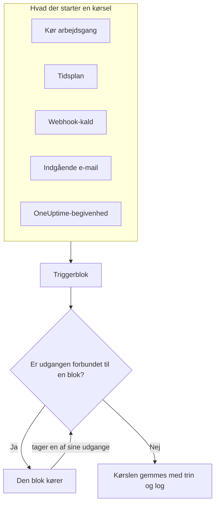
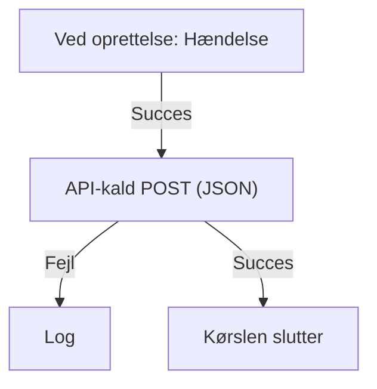

# Arbejdsgange – Oversigt

Arbejdsgange automatiserer arbejde i OneUptime uden kode. Du sætter blokke på et lærred, forbinder dem, og arbejdsgangen kører af sig selv, hver gang dens trigger udløses: en hændelse oprettes, en tidsplan er nået, et andet værktøj kalder en URL, eller der kommer en e-mail. Brug dem til at forbinde OneUptime med resten af din stak og til at tage dig af den rutinemæssige opfølgning, mens du arbejder på selve problemet. Se [Hvilken skal jeg bruge?](/docs/introduction/which-one#arbejdsgang-runbook-playbook-eller-ai-regel) for at vælge mellem en arbejdsgang, et runbook, en playbook og en AI-regel.

:::cards
- [Opret en arbejdsgang](/docs/workflows/authoring): Opret en arbejdsgang, og tilføj, forbind og konfigurer derefter blokkene på lærredet.
- [Triggere](/docs/workflows/triggers): Start en arbejdsgang manuelt, efter en tidsplan, fra en webhook, en e-mail eller en OneUptime-begivenhed.
- [Komponenter](/docs/workflows/components): Alle de blokke, du kan tilføje, fra API-kald til OneUptime-poster.
- [Kørsler](/docs/workflows/runs-and-logs): Se, hvad hver kørsel gjorde, trin for trin.
:::

## Sådan virker en arbejdsgang

Hver arbejdsgang har tre dele:

1. **En trigger** — det, der starter arbejdsgangen: en manuel kørsel, en tidsplan, et webhook-kald, en indgående e-mail eller en begivenhed i OneUptime, som en ny hændelse. Hver arbejdsgang har præcis én.
2. **Komponenter** — det, arbejdsgangen gør: sende en besked, kalde en API, tjekke en betingelse, oprette eller opdatere en OneUptime-post.
3. **Forbindelser** — de linjer, du trækker fra én blok til den næste. De afgør, hvad der kører efter hvad.

Når triggeren udløses, starter OneUptime en **kørsel**. Hver blok slutter med at tage en af sine udgange, som **Succes** eller **Fejl**, **Ja** eller **Nej**, og kun de blokke, der er forbundet til den udgang, kører bagefter. Er der ingen blok forbundet til den udgang, en blok tog, slutter den vej der. Kørslen gemmes med sin status, den vej, den tog, og det, hver blok modtog og returnerede.



Du bygger det hele visuelt på et lærred. De fleste arbejdsgange kræver ingen kode overhovedet; når et gør, kører en **Kør egen JavaScript**-blok et par linjer JavaScript.

## Hvad du kan bruge arbejdsgange til

- **Forbind OneUptime med dine andre værktøjer** — post i Slack, Microsoft Teams, Discord, Telegram, IRC eller Mattermost, opret Jira-sager, eller send en forespørgsel til enhver API i din stak.
- **Reager på det, der sker i OneUptime** — når en hændelse oprettes, så giv den rigtige kanal besked og åbn automatisk en sag.
- **Kør job efter en tidsplan** — hvert femte minut, hver nat, hver mandag morgen.
- **Modtag data udefra** — lad andre systemer starte en arbejdsgang ved at kalde dens URL eller skrive til dens e-mailadresse.
- **Genbrug fælles automatik** — byg den én gang, og start den fra enhver anden arbejdsgang med en **Kør en anden arbejdsgang**-blok.

## Vigtige begreber

Se [Ordliste](/docs/introduction/glossary) for de ord, der bruges på tværs af OneUptime.

| Begreb                 | Hvad det betyder                                                                                                   |
| ---------------------- | ------------------------------------------------------------------------------------------------------------------ |
| **Arbejdsgang**           | Hele automatikken: et navn, et lærred med blokke og en kontakt til at slå den til og fra.                         |
| **Trigger**            | Den første blok. Den afgør, hvornår arbejdsgangen kører. Hver arbejdsgang har præcis én.                               |
| **Komponent**          | Enhver anden blok: den sender en besked, laver en forespørgsel, tjekker en betingelse eller ændrer en post.        |
| **Udgang**             | Et punkt nederst på en blok, som **Succes** eller **Fejl**. Linjer derfra fører til de næste blokke.             |
| **Kørsel**             | Én kørsel af arbejdsgangen, gemt med status, tidsstempler og det, hver blok gjorde.                                   |
| **Global variabel**    | En værdi, som en API-nøgle, du gemmer én gang og bruger i alle projektets arbejdsgange.                              |

## Før du starter

- **Et abonnement, der omfatter arbejdsgange.** I OneUptime Cloud kræver arbejdsgange abonnementet **Growth** eller højere, og hvert abonnement tillader et antal kørsler hver 30. dag — se [Plangrænser](/docs/workflows/configuration#plangrænser). Selvhostede installationer uden fakturering har ingen af grænserne.
- **Tilladelse til at bygge.** At oprette og ændre arbejdsgange kræver **Arbejdsgangsadministrator**, **Projektadministrator** eller **Projektejer**, eller en brugerdefineret rolle med de tilsvarende tilladelser. Et **Arbejdsgangsmedlem** kan åbne arbejdsgange og køre dem manuelt, men ikke ændre dem. Se [Tilladelser](/docs/workflows/configuration#tilladelser).

## Hvor du finder arbejdsgange i OneUptime

Åbn **Produkter** i topbjælken, og vælg **Arbejdsgange** under **Dashboards og automatisering**. Dens menu indeholder:

- **Arbejdsgange** — din liste over arbejdsgange. Opret et nyt, eller åbn et eksisterende.
- **Globale variabler** — værdier, som alle dine arbejdsgange deler.
- **Protokoller → Kørsler** — kørselshistorikken for alle arbejdsgange i dit projekt.
- **Indstillinger → Etiketregler** og **Ejerregler** — sæt automatisk etiketter på nye arbejdsgange, og tildel deres ejere.
- **Avanceret → Arkiveret** — arbejdsgange, du har arkiveret. De kører aldrig og er udeladt af listen; fjern dem fra arkivet her. Se [Arkiver en arbejdsgang](/docs/workflows/configuration#arkiver-en-arbejdsgang).
- **Udvikler** — sådan administrerer du arbejdsgange med Terraform, API'et eller en AI-assistent.

Åbn en enkelt arbejdsgang, og dens egen menu indeholder:

- **Oversigt** — navn, beskrivelse, etiketter og kontakten **Aktiveret**.
- **Bygger** — lærredet, hvor du designer arbejdsgangen, med kontakten **Aktiveret** øverst.
- **Arbejdsgangsvariabler** — værdier, der kun gælder denne ene arbejdsgang.
- **Protokoller → Kørsler** — hver kørsel af denne arbejdsgang, med detaljer.
- **Ejere** — de personer og teams, der er ansvarlige for arbejdsgangen.
- **Udvikler** — sådan administrerer du denne arbejdsgang med Terraform, API'et eller en AI-assistent.
- **Indstillinger** — duplikér, eksportér og arkiver.

**Indstillinger** ligger i menuens sektion **Avanceret** sammen med **Auditlogs** og **Slet arbejdsgang**. **Avanceret** og **Udvikler** starter sammenfoldet, i denne menu og i alle andre, så de sider, du bruger hver dag, kommer først. Klik på en sektions navn for at vise dens sider. Den folder sig selv ud, når du er på en af dem.

## Byg din første arbejdsgang

Hver arbejdsgang bliver til på samme måde:

:::steps
1. **Opret** — vælg et udgangspunkt, og giv så din arbejdsgang et navn. Se [Opret en arbejdsgang](/docs/workflows/authoring).
2. **Vælg en trigger** — manuel, planlagt, webhook, indgående e-mail eller en begivenhed fra OneUptime. Se [Triggere](/docs/workflows/triggers).
3. **Tilføj komponenter** — sæt handlinger på lærredet, og forbind dem. Se [Komponenter](/docs/workflows/components).
4. **Test** — klik på **Kør arbejdsgang** i **Bygger**, og følg kørslen, mens den sker. Det virker, mens arbejdsgangen stadig er slået fra: det er en **Testkørsel**.
5. **Slå den til** — slå **Aktiveret** til øverst i **Bygger**, når den er klar. Fra da af starter dens trigger den.
:::

Eksemplet nedenfor følger disse trin for en rigtigt arbejdsgang.

## Eksempel: send nye hændelser til en webhook

Denne arbejdsgang sender et JSON-resumé af hver ny hændelse til en URL, du vælger — et sagssystem, et datavarehus, alt, der tager imod en webhook — og skriver årsagen i kørslens log, når forespørgslen mislykkes.



> [!TIP]
> Skabelonen **Forward new incidents to another system** bygger denne arbejdsgang for dig, uden Log-blokken: uden noget på **Fejl** får en forespørgsel, der fejler, kørslen til at mislykkes, og kørslens **Trin** siger hvorfor. Du finder den under **Hændelser**, når du opretter en arbejdsgang.

:::steps
### Opret arbejdsgangen

Åbn **Arbejdsgange**, og klik på **Opret arbejdsgang**. Klik på **Start fra bunden**, giv arbejdsgangen navnet `Send new incidents to a webhook`, og klik på **Opret arbejdsgang**.

Den nye arbejdsgang åbner i **Bygger**, slået fra.

### Tilføj triggeren

Klik på den stiplede blok **Vælg, hvad der starter denne arbejdsgang**, og klik så på **Ved oprettelse: Hændelse** under **Populære** i panelet **Tilføj udløser**.

Triggeren tager den stiplede bloks plads. ID'et på den, `incident-on-create-1`, er det, senere blokke henviser til den med.

### Vælg hændelsens felter

Klik på triggeren. **Felter, der sendes videre** starter med titlen: klik på **Tilføj felt**, sæt flueben ved beskrivelsen og de andre felter, forespørgslen skal have med, og klik på **Gem**.

Triggeren sender den nye hændelse videre med disse felter. Et felt, du ikke vælger, kommer tomt frem.

### Tilføj API-blokken

Klik på **Tilføj komponent**, og klik så på **API-kald POST (JSON)** under **Populære**. Træk fra triggerens punkt **Succes** ned til det øverste punkt på den nye blok.

### Udfyld forespørgslen

Klik på API-blokken, hvor der står **Click to set up**. Skriv dit endpoint i **URL**. Skriv i **Anmodningsbrødtekst** det JSON, der skal sendes, brug **{ }** til at indsætte hændelsens felter, hvor du har brug for dem, og klik på **Gem**.

```json title="Request Body"
{
  "id": "{{local.components.incident-on-create-1.returnValues.model._id}}",
  "title": "{{local.components.incident-on-create-1.returnValues.model.title}}",
  "description": "{{local.components.incident-on-create-1.returnValues.model.description}}"
}
```

Hver `{{…}}`-reference erstattes med hændelsens værdi, når arbejdsgangen kører. Se [Variabler](/docs/workflows/variables) for syntaksen.

### Fang fejl

Klik på **Tilføj komponent**, og klik så på **Log**. Forbind API-blokkens punkt **Fejl** til den, og sæt Log-blokkens **Værdi** til `Could not send the incident: {{local.components.api-post-1.returnValues.error}}`.

En forespørgsel, der mislykkes — en URL, der ikke kan nås, eller et svar, der ikke er 2xx — tager nu denne vej, og kørslens log siger hvorfor.

### Test det

Klik på **Kør arbejdsgang**, og vælg en hændelse i dette projekt under **Hændelse**: de seneste er vist, og når du skriver dens nummer eller en del af dens titel, finder du en anden. Klik på **Kør arbejdsgang manuelt**, og bekræft med **Kør**. Arbejdsgangen er stadig slået fra, så dette er en **Testkørsel**, og forespørgslen bliver virkelig sendt.

Et panel **Arbejdsgangskørsel** åbner og følger kørslen. Åbn trinnet **API-kald POST (JSON)** for at se den body, det sendte, og det svar, det fik.

### Slå den til

Slå **Aktiveret** til øverst i **Bygger**.
:::

Fra nu af starter hver ny hændelse i projektet en kørsel. Du finder dem alle under arbejdsgangens [Kørsler](/docs/workflows/runs-and-logs).

> [!NOTE]
> Forespørgslen sendes fra OneUptime. I OneUptime Cloud skal URL'en kunne nås fra internettet. En selvhostet installation afviser private netværksadresser, medmindre en administrator tillader dem — se [Udgående netværksadgang](/docs/workflows/configuration#udgående-netværksadgang).

## Sådan passer arbejdsgange ind i resten af OneUptime

- **Monitorer** opdager problemet. **Hændelser** og **advarsler** registrerer det. **Arbejdsgange** reagerer på det.
- **Runbooks** er beredskabsprocedurer, dit team gennemgår ved en hændelse, en advarsel eller en vedligeholdelseshændelse: manuelle trin, godkendelser og scripts, med mennesker involveret. Arbejdsgange kører uden opsyn. Brug en [runbook](/docs/runbooks/index), når en person skal træffe beslutninger undervejs, og en arbejdsgang, når hvert trin er automatisk.
- **Arbejdsområdeforbindelser** forbinder et projekt med Slack og Microsoft Teams til hændelseskanaler og notifikationer. Arbejdsgangenes Slack- og Microsoft Teams-blokke bruger dem ikke: hver blok poster via sin egen indgående webhook-URL.

## Næste trin

:::cards
- [Opret en arbejdsgang](/docs/workflows/authoring): Arbejd med lærredet, blokkene og deres indstillinger.
- [Variabler](/docs/workflows/variables): Send data mellem blokke, og hold hemmeligheder ude af dine arbejdsgange.
- [Konfiguration og sikkerhed](/docs/workflows/configuration): Tilladelser, grænser og sikkerhed, før du går live.
:::
