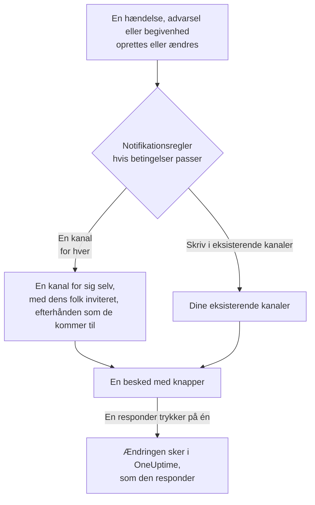

# Slack

Forbind OneUptime med Slack for at slå hændelser, advarsler, episoder, planlagt vedligeholdelse, monitorer og vagtopdateringer op i dine kanaler, give hver hændelse sin egen kanal og lade responders handle uden at forlade Slack: bekræfte, løse, tilføje noter, tilkalde vagten og oprette hændelser.

:::cards
- [Forbind Slack](#forbind-slack): Installér OneUptime i dit workspace, og knyt derefter din egen konto.
- [Bed alle om at forbinde deres konto](#bed-alle-om-at-forbinde-deres-konto): Send på én gang en besked til hvert medlem, der ikke har forbundet sin konto.
- [Notifikationsregler](#notifikationsregler): Bestem, hvilke begivenheder der slås op hvor, og hvilke der får deres egen kanal.
- [Hvem der er i en posts kanal](#hvem-der-er-i-en-posts-kanal): Se, hvem der er i den, deltag, og tilføj personer, fra postens side.
- [Kommandoen /oneuptime](#kommandoen-oneuptime): Erklær hændelser, planlæg vedligeholdelse, se hvem der har vagt, og spørg AI.
- [Vagt-brugergrupper](#vagt-brugergrupper): Hold en brugergruppe lig med dem, der har vagt, og tilkald den.
- [Handl på hændelser, advarsler og begivenheder fra Slack](#handl-på-hændelser-advarsler-og-begivenheder-fra-slack): Knapperne i OneUptimes beskeder.
:::

## Sådan virker det

To forbindelser får det til at virke:

- **Projektets forbindelse**, lavet én gang: OneUptimes app installeret i dit Slack-workspace. Den slår beskederne op, opretter kanalerne og inviterer folk.
- **Hver persons egen forbindelse**: personens Slack-konto knyttet til personens OneUptime-konto. Knapper, kommandoer og emoji-reaktioner handler som den person, med personens rettigheder i projektet.

Ét Slack-workspace kan være forbundet til mere end ét projekt, for eksempel produktion og staging. En knap eller en formular handler i projektet for den post, den handler om. En kommando eller en besked til OneUptime handler i projektet for den kanal, den skrives i, for eksempel en hændelses kanal, ellers i det ene projekt, din Slack-konto er forbundet i. Når intet viser hvilket, spørger OneUptime, hvilket projekt du mener, med en knap for hvert projekt, du er med i, og fortsætter dér, når du har valgt. I en samtale med OneUptime AI gælder dit valg resten af tråden.

## Før du begynder

- **En rolle, der må forbinde projektet:** **Project Owner**, **Project Admin** eller **Project Member**. At afinstallere appen kræver **Project Owner** eller **Project Admin**.
- **Et Slack-workspace**, hvor du må installere apps.
- **Growth-planen på OneUptime Cloud** til notifikationsregler og opsummeringer. Se [Notifikationsregler under Growth-planen](#notifikationsregler-under-growth-planen).
- **På en selvhostet server,** først en Slack-app, der er sat op til den. Se [Slack-integration](/docs/self-hosted/slack-integration).

## Forbind Slack

:::steps
### Installér OneUptime i dit Slack-workspace

Gå til **Projektindstillinger** > **Arbejdsområde** > **Slack**, og klik på **Connect with Slack**. Vælg workspacet, og giv OneUptime lov. Slack sender dig tilbage til samme side, som nu nævner det workspace, projektet er forbundet med. Indtil et workspace er forbundet, indeholder sektionen **Arbejdsområde** i menuerne Hændelser, Advarsler, Planlagt vedligeholdelse, Monitorer og Vagtordning **Forbind Slack eller Teams**, som også fører hertil.

### Forbind din egen Slack-konto

At installere appen knytter kontoen for den, der installerede den. Alle andre knytter deres egen Slack-konto under **Brugerindstillinger** > **Arbejdsområde** > **Slack** med **Connect my account with Slack** for at handle på hændelser og få direkte beskeder som sig selv. Den sektion vises, så snart projektet er forbundet med Slack. Vil du have et helt team med på én gang, så se [Bed alle om at forbinde deres konto](#bed-alle-om-at-forbinde-deres-konto).

### Tilføj en notifikationsregel

Gå til **Hændelser** > **Arbejdsområde** > **Slack**. Sektionen **Arbejdsområde** viser kun de chat-workspaces, dit projekt har forbundet, så **Slack** vises der, så snart det er forbundet. Opret en regel, for eksempel en, der opretter en Slack-kanal for hver ny hændelse med alle, der arbejder på den: de tilkaldte, hændelseslederen og ejerne. Se [Notifikationsregler](#notifikationsregler).

### Test reglen

Klik på **Testregel** i reglens række. En testbesked ankommer i de kanaler, reglen nævner. Se [Test en regel](#test-en-regel).
:::

## Bed alle om at forbinde deres konto

Ingen kan forbinde en andens Slack-konto, heller ikke en administrator: hver især logger ind med sin egen. For at få et helt team med beder en **Project Owner** eller **Project Admin** alle på én gang under **Projektindstillinger** > **Arbejdsområde** > **Slack**. Kortet **Members' Slack accounts** viser, hvor mange medlemmer der har forbundet deres konto. **Ask everyone to connect** sender hvert medlem, der ikke har gjort det, en direkte besked fra OneUptime i Slack med en knap **Connect Slack account**, der forbinder medlemmets konto med ét klik.

- **Hvem der får en besked.** Hvert medlem af projektet, der ikke har forbundet sin Slack-konto, og som OneUptime finder i Slack via medlemmets e-mailadresse. Den, der er blevet bedt om det inden for de sidste 24 timer, bliver ikke bedt igen, så beder du igen dagen efter, får kun dem, der stadig ikke har forbundet deres konto, en påmindelse.
- **Hvad kortet siger.** Hvor langt udsendelsen er nået, mens beskederne sendes, og derefter hvem der bad om det, og hvor mange medlemmer der fik en besked. Medlemmer, som OneUptime ikke kunne finde i Slack via deres e-mailadresse, nævnes ved navn på kortet: de forbinder selv deres konto under **Brugerindstillinger** > **Arbejdsområde** > **Slack**.
- **Hvad knappen forbinder.** Slack-kontoen for den, der trykker på knappen og logger ind, med vedkommendes egen OneUptime-konto. En besked, der sendes videre til en anden, forbinder intet med det medlem, den blev sendt til.

## Notifikationsregler

En notifikationsregel siger, hvilke begivenheder der slås op i Slack, og hvor. Hvert produkt har sine egne regler, under **Arbejdsområde** > **Slack** i sin menu:

| Produkt | Faner på dets **Slack**-side |
| --- | --- |
| **Hændelser** | **Hændelser**, **Hændelse Episoder**, **Summary** |
| **Advarsler** | **Advarsler**, **Advarsel Episoder**, **Summary** |
| **Planlagt vedligeholdelse** | Én liste med regler |
| **Monitorer** | Én liste med regler |
| **Vagtordning** | Én liste med regler |

At oprette en regel går gennem fire trin:

| Trin | Hvad du angiver |
| --- | --- |
| **Grundlæggende** | **Regelnavn** og **Regelbeskrivelse**. |
| **Betingelser** | Hvilke begivenheder reglen gælder for, for eksempel efter alvorlighed, tilstand, etiket, monitor eller ord i titlen. De kontrolleres, når en begivenhed oprettes, og igen ved hver opdatering, OneUptime slår op om den, så en regel for bekræftede hændelser virker, når en hændelse bekræftes. En ny regel gælder for hver begivenhed, for eksempel **Alle hændelser**. For at indsnævre den vælger du **Kun hændelser, der opfylder betingelserne** og tilføjer betingelserne. Med to eller flere siger **Matchbetingelse**, om alle skal passe, eller om én er nok. |
| **Destination** | Hvor den slår op: **Skriv i eksisterende kanaler** med kanalnavnene, **Opret en kanal for hver hændelse** (eller advarsel, episode, begivenhed, monitor eller vagtpolitik) med hvem der kommer med i den, eller begge dele. Under trinnet siger **Hvad reglen gør** det i sætninger, ligesom reglens kort. |
| **Video Call** | Kun hændelser og advarsler: start et opkald for hver. Se [Videoopkald](/docs/workspace-connections/video-calls). |

En kanal, som reglen opretter, får navn efter sin post: hændelse INC-42 får `inc-42`, advarsel ALT-7 får `alt-7`, og i et projekt uden nummerpræfikser får hændelse 42 `incident-42`. Tekst i **Præfiks for kanalnavn** sættes foran, så `prod-` giver `prod-inc-42`, og formularen viser navnet, mens du skriver. For en planlagt vedligeholdelse træder præfikset i stedet for dens nummerpræfiks: SM-5 får `sm-5`, og `maint-` giver `maint-5`. Slack tager små bogstaver, tal, `-` og `_`, op til 80 tegn. Findes der allerede en kanal med det navn, fx et andet projekts eller en arkiveret kanal, tilføjer OneUptime `-2`, `-3` og så videre.

En regel opretter sin kanal første gang, en begivenhed matcher den: når begivenheden oprettes, eller senere, når en opdatering får den til at matche, mens den stadig er åben. En regel for bekræftede hændelser opretter kanalen, når hændelsen bekræftes. En privat hændelse, advarsel eller episode får en privat kanal.

**Hvem der kommer med i kanalen** viser, hvem reglen tilføjer til sin kanal, hver især efterhånden som de kommer med i posten, ikke kun når kanalen oprettes: **Vagthavende, efterhånden som de tilkaldes**, **Hændelsesleder og andre hændelsesroller, efterhånden som de tildeles** (hændelser og hændelsesepisoder) og **Ejere, efterhånden som de tilføjes**, alle afkrydset for en ny regel, og personerne, teamene og vagtplanerne i **Inviter også**, når kanalen oprettes. Hændelseslederen tildeles som regel, når nogen første gang bekræfter hændelsen, og kommer med i dens kanal da. En regel, der blev gemt, før hændelsesroller fik deres egen boks, tilføjer dem, når den tilføjer ejerne eller de vagthavende, og dens boks vises afkrydset. En eksisterende kanal, som en regel slår op i, får ingen.

For en vagtplan i **Inviter også** kommer den, der ifølge vagtplanens side har vagt i den, når kanalen oprettes, med i kanalen uden at blive tilkaldt. Vil du kun tilføje personer til nogle hændelsers kanaler, så giv en anden regel de betingelser og de personer, med samme **Præfiks for kanalnavn** som den første: regler, der matcher en hændelse, når dens kanal oprettes, deler den kanal, og hver af dem tilføjer sine egne personer.

Hver senere opdatering af posten — en tilstandsændring, en note, en ny ejer — slås op i dens kanaler og i de eksisterende kanaler, dens regler nævner, så længe deres betingelser passer. Med **Arkiver kanalen, når hændelsen er løst** slået til, eller dens modstykke for advarsler, episoder, begivenheder, monitorer og vagtpolitikker, arkiverer reglen, der oprettede en kanal, den, når posten er løst, fuldført eller slettet, uanset hvad dens betingelser så siger. En hændelse, advarsel eller episode, der blev oprettet allerede løst, får ingen egen kanal; dens oprettelsesbesked går stadig til de kanaler, dine regler nævner. Se [Erklæret allerede bekræftet eller løst](/docs/incidents/declaring-incidents#erklæret-allerede-bekræftet-eller-løst).

En hændelse, advarsel, episode eller planlagt vedligeholdelse med sin egen kanal har **Åbn i Slack** i toppen af sin side i OneUptime, ved siden af tilstandsknapperne. Den åbner kanalen i en ny fane, i Slack-appen eller i browseren. En post med to egne kanaler viser dem begge under knappen. En post med kanaler i både Slack og Microsoft Teams har i stedet én knap, **Åbn kanal**, der viser dem alle. De eksisterende kanaler, dine regler slår op i, tilbydes ikke.

En kanal forbliver læsbar: hver begivenhed slås op én gang, og postens første tilstand står i den besked, der annoncerer posten, ikke i en besked for sig. En kørsel af en vagtpolitik er én besked, der redigeres, efterhånden som kørslen eskalerer: hvem der blev tilkaldt, hvor ofte og hvordan, hvem der ikke blev det og hvorfor, og hvem der bekræftede. En ny besked slås kun op, når nogen skal handle: en eskaleringsregel nåede ingen, eller kørslen sluttede, uden at nogen bekræftede. En person, hvis Slack-konto ikke er forbundet med OneUptime, tilføjes via den Slack-konto, der har personens e-mailadresse. En person, som OneUptime ikke finder på nogen af de to måder, eller som er gæst i Slack, kan ikke tilføjes til en kanal; OneUptime siger det én gang pr. kanal, i én besked, der nævner dem alle og redigeres, når listen vokser. Send dem beskedens link **Connect Slack account**, så de kan forbinde deres konto i ét trin. At postens ejere eller statussidens abonnenter har fået besked, står i dens feed i OneUptime.

**Projektindstillinger** > **Arbejdsområde** > **Slack** viser de kanaler, OneUptime kan se, med **Send test** ved siden af hver. OneUptime melder sig selv ind i en offentlig kanal første gang, den slår op der. En privat kanal vises, og kan modtage opslag, først når OneUptime-appen er inviteret ind i den i Slack.

## Hvem der er i en posts kanal

En hændelse, advarsel, episode eller planlagt vedligeholdelse med sin egen Slack-kanal har kortet **Slack-kanal** på sin side i OneUptime. Kortet viser kanalen, som et link, der åbner den i Slack, om den er privat, og hvem der er i den, dig først. Fra kortet, uden en Slack-administrator:

- **Deltag i kanal** tilføjer dig, når du ikke er i kanalen.
- **Tilføj personer** åbner en liste over projektets personer og teams: vælg en person for at tilføje personen, eller et team for at tilføje alle i det.

OneUptime-appen tilføjer dem, ligesom den tilføjer personerne i en regels kanal. Appen bliver i de kanaler, den opretter, så det virker også for en privat kanal, som alle har forladt.

- **Hvem der må tilføje personer.** Den, der må redigere posten: **Project Owner**, **Project Admin**, **Project Member**, **Incident Admin** og **Incident Member** for en hændelse, eller **Edit Incident** i en brugerdefineret rolle, og den samme tilladelse for en advarsel, en episode eller en begivenhed (for eksempel **Edit Alert**). Alle andre ser, hvem der er i kanalen, og hvordan de kommer ind.
- **Hvem der kan tilføjes.** En person, OneUptime kan finde i Slack: via den Slack-konto, personen har forbundet, eller ellers via den e-mailadresse, Slack har for personen. Kortet nævner dem, det ikke kunne tilføje, og hvorfor, for eksempel en gæst, som Slack holder uden for kanalen.
- **Hvad der registreres.** Hvem der blev tilføjet, og af hvem, i postens feed (**Kanalmedlem tilføjet**) og under **Projektindstillinger** > **Notifikationer** > **Notifikationslogs** på fanen **Arbejdsområde**.
- **At fjerne nogen.** OneUptime tilføjer kun: fjern nogen fra kanalen i Slack.

## Test en regel

**Testregel** i en regels række slår en testbesked for den regel op i de kanaler, den nævner, så du kan se den ankomme. Hvis reglen opretter en kanal for hver begivenhed, opretter testen også en og inviterer reglens folk ind i den.

Ligesom **Send test** ved siden af en kanal i **Projektindstillinger** > **Arbejdsområde** > **Slack** kræver den rettighed til at oprette notifikationsregler: **Project Owner**, **Project Admin**, **Project Member**, **Settings Admin**, **Settings Member** eller **Create Workspace Notification Rule** og **Read Workspace Notification Rule** i en brugerdefineret rolle. For en, der kun må se reglerne, som en **Viewer**, er **Testregel** låst, og dens værktøjstip siger, hvad der kræves; API'en afviser vedkommendes test med "You do not have permission to send test notifications in this project." På OneUptime Cloud kræver det **Growth**-planen at teste en regel, ligesom at tilføje en.

På OneUptime Cloud kræver **Send test** ved siden af en kanal også **Growth**-planen, da det at slå op i en kanal er det, regler og opsummeringer gør. **Send test nu** på en opsummering kræver rettighed til at oprette opsummeringer (**Create Workspace Notification Summary** og **Read Workspace Notification Summary** i en brugerdefineret rolle) og, på OneUptime Cloud, **Growth**-planen; for alle andre er den låst, og dens værktøjstip siger, hvad der kræves. En MCP-klient, der er forbundet med skrivebeskyttet adgang, kan ikke sende nogen test.

## Opsummeringer

Fanen **Summary** i **Hændelser** > **Arbejdsområde** > **Slack** (og i **Advarsler**) slår en tilbagevendende opsummering op i de kanaler, du nævner: hvor mange hændelser eller advarsler der var, hvor hurtigt de blev bekræftet og løst, og en liste med links. En ny opsummering sendes hver uge og dækker de seneste 7 dage. Lad **Send første rapport kl.** være tom, så sendes den første kl. 09:00 i starten af næste uge, dag eller måned; formularen siger hvornår.

En opsummering sendes efter uret i sin **Tidszone**, som starter med din. Den holder sit klokkeslæt der hele året: en, der er sat til 09:00 i Berlin, sendes stadig kl. 09:00 i Berlin, efter at urene er stillet til sommertid, og datoerne i dens besked er også Berlins. Via API'en sender du `timezone` som et IANA-tidszonenavn, som `Europe/Berlin`. En opsummering, der oprettes uden tidszone, tager tidszonen fra opretterens profil, eller UTC når en API-nøgle opretter den.

Formularen til en opsummering har fire trin: **Grundlæggende oplysninger** (navnet og kanalerne), **Tidsplan**, **Indhold** (**Hvad der skal inkluderes**) og **Filtre** (hvilke hændelser eller advarsler den tæller).

## Notifikationsregler under Growth-planen

På OneUptime Cloud hører notifikationsregler og opsummeringer til **Growth**-planen og derover. Et projekt under den beholder de regler og opsummeringer, det allerede har, og de bliver ved med at slå op i Slack. Derfor viser hvert produkts **Slack**-side (Hændelser, Advarsler, Planlagt vedligeholdelse, Vagtordning, Monitorer) planbemærkningen med dem nedenunder (**Meddelelsesregler, der stadig er sat op**, **Opsummeringer, der stadig er sat op**): slet en regel, eller slå en opsummering fra eller slet den. At tilføje eller ændre regler og opsummeringer kræver **Growth**.

## Bliv tilkaldt i Slack

For at blive tilkaldt via direkte besked, når du har vagt, tilføjer du Slack som en af dine notifikationsmetoder:

:::steps
1. Forbind din egen Slack-konto (se [Forbind Slack](#forbind-slack)).
2. Gå til **Brugerindstillinger** > **Notifikationsmetoder**, åbn fanen **Workspace Apps**, og klik på **Add Slack Account**.
3. Klik på **Send Test Message** i dens række. Beskeden ankommer i dine direkte beskeder i Slack.
:::

At tilføje den sætter den straks ind i dine vagtregler, så tilkald når dig i Slack fra da af. Ændr, hvilke tilkald den får, under **Brugerindstillinger** > **Vagtregler**.

## Gem beskeder som noter

Reagér på en besked i kanalen for en hændelse, advarsel, episode eller planlagt vedligeholdelsesbegivenhed, så gemmer OneUptime den som en note på den post og bekræfter med et svar i tråden:

| Reaktion | Gemt som |
| --- | --- |
| 📌 En knappenål-emoji, eller Slacks egen **Pin to channel** | En privat note, som kun dit team ser |
| 📢 En megafon- eller højttaler-emoji | En offentlig note, vist på statussiden. Kun hændelser og planlagte vedligeholdelsesbegivenheder. På en privat hændelse en privat note, og bekræftelsen siger hvorfor. |

Noten bevarer beskeden, som Slack viste den: dens formatering, links og kode, de personer og kanaler, den nævner, ved navn, og dens filer og billeder som links til dem. En offentlig note udelader filerne og billederne, da de kun åbner for dit team.

Det er ordene fra den, der skrev beskeden: vedkommendes OneUptime-navn, når deres Slack-konto er forbundet, ellers det navn, Slack viser. En privat note placeres på tidslinjen, da beskeden blev slået op, uanset hvor længe efter den gemmes. En offentlig note placeres, når den gemmes, som er når statussiden viser den. Tidslinjen siger, hvem der gemte den. Noten bliver ikke slået op igen i kanalen, hvor beskeden allerede står.

Noten gemmes som dig, med dine rettigheder. Hvis din Slack-konto ikke er forbundet endnu, beder OneUptime dig om at forbinde den, i en besked kun du ser, med en knap der gemmer beskeden, så snart du har gjort det. En besked gemmes kun én gang, uanset hvor mange der reagerer.

## Kommandoen /oneuptime

OneUptime har én kommando i Slack, `/oneuptime`. Ordet, du skriver efter den, siger, hvad der skal ske; alt andet efter den er et spørgsmål til OneUptime AI.

| Kommando | Hvad den gør |
| --- | --- |
| `/oneuptime help` | Viser kommandoerne med eksempler. |
| `/oneuptime incident [title or number]` | Åbner hændelsesformularen med titlen udfyldt. En hændelses nummer, som `42` eller `INC-42`, viser i stedet den hændelse: se [Håndter en hændelse fra Slack](#håndter-en-hændelse-fra-slack). |
| `/oneuptime maintenance [title]` | Åbner formularen til planlagt vedligeholdelse med titlen udfyldt. |
| `/oneuptime oncall` | Viser, hvem der har vagt lige nu i hver vagtplan, du kan se, til hvornår, og hvem der er den næste. |
| `/oneuptime page [who] [message]` | Tilkalder de personer, du nævner med @, om din besked, eller åbner en formular, hvor du vælger, hvem der skal tilkaldes. Se [Tilkald nogen fra Slack](#tilkald-nogen-fra-slack). |
| `/oneuptime ask [question]`, eller ethvert spørgsmål | OneUptime AI svarer om dine logs, traces, metrikker, hændelser og monitorer. |

Svarene på `help` og `oncall` er beskeder, som kun du kan se, under kommandoen. Et første ord, der ligner en kommando med en stavefejl, som `incidnet`, får den kommando, det ligner, ikke et svar fra OneUptime AI. Formularerne til hændelser og vedligeholdelse handler som dig: se [Opret hændelser og vedligeholdelse fra Slack](#opret-hændelser-og-vedligeholdelse-fra-slack).

> [!NOTE]
> `/oneuptime incident` og `/oneuptime maintenance` erstatter `/incident` og `/maintenance`, som kunne støde sammen med andre Slack-apps' kommandoer med samme navn. En Slack-app, der er oprettet ud fra et tidligere manifest, beholder dem, og de åbner de samme formularer, indtil appen bliver opdateret: se [Apps oprettet ud fra et ældre manifest](/docs/self-hosted/slack-integration#apps-oprettet-ud-fra-et-ældre-manifest).

## OneUptimes startside i Slack

Åbn OneUptime under **Apps** i Slacks sidepanel: fanen **Home** viser, hvad der sker i projektet, som du må se det, og læses igen, hver gang du åbner den.

- **Din vagt.** De vagtplaner, du har vagt i lige nu, og til hvornår, eller ellers din næste vagt.
- **Det, der er åbent.** De nyeste åbne hændelser og advarsler, du må læse, hver med et link til dens side i OneUptime.
- **Knapperne.** **Declare incident**, **Schedule maintenance** og **Page someone** åbner de samme formularer som `/oneuptime incident`, `/oneuptime maintenance` og `/oneuptime page`, og **Who's on call** svarer som `/oneuptime oncall`.

Startsiden læser som dig, så den kræver din egen forbundne Slack-konto. Indtil den er forbundet, har startsiden knappen **Connect Slack account**, og den viser dig din startside, så snart du har forbundet den.

Når nogen tilføjer OneUptime til en kanal, slår den en hilsen op der: hvordan man stiller den et spørgsmål, og hvor man tilføjer en notifikationsregel, der slår op i kanalen. Første gang du åbner fanen **Messages**, byder den dig velkommen der: hvad den gør i Slack, og hvordan du kommer i gang.

## Spørg OneUptime AI fra Slack

Spørg om dine logs, traces, metrikker, hændelser og monitorer på almindeligt sprog. Nævn OneUptime med @ i en kanal, eller send den en direkte besked, så svarer den i tråden. `/oneuptime ask which monitors are down?` slår svaret op i kanalen. Begge kræver, at din egen Slack-konto er forbundet, og at AI er slået til for projektet. Svar i Slack læser kun: brug knapperne for at ændre noget. Se [Spørg AI](/docs/ai/ask-ai).

OneUptime svarer kun på det, der er rettet til den.

- **I din egen samtale svarer du bare.** Et spørgsmål, du stiller i en kanal, ikke i en tråd, starter en samtale i tråden under det: svar der for at spørge om mere uden at nævne OneUptime igen, og alle andre kommer med ved at nævne den.
- **I enhver anden tråd nævner du OneUptime.** Under en hændelses besked, for eksempel, nævner du den hver gang: det, folk skriver til hinanden der, får intet svar.
- **Hvis din Slack-konto ikke er forbundet.** OneUptime beder dig én gang i hver samtale om at forbinde den, i en besked kun du kan se, med en knap **Connect Slack account**.

## Opret hændelser og vedligeholdelse fra Slack

`/oneuptime incident` og `/oneuptime maintenance` åbner en formular, som du udfylder og indsender som dig selv: som den OneUptime-konto, din Slack-konto er forbundet med (se [Forbind Slack](#forbind-slack)), med den kontos rettigheder i projektet. Hvis din Slack-konto ikke er forbundet, eller din OneUptime-konto ikke længere er medlem af projektet, fortæller OneUptime dig, hvad du skal gøre, der hvor du kørte kommandoen, i en besked kun du kan se, og ingen formular åbnes. Genvejene **Create New Incident** og **Create Scheduled Event** åbner de samme formularer.

- **Hvem der må bruge dem.** De personer, der må oprette en hændelse eller en planlagt vedligeholdelsesbegivenhed i OneUptime: **Project Owner**, **Project Admin**, **Project Member**, **Incident Admin** og **Incident Member** for en hændelse (**Create Incident** i en brugerdefineret rolle), og **Scheduled Maintenance Admin** og **Scheduled Maintenance Member** for en begivenhed (**Create Scheduled Maintenance**). Alle andre får det at vide der, hvor de kørte den, og ingen formular åbnes.
- **Hvad en formular tilbyder.** Hver liste — alvorligheder, monitorer, monitorstatusser, vagtpolitikker og etiketter — indeholder det, du må læse, ligesom den samme liste i OneUptime: med en rolle, der er begrænset til nogle etiketter, de monitorer og vagtpolitikker, der har de etiketter. En liste, du slet ikke må læse, udelades fra formularen. Arkiverede vagtpolitikker tilbydes aldrig.
- **Hvad en formular må nævne.** Hændelsen eller begivenheden oprettes med dine egne rettigheder og krediteres dig. En monitor, vagtpolitik, etiket, alvorlighed eller status, du ikke må læse, eller en fra et andet projekt, afvises som en, projektet ikke har, selv fra en formular, der blev åbnet, før din adgang ændrede sig, og intet oprettes. OneUptime fortæller dig hvorfor i kanalen, i en besked kun du kan se.

**Execute On-Call Policy** på en hændelse, advarsel eller episode virker på samme måde: den kræver rettighed til at køre en vagtpolitik (**Project Owner**, **Project Admin**, **Project Member**, **On-Call Admin** og **On-Call Member**, eller **Create On-Call Duty Policy Execution Log** i en brugerdefineret rolle) og til at læse den hændelse, advarsel eller episode, og den tilbyder de aktive vagtpolitikker, du må læse.

## Tilkald nogen fra Slack

`/oneuptime page @nawaz The checkout API is throwing 500s` tilkalder Nawaz med det samme. OneUptime opretter en advarsel med din besked som titel, og hver person, du nævner med @, får et opkald, en SMS, en push-notifikation eller en e-mail, som deres egne vagtregler siger, indtil nogen kvitterer for advarslen.

- **Hvem der tilkaldes med det samme.** De personer, du nævner med @, og dem, der har vagt i de vagtplaner, som en brugergruppe, du nævner med @, følger (se [Vagt-brugergrupper](#vagt-brugergrupper)), når en besked følger efter dem. OneUptime kender en person på den OneUptime-konto, personens Slack-konto er forbundet med, eller ellers på den e-mailadresse, Slack har for personen. Ingen uden for projektet tilkaldes.
- **Alt andet åbner en formular.** Hvis ingen er nævnt med @, der ikke er nogen besked, du nævner `@here` eller en brugergruppe, der ikke følger nogen vagtplan, du kan se, eller OneUptime ikke kan se, hvem en person er, åbner formularen **Page someone** med det, du skrev, udfyldt, og den siger, hvem den ikke kunne vælge. Vælg personer, et team, en vagtplan, som tilkalder den, der har vagt i den nu, eller en vagtpolitik, som tilkalder via sine eskaleringsregler, og indsend den. Et navn, du skriver først, som i `/oneuptime page Primary The disk is full`, vælger vagtplanen, teamet eller politikken med det navn.
- **Hvor det vises.** Kanalen viser tilkaldet som én besked, der holdes opdateret: hvem der blev tilkaldt og hvordan, og hvem der kvitterede. Hvor OneUptime ikke kan skrive, som i en privat kanal, den ikke er inviteret til, fortæller en besked, kun du kan se, hvem der blev tilkaldt, med et link til advarslen.
- **Hvem der må tilkalde.** Alle, der både må køre en vagtpolitik og oprette en advarsel: **Project Owner**, **Project Admin** og **Project Member**, eller **On-Call Member** sammen med **Alert Member** (**Create On-Call Duty Policy Execution Log** og **Create Alert** i en brugerdefineret rolle). At tilkalde personer, et team eller en vagtplan direkte, uden en vagtpolitik bag tilkaldet, kræver også adgang til alle projektets vagtpolitikker. Alle andre får det at vide der, hvor de kørte kommandoen, og ingen tilkaldes. På OneUptime Cloud kræver tilkald Growth-planen: under den siger OneUptime, hvilken plan der kræves, og ingen tilkaldes.

## Vagt-brugergrupper

Hold en Slack-brugergruppe, f.eks. `@payments-oncall`, lig med dem, der har vagt i en eller flere vagtplaner, så alle kan nævne den med @ for at nå dem. OneUptime ændrer gruppens medlemmer ved hver overdragelse og hver tilsidesættelse og tjekker den hvert 15. minut.

:::steps
### Forbind en brugergruppe med en vagtplan

Åbn vagtplanen under **Vagtordning** > **Vagtplaner**. Klik på **Forbind brugergruppe** i dens kort **Slack-brugergrupper**, og vælg en af dit arbejdsområdes brugergrupper, eller **Opret en ny brugergruppe** med et navn og et alias. Medlemmerne bliver straks erstattet af dem, der har vagt.

### Forbind den også med den sekundære vagtplan

Til en gruppe med både den primære og den sekundære vagt forbinder du den samme gruppe på den sekundære vagtplans side. En gruppe kan følge et vilkårligt antal vagtplaner.
:::

- **Hvad kortet viser.** Hvem der er i hver gruppe nu, de andre vagtplaner, den følger, og om den er **Opdateret**. En person med vagt, som ikke kan komme i gruppen, nævnes med årsagen: OneUptime finder en person via personens forbundne Slack-konto eller ellers via den e-mailadresse, Slack har for personen, og Slack holder gæster uden for brugergrupper.
- **Ingen har vagt.** Slack kan ikke beholde en brugergruppe uden medlemmer, så OneUptime slår gruppen fra, indtil nogen har vagt, og slår den så til igen.
- **Tilkald gruppen.** `/oneuptime page @payments-oncall The checkout API is down` tilkalder dem, der har vagt i de vagtplaner, gruppen følger. Se [Tilkald nogen fra Slack](#tilkald-nogen-fra-slack).
- **Hvad Slack kræver.** Brugergrupper hører til Slacks betalte abonnementer, og et arbejdsområde kan nøjes med at lade sine ejere og administratorer ændre dem: kortet siger hvilket, og hvad du skal gøre. Hvis Slack blev forbundet, før OneUptime kunne holde brugergrupper opdateret, så forbind det igen én gang under **Projektindstillinger** > **Arbejdsområde** > **Slack**.
- **Hvem der må forbinde en.** De roller, der må redigere vagtplaner: **Project Owner**, **Project Admin**, **Project Member**, **On-Call Admin** og **On-Call Member**, eller **Edit On-Call Duty Policy Schedule** i en brugerdefineret rolle. På OneUptime Cloud kræver det abonnementet **Growth** at forbinde en.
- **Afbryd forbindelsen.** OneUptime holder op med at ændre gruppen. Gruppen og dens medlemmer bliver i Slack, som de er.

## Håndter en hændelse fra Slack

En hændelses besked har fire knapper, **Acknowledge Incident**, **Resolve Incident**, **Add Note** og **View Incident**, og resten i dens menu, knappen med tre prikker efter dem:

| Menupunkt | Hvad det gør |
| --- | --- |
| **Change Severity** | Sætter hændelsens alvorlighed. |
| **Change Incident State** | Flytter hændelsen til en senere tilstand. |
| **Assign Role** | Giver nogen en rolle i hændelsen, som **Incident Commander**. En rolle til én person går over til vedkommende. |
| **Page Someone** | Tilkalder personer, et team, den der har vagt i en vagtplan, eller en vagtpolitik om hændelsen, indtil nogen kvitterer for den. |
| **Edit Custom Fields** | Sætter hændelsens brugerdefinerede felter, hvert udfyldt med det, hændelsen har. Et felt, der efterlades tomt, ryddes. |

`/oneuptime incident 42` viser hændelse 42, med disse knapper og dens menu, i en besked, som kun du kan se. Skriv nummeret, som OneUptime viser det: `42`, `#42` eller `INC-42`. I en hændelses egen kanal viser `/oneuptime incident` alene den hændelse.

- **Hvem der må bruge dem.** De personer, der må foretage den samme ændring i OneUptime. **Change Severity** og **Edit Custom Fields** kræver tilladelse til at redigere hændelsen: **Project Owner**, **Project Admin**, **Project Member**, **Incident Admin** og **Incident Member**, eller **Edit Incident** i en brugerdefineret rolle. **Assign Role** kræver **Create Incident Member**, og **Delete Incident Member** for at flytte en rolle til én person. **Page Someone** kræver det samme som **Execute On-Call Policy**. Alle andre får at vide hvorfor, og ingen formular åbnes.
- **Hvad formularerne tilbyder.** Det, du må læse i projektet. Et brugerdefineret felt, der kopieres fra hændelsens monitor, er udeladt, da det ville blive kopieret igen, og en formular rummer 40 felter: rediger resten i OneUptime.
- **Hvad der sker.** Formularen lukkes, og ændringen foretages som dig, som i OneUptime: hændelsens feed, og hændelsens kanaler med det, fortæller, hvad der ændrede sig, hvert brugerdefineret felt med sin nye værdi. En værdi, der ikke passer til sit felt, som tekst til et tal, nævnes under feltet, og formularen forbliver åben. **Page Someone** fortæller, hvem der blev tilkaldt, eller hvorfor ingen blev; en hændelse, der allerede er løst, tilkalder ingen.
- **Beskeder fra før menuen.** De beholder deres knap **Execute On-Call Policy**, og den virker stadig: **Page Someone** tilkalder også en vagtpolitik. Advarsler og episoder beholder deres.

## Handl på hændelser, advarsler og begivenheder fra Slack

Knapperne i OneUptimes Slack-beskeder handler også som dig: som den OneUptime-konto, din Slack-konto er forbundet med, med den kontos rettigheder i projektet. **Acknowledge**, **Resolve**, **Change State**, **Add Note** og **Execute On-Call Policy** på en hændelse, en advarsel eller en episode, og **Mark as Ongoing**, **Mark as Complete**, **Change State** og **Add Note** på en planlagt vedligeholdelsesbegivenhed, laver hver den ændring, som samme handling laver i OneUptime, og den krediteres dig der: postens tilstandstidslinje og feed viser, at du ændrede dens tilstand, og noten er din. En note, der gemmes fra en besked med en emoji-reaktion, slås op på samme måde.

- **Hvem der må bruge dem.** De personer, der må lave den samme ændring i OneUptime. At bekræfte, løse eller ændre tilstanden for en hændelse kræver rettighed til at ændre dens tilstand: **Project Owner**, **Project Admin**, **Project Member**, **Incident Admin** og **Incident Member**, eller **Create Incident State Timeline** i en brugerdefineret rolle. En advarsel, en episode eller en planlagt vedligeholdelsesbegivenhed kræver den samme rettighed for sin egen type (**Create Alert State Timeline**, for eksempel), og en note kræver rettighed til at slå den type note op. Alle andre får det at vide, og intet ændres.
- **Hvilke poster.** Dem, du må læse, ligesom i OneUptime: med en rolle, der er begrænset til nogle etiketter, de hændelser, advarsler, episoder og begivenheder, der har dem. En knap på enhver anden post siger hvorfor, og intet ændres: på en hændelse, din rolle ikke når, "your access in this project does not include this incident. Ask a project admin for access to it."; på en privat hændelse, du ikke er ejer af, "this incident is private, so only its owners and the project's owners and admins can see it. Ask one of them to add you as an owner."; og på en, der er slettet siden, "the incident was not found. It may have been deleted." På OneUptime Cloud afvises en ændring, som projektets plan ikke omfatter, med den plan, den kræver.
- **Hvad Change State tilbyder.** De tilstande, du må læse, som posten må gå videre til, i projektets rækkefølge: ingen før den tilstand, den er i, for en episode som for en hændelse, en advarsel eller en planlagt vedligeholdelsesbegivenhed, da en tilstandsændring aldrig flytter en post op igen i sin liste (se [Rækkefølgen er en reel begrænsning, ikke en visningspræference](/docs/incidents/states-and-severities#rækkefølgen-er-en-reel-begrænsning-ikke-en-visningspræference)). Når du ikke må læse nogen, får du at vide "No incident states are available to you in this project. Ask a project admin for access to them."; når posten er i den sidste tilstand, den kan nå, får du at vide "There is no later state to move this incident to." Ingen af dem åbner en tom formular.
- **Add Note på en privat hændelse eller episode.** En privat hændelse eller episode tager ingen offentlige noter, så dens formular spørger ikke om notetype og tilføjer en privat note. En formular, der blev åbnet, før den blev gjort privat, tilføjer også en privat note og siger det. Se [Private hændelser tager kun private noter](/docs/incidents/notes-owners-and-feed#private-hændelser-tager-kun-private-noter).
- **Hvor du får svar.** Under beskeden med knappen, i en besked kun du kan se; i en direkte besked kun hvis Slack afviser det. En knap, der trykkes for sent, fortæller, hvem der kom først, og hvornår, for eksempel "Incident INC-2 was already acknowledged by Simon Lee at 6:07 PM."
- **Hvis din Slack-konto ikke er forbundet.** Svaret beder dig forbinde den, med en knap **Connect Slack account**. Knappen åbner dine egne Slack-indstillinger i OneUptime og forbinder din konto i ét trin, efter at du har logget ind i OneUptime, hvis det er nødvendigt. Derefter gør OneUptime færdigt, hvad du trykkede på, som dig, og svarer under den samme besked; for en knap, der åbner en formular, eller en kommando beder det dig trykke på den eller køre den igen. Knappen virker én gang, i 30 minutter, og kun for den Slack-konto, der trykkede på den: logget ind i Slack som en anden forbinder den intet.

## Afbryd forbindelsen

- **Disconnect** fjerner kun tilknytningen af din egen Slack-konto og fjerner samtidig din Slack-notifikationsmetode.
- **Uninstall OneUptime from Slack**, på **Projektindstillinger** > **Arbejdsområde** > **Slack**, afbryder projektets forbindelse. OneUptime holder op med at slå op i Slack, og menuerne **Arbejdsområde** holder op med at vise det. Notifikationsreglerne og opsummeringerne bevares, til du forbinder igen.

> [!WARNING]
> At afinstallere fjerner også tilknytningen af hvert medlems egen Slack-konto i projektet og fjerner Slack-notifikationsmetoderne og de vagtregler, der brugte dem. De, der blev tilkaldt i Slack, tilkaldes via deres andre notifikationsmetoder, indtil de tilføjer Slack igen.

## Dine Slack-data

OneUptime læser kun det fra Slack, som disse funktioner har brug for, med de tilladelser, du giver, når du installerer den:

- **Beskeder til OneUptime.** En besked, der nævner den med @, en, du sender den i en direkte besked, og dine svar i en samtale med den, sammen med de tidligere beskeder i den tråd eller direkte besked, så OneUptime AI kan svare. Slack sender den også de andre beskeder i de kanaler og gruppebeskeder, den er med i; OneUptime hverken svarer på dem eller gemmer dem.
- **Beskeder, du gemmer som noter.** En besked, du reagerer på med 📌 eller 📢, eller fastgør, i kanalen for en hændelse, advarsel, episode eller planlagt vedligeholdelsesbegivenhed, gemt som en note på den post med forfatterens navn.
- **Navne på kanaler og personer.** De kanaler, den kan slå op i, så du kan vælge dem, personers navne, for at vise, hvem der skrev eller gjorde noget, og hvem der er i en posts egen kanal, læst, når postens side viser det.
- **E-mailadresser.** Den e-mailadresse, Slack har for en person, for at matche personens Slack-konto med personens OneUptime-konto, når personen ikke selv har forbundet den: for at tilkalde personen, sætte personen i en vagt-brugergruppe, tilføje personen til en posts kanal eller bede personen om at forbinde den.
- **Brugergrupper.** Dit arbejdsområdes brugergrupper, så du kan vælge en til en vagtplan, og personerne i en, du forbinder, for at holde den lig med dem, der har vagt.

Det, OneUptime gemmer af det — arbejdsområdets navn, dets kanaler, de Slack-konti, folk forbinder, noterne og brugergrupperne — gemmes sammen med dit projekt. [Privatlivspolitikken](https://oneuptime.com/legal/privacy) beskriver, hvordan OneUptime håndterer dine data.

## Fejlfinding

:::details En regel slår intet op
Tjek reglens betingelser med **Testregel**: hvis testen ankommer, passede reglens betingelser ikke på begivenheden. Hvis den ikke gør, siger Slack-siden hvorfor. For en privat kanal skal du først invitere OneUptime-appen ind i den i Slack. Hver besked, OneUptime slår op, og hver besked, Slack afviste, vises i **Projektindstillinger** > **Notifikationer** > **Notifikationslogs**, på fanen **Arbejdsområde**.
:::

:::details Nogen mangler i en regels kanal
Reglens kort siger under **Derefter**, hvem reglen inviterer. Hver slags person kommer med, efterhånden som de kommer med i posten: de tilkaldte, når de tilkaldes, hændelseslederen, når den tildeles, en ejer, når den tilføjes, og dem, der allerede var på posten, da kanalen blev oprettet. En person, som OneUptime ikke kan finde i Slack, hverken via den konto, personen har forbundet, eller via personens e-mailadresse, kan ikke tilføjes; OneUptime nævner personen i kanalen med et link til at forbinde sin konto. Vil du tilføje nogen med det samme, så tryk på **Tilføj personer** på postens kort **Slack-kanal**.
:::

:::details Alle har forladt en privat kanal
Åbn hændelsen, advarslen, episoden eller begivenheden i OneUptime, og tryk på **Deltag i kanal** på dens kort **Slack-kanal**, derefter på **Tilføj personer** for at hente de andre tilbage. Det kræver tilladelse til at redigere posten, ikke en Slack-administrator: OneUptime-appen er stadig i kanalen og tilføjer dem. Siger kortet, at OneUptime ikke kan se kanalen, er kanalen slettet, eller appen er fjernet fra den: En person i kanalen kan tilføje appen igen ved at skrive `/invite @OneUptime`.
:::

:::details Slack blev ikke forbundet
Når Slack sender dig tilbage uden en forbindelse, siger den side, du startede fra, **Slack blev ikke forbundet**, og én sætning siger hvorfor: du mangler rettigheden, linket var brugt eller udløbet, du loggede ind i et andet workspace, eller serveren er ikke sat op til Slack. Se [Forbindelsen blev ikke fuldført](/docs/self-hosted/slack-integration#forbindelsen-blev-ikke-fuldført) for hver sætning, og hvad du skal gøre.
:::

:::details En knap eller kommando siger, at min Slack-konto ikke er forbundet
Tryk på **Connect Slack account** i det svar for at forbinde den i ét trin, eller knyt den under **Brugerindstillinger** > **Arbejdsområde** > **Slack** med **Connect my account with Slack**. Hvis du ikke længere er medlem af projektet, siger OneUptime det i stedet og handler ikke på noget for dig.
:::

:::details OneUptime svarer ikke på et svar i en tråd
Et svar, der ikke nævner OneUptime, besvares kun i din egen samtale med OneUptime AI: tråden under et spørgsmål, du stillede den i en kanal. I enhver anden tråd, som den under en hændelses besked, nævner du OneUptime med @. Hvis din Slack-konto ikke er forbundet, beder OneUptime dig om at forbinde den én gang i hver samtale, ikke ved hver besked: tryk på **Connect Slack account** i den besked, eller knyt den under **Brugerindstillinger** > **Arbejdsområde** > **Slack**. Se [Spørg OneUptime AI fra Slack](#spørg-oneuptime-ai-fra-slack).
:::

:::details Notifikationer ankommer, men knapper og kommandoer gør intet
På en selvhostet server skal Slack kunne nå OneUptime for knapper, formularer og kommandoer; notifikationer kræver kun udgående adgang. Se [Netværksadgang for selvhostede installationer](/docs/self-hosted/slack-integration#netværksadgang-for-selvhostede-installationer).
:::

## Næste trin

:::cards
- [Microsoft Teams](/docs/workspace-connections/microsoft-teams): De samme notifikationer og handlinger i Microsoft Teams.
- [Videoopkald](/docs/workspace-connections/video-calls): Giv hver hændelse et opkald, slået op med dens opdateringer.
- [Slack-integration](/docs/self-hosted/slack-integration): Sæt Slack-appen op på en selvhostet server.
- [Opret en hændelse](/docs/incidents/declaring-incidents): Alle måder, en hændelse starter på, og hvad der kører, når den gør.
:::
