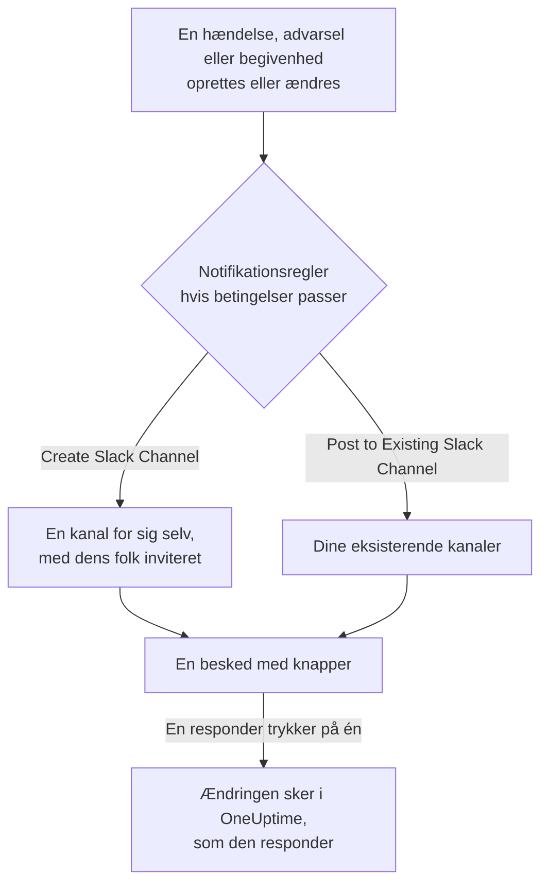

# Slack

Forbind OneUptime med Slack for at slå hændelser, advarsler, episoder, planlagt vedligeholdelse, monitorer og vagtopdateringer op i dine kanaler, give hver hændelse sin egen kanal og lade responders handle uden at forlade Slack: bekræfte, løse, tilføje noter, tilkalde vagten og oprette hændelser.

:::cards
- [Forbind Slack](#forbind-slack): Installér OneUptime i dit workspace, og knyt derefter din egen konto.
- [Notifikationsregler](#notifikationsregler): Bestem, hvilke begivenheder der slås op hvor, og hvilke der får deres egen kanal.
- [Opret hændelser og vedligeholdelse fra Slack](#opret-hændelser-og-vedligeholdelse-fra-slack): `/incident` og `/maintenance`, som dig selv.
- [Handl på hændelser, advarsler og begivenheder fra Slack](#handl-på-hændelser-advarsler-og-begivenheder-fra-slack): Knapperne i OneUptimes beskeder.
:::

## Sådan virker det

To forbindelser får det til at virke:

- **Projektets forbindelse**, lavet én gang: OneUptimes app installeret i dit Slack-workspace. Den slår beskederne op, opretter kanalerne og inviterer folk.
- **Hver persons egen forbindelse**: personens Slack-konto knyttet til personens OneUptime-konto. Knapper, kommandoer og emoji-reaktioner handler som den person, med personens rettigheder i projektet.

## Før du begynder

- **En rolle, der må forbinde projektet:** **Project Owner**, **Project Admin** eller **Project Member**. At afinstallere appen kræver **Project Owner** eller **Project Admin**.
- **Et Slack-workspace**, hvor du må installere apps.
- **Growth-planen på OneUptime Cloud** til notifikationsregler og opsummeringer. Se [Notifikationsregler under Growth-planen](#notifikationsregler-under-growth-planen).
- **På en selvhostet server,** først en Slack-app, der er sat op til den. Se [Slack-integration](/docs/self-hosted/slack-integration).

## Forbind Slack

:::steps
### Installér OneUptime i dit Slack-workspace

Gå til **Projektindstillinger** > **Arbejdsområde** > **Slack**, og klik på **Connect with Slack**. Vælg workspacet, og giv OneUptime lov. Slack sender dig tilbage til samme side, som nu nævner det workspace, projektet er forbundet med. Indtil et workspace er forbundet, indeholder sektionen **Arbejdsområde** i menuerne Hændelser, Advarsler, Planlagt vedligeholdelse, Monitorer og Vagtordning **Forbind Slack eller Teams**, som også fører hertil.

### Forbind din egen Slack-konto

At installere appen knytter kontoen for den, der installerede den. Alle andre knytter deres egen Slack-konto under **Brugerindstillinger** > **Arbejdsområde** > **Slack** med **Connect my account with Slack** for at handle på hændelser og få direkte beskeder som sig selv. Den sektion vises, så snart projektet er forbundet med Slack.

### Tilføj en notifikationsregel

Gå til **Hændelser** > **Arbejdsområde** > **Slack**. Sektionen **Arbejdsområde** viser kun de chat-workspaces, dit projekt har forbundet, så **Slack** vises der, så snart det er forbundet. Opret en regel, for eksempel en, der opretter en Slack-kanal for hver ny hændelse og inviterer hændelsens ejere. Se [Notifikationsregler](#notifikationsregler).

### Test reglen

Klik på **Testregel** i reglens række. En testbesked ankommer i de kanaler, reglen nævner. Se [Test en regel](#test-en-regel).
:::

## Notifikationsregler

En notifikationsregel siger, hvilke begivenheder der slås op i Slack, og hvor. Hvert produkt har sine egne regler, under **Arbejdsområde** > **Slack** i sin menu:

| Produkt | Faner på dets **Slack**-side |
| --- | --- |
| **Hændelser** | **Hændelser**, **Hændelse Episoder**, **Summary** |
| **Advarsler** | **Advarsler**, **Advarsel Episoder**, **Summary** |
| **Planlagt vedligeholdelse** | Én liste med regler |
| **Monitorer** | Én liste med regler |
| **Vagtordning** | Én liste med regler |

At oprette en regel går gennem fire trin:

| Trin | Hvad du angiver |
| --- | --- |
| **Grundlæggende** | **Regelnavn** og **Regelbeskrivelse**. |
| **Betingelser** | Hvilke begivenheder reglen udløses for, for eksempel efter alvorlighed, tilstand, etiket, monitor eller ord i titlen. Uden betingelser udløses den for hver begivenhed. Med to eller flere siger **Matchbetingelse**, om alle skal passe, eller om én er nok. |
| **Destination** | Hvor den slår op: **Post to Existing Slack Channel** med kanalnavnene, **Create Slack Channel** med den nye kanals navn og hvem der inviteres, eller begge dele. |
| **Video Call** | Kun hændelser og advarsler: start et opkald for hver. Se [Videoopkald](/docs/workspace-connections/video-calls). |

En kanal, som reglen opretter, får sit navn fra **New Slack Channel Name** efterfulgt af postens nummer, som `oneuptime-incident-42`, og kun en oprettet kanal får de folk, reglen inviterer: postens ejere, valgte teams og brugere og, for hændelser og advarsler, de vagthavende, efterhånden som de tilkaldes. En privat hændelse, advarsel eller episode får en privat kanal. Hver senere opdatering af posten — en tilstandsændring, en note, en ny ejer — slås op i dens kanaler og i de eksisterende kanaler, dens regler nævner. En hændelse, advarsel eller episode, der blev oprettet allerede løst, får ingen egen kanal; dens oprettelsesbesked går stadig til de kanaler, dine regler nævner. Se [Erklæret allerede bekræftet eller løst](/docs/incidents/declaring-incidents#erklæret-allerede-bekræftet-eller-løst).

**Projektindstillinger** > **Arbejdsområde** > **Slack** viser de kanaler, OneUptime kan se, med **Send test** ved siden af hver. OneUptime melder sig selv ind i en offentlig kanal første gang, den slår op der. En privat kanal vises, og kan modtage opslag, først når OneUptime-appen er inviteret ind i den i Slack.

## Test en regel

**Testregel** i en regels række slår en testbesked for den regel op i de kanaler, den nævner, så du kan se den ankomme. Hvis reglen opretter en kanal for hver begivenhed, opretter testen også en og inviterer reglens folk ind i den.

Ligesom **Send test** ved siden af en kanal i **Projektindstillinger** > **Arbejdsområde** > **Slack** kræver den rettighed til at oprette notifikationsregler: **Project Owner**, **Project Admin**, **Project Member**, **Settings Admin**, **Settings Member** eller **Create Workspace Notification Rule** og **Read Workspace Notification Rule** i en brugerdefineret rolle. For en, der kun må se reglerne, som en **Viewer**, er **Testregel** låst, og dens værktøjstip siger, hvad der kræves; API'en afviser vedkommendes test med "You do not have permission to send test notifications in this project." På OneUptime Cloud kræver det **Growth**-planen at teste en regel, ligesom at tilføje en.

På OneUptime Cloud kræver **Send test** ved siden af en kanal også **Growth**-planen, da det at slå op i en kanal er det, regler og opsummeringer gør. **Send test nu** på en opsummering kræver rettighed til at oprette opsummeringer (**Create Workspace Notification Summary** og **Read Workspace Notification Summary** i en brugerdefineret rolle) og, på OneUptime Cloud, **Growth**-planen; for alle andre er den låst, og dens værktøjstip siger, hvad der kræves. En MCP-klient, der er forbundet med skrivebeskyttet adgang, kan ikke sende nogen test.

## Opsummeringer

Fanen **Summary** i **Hændelser** > **Arbejdsområde** > **Slack** (og i **Advarsler**) slår en tilbagevendende opsummering op i de kanaler, du nævner: hvor mange hændelser eller advarsler der var, hvor hurtigt de blev bekræftet og løst, og en liste med links. En ny opsummering sendes hver uge og dækker de seneste 7 dage. Lad **Send første rapport kl.** være tom, så sendes den første kl. 09:00 i starten af næste uge, dag eller måned; formularen siger hvornår.

En opsummering sendes efter uret i sin **Tidszone**, som starter med din. Den holder sit klokkeslæt der hele året: en, der er sat til 09:00 i Berlin, sendes stadig kl. 09:00 i Berlin, efter at urene er stillet til sommertid, og datoerne i dens besked er også Berlins. Via API'en sender du `timezone` som et IANA-tidszonenavn, som `Europe/Berlin`. En opsummering, der oprettes uden tidszone, tager tidszonen fra opretterens profil, eller UTC når en API-nøgle opretter den.

Formularen til en opsummering har fire trin: **Grundlæggende oplysninger** (navnet og kanalerne), **Tidsplan**, **Indhold** (**Hvad der skal inkluderes**) og **Filtre** (hvilke hændelser eller advarsler den tæller).

## Notifikationsregler under Growth-planen

På OneUptime Cloud hører notifikationsregler og opsummeringer til **Growth**-planen og derover. Et projekt under den beholder de regler og opsummeringer, det allerede har, og de bliver ved med at slå op i Slack. Derfor viser hvert produkts **Slack**-side (Hændelser, Advarsler, Planlagt vedligeholdelse, Vagtordning, Monitorer) planbemærkningen med dem nedenunder (**Meddelelsesregler, der stadig er sat op**, **Opsummeringer, der stadig er sat op**): slet en regel, eller slå en opsummering fra eller slet den. At tilføje eller ændre regler og opsummeringer kræver **Growth**.

## Bliv tilkaldt i Slack

For at blive tilkaldt via direkte besked, når du har vagt, tilføjer du Slack som en af dine notifikationsmetoder:

:::steps
1. Forbind din egen Slack-konto (se [Forbind Slack](#forbind-slack)).
2. Gå til **Brugerindstillinger** > **Notifikationsmetoder**, åbn fanen **Workspace Apps**, og klik på **Add Slack Account**.
3. Klik på **Send Test Message** i dens række. Beskeden ankommer i dine direkte beskeder i Slack.
:::

At tilføje den sætter den straks ind i dine vagtregler, så tilkald når dig i Slack fra da af. Ændr, hvilke tilkald den får, under **Brugerindstillinger** > **Vagtregler**.

## Gem beskeder som noter

Reagér på en besked i kanalen for en hændelse, advarsel, episode eller planlagt vedligeholdelsesbegivenhed, så gemmer OneUptime den som en note på den post og bekræfter med et svar i tråden:

| Reaktion | Gemt som |
| --- | --- |
| 📌 En knappenål-emoji, eller Slacks egen **Pin to channel** | En privat note, som kun dit team ser |
| 📢 En megafon- eller højttaler-emoji | En offentlig note, vist på statussiden. Kun hændelser og planlagte vedligeholdelsesbegivenheder. |

Noten gemmes som dig, med dine rettigheder, så din egen Slack-konto skal være forbundet. En besked gemmes kun én gang, uanset hvor mange der reagerer.

## Spørg OneUptime AI fra Slack

Spørg om dine logs, traces, metrikker, hændelser og monitorer på almindeligt sprog. Nævn OneUptime med @ i en kanal, eller send den en direkte besked, så svarer den i tråden; svar der for at spørge om mere. `/oneuptime ask which monitors are down?` slår svaret op i kanalen. Begge kræver, at din egen Slack-konto er forbundet, og at AI er slået til for projektet. Svar i Slack læser kun: brug knapperne for at ændre noget. Se [Spørg AI](/docs/ai/ask-ai).

## Opret hændelser og vedligeholdelse fra Slack

`/incident` og `/maintenance` åbner en formular, som du udfylder og indsender som dig selv: som den OneUptime-konto, din Slack-konto er forbundet med (se [Forbind Slack](#forbind-slack)), med den kontos rettigheder i projektet. Hvis din Slack-konto ikke er forbundet, eller din OneUptime-konto ikke længere er medlem af projektet, fortæller OneUptime dig i en direkte besked, hvad du skal gøre, og ingen formular åbnes. Genvejene **Create New Incident** og **Create Scheduled Event** åbner de samme formularer.

- **Hvem der må bruge dem.** De personer, der må oprette en hændelse eller en planlagt vedligeholdelsesbegivenhed i OneUptime: **Project Owner**, **Project Admin**, **Project Member**, **Incident Admin** og **Incident Member** for en hændelse (**Create Incident** i en brugerdefineret rolle), og **Scheduled Maintenance Admin** og **Scheduled Maintenance Member** for en begivenhed (**Create Scheduled Maintenance**). Alle andre får det at vide i en direkte besked, og ingen formular åbnes.
- **Hvad en formular tilbyder.** Hver liste — alvorligheder, monitorer, monitorstatusser, vagtpolitikker og etiketter — indeholder det, du må læse, ligesom den samme liste i OneUptime: med en rolle, der er begrænset til nogle etiketter, de monitorer og vagtpolitikker, der har de etiketter. En liste, du slet ikke må læse, udelades fra formularen. Arkiverede vagtpolitikker tilbydes aldrig.
- **Hvad en formular må nævne.** Hændelsen eller begivenheden oprettes med dine egne rettigheder og krediteres dig. En monitor, vagtpolitik, etiket, alvorlighed eller status, du ikke må læse, eller en fra et andet projekt, afvises som en, projektet ikke har, selv fra en formular, der blev åbnet, før din adgang ændrede sig, og intet oprettes. OneUptime fortæller dig hvorfor i en direkte besked.

**Execute On-Call Policy** på en hændelse, advarsel eller episode virker på samme måde: den kræver rettighed til at køre en vagtpolitik (**Project Owner**, **Project Admin**, **Project Member**, **On-Call Admin** og **On-Call Member**, eller **Create On-Call Duty Policy Execution Log** i en brugerdefineret rolle) og til at læse den hændelse, advarsel eller episode, og den tilbyder de aktive vagtpolitikker, du må læse.

## Handl på hændelser, advarsler og begivenheder fra Slack

Knapperne i OneUptimes Slack-beskeder handler også som dig: som den OneUptime-konto, din Slack-konto er forbundet med, med den kontos rettigheder i projektet. **Acknowledge**, **Resolve**, **Change State**, **Add Note** og **Execute On-Call Policy** på en hændelse, en advarsel eller en episode, og **Mark as Ongoing**, **Mark as Complete**, **Change State** og **Add Note** på en planlagt vedligeholdelsesbegivenhed, laver hver den ændring, som samme handling laver i OneUptime, og den krediteres dig der: postens tilstandstidslinje og feed viser, at du ændrede dens tilstand, og noten er din. En note, der gemmes fra en besked med en emoji-reaktion, slås op på samme måde.

- **Hvem der må bruge dem.** De personer, der må lave den samme ændring i OneUptime. At bekræfte, løse eller ændre tilstanden for en hændelse kræver rettighed til at ændre dens tilstand: **Project Owner**, **Project Admin**, **Project Member**, **Incident Admin** og **Incident Member**, eller **Create Incident State Timeline** i en brugerdefineret rolle. En advarsel, en episode eller en planlagt vedligeholdelsesbegivenhed kræver den samme rettighed for sin egen type (**Create Alert State Timeline**, for eksempel), og en note kræver rettighed til at slå den type note op. Alle andre får det at vide i en direkte besked, og intet ændres.
- **Hvilke poster.** Dem, du må læse, ligesom i OneUptime: med en rolle, der er begrænset til nogle etiketter, de hændelser, advarsler, episoder og begivenheder, der har dem. En knap på enhver anden post, eller på en fra et andet projekt, besvares med, at posten "was not found in this project, or you do not have access to it.", og intet ændres. På OneUptime Cloud afvises en ændring, som projektets plan ikke omfatter, med den plan, den kræver.
- **Hvad Change State tilbyder.** De tilstande, du må læse, som posten må gå videre til, i projektets rækkefølge: ingen før den tilstand, den er i, for en episode som for en hændelse, en advarsel eller en planlagt vedligeholdelsesbegivenhed, da en tilstandsændring aldrig flytter en post op igen i sin liste (se [Rækkefølgen er en reel begrænsning, ikke en visningspræference](/docs/incidents/states-and-severities#rækkefølgen-er-en-reel-begrænsning-ikke-en-visningspræference)). Når du ikke må læse nogen, får du at vide "No incident states are available to you in this project. Ask a project admin for access to them."; når posten er i den sidste tilstand, den kan nå, får du at vide "There is no later state to move this incident to." Ingen af dem åbner en tom formular.

## Afbryd forbindelsen

- **Disconnect** fjerner kun tilknytningen af din egen Slack-konto og fjerner samtidig din Slack-notifikationsmetode.
- **Uninstall OneUptime from Slack**, på **Projektindstillinger** > **Arbejdsområde** > **Slack**, afbryder projektets forbindelse. OneUptime holder op med at slå op i Slack, og menuerne **Arbejdsområde** holder op med at vise det. Notifikationsreglerne og opsummeringerne bevares, til du forbinder igen.

> [!WARNING]
> At afinstallere fjerner også tilknytningen af hvert medlems egen Slack-konto i projektet og fjerner Slack-notifikationsmetoderne og de vagtregler, der brugte dem. De, der blev tilkaldt i Slack, tilkaldes via deres andre notifikationsmetoder, indtil de tilføjer Slack igen.

## Fejlfinding

:::details En regel slår intet op
Tjek reglens betingelser med **Testregel**: hvis testen ankommer, passede reglens betingelser ikke på begivenheden. Hvis den ikke gør, siger Slack-siden hvorfor. For en privat kanal skal du først invitere OneUptime-appen ind i den i Slack. Hver besked, OneUptime slår op, og hver besked, Slack afviste, vises i **Projektindstillinger** > **Notifikationer** > **Notifikationslogs**, på fanen **Arbejdsområde**.
:::

:::details Slack blev ikke forbundet
Når Slack sender dig tilbage uden en forbindelse, siger den side, du startede fra, **Slack blev ikke forbundet**, og én sætning siger hvorfor: du mangler rettigheden, linket var brugt eller udløbet, du loggede ind i et andet workspace, eller serveren er ikke sat op til Slack. Se [Forbindelsen blev ikke fuldført](/docs/self-hosted/slack-integration#forbindelsen-blev-ikke-fuldført) for hver sætning, og hvad du skal gøre.
:::

:::details En knap eller kommando siger, at min Slack-konto ikke er forbundet
Knyt den under **Brugerindstillinger** > **Arbejdsområde** > **Slack** med **Connect my account with Slack**. Hvis du ikke længere er medlem af projektet, siger OneUptime det i stedet og handler ikke på noget for dig.
:::

:::details Notifikationer ankommer, men knapper og kommandoer gør intet
På en selvhostet server skal Slack kunne nå OneUptime for knapper, formularer og kommandoer; notifikationer kræver kun udgående adgang. Se [Netværksadgang for selvhostede installationer](/docs/self-hosted/slack-integration#netværksadgang-for-selvhostede-installationer).
:::

## Næste trin

:::cards
- [Microsoft Teams](/docs/workspace-connections/microsoft-teams): De samme notifikationer og handlinger i Microsoft Teams.
- [Videoopkald](/docs/workspace-connections/video-calls): Giv hver hændelse et opkald, slået op med dens opdateringer.
- [Slack-integration](/docs/self-hosted/slack-integration): Sæt Slack-appen op på en selvhostet server.
- [Opret en hændelse](/docs/incidents/declaring-incidents): Alle måder, en hændelse starter på, og hvad der kører, når den gør.
:::
