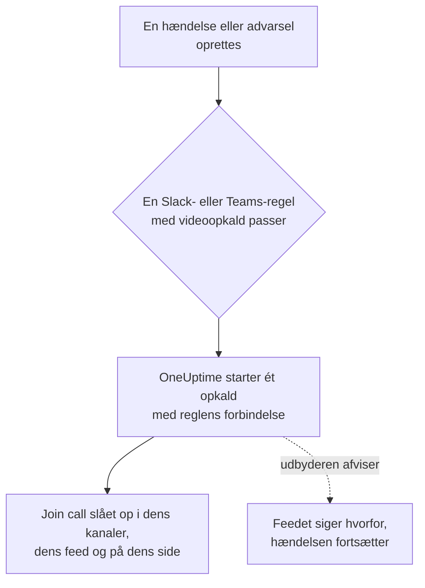

# Videoopkald

Giv hver hændelse og hver advarsel sit eget opkald. Når en notifikationsregel for Slack eller Microsoft Teams udløses for en ny hændelse eller advarsel, starter OneUptime et dedikeret møde (et Zoom-møde, et Google Meet, et Microsoft Teams-møde eller huddlen i hændelsens Slack-kanal) og slår en **Join call**-knap op overalt, hvor hændelsens opdateringer går hen. Responders deltager med ét klik, og ingen skal oprette et møde kl. 3 om natten og sende linket rundt.

:::cards
- [Sådan virker det](#sådan-virker-det): En regel starter opkaldet, og responders deltager, hvor de end er.
- [Forbind med ét klik](#forbind-med-ét-klik): Zoom, Google Meet eller Microsoft Teams, ved at logge ind.
- [Udbydere](#udbydere): Din egen apps tjenesteidentitet, et fast mødelink eller en Slack-huddle.
- [Start et opkald manuelt](#start-et-opkald-manuelt): Fra en hændelses eller advarsels side.
:::

## Sådan virker det



:::steps
### Forbind en udbyder

Gå til **Projektindstillinger** > **Arbejdsområde** > **Video Calls**, og forbind Zoom, Google Meet eller Microsoft Teams, eller tilføj et fast mødelink. På OneUptime Cloud er det ét klik at forbinde Zoom, Google Meet eller Microsoft Teams: log ind, og giv OneUptime lov til at oprette møder (se [Forbind med ét klik](#forbind-med-ét-klik)). Slack-huddles kræver intet ud over projektets Slack-forbindelse.

### Slå det til i en regel

Åbn en notifikationsregel for Slack eller Microsoft Teams for hændelser eller advarsler (**Hændelser** > **Arbejdsområde** > **Slack**, for eksempel). I reglens trin **Video Call** skal du slå **Start a video call for the incident** til og vælge, hvor opkaldet holdes.

### Deltag med ét klik

Når reglen udløses, starter OneUptime ét opkald for hændelsen og slår det op med en **Join call**-knap i de kanaler, hændelsens opdateringer går til, og i hændelsens feed. Hændelsens side viser opkaldet i sit **Video Call**-kort og en **Join call**-knap i sin overskrift.
:::

Reglens betingelser bestemmer, hvilke hændelser der får et opkald. For en bro kun ved Sev1-hændelser skal du give reglen en **Alvorlighed**-betingelse. Opkald starter for hændelser og advarsler, der oprettes som igangværende. En hændelse, der oprettes allerede løst, får intet opkald.

### Ét opkald pr. hændelse

Et opkald startes én gang pr. hændelse for hvert sted, et opkald holdes. Regler, der vælger samme forbindelse, deler ét opkald, og en regel starter aldrig et andet opkald for en hændelse, der allerede har et fra den forbindelse. Regler, der vælger forskellige steder, starter hver deres eget opkald, for eksempel et Zoom-møde for responders og huddlen i hændelsens Slack-kanal.

### Når et opkald ikke kan starte

At oprette en hændelse venter aldrig på en udbyder af videoopkald. Opkaldet startes, efter at hændelsen er oprettet, så en langsom eller fejlende udbyder forsinker aldrig hændelsen eller dens vagttilkald.

Hvis udbyderen afviser (en udløbet hemmelighed, en manglende rettighed, en slettet vært), siger hændelsens feed, at reglens opkald ikke kunne startes, med udbyderens begrundelse, så responders ved, at de skal starte et fra hændelsens side. Reglens kørsel står i workspacets notifikationslogs som **Start videoopkald**, og forbindelsens række i **Projektindstillinger** > **Arbejdsområde** > **Video Calls** viser fejlen, indtil et opkald starter igen.

### Private hændelser

Et møde får navn efter den hændelse, det er til, med dens nummer og titel, og dets beskrivelse linker tilbage til hændelsen. For en privat hændelse udelades titlen, fordi alle, der inviteres til mødet, kan læse dets navn.

## Forbind med ét klik

På OneUptime Cloud tager det ét klik at forbinde Zoom, Google Meet eller Microsoft Teams, og der skal intet sættes op hos udbyderen:

:::steps
1. Gå til **Projektindstillinger** > **Arbejdsområde** > **Video Calls**, og klik på **Forbind** ved Zoom, Google Meet eller Microsoft Teams.
2. Klik på **Continue to Zoom** (eller Google, eller Microsoft), log ind, og giv OneUptime lov til at oprette møder.
3. Du kommer tilbage til siden med videoopkald med forbindelsen oprettet. **Start a test meeting** tjekker den fra ende til anden; vælg derefter forbindelsen i en notifikationsregel for Slack eller Microsoft Teams.
:::

Hvert møde oprettes som den konto, du logger ind med, og som er vært for det. Log ind med en delt konto, som incidents@example.com, i stedet for din egen, så opkald bliver ved med at starte, når folk stopper. Forbindelsens række viser, hvilken konto den er logget ind som.

| Udbyder | Log ind med | Hvad OneUptime må gøre |
| --- | --- | --- |
| Zoom | En Zoom-bruger. Møder med en Basic-bruger (gratis) som vært slutter efter 40 minutter. | Oprette møder for den bruger (`meeting:write:meeting`) og læse, hvem det er (`user:read:user`). |
| Google Meet | En Google-konto, der kan bruge Google Meet. | Oprette Meet-rum som den konto (`meetings.space.created`) og læse dens e-mailadresse. |
| Microsoft Teams | En arbejds- eller skolekonto med Microsoft Teams. Personlige Microsoft-konti kan ikke oprette Teams-møder. | Oprette onlinemøder som den konto (den delegerede rettighed `OnlineMeetings.ReadWrite`) og forblive logget ind (`offline_access`). |

En forbindelse, der er lavet ved at logge ind, har stadig de indstillinger, der bestemmer, hvem der venter: **Who can join** for Google Meet og **Who skips the lobby** for Microsoft Teams. Ændr dem med **Rediger** i forbindelsens række.

### Forbliv logget ind

OneUptime gemmer loginets opdateringstoken, krypteret, og fornyer det mindst én gang om ugen, så det aldrig udløber på grund af manglende brug, uanset hvor længe projektet går uden en hændelse. Hvis loginet holder op med at virke (kontoen fjernede OneUptime, blev slettet eller suspenderet, eller din organisations politik beder den logge ind igen), viser forbindelsens række **Not working** med begrundelsen den dag, OneUptime opdager det, ikke ved næste hændelse. **Reconnect** i rækken logger ind igen.

Forbindelser, der er logget ind som samme konto, deler ét login, i alle projekter: Zoom gemmer kun ét login pr. konto, så at forbinde den samme Zoom-bruger igen erstatter det for dem alle.

### Forbind igen og fjern

**Reconnect** i en forbindelses række logger ind igen, som samme konto eller en anden. Brug det, efter at kontoen har fjernet OneUptime, eller for at flytte hændelsesmøder til en anden konto.

At slette en forbindelse trækker OneUptimes adgang tilbage hos Zoom og Google, så snart ingen anden forbindelse bruger loginet. For Microsoft skal du fjerne OneUptime under kontoens **My Apps** (myapps.microsoft.com). At fjerne OneUptime fra din Zoom-konto i Zoom App Marketplace sletter dens login fra alle forbindelser, der er logget ind som den konto, og de viser **Not working**, indtil de forbindes igen.

### Hvis Microsoft beder om en administrator

Nogle Microsoft 365-organisationer lader kun administratorer godkende apps. Hvis Microsoft siger, at du skal have godkendelse fra en administrator, så bed en Microsoft 365-administrator om at forbinde Microsoft Teams, eller om at godkende OneUptime i [Microsoft Entra Administration](https://entra.microsoft.com/) under **Enterprise applications** > **Admin consent requests**.

### Brug din egen app i stedet

For at forbinde med en tjenesteidentitet i stedet for en persons login — en Zoom-app af typen Server-to-Server OAuth, en Google-tjenestekonto med domænedækkende delegering eller en Microsoft Entra-appregistrering — skal du klikke på **Use your own Zoom app** (eller Google, eller Microsoft) i dialogen Forbind. [Udbydere](#udbydere) forklarer hver af dem. På en selvhostet server uden opsatte ét-kliks-apps åbner **Forbind** denne formular direkte; se [Forbind med ét klik på en selvhostet server](#forbind-med-ét-klik-på-en-selvhostet-server) for at sætte dem op.

## Start et opkald manuelt

**Video Call**-kortet på en hændelses eller advarsels side har **Start call** (eller **Start another**, når der er et). Vælg en af projektets forbindelser, huddlen i hændelsens Slack-kanal, eller indsæt dit eget mødelink. Opkaldet slås op i hændelsens kanaler og feed, ligesom et, en regel starter.

**Fjern** på kortet tager et opkald af hændelsens side. Selve mødet slettes ikke, og alle med linket kan stadig deltage i det.

At starte og fjerne opkald kræver rettighed til at arbejde med hændelser (eller advarsler): **Project Owner**, **Project Admin**, **Project Member**, **Incident Admin** eller **Incident Member**, eller **Create Incident Video Call** og **Delete Incident Video Call** i en brugerdefineret rolle. Alle, der kan læse hændelsen, ser dens opkald.

## Udbydere

Dette afsnit handler om at forbinde en udbyder med din egen apps tjenesteidentitet: en Zoom-app af typen Server-to-Server OAuth, en Google-tjenestekonto, en Microsoft Entra-appregistrering. En tjenesteidentitet afhænger aldrig af en person, så den bliver ved med at virke, uanset hvem der stopper. For at forbinde ved at logge ind i stedet, se [Forbind med ét klik](#forbind-med-ét-klik).

Legitimationsoplysninger krypteres, når de gemmes, og returneres aldrig af API'en. Når du redigerer en forbindelse, beholder en legitimationsoplysning, der efterlades tom, den gemte.

**Start test meeting** i forbindelsesformularen, og **Test** i en forbindelses række, opretter et rigtigt møde med forbindelsens indstillinger og viser dets link. Det er det ene tjek, der beviser, at legitimationsoplysningerne, rettigheden hos udbyderen og værten virker sammen. Intet slås op nogen steder.

At forbinde en udbyder kræver **Project Owner**, **Project Admin** eller **Settings Admin**, eller **Create Video Call Connection** og **Edit Video Call Connection** i en brugerdefineret rolle.

### Zoom

OneUptime opretter et Zoom-møde for hver hændelse via en Zoom-app af typen **Server-to-Server OAuth**, med en licenseret Zoom-bruger efter eget valg som vært.

:::steps
1. I [Zoom App Marketplace](https://marketplace.zoom.us/) skal du vælge **Develop** > **Build App** og oprette en app af typen **Server-to-Server OAuth**. At oprette en kræver en administrator af Zoom-kontoen, eller en rolle, der tillader Server-to-Server OAuth-apps.
2. På appens side **Scopes** skal du tilføje **meeting:write:meeting:admin** (oprette et møde for en bruger). En app, der er oprettet før de detaljerede scopes, kan bruge **meeting:write:admin** i stedet.
3. Klik på **Activate** for at aktivere appen, og kopiér derefter **Account ID**, **Client ID** og **Client secret** fra dens side **App Credentials** til forbindelsesformularen.
4. Angiv **Meeting host**: e-mailen på en licenseret Zoom-bruger, helst en tjenestekonto som incidents@example.com, så møder bliver ved med at virke, når folk stopper. Møder med en Basic-bruger (gratis) som vært slutter efter 40 minutter.
5. Responders deltager uden at vente på værten, fordi værten er en tjenestekonto, der aldrig deltager. Sørg for, at din Zoom-kontos indstilling **Waiting room** ikke er låst til slået til, ellers kan ingen komme ind.
:::

| Felt | Hvor du finder det |
| --- | --- |
| Account ID | Appens side **App Credentials** |
| Client ID | Appens side **App Credentials** |
| Client secret | Appens side **App Credentials** |
| Meeting host | E-mailen på den licenserede Zoom-bruger, der er vært for hvert møde |

### Google Meet

OneUptime opretter et Google Meet for hver hændelse med Google Meet REST API, via en Google Cloud-tjenestekonto, der optræder som en Google Workspace-bruger med domænedækkende delegering.

:::steps
1. I [Google Cloud-konsollen](https://console.cloud.google.com/) skal du vælge eller oprette et projekt og aktivere **Google Meet REST API** for det.
2. Under **IAM & Admin** > **Service accounts** skal du oprette en tjenestekonto. Åbn den, gå til **Keys** > **Add key** > **Create new key**, vælg **JSON**, og indsæt den downloadede fil i forbindelsesformularen som **Service account JSON key**.
3. I [Google Administrationskonsol](https://admin.google.com/) skal du åbne **Security** > **Access and data control** > **API controls** > **Manage Domain Wide Delegation** og klikke på **Add new**. Angiv tjenestekontoens numeriske **Client ID** og scopet `https://www.googleapis.com/auth/meetings.space.created`.
4. Angiv i **Create meetings as** den Google Workspace-bruger, tjenestekontoen optræder som: en dedikeret konto som incidents@example.com. Hvert møde ejes af denne bruger.
:::

**Who can join** bestemmer, hvem der deltager uden at spørge: med **People in your organization join directly, others ask to join** (standarden) beder folk uden for dit Google Workspace om at deltage, og nogen i opkaldet lukker dem ind. Med **Anyone with the link joins directly** venter ingen.

Domænedækkende delegering kan tage et par minutter, før den virker. Hvis testen lige efter, at du tilføjede delegeringen, melder, at Google ikke lod tjenestekontoen optræde som brugeren, så vent et par minutter, og test igen.

### Microsoft Teams

OneUptime opretter et Microsoft Teams-møde for hver hændelse med Microsoft Graph, via en Microsoft Entra-appregistrering, der organiserer møder på vegne af en licenseret Teams-bruger.

:::steps
1. I [Microsoft Entra Administration](https://entra.microsoft.com/) skal du åbne **App registrations** > **New registration** og registrere en app med én lejer. Kopiér dens **Directory (tenant) ID** og **Application (client) ID**.
2. Under **API permissions** skal du tilføje Microsoft Graph-rettigheden af typen **application** **OnlineMeetings.ReadWrite.All** og derefter klikke på **Grant admin consent**.
3. Under **Certificates & secrets** skal du oprette en klienthemmelighed og indsætte dens **Value**, ikke dens Secret ID, i forbindelsesformularen som **Client secret**.
4. Vælg organisatoren: en licenseret Teams-bruger, helst en tjenestekonto. Kopiér dens **Object ID** fra **Users** i Entra Administration til **Organizer object ID**.
5. Tillad appen at oprette møder for organisatoren med en programadgangspolitik. Kør i Teams PowerShell, efter `Connect-MicrosoftTeams`, de to kommandoer nedenfor.
:::

```powershell
New-CsApplicationAccessPolicy -Identity OneUptime-Meetings -AppIds "<application-client-id>"
Grant-CsApplicationAccessPolicy -PolicyName OneUptime-Meetings -Identity "<organizer-object-id>"
```

Politikken kan tage op til 30 minutter om at træde i kraft. Indtil da melder testen, at appen ikke må oprette møder for organisatoren.

**Who skips the lobby** bestemmer, hvem der deltager uden at vente: med **People in your organization skip the lobby** (standarden) venter alle andre i lobbyen, indtil nogen i mødet lukker dem ind. Med **Everyone skips the lobby** venter ingen.

### Mødelink

Et fast mødelink er det samme rum for hver hændelse: et personligt Zoom-mødelokale, et tilbagevendende Microsoft Teams- eller Google Meet-møde, et personligt Webex-rum eller et Jitsi-rum. Intet oprettes pr. hændelse, så der er intet at godkende.

:::steps
1. Opret et møde, der aldrig udløber, i det værktøj, dit team allerede bruger.
2. Indsæt dets https-deltagerlink i forbindelsesformularen som **Meeting link**.
:::

Hver hændelse og hver advarsel, der startes med denne forbindelse, deler rummet, så to samtidige hændelser deler det også. Sørg for, at mødet lader folk deltage uden værten.

### Slack-huddles

En Slack-regel kan i stedet starte huddlen i hændelsens Slack-kanal. Der er intet at forbinde: vælg **Slack huddle** i reglens trin **Video Call**.

Huddlen holdes i den kanal, reglen opretter for hændelsen, eller, når reglen i stedet slår op i eksisterende kanaler, i den første af dem. Reglen skal altså oprette en kanal eller slå op i en eksisterende. Knappen **Join huddle** åbner kanalens huddle i Slack. Den første responder, der åbner den, starter huddlen, og alle efter deltager i den. Slack giver ikke en app nogen måde at starte en huddle på, så der er ingen i huddlen, før nogen åbner den.

En Slack-huddle er kun til Slack-regler. En Microsoft Teams-regel starter sine opkald med en af projektets forbindelser til videoopkald.

## Brug API'en

Et opkald er en post på hændelsen (`IncidentVideoCall`) eller advarslen (`AlertVideoCall`). Opret en med hændelsens `_id` og én af disse:

- `videoCallConnectionId`: start et nyt møde med den forbindelse.
- `provider` sat til `SlackHuddle`: huddlen i hændelsens Slack-kanal.
- `joinUrl` (og eventuelt `title`): dit eget mødelink.

```json
{
  "data": {
    "projectId": "<project-id>",
    "incidentId": "<incident-id>",
    "videoCallConnectionId": "<connection-id>"
  }
}
```

`POST /api/video-call-connection/test` starter et testmøde med en gemt forbindelse (`{ "connectionId": "..." }`) eller med indstillinger, der endnu ikke er gemt (`{ "provider": "Zoom", "config": { ... }, "secrets": { ... } }`), og returnerer dets `joinUrl`.

En forbindelses `authMethod` siger, hvordan den logger ind: `OAuth` for en, der er lavet ved at logge ind, `AppCredentials` for en med din egen apps legitimationsoplysninger, og intet for et mødelink. En forbindelse, der er lavet ved at logge ind, oprettes kun ved at logge ind, i dashboardet. Via API'en kan du omdøbe den og ændre dens `config`, og dens `connectedAccount` siger, hvilken konto den er logget ind som.

## Forbind med ét klik på en selvhostet server

OneUptime Cloud har sine egne Zoom-, Google- og Microsoft-apps til at forbinde med ét klik. En selvhostet server tilbyder det for hver udbyder, hvis app du sætter op. Uden den åbner **Forbind** formularen til din egen app.

Opret én OAuth-app pr. udbyder, og registrér denne omdirigerings-URI på den, med din servers vært:

| Udbyder | Omdirigerings-URI | Miljøvariabler | Helm-værdier |
| --- | --- | --- | --- |
| Zoom | `https://<host>/api/video-call-oauth/zoom/callback` | `ZOOM_APP_CLIENT_ID`, `ZOOM_APP_CLIENT_SECRET`, `ZOOM_APP_WEBHOOK_SECRET_TOKEN` | `zoomApp.clientId`, `zoomApp.clientSecret`, `zoomApp.webhookSecretToken` |
| Google Meet | `https://<host>/api/video-call-oauth/google-meet/callback` | `GOOGLE_MEET_APP_CLIENT_ID`, `GOOGLE_MEET_APP_CLIENT_SECRET` | `googleMeetApp.clientId`, `googleMeetApp.clientSecret` |
| Microsoft Teams | `https://<host>/api/video-call-oauth/microsoft-teams/callback` | `MICROSOFT_TEAMS_MEETINGS_APP_CLIENT_ID`, `MICROSOFT_TEAMS_MEETINGS_APP_CLIENT_SECRET` | `microsoftTeamsMeetingsApp.clientId`, `microsoftTeamsMeetingsApp.clientSecret` |

- **Zoom**: i [Zoom App Marketplace](https://marketplace.zoom.us/) skal du vælge **Develop** > **Build App** og oprette en **General App**, der administreres af brugere. Under **Basic Information** skal du tilføje omdirigerings-URI'en som OAuth Redirect URL på både fanen **Development** og **Production** og på OAuth-tilladelseslisten, og på fanen **Production** skal du sætte endpoint-URL'en for **Deauthorization Notification** til `https://<host>/api/video-call-oauth/zoom/events`. Under **Scopes** skal du tilføje `meeting:write:meeting` og `user:read:user`. **Secret Token** under **Features** > **Access** er `ZOOM_APP_WEBHOOK_SECRET_TOKEN`. **Development**-legitimationsoplysningerne virker kun for brugere af din egen Zoom-konto; **Production**-legitimationsoplysningerne virker for alle, når Zoom har gennemgået og udgivet appen.
- **Google Meet**: i [Google Cloud-konsollen](https://console.cloud.google.com/) skal du aktivere **Google Meet REST API**, konfigurere OAuth-samtykkeskærmen (**Google Auth Platform**) med scopes `openid`, `email` og `https://www.googleapis.com/auth/meetings.space.created`, og oprette en OAuth-klient af typen **Web application** med omdirigerings-URI'en. Udgiv appen til produktion: en app, der efterlades i test, mister sine logins efter syv dage. Google gennemgår apps, der beder om Meet-scopet; indtil det er sket, ser folk en advarsel, før de logger ind.
- **Microsoft Teams**: i [Microsoft Entra Administration](https://entra.microsoft.com/) skal du registrere en app til **Accounts in any organizational directory**, tilføje omdirigerings-URI'en som en **Web**-omdirigerings-URI, tilføje de delegerede Microsoft Graph-rettigheder `openid`, `profile`, `email`, `offline_access` og `OnlineMeetings.ReadWrite`, og oprette en klienthemmelighed. Brug en registrering for sig selv, ikke Microsoft Teams-bottens (`MICROSOFT_TEAMS_APP_CLIENT_ID`). Indtil appen har en verificeret udgiver, skal de fleste organisationer have en administrator til at give samtykke til den.

Klient-ID'erne er offentlige: de sendes til dashboardet, så det ved, hvilke udbydere der forbinder med ét klik. Hold hemmelighederne og webhookens hemmelige token hemmelige. Workeren fornyer dagligt de logins, der skal fornyes, så den skal have de samme værdier som appen.

## Fejlfinding

:::details Der blev ikke startet et opkald for en hændelse
Tjek, at reglen passede på hændelsen (**Testregel**), at dens trin **Video Call** er slået til, og at hændelsen blev oprettet som igangværende: en hændelse, der oprettes allerede løst, får intet opkald. En regel, der allerede startede et opkald for hændelsen med den forbindelse, starter ikke et til.
:::

:::details Feedet siger, at opkaldet ikke kunne startes
Udbyderen afviste, og feedet giver begrundelsen. Start i mellemtiden et opkald fra hændelsens side. Kør derefter **Test** i forbindelsens række: den viser samme begrundelse, mens du retter opsætningen hos udbyderen, for eksempel en udløbet klienthemmelighed eller en manglende rettighed.
:::

:::details En forbindelse viser Not working
Dens login holdt op med at virke: kontoen fjernede OneUptime, blev slettet eller suspenderet, eller skal logge ind igen. Klik på **Reconnect** i dens række. Indtil da kan de opkald, den skulle starte, ikke starte.
:::

:::details Folk venter i en lobby eller et venterum
Ændr **Who can join** (Google Meet) eller **Who skips the lobby** (Microsoft Teams) med **Rediger** i forbindelsens række. For Zoom skal du sørge for, at kontoens indstilling **Waiting room** ikke er låst til slået til.
:::

## Næste trin

:::cards
- [Slack](/docs/workspace-connections/slack): De regler, der starter opkald, og de kanaler, de slår op i.
- [Microsoft Teams](/docs/workspace-connections/microsoft-teams): De samme regler og opkald i Microsoft Teams.
- [Microsoft Teams-integration](/docs/self-hosted/microsoft-teams-integration): Sæt Teams-botten op på en selvhostet server.
- [Opret en hændelse](/docs/incidents/declaring-incidents): Hvad der sker, når en hændelse starter.
:::
