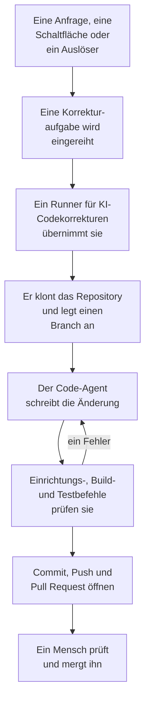

# Code

Code ist der Ort, an dem Sie OneUptime AI bitten, in Ihren Repositorys zu arbeiten, so wie Sie einen Coding-Agenten bitten würden: einen Fehler beheben, Tests schreiben, den Code erklären, eine Änderung vornehmen. Code öffnet sich mit dem Feld, in dem Sie fragen, mit dem darin ausgewählten Repository und Branch und allen Aufgaben darunter; die Seite einer Aufgabe ist eine Unterhaltung, in der Sie antworten können. OneUptime startet auch selbst Aufgaben, aus Ausnahmen, Traces und Untersuchungen. Ein [Runner](/docs/runbooks/agents) klont das Repository, schreibt die Änderung in einen neuen Branch, baut und testet sie und öffnet einen Pull Request. Jeden davon prüft und mergt ein Mensch: Der Runner kann Branches pushen und Pull Requests öffnen, mehr nicht.

:::cards
- [KI in einem Repository bitten](#ki-in-einem-repository-bitten): Eine Anfrage in Ihren eigenen Worten, mit dem Kontext, den sie braucht.
- [Die Unterhaltung einer Aufgabe](#die-unterhaltung-einer-aufgabe): Was die KI getan und geändert hat, und Ihre Antwort.
- [Wie ein Korrekturlauf abläuft](#wie-ein-korrekturlauf-abläuft): Vom Klick bis zum Pull Request, Schritt für Schritt.
- [Wo Korrekturaufgaben starten](#wo-korrekturaufgaben-starten): Die Aufgaben, die OneUptime startet, und was jeder Pull Request tut.
- [Produktionstelemetrie in einer Korrektur](#produktionstelemetrie-in-einer-korrektur): Was eine Korrektur aus der Produktion liest, während sie die Änderung schreibt.
- [Produktionsprüfung von Pull Requests](#produktionsprüfung-von-pull-requests): Was die Produktion über den Code sagt, den jeder Pull Request ändert.
- [Bevor Sie beginnen](#bevor-sie-beginnen): Ein Modell, ein verbundenes Repository und ein Runner.
- [Wenn eine Korrektur fehlschlägt](#wenn-eine-korrektur-fehlschlägt): Was mit einem Lauf passiert, der fehlschlägt, hängen bleibt oder wartet.
:::

> [!TIP]
> Sie können das auch aus GitHub heraus starten. Erwähnen Sie die OneUptime GitHub App in einem Issue oder einem Pull Request, und sie implementiert, überarbeitet oder prüft direkt dort: siehe [GitHub App](/docs/ai/github-app). Es ist derselbe Agent, derselbe Runner und dasselbe Budget; nur der Auslöser unterscheidet sich.

## KI in einem Repository bitten

:::steps
### Code öffnen

Öffnen Sie **Produkte → Code**. Code öffnet sich mit **Was soll die KI tun?**: dem Feld, in dem Sie fragen, mit allen Aufgaben darunter, die neueste zuerst. Gibt es noch kein Repository, bietet Code stattdessen **GitHub verbinden** an (siehe [Bevor Sie beginnen](#bevor-sie-beginnen)). **Repositorys** im Seitenmenü listet die Repositorys auf, in denen die KI arbeiten kann, und fasst die, die die GitHub App nicht mehr erreicht, unter **Nicht verbunden** zusammen. Die Seite jedes Repositorys hat dasselbe Feld für dieses Repository.

### Repository und Branch auswählen

Das Feld beginnt mit dem Repository, das Sie zuletzt ausgewählt haben. Wählen Sie in seiner unteren Zeile ein anderes aus und daneben den Branch, von dem die Aufgabe ausgeht: den Hauptbranch des Repositorys, markiert mit **Standard**, bis Sie einen anderen auswählen. Die KI zweigt ihren Branch von dem ausgewählten ab und öffnet ihren Pull Request in ihn.

### Sagen, was Sie möchten

Schreiben Sie die Änderung, den Fehler oder die Frage in Ihren eigenen Worten. Solange noch nichts gefragt wurde, schlägt Code unter **Zum Beispiel** einige vor.

### Kontext hinzufügen

Klicken Sie auf **Kontext hinzufügen**, um der KI zu geben, was sie braucht: eine Datei oder einen Ordner des Repositorys, eine Notiz, einen Link oder einen Datensatz des Projekts. OneUptime liest jeden Datensatz beim Senden der Anfrage mit Ihren Berechtigungen und behält, was die KI bekommen hat.

### Die Aufgabe starten

Klicken Sie auf **Aufgabe starten** oder drücken Sie die Eingabetaste. Die Seite der Aufgabe öffnet sich, und die Arbeit der KI erscheint dort, während sie geschieht.
:::

| Kontext | Was die KI bekommt |
| --- | --- |
| **Datei oder Ordner** | Einen Pfad im Repository, den die KI zuerst liest. |
| **Notiz** | Text, den Sie einfügen: einen Fehler, eine Spezifikation, eine Protokollzeile. |
| **Link** | Eine Webadresse als Referenz. |
| **Vorfall** oder **Warnung** | Status, Beschreibung und Grundursache, so wie sie beim Senden der Anfrage sind. |
| **Ausnahme** | Meldung und Stacktrace. |
| **Überwachung** | Typ, Status und Beschreibung. |
| **Trace** | Die Spans: ihre Namen, Zeiten und Fehler. |
| **Protokolle** | Die neuesten 20 Protokollzeilen, die Ihren Suchbegriff enthalten, aus der letzten Stunde, dem letzten Tag oder der letzten Woche. |
| **Leistungsprofil** | Wohin die Zeit einer Funktion in den Profilen ihres Dienstes geht: wer sie aufruft, was sie aufruft und ihre heißesten Zeilen. |

Eine Anfrage trägt höchstens 10 Kontextelemente. Token, Schlüssel, Passwörter und E-Mail-Adressen in dem, was OneUptime liest, werden geschwärzt, bevor die KI sie sieht, wie überall, wo OneUptime AI Ihre Daten liest.

## Die Unterhaltung einer Aufgabe

Die Seite einer Aufgabe ist eine Unterhaltung: was gefragt wurde und welcher Kontext hinzugefügt wurde, dann der Zug der KI – die Schritte, während sie sie ausführt (die Dateien, die sie gelesen und bearbeitet hat, wonach sie gesucht hat, die Befehle, die sie ausgeführt hat), ihre Antwort, die geänderten Dateien mit ihrem Diff und der Pull Request. Oben auf der Seite steht, wo die Aufgabe arbeitet (ihr Repository und der Branch, von dem sie ausging), wie viele Zeilen sie geändert hat, mit einer Schaltfläche zu ihrem Pull Request, und wie es um die Aufgabe steht:

| Status | Was er bedeutet |
| --- | --- |
| **In der Warteschlange** | Sie wartet darauf, dass ein Runner sie übernimmt. |
| **Wird bearbeitet…** | Die KI arbeitet daran. **Stoppen** stoppt sie; was sie gepusht hat, bleibt im Branch. |
| **Wartet auf Sie** | Die KI hat eine Frage gestellt. Beantworten Sie sie im Feld unten. |
| **Fertig** | Die KI ist fertig: ihre Antwort und der Pull Request, wenn sie Code geändert hat. |
| **Fehlgeschlagen** | Der Durchgang konnte nicht abgeschlossen werden und sagt, warum. **Erneut versuchen** fragt dasselbe noch einmal. |
| **Gestoppt** | Jemand hat sie gestoppt. **Erneut versuchen** fragt dasselbe noch einmal. |

Um nachzufassen, schreiben Sie in das Feld unten, das sichtbar bleibt, während die Unterhaltung scrollt: Antworten Sie der KI, fügen Sie Kontext hinzu oder bitten Sie um Änderungen. Jede Antwort ist der nächste Durchgang derselben Aufgabe: Sie arbeitet im selben Branch und pusht in denselben Pull Request, solange er offen ist. Eine Aufgabe hat immer nur einen Durchgang zur Zeit, deshalb wartet das Feld, während die KI arbeitet. Das **Protokoll** jedes Durchgangs ist die wörtliche Aufzeichnung dessen, was er getan hat.

Wer ein Repository lesen darf, liest seine Aufgaben. Die KI bitten, antworten und eine Aufgabe stoppen erfordern die Berechtigung, das Repository zu bearbeiten, ebenso das Ansehen des Diffs einer Änderung: Alle anderen sehen, welche Dateien sich geändert haben. Die Aufgaben, die OneUptime selbst startet (unten), stehen ebenfalls in ihrem Repository, als Unterhaltungen, in denen Sie antworten können.

## Wie ein Korrekturlauf abläuft



1. Sie klicken in Code auf **Aufgabe starten** oder bei einer ungelösten Ausnahme auf **Mit KI beheben**, oder eine andere Schaltfläche oder ein Auslöser startet eine Aufgabe (siehe [Wo Korrekturaufgaben starten](#wo-korrekturaufgaben-starten)).
2. Die Aufgabe wird für ihr Repository eingereiht, und der Runner, den das Repository auswählt, übernimmt sie: einer Ihrer Runner oder ein globaler Runner, wenn es keinen auswählt (siehe [Den Runner des Repositorys auswählen](#den-runner-des-repositorys-auswählen)).
3. Der Runner holt den Kontext der Aufgabe. Bei einer Anfrage sind das ihre Worte, der hinzugefügte Kontext und die bisherige Unterhaltung; bei einer Ausnahme ihr Typ, ihre Meldung und ihr Stack-Trace.
4. Er klont das Repository in einen eigenen Arbeitsbereich und legt einen Branch an. Eine Korrektur einer Ausnahme heißt `oneuptime-fix-exception-`, gefolgt von den ersten Zeichen der ID des Laufs. Eine Anfrage geht von dem Branch aus, der beim Fragen ausgewählt wurde, und ihr Pull Request öffnet sich in ihn. Eine Antwort arbeitet stattdessen im Branch des offenen Pull Requests der Aufgabe.
5. Ein Code-Agent, angetrieben vom LLM-Anbieter Ihres Projekts, liest den Code und schreibt die Änderung. Der OneUptime-Server führt die LLM-Aufrufe aus, sodass der Runner den API-Schlüssel Ihres Anbieters nie besitzt, und jeder Aufruf wird gemessen und in den KI-Protokollen aufgeführt. Eine Korrektur einer Ausnahme, eines langsamen Traces oder eines Vorfalls liest während der Arbeit auch Daten aus der Produktion: die Ausnahmen, Traces, Logs und Metriken der Dienste des Repositorys (siehe [Produktionstelemetrie in einer Korrektur](#produktionstelemetrie-in-einer-korrektur)).
6. Auf einem eigenen Runner baut und testet der Code-Agent seine Änderung so, wie es die `AGENTS.md` des Repositorys beschreibt, bevor etwas committet wird, und repariert, was fehlschlägt (siehe [Prüfung vor dem Pull Request](#prüfung-vor-dem-pull-request)).
7. Der Runner committet, pusht den Branch, öffnet den Pull Request (bei einer Anfrage nur, wenn sie Code geändert hat) und löscht den Arbeitsbereich.

Die Seite, auf der die Aufgabe gestartet wurde, zeigt ihren Live-Status. Jede Aufgabe steht in ihrem Repository unter **Produkte → Code**: Ihre Seite ist ihre Unterhaltung, und das **Protokoll** jedes Durchgangs hat eine Zeile für jede Datei, die der Runner gelesen oder geschrieben hat, und jeden Befehl, den er ausgeführt hat.

Jeder Lauf unterliegt Budgets, die der Server durchsetzt: höchstens **40 LLM-Aufrufe** und **100.000 Ausgabe-Tokens**. Die Abfragen der Produktionstelemetrie eines Laufs zählen zu denselben 40 Aufrufen. Ein Lauf, der eines davon erreicht, endet mit einer Zusammenfassung der bisherigen Arbeit, statt in einer Schleife zu laufen. Korrekturläufe zählen auch zu den täglichen KI-Limits des Projekts, wenn das Projekt sie festlegt.

## Wo Korrekturaufgaben starten

| Wo | Klick | Der Pull Request |
| --- | --- | --- |
| Die Seite **KI-Unterstützung** einer Ausnahme | **Mit KI beheben** | Behebt den Fehler hinter der Ausnahme. |
| Die Seite **KI-Unterstützung** einer Ausnahme | **Regressionstest generieren** | Fügt einen Test hinzu, der die Ausnahme reproduziert und fehlschlägt, bis der Fehler behoben ist. |
| Die Seite **KI-Unterstützung** einer Ausnahme | **Fehlerbehandlung verbessern** | Für einen erwarteten Fehler, etwa eine ungültige Eingabe: nimmt Benutzerdaten aus der Meldung, prüft die Eingabe früher und markiert den Fehler als behandelt, ohne das Verhalten zu ändern. |
| Die Karte **KI-Untersuchung** eines Vorfalls oder einer Warnung | **Korrektur-PR aus dieser Analyse öffnen** | Behebt die Grundursache, die die Untersuchung veröffentlicht hat (siehe [Automatische Codekorrekturen aus Untersuchungen](#automatische-codekorrekturen-aus-untersuchungen)). |
| Ein Trace, der eine Korrektur lohnt | **Mit KI beschleunigen** | Behebt das langsame Muster, das die Schaltfläche nennt, etwa eine N+1-Abfrage oder Aufrufe, die parallel laufen könnten. |
| Die Seite **Protokolle** eines Dienstes | **Logging verbessern** | Macht die Logs des Dienstes strukturiert, mit dem richtigen Schweregrad und mit seinen Traces verknüpft, ohne das Verhalten zu ändern. |
| Die Seite **Traces** eines Dienstes | **Tracing verbessern** | Fügt Spans und Attribute hinzu, wo das Tracing des Dienstes fehlt, ohne das Verhalten zu ändern. |
| Eine Funktion in **Leistungsprofile** | **Mit KI beheben** | Lässt die Funktion dieselbe Arbeit mit weniger Zeit oder Speicher erledigen, mit ihrem Profil als Beleg. |

Diese Schaltflächen erscheinen nur dort, wo sie eine Aufgabe starten können. Ist KI für das Projekt ausgeschaltet, erscheint keine davon, und das Seitenmenü einer Ausnahme hat keine **KI-Unterstützung**. **Logging verbessern** und **Tracing verbessern** erscheinen, sobald ein Repository verbunden ist, und **Mit KI beschleunigen** nur bei einem Trace, der eine Korrektur lohnt (siehe [Trace-Explorer](/docs/telemetry/traces-explorer)). **Mit KI beheben** bei einer Funktion erscheint nur für den eigenen Code der Anwendung, der mindestens 5 % der Zeit oder des Speichers des Profils beansprucht oder dessen Anteil seit dem Vergleichsfenster um 3 Punkte oder mehr gewachsen ist (siehe [Kontinuierliches Profiling](/docs/telemetry/profiles)).

Um die Seite **KI-Unterstützung** einer Ausnahme zu öffnen, öffnen Sie die Ausnahme unter **Produkte → Observability → Ausnahmen** und wählen im Seitenmenü **KI-Unterstützung**. Eine gelöste oder archivierte Ausnahme muss zuerst als ungelöst markiert werden.

OneUptime AI startet Korrekturaufgaben auch selbst: aus einer Untersuchung, die eine Codeänderung findet, aus einer, die ergebnislos endet, weil Telemetrie fehlte, und aus KI-Einblicken zu Ausnahmen und langsamen Traces. Jede davon hat einen eigenen Schalter; siehe [Automatische Codekorrekturen](/docs/ai/ai-sre#automatische-code-korrekturen).

## Produktionstelemetrie in einer Korrektur

OneUptime weiß, was Ihr Code in der Produktion tut, sodass eine Korrektur nicht allein von einem Stack-Trace ausgehen muss. Während der Code-Agent arbeitet, kann er die Produktionstelemetrie der Dienste abfragen, die zum Repository gehören:

| Er liest | Wofür |
| --- | --- |
| **Ausnahmen** | Die Ausnahmegruppen, die in bestimmten Dateien oder einer Funktion geworfen werden: wie oft in den letzten Tagen, seit welchem Release, und der Trace eines Vorkommens aus jüngster Zeit. |
| **Traces** | Das Latenz- und Fehlerprofil eines Endpunkts oder einer Operation, und die Spans eines einzelnen Traces. |
| **Protokolle** | Die Protokollzeilen eines Dienstes, nach Zeit, Schweregrad, Text oder Trace. |
| **Metriken** | Eine Metrik, die ein Dienst meldet, im Zeitverlauf; ohne Namen die Metriken, die er meldet. |
| **Vorfälle** | Vorfälle, die die Dienste betroffen haben oder für die eine OneUptime-Korrektur in diesem Repository geöffnet wurde, mit ihrer Grundursache und ihrem Postmortem. |
| **Deploys** | Die jüngsten Deploys und anderen Änderungen der Dienste, jeweils mit dem Urteil von OneUptime, ob die Änderung ihrem Dienst geschadet hat. |

| Aufgabe | Was sie prüft |
| --- | --- |
| **Mit KI beheben** bei einer Ausnahme | Wie oft sie jetzt geworfen wird und seit welchem Release, die Logs und der Trace eines Vorkommens. |
| **Mit KI beschleunigen** | Wie stark ausgelastet und wie langsam die Operation über alle ihre Traces hinweg ist, nicht nur im analysierten Trace. Die Aufgabe ändert nichts, wenn die Operation nicht mehr langsam ist. |
| **Korrektur-PR aus dieser Analyse öffnen** sowie automatisch aus Untersuchungen geöffnete Korrekturen | Die Deploys vor dem Vorfall, seine Fehler, Logs und langsamen Operationen, und ob die Ursache schon früher zugeschlagen hat. |
| `@oneuptime review` aus GitHub | Was die Produktion über den geänderten Code sagt (siehe [Reviews mit Produktionskontext](/docs/ai/github-app#reviews-mit-produktionskontext)). |

Die Beschreibung des Pull Requests sagt, was der Agent abgefragt hat und was sich dabei gezeigt hat. Andere Aufgaben, etwa Regressionstests und Verbesserungen am Logging oder Tracing, fragen die Produktion nicht ab.

Was der Agent lesen darf, entscheidet der OneUptime-Server anhand der Aufgabe selbst:

- **Nur lesend.** Die Abfragen laufen auf dem OneUptime-Server, nie auf dem Runner, der keine Zugangsdaten besitzt, mit denen sich Telemetrie lesen lässt. Nichts, was sie tun, kann Ihr Projekt ändern.
- **Dieses Projekt, und nur die Dienste, die zu diesem Repository gehören.** Sie müssen sie nicht zuordnen: Es sind die Dienste, für die OneUptime dieses Repository findet, so wie es das Repository einer Korrektur findet - die Stack-Traces ihrer Ausnahmen laufen durch seine Dateien, sie heißen wie das Repository, oder es ist das einzige Repository des Projekts. Die Telemetrie eines anderen Dienstes lässt sich nicht lesen.
- **Keine privaten Vorfälle**, und Token, Schlüssel, Passwörter und E-Mail-Adressen werden geschwärzt, bevor der Agent ein Ergebnis sieht, wie überall, wo OneUptime AI Ihre Daten liest.
- **Begrenzt.** Höchstens **12** Abfragen pro Lauf, von denen jede zu den 40 Aufrufen des Laufs zählt.

Wenn kein Dienst zum Repository gehört, läuft die Aufgabe wie bisher ohne Produktionstelemetrie.

## Produktionsprüfung von Pull Requests

OneUptime weiß, was Ihr Code in der Produktion tut, und kann einen Pull Request deshalb mit dem prüfen, was niemand beim Lesen des Diffs sieht. Schalten Sie **Pull Requests gegen die Produktion prüfen** unter **Weitere Einstellungen** auf der Seite **Einstellungen** eines Repositorys in Code ein, und jeder Pull Request, den jemand mit Schreibzugriff öffnet oder in den er pusht, erhält einen Kommentar, der sagt, was die Produktion über den geänderten Code zeigt. Der Kommentar wird bei jedem Push an Ort und Stelle aktualisiert, und die Seite **Produktionsprüfungen** des Repositorys in Code bewahrt jede Prüfung auf, mit **Erneut prüfen**.

| Sie liest | Aus dem Code, den der Pull Request ändert |
| --- | --- |
| **Ausnahmen** | Die Ausnahmen, die in den letzten 7 Tagen in den geänderten Zeilen, Funktionen und Dateien geworfen wurden, neue und unbehandelte markiert. |
| **Vorgänge** | Die getraceten Vorgänge, die den geänderten Code in der letzten Stunde ausführen: ihre Spans, Fehler und ihr p95. |
| **Rechenintensive Funktionen** | Die Funktionen des geänderten Codes, die in der letzten Stunde einen Anteil an den Profilen der Dienste haben. |
| **Vorfälle** | Die Vorfälle der Dienste aus den letzten 30 Tagen, die noch offen sind oder deren Grundursache oder Postmortem den geänderten Code nennt. Nie ein privater Vorfall. |
| **Deploys** | Die Deploys der Dienste aus den letzten 7 Tagen, die OneUptime einer Regression verdächtigt. |

Wenn die Produktion etwas zeigt, liest OneUptime AI es neben dem Diff und ergänzt **Worauf zu achten ist**: ein paar kurze Punkte, die jeweils auf den Fakten beruhen. Das läuft nur, solange KI für das Projekt eingeschaltet ist, höchstens 10 Mal am Tag für einen Pull Request und 100 Mal für ein Repository, und wird wie jeder KI-Aufruf abgerechnet; die Fakten werden jedes Mal ohne KI gelesen. Wenn die Produktion nichts über die Änderung zeigt, veröffentlicht OneUptime nichts.

- **Nur Aggregate.** Der Kommentar enthält Anzahlen, Dauern und die Namen von Code: nie die Meldung einer Ausnahme, eine Logzeile, den Titel eines Vorfalls oder personenbezogene Daten.
- **Öffentliche Repositorys bekommen einen Link.** Jeder kann die Pull Requests eines öffentlichen Repositorys lesen, daher verlinkt der Kommentar dort nur auf die Prüfung in OneUptime, die nur Mitglieder des Projekts öffnen können. **Kommentar der Produktionsprüfung** unter **Weitere Einstellungen** auf der Seite **Einstellungen** des Repositorys kann überall **Nur ein Link zur Prüfung** veröffentlichen oder **Die Prüfung, auch in einem öffentlichen Repository**.
- **Externe Mitwirkende können keine starten.** Ein Pull Request wird nur dann von selbst geprüft, wenn sein Autor und jeder, der in ihn gepusht hat, in das Repository schreiben dürfen. Einer von allen anderen - einem externen Mitwirkenden, einem Fork, einem Bot - wird geprüft, wenn jemand mit Schreibzugriff `@oneuptime production review` darin kommentiert oder in Code auf **Erneut prüfen** klickt.
- **Nur lesend.** Eine Prüfung klont nichts und führt nichts aus dem Pull Request aus. Sein Diff und sein Titel sind für OneUptime AI Daten, nie Anweisungen: Die KI hat keine Werkzeuge, und was sie schreibt, wird als Text in den Kommentar gesetzt.

Der Schalter ist für die Repositorys eingeschaltet, die die GitHub App ab jetzt verbindet. Ein Repository, das verbunden wurde, bevor es ihn gab, behält ihn ausgeschaltet, bis Sie ihn einschalten.

## Prüfung vor dem Pull Request

Ein Repository beschreibt in einer `AGENTS.md` in seinem Stammverzeichnis, der Datei, die Coding-Agenten lesen, wie es gebaut und getestet wird. Bevor der Code-Agent etwas ändert, liest er die `AGENTS.md` des Repositorys (oder seine `CLAUDE.md`, wenn es keine `AGENTS.md` hat) aus dem Branch, von dem die Aufgabe ausgeht, und arbeitet so, wie sie es beschreibt. Ohne beide erfährt er es aus der `CONTRIBUTING.md` des Repositorys, der README, den Paketskripten, dem `Makefile` oder den CI-Workflows. In OneUptime ist nichts einzurichten.

| Wo die KI arbeitet | Was sie mit Build und Tests des Repositorys macht |
| --- | --- |
| Einer Ihrer Runner | Baut und testet ihre Änderung, bevor der Pull Request geöffnet wird, behebt, was fehlschlägt, prüft erneut und nennt in ihrer Zusammenfassung die Prüfungen, die sie ausgeführt hat. Jeder Befehl, den sie ausführt, bekommt bis zu 2 Minuten, ohne die eigenen Zugangsdaten des Runners in seiner Umgebung. |
| **Globaler Runner** | Führt keinen Befehl aus: Die KI schreibt die Änderung und öffnet den Pull Request, und das eigene CI Ihres Repositorys prüft sie. |

Nichts aus einem Pull Request, der aus einem Fork kommt, wird je als Anleitung des Repositorys gelesen: Eine Überarbeitung lehnt einen solchen Pull Request ab, und ein Review liest den Basis-Branch.

### Auf einem Repository gesetzte Befehle

Code fragt nicht mehr nach Einrichtungs-, Build- und Testbefehlen, aber ein Repository, das sie hat, früher oder über die API oder Terraform gesetzt, behält sie. Sie stehen schreibgeschützt auf der Karte **Build- und Testbefehle** unter **Weitere Einstellungen** auf der Seite **Einstellungen** des Repositorys, und **Befehle entfernen** entfernt alle drei. Solange einer davon gesetzt ist, prüft jeder Korrekturlauf auf einem eigenen Runner seine Änderung auch damit, bevor der Pull Request geöffnet wird:

1. Wenn der Code-Agent fertig ist, laufen die Befehle der Reihe nach im Stammverzeichnis des Repositorys, auf dem Runner, im geklonten Arbeitsbereich. Jeder bekommt bis zu 15 Minuten und läuft mit `CI=true`, sodass nichts auf eine Eingabe wartet; der erste Fehler beendet den Durchlauf.
2. Bei einem Fehler geht das Ende der Ausgabe des fehlgeschlagenen Befehls als Reparaturaufgabe an denselben Code-Agenten zurück, mit der Anweisung, seine eigene Änderung zu korrigieren, statt Tests abzuschwächen oder zu überspringen, und die Befehle laufen erneut. Er unternimmt höchstens **2** Reparaturversuche. Sie teilen sich das LLM-Budget des Laufs, und ihre Änderungen landen im selben Commit wie die Korrektur.
3. Das Ergebnis, bestanden, fehlgeschlagen oder übersprungen (keine Befehle gesetzt oder ein globaler Runner), steht in einem Abschnitt Verification der Beschreibung des Pull Requests und wird am Pull Request der Aufgabe gespeichert.

Eine Änderung, die die Prüfung weiterhin nicht besteht, wird nicht verworfen: Der Pull Request öffnet sich trotzdem, mit einem deutlich markierten Abschnitt "Verification failed", der den fehlgeschlagenen Befehl nennt und mit seiner Ausgabe endet. Die Arbeit bleibt erhalten, und der Prüfer entscheidet. Ein Repository ohne gesetzte Befehle wird als übersprungen gemeldet, statt einen grünen Build vorzutäuschen.

Die Befehle sind Repository-Einstellungen, die Ihr Team schreibt und die auf Ihrem eigenen Runner laufen: dasselbe Vertrauensmodell wie die Bash-Schritte eines Runbooks. Die KI schreibt oder ändert sie nie. Ein globaler Runner, den OneUptime für jedes Projekt betreibt, führt sie nie aus: Auf einem globalen Runner wird die Korrektur geschrieben und zur Durchsicht geöffnet, die Prüfung wird als übersprungen gemeldet, und das eigene CI Ihres Repositorys prüft die Änderung. [Betreiben Sie einen eigenen Runner](#einen-eigenen-runner-betreiben), damit Korrekturen gebaut und getestet werden, bevor sich der Pull Request öffnet.

## Nach dem Zusammenführen einer Korrektur

Das Zusammenführen einer Korrektur behebt nichts, bis sie läuft. Sobald ein Korrektur-Pull-Request zusammengeführt ist, wartet OneUptime auf einen aufgezeichneten Deploy, der ihn enthält (siehe [Deploys und Änderungen](/docs/telemetry/change-events)), und beobachtet in diesem Deploy, wofür die Korrektur gedacht war. Der Pull-Request der Aufgabe in Code zeigt, wie es ausging, ebenso die Seite **KI-Unterstützung** der Ausnahme, die KI-Protokolle des Vorfalls und der KI-Insight, aus dem die Korrektur kam:

| Eine Korrektur für | Was beobachtet wird | Sie hat gewirkt | Sie hat nicht gewirkt |
| --- | --- | --- | --- |
| Eine Ausnahme | Ob die Ausnahme erneut auftritt | **In Produktion behoben** | **Tritt nach der Korrektur weiterhin auf** |
| Einen langsamen Trace oder einen Latenz-Insight | Der p99 der Operation, die die Korrektur nennt | **In Produktion schneller** | **Nach der Korrektur weiterhin langsam** |
| Die Grundursache eines Vorfalls oder einer Warnung | Ob ihr Monitor einen weiteren auslöst | **In Produktion behoben** | **Nach der Korrektur erneut aufgetreten** |
| Fehlende Telemetrie, Logging oder Tracing | Was die Korrektur hinzufügt, und die übrige Telemetrie des Dienstes | **Kommt in Produktion an** | **Telemetrie nach der Korrektur ausgeblieben** |

Bis ein Deploy sie ausliefert, steht bei der Korrektur **Gemergt, wartet auf ein Deploy**, danach **Deployt, wird in Produktion beobachtet**, solange sie beobachtet wird. Eine, die innerhalb von 14 Tagen in keinem aufgezeichneten Deploy enthalten ist oder über die die Produktion nichts sagen kann, steht auf **In Produktion nicht verifiziert**. [Automatische Code-Korrekturen](/docs/ai/ai-sre#automatische-code-korrekturen) enthält die Regeln. Ein Regressionstest, eine bessere Fehlerbehandlung, ein Review und eine Anfrage in Code werden nicht beobachtet: Die Produktion kann nicht zeigen, was sie ändern.

## Bevor Sie beginnen

Eine Aufgabe braucht drei Dinge. Das Anfragefeld von Code und die Seite **KI-Unterstützung** der Ausnahme prüfen alle drei, bevor sie den Start anbieten, und sagen, was fehlt.

| Was | OneUptime Cloud | Selbst gehostet |
| --- | --- | --- |
| Ein LLM-Anbieter | Nichts einzurichten: Ein Projekt ohne eigenen Anbieter nutzt den globalen Anbieter, bezahlt aus dem KI-Guthaben des Projekts. Ein eigener Anbieter unter **Projekteinstellungen → KI → LLM-Anbieter** hat Vorrang. | Setzen Sie die Umgebungsvariablen `GLOBAL_LLM_PROVIDER_*` einmal auf dem Server, oder fügen Sie dem Projekt einen Anbieter hinzu. |
| Ein über die GitHub App verbundenes Repository | **Produkte → Code**, dann **GitHub verbinden**. Ist die App auf dem GitHub-Konto bereits installiert, klicken Sie stattdessen auf **Vorhandene Installation verbinden**: Eine erneute Installation verbindet sie nicht. Erfordert den Growth-Tarif. | Dasselbe, sobald Ihre Instanz eine GitHub App hat (siehe [GitHub-Integration](/docs/self-hosted/github-integration)). |
| Ein Runner, der KI-Codekorrekturen ausführt | Nichts zu betreiben: Ein Repository, das keinen auswählt, arbeitet auf den globalen Runnern von OneUptime. | Der Dienst `runner` von Docker Compose oder der Runner des Helm-Charts (`runner.enabled`, standardmäßig eingeschaltet) registriert sich selbst und führt KI-Codekorrekturen in jedem Repository aus, das keinen Runner auswählt. |

Auf einer selbst gehosteten Instanz ist der globale Anbieter ein Block in `config.env` (Docker Compose) oder in Ihren Helm-Werten. Für ein selbst gehostetes Ollama:

```bash
GLOBAL_LLM_PROVIDER_TYPE=Ollama
# An address the OneUptime server can reach, never localhost.
GLOBAL_LLM_PROVIDER_BASE_URL=http://ollama:11434
GLOBAL_LLM_PROVIDER_MODEL_NAME=llama3.1
# No GLOBAL_LLM_PROVIDER_API_KEY needed — Ollama is keyless.
```

Jeder unterstützte Anbieter funktioniert: siehe [LLM-Anbieter](/docs/ai/llm-provider) für alle Anbieter und jede Umgebungsvariable.

Sie ordnen Repositories keinen Diensten zu. Wenn eine Aufgabe startet, findet OneUptime das Repository, indem es die Dateipfade aus dem Stack-Trace der Ausnahme mit Ihren verbundenen Repositories abgleicht. Passt nichts, weicht es auf ein Repository aus, das wie der Dienst heißt, und dann auf das einzige Repository des Projekts, wenn es nur eines gibt. Die Seite **KI-Unterstützung** zeigt, welches Repository gefunden wurde.

### Den Runner des Repositorys auswählen

Jedes Repository wählt den Runner aus, auf dem die KI darin arbeitet: Öffnen Sie auf seiner Seite **Einstellungen** in Code **Weitere Einstellungen**, klicken Sie auf der Karte **Runner** auf **Bearbeiten** und wählen Sie einen aus. Ein Repository, das die GitHub App importiert, startet auf dem [Standard-Runner](/docs/runbooks/agents#der-standard-runner-des-projekts) des Projekts, wenn es einen hat. Ein Repository, das keinen auswählt, arbeitet auf **Globaler Runner**, den OneUptime für jedes Projekt betreibt.

| Runner | Was er mit einer Aufgabe macht |
| --- | --- |
| **Globaler Runner** | Schreibt die Änderung und öffnet den Pull Request, ohne sie zu bauen oder zu testen: Das eigene CI Ihres Repositorys prüft die Änderung. |
| Einer Ihrer Runner | Baut und testet die Änderung außerdem so, wie es die `AGENTS.md` des Repositorys beschreibt, auf einem Host, den Sie kontrollieren. |

Nur der Runner, den ein Repository auswählt, erhält dessen Aufgaben und ein Token dafür. In einem Projekt, das **Globale Runner nutzen** unter **Runbooks → Runbook-Agents** ausschaltet, braucht jedes Repository einen der eigenen Runner des Projekts. Die Seite eines Runners listet die Repositorys auf, die ihn auswählen.

### Einen eigenen Runner betreiben

So betreiben Sie einen Runner an anderer Stelle, etwa auf einem Rechner in der Nähe Ihrer Repositories:

:::steps
### Den Runner anlegen

Legen Sie einen Runner unter **Runbooks → Runbook-Agents** an und klicken Sie in seiner Zeile auf **Einrichtungsanweisungen anzeigen**. Der Befehl enthält den geheimen Schlüssel des Runners, den nur ein Project Owner, Project Admin oder Runbook Admin lesen kann. Er sieht so aus:

```bash
docker run --name oneuptime-runner --restart unless-stopped \
  -e ONEUPTIME_RUNNER_ID=<runner-id> \
  -e ONEUPTIME_RUNNER_KEY=<runner-key> \
  -e ONEUPTIME_URL=<your-oneuptime-url> \
  -d oneuptime/runner:release
```

### Ihn für das Repository auswählen

Öffnen Sie auf der Seite **Einstellungen** des Repositorys in Code **Weitere Einstellungen**, klicken Sie auf der Karte **Runner** auf **Bearbeiten** und wählen Sie den Runner aus. Der Runner übernimmt die Änderung mit seinem nächsten Heartbeat, innerhalb etwa einer Minute; es muss nichts neu gestartet werden.

### Prüfen, dass er sich verbindet

Der Runner erscheint innerhalb von ein, zwei Minuten als verbunden auf der Seite **Runbooks → Runbook-Agents**. Wenn nicht, lesen Sie das Log des Containers (`docker logs oneuptime-runner`) auf einen Anmelde- oder Netzwerkfehler hin.
:::

Jede Art, den Container zu betreiben, funktioniert (Docker Compose, Kubernetes und so weiter), solange er diese Variablen hat und Ihre OneUptime-Instanz über HTTPS erreicht:

| Variable | Was sie ist |
| --- | --- |
| `ONEUPTIME_RUNNER_ID` | Die ID des Runners, aus dem Dashboard. |
| `ONEUPTIME_RUNNER_KEY` | Der geheime Schlüssel des Runners. |
| `ONEUPTIME_URL` | Die Adresse Ihrer OneUptime-Instanz (`https://oneuptime.com` in OneUptime Cloud). |

> [!NOTE]
> Vor OneUptime 12 liefen KI-Codekorrekturen auf einer eigenen Komponente AI Agent (dem Image `oneuptime/ai-agent` mit Variablen `AI_AGENT_*`). Sie ist im Runner aufgegangen: Wenn Sie noch eine betreiben, beschreibt der [Upgrade-Leitfaden von v11 auf v12](/docs/installation/upgrading), wie Sie sie ersetzen.

## Automatische Codekorrekturen aus Untersuchungen

Wenn eine [KI-Untersuchung](/docs/ai/ai-sre) eine Ursachenanalyse zu einem Vorfall oder einer Warnung veröffentlicht und ihre sorgfältige Einordnung eine Änderung am Code empfiehlt, bietet die Untersuchungskarte **Korrektur-PR aus dieser Analyse öffnen** an: eine Korrekturaufgabe, deren ganzer Kontext die veröffentlichte Analyse ist. Die Schaltfläche ist ausgeblendet, wenn die Abhilfe betrieblich ist, nur die Infrastruktur betrifft, extern ist, eine erwartete Ablehnung, ein Benutzerfehler oder ergebnislos ist. Passende Korrekturen geschehen ohne Klick, solange **Neue Vorfälle automatisch beheben** auf **Vorfälle → KI → Einstellungen** eingeschaltet ist (und **Neue Warnungen automatisch beheben** auf **Warnungen → KI → Einstellungen**). Das Beheben ist anfangs ausgeschaltet, auch bei neuen Projekten. Ohne Regel für automatische Behebung wird jede passende Korrektur geöffnet; mit Regeln nur eine für das, worauf eine Regel passt, wenn die Regel **Fix-Pull-Requests** eingeschaltet hat (bei einer neuen Regel ist es so), in den Code-Repositorys, die sie nennt.

Solange das Beheben eingeschaltet ist, reiht eine Untersuchung, die mit einer sicheren, belegten Grundursache endet, die eine Codeänderung beheben kann, dieselbe Korrekturaufgabe ein, die die Schaltfläche anlegt. Die Entscheidung ist eine eingeschränkte Einordnung, die der Server prüft, nie ein Muster, das gegen den Text der Analyse abgeglichen wird: Nur ein positives Urteil für eine Codekorrektur öffnet einen Pull Request. Fehlende Belege, eine Abhilfe außerhalb des Codes und eine fehlgeschlagene Einordnung enden alle damit, dass nichts geschieht.

Alles andere entspricht der Schaltfläche:

- Der Pull Request öffnet sich prüfbereit, geschrieben aus der veröffentlichten Analyse, und braucht ein über die GitHub App verbundenes Repository, eines, das die passenden Regeln nennen, wenn sie welche nennen, und einen Runner, der online ist, um darin zu arbeiten: den, den das Repository auswählt, oder einen globalen Runner.
- Er zählt zum täglichen Limit für Korrekturaufgaben dieses Signals (**Tägliches Limit für KI-Korrekturaufgaben bei Vorfällen** oder **Tägliches Limit für KI-Korrekturaufgaben bei Warnungen**, unter **Weitere Einstellungen** auf seiner KI-Einstellungsseite) und zur Obergrenze offener Pull Requests des Repositorys, wenn eines davon gesetzt ist. Ungesetzt begrenzt keines davon etwas.
- Jeder Auslöser sucht zuerst nach einer Korrekturaufgabe, die für denselben Vorfall oder dieselbe Warnung bereits eingereiht ist oder läuft, sodass ein automatischer Auslöser und ein Klick normalerweise zu einer Aufgabe werden, nicht zu zwei Pull Requests. Die Prüfung ist ein Lesen vor dem Schreiben, keine Sperre, sodass zwei Auslöser im selben Moment trotzdem beide durchkommen können.
- Der Lauf stammt vom System, wird niemandem zugeschrieben, und nichts wird von selbst gemergt.

## Wenn eine Korrektur fehlschlägt

:::details Der Lauf schlägt fehl
Die Korrektur ließ sich nicht anwenden, das Repository oder der Branch, von dem eine Anfrage ausging, war nicht erreichbar, oder der LLM-Aufruf schlug fehl. Die Unterhaltung der Aufgabe und die Seite, auf der sie gestartet wurde, zeigen den Grund und bieten einen neuen Versuch an. Das **Protokoll** des Durchgangs enthält das vollständige Laufprotokoll.
:::

:::details Der Runner bleibt mitten im Lauf stehen
Ein Lauf, dessen Heartbeat länger als 12 Minuten ausbleibt, wird mit einem Fehler beendet. Er wird nie von selbst erneut eingereiht, weil der Runner bereits einen Teil eines Korrektur-Branches gepusht haben kann; starten Sie ihn dort neu, wo Sie ihn gestartet haben.
:::

:::details Kein Runner übernimmt die Aufgabe
Eine Aufgabe, die länger als 30 Minuten wartet, während der Runner, der sie übernehmen soll, nicht verbunden ist - der, den ihr Repository auswählt, oder ein globaler Runner für ein Repository, das keinen auswählt -, schlägt mit einem Hinweis fehl, der sagt, welcher, sodass sie nie für immer als laufend angezeigt wird. Ist ein Runner online, aber beschäftigt, warten eingereihte Aufgaben, bis sie an der Reihe sind. Ein Runner, der älter als Code ist, bekommt nie eine Anfrage aus Code: Aktualisieren Sie einen selbst betriebenen Runner zusammen mit dem Server.
:::

## Datenschutz

Der Klon Ihres Repositorys liegt in einem Arbeitsbereich im Container des Runners und wird gelöscht, wenn der Lauf endet, ob erfolgreich oder nicht. Der Runner besitzt nie den API-Schlüssel Ihres LLM-Anbieters: Der OneUptime-Server führt die LLM-Aufrufe für ihn aus, und auch die Abfragen der Produktionstelemetrie. OneUptime behält Ihr Repository nicht und trainiert nicht mit Ihrem Code. Das Protokoll der Aufgabe behält die ersten 300 Zeichen der Ausgabe jedes Schritts, damit Sie prüfen können, was der Runner getan hat, und das kann Codeausschnitte enthalten. Betreiben Sie einen selbst gehosteten Runner mit Ihrem eigenen LLM-Anbieter (lokales Ollama eingeschlossen), verlässt Ihr Code Ihre Infrastruktur nie.

## Geplant

Geplant, und **heute noch nicht verfügbar**:

- **Unterstützung für GitLab.** Repositories werden nur über die GitHub App verbunden.

## Nächste Schritte

:::cards
- [GitHub App](/docs/ai/github-app): Bitten Sie direkt aus GitHub um eine Änderung, eine Überarbeitung oder eine Prüfung.
- [AI SRE](/docs/ai/ai-sre): Die Untersuchungen, deren Analysen Korrekturaufgaben in Pull Requests verwandeln können.
- [Runbook-Agents](/docs/runbooks/agents): Der Worker, der jeden Korrekturlauf ausführt.
:::
