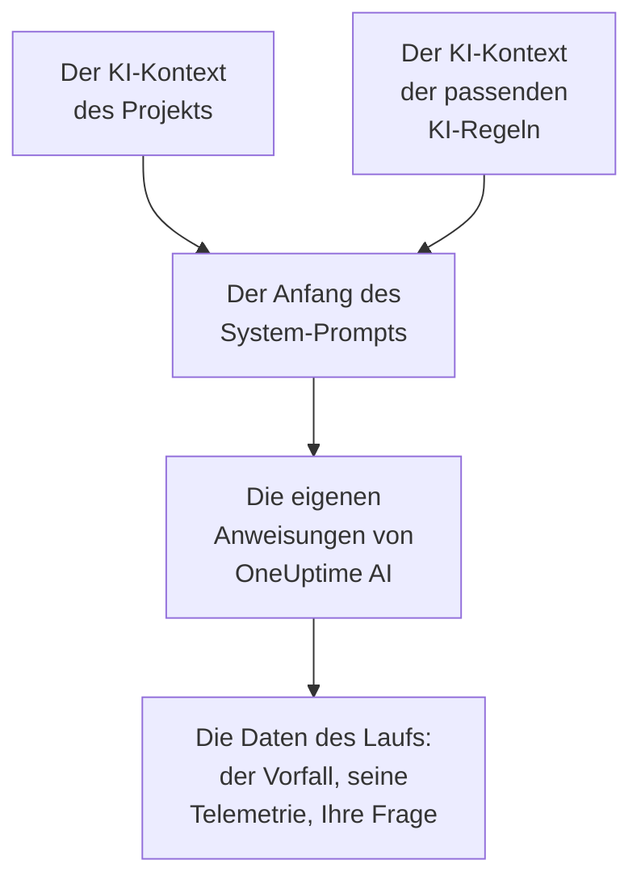

# KI-Kontext

Der KI-Kontext ist das, was Ihr Team für OneUptime AI über Ihre eigenen Systeme aufschreibt: wie sie zusammenhängen, wem welches Symptom gehört, wo die Logs liegen und welche Begriffe Ihr Team verwendet. OneUptime AI liest ihn zuerst, in jeder Untersuchung, jeder Behebung, jedem Postmortem-Entwurf und jedem Gespräch mit KI fragen, und beginnt so bei dem, was Ihr Team schon weiß.

:::cards
- [Den KI-Kontext schreiben](#den-ki-kontext-schreiben): Eine Karte in den KI-Einstellungen des Projekts.
- [Die eigenen Notizen einer KI-Regel](#die-eigenen-notizen-einer-ki-regel): Notizen zu dem, was eine Regel erfasst.
- [Was ihn liest](#was-ihn-liest): Die Funktionen, die ihn lesen, und die, die es nicht tun.
- [Was ein Lauf gelesen hat](#was-ein-lauf-gelesen-hat): Jeder Lauf zeigt die Notizen, die er bekommen hat.
:::

## So funktioniert es

OneUptime AI stellt den KI-Kontext ganz an den Anfang seines System-Prompts, vor seine eigenen Anweisungen und die Daten des Laufs: zuerst die Notizen des Projekts, dann die der passenden KI-Regeln. Es liest sie als Hintergrundwissen Ihres Teams. Sie sind kein Beleg dafür, was gerade passiert, und sie ändern nie die eigenen Regeln von OneUptime AI.

Weil die Notizen zuerst kommen und von einem Lauf zum nächsten gleich bleiben, gehören sie zum Anfang des Prompts, den Anbieter zwischenspeichern. Bei Anthropic markiert OneUptime den System-Prompt für das Caching; OpenAI, Azure OpenAI und die anderen Anbieter, die einen wiederholten Prompt-Anfang zwischenspeichern, tun das von selbst. Unveränderte Notizen kosten beim erneuten Lesen weniger.

## Den KI-Kontext schreiben

:::steps
### KI-Funktionen öffnen
Öffnen Sie **Projekteinstellungen → KI → KI-Funktionen**. Die Karte **KI-Kontext** steht unter **KI aktivieren**.

### Die Notizen schreiben
Klicken Sie auf **KI-Kontext hinzufügen** oder, sobald es Notizen gibt, auf **Bearbeiten**. Schreiben Sie in Markdown, oder klicken Sie auf **Mit einer Gliederung beginnen**, um für jede Art von Notiz eine Überschrift zu bekommen.

### Speichern
Klicken Sie auf **Änderungen speichern**. Die Karte zeigt die Notizen, wie lang sie sind und mit etwa wie vielen Tokens ein Modell sie liest.
:::

Schreiben Sie auf, was Sie jemandem erzählen würden, der neu im Team ist:

| Art der Notiz | Zum Beispiel |
| --- | --- |
| Wie Ihre Systeme zusammenhängen | `checkout-api` liefert die Checkout-Seite aus und hängt von `payments-db` ab. |
| Wem welches Symptom gehört | Ein 502 auf der Checkout-Seite gehört dem Payments-Team: zuerst `payments-db` prüfen. |
| Wo die Logs liegen | Die Logs von Checkout liegen in Loki unter `app=checkout`. |
| Die Begriffe Ihres Teams | PSP ist unser Zahlungsdienstleister. |

> [!WARNING]
> Lassen Sie Geheimnisse weg: Wer sehen kann, was ein KI-Lauf getan hat, kann die Notizen lesen, die er bekommen hat.

## Die eigenen Notizen einer KI-Regel

Eine KI-Regel kann eigene Notizen zu den Vorfällen oder Warnungen haben, die sie erfasst: die Dienste eines Produkts, wem sie gehören, wo ihre Logs liegen. Schreiben Sie sie in das Feld **KI-Kontext** der Regel, unter **Weitere Felder**, nach **LLM-Anbieter**. Eine Regel, die jedes Mal nur ihre Runbooks ausführt, fragt OneUptime AI nichts und hat daher keinen KI-Kontext.

- Eine Untersuchung liest die Notizen des Projekts, dann die jeder aktivierten KI-Regel, die untersucht und zum Vorfall oder zur Warnung passt, in der Reihenfolge der Regelnamen.
- Eine Behebung liest die Notizen des Projekts, dann die ihrer eigenen Regel.
- Das Gespräch zu einem Vorfall oder einer Warnung liest dieselben Notizen wie dessen Untersuchung.

## Was ihn liest

| Funktion | Was sie liest |
| --- | --- |
| Untersuchungen von AI SRE und ihre erneuten Prüfungen, wenn eine neue Warnung aufkommt | Die Notizen des Projekts und die der passenden KI-Regeln |
| Die Behebungen, die eine KI-Regel startet: ihre Pläne, Befehle und MCP-Server | Die Notizen des Projekts und die der Regel |
| KI fragen und das Gespräch zu einem Vorfall oder einer Warnung | Die Notizen des Projekts; bei einem Vorfall oder einer Warnung auch die der passenden KI-Regeln |
| Antworten in Slack und Microsoft Teams | Die Notizen des Projekts |
| Postmortem-Entwürfe, für Vorfälle und Episoden | Die Notizen des Projekts |
| Die Triage von AI Insights und von Sicherheitsfällen | Die Notizen des Projekts |

Aufrufe, die nur umformulieren oder bewerten, was sie bekommen, lesen ihn nicht: Entwürfe von Notizen und öffentlichen Notizen, Anrufzusammenfassungen, die Zusammenfassung, Zuversicht und Bewertung einer Untersuchung und der Titel eines Gesprächs. Ebenso wenig die Prompts, die Menschen selbst schreiben, im KI-Schritt eines Workflows oder eines Runbooks.

## Grenzen

| Was | Höchstens |
| --- | --- |
| Der KI-Kontext des Projekts | 20.000 Zeichen |
| Der KI-Kontext einer KI-Regel | 5.000 Zeichen |
| Der gesamte KI-Kontext, den ein Lauf liest | 30.000 Zeichen |

Das Formular zählt die Zeichen beim Tippen und lehnt das Speichern über der Grenze ab, ebenso die API. Ein Lauf liest zuerst die Notizen des Projekts, dann die jeder passenden Regel in der Reihenfolge ihrer Namen. Eine Regel, deren Notizen den Lauf über 30.000 Zeichen bringen würden, wird ganz ausgelassen, und die Aktivität des Laufs sagt das.

Die Token-Zahl ist eine Schätzung: die Größe der Notizen in UTF-8-Bytes geteilt durch 4, aufgerundet. Jedes Modell zählt Tokens auf seine eigene Weise, daher kann die Zählung eines Anbieters abweichen, am meisten bei Text, der nicht auf Englisch ist.

## Was ein Lauf gelesen hat

Jeder Lauf hält die Notizen, die er gelesen hat, Wort für Wort fest. Seine Aktivität zeigt **KI-Kontext des Projekts gelesen** oder, wie viele KI-Regeln er außerdem gelesen hat, mit etwa wie vielen Tokens. **Anzeigen** öffnet die Notizen so, wie der Lauf sie gelesen hat: zuerst die des Projekts, dann die jeder Regel unter ihrem Namen, auch nachdem sie geändert wurden. Wurden die Notizen einer Regel wegen der Grenze des Laufs ausgelassen, sagt das ein Warnhinweis.

## Wer ihn ändern kann

- **Project Owner** und **Project Admin** können den KI-Kontext des Projekts ändern. **Project Member**, **Viewer** und **Read Project** können ihn lesen.
- Die Notizen einer KI-Regel gehören zur Regel: Wer die Regel ändern kann, kann auch sie ändern.
- Die Notizen werden immer nur für ihr eigenes Projekt gelesen: Kein Lauf liest den KI-Kontext eines anderen Projekts.

Über die API oder Terraform sind die Notizen des Projekts dessen `aiContext` und die einer KI-Regel der eigene `aiContext` der Regel.

## Nächste Schritte

:::cards
- [AI SRE](/docs/ai/ai-sre): Lassen Sie OneUptime AI jeden neuen Vorfall und jede neue Warnung untersuchen.
- [KI fragen](/docs/ai/ask-ai): Fragen Sie in einem Gespräch nach den Daten Ihres Projekts.
- [LLM-Anbieter](/docs/ai/llm-provider): Wählen Sie das Modell, das die Notizen liest.
:::
