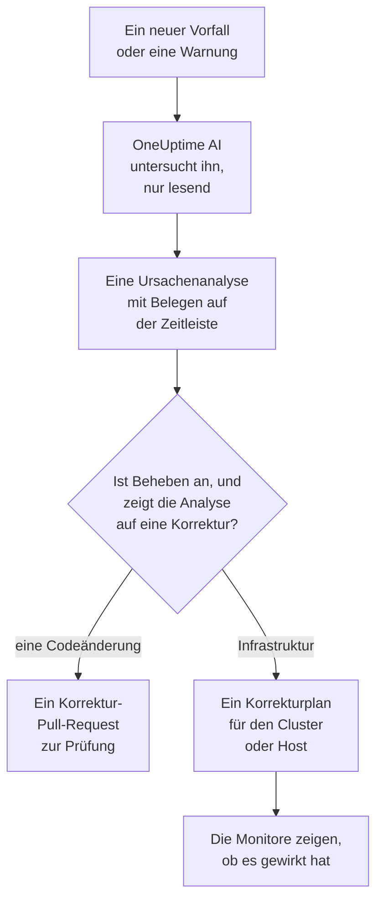
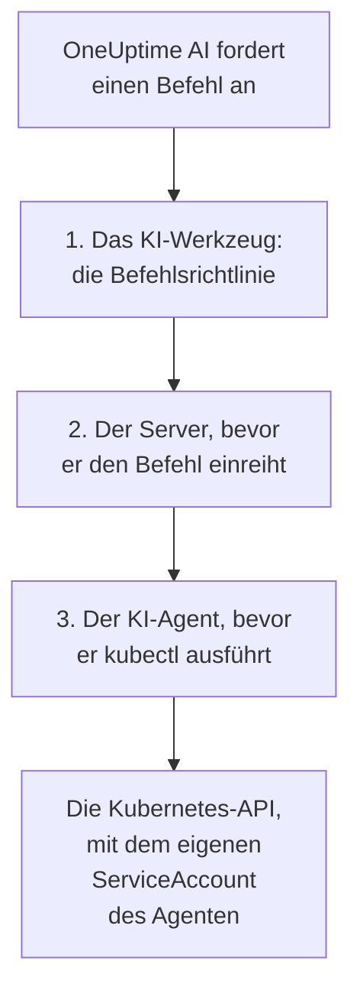

# AI SRE

OneUptime AI ist Ihr KI-Site-Reliability-Engineer. Sobald ein neuer Vorfall oder eine neue Warnung gemeldet wird, wird es aktiv, untersucht ihn anhand Ihrer eigenen Telemetrie – Logs, Metriken, Traces, Ausnahmen, Monitore und jüngste Änderungen – und veröffentlicht eine belegte Ursachenanalyse auf der Zeitleiste des Vorfalls oder der Warnung, meist bevor die Bereitschaft die Benachrichtigung zu Ende gelesen hat.

Jede Aussage der Analyse trägt einen Beleg, der direkt zu den Daten führt, auf die sie sich stützt, und die Untersuchung selbst ist **strikt nur lesend**: Während OneUptime AI untersucht, kann es nie etwas in Ihrem Projekt ändern.

:::cards
- [So funktioniert es](#so-funktioniert-es): Vom neuen Vorfall zur belegten Analyse und zu einer Korrektur, wenn Sie sie erlauben.
- [KI-Untersuchungen aktivieren](#ki-untersuchungen-aktivieren): Die Schalter und was sie voraussetzen.
- [Clusterzugriff – OneUptime AI kubectl ausführen lassen](#clusterzugriff-oneuptime-ai-kubectl-ausführen-lassen): Untersuchen und beheben, direkt in Kubernetes.
- [Kostenkontrollen](#kostenkontrollen): Limits für Vorfälle, für Warnungen und für das ganze Projekt.
:::

## So funktioniert es

OneUptime AI tut für einen neuen Vorfall oder eine neue Warnung drei Dinge, und jedes hat einen eigenen Schalter:

- **Es untersucht** (standardmäßig an). Es liest Ihre Telemetrie sowie die Cluster und Hosts, auf denen ein KI-Agent läuft, und veröffentlicht eine belegte Ursachenanalyse. Eine Untersuchung ändert nichts.
- **Es behebt** (standardmäßig aus). Ist das Beheben an, wird aus einer sicheren Analyse eine Korrektur: ein Pull-Request für eine Änderung an Ihrem Code oder ein Plan aus Befehlen für einen Cluster oder Host, ausgeführt so, wie es der KI-Agent dieses Clusters oder Hosts erlaubt.
- **Es lernt.** Die Seiten der KI-Einblicke zeigen, was immer wieder schiefgeht, ermittelt aus allem, was aufgezeichnet wurde.



Eine Analyse, die keine Ursache findet, wird still veröffentlicht, ohne jemanden zu alarmieren (siehe [Stiller Modus](#stiller-modus)), und ohne Ursache wird nichts behoben.

## Was die Untersuchung veröffentlicht

Wenn eine Untersuchung abgeschlossen ist, veröffentlicht OneUptime AI eine Ursachenanalyse mit diesen Abschnitten:

- **Summary** – ein oder zwei Sätze, die eine alarmierte Person in fünf Sekunden lesen kann.
- **Most likely root cause** – die Hypothese, nur mit der Sicherheit, die die Belege hergeben, und jede sachliche Aussage belegt. Reicht die Telemetrie nicht aus, sagt die KI das klar und listet auf, was sie geprüft hat, statt zu raten.
- **Evidence** – die wichtigsten Befunde, die die Hypothese stützen oder ausschließen, jeder belegt.
- **Suggested next steps** – konkrete Schritte für die Person in Bereitschaft.

Bei Vorfällen wird die Analyse im Feed des Vorfalls **und** als interne Notiz des Vorfalls veröffentlicht (wo die Beteiligten zusammenarbeiten). Bei Warnungen wird sie im Feed der Warnung veröffentlicht.

Während die Untersuchung läuft, zeigt die Seite des Vorfalls oder der Warnung ein Live-Panel **KI-Untersuchung**, das jeden Schritt beschreibt – welche Werkzeuge liefen, was sie fanden und wie lange sie brauchten –, sodass Sie ihr beim Denken zusehen können. Schlägt eine Untersuchung fehl, zeigt das Panel den Grund an statt einer stillen Lücke.

Eine Untersuchung läuft, bis sie fertig ist: Sie hat **kein Zeitlimit** und kein knappes Abfragebudget, sodass sie jede Abfrage und jeden kubectl- oder Infrastrukturbefehl ausführen kann, den sie braucht. Eine lange Befehlsausgabe (ein `kubectl describe node` eines ausgelasteten Knotens, die Logs eines Pods) wird nie abgeschnitten – OneUptime AI liest sie Seite für Seite. Wenn Sie einen harten Stopp möchten, legen Sie pro Signaltyp ein **Zeitlimit für Untersuchungen** fest (siehe **Kostenkontrollen** unten).

### Wenn die Protokolle nichts zu sagen hatten

Eine Untersuchung, die keine Ursache bestimmen konnte und in keiner ihrer Suchen eine Protokollzeile gefunden hat, sagt auf der Karte **KI-Untersuchung** unter ihrem Bericht, warum, und zeigt den Weg nach vorn:

- **Keine Protokolle zum Lesen**: Aus der Stunde vor Beginn des Vorfalls oder der Warnung hat kein Protokoll OneUptime erreicht. **Protokolle einrichten** öffnet die Einrichtungsanleitung der Protokolle: Senden Sie die Protokolle Ihrer Dienste an OneUptime, dann kann die nächste Untersuchung sie nutzen.
- **Keine Protokolle zu diesem Vorfall** (bei einer Warnung **Keine Protokolle zu dieser Warnung**): Protokolle haben OneUptime erreicht, aber keine Suche der Untersuchung hat etwas dazu gefunden. **Protokolle einrichten** hilft, wenn ein beteiligter Dienst seine Protokolle noch nicht sendet, und **Nicht protokollierte Fehlschläge finden** öffnet **Protokolle → KI**, das die Fehlschläge findet, die Ihr Code nicht protokolliert, und die Protokollierung mit einem Pull Request ergänzt.

OneUptime entscheidet das aus dem, was es weiß, nie aus dem, was die Analyse sagt: aus demselben serverseitig geprüften Urteil wie der [stille Modus](#stiller-modus), aus den eigenen Protokollsuchen der Untersuchung und aus einer Abfrage, ob in diesem Zeitraum überhaupt ein Protokoll das Projekt erreicht hat. Eine Untersuchung, die die Ursache oder eine Protokollzeile gefunden hat, sagt nichts dergleichen.

## Was eine Untersuchung liest

Eine Untersuchung beginnt beim Vorfall oder bei der Warnung und bei der Infrastruktur, mit der sie verknüpft ist: den Hosts, Docker- und Podman-Hosts, Kubernetes-Clustern, Datenbanken und Diensten, die ihre Monitore überwachen. Ein Website-, API- oder synthetischer Monitor überwacht, womit Sie ihn unter **Überwachung → Übersicht → Verknüpfte Ressourcen** verknüpfen. Verknüpfen Sie ihn also mit den Hosts, die das bereitstellen, was er prüft, dann beginnt jede Untersuchung seiner Vorfälle dort. Vor alledem liest sie den [KI-Kontext](/docs/ai/ai-context) des Projekts: was Ihr Team für OneUptime AI über Ihre eigenen Systeme aufgeschrieben hat, mit den Notizen der passenden KI-Regeln.

- Die Warnungen auf dieser Infrastruktur, die in den 30 Minuten vor dem Vorfall ausgelöst wurden oder noch offen sind, die neuesten zuerst, etwa die Warnung zu hoher CPU-Last des Hosts hinter einer langsamen Website. Private Warnungen werden ausgelassen.
- Die eigenen Metriken der Infrastruktur, so gelesen, wie Menschen sie lesen. Host-Metriken wie `system.cpu.utilization` und `system.memory.utilization` werden einmal je Zustand gemeldet, und die Zustände ergeben zusammen 100 %, daher sagt ein Durchschnitt über alle nichts aus. OneUptime AI liest sie Zustand für Zustand (belegte CPU ist user plus system) und jede Metrik pro Container, pro Mountpoint oder nach jedem anderen Attribut.
- Die Container eines Docker- oder Podman-Hosts: die am stärksten ausgelasteten nach CPU, Arbeitsspeicher oder Neustarts und die, die keine Daten mehr melden. Ein gestoppter Container sendet nichts statt null, daher verbergen ihn die Zahlen des ganzen Hosts.
- Die Änderungen, die in den 2 Stunden vor dem Vorfall oder der Warnung aufgezeichnet wurden – Deploys, Kubernetes-Rollouts, Konfigurationsänderungen und die Korrekturen, die OneUptime ausgeführt hat –, und welche davon die Telemetrie der zugehörigen Dienste verdächtig macht: ein Dienst, der sich direkt nach einer Änderung messbar verschlechtert hat. Siehe [Deploys und Änderungen](/docs/telemetry/change-events).

Die Aktivität der Untersuchung auf der Karte **KI-Untersuchung** zeigt, wie viele offene oder neue Warnungen sie gelesen hat und auf welchen Ressourcen.

### Erneut geprüft, wenn eine neue Warnung ausgelöst wird

Eine Untersuchung beginnt in dem Moment, in dem ein Vorfall erklärt wird, und eine Host-Warnung, die einige Minuten an Metriken braucht, kann danach ausgelöst werden. Wird innerhalb von 30 Minuten nach dem Vorfall eine Warnung auf seiner verknüpften Infrastruktur ausgelöst, nachdem die Untersuchung sie gelesen hat, und ist der Vorfall noch offen, prüft OneUptime AI den Vorfall noch einmal mit dieser Warnung. Die neue Analyse beginnt mit **Checked again** und der Warnung, die die Prüfung ausgelöst hat, und ihre Aktivität sagt es ebenfalls. Hat eine KI-Regel OneUptime AI vor der Untersuchung des Vorfalls warten lassen, zählen diese Minuten stattdessen ab dem Ende seiner Untersuchung (siehe [Vor der Untersuchung warten](#vor-der-untersuchung-warten)).

Das geschieht höchstens einmal pro Vorfall, mit denselben Schaltern und Limits wie eine neue Untersuchung: **KI aktivieren**, _Neue Vorfälle untersuchen_, die KI-Guthaben sowie die Tages- und Parallelitätslimits. Es gibt nichts einzuschalten. Eine erneute Prüfung führt die automatische Behebung nie noch einmal aus und wird selbst nie erneut geprüft, und die Untersuchung einer Warnung wird nicht erneut geprüft.

## Mit OneUptime AI über den Vorfall sprechen

Die Karte **KI-Untersuchung** endet mit einem Gespräch – **Ask OneUptime AI** –, das alle teilen, die den Vorfall oder die Warnung sehen können. Es ist eine einzige Karte, was auch immer darüber geschah: Unter einem Bericht stellen Sie Rückfragen, und wenn keine automatische Untersuchung lief (oder sie vor dem Bericht stoppte), lautet der erste Vorschlag **Was ist die Grundursache?**, womit OneUptime AI auf Anfrage untersucht. Die Vorschläge folgen dem Stand des Vorfalls oder der Warnung: Nach der Bestätigung bietet keiner mehr an, zu bestätigen, und nach der Behebung fragen sie, wie die Reaktion verlief und was eine Wiederholung verhindern würde.

- **Rückfragen stellen** – „Welche Pods brauchen den meisten Speicher?“, „Was hat sich direkt vor dem Beginn geändert?“, „Ist noch etwas anderes betroffen?“. OneUptime AI baut auf seinem Bericht auf, fragt frische Daten ab (und führt nur lesende kubectl- oder Infrastrukturbefehle aus, wo es Zugriff hat – auf den Clustern und Ressourcen, die Sie sehen dürfen) und belegt jede Aussage.
- **Es handeln lassen** – „Bestätige diesen Vorfall“, „Veröffentliche ein Status-Update, dass wir untersuchen“, „Alarmiere die Datenbank-Bereitschaft“, „Erhöhe den Schweregrad“. Es nutzt dieselben Aktionen wie KI fragen und handelt immer **mit Ihren eigenen Berechtigungen**, sodass es nie mehr tun kann als Sie.
- **Wählen, wie es handelt**, mit dem Schalter im Nachrichtenfeld, der daneben sagt, was der gewählte Modus bedeutet: _Auto-run_ (der Standard – es handelt bei einer klaren Bitte sofort), _Ask to act_ (es zeigt zuerst eine Genehmigungskarte, die jeder am Vorfall genehmigen oder ablehnen kann) oder _Nur Lesezugriff_.
- **Ein gemeinsamer Verlauf.** Jede Frage zeigt, wer sie gestellt hat, alle sehen dasselbe Gespräch live, und jeder kann eine laufende Antwort stoppen. Diagramme und Tabellen in einer Antwort werden der fragenden Person gezeigt; alle anderen sehen die belegte Antwort. Jede Antwort listet ihre **Quellen** auf, und eine Quelle mit eigener Seite (Logs, Metriken, ein Monitor) öffnet diese. Ein langer Verlauf öffnet sich bei seinen neuesten Nachrichten, mit einer Schaltfläche darüber (zum Beispiel **Show 6 earlier messages**), die den Rest zurückholt.

Ein Vorfall oder eine Warnung, die OneUptime AI weder untersucht noch behoben hat, weil die KI dafür aus war – für das Projekt aus, _Neue Vorfälle untersuchen_ (oder für Warnungen) beim Erstellen aus, keine untersuchende KI-Regel passte oder der Schweregrad lag unter dem Minimum –, bekommt stattdessen eine einzeilige Karte: **KI-Untersuchung ist aus** (oder **KI ist für dieses Projekt ausgeschaltet**, solange sie es ist; **KI-Untersuchung war aus**, sobald sie wieder an ist) und warum. Ihr Pfeil, **Was Sie tun können**, öffnet, was einzuschalten ist, mit einem Link dorthin, wo es geändert wird, für alle, die es ändern dürfen, und wer es ändern kann, für alle anderen; eine Änderung gilt nur für neue Vorfälle und Warnungen, nicht für diesen. Solange die KI an ist, öffnet **Ask OneUptime AI** in der Zeile das Gespräch, und ein Gespräch, das schon jemand begonnen hat, steht von selbst unter der Zeile. Die Karte **Behebung** entfällt dann: Die Zeile sagt, warum nichts behoben wurde.

## KI-Untersuchungen aktivieren

Autonome Untersuchungen sind **für neue Projekte standardmäßig an**. Das gilt auch für Postmortem-Entwürfe und KI-Einblicke. Das Beheben startet ausgeschaltet, und die Pull-Requests, die dazugehören, werden nur geöffnet, solange es an ist (siehe [Automatische Code-Korrekturen](#automatische-code-korrekturen)). Ein Projekt, das vor diesem Standard angelegt wurde, behält seine Einstellung; schalten Sie Untersuchungen wie in Schritt 3 ein oder mit **Einschalten** auf der Seite **KI-Agent** eines beliebigen Kubernetes-Clusters (Project Owner oder Project Admin). So prüfen oder ändern Sie sie:

:::steps
1. **Einen LLM-Anbieter konfigurieren.** Selbst gehostete Installationen bringen ihren eigenen Schlüssel mit (oder laufen mit lokalem Ollama komplett ohne Netzverbindung) – siehe [LLM-Anbieter](/docs/ai/llm-provider). Nutzer von OneUptime Cloud können den vorkonfigurierten globalen Anbieter verwenden, abgerechnet als gemessene KI-Token, daher braucht das Projekt KI-Guthaben: Ein Projektinhaber oder jemand mit **Manage Billing** fügt es unter **Projekteinstellungen → KI → KI-Guthaben** hinzu, wo **Automatisches Aufladen** dafür sorgt, dass es nicht ausgeht.
2. **Sicherstellen, dass KI für das Projekt aktiviert ist** (standardmäßig ist sie es): **KI aktivieren** unter **Projekteinstellungen → KI → KI-Funktionen**.
3. **Pro Signaltyp wählen** (bei neuen Projekten ist beides an):
   - Vorfälle: **Vorfälle → KI → Einstellungen** – schalten Sie _Neue Vorfälle untersuchen_ ein.
   - Warnungen: **Warnungen → KI → Einstellungen** – schalten Sie _Neue Warnungen untersuchen_ ein.
:::

Jedes KI-Verhalten auf diesen Seiten ist ein Schalter, der beim Umlegen sofort speichert; es gibt keine Schaltfläche zum Speichern. Die Vorfallseite hat drei davon, unter **Was OneUptime AI tut**: _Neue Vorfälle untersuchen_, _Neue Vorfälle automatisch beheben_ und _Postmortem entwerfen, wenn ein Vorfall gelöst wird_. Die Warnungsseite hat dieselben, ohne das Postmortem. _Neue Vorfälle automatisch beheben_ (und _Neue Warnungen automatisch beheben_) startet **aus**, auch für neue Projekte: Damit darf OneUptime AI Ihre Infrastruktur ändern, also schaltet ein Projekt es selbst ein – siehe [Welche Vorfälle untersucht und behoben werden](#welche-vorfälle-untersucht-und-behoben-werden). Die Pull-Requests, die es öffnet, eine Korrektur Ihres Codes und die Telemetrie, die einer Untersuchung fehlte, gehören dazu, und jede KI-Regel legt sie fest: Ohne Regel werden beide geöffnet, und eine Regel kann jeden der beiden unter **Weitere Felder** ausschalten (siehe [Automatische Code-Korrekturen](#automatische-code-korrekturen)). Project Owners und Project Admins können sie ändern; für alle anderen ist jeder Schalter gesperrt und nennt die Berechtigung, die er braucht.

Die Seiten sagen zwei Dinge nur, wenn sie zutreffen. Ist **KI aktivieren** aus, läuft auf ihnen nichts, und die Seite sagt das oben, mit dem Schalter KI aktivieren selbst für alle, die ihn ändern dürfen (Project Owners und alle mit Manage Billing); allen anderen wird gesagt, wer es kann. Hat das Projekt keinen LLM-Anbieter, den OneUptime AI nutzen kann – gar keinen oder Anbieter, aber keinen als Standard –, sagt die Seite auch das, mit einem Link zu **Projekteinstellungen → KI → LLM-Anbieter**. Auf OneUptime Cloud zählt der globale Anbieter, daher wird dort nichts gesagt.

Vorfälle und Warnungen werden unabhängig voneinander konfiguriert, sodass Sie jedem Signaltyp eine eigene Obergrenze für gleichzeitige Untersuchungen, ein tägliches Token-Budget, ein Budget für Korrekturaufgaben und eigene Regeln geben können. Keines dieser Limits gilt, bevor Sie es festlegen – sie sind unten auf jeder Seite unter **Weitere Einstellungen** eingeklappt; siehe **Kostenkontrollen** unten. Eine KI-Einstellung für Warnungen zu ändern, ändert nicht die entsprechende Einstellung für Vorfälle und umgekehrt.

Das Beheben baut auf Untersuchungen auf: Solange **Neue Vorfälle automatisch beheben** (oder für Warnungen) an ist, öffnet eine Untersuchung, die sicher eine Codeänderung im Repository erkennt, automatisch einen Korrektur-Pull-Request – siehe **Automatische Code-Korrekturen** unten.

## Clusterzugriff – OneUptime AI kubectl ausführen lassen

Von Haus aus kann eine Untersuchung nur die Telemetrie nutzen, die Ihre Agenten senden. Für ein Kubernetes-Signal reicht das oft nicht: „Pods hängen in Pending“ ist ein Planungsproblem, das Sie diagnostizieren, indem Sie den Pod beschreiben und seine Ereignisse lesen, nicht indem Sie auf eine Metrik schauen. Der **Kubernetes-KI-Agent** lässt OneUptime AI genau das tun – und, wenn Sie es erlauben, beheben, was es findet.

Die Seite jedes Clusters hat in ihrem Seitenmenü einen Bereich **KI**:

- **Agent** – die Seite **KI-Agent** des Clusters: ob der Agent verbunden ist, was die KI auf dem Cluster tun darf und alles, was Aufmerksamkeit braucht, jeweils mit dem Schritt, der es behebt. Dieselbe Erklärung erscheint im Untersuchungspanel des Vorfalls, wenn die KI nur mit Daten von OneUptime untersuchen musste.
- **Einblicke** – die Seite **KI-Einblicke** des Clusters: was OneUptime AI über den Cluster herausgefunden hat – was immer wieder schiefgeht und warum, und was dagegen zu tun ist (siehe [Was die KI auf einem Cluster gelernt hat](#was-die-ki-auf-einem-cluster-gelernt-hat)).
- **Protokolle** – die Seite **KI-Protokolle** des Clusters: alles, was OneUptime AI auf dem Cluster getan hat, das Neueste zuerst (siehe [Alles, was die KI auf einem Cluster getan hat](#alles-was-die-ki-auf-einem-cluster-getan-hat)).

Die **Übersicht** des Clusters endet mit einer Karte **KI-Agent**, die die Seite des KI-Agenten zusammenfasst: ob der Agent verbunden ist, ob **Mit kubectl untersuchen** an ist, wie Korrekturen laufen (**Aus**, **Genehmigung anfordern**, **Automatisch** oder **Genehmigung umgehen**) und was Aufmerksamkeit braucht, mit einem Link zur Seite des KI-Agenten, wo sie geändert werden.

### Der Kubernetes-KI-Agent – standardmäßig an, nur lesend

Das Chart des [OneUptime-Kubernetes-Agenten](/docs/telemetry/kubernetes-agent) führt den Kubernetes-KI-Agenten standardmäßig aus: einen kleinen Pod (`component=ai-agent`, Image `oneuptime/kubernetes-ai-agent`) mit einem **nur lesenden** ServiceAccount. Er verbindet sich mit dem API-Schlüssel, den das Chart bereits verwendet, daher gibt es im Dashboard nichts einzurichten: Innerhalb einer Minute zeigt die Seite des KI-Agenten des Clusters ihn als **Verbunden**, und **Mit kubectl untersuchen** ist an – es sei denn, jemand hat dort bereits KI-Einstellungen für den Cluster gewählt, die so bleiben, wie sie sind.

Bei einem Agenten, der installiert wurde, bevor es den Kubernetes-KI-Agenten gab, aktualisieren Sie zuerst Ihren Chart-Index und führen dann das Upgrade aus:

```bash
helm repo update
helm upgrade kubernetes-agent oneuptime/kubernetes-agent \
  --namespace oneuptime-agent --reset-then-reuse-values \
  --set aiAgent.enabled=true
```

`kubernetes-agent` in `oneuptime-agent` sind der Release-Name und der Namespace, die die Installationsanleitung im Dashboard verwendet; haben Sie den Agenten mit anderen Namen installiert, verwenden Sie Ihre (`helm list -A | grep kubernetes-agent` zeigt sie). Ohne `helm repo update` kann Helm das Chart verwenden, aus dem Sie installiert haben, das `aiAgent` nicht kennt und mit `Additional property aiAgent is not allowed` fehlschlägt. Bei einem selbst gehosteten OneUptime aktualisieren Sie OneUptime vor dem Chart – siehe [Den Agenten aktualisieren](/docs/telemetry/kubernetes-agent#agent-aktualisieren). Um das Chart ohne den KI-Agenten auszuführen, übergeben Sie `--set aiAgent.enabled=false`.

**Verbindung testen** im Menü **⋯** neben dem Status des Agenten auf der Seite des KI-Agenten führt `kubectl version` und `kubectl auth can-i --list` über den Agenten aus und zeigt die Ergebnisse: was er erreichen kann und was er tun darf. Sagt die Seite, dass der Agent nicht verbunden ist, lesen Sie sein Log mit `kubectl logs -n oneuptime-agent -l component=ai-agent --tail=100`. Ein Schlüssel, bei dem **Festgelegter Dienstname** gesetzt ist, kann den Agenten nicht registrieren – geben Sie dem Chart einen Schlüssel ohne. Lehnt der Server eine Registrierung ab, sagt das Log, ob sich die Ablehnung von selbst erledigt (ein früherer Agent-Pod, der sich noch meldet, oder der alte Runner im Cluster, der während eines Upgrades noch herunterfährt) oder was zu ändern ist. **Agent zurücksetzen** im selben Menü lässt den Server den Schlüssel des Agenten vergessen, sobald Sie bestätigen; der Pod verbindet sich innerhalb weniger Minuten von selbst neu.

Der Kubernetes-KI-Agent ist kein Runner und erscheint nie unter Runbooks → Runbook-Agents. Er verwendet immer nur seinen eigenen ServiceAccount, daher übergibt OneUptime ihm nie Anmeldedaten, er wird nie als Bash/SSH-Host für Runbooks verwendet und nie als Befehls-Runner einer KI-Regel akzeptiert.

### Was die KI tun darf – vom Agenten festgelegt

Was OneUptime AI auf einem Cluster tun darf, wird dort festgelegt, wo der Agent läuft, im Chart, mit zwei Werten:

- `aiAgent.investigation` – `true`: Die KI darf beim Untersuchen nur lesendes kubectl auf dem Cluster ausführen. `false`: Sie untersucht weiterhin, mit den Daten, die OneUptime bereits hat.
- `aiAgent.fixes` – wie die KI eine Korrektur anwendet: `off`, `ask-for-approval`, `automatic` oder `bypass-approval` (siehe [So funktionieren Korrekturen](#so-funktionieren-korrekturen)). Jede Stufe außer `off` gibt dem KI-Agenten Schreibzugriff; mit `off` hat er keinen und lehnt jeden Schreibvorgang selbst ab.

Der KI-Agent meldet beide bei jedem Heartbeat an OneUptime, und OneUptime wendet sie auf den Cluster an. **Was die KI tun darf** auf der Seite des KI-Agenten des Clusters zeigt sie – **An** und die Korrekturstufe, grün, sobald sie an sind –, ohne Möglichkeit, sie dort zu ändern; **Ändern** zeigt jede Option mit genau dem `helm upgrade`, das sie setzt. Eine Änderung an anderer Stelle – auf der Seite des KI-Agenten, über die API oder Terraform – wird abgelehnt, solange der Agent sie festlegt.

Ein Release, das keinen der beiden Werte setzt, lässt den Agenten seine Standards verwenden (Untersuchung an; Korrekturen aus, oder ask-for-approval mit dem älteren `aiAgent.remediation.enabled=true`). OneUptime wendet diese Standards nur auf einen Cluster an, dessen KI-Einstellungen niemand auf seiner Seite des KI-Agenten gewählt hat: Dort gewählte Einstellungen bleiben, wie sie sind, und die Seite zeigt den Befehl, der sie ins Chart überträgt. Ebenso bei einem Cluster, dessen KI-Agent zu alt ist, um sie zu melden – ein Upgrade des Charts mit den beiden Werten überträgt sie.

### Die KI beheben lassen, was sie findet

Korrekturen sind aus, bis Sie sie mit `aiAgent.fixes` einschalten, was dem KI-Agenten auch Schreibzugriff gibt – idealerweise nur in den Namespaces, die die KI beheben darf, und mit ausgeschalteten Knotenoperationen:

```bash
helm repo update
helm upgrade kubernetes-agent oneuptime/kubernetes-agent \
  --namespace oneuptime-agent --reset-then-reuse-values \
  --set aiAgent.enabled=true \
  --set aiAgent.investigation=true \
  --set aiAgent.fixes=ask-for-approval \
  --set "aiAgent.remediation.namespaces={web,api}" \
  --set aiAgent.remediation.nodeOperations=false
```

Oder clusterweit:

```bash
helm repo update
helm upgrade kubernetes-agent oneuptime/kubernetes-agent \
  --namespace oneuptime-agent --reset-then-reuse-values \
  --set aiAgent.enabled=true \
  --set aiAgent.investigation=true \
  --set aiAgent.fixes=ask-for-approval \
  --set-json 'aiAgent.remediation.namespaces=[]'
```

Ersetzen Sie `{web,api}` durch die Namespaces, die die KI beheben darf. Jeder aufgeführte Namespace muss bereits existieren: Das Chart legt in jedem ein RoleBinding an und erstellt nie einen Namespace, daher lässt ein fehlender die ganze Installation oder das ganze Upgrade – den Collector eingeschlossen – mit `namespaces "api" not found` fehlschlagen. Legen Sie ihn zuerst an oder nehmen Sie ihn von der Liste; nehmen Sie einen Namespace von der Liste, bevor Sie ihn löschen. Lassen Sie das Flag bei einem Upgrade weg, bleibt die im Release gespeicherte Liste erhalten; um wieder clusterweit zu arbeiten, übergeben Sie daher `--set-json 'aiAgent.remediation.namespaces=[]'` (Helm 3.10+), wie es der zweite Befehl tut – nicht `={}`, was Helm als einen leeren Namen liest und das Chart ablehnt. `--set aiAgent.remediation.namespaces=null` setzt eine gespeicherte Liste unter `--reuse-values` nicht zurück: Helm behält die gespeicherte Liste. `aiAgent.remediation.nodeOperations=false` hält Korrekturen von Knoten fern; setzen Sie es auf `true`, damit die KI Knoten absperren, freigeben, leeren und mit Taints versehen darf (ein Drain, ein Taint oder ein Patch eines Knotens wartet weiterhin auf einen Menschen).

Verwenden Sie `automatic` oder `bypass-approval` anstelle von `ask-for-approval` für mehr Autonomie und `--set aiAgent.fixes=off`, um Korrekturen wieder auszuschalten, was auch den Schreibzugriff entfernt. Korrekturen brauchen außerdem zwei Projektschalter. **Neue Vorfälle automatisch beheben** (unter **Vorfälle → KI → Einstellungen**) und **Neue Warnungen automatisch beheben** (unter **Warnungen → KI → Einstellungen**) starten ausgeschaltet: Bis einer davon an ist, wird nichts Neues dieser Art behoben. **KI aktivieren** (**Projekteinstellungen → KI → KI-Funktionen**) ist an, sofern niemand es ausgeschaltet hat; es schaltet die gesamte KI für das Projekt aus, egal was die Konfiguration eines Agenten sagt.

### Auf welche Vorfälle die Korrekturen eines Clusters wirken

Solange **Neue Vorfälle automatisch beheben** an ist und keine KI-Regel eingerichtet ist, behebt OneUptime AI jeden neuen Vorfall, mit dem der Cluster verknüpft ist, in dem Modus, den die Seite seines KI-Agenten festlegt – und dasselbe für Warnungen mit **Neue Warnungen automatisch beheben**. Mit Regeln behebt es nur die Vorfälle, auf die eine Regel passt, die mit OneUptime AI behebt (siehe [Welche Vorfälle untersucht und behoben werden](#welche-vorfälle-untersucht-und-behoben-werden)). Womit er nicht verknüpft ist, das rührt es nicht an – so klar die Ursache auch im Cluster liegt. Ein Vorfall oder eine Warnung ist mit einem Cluster verknüpft, wenn:

- die Telemetrie, aus der er ausgelöst wurde, den Cluster nennt (ein Metrik-, Log- oder Trace-Monitor auf den Daten des Clusters);
- sein Monitor ein Kubernetes-Monitor des Clusters ist;
- sein Monitor unter **Überwachung → Übersicht → Verknüpfte Ressourcen** mit dem Cluster verknüpft ist – so verknüpfen Sie einen Website-, API- oder synthetischen Monitor mit dem Cluster, der das bereitstellt, was er prüft;
- KI fragen ihn auf der Seite des Clusters gemeldet oder auf Nachfrage mit dem Cluster verknüpft hat;
- jemand beim Melden den Cluster unter **Andere betroffene Ressourcen** ausgewählt hat (die Auswahl eines verknüpften Monitors fügt ihn dort für Sie hinzu).

Jeder Vorfall und jede Warnung sagt auf der Karte **Behebung**, ob er mit einem Cluster verknüpft war und was die Korrekturen des Clusters getan haben; siehe [Was die automatische Behebung getan hat](#was-die-automatische-behebung-getan-hat). Dasselbe gilt für eine Infrastrukturressource und ihren KI-Agenten.

### Wer es ändern darf

Solange der Kubernetes-KI-Agent Untersuchung und Korrekturen festlegt, ändert sie, wer die Werte des Charts auf dem Cluster ändern darf; OneUptime lehnt eine Änderung an anderer Stelle ab. Die folgenden Regeln gelten für das, was in OneUptime bleibt – die kubectl-Erlaubnisliste sowie die Bindung an den bisherigen Runner im Cluster – und für Untersuchung und Korrekturen auf einem Cluster, dessen Einstellungen noch in OneUptime festgelegt sind (siehe [Was die KI tun darf – vom Agenten festgelegt](#was-die-ki-tun-darf-vom-agenten-festgelegt)).

Korrekturen einschalten – jeder Wechsel von **Aus** in einen anderen Modus – und sie lockern – der Wechsel zu **Automatisch** oder **Genehmigung umgehen**, das Schreiben der kubectl-Erlaubnisliste oder das Binden eines Runners – erfordert einen Project Owner, einen Project Admin oder die Berechtigung **Edit AI Rule**, also dieselben Personen, die eine KI-Regel anlegen dürfen, die ohne Nachfrage behebt. **Agent zurücksetzen** erfordert dieselben Personen wie das Einschalten von Korrekturen. Sie zu verschärfen – **Aus**, zurück zu **Genehmigung anfordern**, die Erlaubnisliste oder die Runner-Bindung leeren – steht allen offen, die den Cluster bearbeiten dürfen, ebenso **Verbindung testen** und das Genehmigen einer Korrektur, die OneUptime AI für ihn vorschlägt. All das erfordert die Berechtigung, genau diesen Cluster zu bearbeiten: Eine Berechtigung, die auf bestimmte Labels oder auf die Cluster beschränkt ist, die Ihnen oder Ihren Teams gehören, reicht nur bis zu diesen Clustern, und ein Sperr-Eintrag mit Labels entzieht die Cluster, die sie tragen.

### Was eine Untersuchung ausführen darf

Mit Zugriff führt eine Untersuchung über den KI-Agenten **nur lesendes** kubectl aus – `get`, `describe`, `logs`, `events`, `top`, `rollout status/history`, `auth can-i` –, so viele Befehle, wie sie braucht, und belegt jeden Befehl wie jeden anderen Beleg. Die Ausgabe wird nie abgeschnitten: Der Agent behält bis zu einem Megabyte davon, und OneUptime AI liest eine lange Ausgabe Seite für Seite. Drei unabhängige Prüfungen halten sie nur lesend: die Richtlinie, die jeden Befehl einstuft, der Server, der für eine Untersuchung nichts anderes in die Warteschlange stellt, und der KI-Agent, der dieselbe Richtlinie noch einmal prüft, bevor er kubectl startet. „Nur lesend – in Ihren Systemen wurde nichts geändert“ bleibt wörtlich wahr.



### So funktionieren Korrekturen

**Korrekturen** auf der Seite des KI-Agenten haben vier Einstellungen (das `aiAgent.fixes` des Charts: `off`, `ask-for-approval`, `automatic`, `bypass-approval`):

- **Aus** – die KI untersucht nur.
- **Genehmigung anfordern** – nach der Ursachenanalyse diagnostiziert OneUptime AI mit kubectl und stellt den kleinsten kubectl-Plan zusammen, der die Ursache angeht, zum Beispiel `kubectl rollout restart deployment/web -n web`. Der Plan erscheint am Vorfall mit seiner Begründung, der erwarteten Wirkung und dem Rollback; ein Mensch genehmigt ihn mit einem Klick, und OneUptime führt genau diese Befehle aus. Erholen sich die Monitore nicht, läuft der Rollback, und OneUptime AI stellt einen weiteren Plan zusammen – wieder zur Genehmigung –, mit dem gescheiterten Versuch vor Augen, sodass es einen anderen Ansatz wählt oder sagt, was sich ein Mensch ansehen sollte.
- **Automatisch** – sichere Änderungen laufen von selbst; eine riskantere Änderung nie. Konnte die Runde nur riskantere Korrekturen finden, endet sie damit, genau diese zur Genehmigung mit einem Klick vorzuschlagen. Hat sie auch eine sichere Korrektur ausgeführt, bleibt die riskantere in der Analyse und wird nur vorgeschlagen, wenn die Überprüfung zeigt, dass die sichere Korrektur die Monitore nicht erholt hat – von der Folgerunde, die um Genehmigung bittet. Setzen Sie die Form eines riskanteren Befehls auf der Seite des KI-Agenten auf die Erlaubnisliste, dann läuft auch er von selbst. Der automatische Modus löst das Signal außerdem auf, sobald die Überprüfung bestätigt, dass sich die Monitore erholt haben, und er ist durch einen Schutzschalter auf drei unbeaufsichtigte Korrekturen pro Cluster und Stunde begrenzt: Darüber hinaus, oder solange eine andere unbeaufsichtigte Runde von OneUptime AI denselben Cluster noch ändert oder überprüft, schlägt eine Runde ihren Plan zur Genehmigung vor, statt ihn auszuführen.
- **Genehmigung umgehen** – die KI fragt nicht. Jede Änderung, die die Richtlinie erlaubt, riskantere eingeschlossen, läuft von selbst, ebenso die Folgerunde nach einer gescheiterten Überprüfung; das Signal löst sich selbst auf, sobald die Überprüfung die Erholung bestätigt. Was in jedem Modus einen Menschen braucht (unten), wartet weiterhin auf einen. Eine Runde schlägt ihren Plan auch zur Genehmigung vor, statt ihn auszuführen, und sagt am Vorfall, warum, wenn:
  - der stündliche Schutzschalter (drei unbeaufsichtigte Korrekturen pro Cluster und Stunde) ausgelöst hat oder nicht geprüft werden kann;
  - eine andere unbeaufsichtigte Runde von OneUptime AI denselben Cluster noch ändert oder dort noch eine Korrektur überprüft – eine Warnung und ein Vorfall desselben Monitors sind der übliche Fall – oder das nicht geprüft werden kann;
  - es die Folgerunde nach einer Korrektur ist, deren Rollback nicht abgeschlossen wurde.

**Rollback zuerst.** Hat OneUptime einen Kubernetes-Rollout auf dem Cluster als verdächtig für den Vorfall eingestuft (siehe [Deploys und Änderungen](/docs/telemetry/change-events)), versucht OneUptime AI vor jeder anderen Korrektur, diesen Rollout zurückzunehmen. OneUptime baut das `kubectl rollout undo` aus der aufgezeichneten Änderung, nie aus dem, was das Modell schreibt, und der Befehl läuft oder wartet auf Genehmigung wie jede sichere Änderung im Modus des Clusters. Der Rollback wird nicht angeboten, wenn sich das Deployment nach diesem Rollout erneut geändert hat, weil das Zurücknehmen dann die spätere Änderung rückgängig machen würde.

**Workloads, die Argo CD, Flux oder Helm deklarieren.** Viele Cluster deklarieren ihre Workloads in Git und lassen Argo CD oder Flux sie anwenden, oder installieren sie mit Helm – und eine kubectl-Änderung an dem, was dort deklariert ist, hält nicht: Argo CD setzt sie innerhalb von Sekunden zurück, wenn die Application Self-Heal aktiviert hat (sonst bei der nächsten Synchronisierung), Flux bei seiner nächsten Reconciliation und ein Helm-Release bei seinem nächsten Upgrade. Bevor OneUptime AI eine kubectl-Änderung ausführt oder vorschlägt, liest OneUptime deshalb mit schreibgeschütztem kubectl über den KI-Agenten des Clusters das Objekt, das sie ändert (bei einem ReplicaSet dessen Deployment), und wer es deklariert: Argo CD (die Annotation `argocd.argoproj.io/tracking-id`, das Label `argocd.argoproj.io/instance` oder sein Feldmanager), Flux (die Labels `kustomize.toolkit.fluxcd.io/*` oder `helm.toolkit.fluxcd.io/*`) oder ein Helm-Release (die Annotation `meta.helm.sh/release-name` oder das Label `app.kubernetes.io/managed-by: Helm`). Eine Änderung, die Argo CD oder Flux zurücksetzt – `rollout undo` (Rollback zuerst eingeschlossen), `scale` (wenn Git die Zahl der Replikate festlegt), `set image/env/resources`, `patch`, das Löschen eines Workloads –, läuft in keinem Modus von selbst, auch nicht mit Genehmigung umgehen oder über die Erlaubnisliste: Sie wird als **vorübergehende Lösung** zur Genehmigung mit einem Klick vorgeschlagen, und der Plan nennt die dauerhafte Lösung, dieselbe Änderung in Git (im Manifest, in den Helm-Values oder im Kustomize-Overlay, aus denen der Workload entsteht). Argo CD und Helm lassen unangetastet, was Git nicht deklariert, etwa ein `rollout restart`, ein `rollout pause` oder eine hinzugefügte Annotation; eine solche Änderung läuft daher so, wie es der Modus des Clusters vorsieht. Eine Flux-Kustomization entfernt auch das bei ihrer nächsten Reconciliation, dort sind eine Pause, ein Label oder eine Annotation also ebenfalls eine vorübergehende Lösung. Ein Neustart läuft bei Flux trotzdem so, wie es der Modus vorsieht: Entfernt Flux seine Annotation, starten die Pods noch einmal neu, der Neustart wird aber nicht rückgängig gemacht. Das Löschen eines fehlerhaften Pods läuft so, wie es der Modus vorsieht, ganz gleich, wer den Workload deklariert: Git deklariert nie einen Pod, und sein ReplicaSet ersetzt ihn. Ein Helm-Release setzt eine Änderung erst bei seinem nächsten Upgrade zurück; dort läuft die Änderung daher ebenfalls so, wie es der Modus des Clusters vorsieht, und der Plan sagt, dass sie vorübergehend ist.

**Die Überprüfung bemerkt eine zurückgesetzte Korrektur.** OneUptime liest das Objekt, das eine kubectl-Korrektur ändert, unmittelbar bevor und nachdem sie läuft, und erneut alle paar Minuten, solange das Überprüfungsfenster offen ist. Eine Korrektur, die wieder auf ihren alten Werten steht (zurückgesetzt von Argo CD, Flux, einem Helm-Upgrade, einem Operator oder einem Autoscaler), lässt die Überprüfung sofort scheitern, und der Hinweis sagt, wer sie zurückgesetzt hat und wo die dauerhafte Änderung hingehört. Ihr Rollback läuft nicht: Der Cluster hat sie bereits rückgängig gemacht, und das Rückgängigmachen könnte die Korrektur erneut anwenden. Eine Änderung, die Argo CD oder Flux zurücksetzt, wird am Ende ihres Fensters beurteilt, nicht sobald sich die Monitore erholen. Ein Neustart hinterlässt nichts zu beobachten: Seine Pods wurden ersetzt, was auch immer später mit seiner Annotation geschieht.

Eine **sichere** Änderung betrifft genau ein benanntes Objekt: `rollout restart/undo/pause/resume`, `scale` (auf alles außer 0), das Löschen eines benannten Pods, `cordon`/`uncordon` sowie `label`/`annotate` auf einem benannten Pod, Deployment, StatefulSet, DaemonSet, ReplicaSet, Job oder CronJob mit einem gewöhnlichen Schlüssel (keinem reservierten wie `*.kubernetes.io/…` oder `*.k8s.io/…`). Alles andere, was die Richtlinie erlaubt, ist **riskanter**: dieselben Verben auf eine bloße Art (`rollout restart deployment`), auf mehrere Objekte, mit einem Selektor oder mit `--all`; `scale` auf 0; das Löschen eines Jobs; `taint`; `drain`; `patch`; `set image/env/resources`; `create`; Löschen mit `--force`; sowie Labels oder Annotationen auf jeder anderen Art oder mit einem reservierten Schlüssel.

Einige Grenzen gelten in **jedem** Modus, Genehmigung umgehen eingeschlossen, und kein Eintrag der Erlaubnisliste ändert sie:

- Ein Schreibvorgang in **kube-system**, **kube-public** oder **kube-node-lease** braucht immer einen Menschen. Eine benutzerdefinierte Ressource wird nach dem Namespace beurteilt, in den sie geschrieben wird, selbst eine, deren Name wie eine eingebaute clusterweite Art aussieht (`nodes.example.com`, `namespaces.example.com`).
- Ein `drain`, ein `taint` oder ein `patch` eines Knotens braucht immer einen Menschen. Das Leeren eines Knotens verdrängt Pods in jedem Namespace – die drei oben und den eigenen des Agenten eingeschlossen –, und ein `NoExecute`-Taint verdrängt sie ebenfalls, ob ihn `kubectl taint` setzt oder ein `patch` des Knotens.
- Der KI-Agent ändert nie etwas in seinem eigenen Namespace – eine Korrektur dort könnte den Kubernetes-Agenten oder den KI-Agenten selbst wegskalieren –, nichts außerhalb der Namespaces, in die sein Chart ihn schreiben lässt (`aiAgent.remediation.namespaces`), und keinen Knoten, wenn sein Chart Knotenoperationen ausgeschaltet hat (`aiAgent.remediation.nodeOperations=false`). OneUptime liest diesen Umfang aus dem, was der KI-Agent meldet, und lehnt eine solche Korrektur ab, wenn OneUptime AI sie vorschlägt, und noch einmal, wenn jemand sie genehmigt, sodass sie den KI-Agenten nie als gescheiterte Korrektur erreicht; der KI-Agent lehnt sie ebenfalls ab, bevor er `kubectl` startet.
- Destruktive Befehle (unten) laufen nie, selbst wenn ein Mensch sie genehmigt.

Die Erlaubnisliste des automatischen Modus wird Wort für Wort mit dem zerlegten Befehl abgeglichen, nicht als freier Text: `*` steht für genau ein Wort (ein Image, einen Namen), nie für zusätzliche Objekte, Flags oder ein zweites `-n`, und jedes Flag, das der Befehl verwendet, muss im Eintrag ausgeschrieben sein. `kubectl set image deployment/web * -n web` erlaubt ein neues Image für `web` in `web`, sonst nichts. Ein Eintrag muss sein Verb ausschreiben – und den Unterbefehl von `rollout`, `set` oder `create` –, statt `*` dafür zu verwenden, und muss nach dem optionalen führenden `kubectl` mehr als ein Wort haben; ein Eintrag, der diese Regeln verletzt, wie `scale` oder `kubectl *`, könnte nie eine Änderung vorab genehmigen und wird beim Speichern abgelehnt.

:::details Befehle, die nie laufen, und wie ein Befehl gelesen wird
Einige Befehle laufen **nie**, egal in welchem Modus und selbst mit menschlicher Genehmigung. Die Befehlsrichtlinie lehnt sie ab, und sie wird dreimal durchgesetzt – vom Werkzeug des Servers, von der Engstelle, an der der Server Befehle einreiht, und vom KI-Agenten, bevor er `kubectl` startet: `exec`, `attach`, `cp`, `port-forward`, `proxy`, `debug`, `run`, `edit`, `apply`, `replace`, `diff`, kubectl-Plugins und jedes andere Verb, das nicht auf ihrer Liste steht, jede Dateieingabe (`-f`, `-k`) oder jedes Ausgabeformat, das Dateien liest (`-o jsonpath-file=`, `-o go-template-file=`, `-o custom-columns-file=`, `--template` und ein bloßes `-o jsonpath`/`go-template`/`custom-columns` ohne seine Inline-Vorlage), Flags für Anmeldedaten, Identitätswechsel (`--as`, `--as-group`, `--as-uid`, `--as-user-extra`), Clusterauswahl, `--kuberc`, rohe API und ausführliche Protokollierung, Secret-Objekte mit **jedem** Verb – OneUptime AI liest, ändert, löscht oder erstellt nie ein Secret, und `create secret`, `create token` und `set env --resolve` werden mit ihnen abgelehnt –, alles, was RBAC gewährt (`create role`, `create clusterrole`, `create rolebinding`, `create clusterrolebinding`, `set subject`), `certificate approve`, `set serviceaccount`, `create deployment`, `create cronjob` oder `create job` mit `--image` (`create job --from=cronjob/…` bleibt eine riskantere Änderung), `expose --overrides` oder `--override-type` (die Überschreibung kann kubectl statt eines Service einen Job, ein ClusterRoleBinding oder jede andere Art von Objekt erstellen lassen), ein `patch`-Inhalt, der kein JSON ist (kubectl würde ihn als YAML lesen, dessen Tags ein Feld formulieren können, das keine Prüfung sieht), Patches, die den ServiceAccount, die Volumes oder die Sicherheitseinstellungen einer Pod-Vorlage ändern (Host-Ports, das Opt-out aus dem Benutzer-Namespace `hostUsers` und die Laufzeitklasse `runtimeClassName` eingeschlossen), Patches, die einen ganzen Teil einer Pod-Vorlage ersetzen, statt Felder darin zu setzen (ein strategischer Merge mit `$patch: replace`, ein Merge-Patch, der eine ganze `containers`-Liste setzt, oder ein JSON-Patch, der die Pod-Spezifikation ersetzt oder entfernt) – was diese Einstellungen verwerfen würde, ohne sie zu nennen –, ein Label oder eine Annotation auf Namespace-Objekten, die per `--all` oder Selektor statt per Name gewählt werden, jeder Schreibvorgang – `patch`, `label`, `annotate`, `set` – auf RBAC-Objekte, CustomResourceDefinitions, APIServices, Konfigurationen von Admission-Webhooks oder Admission-Richtlinien, Schreibvorgänge mit `--all-namespaces`, `delete --all` sowie das Löschen von Namespaces, Knoten, Volumes, CRDs oder Clusterrollen. Flags werden so zerlegt, wie kubectl sie zerlegt, sodass sich ein verbotenes Flag oder eine verbotene Art nicht hinter einem anderen verstecken kann: Kombinierte Kurzflags werden Buchstabe für Buchstabe getrennt (`-As` wird erkannt), Flags mit optionalem Wert (`--cascade`, `--dry-run`, `--validate`) schlucken nie das nächste Wort, und jedes Flag außer `-n`/`--namespace`, `--request-timeout` und `--match-server-version` muss nach dem Verb stehen (und nach dem Unterbefehl von `rollout`, `set`, `create`, `auth`, `cluster-info` und `top`), weil kubectl den Befehl wählt, bevor es Flags zerlegt. Der KI-Agent bringt sein eigenes, fest versioniertes kubectl (v1.36.5) mit und schaltet kuberc aus, sodass eine kuberc-Datei einem Befehl keine Standardwerte oder Aliase hinzufügen kann, nachdem die Richtlinie ihn geprüft hat. Er gibt jedem Befehl eine private kubeconfig für seinen eigenen ServiceAccount, die auf die eingebundene Token-Datei zeigt, nie eine Kopie des Tokens.
:::

### Was das RBAC des KI-Agenten begrenzt – und was nicht

:::details Was das RBAC des Charts gewährt
Das RBAC des Charts ist eine eigene Schicht neben der Richtlinie und begrenzt, **wo** der KI-Agent schreiben darf, nicht, was ein Schreibvorgang bewirken darf. Nur lesender Zugriff (get/list/watch, Pod-Logs) wird clusterweit gewährt. `aiAgent.remediation.enabled` fügt patch/update auf Deployments, StatefulSets, DaemonSets, ReplicaSets und deren Scale-Unterressource, Jobs, CronJobs, Pods und HPAs hinzu; create auf Jobs und HPAs; und delete nur auf Pods und Jobs. `aiAgent.remediation.nodeOperations` (standardmäßig an) fügt cordon, uncordon, taint und drain auf Knoten hinzu, clusterweit; setzen Sie es auf `false`, dann gewährt das Chart kein Knoten-RBAC und teilt es dem KI-Agenten mit (`ONEUPTIME_KUBECTL_ALLOW_NODE_OPERATIONS=false`), der dann cordon, uncordon, drain, taint und label/annotate/patch auf einem Knoten ablehnt, bevor er kubectl startet – und da der KI-Agent den Schalter meldet, lehnt OneUptime eine solche Korrektur bereits ab, wenn sie vorgeschlagen oder genehmigt wird. Es gewährt nie Secrets, `exec`, `attach`, `port-forward`, ServiceAccount-Tokens, Identitätswechsel, CRDs oder RBAC-Schreibrechte, daher scheitert das Löschen jeder anderen Art oder das Labeln eines Service, einer ConfigMap, eines Ingress, eines Namespace oder eines PVC am API-Server mit `Forbidden`, selbst wenn ein Mensch es genehmigt hat. Die beiden Schichten sind keine Kopien voneinander: Für RBAC sind `apply`, `edit`, `replace`, Schreibvorgänge mit `--all-namespaces` und `delete --all` gewöhnliche patch-, update- und delete-Aufrufe, und nur die Richtlinie stoppt sie.
:::

:::warning Was Schreibzugriff bedeutet
Seien Sie sich aber im Klaren, was dieser Schreibzugriff bedeutet: **patch/update auf Workloads, Pods und CronJobs sowie create auf Jobs in einem Namespace kommt dem gleich, beliebige Images als beliebigen ServiceAccount in diesem Namespace auszuführen und seine Secrets zu lesen.** Eine Pod-Vorlage kann jedes Image, jeden ServiceAccount und jedes Secret-Volume nennen, und RBAC kennt kein Verb „patch, aber nicht die Pod-Vorlage“ – dass keine Regel `exec` oder Secrets nennt, ändert daran nichts. Deshalb lehnt die Richtlinie Änderungen daran ab, mit welchem ServiceAccount, welchen Sicherheitseinstellungen, Volumes, welchem Befehl oder welcher Secret-Anbindung ein Pod läuft (Sicherheits-Patches der Pod-Vorlage, Patches, die die Pod-Spezifikation oder eine ganze `containers`-Liste ersetzen, `set serviceaccount`, `create … --image`, `expose --overrides`, Patch-Inhalte, die kein JSON sind), deshalb brauchen die geschützten Namespaces immer einen Menschen, und deshalb gibt es `aiAgent.remediation.namespaces`. Die Richtlinie lehnt das Ändern eines Images **nicht** ab: `set image` oder ein Patch eines Image-Felds ist eine riskantere Änderung – das neue Image läuft als eigener ServiceAccount des Workloads, mit dessen Secrets –, die ein Mensch genehmigt, es sei denn, der Cluster umgeht Genehmigungen oder seine Erlaubnisliste nennt den Befehl. Ohne `aiAgent.remediation.namespaces` ist die Schreibrolle clusterweit gebunden – kube-system, kube-public, kube-node-lease und der eigene Namespace des Agenten eingeschlossen, da RBAC Namespaces nicht aus einer clusterweiten Bindung ausnehmen kann –, und dort halten die Richtlinie und der KI-Agent die Linie, nicht RBAC. Damit bindet das Chart die Rolle in genau den aufgeführten Namespaces, OneUptime lehnt einen Schreibvorgang anderswo ab, wenn er vorgeschlagen oder genehmigt wird, und der KI-Agent lehnt ihn noch einmal ab, bevor er kubectl startet.
:::

### Was die KI auf einem Cluster gelernt hat

Die Seite **KI-Einblicke** des Clusters (KI → Einblicke) sagt Ihnen, was über den Cluster aus den letzten 30 Tagen wissenswert ist – keine Aufzeichnung dessen, was die KI getan hat, sondern was sie herausgefunden hat:

- **Was OneUptime AI gefunden hat** – die wenigen Dinge, die am meisten zählen, das Wichtigste zuerst, jeweils mit den Vorfällen und Warnungen dahinter und einem nächsten Schritt:
  - ein Problem, das immer wiederkommt: wie oft (jeder Vorfall und jede Warnung, die es ausgelöst hat, zählt, untersucht oder nicht) und welcher Anteil von allem das ist, ob es diese Woche neu ist oder schlimmer wird, die Tageszeit, zu der es meist beginnt (in Ihrer eigenen Zeitzone), die Teile des Clusters, die es trifft, was die letzte Untersuchung gefunden hat und den ersten Schritt, den ihr Bericht vorschlägt;
  - eine Korrektur, die ihr Problem nicht gelöst hat, und Korrekturen, die auf Ihre Genehmigung warten;
  - ein Risiko, das erkannt wurde, bevor jemand alarmiert wurde: ein offener [Einblick](#einblicke-proaktive-erkennung) mit Schweregrad High oder Medium zur eigenen Telemetrie des Clusters;
  - der Knoten, Pod, Namespace oder Workload hinter mehreren verschiedenen Problemen, verlinkt mit seiner eigenen Seite im Cluster;
  - was die KI von selbst behoben hat und ob die Korrektur gehalten hat, und – wenn Ihr Team jede von der KI vorgeschlagene Korrektur genehmigt hat –, dass die KI solche Korrekturen selbst anwenden könnte;
  - ein Problem, das immer wiederkam und nach einer Korrektur aufgehört hat.

  Wenn nichts heraussticht, sagt die Seite das.
- **Weitere Probleme** – alles andere, was sich die KI angesehen hat, gruppiert nach dem, was es ausgelöst hat (ein Monitor ist ein Problem, für wie viele Pods oder Knoten er auch ausgelöst hat), das Häufigste zuerst: wie oft, welche Namespaces, Workloads, Pods oder Knoten es trifft, was die letzte Untersuchung gefunden hat und vorschlägt, was aus den von der KI vorgeschlagenen Korrekturen wurde und was Ihr Team und die Bewertung zu den Befunden gesagt haben. Ein Problem, das mehr als einmal auftrat, ist als **Wiederkehrend**, **Neu diese Woche** oder **Wird schlimmer** markiert.
- **Wo Probleme auftreten** – die Teile des Clusters, die am häufigsten vorkamen, und in wie vielen verschiedenen Problemen.
- **Erkannt, bevor jemand alarmiert wurde** – die anderen offenen Einblicke, die die Detektoren zur eigenen Telemetrie des Clusters angelegt haben.
- **Was OneUptime AI hier getan hat** – die Fußnote: wie viele Untersuchungen, Korrekturen und Befehle es gab und wie viele davon scheiterten, Untersuchungen pro Tag, wo die von der KI vorgeschlagenen Korrekturen gelandet sind und ob die angewendeten das Problem gelöst haben, und was bei der eigenen Arbeit der KI schiefging (gescheiterte Untersuchungen, Befehle, die der Agent nie abgeholt hat, Befunde, die Ihr Team abgelehnt hat), jeweils mit dem Ort, an dem man nachsieht.

Ist **KI aktivieren** für das Projekt aus oder gibt es keinen LLM-Anbieter, den OneUptime AI nutzen kann, sagt die Seite das oben: Es wird nichts Neues untersucht, also erscheint nichts Neues.

Alles auf der Seite stammt aus dem, was OneUptime bereits aufgezeichnet hat – die Vorfälle und Warnungen, ihre Untersuchungen und deren Ergebnisse, die Urteile darüber, die Korrekturen und die Befehle –, und zum Aufbau wird kein Modell aufgerufen: Die Worte, die von der KI selbst stammen (ein Befund, ein vorgeschlagener Schritt), hat die Untersuchung geschrieben, die sie gefunden hat, und sie werden als ihre gezeigt. Wer den Cluster sehen kann, kann die Seite sehen, und sie nennt nur Vorfälle und Warnungen, die die Person lesen darf.

### Alles, was die KI auf einem Cluster getan hat

Die Seite **KI-Protokolle** des Clusters (KI → Protokolle) ist die Aufzeichnung von allem, was OneUptime AI dort getan hat, das Neueste zuerst: jede Untersuchung mit ihrem Vorfall oder ihrer Warnung und ihrer Zusammenfassung, jede Korrektur, die es vorgeschlagen oder ausgeführt hat, mit ihrem Status, und jeder kubectl-Befehl – Untersuchung oder Korrektur – mit dem Befehl, seinem Status und dem Zeitpunkt der Ausführung. Die Zusammenfassung einer Untersuchung ist ihr TL;DR oder, wenn kein TL;DR geschrieben werden konnte, die Zusammenfassung, mit der ihr Bericht beginnt. Diese Seite hieß früher KI-Einblicke; ein Lesezeichen ihrer alten Adresse öffnet jetzt die Seite KI-Einblicke, die hierher verlinkt.

### Über den bisherigen Runner im Cluster

Cluster, die mit einem früheren Chart eingerichtet wurden (`aiAccess.enabled=true`), erreichen OneUptime AI über den bisherigen Runner im Cluster, bis das Chart aktualisiert wird. Das Upgrade ersetzt diesen Runner durch den Kubernetes-KI-Agenten und übernimmt seine Einstellungen – siehe [Den Agenten aktualisieren](/docs/telemetry/kubernetes-agent#agent-aktualisieren).

Ein Runner außerhalb des Clusters erreicht ihn nicht mehr: Er tat das mit Kubernetes-Runbook-Anmeldedaten, und Runbook-Anmeldedaten wurden entfernt. Ein Cluster, der das Chart des Kubernetes-Agenten nicht ausführt, bekommt das kubectl von OneUptime AI, indem er es installiert: Der Kubernetes-KI-Agent des Charts ist der Weg hinein.

## Infrastrukturzugriff – Docker, Podman, Swarm, Proxmox, VMware, Ceph, Datenbanken und Hosts

Dieselbe Art von Zugriff gibt es für den Rest Ihrer Infrastruktur. Ein Ressourcen-KI-Agent (Image `oneuptime/resource-ai-agent`) läuft neben dem Collector eines Docker- oder Podman-Hosts, eines Docker-Swarm-Clusters, eines Proxmox-Clusters, eines VMware vCenter, eines Ceph-Clusters oder eines Datenbankservers – oder allein auf einem Linux-Host – und lässt OneUptime AI dort beim Untersuchen nur lesende Befehle ausführen (`docker logs`, `pvesh get`, `govc vm.info`, `ceph health detail`, ein fester Katalog von Datenbankdiagnosen, `systemctl status`, `journalctl`, …) und, nur wenn Sie den Agenten mit `ONEUPTIME_AI_ALLOW_WRITES=true` und einer Korrekturstufe (`ONEUPTIME_AI_FIXES`) starten, Korrekturen anwenden, mit denselben vier Modi und denselben drei Prüfungen wie bei einem Kubernetes-Cluster. Wie bei einem Cluster wird dort, wo der Agent läuft, festgelegt, was die KI auf einer solchen Ressource tun darf (`ONEUPTIME_AI_INVESTIGATION`, `ONEUPTIME_AI_FIXES`), und auf der Seite ihres KI-Agenten nur lesend angezeigt. Jede solche Ressource hat dieselben Seiten **KI-Agent**, **Einblicke** und **Protokolle**. Ein Cloud-Konto (ein AWS-Konto, ein Azure-Abonnement oder ein Google-Cloud-Projekt) braucht für eine Untersuchung keinen Agenten, da OneUptime es live über seine nur lesende Verbindung liest, und bekommt seine Korrekturen von einem Cloud-KI-Agenten, den ein einziger Befehl von der Seite des Kontos aus im Konto startet. Siehe [KI-Agenten für die Infrastruktur](/docs/ai/infrastructure-ai-agents), wie Sie sie installieren, was jeder ausführen darf und wie sein Sicherheitsmodell aussieht.

## Stiller Modus

Eine Untersuchung, die keine Ursache bestimmen kann, veröffentlicht ihre Analyse auf der Zeitleiste, **ohne** Ihren Slack- oder Teams-Arbeitsbereich oder die Bereitschaft anzupingen. Eine Nicht-Antwort sollte nie jemanden alarmieren – die Analyse ist da, wenn jemand nachsieht, aber niemand wird für „nicht eindeutig“ geweckt. Sichere Analysen benachrichtigen den Arbeitsbereich wie gewohnt.

Ob eine Analyse als sicher gilt, entscheidet ein vom Server geprüftes Signal, nicht der Text der Analyse: Eine Untersuchung, die keine Belege gesammelt hat (keine erfolgreichen Telemetrieabfragen, keine Belege), gilt immer als nicht eindeutig, und andernfalls stuft eine eigene, eingeschränkte Prüfung die Analyse ein. Scheitert diese Prüfung selbst, entscheidet sich OneUptime AI im Zweifel für die Benachrichtigung – der stille Modus scheitert lauter, nie stumm.

## Automatische Code-Korrekturen

Eine sichere Analyse, die eine Codeänderung im Repository empfiehlt, kann einen Schritt weiter gehen als die Benachrichtigung: Sie öffnet die Korrektur. Korrektur-Pull-Requests gehören zum Beheben: Sie werden nur geöffnet, solange **Neue Vorfälle automatisch beheben** (auf **Vorfälle → KI → Einstellungen**) oder **Neue Warnungen automatisch beheben** (auf **Warnungen → KI → Einstellungen**) an ist, und das Beheben startet **aus**, auch für neue Projekte. Ohne KI-Regel werden sie für jede Untersuchung geöffnet, die sich qualifiziert; mit Regeln legt jede Regel es für das fest, worauf sie passt, mit **Fix-Pull-Requests** unter **Weitere Felder**, bei einer neuen Regel eingeschaltet. Nichts wird geöffnet, bis das Projekt ein verbundenes Repository und einen Runner mit der Fähigkeit für Code-Korrekturen hat. Eine Untersuchung, die sich qualifiziert, reiht automatisch dieselbe Korrekturaufgabe ein wie die Schaltfläche **Korrektur-PR aus dieser Analyse öffnen** im Untersuchungspanel: eine Aufgabe für einen KI-Agenten, die die veröffentlichte Analyse in einen Pull-Request verwandelt, bereit zur Prüfung. Die Schaltfläche nutzt dieselbe Empfehlung und ist bei Analysen ausgeblendet, deren Abhilfe betrieblich, nur infrastrukturell, extern, eine erwartete Ablehnung, ein Benutzerfehler oder nicht eindeutig ist.

**Telemetrie-Pull-Requests**, daneben unter **Weitere Felder** einer Regel und bei einer neuen Regel ebenfalls eingeschaltet, sind für die Untersuchungen gedacht, die nicht eindeutig enden, weil die nötigen Logs, Traces oder Metriken fehlten: OneUptime AI öffnet einen Pull-Request, der diese Instrumentierung in den betroffenen Codepfaden ergänzt, zur Prüfung durch Ihr Team. Sie brauchen ein verbundenes Repository (siehe [Ein Repository verbinden](/docs/ai/ai-agent#ein-repository-verbinden)) und werden ebenfalls nur geöffnet, solange das Beheben an ist.

Ein Pull-Request ändert nichts, bis Ihr Team ihn zusammenführt, aber das Beheben tut mehr, als sie zu öffnen. Um die Pull-Requests zu bekommen, ohne dass OneUptime AI Ihre Cluster oder Hosts ändert, schalten Sie das Beheben ein, lassen **Korrekturen** auf der Seite **KI-Agent** jedes Kubernetes-Clusters und jedes Hosts aus (aus ist dort der Standard) und legen keine KI-Regel an: Mit eingeschaltetem Beheben und ohne Regel behebt OneUptime AI nur dort, wo eine Seite eines KI-Agenten es erlaubt. Sind Regeln eingerichtet, wird ein Pull-Request nur für einen Vorfall (oder eine Warnung) geöffnet, auf den eine Regel passt, wenn eine passende Regel diesen Pull-Request eingeschaltet hat, und nur in den Code-Repositorys, die die passenden Regeln nennen; eine passende Regel, die keines nennt, erlaubt jedes verbundene Repository.

Über die API oder Terraform ist das Beheben das Projektfeld `enableAutomaticIncidentRemediation` (`enableAutomaticAlertRemediation` für Warnungen), und jede KI-Regel hat `openCodeFixPullRequests` und `openTelemetryPullRequests`, beide `true`, sofern Sie sie nicht setzen, sowie `codeRepositories`, leer für jedes verbundene Repository. Die Projektfelder, die die beiden Pull-Requests vorher hielten, gibt es nicht mehr; siehe [den Upgrade-Hinweis](/docs/installation/upgrading#die-pull-request-schalter-sind-in-die-regeln-für-automatische-behebung-umgezogen).

Dieselbe eingeschränkte, vom Server geprüfte Einstufung, die über die Sicherheit entscheidet, entscheidet auch, ob eine Änderung im Repository angebracht ist. Nur eine positive Einstufung als Code-Korrektur bietet den Pull-Request an oder öffnet ihn automatisch. Eine Untersuchung, die keine vom Server geprüften Belege gesammelt hat, eine Abhilfe ohne Code empfiehlt oder deren Einstufung scheiterte, öffnet nie einen – das Erstellen von PRs scheitert immer in Richtung Nichtstun. Alles andere entspricht der manuellen Schaltfläche: Der Pull-Request wird bereit zur Prüfung geöffnet, braucht ein verbundenes Repository und einen Runner mit der Fähigkeit für Code-Korrekturen, zählt gegen das tägliche Limit für Korrekturaufgaben dieses Signaltyps und gegen die Obergrenze offener PRs des Repositorys, wenn eines davon gesetzt ist, und pro Vorfall oder Warnung kann höchstens eine Korrekturaufgabe gleichzeitig aktiv sein. Die Untersuchung selbst bleibt nur lesend – die Korrektur läuft als eigene, vollständig protokollierte Agentenaufgabe. Siehe [Code](/docs/ai/ai-agent), wie Korrektur-Pull-Requests funktionieren, einschließlich der Build- und Testprüfung, die vor dem Öffnen jedes Pull-Requests läuft.

**In Produktion verifiziert.** Nicht das Zusammenführen einer Korrektur behebt die Ausnahme, sondern erst ihre Ausführung. Sobald eine KI-Korrektur einer Ausnahme zusammengeführt ist, wartet OneUptime auf einen aufgezeichneten Deploy des Dienstes der Ausnahme, der den Commit der Korrektur enthält (siehe [Deploys und Änderungen](/docs/telemetry/change-events)), und beobachtet die Ausnahme dann in diesem Deploy. Tritt die Ausnahme erneut auf, wird die Korrektur als **Tritt nach der Korrektur weiterhin auf** markiert und die Ausnahme wieder geöffnet. Bleibt sie mindestens einen Tag lang aus, und so lange, dass sie bei ihrer Rate in der Woche vor der Korrektur mindestens 3-mal aufgetreten wäre, wird die Korrektur als **In Produktion behoben** markiert und die Ausnahme behoben. Eine Korrektur, die innerhalb von 14 Tagen in keinem aufgezeichneten Deploy enthalten ist, oder eine Ausnahme, die so selten ist, dass 7 ruhige Tage nichts aussagen, wird als **In Produktion nicht verifiziert** markiert. Die Korrekturaufgabe der Ausnahme zeigt, was davon zutrifft.

**Die übrigen Korrekturen werden daran gemessen, was sie beheben.** Eine Korrektur eines langsamen Traces oder eines Latenz-Insights, eine Korrektur der Grundursache, die eine Untersuchung gefunden hat, und eine Telemetrie-Verbesserung warten auf denselben Deploy und werden dann danach beurteilt, wofür sie gedacht waren:

- **Eine langsame Operation** — ihr p99 in der bereitgestellten Korrektur gegenüber der Woche vor dem Zusammenführen, sobald die Korrektur einen Tag lang auf mindestens 100 Spans gelaufen ist, gelesen in der Version des Deploys, wenn die Telemetrie des Dienstes sie meldet. Mindestens ein Fünftel schneller ist **In Produktion schneller**, und der Latenz-Insight, der die Korrektur angefordert hat, wird erledigt; überhaupt nicht schneller ist **Nach der Korrektur weiterhin langsam**, und der Insight braucht wieder Aufmerksamkeit.
- **Die Grundursache eines Vorfalls oder einer Warnung** — der Monitor, der ihn ausgelöst hat. Jeder Vorfall und jede Warnung, die er nach dem Deploy auslöst, ist **Nach der Korrektur erneut aufgetreten**, vermerkt im Feed beider; ruhig für einen Tag und so lange, dass er bei seiner Rate in den 30 Tagen vor der Korrektur 3 ausgelöst hätte, ist **In Produktion behoben**, vermerkt im Feed des untersuchten Vorfalls. Solange einer seiner Vorfälle offen bleibt, löst ein Monitor keinen weiteren aus, daher zählt diese Zeit nicht.
- **Fehlende Telemetrie, Logging oder Tracing** — was die Änderungen der Korrektur hinzufügen und in der Woche vor dem Zusammenführen nicht vorkam: der Name eines Spans, der Schlüssel eines Attributs, die Nachricht eines Logs. Sobald etwas davon aus der bereitgestellten Korrektur ankommt oder ein Dienst, der keine Spans oder Logs gesendet hat, damit beginnt, und die Korrektur einen Tag gelaufen ist, ist sie **Kommt in Produktion an**; ein Dienst, der stetig Spans oder Logs gesendet hat und nach dem Deploy keine mehr sendet, ist **Telemetrie nach der Korrektur ausgeblieben**.

Eine Korrektur, über die sich innerhalb von 7 Tagen nach ihrem Deploy nichts sagen lässt (14 bei der Grundursache eines Vorfalls), ist **In Produktion nicht verifiziert**. Code zeigt das Urteil jedes Korrektur-Pull-Requests, ebenso die KI-Protokolle des Vorfalls und der Insight, der die Korrektur angefordert hat.

## Welche Vorfälle untersucht und behoben werden

Zwei Schalter auf der KI-Einstellungsseite jedes Signaltyps entscheiden, was OneUptime AI von selbst mit einem neuen Vorfall tut: _Neue Vorfälle untersuchen_ (standardmäßig an) und _Neue Vorfälle automatisch beheben_ (standardmäßig aus); Warnungen haben ihr eigenes Paar. **KI-Regeln**, eingeklappt unter **Weitere Einstellungen** auf derselben Seite, grenzen beide ein: an welchen neuen Vorfällen OneUptime AI arbeitet und was es mit jedem tut. Die meisten Projekte brauchen keine.

- Ohne Regel untersucht OneUptime AI jeden neuen Vorfall sofort und behebt, solange _Neue Vorfälle automatisch beheben_ an ist, jeden auf den Kubernetes-Clustern und Hosts, mit denen er verknüpft ist, in dem Modus, den die Seite des jeweiligen KI-Agenten festlegt, und kann das passende Runbook des Projekts auswählen, das es Ihnen zur Genehmigung vorschlägt.
- Mit Regeln untersucht OneUptime AI nur die Vorfälle, auf die mindestens eine aktivierte Regel passt, und behebt nur die, auf die eine Regel passt, die behebt, jeden so, wie es die passenden Regeln sagen. Die anderen sagen das: ein Vorfall außerhalb der Regeln auf seiner Karte **KI-Untersuchung** (**This incident was outside the AI rules that investigate at creation**), wo Sie OneUptime AI trotzdem zu ihm fragen können, und einer, auf den nur Regeln passten, die nicht beheben, auf seiner Karte **Behebung**. Regeln, die sich nicht lesen lassen, stoppen nie eine Untersuchung: Der Vorfall wird untersucht, als gäbe es keine. Wenn jede aktivierte Regel **Nicht beheben** sagt, wird nichts behoben, und _Neue Vorfälle automatisch beheben_ sagt das unter seinem Schalter.

Eine KI-Regel stellt drei Fragen, jede in einem eigenen Schritt:

1. **Übereinstimmung** – auf welche Vorfälle sie passt: **Alle Vorfälle**, womit eine neue Regel beginnt, oder **Nur Vorfälle, die den Bedingungen entsprechen** zu Monitoren, Schweregraden, Labels, Monitor-Labels, Titel und Beschreibung, dieselben Bedingungen wie bei den anderen Vorfall- und Warnungsregeln des Projekts.
2. **Untersuchen** – wann OneUptime AI untersucht, worauf die Regel passt: **Sofort** oder **Nur falls nach einer Wartezeit noch offen** (siehe [Vor der Untersuchung warten](#vor-der-untersuchung-warten)).
3. **Behebung** – was OneUptime AI tut, nachdem es untersucht hat. **Nicht beheben**: Es veröffentlicht, was es findet, und ändert nichts. **Vor dem Beheben fragen**: Nichts läuft, bis jemand die Korrektur mit einem Klick genehmigt. **Ohne Nachfrage beheben**: OneUptime AI behebt sofort, wo immer die Einstellungen des KI-Agenten es erlauben – ein Cluster oder Host, der auf Genehmigung eingestellt ist, fragt trotzdem –, und startet die Runbooks, die Sie ausgewählt haben. Eine neue Regel fragt vor dem Beheben.

Ohne Untersuchung gibt es keine Behebung, daher untersucht jede im Dashboard angelegte Regel. Eine Regel, die eine Regel für automatische Behebung war, bevor die beiden Arten von Regeln eins wurden, oder die ein API- oder Terraform-Client anlegt, ohne es anzugeben, kann nur beheben: Ihre Spalte **Untersucht und behebt** zeigt **Untersucht nicht**, ihr Schritt **Untersuchen** sagt es, und **Auch untersuchen** macht sie zu einer Regel wie jede andere. Eine solche Regel entscheidet nie, welche Vorfälle untersucht werden: OneUptime AI untersucht, worauf sie passt, wenn eine andere Regel es tut oder wenn keine aktivierte Regel untersucht. Eine Regel, die weder untersucht noch behebt, wird abgelehnt.

OneUptime AI behebt über den KI-Agenten auf dem Cluster oder Host, den der Vorfall betrifft, mit dem Runbook des Projekts, das dazu passt, wenn eines passt, und mit einem Pull-Request, wenn die Korrektur eine Änderung an Ihrem Code ist. Was die meisten Regeln nie ändern, ist unter **Weitere Felder** eingeklappt, am Ende des letzten Schritts der Regel; die Runbooks, den Runner und die beiden Pull-Requests gibt es nur bei einer Regel, die behebt:

- **Code-Repositories** – die Repositorys, die OneUptime AI beim Untersuchen und Beheben lesen und in denen es Pull-Requests öffnen darf. Ist keines ausgewählt (**Alle verbundenen Repositorys**), darf es jedes mit dem Projekt verbundene Repository nutzen.
- **MCP-Server** – die [externen MCP-Server](/docs/ai/external-mcp-servers), die OneUptime AI für die Regel nutzen darf: beim Untersuchen nur ihre lesenden Werkzeuge, beim Beheben auch die anderen. Ist keiner ausgewählt (**Alle MCP-Server**), darf es alle eingeschalteten Server des Projekts nutzen, und jede Änderung über sie wartet auf eine Genehmigung; wählen Sie einige aus, damit es nur diese nutzt und eine Regel, die ohne Nachfrage behebt, deren Änderungen selbst vornehmen kann.
- **LLM-Anbieter** – der LLM-Anbieter, den OneUptime AI für die Regel nutzt: die Untersuchung sowie die Runbooks, die es auswählt, die Befehle, die es verfasst, seine Behebungen über MCP-Server, seine Pull-Requests und die Arbeit des KI-Agenten auf dem Cluster oder Host. Ist keiner ausgewählt, ist es der Standardanbieter des Projekts, sonst der globale (siehe [Welchen LLM-Anbieter eine Regel nutzt](#welchen-llm-anbieter-eine-regel-nutzt)). Eine Regel, die nur behebt und auf **Jedes Mal ausführen** steht, nutzt keine KI und hat daher keinen.
- **Runbooks** – die Runbooks, die OneUptime AI für die Regel ausführen darf. Ist keines ausgewählt (**Jedes Runbook**), darf es jedes aktivierte Runbook des Projekts auswählen; wählen Sie welche aus, damit es nur diese ausführt. Ein Runbook, das es aus allen auswählt, wird immer zur Genehmigung vorgeschlagen. Eines, das es aus den eigenen Runbooks der Regel auswählt, startet bei einer Regel, die ohne Nachfrage behebt, sofort – es sei denn, eine andere passende Regel fragt zuerst, der KI-Agent behebt den Vorfall bereits auf einem Cluster oder Host, oder die Regel hat bereits die meisten Runbooks gestartet, die sie in einer Stunde starten darf.
- **Jedes Mal ausführen** – die Regel startet jedes Runbook, das sie nennt, für jeden Vorfall, auf den sie passt, jedes Mal auf dieselbe Weise, statt OneUptime AI entscheiden zu lassen. Es wird angezeigt, sobald die Regel Runbooks nennt.
- **Runner** – wo OneUptime AI Bash-Befehle für die Regel ausführt. Die Liste zeigt Ihre eigenen Runner und **Globaler Runner**: Eine neue Regel startet mit dem Standard-Runner des Projekts, der zuerst steht, oder mit **Globaler Runner**, wenn das Projekt keinen Standard hat. Einen globalen Runner teilen sich alle Projekte, und er führt nie eine Shell aus, deshalb führt OneUptime AI auf **Globaler Runner** keine eigenen Bash-Befehle für die Regel aus; wählen Sie einen Ihrer Runner, damit OneUptime AI sie innerhalb Ihres Netzwerks ausführt. In einem Projekt, das keine globalen Runner nutzt, oder auf einem Server, der keinen betreibt, zeigt das Feld stattdessen **Kein Runner**. Befehle auf dem betroffenen Kubernetes-Cluster oder Host laufen immer über dessen KI-Agenten, egal welchen Runner die Regel wählt. Erst die Auswahl eines Ihrer Runner erlaubt OneUptime AI, darauf Befehle auszuführen: Ein Runner hat dafür keinen Schalter.
- **Fix-Pull-Requests** und **Telemetrie-Pull-Requests** – ob OneUptime AI für die Vorfälle, auf die die Regel passt, einen Korrektur-Pull-Request öffnet oder einen, der fehlende Telemetrie ergänzt (siehe [Automatische Code-Korrekturen](#automatische-code-korrekturen)). Bei einer neuen Regel sind beide an.

Passen mehrere Regeln, läuft jede: OneUptime AI untersucht den Vorfall einmal, nach der kürzesten ihrer Wartezeiten, und behebt ihn einmal, und jede Regel, die ihre Runbooks jedes Mal ausführt, führt sie aus. Fragt eine passende Regel, die mit OneUptime AI behebt, vor dem Beheben, fragt jede Korrektur von OneUptime AI für den Vorfall zuerst, und ihre Zeile auf der Karte **Behebung** nennt diese Regel. Eine passende Regel, die nicht behebt, trägt nichts zur Behebung bei.

Eine Regel, die gespeichert wurde, bevor Regeln vereinfacht wurden, tut weiter, was sie tat. Eine, bei der die KI Befehle auf Runnern zusammenstellte oder eines der Runbooks des Projekts auswählte, erscheint als **OneUptime AI: Befehle auf Runnern** oder **OneUptime AI: wählt ein Runbook** und tut das weiterhin; sie schaltet die Korrekturen von Clustern und Hosts nicht ein und lässt sie nicht fragen. Ihre anderen Einstellungen (die Befehls-Erlaubnisliste, die Befehls-Runner, das Prüffenster) bleiben erhalten und werden über die API oder Terraform gesetzt. Beim Bearbeiten zeigt sie, was sie tut, und **Wie eine neue Regel beheben** lässt sie so beheben wie eine neue Regel, zunächst mit Nachfrage, bis Sie etwas anderes wählen.

Über die API ist eine KI-Regel ein `AutoRemediationRule` unter `/api/auto-remediation-rule`: die Route, die Berechtigungen und die IDs, die die Regeln für automatische Behebung hatten. `investigates` und `fixes` sagen, was sie tut – `false` und `true`, sofern Sie sie nicht setzen, sodass ein älterer Client weiterhin Regeln anlegt, die nur beheben –, und `onlyIfOpenAfterMinutes` ist ihre Wartezeit. In Terraform ist sie `oneuptime_ai_rule`; `oneuptime_auto_remediation_rule` funktioniert weiterhin, ist aber veraltet. Die eigene Route und die Terraform-Ressource der Untersuchungsregeln gibt es nicht mehr: siehe [den Upgrade-Hinweis](/docs/installation/upgrading#untersuchungsregeln-und-regeln-für-automatische-behebung-sind-jetzt-ki-regeln).

**Befehle auf Runnern.** Ein Befehl, den OneUptime AI für eine Regel zusammenstellt, die einen **Runner** auswählt, oder für eine Regel, die zum Zusammenstellen von Befehlen auf Runnern gespeichert ist, ist ein Bash-Befehl, der auf dem eigenen Host dieses Runners läuft, mit dem, was der Host erreichen darf. OneUptime AI stellt keine SSH-Befehle mehr zusammen: Ein solcher erreichte einen anderen Host mit Runbook-Anmeldedaten, und Runbook-Anmeldedaten wurden entfernt, sodass ein gespeicherter Plan, der noch einen enthält, nicht genehmigt wird und nie läuft. Ein kubectl-Befehl läuft über den Kubernetes-KI-Agenten des Clusters oder seinen bisherigen Runner im Cluster, mit dessen eigenem ServiceAccount (siehe [Clusterzugriff](#clusterzugriff-oneuptime-ai-kubectl-ausführen-lassen)).

### Welchen LLM-Anbieter eine Regel nutzt

Jede OneUptime-AI-Regel – KI-Regeln und Postmortem-Regeln – kann unter **Weitere Felder** den **LLM-Anbieter** wählen, den OneUptime AI für das nutzt, was die Regel startet: einen der eigenen Anbieter des Projekts oder einen globalen. Die meisten Regeln wählen keinen. Was eine Regel startet, nutzt in dieser Reihenfolge:

1. den Anbieter, den die Regel wählt;
2. ohne ihn den Standardanbieter des Projekts, den unter **Projekteinstellungen → KI → LLM-Anbieter** als Standard festgelegten;
3. ohne Standard den globalen Anbieter.

Ein leeres Feld nennt den Anbieter, für den es steht, und die eingeklappte Zeile **Weitere Felder** der Regel ebenso, wenn mehr als ein Anbieter zur Wahl steht.

- **Alles, was die Regel startet.** Der Anbieter einer KI-Regel schreibt die Untersuchung, die erneute Prüfung, wenn eine neue Warnung auftritt, und die Bewertung, wenn der Vorfall behoben wird; **Jetzt untersuchen** und die Bitte an OneUptime AI, eine Untersuchung zu starten, nutzen ihn ebenfalls. Bei einer Regel, die behebt, erarbeitet er auch die Behebungen der Regel und öffnet ihre Pull-Requests, und eine spätere Runde einer Behebung nutzt den Anbieter der Runde davor. Der Anbieter einer Postmortem-Regel schreibt den Entwurf und wählt seine Vorlage.
- **Mehrere Regeln.** Passen mehrere Regeln, die untersuchen, entscheidet die erste von ihnen nach Namen, die einen Anbieter wählt. Passen mehrere Regeln, die beheben, erarbeitet jede ihre eigenen Behebungen mit ihrem eigenen Anbieter, und was sie teilen – die Arbeit des KI-Agenten auf dem Cluster oder Host und die Pull-Requests – nutzt die erste von ihnen nach Namen, die einen wählt. Eine passende Regel, die keinen wählt, verdeckt nie die Wahl einer anderen. Bei einem Postmortem entscheidet die Regel, die über die Vorlagen entscheidet, auch über den Anbieter.
- **Ein Anbieter, der nicht mehr genutzt werden kann.** Wird ein Anbieter gelöscht, verschwindet er aus jeder Regel, die ihn gewählt hat. Arbeit, die vorher eingereiht wurde, und ein Anbieter, den das Projekt nicht mehr nutzen kann, fallen auf den Standardanbieter des Projekts zurück, sonst auf den globalen. Ein globaler Anbieter, der mit KI-Guthaben bezahlt wird, fällt nur auf den eigenen Standardanbieter des Projekts zurück, wenn das Guthaben aufgebraucht ist oder das tägliche KI-Ausgabenlimit des Projekts ihn stoppt; ohne eigenen Standard wird die Arbeit gestoppt.
- **Der Lauf sagt, welcher.** Ein Lauf, dessen Regel einen Anbieter gewählt hat, sagt in seiner Aktivität, welchen Anbieter er genutzt hat oder welchen er stattdessen genutzt hat, und warum. Ein Postmortem-Entwurf sagt es im Feed des Vorfalls.
- **Wer einen wählen darf.** Einen Anbieter zu wählen, erfordert die Berechtigung, die LLM-Anbieter des Projekts zu lesen. Eine benutzerdefinierte Rolle, die Regeln bearbeitet, aber keine Anbieter liest, kann keinen wählen, und eine Bearbeitung durch sie behält den Anbieter, den die Regel gewählt hat.

Über die API oder Terraform ist der Anbieter jeder Regel ihr `llmProviderId`, leer für keinen, und ein KI-Lauf hält den Anbieter, den seine Regel gewählt hat, in seinem eigenen `llmProviderId` fest.

### Vor der Untersuchung warten

Viele Vorfälle sind nach wenigen Minuten vorbei: eine Prüfung, die flattert, ein Deployment, das sich von selbst erholt. Eine KI-Regel kann OneUptime AI warten lassen, bevor es die Vorfälle untersucht, auf die sie passt, und nur die untersuchen lassen, die nach der Wartezeit noch offen sind. Unter **Wann untersucht wird** wählt jede Regel eine von zwei Antworten:

- **Sofort** – OneUptime AI beginnt, sobald der Vorfall erklärt wird. Eine neue Regel beginnt damit, und jede Regel, die gespeichert wurde, bevor Regeln warten konnten, behält es.
- **Nur falls nach einer Wartezeit noch offen** – OneUptime AI wartet die **Wartezeit (Minuten)** der Regel ab, von 1 bis 1440 (ein Tag), gezählt ab der Erklärung des Vorfalls. Ein Vorfall, der während der Wartezeit gelöst wird, wird nicht untersucht, und seine Karte **KI-Untersuchung** sagt, warum: **Resolved before the investigation started**. In der API und in Terraform ist die Wartezeit das Feld `onlyIfOpenAfterMinutes` der Regel; leer heißt keine Wartezeit.

Während ein Vorfall wartet, zeigt seine Karte **KI-Untersuchung** **Wartet** und den Zeitpunkt, zu dem OneUptime AI ihn untersucht, falls er dann noch offen ist, und die Spalte **Untersucht und behebt** der Regeltabelle sagt, wann jede Regel untersucht. Wer den Vorfall bearbeiten darf, kann die Untersuchung mit **Jetzt untersuchen** auf der Karte früher starten oder OneUptime AI bitten, sie zu starten. Sie beginnt sofort, was auch immer die Regeln, die Schweregrad-Untergrenze oder die Abklingzeit sagen, solange die KI an ist, einen LLM-Anbieter und KI-Guthaben hat und kein Limit erreicht ist.

- **Mehrere Regeln.** Passen mehrere aktivierte Regeln, entscheidet die kürzeste Wartezeit, und eine passende Regel, die sofort untersucht, bedeutet sofort.
- **Änderungen während der Wartezeit.** Ändern sich Schweregrad, Labels, Monitore, Titel oder Beschreibung des Vorfalls, während er wartet, folgt die Wartezeit den Regeln, auf die er dann passt: Ein Schweregrad, dessen Regel kürzer oder gar nicht wartet, beendet die Wartezeit früher.
- **Wenn die Wartezeit endet.** Der Vorfall wird geprüft wie ein neuer: die Schalter, die Regeln, die Schweregrad-Untergrenze, die Abklingzeit und die Limits. Warten die Regeln, auf die er jetzt passt, länger, wartet er bis dahin weiter. Passt er auf keine Regel mehr oder hält ihn etwas anderes auf, wird er nicht untersucht, und seine Karte sagt, warum, markiert mit **Entscheidung nach Ende der Wartezeit erfasst**.
- **Das Beheben wartet nicht.** Die automatische Behebung beginnt, wenn der Vorfall erklärt wird, wie wenn keine Untersuchung eingereiht wird, und die Untersuchung nach der Wartezeit startet sie nie ein zweites Mal (siehe [Die automatische Behebung wartet auf die Analyse](#die-automatische-behebung-wartet-auf-die-analyse)).
- **Eine neue Warnung danach.** Die Folgeprüfung zählt ihre 30 Minuten ab dem Ende der Untersuchung, nicht ab der Erklärung des Vorfalls (siehe [Erneut geprüft, wenn eine neue Warnung ausgelöst wird](#erneut-geprüft-wenn-eine-neue-warnung-ausgelöst-wird)).

Warnungen funktionieren genauso, auf **Warnungen → KI → Einstellungen**, gezählt ab dem Anlegen der Warnung.

## Die automatische Behebung wartet auf die Analyse

Wenn das Projekt neue Vorfälle oder Warnungen automatisch behebt (**Neue Vorfälle automatisch beheben** und **Neue Warnungen automatisch beheben**, mit den KI-Regeln unter **Weitere Einstellungen** auf **Vorfälle → KI → Einstellungen** und **Warnungen → KI → Einstellungen**), wartet das Beheben auf die Untersuchung – **zuerst die Ursachenanalyse**:

- Wenn ein neuer Vorfall oder eine neue Warnung **eine KI-Untersuchung einreiht**, wird die automatische Behebung dafür zurückgestellt, bis die Untersuchung **abgeschlossen ist** – mit jedem endgültigen Ausgang: Die Analyse ist veröffentlicht, der Lauf scheitert nach seinen Wiederholungen, er läuft in der Warteschlange ab, oder er veraltet. Erst dann laufen die KI-Regeln, sodass der Behebungsplaner immer die veröffentlichte Ursachenanalyse als Eingabe hat, statt mit ihr um die Wette zu laufen.
- Wenn **keine Untersuchung eingereiht wird** (Untersuchungen ausgeschaltet, oder eine von Ihnen gesetzte Schweregrad-Untergrenze, Abklingzeit oder ein Budget hat sie übersprungen), greift die Behebung sofort beim Anlegen des Vorfalls oder der Warnung, genau wie bisher. Die automatische Behebung hängt nie davon ab, dass die Spur der KI-Untersuchungen aktiviert ist.
- Lässt eine KI-Regel OneUptime AI **vor der Untersuchung warten** (siehe [Vor der Untersuchung warten](#vor-der-untersuchung-warten)), wartet die Behebung nicht mit: Sie greift beim Anlegen des Vorfalls oder der Warnung, wie wenn keine Untersuchung eingereiht wird.
- Ein Vorfall oder eine Warnung, die **bereits gelöst angelegt** wurde, wird weder untersucht noch behoben: Er war vorbei, bevor er aufgezeichnet wurde. Seine Karte **KI-Untersuchung** sagt das, und Sie können OneUptime AI trotzdem zu ihm fragen. Siehe [Bereits bestätigt oder gelöst gemeldet](/docs/incidents/declaring-incidents#bereits-bestätigt-oder-behoben-gemeldet).

Eine Untersuchung, die scheitert, abläuft oder veraltet, gibt die Behebung trotzdem frei – die Zurückstellung verzögert die Behebung, bis der Ausgang bekannt ist; sie bricht sie nie ab.

Während die Behebung wartet, sagt das die Karte **Behebung** des Vorfalls oder der Warnung und zeigt, was geschah, sobald die Untersuchung abgeschlossen ist.

Die automatische Behebung hängt von zwei Schaltern ab. **Neue Vorfälle automatisch beheben** (oder für Warnungen), aus, bis das Projekt es einschaltet: Ist es aus, wird kein neuer Vorfall (und keine neue Warnung) behoben. Und **KI aktivieren** (**Projekteinstellungen → KI → KI-Funktionen**), der KI-Hauptschalter des Projekts: Ist er aus, läuft keine KI-Regel – nicht einmal eine, die ein Runbook ohne KI startet –, und kein Cluster und keine Ressource wird behoben.

## Was die automatische Behebung getan hat

Jeder Vorfall und jede Warnung hat eine Karte **Behebung**, die sagt, was die automatische Behebung damit getan hat – auch wenn sie nichts getan hat. Jedes Mal, wenn die Engine den Vorfall oder die Warnung bewertet, zeichnet sie eine Zeile pro Weg auf, auf dem er behoben werden kann:

- **Jeder Kubernetes-Cluster, mit dem er verknüpft ist** – OneUptime AI hat eine Korrektur gestartet (und ob sie um Genehmigung bittet oder von selbst läuft); Korrekturen sind auf dem Cluster aus; Korrekturen sind an, aber blockiert, mit dem Grund und dem nächsten Schritt, den die Seite des KI-Agenten des Clusters nennt; der Cluster hat bereits eine Korrektur dafür; oder die Korrektur konnte nicht starten.
- **Jede Infrastrukturressource, mit der er verknüpft ist** – dasselbe, und dass eine andere verknüpfte Ressource die eine KI-Korrektur bekommen hat, die ein Vorfall bekommt.
- **Die KI-Regeln** – mit eingerichteten Regeln: keine hat gepasst (und wie viele geprüft wurden) oder nur Regeln, die nicht beheben, also wurde nichts behoben; oder was jede passende Regel getan hat: OneUptime AI den Vorfall beheben lassen (mit oder ohne vorherige Nachfrage), ein Runbook vorgeschlagen oder gestartet, die KI Befehle zusammenstellen oder ein Runbook auswählen lassen, oder es nicht gekonnt, und warum.
- **Das Projekt** – **Neue Vorfälle automatisch beheben** (oder für Warnungen) ist aus; **KI aktivieren** ist aus, also läuft nichts; der Vorfall hat bereits die meisten Korrekturen, die er bekommen kann; oder die Bewertung ist an einem Fehler gestoppt.

Ist der Vorfall mit überhaupt keinem Cluster und keiner Infrastrukturressource verknüpft, sagt die Karte das in einer Zeile – der häufigste Grund, warum nichts behoben wurde – und auch, was zu tun ist: Fügen Sie unter **Betroffene Ressourcen** den Host, den Cluster oder die Datenbank hinzu, um die es geht, dann versucht es OneUptime AI erneut, solange der Vorfall offen ist, wie bei einem neuen. Ein Vorfall mit Monitoren bekommt außerdem einen Link zu jedem davon, wo Sie sie mit dem verknüpfen können, was sie überwachen, damit der nächste Vorfall, den sie auslösen, verknüpft ist. Jede Zeile verlinkt dorthin, wo es geändert wird: die Seite des KI-Agenten des Clusters oder der Ressource, die KI-Einstellungen des Vorfalls (oder der Warnung), wo sein Behebungsschalter und seine Regeln sind, **KI aktivieren** oder die LLM-Anbieter. Vorfälle und Warnungen, die angelegt wurden, bevor dies aufgezeichnet wurde, zeigen die Karte nur, wenn etwas vorgeschlagen wurde. War die KI für einen Vorfall ganz aus, sagt die eine Zeile der Karte **KI-Untersuchung**, warum nichts behoben wurde, und die Karte **Behebung** entfällt.

## OneUptime AI reagiert zuerst

Eine On-Call-Regel für Vorfälle oder Alarme kann OneUptime AI die Alarmierung zuerst übernehmen lassen. Wählen Sie unter **Weitere Felder** bei **Wann soll diese Regel alarmieren?** die Option **Nach einem Versuch von OneUptime AI**. Wenn OneUptime AI beheben darf, worum es bei einem passenden Vorfall oder Alarm geht, warten die Richtlinien der Regel, während die KI untersucht, behebt und ihre Behebung prüft, höchstens so lange, wie unter **Höchstens so lange auf OneUptime AI warten (Minuten)** eingestellt ist: standardmäßig 10 Minuten, von 1 bis 30. Wird die Behebung der KI bestätigt, löst OneUptime AI den Eintrag auf, und niemand wird alarmiert.

Stattdessen alarmiert die Regel sofort, und der Feed des Eintrags nennt den Grund, wenn eine Person den Eintrag erstellt hat, er den höchsten Schweregrad des Projekts hat, in den 5 Minuten davor 3 oder mehr andere Alarme und Vorfälle eröffnet wurden, das Projekt einen Tarif unter Growth hat (dort könnte niemand eine zurückgehaltene Alarmierung sehen), OneUptime AI ihn nicht untersuchen oder nicht automatisch beheben darf, kein Monitor mit ihm verknüpft ist oder kein verknüpfter Kubernetes-Cluster und keine verknüpfte Ressource einen KI-Agenten auf **Automatisch** oder **Genehmigung umgehen** hat.

Solange die KI eine Alarmierung zurückhält, zeigt die Karte **KI-Untersuchung**, wann die Alarmierung beginnt, mit **Jetzt alarmieren** für alle, die sofort eine Person einbeziehen möchten; wer nicht über Bereitschaftsrichtlinien alarmieren darf, sieht die Schaltfläche gesperrt, mit Begründung. Jede Minute prüft OneUptime jede Alarmierung, die die KI zurückhält, und beginnt sofort zu alarmieren, mit Begründung, wenn:

- die Untersuchung nicht startet, auf eine KI-Regel wartet oder nicht abgeschlossen wird;
- die KI keine Behebung findet, die sie selbst ausführen darf, oder ihre Behebung die Genehmigung einer Person braucht;
- die Behebung der KI die Monitore nicht wiederherstellt;
- jemand **Jetzt alarmieren** drückt, der Eintrag den höchsten Schweregrad erreicht oder viele Einträge auf einmal eröffnet werden;
- die KI oder die automatische Behebung ausgeschaltet wird oder die Regel die KI nicht mehr zuerst reagieren lässt.

Die Ausführungsprotokolle der Richtlinie zeigen, wie jedes Zurückhalten endete. Über die API oder Terraform ist `whenToPage` der Regel `After OneUptime AI` und `aiHoldTimeInMinutes` die Haltezeit.

## Was OneUptime AI gelernt hat, und alles, was es getan hat

Der Bereich **KI** der Seitenmenüs von Vorfällen und Warnungen öffnet sich mit zwei Seiten, die darauf zurückblicken, was OneUptime AI für diesen Signaltyp getan hat. Keine von beiden ändert etwas: Beide zeigen nur, was aufgezeichnet wurde, und nur für die Vorfälle (oder Warnungen), die Sie sehen dürfen.

- **Einblicke** (**Vorfälle → KI → Einblicke**, **Warnungen → KI → Einblicke**) – dieselbe Seite KI-Einblicke, die ein Cluster hat (siehe [Was die KI auf einem Cluster gelernt hat](#was-die-ki-auf-einem-cluster-gelernt-hat)), über die Vorfälle (oder Warnungen) der letzten 30 Tage, auf dem Server aus dem ermittelt, was aufgezeichnet wurde:
  - **Was OneUptime AI gefunden hat** – die wenigen Dinge, die am meisten zählen, jeweils mit den Vorfällen dahinter und einem nächsten Schritt: ein Vorfall, der immer wiederkommt (wie oft und welcher Anteil von allem das ist, ob er diese Woche neu ist oder schlimmer wird, wann er meist beginnt, die Monitore, die ihn ausgelöst haben, was die KI gefunden hat und den Schritt, den sie vorschlägt), eine Korrektur, die nicht geholfen hat oder auf Genehmigung wartet, die Vorfälle, die sich die KI nicht angesehen hat, und warum (mit dem Weg zu der Einstellung, die das entscheidet, für alle, die sie ändern dürfen), der Dienst oder Monitor hinter mehreren verschiedenen Problemen, was die KI von selbst behoben hat, und – wenn Ihr Team jede von der KI vorgeschlagene Korrektur genehmigt hat – der Weg, die KI solche Korrekturen selbst anwenden zu lassen.
  - **Weitere Probleme** – der Rest dessen, was sich die KI angesehen hat, gruppiert nach dem Monitor, der es ausgelöst hat (nach Titel, wenn es keinen gibt), das Häufigste zuerst: wie oft, die Monitore dahinter, welche Hosts, Pods oder anderen Teile es trifft, was die letzte Untersuchung gefunden hat und vorschlägt, was aus den von der KI vorgeschlagenen Korrekturen wurde und was Ihr Team und die automatische Bewertung aus den Befunden gemacht haben.
  - **Monitore, die immer wieder ausfallen** und **Dienste, die immer wieder ausfallen** – die Monitore hinter den meisten Vorfällen der 30 Tage und die Dienste, die von den meisten betroffen sind, untersucht oder nicht.
  - **Was OneUptime AI hier getan hat** – die Fußnote: wie viele Untersuchungen es gab und wie viele der in den 30 Tagen angelegten Vorfälle die KI untersucht hat, die Korrekturen und Befehle und wie viele davon scheiterten, Untersuchungen pro Tag, wo die Korrekturen und die Korrektur-Pull-Requests gelandet sind und warum die KI die anderen nicht untersucht hat, mit dem Weg zu den KI-Einstellungen, die das entscheiden.

  Die Zahlen zu Korrekturen zu sehen, erfordert die Berechtigung, Vorschläge der automatischen Behebung zu lesen; ohne sie werden sie weggelassen, nicht als null angezeigt.
- **Protokolle** (**Vorfälle → KI → Protokolle**, **Warnungen → KI → Protokolle**) – jede Untersuchung, jede Korrektur, jeder Korrektur-Pull-Request und jeder Befehl, das Neueste zuerst, jeweils mit seinem Vorfall oder seiner Warnung verlinkt. Die Zusammenfassung einer Untersuchung ist ihr TL;DR oder, wenn kein TL;DR geschrieben werden konnte, die Zusammenfassung, mit der ihr Bericht beginnt. Filtern Sie nach einer Art, und blättern Sie mit **Ältere Einträge laden** zurück. Befehle erfordern die Berechtigung, Runner-Aufträge zu lesen, und Korrekturen die Berechtigung, Vorschläge der automatischen Behebung zu lesen; die Seite sagt, welche Arten sie für Ihre Rolle weglässt.

Die KI-Einstellungen und die KI-Regeln lagen früher unter `…/settings/ai` und `…/settings/auto-remediation-rules`, und die Regeln danach unter `…/ai/auto-remediation-rules`; diese Adressen funktionieren weiterhin und öffnen **KI → Einstellungen**, wo die Regeln jetzt sind, unter **Weitere Einstellungen**.

## Kostenkontrollen

Jedes der folgenden Limits ist optional, und keines gilt, bevor Sie es festlegen: Mit eingeschalteter automatischer Untersuchung wird jeder neue Vorfall und jede neue Warnung untersucht, unabhängig vom Schweregrad, und nichts begrenzt, wie viele Untersuchungen oder Korrekturaufgaben laufen. Das Aufkommen an Warnungen kann viel höher sein als das an Vorfällen, daher sind dies die Kontrollen, zu denen Sie greifen, wenn Sie eine Obergrenze wollen.

Sie sind unten auf der KI-Einstellungsseite jedes Signaltyps unter **Weitere Einstellungen** eingeklappt, zusammen mit den KI-Regeln (siehe [Welche Vorfälle untersucht und behoben werden](#welche-vorfälle-untersucht-und-behoben-werden)) und, auf der Seite für Vorfälle, den Postmortem-Regeln (siehe [Automatisches Postmortem](#automatisches-postmortem)), auf **Vorfälle → KI → Einstellungen** und **Warnungen → KI → Einstellungen**, in drei Abschnitten, die jeweils auf einer Seite bearbeitet werden: **Welche Vorfälle untersucht werden** (oder Warnungen: die Schweregrad-Untergrenze und die Abklingzeit), **Untersuchungslimits** (die Obergrenze für gleichzeitige Untersuchungen und das Zeitlimit) und **Tägliche Limits** (die Limits für Token und Korrekturaufgaben). Eingeklappt nennt **Weitere Einstellungen** die Regeltabellen und die drei Abschnitte und sagt, was die Standards bewirken – jeder Vorfall (oder jede Warnung) wird untersucht, unabhängig vom Schweregrad, jeder wird behoben, solange das Beheben an ist, jeder gelöste Vorfall erhält einen Postmortem-Entwurf, und nichts begrenzt, wie viel OneUptime AI tut – und zeigt, sobald eine Regel oder ein Limit gesetzt ist, die Tabelle oder den Abschnitt, der sie enthält. Aufgeklappt ist es eine Karte: Jede Tabelle und jede Gruppe von Limits ist ein Abschnitt davon, mit eigenem Titel und eigener Schaltfläche **Bearbeiten** oder **Erstellen**, vom nächsten durch eine Trennlinie getrennt.

| Kontrolle | Verhalten |
| --- | --- |
| Schweregrad-Untergrenze | Nur Vorfälle oder Warnungen ab einem Mindestschweregrad werden untersucht. Nicht gesetzt (der Standard) bedeutet **jeder Schweregrad**. |
| Abklingzeit für erneute Untersuchung | Ein wiederholter Vorfall oder eine wiederholte Warnung eines Monitors, der innerhalb der Abklingzeit untersucht wurde, wird nicht erneut untersucht – die erste Analyse bleibt bestehen. Nicht gesetzt (der Standard) oder 0 bedeutet **keine Abklingzeit**: Jeder Vorfall und jede Warnung wird untersucht. Höchstens 1440 Minuten (ein Tag). |
| Obergrenze gleichzeitiger Untersuchungen | Wie viele Untersuchungen dieses Signaltyps gleichzeitig laufen. Vorfälle und Warnungen haben getrennte Pools. Nicht gesetzt (der Standard) bedeutet **kein Limit**: Jede Untersuchung startet sofort. Eine von Ihnen gesetzte Obergrenze ist mindestens 1, ohne Maximum; nur dann warten eingereihte Untersuchungen auf einen freien Platz, und sie verfallen nach 30 Minuten. |
| Zeitlimit für Untersuchungen | Optional. Stoppt eine Untersuchung nach so vielen Minuten und meldet, was sie gefunden hat. Nicht gesetzt (der Standard) bedeutet **kein Zeitlimit** – die Untersuchung läuft, bis sie fertig ist, nur mit einem Schutz gegen Endlosläufe von 100 LLM-Aufrufen und 300 Werkzeugaufrufen. Eine abgeschlossene Untersuchung verbraucht zusätzlich einen winzigen Aufruf zur Einstufung der Sicherheit (höchstens 20 Ausgabe-Token), gemessen und auf das tägliche Token-Limit angerechnet. |
| Tägliches Token-Limit | Optionale Höchstzahl an Token pro UTC-Tag für autonome KI-Arbeit, die mit diesem Signaltyp verknüpft ist, einschließlich Untersuchungen, Behebung und Folge-Korrekturaufgaben. Die Nutzung durch Vorfälle und Warnungen wird getrennt gezählt. Ist ein Limit erreicht, wird nur die KI-Arbeit dieses Signaltyps bis zum nächsten Tag pausiert – der interaktive KI-Chat wird nie blockiert. Nicht gesetzt (der Standard) bedeutet **kein Limit**; setzen Sie **0**, um diese Spur zu pausieren. |
| Tägliches Limit für Korrekturaufgaben | Höchstzahl der mit Vorfällen oder Warnungen verknüpften Korrekturaufgaben, die pro UTC-Tag angelegt werden. Jeder Signaltyp hat sein eigenes Limit. Nicht gesetzt (der Standard) bedeutet **kein Limit**; setzen Sie 0, um die Korrekturaufgaben dieser Spur zu pausieren. |

KI-Arbeit außerhalb von Vorfällen und Warnungen – die Einordnung von Einblicken und Korrekturaufgaben für Ausnahmen, Einblicke und Leistungsrückgänge – hat keine eigene Einstellung und keines der Limits aus der Tabelle; für sie gelten nur die eigenen täglichen Limits des Projekts (unten). Ihre Pull-Requests zählen gegen **Max. offene Korrektur-Pull-Requests** eines Repositorys, unter **Weitere Einstellungen** auf der Seite **Einstellungen** des Repositorys: **KI-Korrektur-Pull-Requests** steht auf **Kein Limit**, bis Sie **Ein Limit** wählen, oder auf **Keine**, was KI-Korrektur-Pull-Requests in diesem Repository blockiert.

### Wie Token gezählt werden

Jedes Token-Limit auf dieser Seite zählt die Token eines Aufrufs nach dem, was sie kosten, und ebenso die KI-Protokolle und, auf OneUptime Cloud, das KI-Guthaben. Ein Token, das das Modell neu liest, und jedes Token, das es schreibt, zählt als eins. Eine Untersuchung oder eine Antwort von KI fragen besteht aus vielen Aufrufen, und jeder Aufruf sendet die ganze Unterhaltung erneut: Den Teil, den der Anbieter schon kennt, liefert er aus seinem Prompt-Cache, zu einem Bruchteil des Preises. Ein aus diesem Cache gelesenes oder hineingeschriebenes Token zählt so viel, wie das Modell des Aufrufs dafür im Vergleich zu einem frischen Token berechnet: Bei Claude und den aktuellen Modellen von OpenAI zählt ein gelesenes Token als ein Zehntel Token (bei Claude Opus 5.5 und Sonnet 5.5 als ein Zwanzigstel, bei gpt-4o als die Hälfte), und ein in den Cache von Anthropic oder ab GPT-5.6 in den von OpenAI geschriebenes als eineinviertel. Ein Modell, für das OneUptime keinen Cache-Preis kennt, zählt ein gelesenes Token als ein Zehntel Token und ein geschriebenes als eineinviertel.

Die KI-Protokolle (**Projekteinstellungen → KI → KI-Protokolle**) führen jeden Aufruf mit den Token auf, die zählen, und darunter, wie viele Token er insgesamt verbraucht hat und wie viele davon aus dem Cache kamen oder in ihn geschrieben wurden. Bei Anthropic, einschließlich Claude in Microsoft Foundry, markiert OneUptime den Systemprompt, die Tools und die Unterhaltung für den Cache, sodass jeder Aufruf einer Untersuchung alles vor seinen neuesten Tool-Ergebnissen aus ihm liest. OpenAI und Azure OpenAI speichern einen wiederholten Prompt von selbst im Cache.

### Die eigenen täglichen Limits des Projekts

Über jedem Limit der Tabelle kann ein Projekt begrenzen, was OneUptime AI an einem Tag verbraucht, egal was es tut: KI fragen, Untersuchungen, Postmortem-Entwürfe, Korrektur-Pull-Requests, die Einordnung von Einblicken, Workflows, Runbooks sowie Fragen in Slack oder Microsoft Teams gleichermaßen. Die Limits stehen auf **Projekteinstellungen → KI → KI-Funktionen**, eingeklappt unter **Weitere Einstellungen**, in deren Abschnitt **Tägliche Limits**:

- **Tägliches KI-Token-Limit**: die meisten Token, die die KI des Projekts pro Tag über einen beliebigen LLM-Anbieter verbrauchen darf.
- **Tägliches KI-Ausgabenlimit (USD)**, auf OneUptime Cloud: das meiste KI-Guthaben in ganzen US-Dollar, das die KI des Projekts pro Tag ausgeben darf. Nur KI, die über das KI-Guthaben des Projekts abgerechnet wird, zählt, daher stoppt es nie KI, die über den eigenen LLM-Anbieter des Projekts läuft. Selbst gehostete Installationen rechnen KI nicht ab und bieten es daher nicht an.

Nicht gesetzt (der Standard) bedeutet **kein Limit**. Ein Limit ist eine ganze Zahl von mindestens 1; um die KI auszuschalten, verwenden Sie **KI aktivieren**. Ein Tag ist ein UTC-Tag, wie bei den Limits für Vorfälle und Warnungen: Die Nutzung wird ab Mitternacht UTC gezählt, und die Zählung beginnt zur nächsten Mitternacht UTC von vorn. Eingeklappt sagt der Abschnitt, was gilt und was die KI heute verbraucht hat, zum Beispiel „Höchstens 200.000 Token pro Tag. Heute verbraucht: 45.210 Token.“ Nur ein Projektinhaber oder jemand mit **Manage Billing** kann die Limits ändern: dieselben Personen, die die KI ausschalten können.

Ist ein Limit erreicht, stoppt neue KI-Arbeit bis Mitternacht UTC. Ein Aufruf, der bereits läuft, wird beendet, und jeder Aufruf danach wird mit einem Satz abgelehnt, der sagt, welches Limit erreicht wurde, wie viel verbraucht wurde und wer es wo ändern kann: „A project owner or someone with Manage Billing can raise or remove the limit in Project Settings → AI → AI Features → More settings.“ KI fragen, eine Schaltfläche **Mit KI generieren**, ein Workflow, ein Runbook-Schritt sowie Slack und Microsoft Teams antworten mit diesem Satz, und jeder abgelehnte Aufruf erscheint in den KI-Protokollen (**Projekteinstellungen → KI → KI-Protokolle**) mit dem Status **Budget Exceeded**. Automatische Untersuchungen, Postmortem-Entwürfe und die Einordnung von Einblicken werden gar nicht erst gestartet. Ein in der Zwischenzeit angelegter Vorfall oder eine Warnung sagt das auf seiner Karte der KI-Untersuchung, mit einem Link zu den Limits für die Personen, die sie ändern können. Die täglichen Token-Limits für Vorfälle und Warnungen gelten unter dem des Projekts weiterhin: Die KI stoppt bei dem, das zuerst erreicht wird.

#### Wenn ein Limit erreicht ist

**Die Projektinhaber erhalten eine E-Mail.** Wenn ein Limit OneUptime AI an einem UTC-Tag zum ersten Mal stoppt, bekommt jeder Projektinhaber eine E-Mail: welches Limit, wie viel das Projekt heute davon verbraucht hat, wann es zurückgesetzt wird, und einen Link zu **Projekteinstellungen → KI → KI-Funktionen**, wo man es erhöhen oder entfernen kann. Sie kommt einmal pro Tag für jedes Limit: Das Token-Limit und das Ausgabenlimit senden jeweils ihre eigene, und an diesem Tag wird nichts weiter gesendet, wie viele Aufrufe auch abgelehnt werden. Es ist dieselbe E-Mail, die die Inhaber zur Abrechnung bekommen, und sie erscheint wie diese in den E-Mail-Protokollen des Projekts.

**Übersprungene Vorfälle und Warnungen werden nach dem Zurücksetzen untersucht.** Ein Vorfall oder eine Warnung, die nicht untersucht wurde, weil ein Limit erreicht war, wird untersucht, sobald das Limit die KI nicht mehr stoppt: nach Mitternacht UTC oder sobald ein Inhaber das Limit erhöht oder entfernt. Nur solange er noch offen und weniger als einen Tag alt ist, und nur einmal. Es gelten die Einstellungen dieses Moments, wie bei einem neuen Vorfall oder einer neuen Warnung: Solange KI aktivieren oder die automatische Untersuchung aus ist, es keinen LLM-Anbieter oder kein KI-Guthaben gibt oder das tägliche Token-Limit für Vorfälle oder Warnungen erreicht ist, wartet er weiter; die Schweregrad-Untergrenze und die Abklingzeit können ihn weiterhin überspringen, und seine Karte sagt dann, warum. Ein Datensatz, der in der Zwischenzeit gelöst wurde oder zu dem jemand OneUptime AI inzwischen um eine Untersuchung gebeten hat, wird nicht erneut untersucht. Alle fünf Minuten werden einige aufgegriffen, die neuesten zuerst, und nur, solange in der Untersuchungswarteschlange des Projekts nichts anderes wartet, sodass neue Vorfälle und Warnungen Vorrang haben; wird das Limit erneut erreicht, warten die übrigen auf das nächste Zurücksetzen.

### Wenn das KI-Guthaben aufgebraucht ist

Auf OneUptime Cloud wird OneUptime AI über den globalen Anbieter aus dem KI-Guthaben des Projekts bezahlt, unter **Projekteinstellungen → KI → KI-Guthaben**. Was passiert, wenn es aufgebraucht ist, hängt von **Automatisches Aufladen** auf derselben Seite ab:

- **Automatisches Aufladen an**: Der KI-Aufruf, der das Guthaben als Erster aufgebraucht vorfindet, fügt den Betrag hinzu, auf den das automatische Aufladen eingestellt ist, belastet die Karte des Projekts und läuft dann. Aufrufe, die im selben Moment eintreffen, belasten die Karte nur einmal. Schalten Sie das automatische Aufladen ein, während das Guthaben unter seinem Schwellenwert liegt, wird es sofort aufgeladen, so wie es das automatische Aufladen des SMS- und Anrufguthabens tut.
- **Automatisches Aufladen aus**: OneUptime AI stoppt. Jeder KI-Aufruf wird abgelehnt, mit dem Hinweis, wer Guthaben hinzufügen kann und wo: „A project owner or someone with Manage Billing can add AI credits in Project Settings → AI → AI Credits.“ Jeder abgelehnte Aufruf erscheint in den KI-Protokollen (**Projekteinstellungen → KI → KI-Protokolle**) mit dem Status **Insufficient Balance**. Automatische Untersuchungen und Postmortem-Entwürfe werden nicht gestartet, und die Seiten der KI-Agenten sowie Code sagen, dass das Projekt kein KI-Guthaben mehr hat.
- **Das automatische Aufladen konnte die Karte nicht belasten** (es gibt keine Zahlungsmethode, oder die Karte wurde abgelehnt): OneUptime AI stoppt auf dieselbe Weise, und die Inhaber bekommen die E-Mail, die sagt, dass das Aufladen gescheitert ist. Das automatische Aufladen versucht es eine Stunde später erneut mit der Karte. Guthaben von Hand hinzuzufügen oder das automatische Aufladen erneut zu speichern, versucht es sofort. Bis dahin sagt **KI-Guthaben** das oben allen, die es öffnen: Ein Projektinhaber oder jemand mit **Manage Billing** wird gebeten, die Zahlungsmethode zu prüfen oder Guthaben hinzuzufügen, und allen anderen wird gesagt, wer es kann.

**Die Projektinhaber erhalten eine E-Mail**, wenn OneUptime AI zum ersten Mal mangels Guthaben stoppt: wenn der Aufruf, der den Rest verbraucht, beendet ist, oder wenn ein KI-Aufruf abgelehnt oder eine Untersuchung übersprungen wird. Die E-Mail sagt, was zu tun ist, und verlinkt zu **KI-Guthaben**. Sie kommt einmal pro Aufbrauchen des Guthabens; nachdem Guthaben hinzugefügt wurde, sendet das nächste Aufbrauchen eine weitere.

## Vertrauen und Sicherheit

- **Immer nur lesend.** Autonome Untersuchungen laufen mit einer kuratierten Auswahl nur lesender Werkzeuge (Abfragen von Metriken, Logs, Traces, Ausnahmen und Änderungen – einschließlich `baseline_anomaly`, das eine Metrik an ihrem gelernten normalen Bereich je Stunde der Woche misst). Die KI kann aus einer Untersuchung heraus nichts bestätigen, lösen, alarmieren oder verändern.
- **Belege werden auf dem Server erzeugt**, aus Werkzeugaufrufen, die tatsächlich ausgeführt wurden – das Modell kann keinen Beleg für Daten erfinden, die es nie gelesen hat.
- **Vollständiger Prüfpfad.** Jede Untersuchung wird als KI-Lauf mit einer geordneten Ereignisspur aufgezeichnet (jeder LLM-Aufruf und jeder Werkzeugaufruf), und jeder LLM-Aufruf wird auf der Seite der KI-Protokolle (**Projekteinstellungen → KI → KI-Protokolle**) mit Token-Zahlen und Kosten gemessen.
- **Geheimnisse werden geschwärzt**, aus Werkzeugergebnissen, bevor irgendetwas an das LLM gesendet wird (Token, Anmeldedaten, Schlüsselmuster).
- **Bilder bleiben aus dem heraus, was das Modell liest.** Ein Bild, das in den Text eines Vorfalls oder einer Warnung eingebettet ist – der Screenshot eines synthetischen Monitors in der Beschreibung, ein in eine Notiz eingefügtes Bild –, besteht aus Hunderten Kilobyte Base64, die das Modell nicht lesen kann und die bei jedem Aufruf berechnet würden. An seiner Stelle steht ein kurzer Hinweis wie `[image omitted: JPEG, 340 KB]`, und die Aktivität der Untersuchung sagt, was weggelassen wurde. Eine Beschreibung, Grundursache oder Notiz, die länger als 4.000 Zeichen ist, wird auf dieselbe Weise gekürzt und endet mit einem Hinweis, wie viel fehlt (16.000 Zeichen in einem entworfenen Postmortem oder einer Notiz). Menschen sehen weiterhin jedes Bild: Nur was das Modell liest, ändert sich.
- **Selbst gehostet = kein Datenabfluss an Dritte.** Mit Ihrem eigenen LLM-Anbieter (einschließlich lokalem Ollama) verlässt Telemetrie nie Ihre Infrastruktur.
- **Was es schreibt, bewirkt nichts.** OneUptime AI schreibt aus Ihrer Telemetrie, und Telemetrie kann Text enthalten, der es steuern soll. Wohin sein Markdown auch geht – der Bericht im Feed und die interne Notiz, ein entworfenes Postmortem, die Notizen, Status-Updates und Vorfallbeschreibungen, die es schreibt, und seine Antworten in Slack und Microsoft Teams –, es behält seine Überschriften, Listen, Tabellen und seinen Code, aber eine Slack-Erwähnung wie `<!channel>` darin benachrichtigt niemanden, ein Bild erscheint als Link, ein Link zeigt seine Worte und seine Adresse so, wie sie geschrieben sind (eine bloße Adresse bleibt ein Link, der zeigt, wohin er führt), und ein HTML-Tag erscheint als Text.

## Automatisches Postmortem

Unabhängig von Untersuchungen kann OneUptime AI automatisch ein Postmortem entwerfen, wenn ein Vorfall gelöst wird. Dafür gibt es einen eigenen Schalter – **Postmortem entwerfen, wenn ein Vorfall gelöst wird** auf der KI-Einstellungsseite für Vorfälle (**Vorfälle → KI → Einstellungen**) –, sodass Sie untersuchen können, ohne zu entwerfen, oder entwerfen, ohne zu untersuchen. Er ist **für neue Projekte standardmäßig an**; ein Projekt, das vor diesem Standard angelegt wurde, behält seine Einstellung. Der Entwurf überschreibt nie eine vorhandene Postmortem-Notiz und wird nicht in ein Postmortem geschrieben, bei dem **Auf Statusseite veröffentlichen** bereits eingeschaltet ist: Dort würde er ungeprüft auf der Statusseite erscheinen, und Abonnenten würden darüber benachrichtigt. Er wird mit dem LLM-Anbieter des Projekts geschrieben oder mit dem, den die passende Postmortem-Regel wählt (siehe [Welchen LLM-Anbieter eine Regel nutzt](#welchen-llm-anbieter-eine-regel-nutzt)), und erscheint zur Prüfung durch Menschen im Postmortem-Tab des Vorfalls.

**Postmortem-Regeln**, eingeklappt unter **Weitere Einstellungen** auf derselben Seite, legen fest, welche gelösten Vorfälle einen Entwurf erhalten und welchen Postmortem-Vorlagen er folgen darf. Ohne Regel erhält jeder gelöste Vorfall einen, in der Standardgliederung von OneUptime AI. Mit Regeln entscheidet die erste aktivierte Regel, die auf den Vorfall passt, von oben in der Liste gezählt; ein Vorfall, auf den keine Regel passt, erhält keinen Entwurf, und solange sich die Regeln nicht lesen lassen, erhält ihn kein Vorfall. Siehe [Festlegen, welche Vorfälle einen Entwurf erhalten, und mit welcher Vorlage](/docs/incidents/postmortems#festlegen-welche-vorfälle-einen-entwurf-erhalten-und-mit-welcher-vorlage).

## Einblicke – proaktive Erkennung

Untersuchungen reagieren auf Vorfälle und Warnungen. **KI-Einblicke** achten auf Probleme, bevor jemand alarmiert wird: Alle 15 Minuten durchsuchen deterministische Detektoren Ihre Telemetrie nach Ärger, der (noch) keinen Monitor ausgelöst hat. Es gibt **keine KI in der Überwachungsschleife** – die Detektoren sind statistische Prüfungen mit festen Schwellenwerten, daher verbraucht der stets laufende Teil der Funktion keine Token und kann keinen Befund erfinden. Die Schwellenwerte sind bewusst vorsichtig gewählt: Ein Einblick bedeutet, dass sich wirklich etwas bewegt hat, nicht dass eine Zahl gewackelt hat.

Was die Detektoren beobachten:

| Detektor | Wird ausgelöst, wenn | Schweregrad |
| ------------------------- | ------------------------------------------------------------------------------------------------------------------------------------------------------------------------------------------------------------------------------------------------------------------------------------------ | ------------------------------------------------------------------------------------------------------- |
| Neue Ausnahmen | Eine Ausnahme, die in den letzten 24 Stunden erstmals auftrat, ist bereits 3+ Mal aufgetreten | Medium; High ab 50+ Vorkommen |
| Ausnahmespitzen | Eine bekannte Ausnahme springt in der letzten Stunde auf 10+ Vorkommen, beim 5×+ ihrer normalen stündlichen Rate – einschließlich einer lange ruhenden Ausnahme, die wieder erwacht | Medium; High ab 10× |
| Spitzen bei Fehler-Logs | Das projektweite Volumen an Error/Fatal-Logs erreicht in der letzten Stunde 100+, beim 3×+ des stündlichen Durchschnitts des Vortags; der Einblick nennt die Dienste, die am meisten beitragen | Medium; High ab 10× |
| Latenzrückgänge bei Traces | Die p99-Latenz eines Dienstes in der letzten Stunde beträgt mindestens 1 Sekunde und das 2×+ seiner p99 der vorherigen 24 Stunden, bei genug Verkehr, um aussagekräftig zu sein. Der Detektor geht einem repräsentativen langsamen Trace nach und hält fest, was er gefunden hat – N+1-Abfragemuster, dominante langsame Spans – als Beleg am Einblick | Medium; High ab 4× |
| Metrikdrift | Der Durchschnitt einer Metrik in dieser Woche hat sich um 50%+ gegenüber derselben Metrik der letzten Woche verschoben | Immer Low – die Richtung der Drift sagt nichts darüber, ob die Änderung schlecht ist, daher wird Drift nie automatisch behoben |
| Regressionen nach Deploys | Ein Dienst war in den 30 Minuten nach einem aufgezeichneten Deploy messbar schlechter als in den 30 Minuten davor, gemessen an den Schwellen, nach denen eine Untersuchung eine Änderung als verdächtig einstuft (siehe [Deploys und Änderungen](/docs/telemetry/change-events)). Der Einblick nennt den Deploy: seine Version, seinen Commit und was sich bewegt hat | Medium; High, wenn sich zwei Signale bewegt haben oder ein Zehntel der Spans fehlgeschlagen ist |

Jeder Befund wird zu einem **Einblick** in einem ruhigen Posteingang – **Produkte → AI → Einblicke** im Dashboard. Der Posteingang beginnt mit dem, was Sie sich zuerst ansehen sollten: dem offenen Befund, der am meisten zählt (der schwerste, der zuletzt gesehene), mit dem Ergebnis seiner Einordnung, dem Dienst hinter den meisten offenen Befunden, wenn einer heraussticht, und wie viele diese Woche neu sind. Einblicke **alarmieren nie jemanden und öffnen nie Vorfälle**; sie warten, bis jemand nachsieht. Ein wiederkehrender Befund aktualisiert seinen vorhandenen Einblick (zuletzt gesehen, Anzahl der Vorkommen), statt Duplikate anzuhäufen, ein Befund, den Sie verwerfen, bleibt 7 Tage aus Ihrem Posteingang, und jeder Scan legt höchstens 10 neue Einblicke pro Projekt an.

Ist ein LLM-Anbieter konfiguriert, bekommt jeder neue Einblick außerdem eine **Einordnungsanalyse**: eine nur lesende, belegte KI-Untersuchung – dieselbe Engine, derselbe Prüfpfad und dasselbe Budget pro Lauf wie autonome Untersuchungen –, die die wahrscheinliche Grundursache, den Wirkungsradius und den einen nächsten Schritt bewertet, der sich lohnt. Die Einordnung von Einblicken hängt an keinem Vorfall und keiner Warnung, daher verbraucht sie nie das Token-Budget von Vorfällen oder Warnungen. Das Ergebnis wird auf der Seite des Einblicks gespeichert. Ohne Anbieter bekommen Sie die Einblicke trotzdem; Sie verzichten nur auf die KI-Einordnung.

Optional kann OneUptime AI für die Arten von Einblicken mit den stärksten Belegen auch einen **Korrektur-Pull-Request** öffnen: neue und sprunghaft ansteigende Ausnahmen (über die bestehende Pipeline für Ausnahmekorrekturen) und Latenzrückgänge bei Traces (gestützt auf die am Einblick festgehaltenen Belege der Spans). Spitzen bei Fehler-Logs, Metrikdrift und Regressionen nach Deploys werden nie automatisch behoben. Jeder automatische Korrektur-PR wird bereit zur Prüfung geöffnet und erfordert eine menschliche Prüfung – automatisches Zusammenführen gibt es nicht. KI-Arbeit außerhalb von Vorfällen und Warnungen hat kein tägliches Limit für Korrekturaufgaben, daher ist die einzige Obergrenze für diese Pull-Requests die Obergrenze offener PRs des Repositorys, falls Sie eine setzen. Solange der eigene KI-Bereich der Ausnahmen eingeschaltet ist, werden neue und sprunghaft ansteigende Ausnahmen stattdessen dort untersucht und behoben, wie seine KI-Regeln es sagen: siehe [Ausnahmenverfolgung](/docs/telemetry/exceptions#neue-und-zunehmende-ausnahmen-mit-ki-finden-und-beheben).

Alle drei Einstellungen sind **für neue Projekte standardmäßig an** (ein Projekt, das vor diesem Standard angelegt wurde, behält seine Einstellung), unter **Produkte → AI → Einblicke → Einstellungen**. Jede ist ein Schalter, der beim Umlegen sofort speichert:

1. **Telemetrie auf Probleme überwachen** – schaltet die Überwachungsschleife, den Posteingang und die Einordnung ein.
2. **Korrektur-Pull-Anfrage öffnen, wenn ein Einblick auf Ihren Code zeigt** – schaltet das Anlegen von Korrekturaufgaben für geeignete Einblicke ein. Dafür braucht es dieselbe Einrichtung wie für den manuellen Ablauf „Fix with AI“: ein verbundenes Repository und einen LLM-Anbieter.
3. **Erwartete Ausnahmen archivieren** – Ausnahmegruppen, die die Einordnung als erwartete Ablehnungen einstuft (abgelehnte Anmeldungen, Planlimits, Scanner, die absichtliche Validierungen auslösen), werden archiviert, damit sie nicht mehr als ungelöst erscheinen. Benutzerfehler und Infrastrukturzustände werden es nie, und Sie können eine archivierte Gruppe über den Tab **Archiviert** zurückholen.

Ist **KI aktivieren** aus, werden Einblicke weiterhin gefunden (die Detektoren nutzen keine KI), aber keiner wird eingeordnet, archiviert oder behoben; die Einstellungsseite sagt das oben. Ohne einen LLM-Anbieter, den OneUptime AI nutzen kann, sagt sie, dass Einblicke nicht eingeordnet werden.

Jeder Einblick hat die Schaltflächen **Bestätigen** und **Ausblenden** – nutzen Sie sie, auch wenn Sie nicht auf den Befund reagieren. Ihre Stimmen aus Bestätigen und Ausblenden sind die Grundlage, auf der die Präzision jedes Detektors gemessen wird, und diese gemessene Präzision entscheidet, welche Arten von Einblicken mit der Zeit mehr Automatisierung verdienen. Ausblenden hält denselben Befund außerdem für die nächsten 7 Tage aus Ihrem Posteingang.

## Voraussetzungen und Grenzen

- Ein LLM-Anbieter muss konfiguriert sein (projektspezifisch oder der globale Anbieter in der Cloud).
- Untersuchungen werden nur bei **neu angelegten** Vorfällen und Warnungen ausgelöst – das Einschalten der Schalter untersucht keine früheren Signale.
- Die Prüfung `baseline_anomaly` braucht etwa zwei Wochen Metrikverlauf, bevor ihre Grundlinien je Stunde der Woche verlässlich sind; vorher meldet sie „insufficient baseline data“, statt zu raten.
- Auf OneUptime Cloud mit dem globalen Anbieter verbrauchen Untersuchungen gemessene KI-Token (siehe **Projekteinstellungen → KI → KI-Guthaben**). Bringen Sie für ungemessene Nutzung Ihren eigenen Anbieterschlüssel mit, oder begrenzen Sie mit einem täglichen KI-Ausgabenlimit, was die KI pro Tag ausgeben darf (Projekteinstellungen → KI → KI-Funktionen → Weitere Einstellungen).

## Fehlerbehebung

:::details Ein Vorfall wurde nicht untersucht
Seine Karte **KI-Untersuchung** sagt, warum: Die KI ist für das Projekt aus, es gibt keinen LLM-Anbieter oder kein KI-Guthaben, ein Limit wurde erreicht, der Vorfall lag außerhalb der KI-Regeln oder unter der Schweregrad-Untergrenze, sein Monitor wurde innerhalb der Abklingzeit untersucht, er wurde bereits gelöst angelegt, oder er wurde während der Wartezeit einer KI-Regel gelöst. Solange eine Regel OneUptime AI warten lässt, sagt die Karte stattdessen, wann es untersucht. Bitten Sie OneUptime AI auf der Karte, ihn jetzt zu untersuchen. War die KI für den Vorfall aus und wurde auch nichts behoben, ist die Karte eine Zeile: Öffnen Sie darauf **Was Sie tun können**, um zu sehen, was einzuschalten ist.
:::

:::details Die Analyse sagt, sie konnte keine Ursache finden
Die Untersuchung hat zu wenige Belege gefunden: Sie sagt, was sie geprüft hat. Stellen Sie sicher, dass der Dienst die Logs, Traces oder Metriken sendet, in denen sich die Ursache zeigen würde, und geben Sie dem Cluster oder Host einen KI-Agenten, damit OneUptime AI hineinsehen kann. Solange das Beheben an ist, öffnet OneUptime AI einen Pull-Request, der ergänzt, was fehlte, außer die passenden KI-Regeln schalten **Telemetrie-Pull-Requests** aus.
:::

:::details Nichts wurde behoben
Die Karte **Behebung** des Vorfalls hat eine Zeile für jeden Weg, auf dem er hätte behoben werden können, mit dem Grund, warum nicht, und einem Link dorthin, wo das geändert wird: Beheben aus, kein Cluster oder Host mit dem Vorfall verknüpft, Korrekturen auf der Seite des KI-Agenten aus, oder keine passende KI-Regel. War die KI für den Vorfall ganz aus, sagt das stattdessen die eine Zeile der Karte **KI-Untersuchung**.
:::

:::details OneUptime AI hat für heute aufgehört zu arbeiten
Ein tägliches Limit oder das KI-Guthaben ist aufgebraucht. Die Ablehnung sagt, welches, und wer es ändern kann; siehe [Kostenkontrollen](#kostenkontrollen).
:::

## Nächste Schritte

:::cards
- [KI-Agenten für die Infrastruktur](/docs/ai/infrastructure-ai-agents): Lassen Sie OneUptime AI in Docker, Proxmox, VMware, Ceph, Datenbanken und Hosts hineinsehen.
- [Code](/docs/ai/ai-agent): Wie ein Korrektur-Pull-Request geschrieben und geprüft wird.
- [KI fragen](/docs/ai/ask-ai): Fragen Sie zu allem in Ihrem Projekt, von jeder Seite aus.
:::
