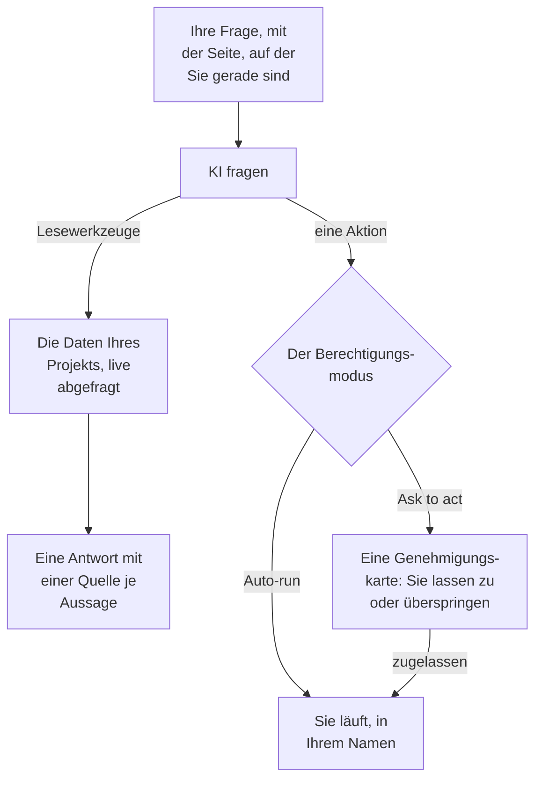

# KI fragen

KI fragen ist der Chat von OneUptime über die Daten Ihres Projekts. Fragen Sie nach Logs, Traces, Metriken, Ausnahmen, Vorfällen, Warnungen, Monitoren, Bereitschaft, Statusseiten, SLOs, Runbooks oder Workflows: Der Chat fragt Ihr Projekt live ab, belegt jede Aussage mit einer Quelle und handelt für Sie, wenn Sie es erlauben.

:::cards
- [KI fragen öffnen](#ki-fragen-öffnen): Aus der Kopfzeile, per Tastatur, aus einem Diagramm oder über das Produktmenü.
- [Was KI fragen sehen kann](#was-ki-fragen-sehen-kann): Die Daten, die der Chat für seine Antworten liest.
- [Aktionen und Berechtigungsmodi](#aktionen-und-berechtigungsmodi): Legen Sie fest, ob er handeln darf und wann er vorher fragt.
- [Aktionen erfolgen in Ihrem Namen](#aktionen-erfolgen-in-ihrem-namen): Ihre Berechtigungen, Ihr Name an jeder Änderung.
:::

## Wie KI fragen antwortet

KI fragen antwortet nur mit dem, was seine Werkzeuge zurückgeben: Der Chat führt Abfragen gegen Ihr Projekt aus, statt aus dem Gedächtnis zu antworten. Jede Tatsache in einer Antwort trägt einen Quellenchip, der die zugrunde liegende Abfrage zeigt und die gelesenen Daten öffnet. Wenn Sie ihn bitten, etwas zu ändern, entscheidet der Berechtigungsmodus der Unterhaltung, ob er Sie vorher fragt. Vor Ihrer Frage liest er den [KI-Kontext](/docs/ai/ai-context) des Projekts: was Ihr Team für OneUptime AI über Ihre eigenen Systeme aufgeschrieben hat.

Im Modus **Nur Lesezugriff** werden dem Modell keine Aktionen angeboten, die Unterhaltung liest also nur.

## KI fragen öffnen

| Wo | Wie |
| --- | --- |
| Auf jeder Seite | Klicken Sie in der Kopfzeile auf **KI fragen** oder drücken Sie `Ctrl` + `I` (`Cmd` + `I` auf einem Mac). Während Sie in ein Textfeld oder einen Editor tippen, bleibt die Tastenkombination die Kursiv-Taste des Editors. |
| Die Befehlspalette | Drücken Sie `Ctrl` + `K` (`Cmd` + `K` auf einem Mac) und wählen Sie **KI fragen**. |
| Ein Fehlermuster in den Logs oder die Befunde eines Diagramms | Klicken Sie auf **Mit KI erklären**: KI fragen öffnet sich mit den Belegen als Frage, die Sie vor dem Senden bearbeiten können. |
| Das Produktmenü | Öffnen Sie **Produkte → AI → Chat**. KI fragen öffnet sich über der Seite, auf der Sie waren. Jede Unterhaltung hat eine eigene Adresse, sodass Sie sie als Lesezeichen speichern und später wieder aufrufen können. |

KI fragen öffnet sich in der Mitte des Bildschirms über der Seite, auf der Sie waren, und füllt auf einem Telefon den ganzen Bildschirm. Drücken Sie `Esc` oder klicken Sie daneben, um zur Seite zurückzukehren. Die Unterhaltung bleibt, wo Sie sie verlassen haben: Öffnen Sie KI fragen erneut, um weiterzumachen. Schließen Sie den Chat, während er noch antwortet, sagt ein Hinweis in der Ecke, wann die Antwort fertig ist, und öffnet sie.

Bei einem Vorfall oder einer Warnung hat die Karte **KI-Untersuchung** eine eigene Unterhaltung, **Ask OneUptime AI**, die alle teilen, die diesen Vorfall oder diese Warnung sehen können: siehe [Mit OneUptime AI über den Vorfall sprechen](/docs/ai/ai-sre#mit-oneuptime-ai-über-den-vorfall-sprechen).

## Was KI fragen sehen kann

KI fragen liest Ihr Projekt mit Ihren eigenen Berechtigungen und sieht daher genau das, was Sie sehen dürfen, und nicht mehr.

| Bereich | Was KI fragen liest |
| --- | --- |
| Telemetrie | Logsuche und Histogramme, Trace-Aggregationen und Span-Bäume, Metriken, Ausnahmen, Sicherheitsereignisse, Real User Monitoring und Web Vitals, jüngste Änderungen sowie Anomalieprüfungen gegen gelernte Baselines. |
| Infrastruktur | Hosts, Docker, Podman, Kubernetes, Docker Swarm, Proxmox, VMware vCenter, Ceph, Speicher-Arrays, Serverless-Funktionen, Cloud-Umgebungen, IoT-Flotten und Netzwerkgeräte: was im Inventar ist, ihr gemeldeter Verbindungsstatus, Metrik-Trends, Anzahl der Logs je Schweregrad und Zusammenfassungen der Trace-Operationen. Eine Abfrage umfasst Telemetrie, die einen Dienst nennt, ebenso wie solche, die eine Infrastrukturressource nennt. |
| Vorfallreaktion | Vorfälle und Warnungen, mit Statusfiltern („was ist gerade aktiv?“), ihren Aktivitätszeitleisten (Statuswechsel, interne und öffentliche Notizen, der Feed) und Verantwortlichen sowie eine Suche in früheren Vorfällen, um ihre Lösung wiederzuverwenden. |
| Bereitschaft | Wer gerade Bereitschaft hat, Richtlinien und Eskalationsketten und ob die letzten Benachrichtigungen zugestellt und bestätigt wurden. |
| Die eigene Arbeit der KI | Die Ergebnisse der Untersuchungen von AI SRE und der KI-Einblicke, sodass „was hat die KI gefunden?“ aus der veröffentlichten Analyse beantwortet wird, statt es neu zu erarbeiten. |
| Plattform | Monitore (mit Statusfiltern), geplante Wartungen, Statusseiten und ihre Ankündigungen, SLOs, Runbooks, Workflow-Ausführungen, der Zustand der Probes, Teams und der Code verbundener Repositories. |

## Seitenkontext

KI fragen weiß, von welcher Seite aus Sie den Chat geöffnet haben. Auf einer Vorfallseite meint „warum ist das passiert?“ genau diesen Vorfall: Der Eingabebereich zeigt einen Chip mit dem Gegenstand der Seite, und die vorgeschlagenen Fragen sind die dieser Seite. Entfernen Sie den Chip, um nach dem ganzen Projekt zu fragen, und fügen Sie ihn auf dieselbe Weise wieder hinzu. Öffnen Sie KI fragen auf einer anderen Seite, folgt Ihnen der Kontext. Die Unterhaltung merkt sich ihren ersten Gegenstand auch auf dem Server, sodass eine Nachfrage Tage später „diesen Vorfall“ noch richtig zuordnet.

Auf einem Vorfall, einer Warnung, einem Monitor oder einem geplanten Wartungsereignis richten sich die Fragen auch danach, wo dieser Datensatz steht; das liest KI fragen jedes Mal, wenn Sie den Chat darauf öffnen. Ein behobener Vorfall fragt, wie die Reaktion verlief und was eine Wiederholung verhindern würde, eine behobene Warnung, ob sie ein echtes Problem war und wie oft Warnungen wie sie ausgelöst werden, und ein Monitor, der nicht betriebsbereit ist, fragt nach dem Grund. Ein Wartungsereignis, das noch nicht begonnen hat, fragt, ob seine Monitore vorher gesund sind, und eines, das beendet ist, ob sie wieder normal laufen.

Infrastrukturlisten und Ressourcenseiten bieten Fragen zu der Art Ressource an, die Sie gerade ansehen. Öffnen Sie einen Kubernetes-Cluster und fragen Sie „Welche Metriken haben sich in den letzten 24 Stunden verändert?“, oder öffnen Sie einen Docker-Host und fragen Sie „Fasse die Log-Schweregrade und Trace-Fehler der letzten sechs Stunden zusammen.“ Belegverweise führen zurück zur Seite der Ressource. Lesezugriffe beachten Ihre Berechtigungen für Projekt, Ressourcen und Telemetrie, einschließlich der Einschränkungen nach Verantwortlichen und Labels.

Auf der Seite eines untergeordneten Objekts hält der Kontext zusätzlich den Pod, Container, die VM, den Prozess oder das andere Objekt fest, das Sie ausgewählt haben. Die Infrastrukturwerkzeuge lesen die Telemetrie der übergeordneten Ressource; ein einzelnes untergeordnetes Objekt können sie nicht allein anhand seines Namens messen. KI fragen sagt das und errät keinen Kubernetes-Namespace, den die Seite nicht angibt. Ein Verbindungsstatus ist nicht der Zustand eines Workloads, und fehlende Telemetrie bedeutet nicht, dass eine Ressource gesund ist.

## Befehle auf Ihrer Infrastruktur

Auf der Seite einer Ressource geöffnet, deren KI-Agent verbunden ist (ein Host, ein Docker- oder Podman-Host, ein Docker-Swarm-Cluster, ein Proxmox-Cluster, ein VMware vCenter, ein Ceph-Cluster, ein Datenbankserver oder ein Kubernetes-Cluster), führt KI fragen über diesen Agenten Befehle darauf aus, wenn Sie darum bitten: „führe `uptime` auf diesem Host aus“ oder „zeige die letzten 100 Zeilen von `journalctl -u nginx`“. Die Antwort zeigt, was zurückkam, belegt wie jeder andere Nachweis. Auf einem Vorfall oder einer Warnung geöffnet, erreicht KI fragen die damit verknüpften Ressourcen.

- Ausgeführt werden nur die nur lesenden Befehle, die eine KI-Untersuchung auf dieser Art Ressource ausführen darf (siehe [KI-Agenten für die Infrastruktur](/docs/ai/infrastructure-ai-agents)), höchstens 30 für eine Antwort über jede Art von Agent, geprüft von OneUptime und erneut vom Agenten, in jedem Berechtigungsmodus. Eine Änderung über den Agenten, etwa der Neustart eines Dienstes, wird aus KI fragen nie ausgeführt: Sie erhalten stattdessen den genauen Befehl, und der Agent ändert nur dann etwas, wenn OneUptime AI einen Vorfall oder eine Warnung behebt, nach den eigenen Korrektureinstellungen der Ressource. Die eigenen Aktionen von KI fragen, etwa das Ausführen eines Runbooks, folgen dem Berechtigungsmodus der Unterhaltung, wie unten beschrieben.
- Erreicht werden nur die Ressourcen, die Sie sehen dürfen, und nur, solange die KI-Untersuchung für die Ressource eingeschaltet ist.
- Kann KI fragen dort keinen Befehl ausführen (kein Agent ist verbunden, der Agent ist offline oder die KI-Untersuchung ist für die Ressource ausgeschaltet), sagt es das, samt dem, was zu ändern ist, und antwortet stattdessen aus den Daten Ihres Projekts.

## Aktionen und Berechtigungsmodi

Jede Unterhaltung hat einen Berechtigungsmodus, den Sie im Eingabebereich neben dem Textfeld wählen:

| Modus | Was passiert |
| --- | --- |
| **Vor Aktionen fragen** | Die Voreinstellung. KI fragen schlägt jede Aktion auf einer Genehmigungskarte vor, und nichts läuft, bis Sie für sie **Zulassen** oder **Überspringen** wählen, oder **Alle ablehnen**. |
| **Automatisch ausführen** | Aktionen laufen, sobald das Modell sie anfordert, weiterhin begrenzt auf das, was Ihre Rolle darf. Setzen Sie diesen Modus mit Bedacht ein. |
| **Nur Lesezugriff** | Dem Modell werden überhaupt keine Aktionen angeboten: KI fragen kann nur lesen. |

Was KI fragen tun kann, wenn ein Modus es erlaubt:

- Einen Vorfall oder eine Warnung anlegen, Vorfälle und Warnungen bestätigen oder lösen und den Schweregrad eines Vorfalls ändern.
- Einen Vorfall oder eine Warnung mit der Infrastruktur und den Diensten verknüpfen, um die es geht. Einen Vorfall oder eine Warnung, die es auf der Seite einer Ressource anlegt, etwa der eines Hosts, verknüpft es mit dieser Ressource, und die Freigabekarte nennt, womit jede Aktion verknüpft. OneUptime AI untersucht und behebt, womit ein Vorfall oder eine Warnung verknüpft ist.
- Eine interne Notiz zu einem Vorfall oder einer Warnung veröffentlichen. Interne Notizen erscheinen nie auf einer Statusseite.
- Eine öffentliche Statusmeldung zu einem Vorfall veröffentlichen. Das ist eine eigene Aktion, weil sie die Abonnenten der Statusseite benachrichtigt.
- Eine Bereitschaftsrichtlinie alarmieren, ein Runbook ausführen oder eine KI-Untersuchung eines Vorfalls oder einer Warnung starten.
- Eine Codeänderung vorschlagen: in einen neuen Branch eines Repositorys auf GitHub, GitLab, Forgejo oder Gitea committen und einen Pull Request öffnen (auf GitLab einen Merge Request). Er schreibt nie in den Standard-Branch oder einen geschützten Branch, sodass weiterhin ein Mensch die Änderung mergt.

Fragen Sie nach einem Vorfall, wenn Benutzer betroffen sind, und nach einer Warnung, wenn etwas zuerst die Aufmerksamkeit Ihres Teams braucht, etwa wenn der Speicher eines Hosts immer weiter steigt. Beides wird einmal angelegt und überwacht nichts: Um jedes Mal benachrichtigt zu werden, wenn der Speicher eines Hosts 75 % übersteigt, legen Sie eine [Host-Überwachung](/docs/monitor/host-monitor#fertige-warnungsvorlagen) aus ihrer Speichervorlage an, mit 75 % als Schwellenwert. KI fragen kann keine Monitore anlegen. Danach gefragt, sagt es das, prüft den aktuellen Wert und bietet an, eine Warnung auszulösen, wenn er schon darüber liegt.

## Aktionen erfolgen in Ihrem Namen

Jede Aktion, die KI fragen ausführt, erfolgt in Ihrem Namen: Sie bewirkt dieselbe Änderung wie das Dashboard für dieselbe Aktion, mit Ihren eigenen Berechtigungen im Projekt, und die Änderung wird Ihnen zugeschrieben. Wird ein Vorfall aus dem Chat bestätigt, entsteht derselbe Statuswechsel wie über das Statusfeld des Vorfalls, sodass Zeitleiste und Feed des Vorfalls zeigen, dass Sie seinen Status geändert haben. Eine aus dem Chat gesendete Alarmierung zeigt Sie als Auslöser.

- **Was jede Aktion braucht.** Die Berechtigung, die das Dashboard für dieselbe Änderung verlangt. Einen Vorfall oder eine Warnung anzulegen erfordert die Berechtigung, sie anzulegen: eine Rolle, die das darf, oder **Create Incident** oder **Create Alert** in einer benutzerdefinierten Rolle. Einen Vorfall zu bestätigen oder zu lösen erfordert die Berechtigung, seinen Status zu ändern: **Projektinhaber**, **Projektadministrator**, **Projektmitglied**, **Vorfall-Administrator** und **Vorfall-Mitglied**, oder **Create Incident State Timeline** in einer benutzerdefinierten Rolle; eine Warnung braucht dieselbe Berechtigung für Warnungen (**Create Alert State Timeline**). Eine Bereitschaftsrichtlinie zu alarmieren erfordert die Berechtigung, sie auszuführen (**Create On-Call Duty Policy Execution Log**), und ein Runbook auszuführen erfordert die Berechtigung, Runbook-Ausführungen zu starten: eine Rolle, die Runbooks ausführt, für die Runbooks, die ihre Labels erreichen, oder **Create Runbook Execution** in einer benutzerdefinierten Rolle, die jedes Runbook des Projekts erreicht. Den Schweregrad eines Vorfalls zu ändern, eine KI-Untersuchung eines Vorfalls oder einer Warnung zu starten und Code in ein verbundenes Repository zu schreiben, erfordert die Berechtigung, diesen Vorfall, diese Warnung oder dieses Repository zu ändern. Eine Aktion, die Sie nicht ausführen dürfen, wird abgelehnt, und die KI sagt Ihnen, welche Berechtigung sie braucht. Haben Sie die Berechtigung, blockiert sie aber ein Team, dem Sie angehören, sagt die KI Ihnen das: Eine Blockierung für bestimmte Labels lehnt diese Aktion in KI fragen für jeden Datensatz ab, nicht nur für Datensätze mit diesen Labels.
- **Welche Datensätze.** Die, die Sie ändern dürfen, wie überall in OneUptime: Mit einer Rolle, die auf bestimmte Labels oder auf Ihre eigenen Datensätze beschränkt ist, ändert eine Aktion an jedem anderen Datensatz nichts. Ein Runbook läuft nur, wenn Ihre Berechtigung, Runbook-Ausführungen zu starten, es erreicht. In OneUptime Cloud wird eine Aktion, die der Tarif des Projekts nicht umfasst, mit dem nötigen Tarif abgelehnt.
- **Wenn eine Aktion abgelehnt wird.** Nichts ändert sich, und die KI sagt Ihnen klar, dass die Aktion nicht ausgeführt wurde und warum, statt sie erneut zu versuchen.
- **Slack, Microsoft Teams und KI-Untersuchungen.** Die Antworten der KI in Slack und Microsoft Teams sowie autonome KI-Untersuchungen lesen nur: Sie führen keine dieser Aktionen aus. Um aus Slack oder Microsoft Teams heraus zu handeln, nutzen Sie die Schaltflächen an den Nachrichten von OneUptime, die ebenfalls in Ihrem Namen handeln (siehe [Slack](/docs/workspace-connections/slack#aus-slack-auf-vorfälle-warnungen-und-ereignisse-reagieren) und [Microsoft Teams](/docs/workspace-connections/microsoft-teams#aus-microsoft-teams-auf-vorfälle-warnungen-und-ereignisse-reagieren)).

## Eine Unterhaltung steuern

- **Anhalten.** Während KI fragen arbeitet, wird die Senden-Schaltfläche zu einer Stopp-Schaltfläche. Halten Sie einen Lauf jederzeit an und fragen Sie sofort etwas anderes.
- **Die Arbeit verfolgen.** Während der Chat antwortet, sagt eine Zeile, was er gerade tut, etwa Protokolle durchsuchen. Klicken Sie auf die Zahl der Schritte daneben, um jeden Schritt zu sehen.
- **Das Modell wählen.** Wenn Ihr Projekt mehr als einen LLM-Anbieter nutzen kann, listet die Anbieterauswahl im Eingabebereich die LLM-Anbieter Ihres Projekts und die globalen auf, der Standardanbieter ist markiert. Eine neue Unterhaltung nutzt den Standardanbieter.
- **Eine Antwort bewerten.** **Gute Antwort** und **Schlechte Antwort** werden mit der Nachricht gespeichert, sodass sich die Qualität der Antworten über die Zeit messen lässt.
- **Die Kosten sehen.** Unter jeder Antwort öffnen sich ihre Quellen zu den Abfragen, die sie ausgeführt hat, und die der neuesten Antwort nennen auch, wie viele Abfragen sie ausgeführt hat, ihre Tokens und ihre Kosten. Jeder Quellenchip in einer Antwort öffnet die zugrunde liegenden Daten.
- **Eine Kopie behalten.** **Unterhaltung herunterladen** speichert den Verlauf mit **Als Markdown herunterladen**, zum Lesen oder Einfügen in ein Ticket, oder mit **Als PDF herunterladen**, zum Weitergeben.
- **Dort weitermachen, wo Sie aufgehört haben.** **Alle Unterhaltungen** in der Kopfzeile von KI fragen listet Ihre Unterhaltungen auf, die neueste zuerst, um sie wieder zu öffnen oder zu löschen. Der Start einer neuen Unterhaltung zeigt die letzten drei.

## Voraussetzungen

- **Ein LLM-Anbieter.** KI fragen nutzt den Standard-LLM-Anbieter des Projekts (siehe [LLM-Anbieter](/docs/ai/llm-provider)). In OneUptime Cloud funktioniert es sofort mit dem globalen Anbieter, bezahlt aus dem KI-Guthaben des Projekts; eine selbst gehostete Installation richtet einen Anbieter ein oder die Umgebungsvariablen des globalen Anbieters. Die Antworten sind nur so gut wie das Modell: Ein kleines selbst gehostetes Modell ohne zuverlässige Werkzeugaufrufe antwortet schlecht.
- **Der Growth-Tarif, in OneUptime Cloud.** Ein Projekt mit einem kleineren Tarif sieht, dass KI in seinem Tarif nicht enthalten ist, mit einem Link zu **Projekteinstellungen → Abrechnung und Rechnungen → Abrechnung**.
- **Für das Projekt eingeschaltete KI.** **KI aktivieren** unter **Projekteinstellungen → KI → KI-Funktionen** schaltet jede KI-Funktion des Projekts aus, KI fragen eingeschlossen. Es ist eingeschaltet, solange niemand es ausgeschaltet hat.

KI fragen zählt zu den eigenen täglichen KI-Limits des Projekts, wenn das Projekt sie festlegt (Projekteinstellungen → KI → KI-Funktionen → Weitere Einstellungen): Ist eines erreicht, zeigt KI fragen einen Satz, der sagt, welches Limit erreicht wurde, dass OneUptime AI um Mitternacht UTC wieder startet und wer das Limit erhöhen oder entfernen kann. Die Eigentümer des Projekts erhalten eine E-Mail, wenn an einem Tag zum ersten Mal ein Limit erreicht wird. Die täglichen Limits für Vorfälle und Warnungen halten KI fragen nie an. Siehe [die eigenen täglichen Limits des Projekts](/docs/ai/ai-sre#die-eigenen-täglichen-limits-des-projekts).

## Fehlerbehebung

:::details KI fragen sagt, dass KI nicht verfügbar ist
KI fragen sagt den Grund, bevor Sie tippen: Der Tarif des Projekts umfasst keine KI, **KI aktivieren** ist ausgeschaltet oder das Projekt hat keinen LLM-Anbieter. Jeder Hinweis verlinkt auf die Seite, auf der sich das ändern lässt.
:::

:::details Eine Aktion wurde abgelehnt
KI fragen sagt, welche Berechtigung die Aktion braucht oder welches Team sie blockiert. Bitten Sie jemanden, der die Änderung vornehmen darf, oder bitten Sie einen Projekteigentümer, Ihrer Rolle die Berechtigung zu geben. Es wurde nichts geändert.
:::

:::details Antworten sind vage oder nutzen nie Daten
Prüfen Sie das Modell hinter dem Anbieter. KI fragen braucht ein Modell, das Werkzeuge zuverlässig aufruft; kleine lokale Modelle antworten oft, ohne eine einzige Abfrage auszuführen. Siehe [LLM-Anbieter](/docs/ai/llm-provider).
:::

## Nächste Schritte

:::cards
- [AI SRE](/docs/ai/ai-sre): Lassen Sie OneUptime AI jeden neuen Vorfall und jede neue Warnung untersuchen.
- [LLM-Anbieter](/docs/ai/llm-provider): Wählen Sie das Modell, das KI fragen und die anderen KI-Funktionen nutzen.
- [MCP-Server](/docs/ai/mcp-server): Fragen Sie OneUptime stattdessen aus Claude, Cursor oder VS Code.
:::
