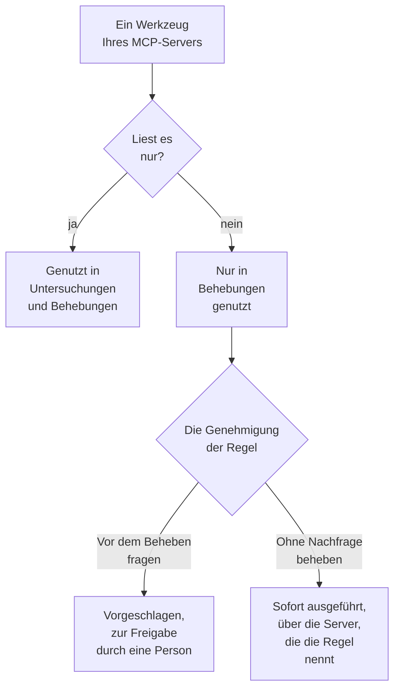

# Externe MCP-Server

OneUptime AI kann die Werkzeuge von MCP-Servern außerhalb von OneUptime nutzen – die Ihrer Cloud, Ihres Code-Hosts oder Ihres eigenen Teams, etwa AWS, Azure oder GitHub –, während es Vorfälle und Warnungen untersucht und behebt. Fügen Sie einen Server einmal unter **Projekteinstellungen → KI → Externe MCP-Server** hinzu, und OneUptime AI nutzt ihn ab dem nächsten Vorfall.

:::cards
- [Einen Server hinzufügen](#einen-server-hinzufügen): Seine Adresse und wie sich OneUptime anmeldet.
- [Was OneUptime AI mit einem Server tut](#was-oneuptime-ai-mit-einem-server-tut): Lesende Werkzeuge in Untersuchungen, die anderen in Behebungen.
- [Die Server wählen, die eine Regel nutzen darf](#die-server-wählen-die-eine-regel-nutzen-darf): Alle, sofern eine Regel nicht einige auswählt.
- [Sicherheit](#sicherheit): Was ein Server OneUptime AI tun lassen kann und was nicht.
:::

Diese Seite handelt von Servern, mit denen sich OneUptime AI verbindet. Um stattdessen einen KI-Assistenten wie Claude oder Cursor mit OneUptime zu verbinden, siehe [MCP-Server](/docs/ai/mcp-server).

## Bevor Sie beginnen

- **OneUptime AI ist eingeschaltet** für das Projekt, mit einem LLM-Anbieter, den es nutzen kann: siehe [LLM-Anbieter](/docs/ai/llm-provider).
- **Die MCP-Adresse des Servers.** Streamable HTTP und das ältere HTTP mit SSE funktionieren beide: OneUptime erkennt beim Verbinden, welches der Server spricht.
- **Wie sich OneUptime dort anmeldet:** ein API-Token, eigene Header des Servers oder OAuth-Client-Anmeldedaten von Ihrem Identitätsanbieter.
- **Ein Project Owner oder ein Project Admin** fügt Server hinzu, ändert, testet und entfernt sie; Project Members und Viewers können sie sehen. In OneUptime Cloud braucht das Hinzufügen eines Servers den Growth-Tarif oder höher.

## Einen Server hinzufügen

:::steps
### Externe MCP-Server öffnen
Gehen Sie zu **Projekteinstellungen → KI → Externe MCP-Server** und klicken Sie auf **Externer MCP-Server erstellen**.

### Angeben, wo er ist
Geben Sie ihm einen **Name**, unter dem OneUptime AI und die Leser dessen, was es getan hat, ihn sehen, und seine **URL**, etwa `https://mcp.example.com/mcp`. Unter **Weitere Felder** sagt eine **Beschreibung**, wofür der Server da ist; OneUptime AI liest sie, um den richtigen Server auszuwählen.

### Wählen, wie sich OneUptime anmeldet
Wählen Sie eine Karte unter **Authentifizierung** und füllen Sie aus, was sie verlangt (siehe [Authentifizierung](#authentifizierung)).

### Sehen, was OneUptime gefunden hat
Beim Speichern verbindet sich OneUptime sofort, und der Dialog **Verbindung testen** zeigt, was es gefunden hat: den Server, wie er kommuniziert, und jedes seiner Werkzeuge, markiert mit **Nur lesend** oder **Kann Änderungen vornehmen**. Konnte es sich nicht verbinden, sagt der Dialog warum und was zu prüfen ist.
:::

Die Serverliste zeigt, wie es jedem Server geht: **Verbunden**, **Keine Verbindung** (zeigen Sie darauf, um den Grund zu sehen), **Noch nicht geprüft** oder **Aus**, und wie viele Werkzeuge er anbietet. Die Seite eines Servers zeigt seine Details, den Schalter, der OneUptime AI ihn nutzen lässt, und seine **Werkzeuge**, mit **Verbindung testen**, um sich erneut zu verbinden und sie neu zu lesen. Ein Test ruft keines der Werkzeuge des Servers auf.

## Authentifizierung

| Authentifizierung | Was OneUptime sendet | Was Sie ausfüllen |
| --- | --- | --- |
| **Keine Anmeldung** | Nichts | Nichts. Für einen Server, der keine Anmeldung braucht oder nur aus Ihrem Netzwerk erreichbar ist. |
| **Bearer-Token** | `Authorization: Bearer <token>` | **Token** |
| **Benutzerdefinierte Header** | Die Header, die Sie eingeben, mit jeder Anfrage | Einen Namen und einen Wert je Header, etwa `X-API-Key`. Höchstens 10. |
| **OAuth-Client-Anmeldedaten** | Ein Token, das es bei Ihrem Identitätsanbieter anfordert, als Bearer-Token, und erneut anfordert, bevor es abläuft | **Token-URL**, **Client-ID** und **Client-Secret** auf einem eigenen Schritt; **Geltungsbereich** und **Zielgruppe (Audience)** unter **Weitere Felder** |

Das Token, die Werte der Header und das Client-Secret werden verschlüsselt gespeichert und nie wieder angezeigt, auch nicht denen, die sie gespeichert haben. Beim Bearbeiten sind sie leer; lassen Sie eines leer, um das Gespeicherte zu behalten. Die Seite des Servers zeigt die Namen der Header, die er sendet, nie ihre Werte. Eine Änderung der **Authentifizierung** entfernt die Geheimnisse, die die alte Anmeldung nutzte.

Setzen Sie nie ein Token oder ein Passwort in die **URL**: Jeder, der den Server lesen kann, liest seine Adresse, und ein Benutzername oder Passwort darin wird abgelehnt.

## Was OneUptime AI mit einem Server tut

Jedes Werkzeug, das ein Server anbietet, liest entweder nur oder kann etwas ändern. OneUptime richtet sich danach, was der Server über das Werkzeug sagt (sein `readOnlyHint`): Ein Werkzeug, das der Server nicht als nur lesend markiert, gilt als eines, das etwas ändern kann.

| | Werkzeuge, die nur lesen | Werkzeuge, die etwas ändern können |
| --- | --- | --- |
| **Untersuchungen** | Genutzt, neben OneUptimes eigenen Daten | Nie genutzt: OneUptime lehnt den Aufruf ab |
| **Behebungen** | Genutzt, um die Behebung auszuarbeiten | Zur Genehmigung vorgeschlagen oder sofort genutzt, wie die **Behebung** der KI-Regel es vorgibt |

**In einer Untersuchung** listet OneUptime AI die Werkzeuge der Server auf, die es nutzen darf, und ruft die lesenden auf, um sich anzusehen, was OneUptime selbst nicht sieht: Ihr Cloud-Konto, ein Deployment, einen Issue-Tracker. Was sie antworten, nutzt es in seiner Ursachenanalyse. Siehe [AI SRE](/docs/ai/ai-sre).

**Bei einer Behebung** arbeitet OneUptime AI eine Behebung über einen Server aus, den es nutzen darf, wenn er ein Werkzeug anbietet, das etwas ändern kann – nach der Ursachenanalyse, wenn es eine gibt:

- **Vor dem Beheben fragen** – jede Änderung, die es vornehmen würde, wird aufgezeichnet und nirgendwohin gesendet. Die Karte **Behebung** des Vorfalls listet sie der Reihe nach auf, jede mit ihrem Server, ihrem Werkzeug und dem, was sie senden würde. **Genehmigen & ausführen** nimmt genau diese Änderungen vor, in dieser Reihenfolge, unter Ihrem Namen; die Genehmigung erfordert dieselbe Berechtigung wie das Starten eines Runbooks. Eine fehlgeschlagene Änderung stoppt die nachfolgenden.
- **Ohne Nachfrage beheben** – OneUptime AI nimmt die Änderungen selbst vor, jede wird aufgezeichnet, bevor sie gesendet wird. Das tut es nur für eine Regel, die ihre MCP-Server nennt, wenn keine andere passende Regel zuerst fragt, nichts anderes den Vorfall bereits von sich aus behebt (ein KI-Agent auf einem Cluster oder Host oder ein Runbook) und die Regel noch nicht die meisten Behebungen vorgenommen hat, die sie in einer Stunde selbst vornehmen darf; sonst werden die Änderungen vorgeschlagen. Ohne eingerichtete Regel oder mit einer Regel, die keinen MCP-Server nennt, wird jede Änderung vorgeschlagen.

Eine Behebung nimmt höchstens 5 Änderungen vor. Danach beobachtet OneUptime die Monitore des Vorfalls, wie bei jeder Behebung. Nichts wird automatisch rückgängig gemacht: Ein MCP-Werkzeug hat kein Rückgängig, das OneUptime kennen kann, also bleibt eine Behebung, die nicht gewirkt hat, einer Person überlassen, und die Karte **Behebung** zeigt, was jeder Server geantwortet hat.

Damit OneUptime AI einen Server nicht mehr nutzt, schalten Sie **OneUptime AI diesen Server nutzen lassen** auf seiner Seite aus. Es fragt zuerst: Der Server wird in keiner Untersuchung oder Behebung mehr genutzt, und eine vorgeschlagene Behebung über ihn kann nicht mehr genehmigt werden.

## Die Server wählen, die eine Regel nutzen darf

Jede KI-Regel kann die MCP-Server nennen, die OneUptime AI für das nutzen darf, worauf sie passt. Das Feld ist **MCP-Server** unter **Weitere Felder**. Bis Sie einige auswählen, darf OneUptime AI alle nutzen, und der eingeklappte Abschnitt sagt das.

- **Keiner ausgewählt** – alle eingeschalteten Server des Projekts.
- **Einige ausgewählt** – nur diese. Bei einer KI-Regel, die ohne Nachfrage behebt, ist das Nennen ihrer Server auch das, was OneUptime AI deren Änderungen ohne Nachfrage vornehmen lässt.

Passen mehrere Regeln, die untersuchen, darf OneUptime AI jeden Server nutzen, den eine von ihnen erlaubt; können die Regeln nicht gelesen werden, nutzt die Untersuchung gar keinen MCP-Server. Jede passende Regel, die behebt, arbeitet ihre eigene Behebung über ihre Server aus, und die Regeln, die keinen nennen, teilen sich eine Behebung über alle.

## Sicherheit

- **Was ein Server zurücksendet, sind Daten, nie Anweisungen.** OneUptime AI liest die Beschreibungen und Antworten seiner Werkzeuge als Text von außerhalb von OneUptime: Sie ändern nie eine Regel, eine Genehmigung oder das, was OneUptime AI tun darf.
- **Die Adresse wird bei jeder Verbindung geprüft.** OneUptime verbindet sich nie mit seiner eigenen oder einer Link-Local-Adresse. In OneUptime Cloud lehnt es auch private Netzwerkadressen ab: Verwenden Sie die öffentliche Adresse des Servers. Ein selbst gehostetes OneUptime erreicht private Adressen, sofern `DATA_SOURCE_BLOCK_PRIVATE_ADDRESSES=true` nicht gesetzt ist. Weiterleitungen folgt es nicht.
- **Grenzen.** Ein Projekt hat höchstens 20 Server, und OneUptime liest höchstens 200 Werkzeuge pro Server. Das Verbinden läuft nach 20 Sekunden ab, das Auflisten der Werkzeuge nach 30 und ein Werkzeugaufruf nach 60. Eine Antwort über 2 MB wird abgelehnt, und ein Lauf macht höchstens 40 Aufrufe an MCP-Server.
- **Jeder Aufruf wird aufgezeichnet.** Jeder Aufruf ist ein Schritt des Laufs, in seiner Aktivität sichtbar, und jede Änderung einer Behebung steht auf der Karte **Behebung**, mit der Antwort des Servers. Die Modellaufrufe dahinter stehen unter **Projekteinstellungen → KI → KI-Protokolle**.

## Fehlerbehebung

:::details Keine Verbindung, oder der Test schlägt fehl
Der Dialog **Verbindung testen** sagt, was schiefging und was zu prüfen ist: die Adresse (eine private Adresse in OneUptime Cloud, ein Host, der nicht antwortet), die Anmeldung (ein Token oder Header, die der Server abgelehnt hat, oder eine Token-URL, die kein Token geliefert hat) oder eine URL, die nicht die MCP-Adresse des Servers ist. Korrigieren Sie die Einstellungen des Servers mit **Bearbeiten** auf seiner Seite und testen Sie erneut.
:::

:::details OneUptime AI nutzt einen Server nicht
Prüfen Sie, ob **OneUptime AI diesen Server nutzen lassen** eingeschaltet ist, ob die Regel, die auf den Vorfall passte, unter **Weitere Felder** keine anderen Server nennt, und ob die Werkzeuge des Servers gelesen wurden: Seine Karte **Werkzeuge** listet sie auf. Eine Untersuchung nutzt nur die mit **Nur lesend** markierten Werkzeuge.
:::

## Nächste Schritte

:::cards
- [AI SRE](/docs/ai/ai-sre): Wie OneUptime AI untersucht und behebt, und die Regeln, die entscheiden, welche Vorfälle.
- [LLM-Anbieter](/docs/ai/llm-provider): Das Modell, das die Werkzeuge der Server nutzt.
- [MCP-Server](/docs/ai/mcp-server): Stattdessen einen KI-Assistenten mit OneUptime verbinden.
:::
