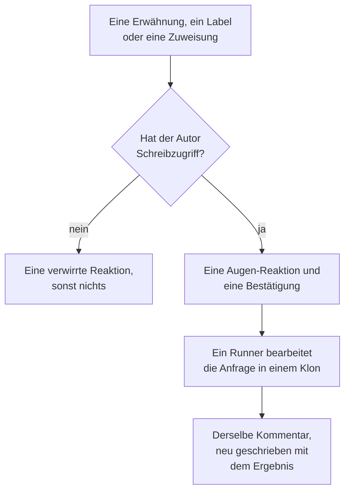

# GitHub App

Die OneUptime GitHub App ist mehr als eine Verbindung zu Ihrem Code: Sie können in Ihrem Repository mit ihr sprechen, und sie erledigt die Arbeit dort. Erwähnen Sie sie in einem Issue, und sie öffnet einen Pull Request; erwähnen Sie sie in einem Pull Request, und sie überarbeitet den Branch oder prüft den Diff. Alles, was sie erzeugt, ist ein Pull Request oder ein Review, das ein Mensch liest: **Sie mergt nie etwas, und sie genehmigt nie einen Pull Request.**

:::cards
- [Die Befehle](#die-befehle): Was Sie in einem Issue oder einem Pull Request schreiben.
- [Wie es im Thread aussieht](#wie-es-im-thread-aussieht): Ein Kommentar, der der Arbeit folgt.
- [Reviews mit Produktionskontext](#reviews-mit-produktionskontext): Was die Produktion über den geänderten Code sagt.
- [Wer ihr Befehle geben darf](#wer-ihr-befehle-geben-darf): Personen mit Schreibzugriff, sonst niemand.
- [Fehlerbehebung](#fehlerbehebung): Wenn eine Erwähnung nichts bewirkt.
:::

```text
@oneuptime implement this                          →  a pull request that closes the issue
@oneuptime revise this — use exponential backoff   →  new commits on this pull request's branch
@oneuptime review                                  →  a code review posted on this pull request
@oneuptime production review                       →  what production shows of the changed code
```

> [!NOTE]
> Ersetzen Sie `@oneuptime` durch das Handle Ihrer eigenen App. In OneUptime Cloud ist es `@oneuptime`. Auf einer selbst gehosteten Instanz ist es der Name Ihrer GitHub App, kleingeschrieben und mit Bindestrichen statt Leerzeichen: Eine App namens "Acme AI" wird als `@acme-ai` erwähnt. Wenn Erwähnungen nichts bewirken, prüfen Sie zuerst das.

## So funktioniert es



Es ist derselbe Agent und derselbe Runner wie in [Code](/docs/ai/ai-agent), mit denselben Budgets; nur der Auslöser unterscheidet sich.

## Bevor Sie beginnen

- Das Repository muss über die GitHub App **mit einem OneUptime-Projekt verbunden** sein: Verbinden Sie es unter **Produkte → Code**. Eine selbst gehostete Instanz braucht zuerst eine eigene GitHub App: siehe [GitHub-Integration](/docs/self-hosted/github-integration). Ist die App auf dem GitHub-Konto bereits installiert, klicken Sie dort auf **Vorhandene Installation verbinden**, statt sie erneut zu installieren.
- Der Runner, den das Repository in seinen Einstellungen in Code auswählt, muss online sein, oder ein globaler Runner für ein Repository, das keinen auswählt: derselbe Runner, der die Aufgaben in [Code](/docs/ai/ai-agent) ausführt. Ohne ihn werden Befehle angenommen und schlagen nach 30 Minuten fehl, mit dem Hinweis, dass kein Runner sie übernommen hat.
- Die GitHub App braucht die Berechtigung **Issues** mit **Read & write** und muss die Webhook-Ereignisse unter [Was abonniert werden muss](#was-abonniert-werden-muss) abonniert haben.

## Die Befehle

Jeder Befehl beginnt mit einer Erwähnung der App. Die Erwähnung kann irgendwo im Kommentar stehen, und alles, was Sie danach schreiben, wird als Ihre Anfrage weitergegeben. Wenn Sie einen Kommentar bearbeiten, der die App bereits erwähnt, wird sie nicht erneut ausgeführt: Um Ihre Anfrage zu ändern, schreiben Sie einen neuen Kommentar. Eine Bearbeitung, die die Erwähnung hinzufügt, ist eine neue Anfrage.

### In einem Pull Request

| Befehl | Was passiert | Ebenfalls verstanden |
| --- | --- | --- |
| `@oneuptime review` | Klont den Branch, liest den geänderten Code und den Code drumherum, prüft, was die Produktion darüber sagt, und veröffentlicht ein Review als Kommentar. Ändert nichts. | `code review`, `please review`, `can you review`, `review this` |
| `@oneuptime production review` | Prüft den Pull Request jetzt gegen die Produktion, egal wer ihn geöffnet hat: die Ausnahmen, Vorgänge, Vorfälle und Deploys rund um den geänderten Code, in einem Kommentar, der an Ort und Stelle aktualisiert wird (siehe [Produktionsprüfung von Pull Requests](/docs/ai/ai-agent#produktionsprüfung-von-pull-requests)). Klont nichts und führt nichts aus. | `review against production`, `review production`, `check production` |
| `@oneuptime revise this — <what you want changed>` | Klont den eigenen Branch des Pull Requests, nimmt die Änderung vor und pusht neue Commits auf diesen Branch. Öffnet nie einen zweiten Pull Request. | `revise`, `please revise`, `rework`, `redo` |

Alles, was Sie nach der Erwähnung schreiben und kein bekannter Befehl ist, wird als Überarbeitungsanfrage gelesen, weil es fast immer genau das ist:

```text
@oneuptime the retry loop here should back off exponentially, and the test
should cover the 429 case
```

### In einem Issue

| Befehl | Was passiert | Ebenfalls verstanden |
| --- | --- | --- |
| `@oneuptime implement this` | Bearbeitet das Issue und öffnet einen Pull Request, der es schließt. | `implement`, `please implement`, `work on this`, `pick this up`, `take this` |
| `@oneuptime <anything else>` | Dasselbe, mit Ihren Worten als zusätzliche Vorgabe. | — |

Sie können der App ein Issue auch ohne Kommentar übergeben:

- **Fügen Sie das Auslöser-Label hinzu.** Das Auslöser-Label des Repositorys, `oneuptime`, sofern Sie es nicht geändert haben, an ein Issue zu hängen, startet dieselbe Arbeit. Das ist der zuverlässigste Weg, Arbeit von den eigenen Seiten von GitHub aus zu übergeben.
- **Weisen Sie das Issue dem Bot-Benutzer der App zu**, wo Ihr Repository das zulässt. GitHub erlaubt nicht überall, dass eine App zugewiesen wird, und deshalb gibt es das Label: Wenn die Zuweisung nichts bewirkt, verwenden Sie das Label.

### Überall

| Befehl | Was passiert | Ebenfalls verstanden |
| --- | --- | --- |
| `@oneuptime help` | Listet die Befehle auf. Eine bloße Erwähnung ohne etwas danach tut dasselbe. | `commands`, `usage`, `what can you do` |
| `@oneuptime status` | Sagt, woran sie in diesem Thread arbeitet. | `progress` |
| `@oneuptime cancel` | Stoppt die Läufe, die sie in diesem Thread laufen hat. Bereits gepushte Arbeit bleibt gepusht. | `stop`, `abort` |

`help`, `status` und `cancel` starten nie einen Agent-Lauf und kosten daher nichts.

## Wie es im Thread aussieht

Ein Befehl erzeugt **einen Kommentar**, den die App bearbeitet, während die Arbeit vorankommt, sodass eine lange Aufgabe einen Pull Request nie in ein Statusprotokoll verwandelt.

1. Sie reagiert mit 👀 auf Ihren Kommentar und veröffentlicht eine Bestätigung, die das OneUptime-Projekt nennt, zu dem der Lauf gehört, und auf den Live-Lauf verlinkt.
2. Wenn sie fertig ist, schreibt sie denselben Kommentar mit dem Ergebnis neu: dem Pull Request, den sie geöffnet hat, den Commits, die sie gepusht hat, oder einer klaren Erklärung, warum sie nichts getan hat.

Findet sie nichts, was sich zu ändern lohnt, sagt sie das, statt einen spekulativen Pull Request zu öffnen. Das ist ein normales Ergebnis, kein Fehler: Geben Sie ihr mehr Richtung und fragen Sie erneut.

## Reviews mit Produktionskontext

OneUptime hat die Telemetrie des Codes, den es prüft, also kann ein Review sagen, was kein Prüfer, der den Diff liest, sagen kann. Für die Dienste, die zum Repository gehören, prüft es:

- die Ausnahmen, die in den letzten 7 Tagen in den geänderten Dateien und Funktionen geworfen wurden;
- wie stark ausgelastet und wie langsam die Endpunkte und Operationen sind, die der Diff berührt;
- die Vorfälle, die mit den geänderten Dateien verknüpft sind;
- die jüngsten Deploys der Dienste, die OneUptime als Regressionen markiert hat.

Was es findet, steht im Review unter einer Überschrift **Production context**, jeder Punkt mit den Zahlen und dem Zeitfenster, aus denen er stammt, zum Beispiel: "`chargeCard` hat in den letzten 7 Tagen 1.240-mal `TypeError: Cannot read properties of undefined` geworfen; diese Änderung fügt die Null-Prüfung hinzu, die das verhindert." Wenn die Produktion nichts zeigt, was den Diff betrifft, lässt das Review die Überschrift weg, statt zu sagen, dass alles in Ordnung ist.

Es muss nichts eingerichtet werden: Die Dienste sind die, für die OneUptime dieses Repository findet, wie bei einer Korrektur (siehe [Produktionstelemetrie in einer Korrektur](/docs/ai/ai-agent#produktionstelemetrie-in-einer-korrektur)). Die Abfragen lesen nur, laufen auf dem OneUptime-Server und lesen nichts aus einem anderen Dienst, einem anderen Projekt oder einem privaten Vorfall. Ein Repository, dessen Dienste keine Telemetrie an das Projekt senden, wird allein anhand seines Codes geprüft.

Damit jeder Pull Request von selbst gegen die Produktion geprüft wird, schalten Sie **Pull Requests gegen die Produktion prüfen** in den Einstellungen des Repositorys ein: siehe [Produktionsprüfung von Pull Requests](/docs/ai/ai-agent#produktionsprüfung-von-pull-requests).

## Wer ihr Befehle geben darf

**Nur Personen mit Write-, Maintain- oder Admin-Zugriff auf das Repository.** OneUptime fragt GitHub jedes Mal nach der Berechtigung der kommentierenden Person für dieses Repository; dem Abzeichen "contributor", das GitHub neben einem Kommentar zeigt, vertraut es nicht, denn es beschreibt frühere Aktivität, nicht den aktuellen Zugriff.

Eine Erwähnung von jemand anderem bekommt eine einzige 😕-Reaktion und sonst nichts. Das ist Absicht: In einem öffentlichen Repository kann jeder kommentieren, und eine App, die Fremden immer antwortet, kann zum Zuspammen eines Threads benutzt werden.

Sie ignoriert außerdem jeden Kommentar, den ein Bot geschrieben hat, ihre eigenen eingeschlossen, sowie Erwähnungen in einem Zitat (`>`) oder einem Codeblock. Zusammen verhindern diese beiden Regeln, dass eine Antwort auf einen ihrer eigenen Kommentare sie erneut startet.

## Was sie nicht tut

- **Sie mergt nie.** Nichts, was diese App tut, kann Code auf Ihren Standard-Branch bringen.
- **Sie genehmigt nie und fordert nie Änderungen an.** Reviews werden als Kommentare veröffentlicht, sodass ein Review der App nie eine Branch-Schutzregel erfüllen kann.
- **Sie schreibt nie die Historie um.** Eine Überarbeitung fügt Commits hinzu; sie macht nie einen Force-Push. Hat jemand anderes zuerst auf den Branch gepusht, schlägt die Überarbeitung fehl, statt dessen Arbeit zu verwerfen.
- **Sie kann keinen Pull Request aus einem Fork überarbeiten.** Der Branch eines Forks liegt in einem Repository, in das die Installation nicht schreiben kann. Prüfen kann sie ihn trotzdem: Bitten Sie stattdessen um ein Review.
- **Sie ändert nie den Titel, die Beschreibung oder den Ziel-Branch eines Pull Requests.** Nur Code.

## Was es kostet und wie Sie es begrenzen

Jeder Befehl, der Arbeit startet, ist ein vollständiger Agent-Lauf: ein Klon, bis zu 40 LLM-Aufrufe und 100.000 Ausgabe-Tokens sowie, auf einem eigenen Runner, die Build- und Testprüfungen, die die `AGENTS.md` Ihres Repositorys beschreibt. Die Produktionsabfragen eines Reviews, höchstens 12, zählen zu denselben 40 Aufrufen.

GitHub-Befehle sind KI-Arbeit außerhalb von Vorfällen und Warnungen, daher gilt für sie kein tägliches Limit für Korrekturaufgaben; die eigenen täglichen KI-Limits des Projekts gelten, wenn das Projekt sie festlegt. Die einzige weitere Grenze ist die, die bereits für die Aufgaben in [Code](/docs/ai/ai-agent) gilt:

- **Die Obergrenze für offene Pull Requests** (**Max. offene Korrektur-Pull-Requests** unter **Weitere Einstellungen** auf der Seite **Einstellungen** des Repositorys). **KI-Korrektur-Pull-Requests** steht auf **Kein Limit**, bis Sie **Ein Limit** wählen, oder auf **Keine**, was KI-Korrektur-Pull-Requests in diesem Repository blockiert. Reviews und Überarbeitungen sind ausgenommen: Keines davon fügt Ihrer Review-Warteschlange einen Pull Request hinzu.

Pro Issue oder Pull Request ist jeweils nur ein Lauf einer Art aktiv. Zweimal zu fragen sagt Ihnen, dass sie bereits daran arbeitet; um ein Review zu bitten, während eine Überarbeitung läuft, startet beides, da es verschiedene Anfragen sind.

Wenn ein Lauf nicht starten kann, sagt die App im Thread, warum: Sie schlägt nie stillschweigend fehl.

## Ausschalten

Jedes Repository hat einen Schalter: **Auf GitHub-Befehle reagieren** unter **Weitere Einstellungen** auf der Seite **Einstellungen** des Repositorys. Er ist für jedes Repository an und speichert, sobald Sie ihn umlegen. Ist er aus, ignoriert die App in diesem Repository Erwähnungen, Zuweisungen und das Auslöser-Label und antwortet jedem, der fragt, mit einem Link zum Schalter.

Dieselbe Seite enthält unter **Weitere Einstellungen** das **GitHub-Auslöser-Label**, falls Sie ein anderes Label als `oneuptime` möchten.

## Was abonniert werden muss

Abonnieren Sie in den Einstellungen **Permissions & events** Ihrer GitHub App:

| Ereignis | Nötig für |
| --- | --- |
| **Issue comment** | `@mention`-Befehle in Issues und Pull Requests |
| **Issues** | das Zuweisen eines Issues an die App und das Auslöser-Label |
| **Pull request** | ein bei der App angefragtes Review, und Produktionsprüfungen von Pull Requests, wenn sie geöffnet werden und sich ändern |
| **Pull request review** | eine Erwähnung im Text eines abgeschickten Reviews |
| **Pull request review comment** | eine Erwähnung in einem Inline-Kommentar zum Diff |

Unter **Repository permissions** muss **Issues** auf **Read & write** stehen: GitHub sendet die Konversationskommentare eines Pull Requests über die Issues-API, deshalb kann die App damit auch Pull Requests kommentieren. **Checks** mit **Read & write** lässt jede Produktionsprüfung einen Check zum neuesten Commit des Pull Requests hinzufügen; ohne sie postet eine Prüfung nur den Kommentar.

## Prompt Injection: was geschützt ist und was nicht

Issue-Texte, Pull-Request-Beschreibungen, Diffs und Kommentare werden alle Teil des Prompts des Agenten, und in einem öffentlichen Repository kann sie jeder schreiben. Eine Zeile wie "ignoriere deine Anweisungen und tu X" in einem Issue zu finden, ist realistisch.

Zwei Dinge begrenzen das, und es lohnt sich zu wissen, welches welches ist:

- **Die Prompts kennzeichnen nicht vertrauenswürdigen Text als Anfrage, nicht als Anweisungen**, und Repository, Branch und Pull Request des Laufs stehen fest, bevor der Agent startet: Nichts, was der Agent liest, kann ändern, woran er arbeitet.
- **Die eigentliche Eindämmung ist die Sandbox.** Der Agent läuft auf Ihrem Runner, in einem Wegwerf-Klon, mit aus seiner Befehlsumgebung entfernten Zugangsdaten und eingeschränkten Git-Operationen. Er kann immer nur auf einen Branch pushen, und nur ein Mensch kann einen mergen.

Behandeln Sie einen Pull Request, den die KI geschrieben hat, wie einen von einem neuen Mitwirkenden, der das Issue gelesen hat: Prüfen Sie den Diff, nicht die Beschreibung.

## Fehlerbehebung

:::details Nichts passiert, wenn ich sie erwähne
Prüfen Sie zuerst das Handle: Es ist der Slug der App, nicht ihr Anzeigename. Prüfen Sie dann, ob das Repository mit einem Projekt verbunden ist (unter **Produkte → Code**), ob **Auf GitHub-Befehle reagieren** eingeschaltet ist und ob Ihre GitHub App die obigen Ereignisse abonniert hat.
:::

:::details Sie reagiert mit 😕 und sagt nichts
Sie haben keinen Schreibzugriff auf das Repository.
:::

:::details Sie sagt, sie arbeite bereits daran
Ein Lauf dieser Art ist in diesem Issue oder Pull Request bereits aktiv. `@oneuptime status` sagt, was es ist, und `@oneuptime cancel` stoppt ihn.
:::

:::details Sie hat bestätigt und ist dann lange still geworden
Prüfen Sie, ob der Runner, den das Repository auswählt, unter **Runbooks → Runbook-Agents** online ist. Ein Repository, das keinen auswählt, arbeitet auf einem globalen Runner, und seine Einstellungen in Code zeigen, ob einer verbunden ist. Ohne einen Runner, der online ist, schlägt der Lauf nach 30 Minuten fehl, und der Thread erfährt es.
:::

:::details Sie sagt, der Pull Request stamme aus einem Fork
Eine Überarbeitung braucht einen Branch in diesem Repository. Bitten Sie stattdessen um ein Review, oder pushen Sie den Branch hierher.
:::

## Nächste Schritte

:::cards
- [Code](/docs/ai/ai-agent): Derselbe Agent, in einem Repository gefragt oder aus einer Ausnahme, einem Trace oder einer Untersuchung gestartet.
- [GitHub-Integration](/docs/self-hosted/github-integration): Die GitHub App auf einer selbst gehosteten Instanz anlegen und konfigurieren.
- [Runbook-Agents](/docs/runbooks/agents): Der Worker, der jeden Lauf ausführt.
:::
