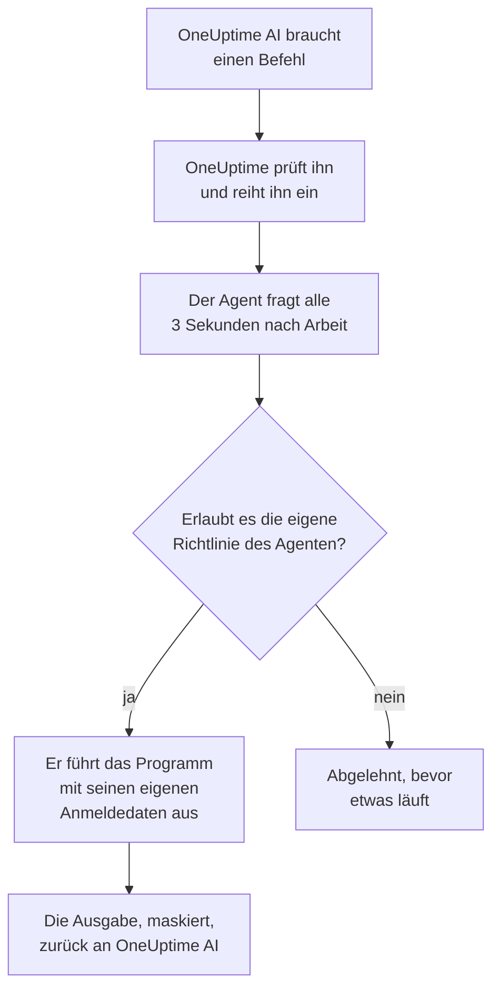

# KI-Agenten für die Infrastruktur

OneUptime AI kann beim Untersuchen eines Vorfalls oder einer Warnung mehr betrachten als Ihre Telemetrie. Ein kleiner Agent, der neben einer Ihrer Ressourcen installiert ist – einem Docker- oder Podman-Host, einem Docker-Swarm-Cluster, einem Proxmox-Cluster, einem VMware vCenter, einem Ceph-Cluster, einem Datenbankserver oder einem Linux-Host –, führt die nur lesenden Befehle aus, die OneUptime AI anfordert, etwa `docker logs --tail 200 web`, `pvesh get /cluster/status`, `ceph health detail`, `db long-queries --min-seconds 30` oder `journalctl -u nginx -n 200 --no-pager`, und schickt die Ausgabe zurück, sodass die Ursachenanalyse zitiert, was die Ressource selbst sagt. Wenn Sie es erlauben, wendet derselbe Agent auch Korrekturen an – einen Container neu starten, eine VM starten, eine OSD wieder als in markieren –, jede von einer Befehlsrichtlinie in eine Stufe eingeordnet und, sofern Sie nichts anderes wählen, zuerst von einem Menschen genehmigt. KI fragen, auf der Seite der Ressource geöffnet, führt dieselben nur lesenden Befehle aus, wenn Sie darum bitten (siehe [KI fragen](/docs/ai/ask-ai)).

Ein AWS-Konto, ein Azure-Abonnement oder ein Google-Cloud-Projekt braucht für eine Untersuchung keinen Agenten: OneUptime liest es live über die nur lesende Verbindung, mit der es verbunden wurde. Nur seine Korrekturen brauchen einen, den Cloud-KI-Agenten, der im Konto selbst läuft und mit einem einzigen Befehl von der Seite des Kontos aus eingerichtet wird (siehe [In einem Cloud-Konto](#in-einem-cloud-konto)).

Diese Agenten sind die **Ressourcen-KI-Agenten**. Die Dashboard-Seite jeder Ressource hat einen Abschnitt **KI** mit drei Seiten:

- **Einblicke** – was OneUptime AI in den letzten 30 Tagen über die Ressource herausgefunden hat: die Probleme, die immer wiederkehren, und warum, mit dem, was die KI gefunden hat, und dem Schritt, den sie vorschlägt, die Teile der Ressource hinter den meisten davon, Korrekturen, die nicht geholfen haben oder auf Genehmigung warten, was die KI selbst behoben hat, und die Risiken, die entdeckt wurden, bevor jemand alarmiert wurde – mit dem, was die KI dort selbst getan hat, als Fußnote. Die Seite funktioniert wie die eines Clusters – siehe [Was die KI auf einem Cluster gelernt hat](/docs/ai/ai-sre#was-die-ki-auf-einem-cluster-gelernt-hat).
- **Protokolle** – alles, was OneUptime AI auf der Ressource getan hat, das Neueste zuerst: jede Untersuchung mit ihrem Vorfall oder ihrer Warnung und ihrer Zusammenfassung, jede Korrektur, die OneUptime AI vorgeschlagen oder ausgeführt hat, und jeder Befehl, den es über den Agenten geschickt hat. (Diese Seite hieß früher Einblicke.)
- **KI-Agent** – ob der Agent verbunden ist, was die KI auf der Ressource tun darf (untersuchen, und wie Korrekturen laufen), alles, was Aufmerksamkeit braucht, mit dem Schritt, der es behebt, und im Menü **⋯** neben dem Status des Agenten **Verbindung testen** und **Agent zurücksetzen**.

Die **Übersicht** der Ressource endet mit einer Karte **KI-Agent**, die die Seite des KI-Agenten zusammenfasst: ob der Agent verbunden ist, ob die Untersuchung eingeschaltet ist, wie Korrekturen laufen (**Aus**, **Genehmigung anfordern**, **Automatisch** oder **Genehmigung umgehen**) und was Aufmerksamkeit braucht, mit einem Link zur Seite des KI-Agenten, wo all das geändert wird.

:::cards
- [Unterstützte Ressourcen](#unterstützte-ressourcen): Elf Arten von Ressourcen, ein Image.
- [Einen KI-Agenten installieren](#einen-ki-agenten-installieren): Neben einem Collector, den Sie bereits betreiben, auf einem Linux-Host oder mit einem einzigen Befehl in einem Cloud-Konto.
- [So funktionieren Korrekturen](#so-funktionieren-korrekturen): Was von selbst laufen darf, was auf einen Menschen wartet und was nie läuft.
- [Sicherheitsmodell](#sicherheitsmodell): Drei Prüfungen für jeden Befehl und keine Anmeldedaten von OneUptime.
:::

## So funktioniert es

Der Agent wartet nie auf eine Verbindung von OneUptime: Er ruft OneUptime selbst auf, fragt nach Arbeit und führt nur aus, was seine eigene Kopie der Befehlsrichtlinie erlaubt, mit den Anmeldedaten, die er bereits hat.



## Verhältnis zum Kubernetes-KI-Agenten

Kubernetes-Cluster haben einen eigenen Agenten, den Kubernetes-KI-Agenten, der mit dem Helm-Chart des Kubernetes-Agenten installiert wird – siehe [Clusterzugriff – OneUptime AI kubectl ausführen lassen](/docs/ai/ai-sre#clusterzugriff-oneuptime-ai-kubectl-ausführen-lassen). Nichts auf dieser Seite ändert ihn. Die Ressourcen-KI-Agenten folgen demselben Aufbau:

- **Dieselben Stufen und Modi.** Jeder Befehl ist **Read**, **SafeWrite**, **RiskyWrite** oder **Denied**, und Korrekturen sind **Aus**, **Genehmigung anfordern**, **Automatisch** oder **Genehmigung umgehen**, mit derselben Bedeutung wie auf einem Cluster.
- **Dieselben drei Prüfungen.** Dieselbe Befehlsrichtlinie wird von den KI-Tools von OneUptime durchgesetzt, erneut, wenn OneUptime den Befehl einreiht, und noch einmal vom Agenten, bevor er irgendetwas ausführt.
- **Dieselbe Regel für Anmeldedaten.** Der Agent verwendet nur, was ihm seine eigene Umgebung und seine Mounts geben. OneUptime schickt ihm nie Anmeldedaten.
- **Dieselben Standardwerte.** KI-Untersuchungen sind standardmäßig eingeschaltet: Eine Ressource beginnt wie ein Cluster mit eingeschalteter Untersuchung und ausgeschalteten Korrekturen, sodass OneUptime AI mit ihrem Agenten untersucht, sobald er sich verbindet, und nichts ändert, bis jemand Korrekturen erlaubt (siehe [Mit OneUptime verbinden](#mit-oneuptime-verbinden)).

Was sich unterscheidet:

- **Ein Image für jede Ressource.** `oneuptime/resource-ai-agent` bedient alle elf Arten von Ressourcen, und `ONEUPTIME_AI_AGENT_RESOURCE_TYPE` sagt, welche ein Agent bedient. Er läuft als ein weiterer Container neben dem Collector der Ressource oder in dem Cloud-Konto, das er bedient, nicht aus einem Helm-Chart.
- **Schreibzugriff ist eine Umgebungsvariable.** Erst `ONEUPTIME_AI_ALLOW_WRITES=true` am Agenten lässt ihn überhaupt Korrekturen anwenden, und `ONEUPTIME_AI_WRITE_TARGETS` begrenzt, welche Container, Dienste, VMs, OSDs, Sitzungen oder Units sie berühren dürfen. Auf einem Cluster tun das das RBAC des Charts und `aiAgent.remediation.namespaces`.

Wie der Kubernetes-KI-Agent ist ein Ressourcen-KI-Agent kein Runner. Er erscheint nie unter Runbooks → Runbook-Agents und wird nie als Bash- oder SSH-Host für Runbooks verwendet.

## Unterstützte Ressourcen

| Ressource | `ONEUPTIME_AI_AGENT_RESOURCE_TYPE` | Agent | Registriert sich als (die Variable des Collectors) | Führt aus | Erreicht die Ressource über |
| -------------------- | ---------------------------------- | --------------------- | ----------------------------------------------------------------------------------------------- | -------------------------------------------------------------------------------------------------------------------------------------------------- | -------------------------------------------------------------------------- |
| Docker-Host | `docker` | Docker-KI-Agent | `DOCKER_HOST_NAME` | `docker` | den Docker-Socket, `/var/run/docker.sock` |
| Podman-Host | `podman` | Podman-KI-Agent | `PODMAN_HOST_NAME` | `docker`, über die Docker-kompatible API von Podman | den Podman-Socket, `/run/podman/podman.sock` |
| Docker-Swarm-Cluster | `docker-swarm` (oder `swarm`) | Docker-Swarm-KI-Agent | `DOCKER_SWARM_CLUSTER_NAME` | `docker` | den Docker-Socket eines Manager-Knotens |
| Proxmox-Cluster | `proxmox` | Proxmox-KI-Agent | `PROXMOX_CLUSTER_NAME` | `pvesh`-Befehle, an die Proxmox-VE-API gesendet (im Agenten gibt es kein `pvesh`-Binary) | `https://PVE_HOST:8006/api2/json`, mit einem Proxmox-API-Token |
| VMware vCenter | `vmware` (oder `vcenter`) | VMware-KI-Agent | `VMWARE_VCENTER_NAME` | `govc` | die API von vCenter, mit einem vSphere-Benutzer |
| Ceph-Cluster | `ceph` | Ceph-KI-Agent | `CEPH_CLUSTER_NAME` | `ceph` | die Monitore, mit einer `ceph.conf` und dem Keyring des eigenen Clients des Agenten |
| Datenbankserver | `database` (oder `db`) | Datenbank-KI-Agent | `DATABASE_SERVER_ID` oder `DATABASE_SYSTEM` + `DATABASE_SERVER_ADDRESS` + `DATABASE_SERVER_PORT` | `db` – eine Operation aus einem festen Diagnosekatalog, nie SQL | den eigenen Treiber der Datenbank, mit einem Datenbank-Login |
| Host | `host` | Host-KI-Agent | `HOST_NAME` (leer: der eigene Hostname des Hosts) | `systemctl`, `journalctl`, `df`, `free`, `uptime`, `ps`, `ss`, `ip`, `dmesg`, `lsblk`, `cat`, `top`, `uname`, `hostnamectl`, `timedatectl`, `kill` | `nsenter` in die Namespaces des Hosts, aus einem privilegierten Container |
| AWS-Konto | `aws` | Cloud-KI-Agent | `AWS_ACCOUNT_ID` (leer: das Konto, in dem er läuft) | `cloud` – eine Operation aus einem festen Katalog, nie ein `aws`-Befehl | die AWS-APIs, mit eigenen IAM-Rollen |
| Azure-Abonnement | `azure` | Cloud-KI-Agent | `AZURE_SUBSCRIPTION_ID` (sein Einrichtungsbefehl setzt sie) | `cloud` – eine Operation aus einem festen Katalog, nie ein `az`-Befehl | Azure Resource Manager, als verwaltete Identität seiner Container App |
| Google-Cloud-Projekt | `gcp` (oder `google-cloud`) | Cloud-KI-Agent | `GOOGLE_CLOUD_PROJECT` (leer: das Projekt, in dem er läuft) | `cloud` – eine Operation aus einem festen Katalog, nie ein `gcloud`-Befehl | die Google-Cloud-APIs, als eigenes Dienstkonto |

Datenbankserver: Der Datenbank-KI-Agent hat Diagnosen für PostgreSQL, MySQL (sowie MariaDB und Percona Server), Redis (sowie Valkey, KeyDB und Dragonfly) und MongoDB. Für jede andere Engine führt er nichts aus und sagt das auf der Seite des KI-Agenten der Datenbank.

**Verbindung testen** im Menü **⋯** neben dem Status des Agenten auf der Seite des KI-Agenten führt diese nur lesenden Befehle über den Agenten aus und zeigt ihre Ausgabe in der Karte des Agenten:

| Ressource | Verbindung testen führt aus |
| -------------------- | ---------------------------------------------------- |
| Docker-Host | `docker version`, `docker info` |
| Podman-Host | `docker version`, `docker info` |
| Docker-Swarm-Cluster | `docker version`, `docker node ls` |
| Proxmox-Cluster | `pvesh get /version`, `pvesh get /cluster/status` |
| VMware vCenter | `govc about` |
| Ceph-Cluster | `ceph health`, `ceph versions` |
| Datenbankserver | `db ping`, `db version` |
| Host | `uptime`, `systemctl list-units --failed --no-pager` |
| AWS-Konto | `cloud whoami` |
| Azure-Abonnement | `cloud whoami` |
| Google-Cloud-Projekt | `cloud whoami` |

Auf einem Docker-Swarm-Worker schlägt `docker node ls` fehl: Der Docker-Swarm-KI-Agent muss auf einem Manager-Knoten laufen. Einer, der auf einem Worker gestartet wurde, registriert sich erst dann für den Cluster, wenn sein Knoten ein Manager ist, und der Docker-Swarm-Installer lässt ihn auf einem Knoten weg, der kein Manager ist.

Bei einem Cloud-Konto zeigt `cloud whoami` das Konto, in dem der Cloud-KI-Agent handelt, und als wen er angemeldet ist, ob er etwas ändern darf, welche Änderungen er vornehmen darf und welches Tag er voraussetzt, falls eines.

## Einen KI-Agenten installieren

Jeder Ressourcen-KI-Agent ist dasselbe Image, `oneuptime/resource-ai-agent:release`. Neben einem Collector oder auf einem Host braucht er nichts im Dashboard: Sobald er läuft, registriert er sich bei OneUptime und erscheint innerhalb einer Minute auf der Seite des KI-Agenten der Ressource. Der Agent eines Cloud-Kontos läuft im Konto selbst, gestartet mit einem einzigen Befehl, den die Seite des Kontos für ihn schreibt (siehe [In einem Cloud-Konto](#in-einem-cloud-konto)).

### Neben einem Collector

Bei Docker, Podman, Docker Swarm, Proxmox, VMware, Ceph und Datenbankservern läuft der Agent neben dem Collector, den Sie für diese Ressource bereits verwenden, und teilt dessen `.env`: Er hat bereits `ONEUPTIME_URL`, den Ingestion-Schlüssel und den Namen der Ressource. Die `docker-compose.yml` jedes Collectors liefert den Agenten als einen weiteren Dienst mit, und dessen `install.sh` startet ihn.

| Ressource | Collector | KI-Agent-Dienst (und Container) | Wo er eingerichtet wird |
| -------------------- | ----------------------------------------------------------- | --------------------------------- | ------------------------------------------------------------------------------------- |
| Docker-Host | [Docker-Agent](/docs/telemetry/docker-host#ki-agent) | `oneuptime-docker-ai-agent` | `agents/DockerAgent/docker-compose.yml`; `install.sh` startet ihn als zweiten Container |
| Podman-Host | [Podman-Agent](/docs/telemetry/podman-host#ki-agent) | `oneuptime-podman-ai-agent` | `agents/PodmanAgent/docker-compose.yml`; `install.sh` startet ihn als zweiten Container |
| Docker-Swarm-Cluster | [Docker-Swarm-Agent](/docs/telemetry/docker-swarm#ki-agent) | `oneuptime-docker-swarm-ai-agent` | `agents/DockerSwarmAgent/docker-compose.yml`, auf einem Manager-Knoten |
| Proxmox-Cluster | [Proxmox-Agent](/docs/telemetry/proxmox#ki-agent) | `oneuptime-proxmox-ai-agent` | `agents/ProxmoxAgent/docker-compose.yml` |
| VMware vCenter | [VMware-Agent](/docs/telemetry/vmware#ki-agent) | `oneuptime-vmware-ai-agent` | `agents/VMwareAgent/docker-compose.yml` |
| Ceph-Cluster | [Ceph-Agent](/docs/telemetry/ceph#ki-agent) | `oneuptime-ceph-ai-agent` | `agents/CephAgent/docker-compose.yml`, mit dem eigenen Ceph-Client des Agenten in `./ceph` |
| Datenbankserver | [Datenbank-Agent](/docs/telemetry/databases#ki-agent) | `oneuptime-database-ai-agent` | `agents/DatabaseAgent/docker-compose.yml` |

Ein Collector, der installiert wurde, bevor es den KI-Agenten gab, führt ihn noch nicht aus. Führen Sie sein `install.sh` erneut aus: Es startet jetzt auch den KI-Agenten (die Installer für Proxmox, VMware, Ceph, Datenbanken und Docker Swarm laden die aktuelle `docker-compose.yml` herunter, die den KI-Agent-Dienst enthält). Wenn Sie die Dateien selbst verwalten, übernehmen Sie den Dienst aus der `docker-compose.yml` des Collectors in Ihre und führen Sie `docker compose up -d` aus. Die Seite des KI-Agenten der Ressource zeigt den genauen Dienst für diese Ressource, mit bereits eingetragenem Namen.

Ohne die Installer ist der Docker-KI-Agent ein einziges `docker run`:

```bash
docker run -d \
  --name oneuptime-docker-ai-agent \
  --user 0:0 \
  --restart unless-stopped \
  --read-only --tmpfs /tmp \
  -v /var/run/docker.sock:/var/run/docker.sock:ro \
  -e ONEUPTIME_URL="https://oneuptime.com" \
  -e ONEUPTIME_SERVICE_TOKEN="YOUR_TELEMETRY_INGESTION_TOKEN" \
  -e ONEUPTIME_AI_AGENT_RESOURCE_TYPE=docker \
  -e DOCKER_HOST_NAME="my-docker-host" \
  oneuptime/resource-ai-agent:release
```

`DOCKER_HOST_NAME` muss der Name sein, den der Docker-Agent meldet. Die Installer für Docker und Podman nehmen `--no-ai-agent` (oder `ONEUPTIME_INSTALL_AI_AGENT=false`) an, um den KI-Agenten wegzulassen, ebenso der Docker-Swarm-Installer. Um einen Collector später ohne ihn zu betreiben, löschen Sie seinen KI-Agent-Dienst aus `docker-compose.yml` oder entfernen Sie seinen Container mit `docker rm -f`.

### Host-KI-Agent

Ein Linux-Host, der über den [Host-OpenTelemetry-Collector](/docs/telemetry/host-otel-collector) berichtet, hat keinen OneUptime-Container, neben dem der Agent laufen könnte, daher kommt der Host-KI-Agent mit einem eigenen Installer (`agents/HostAIAgent`):

```bash
curl -fsSL https://raw.githubusercontent.com/OneUptime/oneuptime/master/agents/HostAIAgent/install.sh -o install.sh
sudo bash install.sh
```

Er fragt nach Ihrer OneUptime-URL, dem Telemetrie-Ingestion-Schlüssel des Projekts und dem Namen des Hosts, schreibt `/opt/oneuptime-host-ai-agent/.env` und `docker-compose.yml` und startet den Container `oneuptime-host-ai-agent`. Fügen Sie `--systemd` hinzu, um ihn stattdessen unter der systemd-Unit `oneuptime-host-ai-agent` auszuführen. Er braucht Docker (die System-Engine, nicht rootless Docker) mit dem Compose-Plugin; rootful Podman kann denselben Container ausführen.

Der Host-KI-Agent führt die **eigenen Programme des Hosts** aus: Jeder Befehl läuft als `nsenter --target 1 --mount --uts --ipc --net --pid -- PROGRAM ARGS`, das in die Namespaces des Init-Prozesses des Hosts wechselt. Das braucht `pid: host`, `privileged: true` und root – siehe [Der Docker-Socket und der Host-KI-Agent sind root auf dem Host](#der-docker-socket-und-der-host-ki-agent-sind-root-auf-dem-host). Lassen Sie `HOST_NAME` leer, um den Hostnamen des Hosts zu verwenden, den der Collector als `host.name` meldet, sofern Sie ihn nicht geändert haben; andernfalls setzen Sie ihn auf den Namen, der unter **Hosts** angezeigt wird.

### In einem Cloud-Konto

Ein AWS-Konto, ein Azure-Abonnement oder ein Google-Cloud-Projekt hat keinen Collector, neben dem ein Agent laufen könnte, und OneUptime liest es ohne einen (siehe [Cloud-Konten](#cloud-konten)). Sein Cloud-KI-Agent, der die Korrekturen vornimmt, läuft im Konto selbst und wird von der Seite des Kontos aus mit einem einzigen Befehl eingerichtet, ohne Compose-Datei und ohne `.env`:

1. Öffnen Sie unter Cloud → Konten das Konto und wählen Sie **KI Probleme beheben lassen** in der Karte **KI-Agent** seiner **Übersicht**.
2. Beantworten Sie die einzige Frage, **Wie weit darf die KI gehen?**: **Mich zuerst fragen**, die Voreinstellung, setzt **Korrekturen** auf **Genehmigung anfordern**, und **Sichere Korrekturen selbstständig anwenden** auf **Automatisch**. **Erweitert** enthält den Rest: welche Änderungen die KI vornehmen darf, die Ressourcen, die sie nie ändern darf, nur Ressourcen mit dem Tag `oneuptime-ai=allow` zu ändern, **Genehmigung umgehen**, das Lesen der Logs des Kontos und die Variablen des Agenten, um ihn anderswo auszuführen.
3. Führen Sie den angezeigten Befehl in der integrierten Shell der Cloud aus, angemeldet bei diesem Konto. Er schreibt die Rolle des Agenten aus den eingeschalteten Änderungen und startet den Agenten, der sich innerhalb weniger Minuten von selbst verbindet: Es gibt nichts zurückzukopieren. Verbindet er sich nicht, sagt sein Log, warum (siehe [Logs und Status](#logs-und-status)).

| Cloud | Ausführen in | Was der Befehl erstellt |
| -------------------- | ------------------ | ------------------------------------------------------------------------------------------------------------------------------------------------------------------------------------------------------------------ |
| AWS-Konto | AWS CloudShell | Ein CloudFormation-Stack, `oneuptime-ai-agent`, der einen ECS-Fargate-Task ausführt. Seine Task-Rolle darf nur die Schreibrolle `OneUptimeAiAgentWrite` übernehmen, die die Berechtigungen der eingeschalteten Änderungen enthält. |
| Azure-Abonnement | Azure Cloud Shell | Eine Container App, `oneuptime-ai-agent`, in der Ressourcengruppe `oneuptime-ai-agent`. Ihre verwaltete Identität hat eine benutzerdefinierte Rolle für das Abonnement mit den Berechtigungen der eingeschalteten Änderungen. |
| Google-Cloud-Projekt | Google Cloud Shell | Ein Cloud-Run-Dienst, `oneuptime-ai-agent`, mit dauerhaft zugewiesener CPU, der als Dienstkonto `oneuptime-ai-agent` läuft, das eine benutzerdefinierte Rolle für das Projekt mit den Berechtigungen der eingeschalteten Änderungen hat. |

Der Befehl funktioniert nur in dem Konto, für das er geschrieben wurde: Bei AWS erstellt er nichts in einer Shell, die bei einem anderen Konto angemeldet ist, und die Befehle für Azure und Google Cloud nennen ihr Abonnement oder Projekt bei jedem Aufruf. Er setzt `ONEUPTIME_AI_INVESTIGATION=true`, `ONEUPTIME_AI_FIXES` nach Ihrer Antwort, `ONEUPTIME_AI_ALLOW_WRITES=true` und `ONEUPTIME_AI_CLOUD_ACCOUNT_ID` auf das Konto, für das er geschrieben wurde. Der Agent registriert sich als das Konto, in dem er laut seiner Cloud läuft, und fügt OneUptime nie eines hinzu: In einem anderen Konto gestartet als dem seines Befehls, wird er abgelehnt, und das Konto, für das er geschrieben wurde, sagt auf seiner Seite, warum; in einem Konto gestartet, das keine Verbindung des Projekts liest, wird er ebenfalls abgelehnt, und sein Log sagt es.

Um etwas zu ändern, führen Sie den Befehl erneut aus: Öffnen Sie **KI Probleme beheben lassen** noch einmal, oder wählen Sie **Ändern** auf der Seite **KI-Agent** des Kontos, und führen Sie den Befehl aus, den sie schreibt. Die Rolle enthält immer nur die eingeschalteten Änderungen. Der Bereich **KI** eines Cloud-Kontos hat zwei Seiten, **KI-Agent** und **Protokolle**, und was der Agent kostet, steht unter [Ein Cloud-Konto verbinden](/docs/telemetry/cloud-accounts#ki-probleme-beheben-lassen).

### Mit OneUptime verbinden

Der Agent registriert sich mit **derselben Identität, die der Collector meldet** – `DOCKER_HOST_NAME`, `PROXMOX_CLUSTER_NAME`, `CEPH_CLUSTER_NAME`, … (`ONEUPTIME_AI_AGENT_RESOURCE_NAME` überschreibt sie) –, sodass er genau die Ressource bedient, die die Telemetrie des Collectors angelegt hat. Hat OneUptime noch keine Ressource dieses Namens, legt die Registrierung sie an, daher ergibt ein Name, der von dem des Collectors abweicht, eine zweite, leere Ressource statt eines Fehlers. Eine Datenbank registriert sich über `DATABASE_SERVER_ID`, wenn es gesetzt ist, sonst über ihre Engine, Adresse und ihren Port; eine `DATABASE_SERVER_ID`, die keine Datenbank dieses Projekts ist, wird abgelehnt.

Verwendet der Collector noch seinen Standardnamen (`docker-host`, `podman-host`, `docker-swarm`, `proxmox-cluster`, `vmware-vcenter`, `ceph`), meldet jede mit diesem Standard installierte Ressource in dieselbe Ressource in OneUptime, und Befehle dafür könnten jede von ihnen erreichen. Der Agent warnt in seinem Log davor; geben Sie jeder Ressource einen eindeutigen Namen, am Collector wie am Agenten.

Er authentifiziert sich mit dem Telemetrie-Ingestion-Schlüssel des Projekts – dem ersten gesetzten von `ONEUPTIME_API_KEY`, `ONEUPTIME_TELEMETRY_INGESTION_KEY` und `ONEUPTIME_SERVICE_TOKEN`, die die Collectors bereits setzen – und erhält einen eigenen Schlüssel. Alle seine Aufrufe sind HTTPS-`POST`s an `<ONEUPTIME_URL>/resource-ai-agent-ingest/…`: Er registriert sich einmal beim Start, sendet alle 30 Sekunden einen Heartbeat (er gilt bis 5 Minuten nach dem letzten als online), fragt alle 3 Sekunden nach Arbeit und meldet sich ab, wenn er stoppt. Ein zweiter Agent mit derselben Identität wird abgelehnt, solange der erste online ist: Ein Container, der sauber stoppt, meldet sich ab, sodass sein Ersatz sofort zugelassen wird, und nach einem Absturz oder einem Kill übernimmt der Ersatz, sobald der alte nach der ersten Ablehnung 40 Sekunden lang nichts gesendet hat. Wird er nach 10 Minuten immer noch abgelehnt, verwendet ein anderer laufender Agent dieselbe Identität: Der Agent protokolliert einen Fehler, der das sagt, und fragt nur noch alle 5 Minuten an, bis Sie jeder Ressource einen eigenen Namen geben oder den anderen Agenten stoppen. Ein Projekt fasst höchstens 250 Ressourcen-KI-Agenten, und höchstens 30 neue registrieren sich pro Stunde. Sind die 250 erreicht, werden Agenten, von denen seit 7 Tagen nichts kam, entfernt, um Platz für einen neuen zu schaffen (die Ressource behält ihre KI-Einstellungen, und ein solcher Agent, der zurückkommt, registriert sich einfach erneut).

**Untersuchung** ist für jede Ressource von Anfang an eingeschaltet, sodass OneUptime AI mit dem Agenten untersucht, sobald er sich verbindet. Darüber hinaus ist, was die KI auf der Ressource tun darf, eine Einstellung des Agenten selbst (siehe [Was die KI tun darf, vom Agenten festgelegt](#was-die-ki-tun-darf-vom-agenten-festgelegt)). Ein Agent, der keine der beiden Einstellungen nennt, verwendet seine Standardwerte: Er schaltet die **Untersuchung** für seine Ressource ein und setzt, wenn er Schreibvorgänge erlaubt (`ONEUPTIME_AI_ALLOW_WRITES=true`), **Korrekturen** auf **Genehmigung anfordern**, sonst auf **Aus**. Seine Standardwerte gelten nur für eine Ressource, deren KI-Einstellungen niemand auf der Seite des KI-Agenten gewählt hat: Dort gespeicherte Einstellungen bleiben, wie sie sind, bis die Konfiguration des Agenten sie nennt, sodass eine Ressource, deren Schalter **Untersuchen** jemand ausgeschaltet hat, aus bleibt. Ein Agent, der älter ist als diese Einstellungen, meldet keine von beiden, und die Seite des KI-Agenten legt sie fest, wie bisher.

**Agent zurücksetzen** im selben Menü **⋯** auf der Seite des KI-Agenten lässt OneUptime den Schlüssel des Agenten vergessen, sobald Sie es bestätigen; wer ihn auch immer hatte, ist ausgesperrt, und der echte Agent registriert sich innerhalb weniger Minuten erneut. Der Agent braucht einen OneUptime-Server derselben Version wie sein Image oder neuer.

### Was die KI tun darf, vom Agenten festgelegt

Untersuchung und Korrekturen werden dort festgelegt, wo der Agent läuft – in der `.env`, die er mit dem Collector teilt, oder in der Umgebung seines Containers –, und OneUptime folgt ihnen:

| Variable | Standard | Was sie bewirkt |
| ---------------------------- | ------- | ----------------------------------------------------------------------------------------------------------------------------------------------------------------------------------------------------------------------------------------------------- |
| `ONEUPTIME_AI_INVESTIGATION` | leer | `true` lässt die KI beim Untersuchen die unten aufgeführten nur lesenden Befehle ausführen; `false` beschränkt sie auf die Daten, die OneUptime bereits hat. Leer: ein. |
| `ONEUPTIME_AI_FIXES` | leer | Wie die KI eine Korrektur anwenden darf: `off`, `ask-for-approval`, `automatic` oder `bypass-approval` (siehe [Korrekturmodi](#korrekturmodi)). Jeder Modus außer `off` braucht zusätzlich `ONEUPTIME_AI_ALLOW_WRITES=true`, und `off` hält den Agenten auch damit nur lesend. Leer: `ask-for-approval`, wenn der Agent Schreibvorgänge erlaubt, sonst `off`. |

Zum Beispiel, um die KI Korrekturen anwenden zu lassen, von denen ein Mensch jede einzelne genehmigt:

```bash
ONEUPTIME_AI_INVESTIGATION=true
ONEUPTIME_AI_FIXES=ask-for-approval
ONEUPTIME_AI_ALLOW_WRITES=true
```

Starten Sie den Agenten dann neu (`docker compose up -d`, oder führen Sie bei einem Docker- oder Podman-Host das `install.sh` des Collectors mit gesetzten Werten erneut aus). Der Agent meldet beide bei der Registrierung und mit jedem Heartbeat, und OneUptime wendet sie sofort auf die Ressource an. Die Seite des KI-Agenten der Ressource zeigt sie dann nur lesend: **Ändern** zeigt diese Zeilen für die gewählte Option, statt etwas zu speichern, und OneUptime lehnt eine Änderung an anderer Stelle ab – über die API, Terraform, einen Master-Admin –, solange der Agent sie festlegt. Die Befehls-Zulassungsliste bleibt auf der Seite. Ein Wert, den der Agent nicht lesen kann, lässt diese Einstellung aus, und der Agent protokolliert, welche.

## Was eine Untersuchung ausführen darf

Eine Untersuchung führt immer nur Befehle der Stufe **Read** aus: Sie betrachten die Ressource und ändern nichts. OneUptime AI sieht die mit dem Vorfall oder der Warnung verknüpften Ressourcen (über ihre Monitore und Telemetrie, höchstens 10 pro Signal), deren KI-Agent verbunden ist (ein Cloud-Konto braucht keinen) und deren Schalter **Untersuchen** eingeschaltet ist, und führt so viele Befehle aus, wie die Untersuchung braucht (bis zu 200 pro Untersuchung, ein Schutz gegen eine außer Kontrolle geratene Schleife), jeden zitiert wie jeden anderen Beleg. Jeder Befehl ist ein Programm mit seinen Argumenten – nie über eine Shell, daher werden Pipes, Umleitungen, `;`, `&&`, `$(…)` und `sudo` mit einer Meldung abgelehnt, die das sagt. Ein Befehl bekommt standardmäßig 30 Sekunden und höchstens 2 Minuten, und seine Ausgabe ist auf dem Agenten auf 1024 KB begrenzt. Von dieser Ausgabe wird vor OneUptime AI nichts abgeschnitten: Eine lange Ausgabe wird seitenweise gezeigt – die ersten 40.000 Zeichen, dann der Rest auf Anfrage. Holt ein Agent einen Befehl nicht ab, schickt OneUptime AI dieser Ressource für den Rest der Untersuchung keine Befehle mehr.

Was jede Art von Ressource lesen darf, steht unten. Es ist dieselbe Liste, die die KI selbst bekommt; alles, was nicht darauf steht, wird abgelehnt.

### Docker- und Podman-Hosts

- Container: `docker ps -a` (auch `-q`, `-n`, `-l`, `-s`, `--no-trunc`, `--filter`, `--format json`), `docker container inspect web`, `docker inspect --type container web`, `docker top web`, `docker port web`, `docker diff web`. Umgebungswerte in der Inspect-Ausgabe kommen maskiert zurück.
- Logs und Aktivität: `docker logs --tail 200 web` oder `docker logs --since 30m web` – ein `--tail` von höchstens 2000 oder ein `--since` ist Pflicht (ohne `--tail` muss `--since` eine Dauer von höchstens 24h sein), und `-f` ist nie erlaubt; `docker stats --no-stream`; `docker events --since 30m --until 0s` (beide Grenzen Pflicht, `--until` als Dauer, sodass sich das Fenster immer in der Vergangenheit schließt).
- Die Engine: `docker info`, `docker version`, `docker system df` (`-v` nur als Tabelle: `-v --format json` gibt die Befehlszeile jedes Build-Schritts aus), `docker images`, `docker image inspect nginx:1.27`, `docker network ls`, `docker network inspect bridge`, `docker volume ls`, `docker volume inspect data`.
- Nur `--format json` (oder `table` für Listen), nie ein Go-Template, und keines der globalen Flags von docker (`-H`, `--context`, `--config`, …): Sie würden die CLI auf eine andere Engine richten.

Ein Podman-Host führt dieselbe `docker`-CLI und dieselbe Richtlinie aus, über die Docker-kompatible API von Podman.

### Docker-Swarm-Cluster

- Knoten: `docker node ls`, `docker node ps node-1`, `docker node inspect node-1 --pretty`.
- Dienste: `docker service ls`, `docker service ps web --no-trunc`, `docker service inspect web --pretty` (Umgebungswerte kommen maskiert zurück), `docker service logs --tail 200 web` (ein `--tail` von höchstens 2000 oder ein `--since` ist Pflicht – allein eine Dauer von höchstens 24h –, nie `-f`).
- Stacks: `docker stack ls`, `docker stack ps shop`, `docker stack services shop`.
- Die eigene Engine des Managers: `docker ps -a`, `docker container inspect web`, `docker logs --tail 200 web`, `docker stats --no-stream`, `docker info`, `docker version`, `docker network ls` und die übrigen Lesebefehle eines Docker-Hosts.

### Proxmox-Cluster

Im Agenten gibt es kein `pvesh`. Ein Befehl wird in der Grammatik von `pvesh` geschrieben – `get` (oder `ls`) und ein API-Pfad, Optionen als `--name value` –, und der Agent macht daraus genau ein `GET` an die Proxmox-VE-API mit seinem eigenen Token. `--output-format json|json-pretty|text` wählt die Ausgabe; Query-Strings werden nicht akzeptiert, und ein Schreibvorgang muss seinen Knoten nennen (nie `localhost`).

- Der Cluster: `pvesh get /version`, `pvesh get /cluster/status`, `pvesh get /cluster/resources --type vm`, `pvesh get /cluster/ha/status/current`, `pvesh get /cluster/log --max 50`, `pvesh get /cluster/tasks`, `pvesh get /nodes` sowie die Listen für Replikation, Backups, Pools und Storage.
- Ein Knoten: `pvesh get /nodes/pve1/status`, `pvesh get /nodes/pve1/services`, `pvesh get /nodes/pve1/storage`, `pvesh get /nodes/pve1/disks/list`, `pvesh get /nodes/pve1/rrddata --timeframe hour`, dazu sein Netzwerk, seine Replikation, APT-Updates und sein Ceph-Status.
- Tasks und Logs: `pvesh get /nodes/pve1/tasks --errors 1 --limit 20`, Status und Log eines Tasks, `pvesh get /nodes/pve1/syslog --limit 200`, `pvesh get /nodes/pve1/journal --lastentries 200`.
- Gäste (`qemu` für VMs, `lxc` für Container): `pvesh get /nodes/pve1/qemu`, `pvesh get /nodes/pve1/lxc`, `pvesh get /nodes/pve1/qemu/101/status/current`, `pvesh get /nodes/pve1/qemu/101/config` (Geheimnisse wie cloud-init-Passwörter kommen maskiert zurück), ausstehende Änderungen, Snapshots, `pvesh get /nodes/pve1/qemu/101/rrddata --timeframe hour` sowie Informationen des QEMU-Gast-Agenten wie `pvesh get /nodes/pve1/qemu/101/agent/get-fsinfo`.
- Nie: alles unter `/access` (Benutzer, API-Tokens, ACLs), Konsolen (`vncproxy`, `termproxy`, `spiceproxy`), der QEMU-Monitor, exec- und Dateiaufrufe des Gast-Agenten.

### VMware vCenter

Zuerst kommt der Befehl, dann seine Flags, dann Namen oder Inventarpfade (govc ignoriert Flags, die nach einem Argument stehen); `-dc DATACENTER` wählt ein Rechenzentrum.

- `govc about`, `govc datacenter.info`, `govc ls /DC/vm`, `govc find . -type m -runtime.powerState poweredOff` – Version und Inventar des vCenter (`find` filtert nur nach Namen, Typen, Zustand und Laufzeiteigenschaften; `ls -json` wird abgelehnt, weil es jede Eigenschaft jedes aufgelisteten Objekts lädt).
- `govc vm.info web-01`, `govc host.info esx-01`, `govc datastore.info datastore1`, `govc pool.info /DC/host/cluster1/Resources` – Betriebszustand, Host, Gastbetriebssystem, IP-Adresse, VMware Tools, Kapazität. `vm.info` ist nur Text: `-json` und `-e` werden abgelehnt, weil sie die `extraConfig` der VM ausgeben, in der cloud-init-Daten und Passwörter liegen.
- `govc events -n 50 /DC/vm/web-01`, `govc tasks -n 50` – jüngste Ereignisse und Tasks (höchstens 500, nie `-f`).
- `govc metric.sample -n 12 /DC/vm/web-01 cpu.usage.average`, `govc metric.ls /DC/vm/web-01`, `govc object.collect -s /DC/vm/web-01 runtime.powerState` (nur Laufzeit- und Zustandseigenschaften), `govc host.service.ls -host esx-01`, `govc host.date.info -host esx-01`, `govc tags.ls`.
- Nie: die Flags für Verbindung, Anmeldedaten, TLS und Debugging (`-u`, `-k`, `-cert`, `-debug`, `-dump`, …), Gastoperationen (`guest.*`), Dateizugriff auf Datastores, `esxcli`, `env` und jeder nicht aufgeführte Befehl.

### Ceph-Cluster

- Der Cluster: `ceph status` (oder `ceph -s`), `ceph health detail`, `ceph df detail`, `ceph versions`, `ceph progress`, `ceph quorum_status`, `ceph log last 100`.
- Die OSDs: `ceph osd tree`, `ceph osd df`, `ceph osd perf`, `ceph osd stat`, `ceph osd dump`, `ceph osd blocked-by`, `ceph osd find 3`, `ceph osd metadata 3`, `ceph osd ok-to-stop 3`, `ceph osd safe-to-destroy 3`.
- Pools und Placement Groups: `ceph osd pool ls detail`, `ceph osd pool stats`, `ceph osd pool get rbd size`, `ceph pg stat`, `ceph pg dump_stuck`, `ceph pg 1.2f query`, `ceph pg ls-by-osd 3`.
- Daemons, Abstürze und cephadm: `ceph mon stat`, `ceph mgr services`, `ceph mgr module ls`, `ceph fs status`, `ceph mds stat`, `ceph balancer status`, `ceph crash ls`, `ceph crash stat`, `ceph orch ps`, `ceph orch ls`, `ceph orch host ls`, `ceph orch device ls`.
- Fügen Sie `--format json` (oder `-f json`, `json-pretty`, `plain`) für strukturierte Ausgabe hinzu. Keine andere Option wird akzeptiert – nie `-c`, `--keyring`, `--id`, `--admin-daemon`, `-i`, `-o` oder `-w` –, und `auth`, `config-key`, `config`, `tell` und `daemon` laufen nie.

### Datenbankserver

`db` ist kein Programm: Es benennt eine Operation aus einem festen Diagnosekatalog, die der Agent über den eigenen Treiber der Datenbank in einer nur lesenden Sitzung ausführt, mit einem Zeitlimit für jede Anweisung. OneUptime AI schreibt nie SQL, einen Redis-Befehl oder MongoDB-Shell-Code. Flags gibt es nur in Langform (`--limit 20` oder `--limit=20`).

- `db ping`, `db version` – ob der Server antwortet, seine Version und Laufzeit.
- `db sessions --limit 20` (auch `--state active`, `--user`, `--database`; `db current-ops` ist dasselbe) – die Sitzungen und was jede ausführt.
- `db long-queries --min-seconds 30`, `db blocking`, `db locks` – langsame Anweisungen und wer auf eine Sperre wartet und wer sie hält.
- `db replication`, `db connections`, `db database-sizes`, `db table-sizes --limit 20`, `db top-statements --limit 10` – Replikationsverzögerung, Verbindungen im Verhältnis zum Limit, wohin Speicherplatz und Zeit gehen.
- `db settings work_mem` (oder jede Einstellung) – nie eine Einstellung mit Anmeldedaten wie `requirepass`.
- Berichte der Engine: `db slowlog`, `db info memory`, `db innodb-status`, `db memory`, `db keyspace`.

Abfragetext in der Ausgabe wird normalisiert – jedes String- und Zahlenliteral wird zu `?` –, sodass die Daten Ihrer Kunden in einer Anweisung OneUptime nie erreichen.

### Hosts

- Dienste: `systemctl status nginx --no-pager -n 50`, `systemctl is-active nginx`, `systemctl list-units --failed --no-pager`, `systemctl list-timers --all`, `systemctl show nginx -p ActiveState,SubState,Result,NRestarts` (`-p` ist Pflicht, und nur Eigenschaften des Unit-Zustands sind erlaubt – nie `Environment` und nie eine Unit-Datei).
- Logs: `journalctl -u nginx -n 200 --no-pager` – jedes Lesen braucht `-n` (höchstens 2000) oder `--since`, nie `-f`; außerdem `-p err`, `-k`, `-b`, `--until`, `-g`, `-t`, `-o short-iso|json`; `journalctl --list-boots`, `journalctl --disk-usage`.
- Ressourcen: `uptime`, `free -m`, `df -h`, `df -i`, `lsblk -f`, `uname -a`, `hostnamectl`, `timedatectl`, `dmesg -T --level=err,warn`.
- Prozesse: `ps aux --sort=-%cpu`, `top -b -n 1 -o %MEM`. Passwörter in Befehlszeilen kommen maskiert zurück.
- Netzwerk: `ss -tulpn`, `ss -s`, `ip -br addr`, `ip route`, `ip route get 1.1.1.1`.
- Kernel-Zähler: `cat /proc/loadavg`, `cat /proc/meminfo`, `cat /proc/pressure/memory`, `cat /etc/os-release` – `cat` liest nur eine kurze Liste von `/proc`-Dateien und `/etc/os-release`, sonst nichts.
- Ein Programm pro Befehl, ohne Pfad benannt: nie eine Shell, `sudo` oder ein anderes Programm.

### Cloud-Konten

OneUptime liest ein AWS-Konto, ein Azure-Abonnement oder ein Google-Cloud-Projekt selbst, live, über die nur lesende Verbindung des Kontos (siehe [Ein Cloud-Konto verbinden](/docs/telemetry/cloud-accounts)): Diese Lesevorgänge laufen auf OneUptime und brauchen keinen Agenten, daher liest eine Untersuchung ein verknüpftes Konto, ob darin ein Cloud-KI-Agent läuft oder nicht. Ein Befehl ist `cloud`, eine Operation aus einem festen Katalog und die ID einer Ressource, genau so, wie das Inventar des Kontos sie auflistet: ein ARN wie `arn:aws:ecs:us-east-1:123456789012:service/prod/web`, eine Azure-Ressourcen-ID wie `/subscriptions/00000000-0000-0000-0000-000000000000/resourceGroups/prod/providers/Microsoft.Web/sites/web` oder ein vollständiger Google-Cloud-Ressourcenname wie `//run.googleapis.com/projects/my-project/locations/us-central1/services/web`. Es gibt nie einen `aws`-, `az`- oder `gcloud`-Befehl, und Flags gibt es nur in Langform, jedes nur einmal.

- `cloud describe RESOURCE` – die Live-Einstellungen und der Live-Status der Ressource. Bei AWS wird eine Ressource, die kein ECS-Dienst, keine EC2-Instanz, keine RDS-Instanz, kein Aurora-Cluster, keine Auto-Scaling-Gruppe, keine Lambda-Funktion, kein Lambda-Alias, keine SQS-Warteschlange, keine Zielgruppe und kein Load Balancer ist, aus der Kopie von OneUptime vom letzten Lesen des Kontos gelesen und als NOT LIVE markiert.
- `cloud recent-events RESOURCE [--hours N] [--limit N]` – was die Plattform zuletzt mit der Ressource gemacht hat: Deployments und Dienstereignisse, RDS-Ereignisse, Skalierungsaktivitäten, Ressourcenintegrität und Einträge des Aktivitätsprotokolls (`--hours` standardmäßig 6, bis zu 72).
- `cloud target-health RESOURCE` – nur AWS: welche Backends eine Zielgruppe oder ein Load Balancer als fehlerfrei zählt und warum die anderen es nicht sind.
- `cloud quota-usage RESOURCE [--limit N]` – die Nutzung des Kontos gemessen an seinen Limits für den Dienst der Ressource, in der Region der Ressource.
- `cloud read-logs RESOURCE [--filter TEXT] [--minutes N] [--limit N]` – die Logzeilen der Ressource, die neuesten zuerst, und nur die, die `--filter` enthalten, wenn es angegeben ist (`--minutes` standardmäßig 60, bis zu 1440). Logzeilen können Kundendaten enthalten, daher ist dieses Lesen aus, bis jemand **KI bei Untersuchungen die Protokolle dieses Kontos lesen lassen** einschaltet, unter **Erweitert** in **KI Probleme beheben lassen**; das wird sofort gespeichert, ohne dass ein Befehl ausgeführt werden muss.
- `cloud whoami` – das einzige Lesen, das auf dem Cloud-KI-Agenten läuft: das Konto, in dem er handelt, ob er etwas ändern darf und welche Änderungen. **Verbindung testen** im Menü **⋯** neben dem Status des Agenten führt es aus.

`--limit` beträgt standardmäßig 50 Zeilen, höchstens 200. Die Antwort eines Lesevorgangs wird bei 64 KB abgeschnitten, an einem Zeilenende, und ein Konto nimmt höchstens 30 Live-Lesevorgänge pro Minute an.

## So funktionieren Korrekturen

Korrekturen sind aus, bis Sie sie einschalten, und dafür braucht es zwei Einstellungen am Agenten: `ONEUPTIME_AI_FIXES` auf einen anderen Modus als `off` gesetzt (siehe [Was die KI tun darf, vom Agenten festgelegt](#was-die-ki-tun-darf-vom-agenten-festgelegt)) und `ONEUPTIME_AI_ALLOW_WRITES=true` (siehe [Schreibzugriff am Agenten](#schreibzugriff-am-agenten)). Eine allein ändert nichts. Ein Agent, der älter ist als `ONEUPTIME_AI_FIXES`, übernimmt **Korrekturen** stattdessen von der Seite des KI-Agenten der Ressource. Korrekturen brauchen außerdem KI, die für das Projekt aktiviert ist (**KI aktivieren** unter Projekteinstellungen → KI → KI-Funktionen), was sie ist, sofern niemand sie ausgeschaltet hat.

### Korrekturmodi

Korrekturen haben dieselben vier Modi wie auf einem Kubernetes-Cluster – `ONEUPTIME_AI_FIXES` schreibt sie `off`, `ask-for-approval`, `automatic` und `bypass-approval`:

- **Aus** – die KI untersucht nur.
- **Genehmigung anfordern** – nach der Ursachenanalyse diagnostiziert OneUptime AI mit Lesebefehlen und stellt den kleinsten Plan zusammen, der die Ursache angeht, zum Beispiel `docker restart web`. Der Plan erscheint am Vorfall oder an der Warnung mit seiner Begründung, der erwarteten Wirkung und dem Rollback; ein Mensch genehmigt ihn mit einem Klick, und OneUptime führt genau diese Befehle aus.
- **Automatisch** – sichere Änderungen (**SafeWrite**) laufen von selbst; eine riskantere Änderung (**RiskyWrite**) wird zur Genehmigung vorgeschlagen, es sei denn, die Befehls-Zulassungsliste der Ressource nennt genau ihre Form.
- **Genehmigung umgehen** – jede Änderung, die die Richtlinie erlaubt, riskantere eingeschlossen, läuft von selbst. Was immer einen Menschen braucht, wartet weiterhin auf einen.

Nachdem eine Korrektur gelaufen ist, beobachtet OneUptime die Monitore des Vorfalls oder der Warnung. Erholen sie sich nicht, läuft der Rollback des Plans, und OneUptime AI stellt einen weiteren Plan zusammen, mit dem gescheiterten Versuch vor Augen – höchstens zwei Runden pro Vorfall oder Warnung. Im Modus **Automatisch** fragt diese zweite Runde nach Genehmigung; bei **Genehmigung umgehen** läuft auch sie von selbst. Unbeaufsichtigte Korrekturen sind durch einen Schutzschalter auf drei pro Ressource und Stunde begrenzt: Darüber hinaus, oder solange eine andere unbeaufsichtigte Runde von OneUptime AI dieselbe Ressource noch ändert oder überprüft, schlägt eine Runde ihren Plan zur Genehmigung vor, statt ihn auszuführen.

Ein Vorfall oder eine Warnung bekommt eine einzige KI-Korrekturspur. Ist er oder sie mit einem Kubernetes-Cluster verknüpft, dessen Korrekturen eingeschaltet sind, läuft die Runde des Clusters und keine Ressourcenrunde. Andernfalls bekommt die erste verknüpfte Ressource mit eingeschalteten Korrekturen und einem bereiten Agenten die Runde, in dieser Reihenfolge: Docker-Host, Podman-Host, Docker-Swarm-Cluster, Proxmox-Cluster, VMware vCenter, Ceph-Cluster, Datenbankserver, Host, AWS-Konto, Azure-Abonnement, Google-Cloud-Projekt. Die Runde ändert nur diese Ressource.

### Sicher, riskanter und nie

| Stufe | Was sie bedeutet | Läuft |
| -------------- | ------------------------------------------------------------------------------------------------------------------------------------- | ------------------------------------------------------------------------------------------------------------ |
| **Read** | Betrachtet die Ressource und ändert nichts | In Untersuchungen und Korrekturrunden, immer |
| **SafeWrite** | Eine umkehrbare Änderung an genau einem benannten Objekt: einen Container neu starten, eine VM starten, eine OSD als in markieren, eine Unit neu starten | Von selbst in **Automatisch** und **Genehmigung umgehen**; nach Genehmigung in **Genehmigung anfordern** |
| **RiskyWrite** | Eine Änderung, die etwas lahmlegen oder ändern kann, was läuft: stoppen, killen, herunterfahren, auf null skalieren, ein neues Image, mehrere Objekte auf einmal | Von selbst in **Genehmigung umgehen** oder in **Automatisch**, wenn die Zulassungsliste sie nennt; sonst nach Genehmigung |
| **Denied** | Alles andere – vor allem alles, was Code ausführt, Daten löscht, Anmeldedaten liest oder was die Richtlinie nicht kennt | Nie, selbst wenn ein Mensch es genehmigt |

Einige riskantere Änderungen **brauchen immer einen Menschen**, in jedem Modus, Genehmigung umgehen eingeschlossen, und kein Eintrag der Zulassungsliste ändert das – sie sind in den Tabellen unten entsprechend gekennzeichnet.

### Korrekturen auf Docker- und Podman-Hosts

| | Befehle |
| ------------------- | ----------------------------------------------------------------------------------------------------------------------------------------------------------------------------------------------------------------------------------------------------------------------------------------------------- |
| **Sicher** | `docker restart web` (`-t 30` ist in Ordnung), `docker start web`, `docker unpause web` – ein Container |
| **Riskanter** | `docker stop web`, `docker kill -s TERM web` (TERM, INT, HUP, QUIT, USR1, USR2 oder KILL), `docker pause web`, `docker update --memory 1g web` (auch `--memory-swap`, `--memory-reservation`, `--cpus`, `--cpu-shares`, `--restart`, `--pids-limit`) und `docker restart web api` (mehrere Container) |
| **Immer ein Mensch** | — |
| **Nie** | `docker exec web sh`, `docker run nginx`, `docker rm web`, `docker system prune`, `docker cp web:/etc/passwd .`, `docker compose up -d`, create, build, pull, push, login, commit, save, load, Netzwerk- und Volume-Änderungen, Swarm-Befehle und jedes andere `update`-Flag |

### Korrekturen auf Docker-Swarm-Clustern

| | Befehle |
| ------------------- | --------------------------------------------------------------------------------------------------------------------------------------------------------------------------------------------------------------------------------------------------------------------------------------------------------------------------------------- |
| **Sicher** | `docker service update --force web` (ein rollierender Neustart), `docker service rollback web`, `docker service scale web=3` (auf 1 oder mehr) – ein Dienst |
| **Riskanter** | `docker service scale web=0`, `docker service update --image nginx:1.27 web`, `docker service update --replicas 5 web`, `docker service update --limit-memory 1g web` (auch CPU-Limits, Reservierungen und die Update-Richtlinie), `docker node update --availability active node-1` |
| **Immer ein Mensch** | `docker node update --availability drain node-1`, `docker node update --availability pause node-1` |
| **Nie** | `docker service rm web`, `docker stack deploy -c stack.yml shop`, `docker secret ls`, `docker node rm node-1`, `docker service update --env-add A=b web` (Umgebung, Mounts, Secrets, Netzwerke, Ports, Benutzer), Configs, Beförderung und Labels von Knoten sowie `docker restart web` – einen Container auf dem Manager zu ändern ist keine Swarm-Korrektur |

Unmittelbar bevor eine Änderung läuft, schlagen die KI-Agenten für Docker, Podman und Docker Swarm ihr Ziel in der Engine nach und lehnen eine Änderung ab, deren Ziel sie zu mehr macht, als ihre Stufe sagt: einen mit `--rm` gestarteten Container stoppen oder killen (docker würde ihn und seine anonymen Volumes löschen), einen gestoppten Einmal-Container starten, den `docker compose run` angelegt hat (sein Job würde erneut laufen), und jedes Update, jede Skalierung oder jeden Rollback eines Swarm-Job-Dienstes (`replicated-job` oder `global-job`: Jedes davon führt den Job erneut aus). Eine solche Änderung bleibt einem Menschen überlassen, wer auch immer sie genehmigt hat.

### Korrekturen auf Proxmox-Clustern

Eine Korrektur ist `create` und ein API-Pfad – ein `POST` an die Proxmox-VE-API. `{type}` ist `qemu` für eine VM und `lxc` für einen Container. Der Agent verfolgt den Task, den eine Korrektur startet, bis er endet, sodass ein Gast, der nicht startet, als gescheiterte Korrektur gemeldet wird, mit dem Log des Tasks.

| | Befehle |
| ------------------- | -------------------------------------------------------------------------------------------------------------------------------------------------------------------------------------------------------------------------------------------------------------------------------------------------------------------------------------------------------------------------------------------------------------------------------------------------------------------------------------------------------------------------- |
| **Sicher** | `pvesh create /nodes/pve1/qemu/101/status/start`, `pvesh create /nodes/pve1/lxc/102/status/start`, `pvesh create /nodes/pve1/qemu/101/status/resume`, `pvesh create /nodes/pve1/qemu/101/status/reboot` – ein Gast |
| **Riskanter** | `pvesh create /nodes/pve1/qemu/101/status/shutdown`, `pvesh create /nodes/pve1/qemu/101/status/stop`, `pvesh create /nodes/pve1/qemu/101/status/suspend`, `pvesh create /nodes/pve1/qemu/101/status/reset` und `pvesh create /nodes/pve1/services/pveproxy/restart` (Start, Neustart oder Reload von pveproxy, pvedaemon, pvestatd, pve-ha-lrm, pve-ha-crm, spiceproxy, pvescheduler, pve-firewall, chrony, cron oder postfix) |
| **Immer ein Mensch** | `pvesh create /nodes/pve1/qemu/101/migrate --target pve2`, `pvesh create /nodes/pve1/services/corosync/restart` (sowie Starten, Neustarten oder Neuladen von `pve-cluster`) |
| **Nie** | `pvesh set /nodes/pve1/qemu/101/config --memory 4096` (jede Konfigurationsänderung), `pvesh delete /nodes/pve1/qemu/101`, `pvesh create /nodes/pve1/services/pveproxy/stop` (Stoppen eines Knotendienstes), `pvesh create /nodes/pve1/status --command reboot` (Neustart oder Herunterfahren eines Knotens), `pvesh create /nodes/pve1/stopall`, `pvesh create /nodes/pve1/qemu/101/snapshot --snapname before`, `pvesh get /access/users`, `pvesh create /nodes/pve1/qemu/101/vncproxy`, `pvesh create /nodes/pve1/qemu/101/agent/exec --command ls` |

### Korrekturen auf VMware vCenter

Jede VM wird exakt benannt – am besten über ihren vollständigen Inventarpfad, da govc einen bloßen Namen auf jede VM anwendet, die ihn trägt, in jedem Ordner – und jeder ESXi-Host nur über seinen Namen, da ein Pfad einen ganzen Cluster benennen kann. Keine Platzhalter und keine Managed-Object-Referenzen (`vm-42`), und die Flags stehen vor den Namen.

| | Befehle |
| ------------------- | -------------------------------------------------------------------------------------------------------------------------------------------------------------------------------------------------------------------------------------------------------------------------------------------------------------------------------------------------------------- |
| **Sicher** | `govc vm.power -on /DC/vm/web-01`, `govc vm.power -r /DC/vm/web-01` (ein sauberer Neustart des Gasts über VMware Tools) – eine VM, über ihren Inventarpfad benannt |
| **Riskanter** | `govc vm.power -s web-01` (Herunterfahren des Gasts), `govc vm.power -off web-01`, `govc vm.power -reset web-01`, `govc vm.power -suspend web-01` (`-force` nur mit `-off` oder `-reset`), `govc vm.power -on web-01 web-02` (mehrere VMs), `govc vm.power -on web-01` (ein bloßer Name: jede VM namens web-01), `govc host.maintenance.exit esx-01` |
| **Immer ein Mensch** | `govc vm.migrate -host esx-02 web-01`, `govc host.maintenance.enter esx-01` |
| **Nie** | `govc vm.destroy web-01` (sowie create, clone, change, register), `govc snapshot.create -vm web-01 before`, `govc guest.run -vm web-01 ls`, `govc vm.info -e web-01`, `govc env`, `govc host.esxcli -host esx-01 system version get`, Geräte und Festplatten, Dateizugriff auf Datastores, Hinzufügen, Entfernen, Neustarten und Herunterfahren von Hosts, Berechtigungen, Rollen, Sitzungen und Lizenzen |

### Korrekturen auf Ceph-Clustern

Jede Korrektur benennt eine OSD (`3` oder `osd.3`), eine PG (`1.2f`), einen Daemon (wie `ceph orch ps` ihn auflistet), einen Dienst oder einen Absturzbericht.

| | Befehle |
| ------------------- | -------------------------------------------------------------------------------------------------------------------------------------------------------------------------------------------------------------------------------------------------------------------------------------------------------------------------------------------- |
| **Sicher** | `ceph osd in 3`, `ceph osd unset noout` (auch norebalance, nobackfill, norecover, noscrub, nodeep-scrub, pause), `ceph orch daemon restart osd.3`, `ceph pg scrub 1.2f`, `ceph pg deep-scrub 1.2f` und das Archivieren eines Absturzberichts |
| **Riskanter** | `ceph osd out 3`, `ceph osd down 3`, `ceph osd set noout`, `ceph osd reweight 3 0.8`, `ceph pg repair 1.2f`, `ceph mgr fail`, `ceph orch daemon stop osd.3`, `ceph orch restart rgw.default`, `ceph crash archive-all`, `ceph balancer on` |
| **Immer ein Mensch** | `ceph osd set pause` (es stoppt alle Client-I/O), `ceph osd pool set rbd size 3` (und `min_size`) |
| **Nie** | `ceph osd purge 3` (sowie destroy, rm, lost, Änderungen an der CRUSH-Map), `ceph osd pool delete rbd` (sowie Anlegen, Umbenennen oder jede andere Pool-Einstellung), `ceph auth ls`, `ceph config-key ls`, `ceph tell osd.3 injectargs --debug-osd 20`, `ceph --id admin status`, `config`, `daemon`, Änderungen an fs und mon, `mgr module enable`, `orch apply`, `crash rm` |

### Korrekturen auf Datenbankservern

`12345` unten ist eine Sitzungs-ID, wie `db sessions` sie ausgibt: die PostgreSQL-PID, die ID in der MySQL-Processlist, die Redis-Client-ID oder die MongoDB-opid. Der Agent schlägt die Sitzung zuerst nach und berührt nie seine eigene Verbindung, einen Server- oder Replikationsthread oder eine Sitzung, die es nicht gibt.

| | Befehle |
| ------------------- | ----------------------------------------------------------------------------------------------------------------------------------------------------------------------------------------------------- |
| **Sicher** | `db cancel-query 12345` – bricht die Anweisung ab, die eine Sitzung ausführt; die Sitzung bleibt verbunden (PostgreSQL, MySQL/MariaDB, MongoDB) |
| **Riskanter** | `db terminate-session 12345` – trennt eine Sitzung und rollt ihre offene Transaktion zurück (PostgreSQL, MySQL/MariaDB, Redis) |
| **Immer ein Mensch** | — |
| **Nie** | `db query "SELECT 1"`, `db sql DROP TABLE users` – kein SQL, keine Änderungen an Einstellungen (`ALTER SYSTEM`, `SET GLOBAL`, `CONFIG SET`), kein `FLUSHALL`, kein `SHUTDOWN`, keine Änderung an Schema, Daten, Benutzern oder Replikation |

### Korrekturen auf Hosts

Units werden mit ihrem vollen Namen benannt: `systemctl restart nginx` startet `nginx.service` neu.

| | Befehle |
| ------------------- | -------------------------------------------------------------------------------------------------------------------------------------------------------------------------------------------------------------------------------------------------------------------------------------------------------------------------------------------------------------------- |
| **Sicher** | `systemctl restart nginx`, `systemctl start nginx`, `systemctl reload nginx`, `systemctl reset-failed nginx` (auch `try-restart` und `reload-or-restart`) – eine Service-, Socket-, Timer- oder Path-Unit |
| **Riskanter** | `systemctl stop nginx`, `systemctl restart nginx php-fpm` (mehrere Units), `journalctl --vacuum-size=500M` (auch `--vacuum-time`, `--vacuum-files`) und `systemctl reset-failed` ohne Unit |
| **Immer ein Mensch** | `systemctl restart sshd` und jede andere Änderung an einer geschützten Unit (ssh, `systemd-*`, udev, dbus, polkit, NetworkManager, networking, getty und autovt, docker, containerd, podman, kubelet, die Firewall, `user@` und die Units für Paket-Upgrades wie `apt-daily-upgrade` und `unattended-upgrades`), `systemctl restart docker`, `systemctl restart local-fs.target` (jede `.target`-, `.mount`-, `.automount`- oder `.swap`-Unit), `kill -TERM 4242` (einem Prozess ein Signal senden) |
| **Nie** | `systemctl enable nginx` (sowie disable, mask, edit), `systemctl daemon-reload`, `systemctl reboot` (sowie poweroff, halt, suspend, rescue und ihre Units wie `reboot.target` und `runlevel6.target`), `systemctl start debug-shell` (eine Root-Shell ohne Passwort), `systemctl cat nginx`, `systemctl show nginx -p Environment`, `journalctl -f -u nginx`, `ip link set eth0 down`, `kill -9 1`, `cat /etc/shadow`, `bash -c uptime`, `sudo systemctl restart nginx`, `dmesg --clear`, `ss -K` |

### Korrekturen auf Cloud-Konten

Eine Änderung nennt eine Ressource über ihre ID, wie ein Lesevorgang, und läuft nur auf einer Ressource, die das Inventar des Kontos auflistet, sodass OneUptime AI nie etwas ändert, von dem OneUptime nicht weiß, dass es da ist. Bevor er eine Änderung vornimmt, liest der Agent den Wert, den die Änderung ersetzt, etwa die Anzahl vor einer Skalierung oder die Version vor einem Rollback, und OneUptime schreibt aus diesem Wert das Rückgängigmachen der Änderung, sodass eine Korrektur, die nicht geholfen hat, exakt zurückgesetzt wird. Eine Ressource, deren Tags sagen, dass Code sie deklariert (ein CloudFormation-Stack, Terraform, Pulumi und Ähnliches), bekommt ihre Korrektur in jedem Modus immer nur zur Genehmigung vorgeschlagen, weil das nächste Anwenden des Codes den alten Wert zurückbringen würde; der Plan nennt den Code, dem sie gehört. Die Stufe einer Änderung hängt von der Art der Ressource ab, die sie ändert:

| Änderung | AWS | Azure | Google Cloud |
| -------------------- | --------------------------------------------- | --------------------------------------------------------------------------- | -------------------------------------------------- |
| `restart-service` | Sicher: ECS-Dienst | Riskanter: App Service oder Function App, Container App | — |
| `start-instance` | Sicher: EC2-Instanz, RDS-Instanz | Sicher: virtuelle Maschine | Sicher: Compute-Engine-VM |
| `scale-out` | Sicher: ECS-Dienst, Auto-Scaling-Gruppe | Sicher: App-Service-Plan, VM-Skalierungsgruppe | Sicher: Cloud-Run-Dienst, verwaltete Instanzgruppe |
| `scale-in` | Riskanter: ECS-Dienst, Auto-Scaling-Gruppe | Riskanter: App-Service-Plan, VM-Skalierungsgruppe | Riskanter: Cloud-Run-Dienst, verwaltete Instanzgruppe |
| `reboot-instance` | Riskanter: EC2-Instanz, RDS-Instanz | Riskanter: virtuelle Maschine, flexibler PostgreSQL-Server, flexibler MySQL-Server | Riskanter: Compute-Engine-VM, Cloud-SQL-Instanz |
| `roll-back-service` | Riskanter: ECS-Dienst, Lambda-Alias | Riskanter: App Service oder Function App, Container App | Riskanter: Cloud-Run-Dienst |
| `set-concurrency` | Riskanter: Lambda-Funktion | — | Riskanter: Cloud-Run-Dienst |
| `fail-over-database` | Immer ein Mensch: Aurora-Cluster, RDS-Instanz | Immer ein Mensch: SQL-Failovergruppe | Immer ein Mensch: Cloud-SQL-Instanz |
| `stop-instance` | Immer ein Mensch: EC2-Instanz | Immer ein Mensch: virtuelle Maschine | Immer ein Mensch: Compute-Engine-VM |
| `redrive-queue` | Immer ein Mensch: SQS-Warteschlange | — | — |

`scale-out` bleibt innerhalb des Maximums der Gruppe und verdoppelt die Anzahl höchstens, wo die Plattform keines setzt; `scale-in` geht nie unter das Minimum oder auf null. `roll-back-service` wechselt zu der Version, die vorher lief, oder zu der, die `--to` nennt; bei einem App Service tauscht es einen Bereitstellungsslot (`--slot`) zurück. Ausgeschrieben lautet eine Änderung `cloud scale-out arn:aws:ecs:us-east-1:123456789012:service/prod/web --count 4`.

**Nie**, selbst wenn ein Mensch es genehmigt: etwas löschen oder beenden, IAM, Sicherheitsgruppen und Firewallregeln, Secrets und Schlüssel, Inhalte von Speichern und Datenbanken, Instanztypen, Snapshots und Wiederherstellungen, eine Warteschlange leeren, das Minimum oder Maximum einer Gruppe und alles, was nicht in der Tabelle steht.

### Die Befehls-Zulassungsliste

Im Modus **Automatisch** lässt die **Befehls-Zulassungsliste** der Ressource auf der Seite des KI-Agenten riskantere Befehle, die Sie nennen, ohne Genehmigung laufen. Sie wird Wort für Wort mit dem Befehl abgeglichen, nicht als Text:

- `*` steht für genau **ein ganzes Wort** – einen Namen, eine ID, einen Wert –, nie für einen Teil eines Wortes und nie für zusätzliche Wörter oder Flags. `docker update --memory * web` erlaubt jedes Speicherlimit für `web`; `docker stop web-*` passt auf nichts, weil `*` nie für einen Teil eines Wortes steht.
- Jedes Wort des Befehls muss im Eintrag stehen, Flags eingeschlossen, und der Eintrag muss nach dem Programm mindestens zwei Wörter haben. `*` darf nicht für das Verb stehen: `docker *` und `docker * web` werden beim Speichern abgelehnt.
- Ein Eintrag, der nie eine Änderung vorab genehmigen kann, wird abgelehnt: ein nur lesender Befehl (Lesevorgänge brauchen nie eine Genehmigung), ein Befehl, den die Richtlinie verweigert, oder einer für eine andere Art von Ressource. Eine Liste fasst höchstens 50 Einträge von höchstens 500 Zeichen.
- Ein Eintrag mit einem `*` an der Stelle des Ziels – `docker stop *` genehmigt vorab das Stoppen **jedes** Containers – bittet Sie um Bestätigung, bevor er gespeichert wird.
- Ein Proxmox-Pfad ist ein Wort und kann daher kein `*` enthalten: Schreiben Sie einen Eintrag pro Gast, etwa `pvesh create /nodes/pve1/qemu/100/status/shutdown`.
- Nichts auf der Zulassungsliste setzt sich über eine Änderung hinweg, die immer einen Menschen braucht, oder über einen Befehl, den die Richtlinie verweigert.

Ein gültiger Eintrag pro Ressource: `docker stop web` (Docker und Podman), `docker service update --image nginx:1.27 web` (Docker Swarm), `pvesh create /nodes/pve1/qemu/100/status/shutdown` (Proxmox), `govc vm.power -off web-01` (VMware), `ceph osd out 3` (Ceph), `db terminate-session 12345` (Datenbanken), `systemctl stop nginx` (Hosts), `cloud scale-in arn:aws:ecs:us-east-1:123456789012:service/prod/web --count 2` (AWS), `cloud restart-service /subscriptions/00000000-0000-0000-0000-000000000000/resourceGroups/prod/providers/Microsoft.Web/sites/web` (Azure), `cloud reboot-instance //compute.googleapis.com/projects/my-project/zones/us-central1-a/instances/web-1` (Google Cloud).

### Wer sie ändern darf

Solange der Agent Untersuchung und Korrekturen festlegt, ändern sie sich dort, wo er läuft, wer auch immer Sie sind, und das Folgende gilt nur für die Befehls-Zulassungsliste. Bei einem Agenten, der älter ist als diese Einstellungen und sie der Seite des KI-Agenten überlässt: Korrekturen einschalten – jeder Wechsel weg von **Aus**, **Genehmigung anfordern** eingeschlossen – und sie lockern – zu **Automatisch** oder **Genehmigung umgehen** wechseln oder einen Eintrag zur Zulassungsliste hinzufügen – erfordert einen Project Owner, einen Project Admin oder die Berechtigung **Edit AI Rule**, also dieselben Personen, die eine KI-Regel anlegen dürfen, die ohne Nachfrage behebt. **Agent zurücksetzen** erfordert dieselben Personen. Verschärfen – **Aus**, ein weniger autonomer Modus, Einträge der Zulassungsliste entfernen – und der Schalter **Untersuchen** stehen jedem offen, der die Ressource bearbeiten darf, ebenso **Verbindung testen** und das Genehmigen einer Korrektur, die OneUptime AI für sie vorschlägt. All das erfordert die Berechtigung, genau diese Ressource zu bearbeiten: Eine Berechtigung, die auf bestimmte Labels oder auf die Ressourcen beschränkt ist, die Ihnen oder Ihren Teams gehören, reicht nur bis zu diesen Ressourcen, und ein Sperr-Eintrag mit Labels entzieht die Ressourcen, die sie tragen.

## Schreibzugriff am Agenten

Was auch immer die Seite des KI-Agenten sagt, der Agent selbst lehnt jede Änderung ab, wenn er nicht mit Schreibzugriff gestartet wurde. Seine Umgebung entscheidet:

| Variable | Standard | Was sie bewirkt |
| -------------------------------- | ------- | -------------------------------------------------------------------------------------------------------------------------------------------------------------------------------------------------------------------------------------------------- |
| `ONEUPTIME_AI_ALLOW_WRITES` | `false` | Erst `true` lässt den Agenten überhaupt Änderungen ausführen. Alles andere – nicht gesetzt, `false`, ein Tippfehler, `yes` – hält ihn nur lesend, und der Agent protokolliert eine Warnung bei einem Wert, der weder `true` noch `false` ist. |
| `ONEUPTIME_AI_WRITE_TARGETS` | leer | Kommagetrennte Globs der Ziele, die eine Änderung berühren darf; `*` passt auf eine beliebige Zeichenfolge, und der Abgleich unterscheidet Groß- und Kleinschreibung. Leer bedeutet jedes Ziel außer den geschützten. Ist sie gesetzt, wird eine Änderung abgelehnt, die ihre Ziele nicht nennt. |
| `ONEUPTIME_AI_PROTECTED_TARGETS` | leer | Kommagetrennte Globs der Ziele, die OneUptime AI nie ändern darf, zusätzlich zu denen, die der Agent von sich aus schützt. Ohne Unterscheidung von Groß- und Kleinschreibung verglichen. |
| `ONEUPTIME_AI_CLOUD_OPERATIONS` | leer | Nur für einen Cloud-KI-Agenten: die kommagetrennten Änderungen, die er vornehmen darf, etwa `restart-service,scale-out`. Leer: jede Änderung des Katalogs, jede mit ihrer Stufe. Ein Name, den der Agent nicht kennt, wird weggelassen, mit einer Warnung in seinem Log. |
| `ONEUPTIME_AI_CLOUD_REQUIRED_TAG` | leer | Nur für einen Cloud-KI-Agenten: ein Tag als `key=value`, etwa `oneuptime-ai=allow`. Der Agent ändert dann nur Ressourcen, die es tragen (bei Google Cloud als Label), und bei AWS erlaubt seine Schreibrolle die Änderungen nur an diesen Ressourcen. Ein Wert, der nicht `key=value` ist, lehnt jede Änderung ab. |

Setzen Sie sie in der `.env`, die der Agent mit dem Collector teilt (oder in der Umgebung seines Containers), und starten Sie ihn mit `docker compose up -d` neu. Eine Liste mit mehr als 64 Einträgen oder mit einem Eintrag länger als 256 Zeichen hält den Agenten nur lesend, bis sie korrigiert ist. Die eines Cloud-KI-Agenten kommen aus seinem Einrichtungsbefehl, so wie **Welche Änderungen die KI vornehmen darf (ihre Risikostufen gelten weiterhin)**, **Ressourcen, die die KI nie ändern darf** und das Tag unter **Erweitert** in **KI Probleme beheben lassen** sie festlegen: Führen Sie den Befehl erneut aus, um sie zu ändern.

Der Agent meldet diese Einstellungen mit jedem Heartbeat an OneUptime, daher lehnt OneUptime eine Korrektur außerhalb davon bereits ab, wenn OneUptime AI sie vorschlägt, und erneut, wenn jemand sie genehmigt – sie erreicht den Agenten nie als gescheiterte Korrektur. Der Agent lehnt sie ebenfalls ab, bevor er irgendetwas ausführt.

### Schreibziele pro Ressource

| Ressource | Die Ziele einer Änderung, wie `ONEUPTIME_AI_WRITE_TARGETS` sie sieht | Beispiel |
| ----------------------- | ---------------------------------------------------------------------------------------------------------------------------------------------------------------------------------------------------- | ----------------------- |
| Docker- und Podman-Hosts | Containernamen oder -IDs, wie der Befehl sie schreibt | `web-*,api-*` |
| Docker-Swarm-Cluster | Dienstnamen (`web`, nicht `web=3`) und Knotennamen | `web_*,api_*` |
| Proxmox-Cluster | die VMID eines Gasts (`101`); ein Knotendienst als `<node>/<service>` (`pve1/pveproxy`) | `100,101,pve1/pveproxy` |
| VMware vCenter | VM- und Hostnamen oder Inventarpfade, genau wie der Befehl sie schreibt – listen Sie beide Formen auf, wenn Sie Pfade verwenden | `web-*,/DC/vm/web/*` |
| Ceph-Cluster | `osd.3` (ob der Befehl `3` oder `osd.3` schrieb), ein Pool-Name, eine PG-ID, ein Daemon-Name, ein Dienstname, `mgr.NAME`, `crash/ID` und `cluster` für clusterweite Änderungen wie `ceph osd set noout` | `osd.*,cluster` |
| Datenbankserver | `session:<id>` | `session:*` |
| Hosts | volle Unit-Namen (`nginx.service`), `pid:<pid>` für einen Prozess, `journal` für ein Aufräumen des Journals | `nginx.service,app-*` |
| Cloud-Konten | die ID der Ressource: ein ARN, eine Azure-Ressourcen-ID in Kleinbuchstaben oder ein vollständiger Google-Cloud-Ressourcenname | `arn:aws:ecs:*:123456789012:service/prod/*` |

### Was der Agent von sich aus schützt

OneUptime AI ändert nie den Agenten selbst oder das, worin er läuft, was auch immer `ONEUPTIME_AI_WRITE_TARGETS` sagt:

- **Docker, Podman und Docker Swarm:** der eigene Container des Agenten (nach Name und ID) und sein Swarm-Dienst sowie die Container der Docker-, Podman- und Docker-Swarm-Agenten von OneUptime – die Collectors, der Swarm-Inventar-Poller und ihre KI-Agenten. Bis der Agent seinen eigenen Container gefunden hat, lehnt er jede Änderung ab.
- **VMware vCenter:** die VM, die nach dem Host in `VCENTER_ENDPOINT` benannt ist (und ihr Kurzname) – normalerweise die vCenter-Appliance selbst –, über welchen Inventarpfad ein Befehl sie auch nennt. Der Agent kennt die Appliance nur unter diesem Namen: Ist `VCENTER_ENDPOINT` eine IP-Adresse (der Agent warnt dann beim Start) oder hat die VM der Appliance einen anderen Namen, tragen Sie diese VM in `ONEUPTIME_AI_PROTECTED_TARGETS` ein.
- **Datenbankserver:** die eigene Sitzung des Agenten.
- **Hosts:** jede OneUptime-Unit (`oneuptime-*`, die des Host-KI-Agenten eingeschlossen), der OpenTelemetry-Collector (`otelcol-contrib.service`, `otelcol.service`), die Docker-Engine, in der er läuft (`docker.service`, `docker.socket`, `containerd.service`), sowie der eigene Prozess des Agenten und die Prozesse über ihm.
- **Proxmox:** Der Agent kann nicht erkennen, in welchem Gast er läuft. Läuft er in einer VM oder einem Container desselben Clusters, tragen Sie diese VMID in `ONEUPTIME_AI_PROTECTED_TARGETS` ein; tun Sie dasselbe mit der VM des Agenten auf VMware.
- **Cloud-Konten:** alles, was sein Einrichtungsbefehl erstellt hat: bei AWS der Stack `oneuptime-ai-agent`, sein ECS-Cluster und -Dienst sowie die Rollen `OneUptimeAiAgentTask` und `OneUptimeAiAgentWrite`; bei Azure die Ressourcengruppe `oneuptime-ai-agent`; bei Google Cloud der Cloud-Run-Dienst und das Dienstkonto `oneuptime-ai-agent`.

## Anmeldedaten und minimale Rechte

Der Agent verwendet nur die Anmeldedaten in seiner eigenen Umgebung und seinen Mounts – meist die des Collectors, aus derselben `.env`. Ein Job, der Anmeldedaten mitführt, wird abgelehnt: OneUptime sendet nie welche. Was auch immer die Befehlsrichtlinie erlaubt, die Ressource selbst lässt den Agenten nur tun, was diese Anmeldedaten dürfen, daher sind die Anmeldedaten die harte Grenze. Geben Sie Untersuchungen eine nur lesende Identität und Korrekturen eine getrennte mit genau den Rechten, die sie brauchen.

| Ressource | Was der Agent verwendet | Für Untersuchungen | Für Korrekturen |
| ---------------------------- | --------------------------------------------------------------------------------------------------------------------------------------------------------------------------------------------------------------------------------------- | --------------------------------------------------------------------- | ---------------------------------------------------------------------------------------------------------------------------------------------------------------------------------------------------------------------------- |
| Docker, Podman, Docker Swarm | Der Socket der Engine, in den Container eingehängt (`DOCKER_HOST` überschreibt, wo er liegt) | Es gibt keinen nur lesenden Socket: Lassen Sie `ONEUPTIME_AI_ALLOW_WRITES` ungesetzt | `ONEUPTIME_AI_WRITE_TARGETS` auf die Container oder Dienste, die die KI ändern darf |
| Proxmox-Cluster | `PVE_API_TOKEN_ID` / `PVE_API_TOKEN_SECRET` (das Token des Collectors) oder `ONEUPTIME_AI_PVE_API_TOKEN_ID` / `ONEUPTIME_AI_PVE_API_TOKEN_SECRET`, wenn gesetzt; `PVE_HOST`, `PVE_PORT`, `PVE_VERIFY_SSL`, `PVE_CA_FILE` | Das `PVEAuditor`-Token des Collectors | Ein eigenes Token des Agenten mit `VM.PowerMgmt` (zum Beispiel die Rolle `PVEVMUser`) auf `/vms`, besser auf einem Pool oder einzelnen VMIDs; `Sys.Modify` auf einem Knoten nur, wenn die KI Knotendienste neu starten darf |
| VMware vCenter | `VCENTER_USERNAME` / `VCENTER_PASSWORD` (der Benutzer des Collectors) oder `ONEUPTIME_AI_VCENTER_USERNAME` / `ONEUPTIME_AI_VCENTER_PASSWORD`, wenn gesetzt; `VCENTER_ENDPOINT`, `VCENTER_INSECURE_SKIP_VERIFY`, `VCENTER_CA_FILE`, `GOVC_DATACENTER` | Der Benutzer des Collectors mit der Rolle **Read-Only** | Ein eigener Benutzer des Agenten mit `VirtualMachine.Interact.PowerOn`, `PowerOff`, `Reset` und `Suspend`, nur auf den Ordnern gewährt, die die KI korrigieren darf; `Host.Config.Maintenance` und Migrationsrechte nur, wenn Sie diese Korrekturen wollen |
| Ceph-Cluster | Der Keyring seines eigenen Clients, `client.oneuptime-ai`, und eine minimale `ceph.conf`, eingehängt unter `/etc/ceph` (`CEPH_CLIENT_ID`, `CEPH_CONF`, `CEPH_KEYRING`) | `mon 'allow r' mgr 'allow r' osd 'allow r'` – nie der Admin-Keyring | Die Lese-Caps plus `allow command`-Einträge für genau die Korrekturen (die README des Ceph-Agenten listet sie auf) |
| Datenbankserver | `DATABASE_USERNAME` / `DATABASE_PASSWORD` (das Login des Collectors) oder `ONEUPTIME_AI_DATABASE_USERNAME` / `ONEUPTIME_AI_DATABASE_PASSWORD`, wenn gesetzt; `DATABASE_ENDPOINT` und die TLS-Einstellungen | Das Monitoring-Login des Collectors (`pg_monitor` auf PostgreSQL) | Ein eigenes Login des Agenten, das anderen Sitzungen Signale senden darf: `pg_signal_backend` (PostgreSQL), `CONNECTION_ADMIN` (MySQL 8), `+client\|kill` (Redis-ACL), die Aktion `killop` (MongoDB) |
| Host | Nichts: Er läuft privilegiert als root in den Namespaces des Hosts | Lassen Sie `ONEUPTIME_AI_ALLOW_WRITES` ungesetzt | `ONEUPTIME_AI_WRITE_TARGETS` auf die Units, die die KI ändern darf |
| Cloud-Konten | Die Identität dessen, wo er läuft: bei AWS die Rolle seines ECS-Tasks, die nur die Schreibrolle in `ONEUPTIME_AI_AWS_WRITE_ROLE_ARN` übernehmen darf; bei Azure die verwaltete Identität seiner Container App; bei Google Cloud das Dienstkonto seines Cloud-Run-Dienstes | Nichts: OneUptime liest das Konto über seine nur lesende Verbindung | Die Rolle, die sein Einrichtungsbefehl schreibt: die Berechtigungen der eingeschalteten Änderungen und die Lesevorgänge, die sie brauchen, sonst nichts. Bei AWS übernimmt jede Änderung `OneUptimeAiAgentWrite` mit einer Sitzungsrichtlinie für genau diese eine Änderung an ihrer einen Ressource |

Die READMEs der Collectors enthalten die genauen Befehle: die `pveum`-Befehle für ein Proxmox-Token für Korrekturen ([ProxmoxAgent](https://github.com/OneUptime/oneuptime/tree/master/agents/ProxmoxAgent)), die vSphere-Rolle für Korrekturen ([VMwareAgent](https://github.com/OneUptime/oneuptime/tree/master/agents/VMwareAgent)), die Ceph-Caps zum Lesen und für Korrekturen ([CephAgent](https://github.com/OneUptime/oneuptime/tree/master/agents/CephAgent)) und die Datenbank-Grants pro Engine ([DatabaseAgent](https://github.com/OneUptime/oneuptime/tree/master/agents/DatabaseAgent)). Die Rolle eines Cloud-KI-Agenten schreibt sein Einrichtungsbefehl: Schalten Sie eine Änderung aus und führen Sie den Befehl erneut aus, dann verlassen ihre Berechtigungen die Rolle.

## Sicherheitsmodell

### Drei Durchsetzungspunkte

Jeder Befehl ist eine Argumentliste, nie eine Shell-Zeile, und dieselbe Befehlsrichtlinie – eine Kopie in OneUptime, eine byteidentische Kopie im Agenten – entscheidet an drei Punkten über seine Stufe:

1. **Die Tools von OneUptime AI.** Das Untersuchungstool lehnt alles außer einem Read ab; die Korrektur-Tools lehnen Denied-Befehle ab, wenden den Modus, die Zulassungsliste und den gemeldeten Schreibzugriff des Agenten an und schicken eine Änderung, die einen Menschen braucht, zur Genehmigung.
2. **Wenn OneUptime ihn einreiht.** Jeder Befehl wird erneut geprüft: Ein Denied-Befehl wird abgelehnt, eine Untersuchung darf nur Reads einreihen, die Ressource muss zu diesem Projekt gehören und ihr Agent online sein, der Schalter für Untersuchung oder Korrektur muss eingeschaltet sein, der Job darf keine Anmeldedaten mitführen, und eine Änderung muss zum gemeldeten Schreibzugriff des Agenten passen. Ein Projekt darf höchstens 240 Untersuchungsbefehle und 30 Korrekturbefehle pro Stunde einreihen.
3. **Auf dem Agenten, bevor etwas läuft.** Der Agent lehnt einen Job ab, der kein KI-Befehl für seine eigene Ressource ist (die Identität, mit der er sich registriert hat, und ihre OneUptime-ID), ein Programm, das seine Ressource nicht ausführt, einen Befehl, den seine eigene Richtlinie verweigert oder höher einstuft als die Stufe, die OneUptime gesendet hat, alles außer einem Read in einer Untersuchung und eine Änderung, solange `ONEUPTIME_AI_ALLOW_WRITES` nicht `true` ist oder außerhalb seiner Schreibziele.

### Wie ein Befehl läuft

- Ein Programm, als Argumentliste, nie über eine Shell: Pipes, Umleitungen, `;`, `&&` und `$(…)` werden abgelehnt, bevor etwas läuft, ebenso `sudo`.
- Eine Umgebung, die für diesen einen Befehl gebaut wird: Nichts vom Agenten selbst – nicht sein Ingestion-Schlüssel, nicht seine Proxy-Einstellungen – erreicht das Programm, und `docker`, `govc` und `ceph` bekommen für diesen einen Befehl ein privates, leeres Home-Verzeichnis unter `/tmp`. Die `docker`-CLI bekommt ein leeres privates `DOCKER_CONFIG`, sodass weder ein Kontext noch ein Credential-Helper ändern kann, wohin sie zeigt; `govc` bekommt seine Anmeldedaten in seiner Umgebung, nie in seiner Befehlszeile; `ceph` bekommt die eigenen `--conf`, `--keyring` und `--id` des Agenten, und ein Befehl darf keine anderen wählen.
- Ein Zeitlimit (höchstens 2 Minuten), nach dem das Programm beendet wird; Ausgabe auf 50 KB begrenzt.
- Geheimnisse in der Ausgabe – Umgebungswerte in `docker inspect`, cloud-init-Passwörter von Proxmox, Schlüssel, Tokens und Passwörter in Logs und Befehlszeilen – werden auf dem Agenten maskiert, bevor die Ausgabe ihn verlässt, und erneut von OneUptime, bevor sie gespeichert oder dem Modell gezeigt wird.
- Die Container laufen mit einem schreibgeschützten Root-Dateisystem. Die KI-Agenten für Proxmox, VMware, Ceph und Datenbanken laufen als UID 1000 ohne Capabilities.
- Ein Cloud-KI-Agent startet überhaupt kein Programm: `cloud` nennt eine Operation seines Katalogs, die der Agent als den einen API-Aufruf ausführt, dem sie entspricht, mit den Anmeldedaten dessen, wo er läuft. Die Lesevorgänge laufen auf OneUptime, über die nur lesende Verbindung des Kontos.

### Der Docker-Socket und der Host-KI-Agent sind root auf dem Host

Machen Sie sich klar, was zwei dieser Agenten in der Hand haben:

- **Der Socket von Docker und Podman ist root auf dem Host.** Wer mit ihm sprechen kann, kann einen privilegierten Container starten, der das Dateisystem des Hosts einhängt. Ihn schreibgeschützt einzuhängen (`:ro`), ändert daran nichts: Ein Prozess kann sich trotzdem mit einem Socket auf einem schreibgeschützten Mount verbinden, und jeder API-Aufruf geht durch. Auf einem Docker-Swarm-Manager steuert der Socket den ganzen Swarm. Die KI-Agenten für Docker, Podman und Docker Swarm laufen als root, weil der Socket root gehört.
- **Der Host-KI-Agent ist root auf dem Host.** Er läuft privilegiert, als root, im PID-Namespace des Hosts und wechselt für jeden Befehl in die Namespaces des Hosts.

Für keinen von beiden gibt es feiner abgestufte Anmeldedaten, daher sind für diese vier Agenten die Befehlsrichtlinie, `ONEUPTIME_AI_ALLOW_WRITES` und `ONEUPTIME_AI_WRITE_TARGETS` die Grenze – nicht das Konto. Die Richtlinie führt nie `exec`, `run`, `rm`, `prune`, eine Shell oder ein Programm außerhalb ihrer Liste aus, und der Agent ändert nie sich selbst oder seinen Collector. Ist das mehr Vertrauen, als Sie ihm schenken wollen, lassen Sie `ONEUPTIME_AI_ALLOW_WRITES` ungesetzt (Untersuchungen funktionieren weiterhin), oder betreiben Sie den Agenten auf diesem Host nicht.

### Was OneUptime nie sendet

OneUptime sendet einem Agenten einen Befehl – das Programm, seine Argumente und seine Stufe – und sonst nichts. Es sendet nie ein Passwort, ein Token, einen Schlüssel oder eine Verbindungseinstellung; ein Job, der so etwas mitführt, wird abgelehnt, wenn er eingereiht wird, wenn der Agent ihn abholt, und vom Agenten selbst. Der eigene Schlüssel des Agenten wird bei der Registrierung erzeugt, und nur sein Hash wird gespeichert. Die API von OneUptime zeigt einen Agenten nur Personen, die seine Ressource lesen dürfen.

## Fehlerbehebung

### Logs und Status

Beginnen Sie mit dem Log des Agenten, dann mit seinem Status. Jeder Agent antwortet auf Port `3877` (der Kubernetes-KI-Agent verwendet 3876, sodass beide auf einer Maschine laufen können), nur auf `127.0.0.1` seines eigenen Netzwerks (`ONEUPTIME_AI_AGENT_HEALTH_HOST=0.0.0.0` stellt ihn auf jeder Schnittstelle bereit, um den Port zu veröffentlichen), mit `/status/live`, `/status/ready` (keiner von beiden wartet auf OneUptime) und `/status` – ob er sich registriert hat, die Ressource, die er bedient, sein letzter Heartbeat und Fehler, ob er die Ressource erreichen kann und warum nicht, und ob Ihr OneUptime zu alt für ihn ist:

```bash
docker logs --tail 100 oneuptime-docker-ai-agent
docker exec oneuptime-docker-ai-agent wget -qO- http://127.0.0.1:3877/status
```

Verwenden Sie den Containernamen Ihrer Ressource: `oneuptime-docker-ai-agent`, `oneuptime-podman-ai-agent` (mit `podman` statt `docker`), `oneuptime-docker-swarm-ai-agent`, `oneuptime-proxmox-ai-agent`, `oneuptime-vmware-ai-agent`, `oneuptime-ceph-ai-agent`, `oneuptime-host-ai-agent`. Der Dienst des Datenbank-Agenten hat keinen festen Containernamen, verwenden Sie daher `docker compose logs --tail=100 oneuptime-database-ai-agent` und `docker compose exec oneuptime-database-ai-agent wget -qO- http://127.0.0.1:3877/status` in `/opt/oneuptime-database-agent`. Der Host-KI-Agent verwendet das Netzwerk des Hosts, daher funktioniert `curl -s http://127.0.0.1:3877/status` direkt auf dem Host.

Ein Cloud-KI-Agent läuft in seiner Cloud, ohne Container, in dem man `exec` ausführen könnte: Lesen Sie sein Log in der Shell der Cloud mit `aws logs tail /oneuptime/oneuptime-ai-agent --since 30m`, `az containerapp logs show --name oneuptime-ai-agent --resource-group oneuptime-ai-agent --tail 100` oder `gcloud run services logs read oneuptime-ai-agent --region "$(gcloud run services list --filter "metadata.name=oneuptime-ai-agent" --format "value(region)" | head -1)" --limit 100`, und seinen Status auf der Seite **KI-Agent** des Kontos, die denselben Befehl zeigt.

Eine fehlende Einstellung bringt den Agenten nicht zum Absturz: Er bleibt aktiv und gesund, sagt in seinem Log und unter `/status`, was fehlt, und tut sonst nichts, sodass der Container nie in einer Schleife neu startet.

### Häufige Fehler

| Was Sie sehen | Was zu tun ist |
| ------------------------------------------------------------------------------------- | --------------------------------------------------------------------------------------------------------------------------------------------------------------------------- |
| `ONEUPTIME_AI_AGENT_RESOURCE_TYPE is not set` (oder eine andere erforderliche Einstellung) | Setzen Sie sie in der `.env`, die der Agent mit dem Collector teilt, dann `docker compose up -d`. |
| `This OneUptime server does not have the resource AI agent API` | Aktualisieren Sie OneUptime oder verwenden Sie die Version des Agenten-Images, die zu Ihrem Server passt. Der Agent prüft alle 5 Minuten erneut. |
| `OneUptime refused the agent's API key` | Verwenden Sie einen Telemetrie-Ingestion-Schlüssel des Projekts, der nicht angeheftet ist. |
| `OneUptime refused the registration: …` | Lesen Sie den Rest der Zeile: ein unbekannter Ressourcentyp, eine leere oder zu lange Identität, eine `DATABASE_SERVER_ID` eines anderen Projekts oder das Agentenlimit des Projekts. Ein Cloud-KI-Agent wird außerdem in einem Konto abgelehnt, das keine Verbindung des Projekts liest, oder in einem anderen Konto als dem seines Befehls. |
| `Waiting for this …'s previous AI agent to go offline` | Der alte Container hat sich nicht abgemeldet (ein Absturz oder ein Kill), daher übernimmt der neue, sobald der alte 40 Sekunden lang nichts gesendet hat. Dauert es länger, verwendet ein anderer Agent diese Identität. |
| Eine Warnung, dass der Name der Standardname des Collectors ist | Geben Sie der Ressource am Collector und am Agenten einen eindeutigen Namen. |
| `The agent cannot reach this … right now` | Prüfen Sie den Socket-Mount, die Adresse, die Anmeldedaten oder den Keyring, die die Meldung nennt. Die Seite des KI-Agenten zeigt denselben Grund. |
| `Refused by the …: … this agent is read-only` | Setzen Sie `ONEUPTIME_AI_ALLOW_WRITES=true` und `ONEUPTIME_AI_FIXES` auf einen anderen Modus als `off`, und starten Sie den Agenten neu. |
| `ONEUPTIME_AI_FIXES="…" is not one of …, so AI fixes stay off` | Verwenden Sie `off`, `ask-for-approval`, `automatic` oder `bypass-approval` (und `true` oder `false` für `ONEUPTIME_AI_INVESTIGATION`); bis dahin bleibt diese Einstellung aus. |
| `ONEUPTIME_AI_FIXES=…, but … is not "true": the agent stays read-only` | Setzen Sie zusätzlich `ONEUPTIME_AI_ALLOW_WRITES=true` oder `ONEUPTIME_AI_FIXES=off`. |
| Ein abgelehntes Speichern, weil der Agent festlegt, was OneUptime AI tun darf | Der Agent legt Untersuchung und Korrekturen fest: Ändern Sie sie dort, wo er läuft. **Ändern** auf der Seite des KI-Agenten zeigt die Zeilen für jede Option. |
| Eine Korrektur, die als `outside the targets` abgelehnt wurde oder weil der Agent ein Ziel schützt (`protects`) | Passen Sie `ONEUPTIME_AI_WRITE_TARGETS` oder `ONEUPTIME_AI_PROTECTED_TARGETS` an, oder überlassen Sie diese Änderung einem Menschen. |
| `OneUptime sent … as …, but this agent's policy reads it as …` | Der Agent und OneUptime laufen in verschiedenen Versionen: Verwenden Sie die Version des Agenten-Images, die zu Ihrem Server passt. |
| `pipes and redirects are not supported; run one command` | Erwartet: Befehle laufen nie über eine Shell. Die Ablehnung sagt OneUptime AI, jeweils einen Befehl auszuführen. |
| `Killed (timeout …)` | Die Ressource hat nicht rechtzeitig geantwortet; ganz ohne Ausgabe kann der Agent sie nicht erreichen – prüfen Sie das Netzwerk zwischen beiden. |
| Ein Fehler von Proxmox, vCenter, Ceph oder der Datenbank, dass ein Recht, eine Rolle oder eine Cap fehlt | Die Anmeldedaten sind die harte Grenze: Gewähren Sie, was die Meldung nennt (siehe [Anmeldedaten und minimale Rechte](#anmeldedaten-und-minimale-rechte)), oder überlassen Sie diese Änderung einem Menschen. |
| `The Cloud AI agent could not check its cloud: …` | Seine Rolle, seine verwaltete Identität oder sein Dienstkonto fehlt oder hat eine Berechtigung nicht, oder er erreicht die APIs seiner Cloud nicht: Führen Sie den Einrichtungsbefehl von der Seite des Kontos aus erneut aus. |
| `cloud … is not one of the changes this agent may make` | Schalten Sie die Änderung unter **Erweitert** in **KI Probleme beheben lassen** ein und führen Sie den Befehl erneut aus: Er gibt der Rolle des Agenten auch die Berechtigungen dieser Änderung. |
| `the agent only changes resources that carry the …` | Versehen Sie die Ressource mit dem Tag `oneuptime-ai=allow` (bei Google Cloud ein Label), oder richten Sie den Agenten ohne das Tag neu ein. |

Die READMEs der Agenten für [Proxmox](https://github.com/OneUptime/oneuptime/tree/master/agents/ProxmoxAgent), [VMware](https://github.com/OneUptime/oneuptime/tree/master/agents/VMwareAgent), [Ceph](https://github.com/OneUptime/oneuptime/tree/master/agents/CephAgent) und [Datenbanken](https://github.com/OneUptime/oneuptime/tree/master/agents/DatabaseAgent) sowie die des [Host-KI-Agenten](https://github.com/OneUptime/oneuptime/tree/master/agents/HostAIAgent) haben eine Tabelle zur Fehlerbehebung für ihre eigenen Verbindungsfehler.

## Was nicht abgedeckt ist

Kubernetes-Cluster verwenden den Kubernetes-KI-Agenten. Ein Cloud-KI-Agent bedient ein AWS-Konto, ein Azure-Abonnement oder ein Google-Cloud-Projekt, und es gibt keinen Agenten für eine ganze AWS Organization: Eine Verbindung, die eine Organisation oder einen Mandanten liest, braucht einen Agenten in jedem Konto, Abonnement oder Projekt, das die KI korrigieren soll. Eine Korrektur an einer als Code deklarierten Ressource bleibt ein Vorschlag: OneUptime AI eröffnet keinen Pull Request gegen diesen Code. IoT-Flotten und Netzwerkgeräte haben keinen KI-Agenten: Auf sie einzuwirken, erfordert Geräte-Anmeldedaten, die OneUptime AI nur über einen Runner verwendet, den Sie betreiben.

## Nächste Schritte

:::cards
- [AI SRE](/docs/ai/ai-sre): Was OneUptime AI mit einem Vorfall macht und wie über Korrekturen entschieden wird.
- [Docker-Agent](/docs/telemetry/docker-host): Installieren Sie den Collector, neben dem der Docker-KI-Agent läuft.
- [Host-OpenTelemetry-Collector](/docs/telemetry/host-otel-collector): Melden Sie einen Linux-Host, und fügen Sie dann den Host-KI-Agenten hinzu.
- [Ein Cloud-Konto verbinden](/docs/telemetry/cloud-accounts): Verbinden Sie das Konto, das ein Cloud-KI-Agent bedient, und lassen Sie die KI dann darin Probleme beheben.
:::
