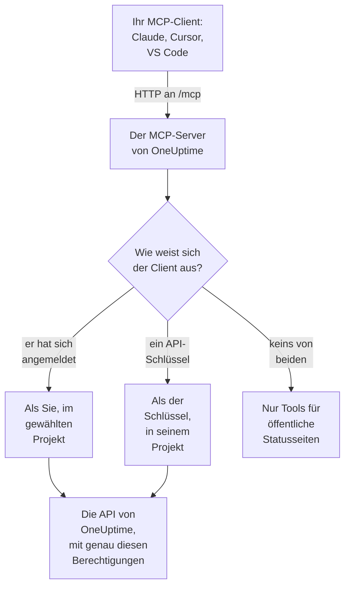

# MCP-Server

Mit dem OneUptime MCP-Server kann ein KI-Assistent direkt mit Ihrem OneUptime-Projekt arbeiten. Verbinden Sie Claude, Cursor, VS Code mit GitHub Copilot oder einen anderen Client des Model Context Protocol (MCP), und bitten Sie ihn, einen Vorfall zu untersuchen, Logs und Traces abzufragen, eine Warnung zu bestätigen oder einen Monitor einzurichten: Er ruft die Tools von OneUptime mit Ihren Berechtigungen auf, oder mit denen eines API-Schlüssels.

:::cards
- [Einen Client verbinden](#einen-client-verbinden): Geben Sie Ihrem Client die Adresse des Servers, und melden Sie sich an.
- [Anmelden mit OneUptime](#anmelden-mit-oneuptime): Was ein verbundener Client tun darf und wie Sie ihn trennen.
- [Ihren API-Schlüssel erhalten](#ihren-api-schlüssel-erhalten): Für einen Agenten, der unbeaufsichtigt läuft.
- [Fehlerbehebung](#fehlerbehebung): Probleme mit Anmeldung, Berechtigungen und Verbindung.
:::

## So funktioniert es

Der MCP-Server ist Teil jeder OneUptime-Instanz, unter `/mcp` auf derselben Adresse wie das Dashboard, und spricht den Streamable-HTTP-Transport. Es gibt nichts zu installieren.

- **OneUptime Cloud**: `https://oneuptime.com/mcp`
- **Selbst gehostet**: `https://your-oneuptime-domain.com/mcp`



Der Server ist zustandslos: Er vergibt keine Sitzungs-IDs, und jede Anfrage steht für sich, sodass er hinter Load Balancern und mit mehreren Replikaten funktioniert.

## Was die Tools abdecken

- **Monitore**: Monitore anlegen und konfigurieren, ihren Status prüfen und ihren Verlauf ansehen.
- **Vorfallreaktion**: Vorfälle anlegen, bestätigen und lösen, interne oder öffentliche Notizen hinzufügen und sie bis zur Lösung verfolgen.
- **Warnungen**: Warnungen bestätigen und lösen, Notizen hinzufügen und Warnungszustände und -schweregrade verwalten.
- **Teams und Bereitschaft**: Teams und Bereitschaftsrichtlinien verwalten.
- **Statusseiten**: Statusseiten verwalten und Ankündigungen veröffentlichen.
- **Geplante Wartung**: Wartungsereignisse anlegen und verwalten.
- **Telemetrie**: Logs, Metriken, Traces, Ausnahmen, Monitor-Logs, Sicherheitsereignisse und mehr abfragen, nur lesend.

Es gibt Tools zum Anlegen, Abrufen, Auflisten, Aktualisieren, Löschen und Zählen für 30 Arten von Datensätzen, Tools zum Auflisten und Zählen für 9 Arten von Telemetrie und Tools speziell für die Vorfallreaktion. Nur lesende Tools tragen `readOnlyHint`, jedes Tool, das etwas ändert, trägt `destructiveHint`, und nur die Tools für öffentliche Statusseiten tragen `openWorldHint`, sodass ein Client nur lesende Aufrufe selbstständig ausführen und Sie vor jeder Änderung fragen kann. Ein fehlgeschlagener Tool-Aufruf kommt als Tool-Ergebnis zurück (`isError: true`) mit einem `statusCode`, den Details und einem Vorschlag, nicht als MCP-Protokollfehler, sodass der Agent den Fehler lesen und sich selbst korrigieren kann.

## Bevor Sie beginnen

- Eine OneUptime-Instanz: OneUptime Cloud oder selbst gehostet.
- Ein MCP-Client, etwa Claude Code, Claude, VS Code mit GitHub Copilot oder Cursor.
- Ein OneUptime-Konto zum Anmelden oder ein OneUptime-API-Schlüssel für einen Agenten, der unbeaufsichtigt läuft. Die Tools für öffentliche Statusseiten brauchen keins von beiden.
- In OneUptime Cloud der Growth-Tarif oder höher: Das Verbinden eines MCP-Clients ist in denselben Tarifen verfügbar wie API-Schlüssel.

## Einen Client verbinden

Geben Sie dem Client die Adresse des Servers und sonst nichts. Wenn er zum ersten Mal Ihre Daten braucht, öffnet er OneUptime in Ihrem Browser, damit Sie sich anmelden (siehe [Anmelden mit OneUptime](#anmelden-mit-oneuptime)). Verwenden Sie auf einer selbst gehosteten Instanz `https://your-oneuptime-domain.com/mcp` statt `https://oneuptime.com/mcp`.

:::tabs
@tab Claude Code
```bash
claude mcp add --transport http oneuptime https://oneuptime.com/mcp
```
Führen Sie dann in Claude Code `/mcp` aus und wählen Sie **oneuptime**, um sich anzumelden.
@tab Claude
Öffnen Sie in Claude **Customize → Connectors**, wählen Sie **Add custom connector** und geben Sie `https://oneuptime.com/mcp` ein. Claude fordert Sie auf, sich bei OneUptime anzumelden, wenn es zum ersten Mal Ihre Daten braucht.
@tab VS Code
Fügen Sie dies Ihrer MCP-Konfiguration hinzu (wo sie liegt, steht unter [VS Code mit GitHub Copilot](#vs-code-mit-github-copilot)). VS Code öffnet OneUptime zum Anmelden, wenn Sie den Server starten:
```json
{
  "servers": {
    "oneuptime": {
      "type": "http",
      "url": "https://oneuptime.com/mcp"
    }
  }
}
```
@tab Cursor
```json
{
  "mcpServers": {
    "oneuptime": {
      "url": "https://oneuptime.com/mcp"
    }
  }
}
```
:::

Jeder andere Client, der MCP-Autorisierung unterstützt, funktioniert genauso: Geben Sie ihm die Adresse, und er findet alles Weitere selbst. Das Protokoll steht unter [Anmelden (OAuth 2.1)](#anmelden-oauth-21).

Das Dashboard enthält diese Schritte ebenfalls, mit der Adresse Ihrer Instanz bereits eingesetzt: **Projekteinstellungen → KI → MCP-Server**. Und von jeder Ressource aus (einem Monitor, einem Vorfall, einer Statusseite und so weiter) klappen Sie **Entwickler** in ihrem Seitenmenü auf und wählen **KI-Assistenten**: Diese Seite schlägt auch Prompts vor, die die Ressource und ihre ID nennen, damit der Assistent sie sofort findet. Für eine Ressource, für die der MCP-Server noch keine Tools hat, etwa einen Workflow, zeigt die Seite, wie ein Assistent, der Befehle ausführen kann, stattdessen über die REST-API damit arbeiten kann.

## Anmelden mit OneUptime

Am einfachsten verbinden Sie sich, indem Sie Ihrem MCP-Client die Adresse des Servers geben und sonst nichts. Wenn der Client zum ersten Mal Ihre Daten braucht, öffnet er eine OneUptime-Seite in Ihrem Browser:

:::steps
1. Melden Sie sich bei OneUptime an, falls Sie noch nicht angemeldet sind.
2. Wählen Sie das Projekt, in dem der Client arbeiten soll.
3. Wählen Sie **Lesen und Schreiben** oder **Nur Lesen**.
4. Klicken Sie auf **Autorisieren**.
:::

Der Client handelt dann in diesem Projekt als Sie. Es gibt keinen API-Schlüssel, den Sie anlegen, kopieren oder rotieren müssten, und nichts Geheimes wird in einer Konfigurationsdatei gespeichert.

Was ein verbundener Client tun kann:

- **Er hat Ihre Berechtigungen, und nie mehr.** Was Ihre Teams Ihnen im Projekt erlauben, kann auch der Client. Ändert sich Ihre Rolle oder verlassen Sie das Projekt, gilt das ab der nächsten Anfrage des Clients. Wenn Sie das Projekt verlassen, wird der Client außerdem getrennt: Seine Autorisierung wird gelöscht, und wenn Sie wieder beitreten, verbinden Sie ihn erneut.
- **Nur Lesen heißt nur lesen.** Ein Client, der nur lesend autorisiert ist, kann die Tools `get_`, `list_` und `count_` verwenden. Tools, die anlegen, aktualisieren, löschen, bestätigen oder lösen, werden abgelehnt, vom MCP-Server und von der OneUptime-API dahinter. Sie können einem Client nie mehr Zugriff geben, als er angefordert hat.
- **Er gilt für ein Projekt.** Um ein zweites Projekt zu nutzen, verbinden Sie den Client erneut und wählen dieses Projekt.
- **Er funktioniert nur über den MCP-Server.** Das Zugriffstoken des Clients wird vom MCP-Endpunkt akzeptiert und nirgends sonst. Es kann nicht verwendet werden, um die REST-API von OneUptime direkt aufzurufen.
- **Instanzadministratoren werden nicht anders behandelt.** Ein Client, den ein Master-Admin verbunden hat, hat das, was die Teams dieser Person im Projekt gewähren, keinen instanzweiten Zugriff.

### Verbundene Clients verwalten

Jeder Client, der durch Anmelden verbunden wurde, ist unter **Projekteinstellungen → KI → MCP-Server** unter **Verbundene MCP-Clients** aufgeführt, mit der Person, die ihn verbunden hat, dem, was er tun darf, und dem Zeitpunkt seiner letzten Nutzung. Sie sehen die Clients, die Sie verbunden haben; Owner und Admins des Projekts sehen die aller.

Klicken Sie auf **Trennen**, um einen Client abzumelden. Er funktioniert sofort nicht mehr.

Ein Client bleibt verbunden, solange er genutzt wird. Einer, der 30 Tage lang nicht genutzt wurde, muss sich erneut anmelden.

### Steuern, wer Clients verbinden darf

Standardmäßig kann jedes Projektmitglied einen MCP-Client verbinden. Um die Mitglieder eines Teams daran zu hindern, öffnen Sie die Seite **Berechtigungen** des Teams, öffnen unten **Weitere Einstellungen** und fügen unter **Berechtigungen blockieren** die Berechtigung **Authorize MCP Client** hinzu. Clients, die diese Mitglieder bereits verbunden haben, funktionieren sofort nicht mehr.

Wenn das Projekt Single Sign-On verlangt, melden Sie sich in Ihrem Browser per SSO beim Projekt an, bevor Sie einen Client autorisieren. Die Verbindung des Clients hält so lange wie diese SSO-Anmeldung; wenn sie abläuft oder der SSO-Anbieter, mit dem Sie sich angemeldet haben, ausgeschaltet oder gelöscht wird, verbinden Sie den Client erneut.

In OneUptime Cloud ist das Verbinden eines MCP-Clients in denselben Tarifen verfügbar wie API-Schlüssel (Growth und höher).

In der Enterprise Edition wird jede Änderung, die ein verbundener Client vornimmt, im Audit-Log unter der Person erfasst, die ihn verbunden hat, mit dem Namen des Clients. Änderungen mit einem API-Schlüssel zeigen den Namen des Schlüssels.

## Ihren API-Schlüssel erhalten

Verwenden Sie einen API-Schlüssel für einen Agenten, der unbeaufsichtigt läuft, etwa einen geplanten Job oder eine CI-Pipeline, bei denen niemand da ist, um sich anzumelden.

:::steps
### Den Schlüssel anlegen

Gehen Sie zu **Projekteinstellungen → Erweitert → API-Schlüssel** und klicken Sie auf **API-Schlüssel erstellen**. Geben Sie ihm einen Namen, etwa "MCP Server".

### Festlegen, was er darf

Wählen Sie unter **Zugriff** **Viewer** für einen Agenten, der nur liest, oder **Project Admin** für einen, der auch anlegt, aktualisiert und löscht (siehe [Berechtigungen von API-Schlüsseln](#berechtigungen-von-api-schlüsseln)).

### Den Schlüssel kopieren

Klicken Sie auf **API-Schlüssel erstellen**: Die Seite des Schlüssels öffnet sich. Kopieren Sie den Schlüssel dort.
:::

API-Schlüssel gehören zu einem Projekt: Der MCP-Server entnimmt das Projekt dem Schlüssel, sodass Tools zum Anlegen nie ein Argument `projectId` brauchen.

> [!WARNING]
> Geben Sie einem KI-Agenten nie einen Master-Schlüssel. Ein OneUptime-Master-API-Schlüssel wird ebenfalls in diesem Header akzeptiert und gewährt Admin-Zugriff auf die gesamte Instanz. Verwenden Sie immer einen Projekt-API-Schlüssel mit dem Minimum, das der Agent braucht: Ein nur lesender Schlüssel reicht für jedes Tool `get_`, `list_` und `count_`.

## Mit einem API-Schlüssel verbinden

Senden Sie den Schlüssel im Header `x-api-key`. Eine Anfrage, die einen API-Schlüssel trägt, wird nie zur Anmeldung aufgefordert. Verwenden Sie auf einer selbst gehosteten Instanz Ihre eigene Domain statt `oneuptime.com`.

:::tabs
@tab Claude Code
```bash
claude mcp add --transport http oneuptime https://oneuptime.com/mcp --header "x-api-key: your-api-key-here"
```
@tab Claude Desktop
Fügen Sie dies zu `claude_desktop_config.json` hinzu, unter macOS in `~/Library/Application Support/Claude/`, unter Windows in `%APPDATA%\Claude\` oder unter Linux in `~/.config/Claude/`:
```json
{
  "mcpServers": {
    "oneuptime": {
      "transport": "streamable-http",
      "url": "https://oneuptime.com/mcp",
      "headers": {
        "x-api-key": "your-api-key-here"
      }
    }
  }
}
```
@tab VS Code
Die Eingabevariable mit `"password": true` fragt beim Start des Servers nach dem Schlüssel, statt ihn im Klartext zu speichern:
```json
{
  "servers": {
    "oneuptime": {
      "type": "http",
      "url": "https://oneuptime.com/mcp",
      "headers": {
        "x-api-key": "${input:oneuptime-api-key}"
      }
    }
  },
  "inputs": [
    {
      "type": "promptString",
      "id": "oneuptime-api-key",
      "description": "OneUptime API Key",
      "password": true
    }
  ]
}
```
@tab Cursor
```json
{
  "mcpServers": {
    "oneuptime": {
      "url": "https://oneuptime.com/mcp",
      "headers": {
        "x-api-key": "your-api-key-here"
      }
    }
  }
}
```
:::

## VS Code mit GitHub Copilot

VS Code 1.99 und neuer unterstützt MCP-Server nativ in GitHub Copilot Chat.

:::steps
### Prüfen, was Sie brauchen

VS Code 1.99 oder neuer, mit installierter und angemeldeter GitHub-Copilot-Erweiterung und eingeschaltetem GitHub Copilot Chat.

### Die MCP-Konfiguration öffnen

Drücken Sie `Ctrl+Shift+P` (`Cmd+Shift+P` unter macOS), tippen Sie "MCP: Open User Configuration" und drücken Sie die Eingabetaste. Das öffnet oder erzeugt die Datei `mcp.json`. Für nur einen Workspace legen Sie stattdessen `.vscode/mcp.json` darin an.

### OneUptime hinzufügen

Fügen Sie die VS-Code-Konfiguration von oben ein: die ohne Schlüssel zum Anmelden oder die mit einem API-Schlüssel.

### Den Server starten

Drücken Sie `Ctrl+Shift+P` (`Cmd+Shift+P` unter macOS), tippen Sie "MCP: List Servers" und wählen Sie **oneuptime**, um ihn zu starten. VS Code fragt beim ersten Mal, ob Sie dem Server vertrauen, und dann nach der Anmeldung oder Ihrem API-Schlüssel.

### Copilot fragen

Öffnen Sie GitHub Copilot Chat im Agent-Modus und fragen Sie zum Beispiel "Welche Monitore habe ich in OneUptime?", "Zeig mir die letzten Vorfälle" oder "Lege einen neuen Monitor für https://example.com an".
:::

## Authentifizierung

Der MCP-Server funktioniert auf drei Arten.

### Öffentliche Tools (keine Authentifizierung nötig)

Ohne API-Schlüssel und ohne Anmeldung kann ein Client die öffentlichen Tools verwenden:

- **`oneuptime_help`**: Hilfe und Anleitung zu den MCP-Tools von OneUptime
- **`oneuptime_list_resources`**: die Ressourcen und was Sie mit jeder tun können
- **`get_public_status_page_overview`**: die Übersicht einer öffentlichen Statusseite
- **`get_public_status_page_incidents`**: die Vorfälle einer öffentlichen Statusseite
- **`get_public_status_page_scheduled_maintenance`**: ihre geplanten Wartungsereignisse
- **`get_public_status_page_announcements`**: ihre Ankündigungen

Die Tools für öffentliche Statusseiten nehmen die ID einer Statusseite (eine UUID) oder ihren Domainnamen entgegen. Um nur diese zu verwenden, verbinden Sie sich mit der Adresse und ohne Zugangsdaten:

```json
{
  "mcpServers": {
    "oneuptime": {
      "transport": "streamable-http",
      "url": "https://oneuptime.com/mcp"
    }
  }
}
```

Die Owner einer Statusseite können den MCP-Zugriff für diese Seite ausschalten: Öffnen Sie auf der Statusseite **MCP** im Abschnitt **KI** ihres Seitenmenüs und schalten Sie **MCP-Server aktivieren** aus. Der Schalter speichert, sobald er umgelegt wird. Der MCP-Zugriff ist standardmäßig eingeschaltet. Solange er ausgeschaltet ist, geben die vier Tools `get_public_status_page_*` für diese Statusseite einen Fehler zurück; die Website der Statusseite, ihr RSS-Feed und ihre öffentliche JSON-API sind nicht betroffen, und die Statusseiten-Tools, die eine Anmeldung brauchen (`get_status_page`, `list_status_pages` und so weiter), funktionieren weiter für das eigene Projekt der Seite.

### Anmelden (OAuth 2.1)

Jedes andere Tool muss wissen, wer aufruft. Ein Client, der keine Zugangsdaten sendet und eines davon aufruft, erhält `401 Unauthorized` mit einem Header `WWW-Authenticate`, der auf die Protected-Resource-Metadaten des Servers verweist. Das ist das Signal, auf das ein MCP-Client reagiert, um Sie anzumelden; `initialize`, `tools/list` und die öffentlichen Tools fragen nie danach.

Der Server implementiert die [MCP-Autorisierungsspezifikation](https://modelcontextprotocol.io/specification/latest/basic/authorization):

- **Ablauf**: OAuth 2.1 Authorization Code mit PKCE (nur `S256`). Zugriffstokens werden als `Authorization: Bearer` gesendet.
- **Erkennung**: Protected-Resource-Metadaten (RFC 9728) und Authorization-Server-Metadaten (RFC 8414). Aussteller und Ressource sind beide `https://<host>/mcp`.
- **Client-Identität**: ein Client ID Metadata Document (die Client-ID ist eine `https`-URL, die der Server abruft) oder Dynamic Client Registration (RFC 7591). Kein Client muss von einem Administrator registriert werden.
- **Geltungsbereiche**: `mcp:read` für die Tools `get_`, `list_` und `count_`; `mcp:write` fügt jedes Tool hinzu, das etwas ändert, und schließt `mcp:read` ein. Ein nur lesendes Token, das ein schreibendes Tool aufruft, erhält `403` mit `error="insufficient_scope"`.
- **Token-Laufzeiten**: Ein Zugriffstoken gilt eine Stunde. Ein Refresh-Token gilt 30 Tage und wird bei jeder Nutzung ersetzt; die Verwendung eines bereits ersetzten Refresh-Tokens beendet die Verbindung.
- **Ressourcenindikatoren** (RFC 8707): Ein Token wird für `https://<host>/mcp` ausgestellt und nirgends sonst akzeptiert.
- **Widerruf** (RFC 7009): Der Widerruf eines der beiden Tokens beendet die Verbindung.

### API-Schlüssel

Ein Agent, der unbeaufsichtigt läuft, sendet einen OneUptime-API-Schlüssel in einem dieser Header:

- `x-api-key`: Ihr OneUptime-API-Schlüssel
- `Authorization`: ein Bearer-Token mit Ihrem API-Schlüssel (z. B. `Bearer your-api-key-here`)

Beim Schema `Bearer` wird nicht zwischen Groß- und Kleinschreibung unterschieden. Eine Anfrage, die einen API-Schlüssel trägt, wird nie zur Anmeldung aufgefordert.

In OneUptime Cloud funktionieren API-Schlüssel nur, solange das Projekt im Tarif **Growth** oder höher ist. Darunter antwortet jedes Tool, das den Schlüssel braucht, mit `402` und einer Meldung, die den Tarif nennt, und dem Agenten wird gesagt, es nicht erneut zu versuchen. Nichts wird gelöscht: Der Schlüssel funktioniert unverändert wieder, sobald das Projekt wieder im Tarif Growth ist, ohne dass etwas neu verbunden werden muss. Ein Client, der durch Anmelden verbunden wurde, handelt als Person und funktioniert weiter ([API-Schlüssel und SCIM unterhalb ihres Tarifs](/docs/api-reference/api-reference#api-schlüssel-und-scim-unterhalb-ihres-tarifs)).

## Verfügbare Endpunkte

| Endpunkt | Methode | Beschreibung |
| --- | --- | --- |
| `/mcp` | POST | JSON-RPC-Anfragen für Tool-Aufrufe und andere Operationen |
| `/mcp` | GET | Ohne SSE-Header `Accept`: eine kurze JSON-Beschreibung des Servers. Mit einem: `405`, weil der zustandslose Server keinen eigenständigen SSE-Stream anbietet (Clients, die der Spezifikation folgen, machen ohne ihn weiter) |
| `/mcp` | DELETE | Tut nichts: Der Server ist zustandslos, es gibt also keine Sitzung, die zu beenden wäre |
| `/mcp/health` | GET | Health-Check |
| `/mcp/tools` | GET | Die Liste der Tools, als einfaches REST |

MCP-Clients, die sich anmelden, verwenden auch die OAuth-Endpunkte unten. Ein Client findet sie selbst; sie sind für Leute aufgeführt, die einen Client schreiben oder einen Proxy einrichten.

| Endpunkt | Methode | Beschreibung |
| --- | --- | --- |
| `/mcp/.well-known/oauth-protected-resource` | GET | Protected-Resource-Metadaten (RFC 9728). Auch unter `/.well-known/oauth-protected-resource/mcp` |
| `/.well-known/oauth-authorization-server/mcp` | GET | Authorization-Server-Metadaten (RFC 8414). Auch unter `/mcp/.well-known/oauth-authorization-server` |
| `/mcp/oauth/authorize` | GET | Autorisierungsendpunkt: wohin der Client Ihren Browser zum Anmelden schickt |
| `/mcp/oauth/token` | POST | Token-Endpunkt: tauscht einen Autorisierungscode oder ein Refresh-Token ein |
| `/mcp/oauth/register` | POST | Dynamische Client-Registrierung (RFC 7591) |
| `/mcp/oauth/revoke` | POST | Token-Widerruf (RFC 7009) |

So prüfen Sie, ob der Server läuft, und listen seine Tools auf:

```bash
curl https://oneuptime.com/mcp/health
curl https://oneuptime.com/mcp/tools
```

## Tools für die Vorfallreaktion

Neben den Tools für jede Art von Datensatz hat der Server Tools speziell für die Reaktion auf Vorfälle und Warnungen:

- **`acknowledge_incident`** / **`resolve_incident`**: einen Vorfall in den Zustand Acknowledged oder Resolved des Projekts versetzen, wie es die Schaltfläche im Dashboard tut
- **`acknowledge_alert`** / **`resolve_alert`**: dasselbe für Warnungen
- **`add_incident_note`**: einem Vorfall eine Notiz hinzufügen, mit `visibility: "internal"` (nur das Team, der Standard) oder `visibility: "public"` (auf der Statusseite veröffentlicht). Markdown wird unterstützt
- **`add_alert_note`**: einer Warnung eine interne Notiz hinzufügen

Ein typischer Ablauf: `list_incidents` → `acknowledge_incident` → mit `list_logs` untersuchen → `add_incident_note` (öffentlich) → `resolve_incident`.

Das Tool **`oneuptime_whoami`** gibt das Projekt zurück, zu dem Ihre Zugangsdaten gehören (seine ID und seinen Namen). Für einen angemeldeten Client sagt es auch, als wer er angemeldet ist und ob er Änderungen vornehmen darf. Es ist ein guter erster Aufruf, damit ein Agent sich orientiert, und da Tools zum Anlegen `projectId` aus den Zugangsdaten nehmen, muss der Agent nie eine Projekt-ID übergeben.

## Telemetrie abfragen

Logs, Metriken, Traces (Spans), Ausnahmen, Monitor-Logs und die anderen Arten von Telemetrie gibt es als nur lesende Tools `list_` und `count_` (`list_logs`, `list_metrics`, `list_spans`, `list_exception_instances`, `list_monitor_logs` und ihre `count_`-Gegenstücke). Telemetrie kommt über OpenTelemetry herein, daher gibt es keine Tools zum Anlegen.

Fragen Sie Telemetrie immer mit einem Zeitraum ab. Ein Abfragefeld nimmt einen Wert oder ein Operator-Objekt entgegen:

```json
{
  "query": {
    "time": { "_type": "GreaterThan", "value": "2026-07-04T00:00:00.000Z" }
  },
  "sort": { "time": "DESC" },
  "limit": 50
}
```

Die Operatoren sind `EqualTo`, `NotEqual`, `IsNull`, `NotNull`, `EqualToOrNull`, `GreaterThan`, `LessThan`, `GreaterThanOrEqual`, `LessThanOrEqual`, `InBetween`, `Search` und `Includes`. Sortierwerte sind `"ASC"` oder `"DESC"`.

## Feldauswahl und Paginierung

Die Tools `get_` und `list_` nehmen ein optionales Array `select` mit Feldnamen entgegen. Standardmäßig kommt jedes lesbare Feld zurück, außer den schweren (JSON, sehr langer Text und HTML-Spalten), die in `select` angefordert werden müssen.

Listen-Tools blättern mit `limit` (standardmäßig 10, höchstens 100) und `skip`, und jede Listenantwort sagt genau, was sie zurückgegeben hat:

```json
{
  "returnedCount": 10,
  "totalCount": 42,
  "skip": 0,
  "limit": 10,
  "hasMore": true,
  "data": ["..."]
}
```

## Anwendungsbeispiele

### Alltägliche Fragen

```text
"What's the current status of all my monitors?"
"Show me incidents from the last 24 hours"
"List the teams in this project"
"Show me our on-call policies"
```

### Monitore und Vorfälle

```text
"Create a new website monitor for https://example.com that checks every 5 minutes"
"Set up an API monitor for https://api.example.com/health with a 30-second timeout"
"Disable the monitor for staging.example.com while we're doing maintenance"
"Create a high-priority incident for the database outage affecting user authentication"
"Add a note to incident #123 saying 'Database connection restored, monitoring for stability'"
"Mark incident #456 as resolved"
```

### Statusseiten

```text
"Update our status page to show 'Investigating Payment Issues' for the payment service"
"Create a status page announcement about scheduled maintenance this weekend"
```

### Abfragen öffentlicher Statusseiten (kein API-Schlüssel nötig)

Diese funktionieren ohne Zugangsdaten, allein mit den Tools für öffentliche Statusseiten:

```text
"What's the current status of status.example.com?"
"Show me recent incidents from the OneUptime status page"
"Are there any scheduled maintenance events on status.acme.com?"
"Get the latest announcements from my public status page with ID abc123-..."
```

### Mehrere Schritte auf einmal

```text
"Create a scheduled maintenance window for Saturday 2-4 AM, disable all monitors for api.example.com during that time, and update the status page"
"Show me all monitors that have been down in the last hour, create incidents for any that don't already have one"
```

## Berechtigungen von API-Schlüsseln

| Was der Agent tut | Unter **Zugriff** wählen |
| --- | --- |
| Liest nur | **Viewer**, oder fügen Sie auf der Seite des Schlüssels Leseberechtigungen hinzu |
| Legt auch an, aktualisiert und löscht | **Project Admin**, oder fügen Sie auf der Seite des Schlüssels die Rolle Project Admin hinzu |

Geben Sie jedem Schlüssel das Minimum, das er braucht, rotieren Sie Schlüssel regelmäßig, verwenden Sie für jede Umgebung einen eigenen Schlüssel und beobachten Sie in OneUptime, was jeder Schlüssel tut.

## Konfiguration bei Selbst-Hosting

Die Anmeldung funktioniert auf einer selbst gehosteten Instanz ohne weiteres Zutun. Zwei Einstellungen ändern sie:

| Umgebungsvariable | Helm-Wert | Was sie bewirkt |
| --- | --- | --- |
| `DISABLE_MCP_OAUTH` | `mcpOAuth.disabled` | Auf `true` setzen, um die Anmeldung auszuschalten. Die OAuth-Endpunkte werden nicht mehr bereitgestellt, und der MCP-Server akzeptiert nur noch API-Schlüssel. Nichts wird gelöscht; verbundene Clients funktionieren wieder, wenn sie wieder eingeschaltet wird. |
| `DISABLE_MCP_OAUTH_CLIENT_ID_METADATA_DOCUMENTS` | `mcpOAuth.disableClientIdMetadataDocuments` | Auf `true` setzen auf einer Instanz, die das Internet nicht erreicht. Ein Client kann sich mit einer URL ausweisen, die OneUptime abruft; mit dieser Einstellung registrieren sich Clients stattdessen direkt bei Ihrer Instanz, was keine ausgehende Anfrage braucht. |

Wenn Sie einen eigenen Reverse Proxy vor OneUptime betreiben, leiten Sie `/.well-known/oauth-protected-resource` und `/.well-known/oauth-authorization-server` (und alles darunter) zusammen mit `/mcp` an OneUptime weiter. Der mitgelieferte Ingress tut das bereits.

Der Server baut jede OAuth-URL aus den Einstellungen `HOST` und `HTTP_PROTOCOL`, daher müssen sie zu der Adresse passen, über die Leute Ihre Instanz erreichen.

## Fehlerbehebung

### Probleme bei der Anmeldung

- **Der Client fordert mich nie zur Anmeldung auf**: Der Client unterstützt MCP-Autorisierung vielleicht nicht, oder er ist mit einem API-Schlüssel-Header konfiguriert, der Vorrang hat. Entfernen Sie den Header, um sich stattdessen anzumelden.
- **Mein Projekt ist auf der Autorisierungsseite ausgegraut**: Die Seite sagt neben dem Projektnamen, warum: Der Tarif des Projekts umfasst das Verbinden von MCP-Clients nicht, das Projekt verlangt SSO und dieser Browser hat sich nicht per SSO dort angemeldet, oder Ihr Team ist für das Verbinden von Clients gesperrt.
- **Ein Tool wird als "read-only" abgelehnt**: Der Client wurde nur lesend autorisiert. Verbinden Sie ihn erneut und wählen Sie **Lesen und Schreiben**.
- **Der Client funktioniert nicht mehr**: Er wurde getrennt, 30 Tage lang nicht genutzt, Sie wurden aus dem Projekt entfernt, oder die SSO-Anmeldung des Projekts ist abgelaufen oder sein Anbieter wurde ausgeschaltet. Verbinden Sie ihn erneut.
- **Selbst gehostet - der Client sagt, er finde den Autorisierungsserver nicht**: Prüfen Sie, ob `HOST` und `HTTP_PROTOCOL` zu Ihrer öffentlichen Adresse passen und ob Ihr Proxy die Pfade `/.well-known/oauth-*` weiterleitet.

### Berechtigungsfehler

Der API-Schlüssel oder, bei einem angemeldeten Client, Ihr eigenes Konto braucht die richtigen Berechtigungen: Lesezugriff, um Datensätze aufzulisten, Schreibzugriff, um sie anzulegen und zu aktualisieren, und Löschzugriff, um sie zu entfernen.

### Verbindungsprobleme

Prüfen Sie, ob die OneUptime-Adresse stimmt und erreichbar ist, ob der API-Schlüssel gültig ist und ob der Health-Endpunkt antwortet (siehe [Verfügbare Endpunkte](#verfügbare-endpunkte)).

### Ungültiger API-Schlüssel

- Prüfen Sie den API-Schlüssel in Ihren OneUptime-Einstellungen, ohne zusätzliche Leerzeichen oder Zeichen
- Prüfen Sie, ob der Schlüssel nicht abgelaufen ist
- In OneUptime Cloud bedeutet ein `402`, das sagt, API-Schlüssel bräuchten den Growth-Tarif, dass das Projekt darunter liegt: Stufen Sie das Projekt unter **Projekteinstellungen → Abrechnung und Rechnungen → Abrechnung** hoch, und derselbe Schlüssel funktioniert wieder

### Sitzungsfehler

Der MCP-Server ist zustandslos: Er vergibt und verfolgt keine Sitzungs-IDs, sodass jede Anfrage gegen jedes Replikat funktioniert. Ein Client, der einen Header `mcp-session-id` von einer älteren Serverversion sendet, kann ihn weglassen; er wird ignoriert. Aktualisieren Sie eine ältere Client-Konfiguration, die erwartet, dass der Server eine Sitzungs-ID zurückgibt.

## Verfügbare Ressourcen

| Bereich | Datensätze mit Tools zum Anlegen, Abrufen, Auflisten, Aktualisieren, Löschen und Zählen |
| --- | --- |
| Überwachung | Monitor, Monitor Status, Monitor Status Event |
| Vorfälle | Incident, Incident State, Incident Severity, Incident State Timeline, Incident Public Note, Incident Internal Note, Incident Alert, Postmortem Status |
| Warnungen | Alert, Alert State, Alert Severity, Alert State Timeline, Alert Internal Note |
| Statusseiten | Status Page, Status Page Announcement |
| Geplante Wartung | Scheduled Maintenance Event, Scheduled Maintenance State, Scheduled Maintenance State Timeline |
| Teams und Bereitschaft | Team, On-Call Policy |
| Labels | Label |
| Sicherheit | Security Case, Security Case Note, Security Case Priority, Security Case Status, Security Detection, Security Playbook |

| Bereich | Telemetrie, nur mit Tools zum Auflisten und Zählen |
| --- | --- |
| Beobachtbarkeit | Log, Metric, Span, Exception Instance, Monitor Log |
| Sicherheit | Security Event, Threat Intel Indicator |
| Änderungen und Kosten | Change Event, Kubernetes Cost Allocation |

Die Tools heißen in Snake Case: `create_incident`, `get_incident`, `list_incidents`, `update_incident`, `delete_incident` und `count_incidents`, oder `list_logs` und `count_spans` für Telemetrie.

## Nächste Schritte

:::cards
- [KI fragen](/docs/ai/ask-ai): Fragen Sie stattdessen innerhalb von OneUptime nach Ihrem Projekt.
- [OneUptime-API-Referenz](/docs/api-reference/api-reference): Die REST-API hinter jedem Tool.
- [Berechtigungen](/docs/permissions/index): Was eine Rolle, ein Team oder ein API-Schlüssel darf.
:::
