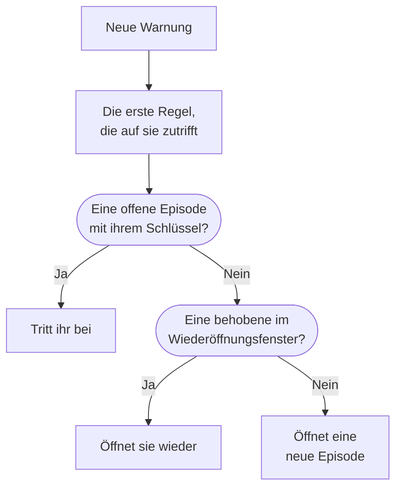

# Warnungsepisoden & Gruppierungsregeln

Fällt eine Datenbank aus, können zwanzig Monitore innerhalb von Minuten zwanzig Warnungen auslösen. Eine Episode fasst sie in einem Datensatz zusammen, den Ihr Team gemeinsam bestätigt und behebt, und eine Gruppierungsregel entscheidet, welche Warnungen hineingehören. Diese Seite zeigt, wie das Gruppieren funktioniert, wie Sie eine Regel einrichten und wie sich eine Episode verhält, sobald sie offen ist.

:::cards
- [So funktioniert das Gruppieren](#so-funktioniert-das-gruppieren): Regeln, Gruppierungsschlüssel und Zeitfenster.
- [Eine Gruppierungsregel erstellen](#eine-gruppierungsregel-erstellen): Aus einer Vorlage mit einem Klick, oder Ihre eigene.
- [So verhält sich eine Episode](#so-verhält-sich-eine-episode): Ihr Schweregrad, ihre Status und wann sie behoben wird.
- [Wen eine Episode alarmiert](#wen-eine-episode-alarmiert): Die Bereitschaftsrichtlinien der Regel und die der Warnungen selbst.
:::

## So funktioniert das Gruppieren

Das Gruppieren läuft einmal für jede neue Warnung, direkt nachdem ihre Bereitschaftsrichtlinien gelaufen sind. Die Warnung wird mit Ihren aktivierten Gruppierungsregeln abgeglichen, von oben nach unten in der Liste, und die erste Regel, die auf sie zutrifft, bestimmt ihre Episode. Eine Warnung, auf die keine Regel zutrifft, bleibt für sich.



- **Die Bedingungen der Regel** entscheiden, für welche Warnungen sie gilt. Eine Regel ohne Bedingungen gilt für jede neue Warnung.
- **Der Gruppierungsschlüssel** entscheidet, welche Warnungen sich eine Episode teilen: die mit demselben Monitor, demselben Schweregrad, demselben Titel oder der Mischung, nach der die Regel gruppiert. Eine Regel, die nach nichts gruppiert, legt jede Warnung, auf die sie zutrifft, in eine einzige Episode.
- **Das Zeitfenster** entscheidet, wie lange eine Episode Warnungen aufnimmt. Ist es eingeschaltet, tritt eine Warnung nur bei, wenn sie innerhalb des Fensters nach der letzten Warnung der Episode eintrifft. Ist es ausgeschaltet, treten passende Warnungen bei, bis die Episode behoben ist.

Gruppiert wird, wenn eine Warnung erstellt wird. Eine Regel, die Sie heute hinzufügen, gruppiert die danach erstellten Warnungen; die bereits vorhandenen gruppiert sie nicht neu.

> [!NOTE]
> Eine Warnung, die bereits bestätigt erstellt wird, kann einer offenen Episode beitreten, öffnet aber nie eine, und eine behoben erstellte Warnung wird gar nicht gruppiert. Siehe [Bereits bestätigt oder behoben erstellt](/docs/alerts/index#bereits-bestätigt-oder-behoben-erstellt).

## Eine Gruppierungsregel erstellen

Gehen Sie zu **Warnungen → Regeln → Gruppierungsregeln**. Der Bereich **Regeln** im Seitenmenü ist zunächst eingeklappt, klappen Sie ihn also zuerst auf.

### Mit einer Vorlage beginnen

Ein Projekt ohne Gruppierungsregeln sieht statt einer leeren Liste vier fertige Regeln; sobald Sie Regeln haben, öffnet **Aus Vorlage erstellen** auf der Karte sie. **Regel hinzufügen** speichert eine mit einem Klick, aktiviert, am Ende der Liste und für jede neue Warnung geltend. Bearbeiten Sie sie danach wie jede andere Regel.

| Vorlage                                         | Gruppiert                                                                    | Zeitfenster |
| ----------------------------------------------- | ---------------------------------------------------------------------------- | ----------- |
| **Warnungen desselben Monitors gruppieren**     | Eine Episode pro Monitor                                                     | 30 Minuten  |
| **Gleichzeitige Warnungen gruppieren**          | Eine gemeinsame Episode, egal welcher Monitor                                | 10 Minuten  |
| **Warnungen nach Schweregrad gruppieren**       | Eine Episode pro Schweregrad                                                 | 30 Minuten  |
| **Wiederholungen derselben Warnung gruppieren** | Eine Episode pro Warnungstitel, Zahlen und Groß-/Kleinschreibung ignoriert   | 1 Stunde    |

### Eine eigene erstellen

:::steps
#### Festlegen, wie gruppiert wird

Klicken Sie unter den Vorlagen auf **Eigene Regel erstellen** oder, sobald Sie Regeln haben, auf der Karte auf **Gruppierungsregel für Warnungen erstellen**. Im Schritt **Gruppierung** stellt **Warnungen gruppieren nach** eine Frage: **Überwachung**, **Alles zusammen**, **Schweregrad**, **Titel** oder **Benutzerdefiniert**. Der **Name** folgt Ihrer Antwort, bis Sie einen eigenen eingeben.

#### Das Zeitfenster festlegen

**Nur Warnungen gruppieren, die kurz nacheinander eintreffen** ist eingeschaltet, mit einem Fenster von 30 Minuten. Ändern Sie die Minuten, oder schalten Sie es aus, damit eine Episode offen bleibt, bis sie behoben ist.

#### Felder kombinieren, für Benutzerdefiniert

**Benutzerdefiniert** fügt einen Schritt **Gruppieren nach** mit fünf Schaltern hinzu: **Gruppieren nach Überwachung**, **Gruppieren nach Warnungsschweregrad**, **Gruppieren nach Warnungstitel**, **Gruppieren nach Warnungsbeschriftungen** und **Gruppieren nach Überwachungsbeschriftungen**. Beschriftungen gruppieren nach ihrer genauen Zusammenstellung.

#### Eingrenzen

Unter **Welche Warnungen** gruppiert **Alle Warnungen**, womit eine neue Regel beginnt, jede neue Warnung. Um sie einzugrenzen, wählen Sie **Nur Warnungen, die den Bedingungen entsprechen** und fügen Bedingungen zu Monitoren, Schweregraden, Beschriftungen, Titeln und Beschreibungen hinzu. Klicken Sie dann auf **Gruppierungsregel für Warnungen erstellen**.
:::

Alles Weitere, was eine Regel kann, ist unter **Weitere Felder** am Ende des Schritts **Gruppierung** eingeklappt, in drei Gruppen. Eingeklappt nennt seine Kopfzeile, was er enthält, und sagt, worauf jede Einstellung steht, die die Regel nutzt, sodass beim Bearbeiten einer Regel nie verborgen bleibt, was sie tut.

| Gruppe                                | Einstellungen                                                                                              |
| ------------------------------------- | ---------------------------------------------------------------------------------------------------------- |
| **Bereitschaft & Eigentümerschaft**   | **Bereitschaftsrichtlinien**, die laufen, wenn die Regel eine Episode öffnet, und **Episoden-Eigentümer**. |
| **Episodenlebenszyklus**              | **Kürzlich behobene Episoden wieder öffnen**, **Vor dem Beheben einer Episode warten** und **Ruhige Episoden beheben**, jeweils ein Schalter mit seinen Minuten. |
| **Details**                           | Die **Beschreibung** der Regel, die **Episodentitelvorlage**, die **Episodenbeschreibungsvorlage** und **Episoden-Beschriftungen**. |

Regeln werden von oben nach unten geprüft, und der erste Treffer gewinnt: Ziehen Sie eine Regel, um ihren Platz zu ändern. Setzen Sie spezifische Regeln über allgemeine. Die Spalte **Gruppierung** der Liste sagt in einem Satz, was jede Regel tut, etwa „Eine Episode pro Monitor“.

## Episodentitel

Ohne Vorlage wird eine Episode nach dem Monitor ihrer ersten Warnung benannt oder, wenn diese keinen Monitor hat, nach den ersten 50 Zeichen ihres Titels. Mit einer **Episodentitelvorlage** oder einer **Episodenbeschreibungsvorlage** werden diese Variablen ausgefüllt. Geben Sie `{{` in einem der beiden Felder ein, um eine zu wählen.

| Variable               | Gefüllt mit                                                                                   |
| ---------------------- | --------------------------------------------------------------------------------------------- |
| `{{alertTitle}}`       | Dem Titel der ersten Warnung.                                                                 |
| `{{alertDescription}}` | Der Beschreibung der ersten Warnung.                                                          |
| `{{alertSeverity}}`    | Dem Schweregrad der ersten Warnung.                                                           |
| `{{monitorName}}`      | Dem Namen des Monitors der ersten Warnung.                                                    |
| `{{alertCount}}`       | Der Anzahl der Warnungen in der Episode, neu geschrieben, wenn Warnungen beitreten oder gehen. |

Eine Variable, für die die erste Warnung keinen Wert hat, oder eine, die nicht in dieser Liste steht, wird weggelassen. Ist die erste Warnung privat, lauten `{{alertTitle}}` und `{{alertDescription}}` „Private alert“, weil die Episode nicht privat ist.

## So verhält sich eine Episode

Eine Episode durchläuft Ihre Warnungsstatus, dieselbe Liste wie Warnungen, und hat eigene Eigentümer, Notizen, eine eigene Grundursache und eigene Behebungs-Notizen.

- **Ihr Schweregrad steigt mit ihren Warnungen.** Sie beginnt mit dem Schweregrad ihrer ersten Warnung und übernimmt den jeder schwereren Warnung, die ihr beitritt, wobei „schwerer“ heißt: weiter oben unter **Warnungen → Einstellungen → Warnungsschweregrad**.
- **Ihr Status bewegt ihre Warnungen.** Bestätigen oder beheben Sie eine Episode oder setzen Sie sie in einen eigenen Status, dann wechselt jede Warnung in ihr mit, außer einer, die schon in diesem Status oder danach ist.
- **Sie behebt sich selbst**, sobald jede Warnung in ihr behoben ist. **Vor dem Beheben einer Episode warten** hält sie zuvor so viele Minuten offen, falls eine Warnung zurückkommt.
- **Sie kann sich wieder öffnen.** Ist **Kürzlich behobene Episoden wieder öffnen** eingeschaltet, öffnet eine passende Warnung, die innerhalb der Minuten nach dem Beheben der Episode eintrifft, sie wieder, statt eine neue zu öffnen. Das ist der einzige Schritt zurück nach oben in der Statusliste, und er öffnet die Warnungen der Episode nicht wieder.

> [!WARNING]
> **Ruhige Episoden beheben** behebt eine Episode, wenn ihr für die eingestellten Minuten keine neue Warnung beigetreten ist, und behebt auch jede Warnung, die in ihr noch offen ist. Nutzen Sie es für Rauschen, bei dem Sie sicher sind, dass es keine Antwort braucht.

## Wen eine Episode alarmiert

Die eigenen Bereitschaftsrichtlinien einer Warnung laufen, wenn sie erstellt wird, vor dem Gruppieren, egal ob sie einer Episode beitritt. Eine Episode fügt ihre eigenen hinzu:

```mermaid title="Eine Warnung, die eine Episode öffnet, alarmiert zweimal; eine, die beitritt, einmal"
flowchart TB
    alert["Neue Warnung"] --> own["Die eigenen Richtlinien<br/>der Warnung laufen"]
    own --> grouped{"Gruppierung"}
    grouped -->|"Öffnet eine Episode"| ep["Auch die Richtlinien<br/>der Episode laufen"]
    grouped -->|"Tritt einer Episode bei"| none["Sonst läuft nichts"]
```

- **Eine neue Episode** führt die **Bereitschaftsrichtlinien** der Regel aus, dazu die jeder passenden Regel auf dem Tab **Episodenregeln** unter **Warnungen → Regeln → Bereitschaftsregeln**.
- **Eine Warnung, die einer offenen Episode beitritt,** führt nur ihre eigenen Richtlinien aus. Die der Episode laufen nicht noch einmal.
- **Wer auf die Alarmierung einer Episode antwortet,** bestätigt die Episode und damit jede Warnung in ihr.

> [!TIP]
> Um einmal pro Problem statt einmal pro Warnung zu alarmieren, legen Sie Bereitschaftsrichtlinien auf Ihre Gruppierungsregeln und lassen Sie sie bei den Warnungen weg: in den Kriterien des Monitors, im Erstellformular und in Ihren Bereitschaftsregeln für Warnungen.

Auch die Eigentümer der Episode erfahren davon: **Warnungs-Episode erstellt**, **Status der Warnungs-Episode geändert** und **Warnung zur Warnungs-Episode hinzugefügt** sind standardmäßig per E-Mail eingeschaltet, unter **Benutzereinstellungen → Benachrichtigungseinstellungen** auf dem Tab **Warnungen**. Die **Episoden-Eigentümer** der Regel werden Eigentümer jeder Episode, die sie öffnet, und werden wie jeder andere Eigentümer benachrichtigt.

## Eine Episode von Hand erstellen

:::steps
### Das Formular öffnen

Gehen Sie zu **Warnungen → Alle Episoden** und klicken Sie auf **Episode erstellen**. Das Formular **Neue Warnungsepisode erstellen** öffnet sich.

### Die Episode beschreiben

Füllen Sie unter **Episodendetails** den **Titel** aus und, wenn Sie möchten, einen **Warnungsschweregrad** und eine **Beschreibung**. **Anfangsstatus** und **Beschriftungen** warten unter **Weitere Felder**.

### Wählen, wer alarmiert wird und wem sie gehört

Wählen Sie unter **Bereitschaft & Eigentümer** eine **Bereitschaftsrichtlinie**, die beim Erstellen der Episode läuft, und ihre **Eigentümer**. Klicken Sie dann auf **Episode erstellen**.

Jedes Team, in dem Sie Mitglied sind, ist unter **Eigentümer** nur einen Klick entfernt, und die Zusammenfassung nennt die Eigentümerregeln, die weitere hinzufügen.

### Die Warnungen hinzufügen

Öffnen Sie die Seite **Mitglieder-Warnungen** der Episode, klicken Sie auf **Warnungen hinzufügen** und haken Sie die Warnungen an, die dazugehören, so viele Sie auf einmal brauchen. Um stattdessen bei den Warnungen zu beginnen, wählen Sie sie in der Liste **Warnungen** aus und wählen unter **Massenaktionen** den Eintrag **Zu neuer Episode hinzufügen** (siehe [Episoden](/docs/incidents/episodes)).
:::

Eine Episode, die Sie erstellen, hat keine Gruppierungsregel, deshalb zeigt die Liste ihre **Gruppierungsregel** als **Manuell**, und keine Lebenszyklus-Einstellung gilt für sie. Sie behebt sich trotzdem selbst, sobald jede Warnung in ihr behoben ist.

## Was jede Seite einer Episode zeigt

| Bereich im Seitenmenü | Seiten                                                                         |
| --------------------- | ------------------------------------------------------------------------------ |
| **Übersicht** | **Übersicht**, **Zustands-Zeitachse** |
| **Untersuchung** | **Beschreibung**, **Grundursache**, **Behebungs-Notizen** |
| **Team** | **Eigentümer** |
| **Warnungen** | **Mitglieder-Warnungen** |
| **Notizen** | **Private Notizen** |
| **Entwickler** | **Terraform**, **API**, **KI-Assistenten** |
| **Erweitert** | **Audit-Protokolle**, **Episode löschen** |

**Entwickler** und **Erweitert** sind zunächst eingeklappt. In der **Übersicht** nennt die Kopfzeile die **Eigentümer** der Episode, Teams zuerst, und die erste Kachel, **Erstellt**, sagt, wann die Episode entstand – **Automatisch**, wenn eine Gruppierungsregel sie eröffnet hat. Die Karte **Hergang** führt die Seite an – die Beschreibung der Episode und ihre **Grundursache** –, dann folgen **Warnungen in dieser Episode** und der **Episoden-Feed**, neben der Karte **Episodendetails**: Nummer, Status, Schweregrad, Anzahl der Warnungen, Gruppierungsregel und Bereitschaftsrichtlinien. Ihr Kopfbereich hat **Bestätigen** und **Beheben**, und **Episode verschieben nach** im Menü **⋯**.

**Warnungen → Aktive Episoden** listet die Episoden, die noch nicht behoben sind, und das Abzeichen daneben zählt sie.

## Fehlerbehebung

:::details Eine neue Warnung ist nicht der erwarteten Episode beigetreten
Prüfen Sie der Reihe nach: Die Regel ist aktiviert; keine Regel darüber hat zuerst auf die Warnung zugetroffen; die Warnung erfüllt die Bedingungen der Regel; sie hat denselben Gruppierungsschlüssel wie die Warnungen der Episode, etwa denselben Monitor; und bei eingeschaltetem Zeitfenster ist sie innerhalb des Fensters nach der letzten Warnung der Episode eingetroffen. Eine bereits bestätigt erstellte Warnung öffnet nie eine Episode, und eine behoben erstellte wird nie gruppiert.
:::

:::details Wir wurden für ein Problem zweimal alarmiert
Die eigene Bereitschaftsrichtlinie der Warnung lief, und die Richtlinie der neuen Episode lief auch. Lassen Sie die Richtlinien auf der Gruppierungsregel und nehmen Sie sie aus den Kriterien, dem Formular oder den Bereitschaftsregeln der Warnung heraus.
:::

:::details Eine Episode wurde von selbst behoben
Jede Warnung in ihr war behoben, deshalb wurde die Episode behoben, sobald ihre Wartezeit vorbei war. Ist **Ruhige Episoden beheben** eingeschaltet, behebt es auch eine Episode, der so lange keine neue Warnung beigetreten ist.
:::

## Nächste Schritte

:::cards
- [Warnungsregeln & Einstellungen](/docs/alerts/settings): Die anderen Regeln, die auf neue Warnungen und Episoden wirken.
- [Warnungsstatus & Schweregrade](/docs/alerts/states-and-severities): Die Status, die eine Episode durchläuft.
- [Eskalationsregeln](/docs/on-call/escalation-rules): Wie die Richtlinien, die eine Episode ausführt, Menschen alarmieren.
- [Vorfalleinstellungen & Automatisierung](/docs/incidents/settings): Gruppierungsregeln für Vorfälle.
:::
