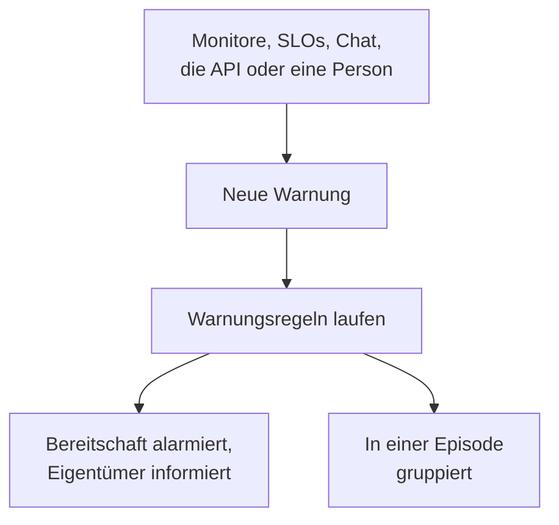

# Warnungen – Übersicht

Eine Warnung macht Ihr Team auf ein Problem aufmerksam, das es sich ansehen sollte, bevor Ihre Nutzer es bemerken: eine Festplatte, die vollläuft, ein Zertifikat kurz vor dem Ablauf, eine steigende Fehlerrate. Sie kann die Bereitschaft alarmieren und ihre Eigentümer benachrichtigen, erscheint aber nie auf einer Statusseite und informiert nie Ihre Abonnenten. Diese Seite erklärt, woher Warnungen kommen, wo sie im Dashboard zu finden sind und wie Ihr Team sie bearbeitet.

:::cards
- [Warnungen und Vorfälle](#warnungen-und-vorfälle): Was ein Problem sein sollte, und wie beide zusammenhängen.
- [Woher Warnungen kommen](#woher-warnungen-kommen): Monitore, SLOs, Chat, die API oder von Hand.
- [Eine Warnung von Hand erstellen](#eine-warnung-von-hand-erstellen): Zwei Schritte im Dashboard.
- [Auf eine Warnung reagieren](#auf-eine-warnung-reagieren): Bestätigen, beheben oder einen Vorfall melden.
:::

## So funktioniert es

Die meisten Warnungen löst ein Monitor aus, dessen Kriterien zutreffen. Andere kommen von einem SLO, das sein Fehlerbudget verbraucht, von einer Sicherheitsregel, von einer Alarmierung aus Slack oder Microsoft Teams oder von einer Person. Wie sie auch eintrifft: Eine Warnung ist immer derselbe Datensatz, und dieselben Regeln laufen auf ihr.

- **Regeln formen sie.** Datenschutz-, Eigentümer-, Beschriftungs- und Bereitschaftsregeln laufen, sobald eine Warnung erstellt wird, und Runbook-Regeln starten die passenden Abläufe. Siehe [Warnungsregeln & Einstellungen](/docs/alerts/settings).
- **Bereitschaftsrichtlinien alarmieren Menschen.** Die Richtlinien, die die Warnung nennt, und die, die ihre Bereitschaftsregeln hinzufügen, alarmieren ihre Personen, bis jemand die Warnung bestätigt.
- **Episoden bündeln das Rauschen.** Eine Gruppierungsregel fasst zusammengehörige Warnungen in einer Episode zusammen, sodass zwanzig Warnungen eines Ausfalls eine einzige Aufgabe sind. Siehe [Warnungsepisoden & Gruppierungsregeln](/docs/alerts/episodes).

## Warnungen und Vorfälle

Beide halten ein Problem fest, und beide können die Bereitschaft alarmieren. Der Unterschied ist, wen das Problem betrifft.

|                              | Warnung                                                | Vorfall                                           |
| ---------------------------- | ------------------------------------------------------ | ------------------------------------------------- |
| **Was es ist**               | Ein Problem, das sich Ihr Team ansehen sollte, bevor Nutzer betroffen sind | Ein Problem, das Ihre Nutzer betrifft, etwa ein Ausfall |
| **Auf Statusseiten**         | Nie                                                    | Kann erscheinen und informiert Abonnenten         |
| **Notizen**                  | Private Notizen, nur für Ihr Team                      | Öffentliche Notizen für Kunden und private Notizen |
| **Anfangsstatus**            | **Identifiziert**, **Bestätigt**, **Behoben**          | **Identifiziert**, **Bestätigt**, **Behoben**     |
| **Anfangsschweregrade**      | **Hoch**, **Low**                                      | Critical Incident, Major Incident, Minor Incident |
| **Nummern in einem neuen Projekt** | `ALT-42` und `AE-42` für Episoden                | `INC-42` und `IE-42` für Episoden                 |

Lösen Sie eine Warnung aus, wenn Ihr Team nachsehen sollte, bevor jemand außerhalb etwas merkt, und melden Sie einen Vorfall, wenn Nutzer betroffen sind. Stellt sich heraus, dass eine Warnung Teil eines Ausfalls ist, melden Sie daraus einen Vorfall oder verknüpfen Sie sie mit dem Vorfall, der sie erklärt: siehe [Verknüpfte Warnungen](/docs/incidents/linked-alerts).

## Woher Warnungen kommen

- **Die Kriterien eines Monitors.** Schalten Sie unter den **Aktionen** eines Kriteriums **Wenn Filter übereinstimmen, eine Warnung erstellen.** ein und füllen Sie die Warnung aus, die es erstellt: **Warnungstitel** und **Schweregrad**, dann, jeweils eingeklappt, **Beschreibung**, **Eigentümerschaft & Beschriftungen**, **Bereitschaft** und **Weitere Felder** mit **Warnung automatisch beheben**, **Private Warnung** und **Behebungs-Notizen**. Ein Kriterium hält jeweils eine offene Warnung, bei einem Monitor, der nach einem Feld gruppiert, eine pro Reihe, und **Warnung automatisch beheben** behebt sie, sobald das Kriterium nicht mehr zutrifft. Siehe [Einen Monitor erstellen](/docs/monitor/create-monitor) und [Vorfall- & Warnmeldungsvorlagen](/docs/monitor/incident-alert-templating).
- **Von Hand.** Klicken Sie in der Warnungsliste auf **Warnung erstellen**, oder auf dem Tab **Warnungen** eines Monitors, eines Hosts oder einer anderen Ressource, der diese Ressource für Sie auswählt. Siehe [Eine Warnung von Hand erstellen](#eine-warnung-von-hand-erstellen).
- **Die Burn-Rate eines SLO.** Eine Burn-Rate-Regel kann eine Warnung erstellen, wenn ein SLO sein Fehlerbudget zu schnell verbraucht. Siehe [Burn-Rate-Warnungen und -Vorfälle](/docs/slo/burn-rate-alerts).
- **Netzwerkstandorte und Sicherheitsereignisse.** Ein Netzwerkstandort, der bei schlechtem Zustand warnen soll, öffnet eine Warnung, sobald seine Zusammenfassung nicht mehr betriebsbereit ist, und auch Ihre Erkennungsregeln für Sicherheitsereignisse öffnen Warnungen. Siehe [Netzwerkstandorte (Integritätszusammenfassung & Verfügbarkeit)](/docs/monitor/network-sites) und [Sicherheitsereignisse (SIEM)](/docs/telemetry/security-events).
- **Eine Alarmierung.** `/oneuptime page` in Slack oder Microsoft Teams öffnet eine Warnung mit Ihrer Nachricht als Titel und alarmiert die Personen, die Sie nennen. Die Alarmierungsblöcke eines Workflows tun dasselbe mit dem Titel und der Nachricht, die Sie ihnen geben. Siehe [Jemanden aus Slack alarmieren](/docs/workspace-connections/slack#jemanden-aus-slack-alarmieren) und [Alarmierung](/docs/workflows/components#paging).
- **Die API, Terraform und Workflows.** Warnungen sind eine gewöhnliche Ressource: `/api/alert`, die Terraform-Ressource `oneuptime_alert` und der Schritt **Create One Alert** eines Workflows.

## Wo Warnungen im Dashboard zu finden sind

Öffnen Sie **Warnungen** über das Menü **Produkte** in der oberen Leiste. Die Warnungsliste liegt unter `/dashboard/{projectId}/alerts`, und ihr Seitenmenü enthält alles rund um Warnungen:

| Bereich       | Was Sie dort tun                                                                                                          |
| ------------- | ------------------------------------------------------------------------------------------------------------------------- |
| **Warnungen** | **Alle Warnungen** und **Aktive Warnungen**, deren rotes Abzeichen die noch nicht behobenen Warnungen zählt.                |
| **Episoden** | **Alle Episoden** und **Aktive Episoden**: zusammengehörige Warnungen, gebündelt zu einem Problem, an dem Sie arbeiten. |
| **KI**        | **Einblicke**, **Protokolle** und **Einstellungen**: was OneUptime AI aus Ihren Warnungen gelernt hat, alles, was es getan hat, und was es darf. |
| **Arbeitsbereich** | **Slack** und **Microsoft Teams**, je nachdem, was das Projekt verbunden hat, oder **Slack oder Teams verbinden**, wenn es keines hat. |
| **Regeln**    | **Gruppierungsregeln**, **Bereitschaftsregeln**, **Eigentümerregeln**, **Runbook-Regeln**, **Datenschutzregeln**, **Beschriftungsregeln**, **Erinnerungsregeln**. |
| **Einstellungen** | **Warnungsstatus**, **Warnungsschweregrad**, **Notiz-Vorlagen**, **Benutzerdefinierte Felder**, **Messungen**, **Episodenzugehörigkeit**, **Nummerierung**. |

**Warnungen** und **Episoden** sind geöffnet; **KI**, **Arbeitsbereich**, **Regeln**, **Einstellungen** und **Entwickler** sind zunächst eingeklappt, und ein Bereich öffnet sich von selbst, wenn Sie auf einer seiner Seiten sind. Die Konfiguration von Warnungen liegt hier, nicht in den **Projekteinstellungen**.

Die Liste zeigt **Warnungsnummer**, **Titel**, **Status**, **Schweregrad**, **Betroffene Ressourcen** (zuerst der Monitor der Warnung), **Erstellt**, **Dauer**, **Beschriftungen** und **Eigentümer**. Wählen Sie Warnungen aus, um mehrere auf einmal zu bearbeiten: **Bestätigen**, **Beheben**, **Status ändern**, **Schweregrad ändern**, **Mir zuweisen**, **Eigentümer hinzufügen**, **Eigentümer entfernen**, **Beschriftungen hinzufügen**, **Beschriftungen entfernen**, **Mit Vorfall verknüpfen**, **Vorfall melden** oder löschen.

Das Menü **⋯** am Ende der Zeile jeder Warnung tut dasselbe für diese eine Warnung: **Bestätigen** und **Beheben**, solange die Warnung diesen Schritt machen kann, **Status ändern**, **Schweregrad ändern**, **Mir zuweisen**, bis Sie ihr Eigentümer sind, und **Eigentümer hinzufügen**, um sie an jemand anderen zu übergeben.

## Eine Warnung von Hand erstellen

:::steps
### Das Formular öffnen

Gehen Sie zu **Warnungen → Alle Warnungen** und klicken Sie auf **Warnung erstellen**. Das Formular **Neue Warnung erstellen** öffnet sich mit seinem ersten Schritt, **Warnungsdetails**.

### Die Warnung beschreiben

Füllen Sie den **Titel** aus und wählen Sie einen **Warnungsschweregrad**; beides ist Pflicht. Fügen Sie eine **Beschreibung** hinzu, wenn sie hilft. Unter **Weitere Felder**, eingeklappt, können Sie einen **Anfangsstatus** wählen, **Beschriftungen** hinzufügen oder **Private Warnung** einschalten. Dort wartet auch **Eigentümer**: Sie werden ohnehin Eigentümer der Warnung, die Sie erstellen, und jedes Team, in dem Sie Mitglied sind, ist unter der Auswahl nur einen Klick entfernt. Ein Master-Admin, der die ganze Installation verwaltet, ist die einzige Ausnahme: Er wird nicht Eigentümer dessen, was er erstellt.

### Wählen, was sie betrifft und wer alarmiert wird

Klicken Sie auf **Weiter**, um zu **Ressourcen & Bereitschaft** zu gelangen. Wählen Sie unter **Überwachung** den Monitor, um den es geht, und unter **Andere betroffene Ressourcen** alles Weitere, etwa Hosts, Kubernetes-Cluster oder Dienste. Wählen Sie unter **Bereitschaftsrichtlinie** die Richtlinien, die beim Erstellen der Warnung laufen sollen.

### Sie erstellen

Klicken Sie auf **Weiter**, um die Zusammenfassung zu prüfen, dann auf **Warnung erstellen**. Die Seite der Warnung öffnet sich, und die Regeln beginnen zu laufen. In der Zusammenfassung nennt die Zeile **Eigentümer** jede Eigentümerregel, die jemanden hinzufügen wird, und wen: siehe [Wem der Vorfall gehören wird](/docs/incidents/declaring-incidents#wem-der-vorfall-gehören-wird).
:::

Lassen Sie **Anfangsstatus** leer, beginnt die Warnung dort, wo jede neue Warnung beginnt: in Ihrem Erstellungsstatus, in einem neuen Projekt **Identifiziert**. Ein späterer Status hält eine Warnung fest, um die sich schon jemand kümmert oder die schon vorbei ist; siehe [Bereits bestätigt oder behoben erstellt](#bereits-bestätigt-oder-behoben-erstellt).

## Was beim Erstellen einer Warnung passiert

Sobald eine Warnung erstellt wird, arbeitet OneUptime diese Schritte in dieser Reihenfolge ab:

1. **Sie bekommt eine Nummer und einen Status.** Die Warnungsnummer stammt aus einem Zähler pro Projekt und wird mit Ihrem Präfix angezeigt (`ALT-42`). Die Warnung beginnt in Ihrem Erstellungsstatus, sofern das Formular, die API oder ein Workflow keinen anderen gewählt hat.
2. **Datenschutzregeln laufen zuerst**, damit alles danach weiß, ob die Warnung privat ist.
3. **Der Feed und Ihre Chat-Werkzeuge erfahren davon.** Ein Eintrag **Warnung erstellt** wird in den **Warnungs-Feed** geschrieben, und die Kanäle, die Ihre Slack- und Microsoft-Teams-Regeln nennen, werden informiert; eine Regel kann einen Kanal für die Warnung anlegen.
4. **Eigentümer und Beschriftungen kommen hinzu**: die, die die Kriterien des Monitors oder die Anfrage nennen, dann die passender Eigentümer- und Beschriftungsregeln.
5. **Bereitschaftsregeln fügen ihre Richtlinien hinzu**, dann starten Runbook-Regeln die passenden Runbooks.
6. **Bereitschaftsrichtlinien laufen.** Jede Richtlinie der Warnung alarmiert ihre Personen gleichzeitig; scheitert eine, hält das die anderen nicht auf.
7. **Gruppierungsregeln fügen sie einer Episode hinzu**, wenn eine zutrifft. Siehe [Warnungsepisoden & Gruppierungsregeln](/docs/alerts/episodes).
8. **Erinnerungen werden geplant**, wenn eine Erinnerungsregel zutrifft, und **OneUptime AI** untersucht die Warnung, wenn **Neue Warnungen untersuchen** unter **Warnungen → KI → Einstellungen** eingeschaltet ist, und behebt sie, wenn **Neue Warnungen automatisch beheben** eingeschaltet ist. Siehe [AI SRE](/docs/ai/ai-sre).

Ein Hintergrundjob informiert die Eigentümer der Warnung innerhalb einer Minute, und der Workflow-Auslöser **On Create Alert** startet jeden Workflow, der darauf aufbaut.

### Bereits bestätigt oder behoben erstellt

Eine Warnung, die in einem späteren Status beginnt, hält ein Problem fest, um das sich schon jemand kümmert, und wird deshalb nicht als neuer Notfall behandelt:

- **In Ihrem bestätigten Status oder danach** läuft keine Bereitschaftsrichtlinie. Die Warnung behält ihre Richtlinien, und ihr Feed sagt in einer Zeile, warum niemand alarmiert wurde. Sie kann einer offenen Episode beitreten, öffnet aber nie eine, denn die würde über die Richtlinien der Episode alarmieren.
- **In Ihrem behobenen Status oder danach** ist die Warnung vorbei: Sie wird keiner Episode zugeordnet, kein Runbook und keine automatische Behebung greift, OneUptime AI untersucht sie nicht, und es wird kein Slack- oder Microsoft-Teams-Kanal für sie angelegt.

Ihre Regeln, ihre Eigentümer, ihr Feed und ihr erster Status passieren in beiden Fällen trotzdem. Für Vorfälle gilt dieselbe Regel: siehe [Bereits bestätigt oder behoben gemeldet](/docs/incidents/declaring-incidents#bereits-bestätigt-oder-behoben-gemeldet).

## Auf eine Warnung reagieren

Öffnen Sie die Warnung. Ihr Kopfbereich zeigt ihren Status, ihren Schweregrad, wie lange sie schon dauert, ihre Eigentümer und zu welchem Monitor und welcher Episode sie gehört, mit den Schaltflächen für Ihren nächsten Schritt:

- **Bestätigen** sagt, dass sich jemand darum kümmert. Es hält die Bereitschaftsrichtlinien der Warnung davon ab, die nächste Stufe zu alarmieren.
- **Beheben** schließt sie. Die Warnung verlässt **Aktive Warnungen**, und ihre Erinnerungen enden.
- **Status ändern in**, im Menü **⋯** daneben, setzt sie in einen eigenen Status, etwa „In Untersuchung“.
- **Vorfall melden** öffnet einen neuen Vorfall, vorausgefüllt aus der Warnung, wenn sich zeigt, dass das Problem Nutzer betrifft. Siehe [Verknüpfte Warnungen](/docs/incidents/linked-alerts).

Ein Wechsel in einen anderen Status verlangt eine Bestätigung, mit einer optionalen privaten Notiz, eingeklappt unter **Private Notiz hinzufügen**. Was jeder Status bewirkt, steht unter [Warnungsstatus & Schweregrade](/docs/alerts/states-and-severities).

Während Sie daran arbeiten, halten Sie Erkenntnisse als **Private Notizen** fest, füllen ihre Seiten **Grundursache** und **Behebung** aus und fügen **Eigentümer** hinzu. Das Menü **Aktionen** des **Warnungs-Feed** startet außerdem ein Runbook mit **Runbook ausführen** oder alarmiert weitere Personen mit **Bereitschaftsdienst-Richtlinie ausführen**.

## Was jede Seite einer Warnung zeigt

| Bereich im Seitenmenü | Seiten                                                                                                     |
| ----------------- | -------------------------------------------------------------------------------------------------------------- |
| **Übersicht** | **Übersicht** und **Zustands-Zeitachse** |
| **Untersuchung** | **Beschreibung**, **Grundursache**, **Behebung**, **Runbooks**, **Verknüpfte Vorfälle** |
| **Team** | **Bereitschaftsausführungen** und **Eigentümer**: wer für die Warnung alarmiert wurde und wem sie gehört |
| **Benachrichtigungen**    | **Benachrichtigungsprotokolle** und **KI-Protokolle**: jede Nachricht über die Warnung, und alles, was die KI für sie getan hat |
| **Notizen** | **Private Notizen**                                                                                          |
| **Entwickler**    | **Terraform**, **API** und **KI-Assistenten**: die Warnung aus Code verwaltet                                  |
| **Erweitert** | **Benutzerdefinierte Felder**, **Einstellungen**, **Audit-Protokolle**, **Warnung löschen** |

**Übersicht**, **Untersuchung**, **Team** und **Notizen** sind geöffnet; die anderen Bereiche sind eingeklappt, bis Sie sie anklicken.

- **Übersicht** — die Kopfzeile nennt die **Eigentümer** der Warnung, Teams zuerst, neben ihrem Monitor und ihrer Episode. Die Kachel **Erstellt** zeigt, wann und wodurch sie entstand, zwei weitere, wie lange es bis zur Bestätigung und zur Behebung dauerte; wie lange sie schon dauert, steht als Erstes in der Kopfzeile. Die Karte **Hergang** steht oben auf der Seite – die Beschreibung der Warnung und ihre **Grundursache** –, dann die Karte **KI-Untersuchung**, mit **Ask OneUptime AI** an ihrem Ende, und der **Warnungs-Feed** hält alles fest, was mit der Warnung geschah. Daneben stehen die Karte **Betroffene Ressourcen**, die Karte **Warnungsdetails** und die Messungen der Warnung.
- **Zustands-Zeitachse** — jeder Status, in dem die Warnung war, wann und wie lange. Siehe [Die Statuszeitachse](/docs/alerts/states-and-severities#die-statuszeitachse).
- **Verknüpfte Vorfälle** — die Vorfälle, zu denen diese Warnung gehört, mit **Vorfall verknüpfen** und **Vorfall melden**.
- **Einstellungen** — **Wer diese Warnung sehen kann**, mit dem Schalter **Private Warnung**, und **Erinnerungen**, mit **Erinnerungen senden**. Jeder Schalter speichert, sobald Sie ihn umlegen.

## Private Warnungen

Eine private Warnung sehen nur ihre Eigentümer, also die Eigentümer-Benutzer und die Mitglieder ihrer Eigentümer-Teams, sowie die Admins und Eigentümer Ihres Projekts. Niemand sonst im Projekt kann sie öffnen.

Machen Sie eine Warnung privat mit **Private Warnung** unter **Weitere Felder** im Erstellformular oder in den Kriterien eines Monitors, mit **Warnungen → Regeln → Datenschutzregeln** oder später auf ihrer Seite **Einstellungen**, die **Diese Warnung privat machen?** fragt, bevor sie die Warnung verbirgt. Gehören Sie zu keiner dieser Personen, verlieren auch Sie den Zugriff.

Eine Episode, die eine private Warnung öffnet, ist nicht privat und zeigt deshalb nie den Titel oder die Beschreibung der Warnung: Wo ihr Titel oder ihre Beschreibung sie enthalten würde, steht „Private alert“.

## Wer von einer Warnung erfährt

- **Die Bereitschaft.** Die Bereitschaftsrichtlinien der Warnung alarmieren ihre Personen, jede so, wie sie es unter **Benutzereinstellungen → Bereitschaftsregeln** auf dem Tab **Warnungen** eingerichtet hat. Wer auf die Alarmierung antwortet, bestätigt die Warnung, und die Alarmierung endet.
- **Ihre Eigentümer.** Per E-Mail, sofern sie unter **Benutzereinstellungen → Benachrichtigungseinstellungen** auf dem Tab **Warnungen** keine anderen Kanäle gewählt haben: **Warnung erstellt**, **Warnungsstatus geändert** und **Warnungserinnerung** sind standardmäßig eingeschaltet, **Warnungsnotiz veröffentlicht** und **Als Eigentümer der Warnung hinzugefügt** sind aus, bis jemand sie einschaltet. Eine Warnung ohne Eigentümer benachrichtigt stattdessen die Eigentümer des Projekts.
- **Ihre Chat-Werkzeuge.** **Warnungen → Arbeitsbereich** enthält die Slack- und Microsoft-Teams-Regeln, die Warnungen und Episoden in Kanäle posten. Siehe [Slack](/docs/workspace-connections/slack) und [Microsoft Teams](/docs/workspace-connections/microsoft-teams).

## Fehlerbehebung

:::details Bei einer neuen Warnung wurde niemand alarmiert
Öffnen Sie die Seite **Bereitschaftsausführungen** der Warnung. Ist sie leer, hatte die Warnung keine Bereitschaftsrichtlinie: Weder im Formular noch in den Kriterien des Monitors wurde eine gewählt, und keine Bereitschaftsregel traf zu. Wurde die Warnung bereits bestätigt oder behoben erstellt, sagt ihr Feed, dass niemand alarmiert wurde, und warum.
:::

:::details Der Monitor schlägt weiter fehl, aber es erscheint keine neue Warnung
Ein Kriterium hält jeweils eine offene Warnung. Bis diese behoben ist, fügt der Monitor für dasselbe Kriterium nichts Neues hinzu. Beheben Sie sie, oder schalten Sie **Warnung automatisch beheben** ein, damit der Monitor sie behebt, sobald das Kriterium nicht mehr zutrifft.
:::

:::details Eine Kollegin kann eine Warnung öffnen, die ich nicht finde
Die Warnung ist wahrscheinlich privat. Bitten Sie einen Projekt-Admin, Sie als Eigentümer hinzuzufügen oder **Private Warnung** auf der Seite **Einstellungen** der Warnung auszuschalten.
:::

## Nächste Schritte

:::cards
- [Warnungsstatus & Schweregrade](/docs/alerts/states-and-severities): Was Bestätigen und Beheben bewirken, und wie Sie eigene Status hinzufügen.
- [Warnungsepisoden & Gruppierungsregeln](/docs/alerts/episodes): Aus einer Flut von Warnungen wird eine einzige Aufgabe.
- [Warnungsregeln & Einstellungen](/docs/alerts/settings): Automatisch alarmieren, zuordnen, beschriften und erinnern.
- [Verknüpfte Warnungen](/docs/incidents/linked-alerts): Warnungen mit dem Vorfall verbinden, der sie erklärt.
:::
